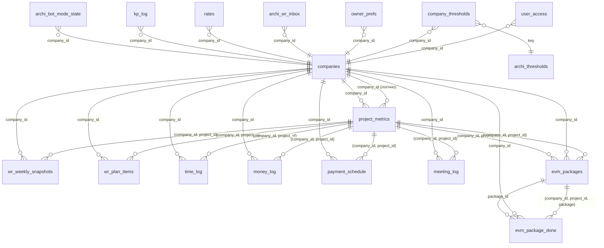

# ARCHI — схема бази даних (згенеровано)

Згенеровано `scripts/gen_db_schema.py` зі знімка `sql/schema/schema_dump_2026-11-12.json` (живий Supabase `bxawceksdkqlbkdgjvyz`, схема `public`). **Не редагувати вручну:** змінюється знімок → перегенерувати → закомітити разом.
Перевірка відповідності: `python3 scripts/gen_db_schema.py --check`. Оновлення знімка: `sql/schema/dump_query.sql`.
Охоплено 19 таблиць і 7 вʼю ARCHI. Чужі таблиці в тій самій базі (`_bak_*`, `jarvis_*`, `shift_*`, `bot_*`, `archi_bot_semantic_memory`) не входять.

## 1. Огляд

| Об'єкт | Тип | Рядків | RLS | Політик | Призначення | Клас даних |
|---|---|---|---|---|---|---|
| `companies` | таблиця | 1 | так | 0 | клієнти (тенанти); `DEMO` — демо-компанія | службові |
| `user_access` | таблиця | 1 | так | 0 | ролі користувачів Telegram у компанії; `operator` ⇔ `company_id IS NULL` | PII: Telegram id |
| `company_thresholds` | таблиця | 4 | так | 0 | перевизначення порогів методології по компанії | конфігурація |
| `archi_thresholds` | таблиця | 31 | так | 0 | пороги й план бюро за замовчуванням (31 ключ) | конфігурація |
| `owner_prefs` | таблиця | 1 | так | 0 | налаштування ранкового брифінгу власника | PII: Telegram id |
| `project_metrics` | таблиця | 18 | ні | 0 | один рядок на проєкт: план і розрахункові поля | фінансові, комерційна таємниця |
| `wr_weekly_snapshots` | таблиця | 101 | ні | 0 | знімок тижневого звіту ПМа | ділові тексти ПМа (можливі ПІБ) |
| `wr_plan_items` | таблиця | 467 | ні | 0 | пункти плану тижня зі статусами й перенесенням | ділові тексти ПМа |
| `archi_wr_inbox` | таблиця | 0 | так | 0 | черга повідомлень ПМа до «Відправити» | вільний текст, можливі ПІБ |
| `time_log` | таблиця | 476 | ні | 0 | відпрацьовані години (`confirmed` після «Фінал») | PII-lite: виконавець, години |
| `money_log` | таблиця | 152 | ні | 0 | акти, надходження, оплати субпідрядникам | фінансові |
| `payment_schedule` | таблиця | 56 | так | 0 | графік актів і документації | фінансові |
| `rates` | таблиця | 7 | ні | 0 | ставки по посадах (глобально, W3.6) | фінансові |
| `meeting_log` | таблиця | 11 | ні | 0 | журнал зустрічей і домовленостей | вільний текст |
| `kp_log` | таблиця | 11 | ні | 0 | облік комерційних пропозицій | комерційні |
| `archi_bot_mode_state` | таблиця | 1 | ні | 0 | режим діалогу бота й обраний проєкт; ключ — id чату | службові |
| `n8n_chat_histories` | таблиця | 122 | ні | 0 | пам'ять LLM-агентів звіту, імпорту, зустрічі | вільний текст, можливі ПІБ |
| `evm_packages` | таблиця | 100 | так | 0 | гілка «EVM (класичний)»: базовий план пакетів | фінансові |
| `evm_package_done` | таблиця | 0 | так | 0 | гілка «EVM (класичний)»: факт виконання пакетів | фінансові |
| `archi_report_today` | вʼю | — | — | — | вʼю: колонка «Сьогодні» звіту (ETC, рентабельність, ймовірності) | похідні |
| `archi_snapshot_history` | вʼю | — | — | — | вʼю: історія знімків із сигналами (H-01, H-02, E-*) | похідні |
| `archi_plan_execution` | вʼю | — | — | — | вʼю: виконання плану тижня (PX-01) | похідні |
| `archi_weekly_progress` | вʼю | — | — | — | вʼю: приріст готовності проти витрат (P-10) | похідні, фінансові |
| `evm_classic_today` | вʼю | — | — | — | вʼю: класичні показники на сьогодні | похідні |
| `project_metrics_live` | вʼю | — | — | — | застаріле вʼю: лінійна оцінка за годинами; **не використовувати** | похідні |
| `rates_coverage_check` | вʼю | — | — | — | діагностика: пари проєкт–виконавець без ставки | службові |

Рядків — оцінка `pg_stat_user_tables.n_live_tup` на дату знімка. Усі дані демо (`CLAUDE.md` п. 18).
n8n підключається прямим з'єднанням Postgres і **обходить RLS**; ізоляцію клієнтів тримає фільтр `company_id` у запитах (`docs/W1_DESIGN.md` §4).

## 2. Зв'язки (ER)

Зовнішні ключі (FK) у базі є **лише** на `companies`. Між рештою таблиць зв'язок логічний через `(company_id, project_id)` без FK; це відомий борг (W1.1: «FK для логів не додані»).

Позначка «логічно» — зв'язок без FK у БД. Кожна FK: `user_access` → `companies(company_id)`, `company_thresholds` → `companies(company_id)`, `company_thresholds` → `archi_thresholds(key)`, `owner_prefs` → `companies(company_id)`, `project_metrics` → `companies(company_id)`, `wr_weekly_snapshots` → `companies(company_id)`, `wr_plan_items` → `companies(company_id)`, `archi_wr_inbox` → `companies(company_id)`, `time_log` → `companies(company_id)`, `money_log` → `companies(company_id)`, `payment_schedule` → `companies(company_id)`, `rates` → `companies(company_id)`, `meeting_log` → `companies(company_id)`, `kp_log` → `companies(company_id)`, `archi_bot_mode_state` → `companies(company_id)`, `evm_packages` → `companies(company_id)`, `evm_packages` → `project_metrics(company_id, project_id)`, `evm_package_done` → `companies(company_id)`, `evm_package_done` → `evm_packages(id) ON DELETE RESTRICT`.

## 3. Клієнти, доступ, конфігурація

### `companies`

- Призначення: клієнти (тенанти); `DEMO` — демо-компанія.
- Хто пише: міграції, оператор.
- Хто читає: n8n (резолвер).
- Клас даних: службові.

| № | Колонка | Тип | NULL | За замовчуванням |
|---|---|---|---|---|
| 1 | `company_id` | uuid | **ні** | `gen_random_uuid()` |
| 2 | `code` | text | **ні** |  |
| 3 | `name` | text | **ні** |  |
| 4 | `kind` | text | **ні** |  |
| 5 | `created_at` | timestamp with time zone | **ні** | `now()` |

Обмеження:
- CHECK `companies_kind_check`: `CHECK ((kind = ANY (ARRAY['demo'::text, 'client'::text])))`
- PRIMARY KEY `companies_pkey`: `PRIMARY KEY (company_id)`
- UNIQUE `companies_code_key`: `UNIQUE (code)`

Індекси:
- `companies_code_key`: `CREATE UNIQUE INDEX companies_code_key ON public.companies USING btree (code)`
- `companies_pkey`: `CREATE UNIQUE INDEX companies_pkey ON public.companies USING btree (company_id)`

### `user_access`

- Призначення: ролі користувачів Telegram у компанії; `operator` ⇔ `company_id IS NULL`.
- Хто пише: оператор, міграції.
- Хто читає: n8n (резолвер на 4 входах).
- Клас даних: PII: Telegram id.

| № | Колонка | Тип | NULL | За замовчуванням |
|---|---|---|---|---|
| 1 | `id` | bigint | **ні** |  |
| 2 | `telegram_user_id` | bigint | **ні** |  |
| 3 | `company_id` | uuid | так |  |
| 4 | `role` | text | **ні** |  |
| 5 | `created_at` | timestamp with time zone | **ні** | `now()` |
| 6 | `created_by` | text | так |  |

Обмеження:
- CHECK `user_access_operator_global`: `CHECK (((role = 'operator'::text) = (company_id IS NULL)))`
- CHECK `user_access_role_check`: `CHECK ((role = ANY (ARRAY['owner'::text, 'pm'::text, 'gap'::text, 'executor'::text, 'operator'::text])))`
- FOREIGN KEY `user_access_company_id_fkey`: `FOREIGN KEY (company_id) REFERENCES companies(company_id)`
- PRIMARY KEY `user_access_pkey`: `PRIMARY KEY (id)`

Індекси:
- `user_access_pkey`: `CREATE UNIQUE INDEX user_access_pkey ON public.user_access USING btree (id)`
- `user_access_uq`: `CREATE UNIQUE INDEX user_access_uq ON public.user_access USING btree (telegram_user_id, COALESCE(company_id, '00000000-0000-0000-0000-000000000000'::uuid))`

### `company_thresholds`

- Призначення: перевизначення порогів методології по компанії.
- Хто пише: оператор.
- Хто читає: `archi_rules`, `archi_threshold`.
- Клас даних: конфігурація.

| № | Колонка | Тип | NULL | За замовчуванням |
|---|---|---|---|---|
| 1 | `company_id` | uuid | **ні** |  |
| 2 | `key` | text | **ні** |  |
| 3 | `value` | numeric | **ні** |  |
| 4 | `note` | text | так |  |
| 5 | `updated_at` | timestamp with time zone | **ні** | `now()` |

Обмеження:
- FOREIGN KEY `company_thresholds_company_id_fkey`: `FOREIGN KEY (company_id) REFERENCES companies(company_id)`
- FOREIGN KEY `company_thresholds_key_fkey`: `FOREIGN KEY (key) REFERENCES archi_thresholds(key)`
- PRIMARY KEY `company_thresholds_pkey`: `PRIMARY KEY (company_id, key)`

Індекси:
- `company_thresholds_pkey`: `CREATE UNIQUE INDEX company_thresholds_pkey ON public.company_thresholds USING btree (company_id, key)`

### `archi_thresholds`

- Призначення: пороги й план бюро за замовчуванням (31 ключ).
- Хто пише: міграції.
- Хто читає: `archi_rules`, `archi_threshold`.
- Клас даних: конфігурація.

| № | Колонка | Тип | NULL | За замовчуванням |
|---|---|---|---|---|
| 1 | `key` | text | **ні** |  |
| 2 | `value` | numeric | **ні** |  |
| 3 | `note` | text | так |  |

Обмеження:
- PRIMARY KEY `archi_thresholds_pkey`: `PRIMARY KEY (key)`

Індекси:
- `archi_thresholds_pkey`: `CREATE UNIQUE INDEX archi_thresholds_pkey ON public.archi_thresholds USING btree (key)`

### `owner_prefs`

- Призначення: налаштування ранкового брифінгу власника.
- Хто пише: оператор (вручну).
- Хто читає: workflow Morning Brief.
- Клас даних: PII: Telegram id.

| № | Колонка | Тип | NULL | За замовчуванням |
|---|---|---|---|---|
| 1 | `telegram_user_id` | bigint | **ні** |  |
| 2 | `company_id` | uuid | **ні** |  |
| 3 | `brief_time` | time without time zone | **ні** | `'08:30:00'::time without time zone` |
| 4 | `tz` | text | **ні** | `'Europe/Kyiv'::text` |
| 5 | `days` | int2[] | **ні** | `'{1,2,3,4,5}'::smallint[]` |
| 6 | `enabled` | boolean | **ні** | `false` |
| 7 | `last_sent_on` | date | так |  |
| 8 | `updated_at` | timestamp with time zone | **ні** | `now()` |

Обмеження:
- FOREIGN KEY `owner_prefs_company_id_fkey`: `FOREIGN KEY (company_id) REFERENCES companies(company_id)`
- PRIMARY KEY `owner_prefs_pkey`: `PRIMARY KEY (telegram_user_id, company_id)`

Індекси:
- `owner_prefs_pkey`: `CREATE UNIQUE INDEX owner_prefs_pkey ON public.owner_prefs USING btree (telegram_user_id, company_id)`

## 4. Проєкти й тижневий ритм

### `project_metrics`

- Призначення: один рядок на проєкт: план і розрахункові поля.
- Хто пише: план — Кошторис/міграції; розрахунок — лише `archi_recalc`.
- Хто читає: усі екрани, чат, брифінг.
- Клас даних: фінансові, комерційна таємниця.

| № | Колонка | Тип | NULL | За замовчуванням |
|---|---|---|---|---|
| 1 | `project_id` | text | **ні** |  |
| 2 | `contract_amount` | numeric | так |  |
| 3 | `profitability_plan_pct` | numeric | так |  |
| 4 | `profit_plan` | numeric | так |  |
| 5 | `cost_plan_team` | numeric | так |  |
| 6 | `cost_plan_subcontract` | numeric | так |  |
| 7 | `planned_hours` | numeric | так |  |
| 8 | `actual_hours` | numeric | так |  |
| 9 | `hours_remaining` | numeric | так |  |
| 10 | `percent_execution` | numeric | так |  |
| 11 | `earned_value_contract` | numeric | так |  |
| 12 | `actual_cost` | numeric | так |  |
| 13 | `efficiency_contract` | numeric | так |  |
| 14 | `money_received` | numeric | так |  |
| 15 | `earned_value` | numeric | так |  |
| 16 | `paid_volume` | numeric | так |  |
| 17 | `acts_amount` | numeric | так |  |
| 18 | `comparison` | numeric | так |  |
| 19 | `stage_data` | jsonb | так |  |
| 20 | `etc_forecast_total_hours` | numeric | так |  |
| 21 | `real_rate_team_hour` | numeric | так |  |
| 22 | `money_to_completion_team` | numeric | так |  |
| 23 | `cost_final_forecast` | numeric | так |  |
| 24 | `profit_forecast` | numeric | так |  |
| 25 | `profitability_forecast_pct` | numeric | так |  |
| 26 | `bac` | numeric | так |  |
| 27 | `ev_classic_evm` | numeric | так |  |
| 28 | `cpi_classic_evm` | numeric | так |  |
| 29 | `updated_at` | timestamp with time zone | **ні** | `now()` |
| 30 | `money_to_completion_subcontract` | numeric | так |  |
| 31 | `nearest_act_date` | date | так |  |
| 32 | `nearest_act_probability` | numeric | так |  |
| 33 | `nearest_doc_deadline` | date | так |  |
| 34 | `doc_issuance_probability` | numeric | так |  |
| 35 | `etc_plan_by_stage` | jsonb | так |  |
| 36 | `planned_hours_by_stage` | jsonb | так |  |
| 37 | `koshtorys_spreadsheet_id` | text | так |  |
| 38 | `koshtorys_sheet` | text | так |  |
| 39 | `baseline_at` | timestamp with time zone | так |  |
| 40 | `baseline_by` | bigint | так |  |
| 41 | `contract_file_url` | text | так |  |
| 42 | `forecast_confirmed_pct` | numeric | так |  |
| 43 | `forecast_confirmed_week` | date | так |  |
| 44 | `contract_type` | text | **ні** | `'stages'::text` |
| 45 | `parent_project_id` | text | так |  |
| 46 | `visits_plan` | integer | так |  |
| 47 | `visit_price` | numeric | так |  |
| 48 | `visit_hours` | numeric | так |  |
| 49 | `visits_done` | integer | так |  |
| 50 | `data_updated_at` | timestamp with time zone | так |  |
| 51 | `company_id` | uuid | **ні** |  |

Обмеження:
- FOREIGN KEY `project_metrics_company_id_fkey`: `FOREIGN KEY (company_id) REFERENCES companies(company_id)`
- PRIMARY KEY `project_metrics_pkey`: `PRIMARY KEY (company_id, project_id)`

Індекси:
- `project_metrics_pkey`: `CREATE UNIQUE INDEX project_metrics_pkey ON public.project_metrics USING btree (company_id, project_id)`

Тригери: `archi_recalc_plan` (AFTER INSERT), `archi_recalc_plan` (AFTER UPDATE).

### `wr_weekly_snapshots`

- Призначення: знімок тижневого звіту ПМа.
- Хто пише: потік «Фінал».
- Хто читає: Weekly Render, `archi_report_today`, `archi_snapshot_history`.
- Клас даних: ділові тексти ПМа (можливі ПІБ).

| № | Колонка | Тип | NULL | За замовчуванням |
|---|---|---|---|---|
| 1 | `id` | integer | **ні** | `nextval('wr_weekly_snapshots_id_seq'::regclass)` |
| 2 | `project_id` | text | **ні** |  |
| 3 | `week_start` | date | **ні** |  |
| 4 | `session_id` | text | так |  |
| 5 | `готовність_pct` | jsonb | так |  |
| 6 | `залишок_прогноз_год` | numeric | так |  |
| 7 | `ймовірність_акту` | numeric | так |  |
| 8 | `ймовірність_документації` | numeric | так |  |
| 9 | `plans_next_week` | text | так |  |
| 10 | `problems` | text | так |  |
| 11 | `help_needed` | text | так |  |
| 12 | `pm_comment` | text | так |  |
| 13 | `final_message` | text | так |  |
| 14 | `item_statuses` | jsonb | так |  |
| 15 | `created_at` | timestamp with time zone | **ні** | `now()` |
| 16 | `залишок_прогноз_по_стадіях` | jsonb | так |  |
| 17 | `дедлайн_прогноз_по_стадіях` | jsonb | так |  |
| 18 | `блокер` | jsonb | так |  |
| 19 | `розбіжність_готовності` | jsonb | так |  |
| 20 | `company_id` | uuid | **ні** |  |

Обмеження:
- FOREIGN KEY `wr_weekly_snapshots_company_id_fkey`: `FOREIGN KEY (company_id) REFERENCES companies(company_id)`
- PRIMARY KEY `wr_weekly_snapshots_pkey`: `PRIMARY KEY (id)`
- UNIQUE `wr_weekly_snapshots_company_project_week_key`: `UNIQUE (company_id, project_id, week_start)`

Індекси:
- `wr_weekly_snapshots_company_project_week_key`: `CREATE UNIQUE INDEX wr_weekly_snapshots_company_project_week_key ON public.wr_weekly_snapshots USING btree (company_id, project_id, week_start)`
- `wr_weekly_snapshots_pkey`: `CREATE UNIQUE INDEX wr_weekly_snapshots_pkey ON public.wr_weekly_snapshots USING btree (id)`

Тригери: `archi_recalc_wr` (AFTER DELETE), `archi_recalc_wr` (AFTER INSERT), `archi_recalc_wr` (AFTER UPDATE).

### `wr_plan_items`

- Призначення: пункти плану тижня зі статусами й перенесенням.
- Хто пише: потік звіту.
- Хто читає: `archi_plan_execution`.
- Клас даних: ділові тексти ПМа.

| № | Колонка | Тип | NULL | За замовчуванням |
|---|---|---|---|---|
| 1 | `id` | integer | **ні** | `nextval('wr_plan_items_id_seq'::regclass)` |
| 2 | `project_id` | text | **ні** |  |
| 3 | `week_start` | date | **ні** |  |
| 4 | `item_number` | integer | **ні** |  |
| 5 | `item_text` | text | **ні** |  |
| 6 | `status` | text | **ні** | `'pending'::text` |
| 7 | `created_at` | timestamp with time zone | **ні** | `now()` |
| 8 | `origin_week` | date | так |  |
| 9 | `carry_count` | integer | **ні** | `0` |
| 10 | `company_id` | uuid | **ні** |  |

Обмеження:
- FOREIGN KEY `wr_plan_items_company_id_fkey`: `FOREIGN KEY (company_id) REFERENCES companies(company_id)`
- PRIMARY KEY `wr_plan_items_pkey`: `PRIMARY KEY (id)`
- UNIQUE `wr_plan_items_company_project_week_item_key`: `UNIQUE (company_id, project_id, week_start, item_number)`

Індекси:
- `idx_wr_plan_items_proj_week`: `CREATE INDEX idx_wr_plan_items_proj_week ON public.wr_plan_items USING btree (project_id, week_start)`
- `wr_plan_items_company_project_week_item_key`: `CREATE UNIQUE INDEX wr_plan_items_company_project_week_item_key ON public.wr_plan_items USING btree (company_id, project_id, week_start, item_number)`
- `wr_plan_items_pkey`: `CREATE UNIQUE INDEX wr_plan_items_pkey ON public.wr_plan_items USING btree (id)`

### `archi_wr_inbox`

- Призначення: черга повідомлень ПМа до «Відправити».
- Хто пише: `WR: Inbox Add`.
- Хто читає: `WR: Fetch Inbox`, `WR: Inbox Consume`.
- Клас даних: вільний текст, можливі ПІБ.

| № | Колонка | Тип | NULL | За замовчуванням |
|---|---|---|---|---|
| 1 | `id` | bigint | **ні** | `nextval('archi_wr_inbox_id_seq'::regclass)` |
| 2 | `session_id` | text | **ні** |  |
| 3 | `project_id` | text | **ні** |  |
| 4 | `source_type` | text | **ні** | `'text'::text` |
| 5 | `content` | text | **ні** |  |
| 6 | `created_at` | timestamp with time zone | **ні** | `now()` |
| 7 | `company_id` | uuid | **ні** |  |

Обмеження:
- FOREIGN KEY `archi_wr_inbox_company_id_fkey`: `FOREIGN KEY (company_id) REFERENCES companies(company_id)`
- PRIMARY KEY `archi_wr_inbox_pkey`: `PRIMARY KEY (id)`

Індекси:
- `archi_wr_inbox_pkey`: `CREATE UNIQUE INDEX archi_wr_inbox_pkey ON public.archi_wr_inbox USING btree (id)`
- `archi_wr_inbox_sess_proj`: `CREATE INDEX archi_wr_inbox_sess_proj ON public.archi_wr_inbox USING btree (session_id, project_id, id)`
- `idx_archi_wr_inbox_company_sess`: `CREATE INDEX idx_archi_wr_inbox_company_sess ON public.archi_wr_inbox USING btree (company_id, session_id, project_id, id)`

## 5. Факт: години, гроші, графік

### `time_log`

- Призначення: відпрацьовані години (`confirmed` після «Фінал»).
- Хто пише: імпорт ботом.
- Хто читає: `archi_recalc`, P-10.
- Клас даних: PII-lite: виконавець, години.

| № | Колонка | Тип | NULL | За замовчуванням |
|---|---|---|---|---|
| 1 | `id` | bigint | **ні** |  |
| 2 | `project_id` | text | **ні** |  |
| 3 | `дата` | date | **ні** |  |
| 4 | `стадія` | text | так |  |
| 5 | `виконавець` | text | так |  |
| 6 | `завдання_розділ` | text | так |  |
| 7 | `години` | numeric | так |  |
| 8 | `статус` | text | так | `'logged'::text` |
| 9 | `source` | text | так |  |
| 10 | `raw_payload` | jsonb | так |  |
| 11 | `created_at` | timestamp with time zone | так | `now()` |
| 12 | `company_id` | uuid | **ні** |  |

Обмеження:
- FOREIGN KEY `time_log_company_id_fkey`: `FOREIGN KEY (company_id) REFERENCES companies(company_id)`
- PRIMARY KEY `time_log_pkey`: `PRIMARY KEY (id)`

Індекси:
- `idx_time_log_company_project`: `CREATE INDEX idx_time_log_company_project ON public.time_log USING btree (company_id, project_id)`
- `idx_time_log_date`: `CREATE INDEX idx_time_log_date ON public.time_log USING btree ("дата")`
- `idx_time_log_project`: `CREATE INDEX idx_time_log_project ON public.time_log USING btree (project_id)`
- `time_log_pkey`: `CREATE UNIQUE INDEX time_log_pkey ON public.time_log USING btree (id)`

Тригери: `archi_recalc_time` (AFTER DELETE), `archi_recalc_time` (AFTER INSERT), `archi_recalc_time` (AFTER UPDATE).

### `money_log`

- Призначення: акти, надходження, оплати субпідрядникам.
- Хто пише: імпорт ботом (лише ПМ).
- Хто читає: `archi_recalc`.
- Клас даних: фінансові.

| № | Колонка | Тип | NULL | За замовчуванням |
|---|---|---|---|---|
| 1 | `id` | bigint | **ні** |  |
| 2 | `project_id` | text | **ні** |  |
| 3 | `дата` | date | **ні** |  |
| 4 | `стадія` | text | так |  |
| 5 | `контрагент` | text | так |  |
| 6 | `сума` | numeric | так |  |
| 7 | `тип` | text | так |  |
| 8 | `статус` | text | так | `'logged'::text` |
| 9 | `source` | text | так |  |
| 10 | `raw_payload` | jsonb | так |  |
| 11 | `created_at` | timestamp with time zone | так | `now()` |
| 12 | `company_id` | uuid | **ні** |  |

Обмеження:
- FOREIGN KEY `money_log_company_id_fkey`: `FOREIGN KEY (company_id) REFERENCES companies(company_id)`
- PRIMARY KEY `money_log_pkey`: `PRIMARY KEY (id)`

Індекси:
- `idx_money_log_company_project`: `CREATE INDEX idx_money_log_company_project ON public.money_log USING btree (company_id, project_id)`
- `idx_money_log_date`: `CREATE INDEX idx_money_log_date ON public.money_log USING btree ("дата")`
- `idx_money_log_project`: `CREATE INDEX idx_money_log_project ON public.money_log USING btree (project_id)`
- `money_log_pkey`: `CREATE UNIQUE INDEX money_log_pkey ON public.money_log USING btree (id)`

Тригери: `archi_recalc_money` (AFTER DELETE), `archi_recalc_money` (AFTER INSERT), `archi_recalc_money` (AFTER UPDATE).

### `payment_schedule`

- Призначення: графік актів і документації.
- Хто пише: Кошторис, міграції.
- Хто читає: `archi_recalc`, брифінг.
- Клас даних: фінансові.

| № | Колонка | Тип | NULL | За замовчуванням |
|---|---|---|---|---|
| 1 | `id` | bigint | **ні** | `nextval('payment_schedule_id_seq'::regclass)` |
| 2 | `project_id` | text | **ні** |  |
| 3 | `стадія` | text | так |  |
| 4 | `подія` | text | **ні** |  |
| 5 | `дата_план` | date | **ні** |  |
| 6 | `сума_план` | numeric | так |  |
| 7 | `ймовірність_план` | integer | так |  |
| 8 | `статус_план` | text | так |  |
| 9 | `baseline_at` | timestamp with time zone | **ні** | `now()` |
| 10 | `company_id` | uuid | **ні** |  |

Обмеження:
- CHECK `payment_schedule_check`: `CHECK ((("подія" <> 'акт'::text) OR ("стадія" IS NOT NULL)))`
- CHECK `payment_schedule_ймовірність_план_check`: `CHECK ((("ймовірність_план" IS NULL) OR (("ймовірність_план" >= 1) AND ("ймовірність_план" <= 10))))`
- CHECK `payment_schedule_подія_check`: `CHECK (("подія" = ANY (ARRAY['акт'::text, 'документація'::text])))`
- CHECK `payment_schedule_стадія_check`: `CHECK ((("стадія" IS NULL) OR ("стадія" = ANY (ARRAY['МБР'::text, 'ЕП'::text, 'П'::text, 'Р'::text, 'АН'::text]))))`
- FOREIGN KEY `payment_schedule_company_id_fkey`: `FOREIGN KEY (company_id) REFERENCES companies(company_id)`
- PRIMARY KEY `payment_schedule_pkey`: `PRIMARY KEY (id)`

Індекси:
- `idx_payment_schedule_company_project`: `CREATE INDEX idx_payment_schedule_company_project ON public.payment_schedule USING btree (company_id, project_id)`
- `ix_payment_schedule_proj`: `CREATE INDEX ix_payment_schedule_proj ON public.payment_schedule USING btree (project_id, "подія", "дата_план")`
- `payment_schedule_pkey`: `CREATE UNIQUE INDEX payment_schedule_pkey ON public.payment_schedule USING btree (id)`

Тригери: `archi_recalc_schedule` (AFTER DELETE), `archi_recalc_schedule` (AFTER INSERT), `archi_recalc_schedule` (AFTER UPDATE).

### `rates`

- Призначення: ставки по посадах (глобально, W3.6).
- Хто пише: вручну.
- Хто читає: F-02, P-10.
- Клас даних: фінансові.

| № | Колонка | Тип | NULL | За замовчуванням |
|---|---|---|---|---|
| 1 | `posada` | text | **ні** |  |
| 2 | `stavka_grn_god` | numeric | **ні** |  |
| 3 | `nakladni_grn_god` | numeric | **ні** |  |
| 4 | `razom_grn_god` | numeric | так |  |
| 5 | `company_id` | uuid | **ні** |  |

Обмеження:
- FOREIGN KEY `rates_company_id_fkey`: `FOREIGN KEY (company_id) REFERENCES companies(company_id)`
- PRIMARY KEY `rates_pkey`: `PRIMARY KEY (company_id, posada)`

Індекси:
- `rates_pkey`: `CREATE UNIQUE INDEX rates_pkey ON public.rates USING btree (company_id, posada)`

## 6. Журнали й стан бота

### `meeting_log`

- Призначення: журнал зустрічей і домовленостей.
- Хто пише: бот (режим «Зустріч»).
- Хто читає: чат (Q10), брифінг.
- Клас даних: вільний текст.

| № | Колонка | Тип | NULL | За замовчуванням |
|---|---|---|---|---|
| 1 | `id` | bigint | **ні** |  |
| 2 | `project_id` | text | **ні** |  |
| 3 | `дата` | date | **ні** |  |
| 4 | `учасники` | text | так |  |
| 5 | `рішення_дія` | text | так |  |
| 6 | `відповідальний` | text | так |  |
| 7 | `дедлайн` | date | так |  |
| 8 | `source` | text | так |  |
| 9 | `raw_payload` | jsonb | так |  |
| 10 | `created_at` | timestamp with time zone | так | `now()` |
| 11 | `company_id` | uuid | **ні** |  |

Обмеження:
- FOREIGN KEY `meeting_log_company_id_fkey`: `FOREIGN KEY (company_id) REFERENCES companies(company_id)`
- PRIMARY KEY `meeting_log_pkey`: `PRIMARY KEY (id)`

Індекси:
- `idx_meeting_log_company_project`: `CREATE INDEX idx_meeting_log_company_project ON public.meeting_log USING btree (company_id, project_id)`
- `idx_meeting_log_date`: `CREATE INDEX idx_meeting_log_date ON public.meeting_log USING btree ("дата")`
- `idx_meeting_log_project`: `CREATE INDEX idx_meeting_log_project ON public.meeting_log USING btree (project_id)`
- `meeting_log_pkey`: `CREATE UNIQUE INDEX meeting_log_pkey ON public.meeting_log USING btree (id)`

### `kp_log`

- Призначення: облік комерційних пропозицій.
- Хто пише: бот `КП: N`.
- Хто читає: Owner View.
- Клас даних: комерційні.

| № | Колонка | Тип | NULL | За замовчуванням |
|---|---|---|---|---|
| 1 | `id` | bigint | **ні** | `nextval('kp_log_id_seq'::regclass)` |
| 2 | `logged_at` | timestamp with time zone | **ні** | `now()` |
| 3 | `count` | integer | **ні** |  |
| 4 | `telegram_user_id` | bigint | так |  |
| 5 | `company_id` | uuid | **ні** |  |

Обмеження:
- FOREIGN KEY `kp_log_company_id_fkey`: `FOREIGN KEY (company_id) REFERENCES companies(company_id)`
- PRIMARY KEY `kp_log_pkey`: `PRIMARY KEY (id)`

Індекси:
- `kp_log_pkey`: `CREATE UNIQUE INDEX kp_log_pkey ON public.kp_log USING btree (id)`

### `archi_bot_mode_state`

- Призначення: режим діалогу бота й обраний проєкт; ключ — id чату.
- Хто пише: n8n.
- Хто читає: n8n.
- Клас даних: службові.

| № | Колонка | Тип | NULL | За замовчуванням |
|---|---|---|---|---|
| 1 | `session_id` | text | **ні** |  |
| 2 | `mode` | text | **ні** | `'idle'::text` |
| 3 | `updated_at` | timestamp with time zone | **ні** | `now()` |
| 4 | `project_id` | text | так |  |
| 5 | `context` | jsonb | так |  |
| 6 | `company_id` | uuid | так |  |

Обмеження:
- FOREIGN KEY `archi_bot_mode_state_company_id_fkey`: `FOREIGN KEY (company_id) REFERENCES companies(company_id)`
- PRIMARY KEY `archi_bot_mode_state_pkey`: `PRIMARY KEY (session_id)`

Індекси:
- `archi_bot_mode_state_pkey`: `CREATE UNIQUE INDEX archi_bot_mode_state_pkey ON public.archi_bot_mode_state USING btree (session_id)`

### `n8n_chat_histories`

- Призначення: пам'ять LLM-агентів звіту, імпорту, зустрічі.
- Хто пише: n8n (LangChain).
- Хто читає: n8n.
- Клас даних: вільний текст, можливі ПІБ.

| № | Колонка | Тип | NULL | За замовчуванням |
|---|---|---|---|---|
| 1 | `id` | integer | **ні** | `nextval('n8n_chat_histories_id_seq'::regclass)` |
| 2 | `session_id` | character varying(255) | **ні** |  |
| 3 | `message` | jsonb | **ні** |  |

Обмеження:
- PRIMARY KEY `n8n_chat_histories_pkey`: `PRIMARY KEY (id)`

Індекси:
- `n8n_chat_histories_pkey`: `CREATE UNIQUE INDEX n8n_chat_histories_pkey ON public.n8n_chat_histories USING btree (id)`

## 7. EVM (класичний)

### `evm_packages`

- Призначення: гілка «EVM (класичний)»: базовий план пакетів.
- Хто пише: міграції.
- Хто читає: `evm_classic_*`.
- Клас даних: фінансові.

| № | Колонка | Тип | NULL | За замовчуванням |
|---|---|---|---|---|
| 1 | `id` | bigint | **ні** |  |
| 2 | `project_id` | text | **ні** |  |
| 3 | `baseline_no` | integer | **ні** | `1` |
| 4 | `stage` | text | **ні** |  |
| 5 | `package_code` | text | **ні** |  |
| 6 | `title` | text | **ні** |  |
| 7 | `budget_uah` | numeric | **ні** |  |
| 8 | `budget_src` | text | так |  |
| 9 | `rule` | text | **ні** | `'0/100'::text` |
| 10 | `planned_start` | date | так |  |
| 11 | `planned_finish` | date | **ні** |  |
| 12 | `source` | text | **ні** |  |
| 13 | `created_at` | timestamp with time zone | **ні** | `now()` |
| 14 | `created_by` | text | так |  |
| 15 | `company_id` | uuid | **ні** |  |

Обмеження:
- CHECK `evm_packages_baseline_no_check`: `CHECK ((baseline_no >= 1))`
- CHECK `evm_packages_budget_uah_check`: `CHECK ((budget_uah > (0)::numeric))`
- CHECK `evm_packages_rule_check`: `CHECK ((rule = '0/100'::text))`
- CHECK `evm_packages_source_check`: `CHECK ((source = ANY (ARRAY['koshtorys'::text, 'demo'::text])))`
- CHECK `evm_packages_stage_check`: `CHECK ((stage = ANY (ARRAY['МБР'::text, 'ЕП'::text, 'П'::text, 'Р'::text])))`
- CHECK `evm_packages_start_le_finish`: `CHECK (((planned_start IS NULL) OR (planned_start <= planned_finish)))`
- FOREIGN KEY `evm_packages_company_id_fkey`: `FOREIGN KEY (company_id) REFERENCES companies(company_id)`
- FOREIGN KEY `evm_packages_project_fkey`: `FOREIGN KEY (company_id, project_id) REFERENCES project_metrics(company_id, project_id)`
- PRIMARY KEY `evm_packages_pkey`: `PRIMARY KEY (id)`
- UNIQUE `evm_packages_uq`: `UNIQUE (company_id, project_id, baseline_no, package_code)`

Індекси:
- `evm_packages_pkey`: `CREATE UNIQUE INDEX evm_packages_pkey ON public.evm_packages USING btree (id)`
- `evm_packages_uq`: `CREATE UNIQUE INDEX evm_packages_uq ON public.evm_packages USING btree (company_id, project_id, baseline_no, package_code)`

### `evm_package_done`

- Призначення: гілка «EVM (класичний)»: факт виконання пакетів.
- Хто пише: бот «Видано» (⬜).
- Хто читає: `evm_classic_*`.
- Клас даних: фінансові.

| № | Колонка | Тип | NULL | За замовчуванням |
|---|---|---|---|---|
| 1 | `id` | bigint | **ні** |  |
| 2 | `package_id` | bigint | **ні** |  |
| 3 | `event` | text | **ні** |  |
| 4 | `event_date` | date | **ні** |  |
| 5 | `confirmed_by` | text | так |  |
| 6 | `evidence` | text | так |  |
| 7 | `source` | text | **ні** |  |
| 8 | `created_at` | timestamp with time zone | **ні** | `now()` |
| 9 | `company_id` | uuid | **ні** |  |

Обмеження:
- CHECK `evm_package_done_event_check`: `CHECK ((event = ANY (ARRAY['started'::text, 'done'::text, 'cancelled'::text])))`
- CHECK `evm_package_done_source_check`: `CHECK ((source = ANY (ARRAY['bot'::text, 'koshtorys'::text, 'demo'::text])))`
- FOREIGN KEY `evm_package_done_company_id_fkey`: `FOREIGN KEY (company_id) REFERENCES companies(company_id)`
- FOREIGN KEY `evm_package_done_package_id_fkey`: `FOREIGN KEY (package_id) REFERENCES evm_packages(id) ON DELETE RESTRICT`
- PRIMARY KEY `evm_package_done_pkey`: `PRIMARY KEY (id)`

Індекси:
- `evm_package_done_pkey`: `CREATE UNIQUE INDEX evm_package_done_pkey ON public.evm_package_done USING btree (id)`
- `evm_package_done_pkg_idx`: `CREATE INDEX evm_package_done_pkg_idx ON public.evm_package_done USING btree (package_id)`

## 8. Вʼю

### `archi_report_today`

- Призначення: вʼю: колонка «Сьогодні» звіту (ETC, рентабельність, ймовірності).
- Хто пише: —.
- Хто читає: Weekly Render, чат ПМа.
- Клас даних: похідні.

| № | Колонка | Тип | NULL | За замовчуванням |
|---|---|---|---|---|
| 1 | `project_id` | text | так |  |
| 2 | `data_updated_at` | timestamp with time zone | так |  |
| 3 | `rent_plan_pct` | numeric | так |  |
| 4 | `rent_forecast_pct` | numeric | так |  |
| 5 | `planned_hours` | numeric | так |  |
| 6 | `actual_hours` | numeric | так |  |
| 7 | `etc_plan_hours` | numeric | так |  |
| 8 | `etc_fact_hours` | numeric | так |  |
| 9 | `etc_forecast_hours` | numeric | так |  |
| 10 | `eac_hours_pct` | numeric | так |  |
| 11 | `cpi` | numeric | так |  |
| 12 | `act_date` | date | так |  |
| 13 | `act_prob` | numeric | так |  |
| 14 | `doc_date` | date | так |  |
| 15 | `doc_prob` | numeric | так |  |
| 16 | `etc_gap_hours` | numeric | так |  |
| 17 | `etc_gap_signal` | text | так |  |
| 18 | `spent_pct` | numeric | так |  |
| 19 | `ready_pm_pct` | numeric | так |  |
| 20 | `ready_fc_pct` | numeric | так |  |
| 21 | `ready_gap_pp` | numeric | так |  |
| 22 | `ready_gap_signal` | text | так |  |
| 23 | `eff_hours_idx` | numeric | так |  |
| 24 | `eff_signal` | text | так |  |
| 25 | `acts_to_ev` | numeric | так |  |
| 26 | `paid_to_acts` | numeric | так |  |
| 27 | `acts_to_ev_signal` | text | так |  |
| 28 | `paid_to_acts_signal` | text | так |  |
| 29 | `exec_idx` | numeric | так |  |
| 30 | `exec_signal` | text | так |  |
| 31 | `acts_due` | integer | так |  |
| 32 | `acts_done` | integer | так |  |
| 33 | `acts_plan_idx` | numeric | так |  |
| 34 | `acts_plan_signal` | text | так |  |
| 35 | `etc_gap_pct_bac` | numeric | так |  |
| 36 | `stage_etc_signal` | jsonb | так |  |
| 37 | `company_id` | uuid | так |  |

### `archi_snapshot_history`

- Призначення: вʼю: історія знімків із сигналами (H-01, H-02, E-*).
- Хто пише: —.
- Хто читає: Weekly Render.
- Клас даних: похідні.

| № | Колонка | Тип | NULL | За замовчуванням |
|---|---|---|---|---|
| 1 | `project_id` | text | так |  |
| 2 | `week_start` | date | так |  |
| 3 | `rent_plan_pct` | numeric | так |  |
| 4 | `rent_forecast_pct` | numeric | так |  |
| 5 | `eac_hours_pct` | numeric | так |  |
| 6 | `cpi` | numeric | так |  |
| 7 | `etc_plan_hours` | numeric | так |  |
| 8 | `etc_fact_hours` | numeric | так |  |
| 9 | `etc_forecast_hours` | numeric | так |  |
| 10 | `etc_gap_hours` | numeric | так |  |
| 11 | `etc_gap_signal` | text | так |  |
| 12 | `spent_pct` | numeric | так |  |
| 13 | `ready_pm_pct` | numeric | так |  |
| 14 | `ready_fc_pct` | numeric | так |  |
| 15 | `ready_gap_pp` | numeric | так |  |
| 16 | `ready_gap_signal` | text | так |  |
| 17 | `eff_hours_idx` | numeric | так |  |
| 18 | `eff_signal` | text | так |  |
| 19 | `acts_to_ev` | numeric | так |  |
| 20 | `paid_to_acts` | numeric | так |  |
| 21 | `acts_to_ev_signal` | text | так |  |
| 22 | `paid_to_acts_signal` | text | так |  |
| 23 | `exec_idx` | numeric | так |  |
| 24 | `exec_signal` | text | так |  |
| 25 | `acts_due` | integer | так |  |
| 26 | `acts_done` | integer | так |  |
| 27 | `acts_plan_idx` | numeric | так |  |
| 28 | `acts_plan_signal` | text | так |  |
| 29 | `company_id` | uuid | так |  |

### `archi_plan_execution`

- Призначення: вʼю: виконання плану тижня (PX-01).
- Хто пише: —.
- Хто читає: Weekly Render.
- Клас даних: похідні.

| № | Колонка | Тип | NULL | За замовчуванням |
|---|---|---|---|---|
| 1 | `project_id` | text | так |  |
| 2 | `week_start` | date | так |  |
| 3 | `total` | integer | так |  |
| 4 | `done` | integer | так |  |
| 5 | `not_done` | integer | так |  |
| 6 | `no_answer` | integer | так |  |
| 7 | `pending` | integer | так |  |
| 8 | `max_carry` | integer | так |  |
| 9 | `exec_pct` | numeric | так |  |
| 10 | `signal` | text | так |  |
| 11 | `company_id` | uuid | так |  |

### `archi_weekly_progress`

- Призначення: вʼю: приріст готовності проти витрат (P-10).
- Хто пише: —.
- Хто читає: Owner View.
- Клас даних: похідні, фінансові.

| № | Колонка | Тип | NULL | За замовчуванням |
|---|---|---|---|---|
| 1 | `project_id` | text | так |  |
| 2 | `week_start` | date | так |  |
| 3 | `prev_week` | date | так |  |
| 4 | `ready_prev_pct` | numeric | так |  |
| 5 | `ready_pct` | numeric | так |  |
| 6 | `d_ready_pp` | numeric | так |  |
| 7 | `hours` | numeric | так |  |
| 8 | `cost_uah` | numeric | так |  |
| 9 | `contract_amount` | numeric | так |  |
| 10 | `value_uah` | numeric | так |  |
| 11 | `result_uah` | numeric | так |  |
| 12 | `idx` | numeric | так |  |
| 13 | `signal` | text | так |  |
| 14 | `budget_uah` | numeric | так |  |
| 15 | `customer_money_uah` | numeric | так |  |
| 16 | `owner_money_uah` | numeric | так |  |
| 17 | `company_id` | uuid | так |  |

### `evm_classic_today`

- Призначення: вʼю: класичні показники на сьогодні.
- Хто пише: —.
- Хто читає: (екрана ще немає).
- Клас даних: похідні.

| № | Колонка | Тип | NULL | За замовчуванням |
|---|---|---|---|---|
| 1 | `project_id` | text | так |  |
| 2 | `as_of` | date | так |  |
| 3 | `has_baseline` | boolean | так |  |
| 4 | `baseline_no` | integer | так |  |
| 5 | `packages` | integer | так |  |
| 6 | `bac` | numeric | так |  |
| 7 | `pv` | numeric | так |  |
| 8 | `ev` | numeric | так |  |
| 9 | `ac` | numeric | так |  |
| 10 | `cv` | numeric | так |  |
| 11 | `sv` | numeric | так |  |
| 12 | `cpi` | numeric | так |  |
| 13 | `spi` | numeric | так |  |
| 14 | `eac` | numeric | так |  |
| 15 | `etc` | numeric | так |  |
| 16 | `vac` | numeric | так |  |
| 17 | `tcpi` | numeric | так |  |
| 18 | `company_id` | uuid | так |  |

### `project_metrics_live`

- Призначення: застаріле вʼю: лінійна оцінка за годинами; **не використовувати**.
- Хто пише: —.
- Хто читає: ніхто.
- Клас даних: похідні.

| № | Колонка | Тип | NULL | За замовчуванням |
|---|---|---|---|---|
| 1 | `project_id` | text | так |  |
| 2 | `contract_amount` | numeric | так |  |
| 3 | `planned_hours` | numeric | так |  |
| 4 | `actual_hours` | numeric | так |  |
| 5 | `percent_execution` | numeric | так |  |
| 6 | `earned_value_contract` | numeric | так |  |
| 7 | `actual_cost` | numeric | так |  |
| 8 | `efficiency_contract` | numeric | так |  |
| 9 | `comparison` | numeric | так |  |
| 10 | `company_id` | uuid | так |  |

### `rates_coverage_check`

- Призначення: діагностика: пари проєкт–виконавець без ставки.
- Хто пише: —.
- Хто читає: ручна перевірка.
- Клас даних: службові.

| № | Колонка | Тип | NULL | За замовчуванням |
|---|---|---|---|---|
| 1 | `project_id` | text | так |  |
| 2 | `posada_bez_stavky` | text | так |  |
| 3 | `company_id` | uuid | так |  |

## 9. Функції SQL (`archi_*`, `evm_*`)

| Функція | Аргументи | Повертає | SECURITY DEFINER |
|---|---|---|---|
| `archi_acts_plan` | `p_company uuid, p_project text, p_asof date` | `TABLE(acts_due integer, acts_done integer, acts_plan_idx numeric)` | ні |
| `archi_acts_plan` | `p_project text, p_asof date` | `TABLE(acts_due integer, acts_done integer, acts_plan_idx numeric)` | ні |
| `archi_etc_gap_signal` | `p_company uuid, p_fact numeric, p_forecast numeric` | `text` | ні |
| `archi_etc_gap_signal` | `p_fact numeric, p_forecast numeric` | `text` | ні |
| `archi_flow_idx_signal` | `p numeric` | `text` | ні |
| `archi_flow_idx_signal` | `p_company uuid, p numeric` | `text` | ні |
| `archi_idx_signal` | `p numeric` | `text` | ні |
| `archi_idx_signal` | `p_company uuid, p numeric` | `text` | ні |
| `archi_morning_brief` | `p_company uuid, p_asof date DEFAULT ((now() AT TIME ZONE 'Europe/Kyiv'::text))::date` | `jsonb` | ні |
| `archi_paid_idx_signal` | `p numeric` | `text` | ні |
| `archi_paid_idx_signal` | `p_company uuid, p numeric` | `text` | ні |
| `archi_project_signals` | `p_company uuid, p_asof date DEFAULT ((now() AT TIME ZONE 'Europe/Kyiv'::text))::date` | `jsonb` | ні |
| `archi_ready_gap_signal` | `p_company uuid, p_pp numeric` | `text` | ні |
| `archi_ready_gap_signal` | `p_pp numeric` | `text` | ні |
| `archi_recalc` | `p_company uuid, p_project text` | `integer` | ні |
| `archi_recalc` | `p_project text DEFAULT NULL::text` | `integer` | ні |
| `archi_recalc_stages` | `p_company uuid, p_project text` | `integer` | ні |
| `archi_recalc_stages` | `p_project text DEFAULT NULL::text` | `integer` | ні |
| `archi_recalc_trg` | `—` | `trigger` | ні |
| `archi_recalc_visit` | `p_company uuid, p_project text` | `integer` | ні |
| `archi_recalc_visit` | `p_project text DEFAULT NULL::text` | `integer` | ні |
| `archi_rules` | `p_company uuid` | `json` | ні |
| `archi_snapshot_evm` | `p_company uuid, p_project text, p_week date, p_rd jsonb, p_et jsonb` | `TABLE(spent_pct numeric, ready_pm_pct numeric, ready_fc_pct numeric, ready_gap_pp numeric, ready_gap_signal text, eff_hours_idx numeric, eff_signal text, acts_to_ev numeric, paid_to_acts numeric)` | ні |
| `archi_snapshot_evm` | `p_project text, p_week date, p_rd jsonb, p_et jsonb` | `TABLE(spent_pct numeric, ready_pm_pct numeric, ready_fc_pct numeric, ready_gap_pp numeric, ready_gap_signal text, eff_hours_idx numeric, eff_signal text, acts_to_ev numeric, paid_to_acts numeric)` | ні |
| `archi_snapshot_metrics` | `p_company uuid, p_project text, p_week date, p_rd jsonb, p_et jsonb` | `TABLE(rent_plan_pct numeric, rent_forecast_pct numeric, eac_hours_pct numeric, cpi numeric, etc_plan_hours numeric, etc_fact_hours numeric, etc_forecast_hours numeric, etc_gap_hours numeric, etc_gap_signal text)` | ні |
| `archi_snapshot_metrics` | `p_project text, p_week date, p_rd jsonb, p_et jsonb` | `TABLE(rent_plan_pct numeric, rent_forecast_pct numeric, eac_hours_pct numeric, cpi numeric, etc_plan_hours numeric, etc_fact_hours numeric, etc_forecast_hours numeric, etc_gap_hours numeric, etc_gap_signal text)` | ні |
| `archi_threshold` | `p_company uuid, p_key text` | `numeric` | ні |
| `archi_threshold_req` | `p_company uuid, p_key text` | `numeric` | ні |
| `archi_vac_signal` | `p_company uuid, p_gap numeric, p_bac numeric` | `text` | ні |
| `archi_vac_signal` | `p_gap numeric, p_bac numeric` | `text` | ні |
| `evm_classic_at` | `p_company uuid, p_project text, p_t date` | `TABLE(company_id uuid, project_id text, as_of date, has_baseline boolean, baseline_no integer, packages integer, bac numeric, pv numeric, ev numeric, ac numeric, cv numeric, sv numeric, cpi numeric, spi numeric, eac numeric, etc numeric, vac numeric, tcpi numeric)` | ні |
| `evm_classic_at` | `p_project text, p_t date` | `TABLE(project_id text, as_of date, has_baseline boolean, baseline_no integer, packages integer, bac numeric, pv numeric, ev numeric, ac numeric, cv numeric, sv numeric, cpi numeric, spi numeric, eac numeric, etc numeric, vac numeric, tcpi numeric)` | ні |
| `evm_classic_indices` | `p_bac numeric, p_pv numeric, p_ev numeric, p_ac numeric` | `TABLE(cv numeric, sv numeric, cpi numeric, spi numeric, eac numeric, etc numeric, vac numeric, tcpi numeric)` | ні |

Формули й пороги, які реалізують функції, — `docs/FORMULAS.md`. Перевантаження `p_company` читають пороги по компанії (W1.5).

## 10. Політики зберігання й дані особисті

- Політики зберігання й видалення **не визначені** (OD-20, W10.8, W11.5). Нічого не архівується й не видаляється автоматично.
- Дані з потенційно особистим змістом: `user_access` (Telegram id), `owner_prefs`, `time_log` (ПІБ або посада виконавця), `wr_*`, `meeting_log`, `archi_wr_inbox`, `n8n_chat_histories` (вільний текст).
- Юридична перевірка — до першого клієнта (OD-20); юридичних висновків цей документ не дає.

## 11. Відомі відхилення схеми від бажаного

| № | Факт зі знімка | Наслідок | Вузол карти |
|---|---|---|---|
| 1 | FK є лише на `companies` | немає цілісності між `project_metrics` і логами | W1.1 |
| 2 | `company_id` допускає NULL: `archi_bot_mode_state`, `user_access` | `user_access`: так задумано (оператор); `archi_bot_mode_state`: колізія станів бота для оператора з кількома клієнтами | W1.6 |
| 3 | таблиці без `company_id`: `archi_thresholds`, `n8n_chat_histories` | немає прив'язки до клієнта: `archi_thresholds` — значення за замовчуванням (перевизначення в `company_thresholds`); `n8n_chat_histories` — пам'ять LLM, ізоляція лише через `session_id` | W1.6, W3.6, DR-13 |
| 4 | RLS увімкнено, але політик немає на частині таблиць | публічний ключ нічого не читає, n8n (роль postgres) читає все | OD-4 |
| 5 | `wr_plan_items_legacy` відсутня | дизайн D2 не виконано (245 рядків зі старими ID) | W1.1 |
| 6 | Застарілі об'єкти: `project_metrics_live`, колонки `final_message`, `efficiency_contract`, `earned_value`, `paid_volume`, `comparison` | плутанина; видалення — рішення власника | T-12 |

