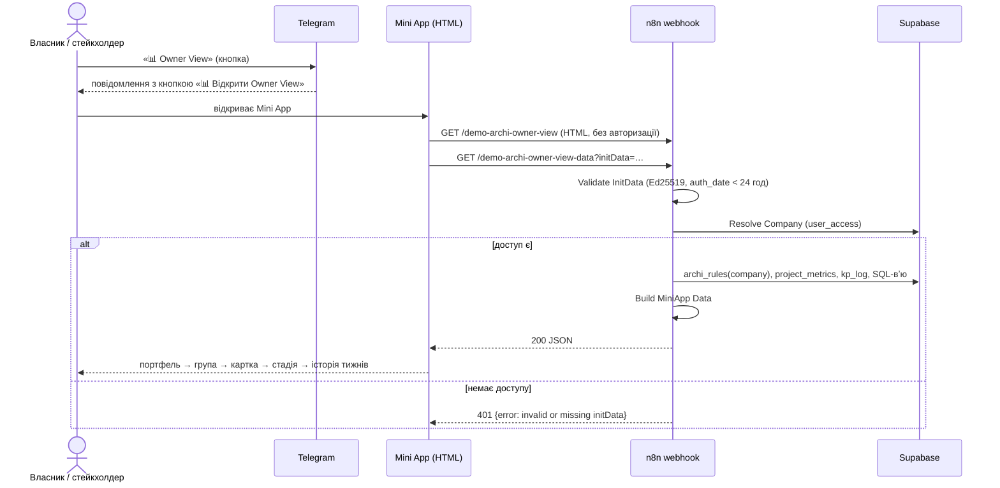
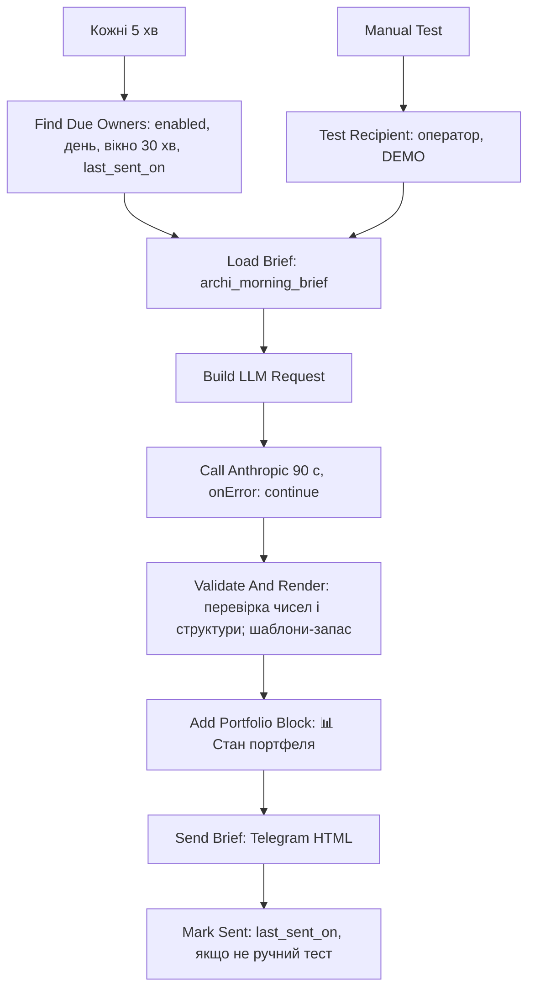
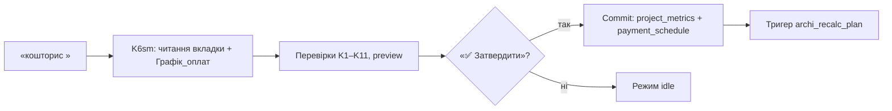

# ARCHI — потоки користувача (діаграми)
Версія 1 · 05.11.2026. Діаграми Mermaid за кодом core `a4c89c3c` і документами (`TECH_SPEC` §4, `WEEKLY_REPORT_FORM`, `CLAUDE.md` п. 2, 9, 32). Вузли n8n названо як у `NODE_MAP.md`. Гілки помилок — за `12_ERROR_AND_EDGE_CASES.md`; **жирним** у підписах позначено поведінку, якої в системі зараз немає (прогалина). Кнопки й повідомлення — із коду.

## 1. Тижневий звіт ПМа
```mermaid
sequenceDiagram
  actor PM as ПМ
  participant TG as Telegram
  participant WF as n8n core
  participant DB as Supabase
  participant LLM as OpenAI gpt-4o
  PM->>TG: кнопка проєкту
  TG->>WF: message
  WF->>DB: резолвер user_access, archi_bot_mode_state = weekly_report
  WF-->>PM: бриф: питання звіту (стадії, ймовірності, блокер, план)
  loop довільні відповіді
    PM->>TG: текст / голос / фото / PDF-TXT
    WF->>LLM: транскрипція або аналіз фото (за типом)
    WF->>DB: archi_wr_inbox (додати)
    WF-->>PM: «📥 Прийнято · у черзі N» (без LLM)
  end
  PM->>TG: «📤 Відправити»
  WF->>DB: Fetch Inbox
  WF->>LLM: WR: Agent (уся черга одним запитом)
  WF->>WF: WR: Parse Agent Output (числа, дати, блокер лише з тексту ПМа; п. 9)
  WF->>DB: Inbox Consume (id ≤ max)
  WF-->>PM: звіт за формою + «Не підтверджено вашим текстом» + уточнення (ask)
  PM->>TG: відповідь або «відповіді немає»
  PM->>TG: «✅ Фінал»
  alt усі пункти плану минулого тижня мають статус
    WF->>DB: UPSERT wr_weekly_snapshots + статуси wr_plan_items
    DB->>DB: тригер archi_recalc_wr → archi_recalc()
    WF->>DB: план наступного тижня (перенесення)
    WF-->>PM: підтвердження звіту (Send Final Report, retry)
  else немає статусів
    WF-->>PM: уточнення «статус пункту N?»
  end
```
Гілки помилок: збій OpenAI → **немає повідомлення користувачу**, повідомлення лишаються в черзі (E-06); збій збереження знімка → `retryOnFail`, вихід помилки (E-13); повторне «Фінал» → перезапис знімка (EC-02); паралельний «Фінал» → переможе останній (EC-01).
Режим «🆕 Новий» очищає пам'ять LLM і чергу.

## 2. Owner View і Weekly Render (Mini App)

Weekly Render і xlsx — той самий потік із ендпоінтами `…-weekly-render-data` і `…-export`.
Drill-down нижче стадії (виконавець, розділ, пакет, запис журналу) **не реалізовано** (R-7).

## 3. Чат-агент (Archi Consult)
```mermaid
flowchart TD
  A[Повідомлення в Telegram] --> B{Користувач у user_access?}
  B -- ні --> C[⛔ Доступ не надано]
  B -- так --> D{Режим / команда?}
  D -- WR-потік --> E[Потоки звіт / імпорт / зустріч / Кошторис / договір / КП]
  D -- /status, «Статус звітів» --> F[Build Status Text]
  D -- Owner View / Weekly Render --> G[Кнопка Mini App]
  D -- інше --> H[Fetch Project Metrics + Fetch KP Log Sum]
  H --> I[Build MiniApp Data: сигнали, pfc]
  I --> J[Build Request Body: детектор Q1–Q10, правила «не вигадувати»]
  J --> K[Call Anthropic claude-sonnet-4-6]
  K -->|успіх| L[Sanitize Reply: Markdown → HTML Telegram]
  L --> M{Q1–Q10?}
  M -- так --> N[Send Reply (Questions): клавіатура питань]
  M -- ні --> O[Send Reply: головне меню]
  K -. збій .-> P[Тиша: fallback відсутній]
```
Пам'яті розмови немає. Формат відповіді — Insight → Impact → Action, до 3 проєктів; «даних немає» замість вигаданих чисел.

## 4. Імпорт годин і грошей (бот)
```mermaid
flowchart LR
  S[Кнопка проєкту → режим «Години і гроші»] --> T[Користувач диктує/пише/надсилає скрін]
  T --> U[Import: Agent (LLM) формує Time_Log / Money_Log]
  U --> V[Import: Parse Agent Output]
  V -->|неповні рядки| W[Уточнення; «Фінал» заблоковано]
  V -->|повні| X[Чернетка]
  X --> Y{«✅ Фінал»?}
  Y -- так --> Z[Import: Insert Time Rows / Money Rows, статус confirmed]
  Z --> R[Тригери archi_recalc_time / money → archi_recalc]
  Y -- «🆕 Новий» --> N[Очистити чернетку]
```
Гроші вносить лише ПМ (п. 23); **перевірки ролі в коді немає** (аудит 05.11.2026). Файли xlsx/csv не імпортуються (W3.10).

## 5. Ранковий брифінг власника

`archi_morning_brief` повертає `actions[]` (топ-5), `horizon_7d[]`, `portfolio`, `data_updated_at`. Без `owner_prefs` — нічого не надсилається.

## 6. Старт проєкту (поточна реалізація через Кошторис)

Доступ до команди — лише `ALLOWED` у `WR: Hard Logic Engine` (власник). Модуль плану в ARCHI (версії, GATE) — W2 ⬜.

## 7. Не описані потоки (не існують)
Онбординг нового клієнта (W9.1), видалення клієнта й даних (OD-20), перемикання компанії оператором FDO (W1.2: «клавіатура клієнт → проєкт» у дизайні, у коді не підтверджено), вихід користувача.
