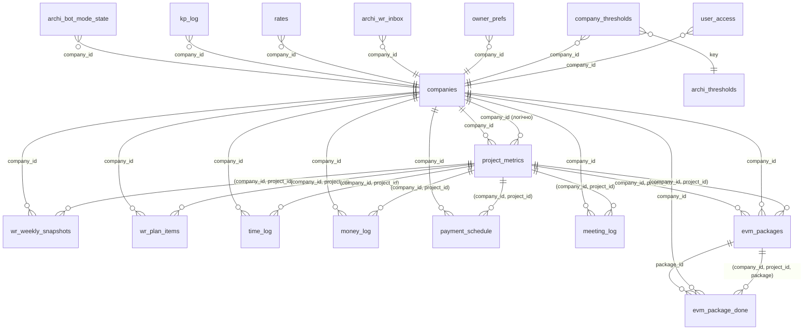
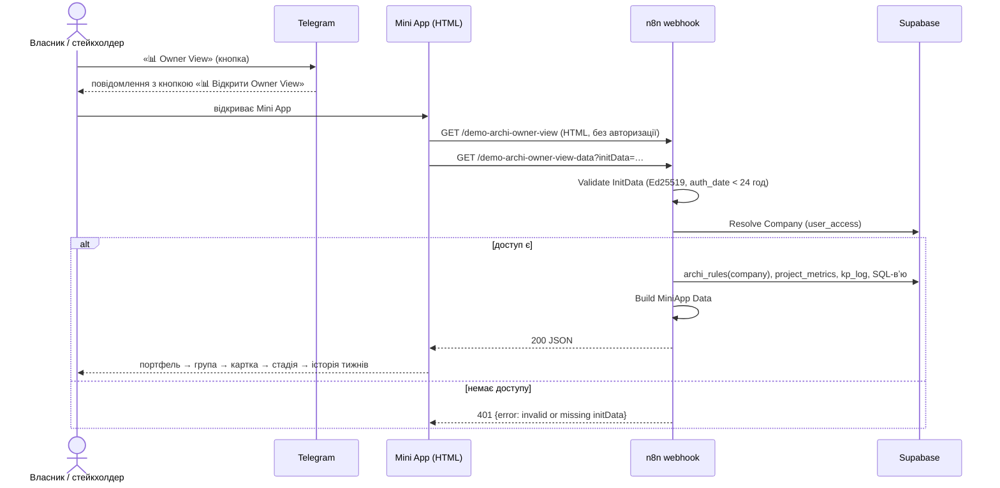
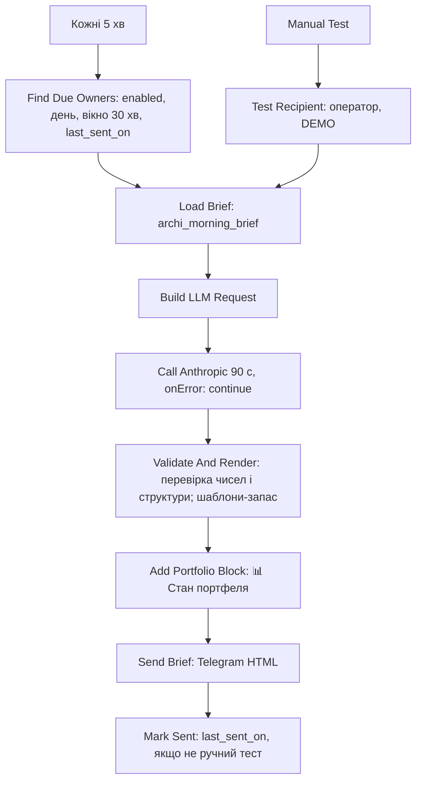
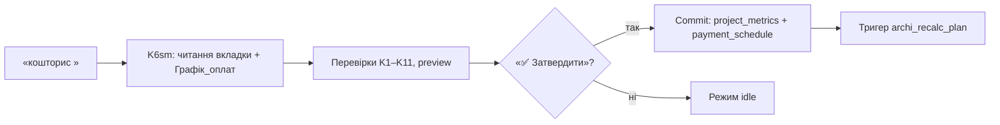

# ARCHI — повний пакет документації для передачі розробки

Зібрано автоматично `scripts/build_handover_bundle.py`. Кожен документ вставлено дослівно; `<!-- SOURCE … -->` містить sha256 джерела.
Не входять: `docs/archive/` (22 замінені документи — історія), `sql/` (міграції, відкати, демо-дані) і `workflows/` (експорти n8n): це код, а не документація, він лише в репозиторії. Журнал робіт `docs/RELEASE_PLAN.md` входить у Частину V (читати з кінця: найновіше внизу).
Номери «п. N» означають пункти закритих рішень у `CLAUDE.md`. Починати з Частини I, документ 00.

## Зміст

**ЧАСТИНА I — Пакет передачі: що це, для кого, як читати**
1. `docs/handover/00_START_HERE.md` — Навігація, стан, чек-лист передачі
2. `docs/handover/01_PRODUCT_BRIEF.md` — Продуктовий бриф для Product Manager
3. `docs/handover/02_BUSINESS_REQUIREMENTS.md` — Бізнес-вимоги
4. `docs/handover/03_TECHNICAL_CTO.md` — Технічний документ для CTO
5. `docs/handover/04_METHODOLOGY_FOR_DEVELOPERS.md` — Методологія для розробників
6. `docs/handover/10_DATABASE_SCHEMA.md` — Схема БД (згенеровано зі знімка)
7. `docs/handover/11_API_CONTRACT.md` — API-контракт
8. `docs/handover/openapi.yaml` — OpenAPI 3.0
9. `docs/handover/12_ERROR_AND_EDGE_CASES.md` — Помилки, порожні стани, крайні випадки
10. `docs/handover/13_USER_FLOWS.md` — Потоки користувача (Mermaid)
11. `docs/handover/14_THREAT_MODEL.md` — Модель загроз (STRIDE)
12. `docs/handover/15_USER_STORIES.md` — User Stories з Acceptance Criteria
13. `docs/handover/16_NFR.md` — Нефункціональні вимоги: цілі власника й стан

**ЧАСТИНА II — Перевірка пакета**
14. `docs/handover/05_CTO_REVIEW_PLAN.md` — План перевірки пакета CTO
15. `docs/handover/06_REVIEW_VALIDATION_PLAN.md` — План валідації результатів перевірки
16. `docs/handover/07_REVIEW_REPORT.md` — Звіт про перевірку за планом
17. `docs/handover/08_CODE_VS_DOCS_AUDIT_PROMPT.md` — Промпт: перевірка існуючого коду проти документації

**ЧАСТИНА III — Канон: рішення, карта, специфікації**
18. `CLAUDE.md` — Закриті рішення власника п. 1–37, ритуал і правила сесії
19. `docs/DECISIONS_REGISTER.md` — Реєстр закритих рішень і суперечностей
20. `docs/ROADMAP_TO_RELEASE.md` — Єдина карта розробки до релізу
21. `docs/WBS_FROM_FINAL.md` — Зворотний WBS від фіналу до сьогодні (згенеровано)
22. `docs/ARCHI_TECH_SPEC_v3_1.md` — Технічна специфікація v3.1
23. `docs/FORMULAS.md` — Довідник формул і порогів
24. `SECURITY.md` — Відомі ризики безпеки

**ЧАСТИНА IV — Додаткові специфікації й методологія**
25. `docs/ARCHI_Obraz_Idealnoho_Rezultatu.md` — Методологія й концепція
26. `docs/W1_DESIGN.md` — Дизайн багатоклієнтності
27. `docs/WEEKLY_REPORT_FORM.md` — Форма звіту ПМа і Weekly Render
28. `docs/LAYOUT_STANDARD.md` — Стандарт верстки текстів
29. `docs/EVM_CLASSIC_PLAN.md` — План гілки «EVM (класичний)»
30. `docs/EVM_CLASSIC_DESIGN.md` — Дизайн гілки «EVM (класичний)»
31. `docs/OWNER_MORNING_TEST.md` — Тест для власника
32. `docs/FEATURE_IDEAS.md` — Ідеї власника: чат проєкту, виконавці
33. `docs/HANDOVER_CTO.md` — Пакет передачі CTO Senior (v1, 02.11.2026)
34. `docs/CTO_CHECKPOINT_03.11.2026.md` — Останній аудит коду проти документації
35. `docs/NODE_MAP.md` — Карта вузлів core workflow (генерується)
36. `docs/MORNING_BRIEF_PROMPT.txt` — Системний промпт ранкового брифінгу

**ЧАСТИНА V — Журнал робіт, плани, аудити й операційні документи**
37. `README.md` — Корінь репозиторію: стан і навігація
38. `docs/README.md` — Індекс документації
39. `docs/RELEASE_PLAN.md` — Журнал усіх робіт і перевірок (розділи 1–199, найновіше в кінці)
40. `docs/TRANSITION_PROMPT_2026-11-02.md` — Перехідний промпт v5: живий стан
41. `docs/TRANSITION_PROMPT_2026-10-25.md` — Перехідний промпт v3: довідкові розділи
42. `docs/START_PROMPT_OWNER_VIEW.md` — Стартовий промпт поточної сесії (Owner View → чат П2e → брифінг)
43. `docs/START_PROMPT_P2C.md` — Стартовий промпт П2 решта + П3 показ
44. `docs/START_PROMPT_P2B.md` — Стартовий промпт П2b
45. `docs/START_PROMPT_HQ.md` — Стартовий промпт сесії-штабу
46. `docs/START_PROMPT_DEMO.md` — Стартовий промпт демо-відео
47. `docs/DEMO_VIDEO_PLAN_2026-11-07.md` — План демонстраційного відео
48. `docs/DEMO_VIDEO_SCRIPT_2026-11-11.md` — Сценарій демонстраційного відео
49. `docs/DEMO_FIX_PLAN_2026-11-13.md` — План виправлень демо (П1–П3, дизайн П2b і П2e)
50. `docs/DEMO_BACKLOG_2026-11-13.md` — Беклог демо: дефекти, рішення, відкладене
51. `docs/DEMO_PLAN_2026-10-28.md` — План демо 28.10.2026
52. `docs/DEMO_REPORT_TEXTS_2026-10-30.md` — Сценарні тексти звітів демо
53. `docs/AGENTS_AND_RELIABILITY_DESIGN.md` — Дизайн агентів і надійності
54. `docs/RETROSPECTIVE_PROMPT.md` — Ретроспектива проєкту: промпт, дані, тригер
55. `docs/W1_8_DESIGN.md` — Дизайн W1.8: формули лише в SQL
56. `docs/EVM_CLASSIC_DESIGN_notes.md` — Нотатки до дизайну EVM (класичний)
57. `docs/DOC_AUDIT_29.10.2026.md` — Аудит документації 29.10.2026
58. `docs/CTO_CHECKPOINT_PROMPT.md` — Промпт CTO-перевірки відповідності коду документації
59. `docs/CTO_CHECKPOINT_30.10.2026.md` — CTO-checkpoint 30.10.2026
60. `docs/CTO_CHECKPOINT_01.11.2026.md` — CTO-checkpoint 01.11.2026
61. `docs/CTO_CHECKPOINT_02.11.2026.md` — CTO-checkpoint 02.11.2026
62. `docs/CTO_CHECKPOINT_15.11.2026.md` — CTO-checkpoint 15.11.2026

---

# ЧАСТИНА I — Пакет передачі: що це, для кого, як читати


---

<!-- SOURCE docs/handover/00_START_HERE.md sha256=caaeebf6c7841728dc15f9e9713147756a6686d8338527f704dcb7e71b83c4fa bytes=13407 -->
**Джерело: `docs/handover/00_START_HERE.md` — Навігація, стан, чек-лист передачі**

# ARCHI — пакет передачі розробки IT-компанії
Версія 1.0 (остаточна) · 05.11.2026 · Зміни пакета — лише через PR з перевіркою `check_handover.py` і CI та новим розділом у `RELEASE_PLAN`. · Репозиторій `matveevhmd-prog/fdo-perfect` (приватний), гілка `main`.
Власник продукту — Андрій Матвєєв (COO). Мова документації — українська. Назви показників, вузлів, таблиць, полів і шляхів — без перекладу.

Позначки в усіх документах пакета: **Факт** — перевірено кодом або живим SQL (джерело й дата поруч); **[Припущення]** — логічний висновок без перевірки; **Потребує перевірки** — сумнів; **[Рекомендація]** — пропозиція автора пакета, не рішення власника.

## 1. Що це за продукт одним абзацом
ARCHI — це **контроль майбутньої рентабельності проєкту** для архітектурно-проєктних компаній. Продукт не моніторить фактичний % виконання. Центр методології — постійний фокус на **прогнозі часу до завершення (ETC)**, який щотижня дає проєктний менеджер (ПМ). ARCHI порівнює слова ПМа з об'єктивними цифрами (години, акти, оплати) і робить розбіжність видимою без наказів. Власник бачить портфель у Telegram Mini App, питає чат-агента, а щоранку отримує готовий план дій на день.
Методологічна основа — «порожній човен»: видима правда цифр замість особистого тиску (`docs/ARCHI_Obraz_Idealnoho_Rezultatu.md`, Розділ 1).

## 2. Кому який документ
| Роль | Читати | Навіщо |
|---|---|---|
| Product Manager | `01_PRODUCT_BRIEF.md`, потім `02_BUSINESS_REQUIREMENTS.md` | бачення, користувачі, кілер-фічі, каталог фіч зі статусами, вимоги, критерії релізу |
| CTO / техлід | `03_TECHNICAL_CTO.md`, потім `04_METHODOLOGY_FOR_DEVELOPERS.md` | архітектура, дані, потоки, безпека, борг, ризики, перші кроки |
| Розробник | `04_METHODOLOGY_FOR_DEVELOPERS.md`, `10_DATABASE_SCHEMA.md`, `11_API_CONTRACT.md`, `13_USER_FLOWS.md`, `docs/FORMULAS.md`, `docs/NODE_MAP.md` | предметна область, схема БД, API, потоки, формули, карта вузлів |
| QA | `15_USER_STORIES.md`, `12_ERROR_AND_EDGE_CASES.md`, `02_BUSINESS_REQUIREMENTS.md` §6, `docs/OWNER_MORNING_TEST.md` | сценарії приймання, помилки й крайні випадки |

## 3. Порядок читання першого дня (для всіх)
1. Цей файл.
2. `CLAUDE.md` у корені репозиторію — **закриті рішення власника (п. 1–34)**. Їх не перепитують і не переробляють без власника. Для нового виконавця це найважливіший файл: він пояснює, чому продукт влаштований саме так.
3. `docs/DECISIONS_REGISTER.md` — реєстр рішень і суперечностей між документами.
4. `docs/ROADMAP_TO_RELEASE.md` — єдина карта розробки до релізу (потоки W0–W11, критерії R-1…R-14, рішення OD-N).
5. Документи за роллю (таблиця вище).

## 4. Пакет документів
### 4.1 Нові документи цього пакета (`docs/handover/`)
| Файл | Зміст |
|---|---|
| `00_START_HERE.md` | цей файл: навігація, стан, чек-лист передачі |
| `01_PRODUCT_BRIEF.md` | продуктове бачення, користувачі, сценарії, кілер-фічі, каталог фіч |
| `02_BUSINESS_REQUIREMENTS.md` | бізнес-контекст, вимоги BR-N зі статусом і джерелом, обмеження, критерії приймання, ризики |
| `03_TECHNICAL_CTO.md` | архітектура, дані, потоки n8n, інтеграції, безпека, борг, операційні правила, рекомендації |
| `04_METHODOLOGY_FOR_DEVELOPERS.md` | предметна область і формули простою мовою, правила кольору й верстки |
| `05…07` | план перевірки пакета CTO, план валідації, звіт про перевірку |
| `08_CODE_VS_DOCS_AUDIT_PROMPT.md` | промпт: перевірка коду й живих систем проти документації |
| `10_DATABASE_SCHEMA.md` | схема БД (згенеровано з живої бази): типи, обмеження, індекси, RLS, ER |
| `11_API_CONTRACT.md`, `openapi.yaml` | API-контракт 5 вебхуків і форма відповідей |
| `12_ERROR_AND_EDGE_CASES.md` | помилки, порожні стани, крайні випадки «як є» |
| `13_USER_FLOWS.md` | потоки користувача (діаграми Mermaid) |
| `14_THREAT_MODEL.md` | модель загроз STRIDE |
| `15_USER_STORIES.md` | 55 User Stories з Acceptance Criteria |
| `16_NFR.md` | нефункціональні вимоги: цілі власника й виміряний стан |

### 4.2 Канонічні документи репозиторію (джерела, на які посилається пакет)
| Файл | Призначення |
|---|---|
| `CLAUDE.md` | закриті рішення власника п. 1–34, ритуал сесії |
| `docs/ROADMAP_TO_RELEASE.md` | карта, критерії релізу, рішення OD |
| `docs/ARCHI_TECH_SPEC_v3_1.md` | технічна специфікація v3.1 |
| `docs/FORMULAS.md` | довідник усіх формул і порогів (єдине джерело визначень) |
| `docs/WEEKLY_REPORT_FORM.md` | форма звіту ПМа і специфікація Weekly Render |
| `docs/LAYOUT_STANDARD.md` | верстка текстів «стовпчиком», словник емодзі |
| `docs/ARCHI_Obraz_Idealnoho_Rezultatu.md` | методологія й концепція |
| `docs/W1_DESIGN.md` | дизайн багатоклієнтності (company_id, ролі, пороги на клієнта) |
| `docs/EVM_CLASSIC_PLAN.md`, `docs/EVM_CLASSIC_DESIGN.md` | окрема гілка «EVM (класичний)» |
| `docs/NODE_MAP.md` | карта 197 вузлів core workflow (генерується скриптом) |
| `docs/FEATURE_IDEAS.md` | ідеї власника: ARCHI у чаті проєкту, виконавці |
| `docs/OWNER_MORNING_TEST.md` | тест для власника: 4 дії + 10 питань |
| `SECURITY.md` | відомі ризики безпеки й прийняті рішення |
| `docs/RELEASE_PLAN.md` | журнал усіх робіт (540 КБ; читати з кінця) |
| `docs/CTO_CHECKPOINT_*.md` | аудити коду проти документації |
| `docs/MORNING_BRIEF_PROMPT.txt` | системний промпт ранкового брифінгу |
| `workflows/*.json`, `workflows/*.sdk.ts` | експорти n8n (токен замінено на `<TELEGRAM_BOT_TOKEN>`) |
| `sql/` | міграції з відкатами, демо-дані, тести |
| `scripts/` | `check_docs.py`, `check_report_form.py`, `check_tenant_filter.py`, `gen_node_map.py`, `replay/` |

## 5. Стан продукту (чесно)
| Параметр | Стан | Джерело |
|---|---|---|
| Фаза | Робочий прототип на демо-даних; **реальних клієнтів немає**. Мета — три перші клієнти без переробки архітектури | `CLAUDE.md` п. 20 |
| Дані в системі | Усі вигадані демо-дані з арифметично порахованими значеннями (SQL); це свідомий актив для показів, не дефект | `CLAUDE.md` п. 18 |
| Стек | n8n Cloud (логіка, 197 вузлів у core), Supabase Postgres (дані й обчислення), Telegram (бот і Mini App), Anthropic Claude (чат, брифінг), OpenAI gpt-4o (звіти, імпорт, фото, голос) | `TECH_SPEC` §6 |
| Багатоклієнтність | База готова (`company_id`, ключ `(company_id, project_id)`, ролі в `user_access`, пороги на клієнта). **Ізоляцію доведено тестом на рівні БД; на рівні n8n — ні.** RLS свідомо вимкнений до першого платного клієнта | `RELEASE_PLAN` §165–§171, `CLAUDE.md` п. 28 |
| Безпека | Відкриті свідомі ризики: токен бота в живому workflow, RLS вимкнений. Авторизація з таблиці `user_access` реалізована в n8n 03.11.2026, але в Telegram не прогнана (до цього чат і WR-бот були без allowlist, `SECURITY.md` п. 7). Рішення власника: токен міняти останнім кроком перед презентацією першому клієнтові | `SECURITY.md`, `CLAUDE.md` п. 25, 28 |
| Реліз | Дат релізів і показів немає (скасовано власником) | `CLAUDE.md` п. 24, 26 |
| Повнота | Див. каталог фіч у `01_PRODUCT_BRIEF.md` §6: ✅ реалізовано · 🟡 частково · ⬜ не розпочато | |

## 6. Що ще потрібно від власника при передачі (чек-лист)
Секрети в репозиторії відсутні й не мають бути. Нижче те, що власник передає окремо, захищеним каналом.
| № | Що | Навіщо |
|---|---|---|
| 1 | Доступ до n8n Cloud `osbbcopilot.app.n8n.cloud` (проєкт з workflow `CKwCsGIwyw9feCY5`, `K6smBd5xWZLWx9rr`, `RC7HNVlJtuPLtvYV`, `J3Oqcaa2YBEsVSng`) | запуск, налагодження, публікація |
| 2 | Доступ до Supabase `bxawceksdkqlbkdgjvyz` (проєкт «matvieiev-bots») | міграції, SQL |
| 3 | Токен бота `@archi_demo_bot` через BotFather і credential `Telegram account 4` у n8n | перенос секрету в сховище, потім ротація (`CLAUDE.md` п. 25) |
| 4 | API-ключі Anthropic та OpenAI, credentials у n8n | обчислення чату, звітів, брифінгу |
| 5 | Доступ до GitHub-репозиторію | код і документація |
| 6 | Google Drive / Sheets: файл Кошториса DEMO і папка договорів | спадковий адаптер; виводиться з обігу (`CLAUDE.md` п. 17) |
| 7 | Відповіді на відкриті рішення OD (`02_BUSINESS_REQUIREMENTS.md` §8) | розблокування потоків W2, W6, W8, W9, W10 |
| 8 | Юрист: пункт договору про згоду на знеособлені патерни, строки зберігання знань із чатів | `CLAUDE.md` п. 28, OD-20 |

## 7. Як перевірити, що середовище живе (перші 2 години)
1. Відкрити `docs/NODE_MAP.md` і порівняти з живим core workflow `CKwCsGIwyw9feCY5` у n8n (`activeVersionId` `4a5df71b-ba97-42a8-bbdd-179ce53fdfeb`, 197 вузлів на 11.11.2026, §190). Якщо розходяться — довіряти живому n8n, експорт перезробити (правило `CLAUDE.md`).
2. У боті `@archi_demo_bot` пройти `docs/OWNER_MORNING_TEST.md` (15 хв).
3. Запустити `python3 scripts/check_docs.py` — очікується 0 помилок.
4. Запустити незалежну звірку F-02, F-13, F-15 з сирих таблиць проти `project_metrics` (запит у `docs/CTO_CHECKPOINT_PROMPT.md`, перевірка C-3).

## 8. Що пакет свідомо не містить
- Секретів, токенів, паролів, ключів API.
- Цін і тарифів: їх немає (власник ще не визначив склад; орієнтир — розділ 6 `02_BUSINESS_REQUIREMENTS.md`).
- Оцінок трудомісткості й термінів: вимірюваних даних немає, оцінювати без них заборонено правилами власника.
- Юридичних висновків.


---

<!-- SOURCE docs/handover/01_PRODUCT_BRIEF.md sha256=d4fd6bf8ecc04bdd2ca2cd637fa1a1234f182cbdb57d6f56af4c731b0230a66d bytes=34734 -->
**Джерело: `docs/handover/01_PRODUCT_BRIEF.md` — Продуктовий бриф для Product Manager**

# ARCHI — продуктовий бриф для Product Manager
Версія 1 · 05.11.2026. Позначки — як у `00_START_HERE.md`. Статуси фіч: ✅ реалізовано · 🟡 частково · ⬜ не розпочато · ⛔ чекає рішення власника.

## 1. Проблема і рішення
**Проблема.** У проєктній компанії керівник дізнається про втрату рентабельності пізно: коли години вже витрачені, а акт не підписано. Статус «готовність 40%» ні до чого не прив'язаний: людина може сказати що завгодно. Тиск «зроби швидше» викликає опір або формальне виконання.

**Рішення ARCHI.** Щотижня ПМ дає прогноз часу до завершення (ETC). ARCHI зіставляє його з годинами, актами й оплатами. Розбіжність показується як цифра, а не як чиясь думка. Оскаржити цифру складніше, ніж оскаржити людину. Це і є «порожній човен»: тиск є, але без особи, на яку можна образитись (`ARCHI_Obraz_Idealnoho_Rezultatu.md`, Розділ 1, §2).

**Суть продукту (власник, 02.11.2026, `CLAUDE.md` п. 19, переказ).**
- ARCHI — це контроль **майбутньої** рентабельності, а не моніторинг фактичного % виконання.
- Центр — прогноз ETC.
- Щотижневий моніторинг прогресу у **грошах контракту** і у **грошах собівартості виконавців**.
- Щотижневий ритм: звіт ПМа, нарада, таблиця Weekly Render.
- Owner View з drill-down на будь-який рівень у Mini App.
- Зручність: дані вантажаться голосом або текстом через бота, або імпортом з файлів; відповіді приходять туди, де людині зручно.

**Критерій для будь-якого продуктового рішення:** чи підсилює воно контроль майбутньої рентабельності й зручність каналу. Інакше фіча не входить.

## 2. Для кого
| Користувач | Що йому потрібно | Як ARCHI допомагає | Стан ролі в системі |
|---|---|---|---|
| **Власник / COO** | Знати, де «запалає», і що робити зараз | Owner View, чат Q1–Q10, ранковий брифінг з планом дій | ✅ |
| **ПМ** | Швидко здати прогноз, не писати форму руками | Опитування в Telegram; довільні відповіді (текст, голос, фото, документ) | ✅ |
| **ГАП** | Бачити стан свого проєкту | Weekly Render, Owner View | 🟡 [Припущення: ГАП — головний архітектор проєкту; розшифровку дає власник] |
| **Виконавець** | Вносити години й % готовності свого розділу без форм | Бот для виконавців; **без грошей** (`CLAUDE.md` п. 23) | ⬜ (W3.11, W10.9) |
| **Фіндиректор** | Отримувати чіткі запити про акти й оплати | Адресат порад у ранковому брифінгу; доступу до системи немає | 🟡 роль лише як адресат тексту |
| **Оператор FDO (консультант власника)** | Бачити всіх клієнтів, навчати систему на кейсах | Роль `operator` у `user_access`, бачить усі компанії | ✅ модель; журналу дій немає |
| **Замовник, підрядники** | Не користувачі ARCHI | Лише джерело подій (чати, договори) | — |

**Рівень доступу.** Ролі задаються на рівні компанії, без доступу по проєктах (`CLAUDE.md` п. 27, OD-3). Наслідок: усі ПМ клієнта бачать усі його проєкти.

## 3. Три основні фічі
1. **Owner View** — Telegram Mini App для власника: портфель, сигнали, картка проєкту, історія тижнів.
2. **Archi Consult** — чат-агент: 10 фіксованих питань і вільні питання; відповідь у форматі Insight → Impact → Action.
3. **Щотижневий ритм** — звіт ПМа через бота → Weekly Render для наради → xlsx.

Додаткові модулі: ранковий брифінг, імпорт годин і грошей через бота, журнал зустрічей, облік КП, прийом договору, гілка «EVM (класичний)», знання проєкту з чатів (план), самонавчання (план).

## 4. Кілер-фічі
Кілер-фіча — те, чого немає в звичайному таск-трекері чи BI і що важко скопіювати, бо за нею стоїть методологія. Перелік складено за закритими рішеннями власника.

| № | Кілер-фіча | У чому сила | Стан | Джерело |
|---|---|---|---|---|
| K1 | **Ланцюжок готовності в годинах** | Чотири числа поруч: «Витрачено» = AC/BAC; «Готовність ПМа» = EV/BAC; «За прогнозом» = AC/EAC, де EAC = AC + ETC_прогноз; «Ефективність годин» = BAC/EAC (план = 1,00). Розбіжність «Готовність ПМа − за прогнозом» у п.п. — **видимий технічний борг**. Людина не може словами закрити цей розрив | ✅ | `CLAUDE.md` п. 7; `FORMULAS` E-01…E-08 |
| K2 | **Звіт ПМа через опитування, а не форма** | ПМ відповідає довільно (текст, голос, фото екрана, документ). ARCHI структурує, бачить прогалини, ставить уточнення. На кожне ПМ мусить відповісти чітко або сказати «відповіді немає» | ✅ | `CLAUDE.md` п. 2 |
| K3 | **Захист від вигаданих чисел (довіра до даних)** | Числа, дати й блокер приймаються лише якщо їх можна знайти в тексті ПМа. Перевіряє код, не LLM. Слова-підтвердження («нуль», «немає») діють лише по названій стадії. Непідтверджене показується окремим блоком «Не підтверджено вашим текстом» | ✅ | `CLAUDE.md` п. 9; тести 29/0 |
| K4 | **«За чиї гроші працювала команда» (P-10)** | Приріст готовності між двома звітами × контракт = бюджет приросту. Порівняння з витратами команди (години × ставка) показує, чи тиждень пройшов за гроші замовника чи власника. Історія кожного тижня | ✅ в Owner View; індекс у Weekly Render ⬜ | `CLAUDE.md` п. 11, 12 |
| K5 | **Правило кольору «від'ємне — червоне»** | Одна логіка на весь продукт: різниця = результат − план; мінус 🔴, плюс або нуль 🟢, жовтого немає. Колір рахує лише SQL. Екран підсвічує відхилення від плану, а не «настрій» | ✅ | `CLAUDE.md` п. 15 |
| K6 | **Дві рентабельності й дві методології** | Рентабельність від контракту і від собівартості (важливо для pro bono й імідж-проєктів). Окрема вкладка «EVM (класичний)» без домішок методології Archi: власник бачить проєкт у двох оптиках | ✅ методологія Archi; 🟡 EVM (таблиці й функції є, екрана немає) | `CLAUDE.md` п. 8, 13, 14 |
| K7 | **Ранковий брифінг власника** | Щодня о 08:30 (пн–пт) у Telegram приходить план дій на день: топ-5 дій у форматі Insight → Impact → Action; для кожної — адресат за роллю (ПМ, Фіндиректор) і **готовий текст, який власник копіює й надсилає**, або тези для власного дзвінка (з 07.11.2026). ARCHI не просто підсвічує проблему, а думає за власника «що мені з цим робити». Пріоритети рахує SQL, LLM лише формулює, числа перевіряє код | ✅ розсилку ввімкнено 05.11.2026; перший автозапуск не перевірено | `CLAUDE.md` п. 32; `RELEASE_PLAN` §172–§175 |
| K8 | **Weekly Render без грошей для наради** | Таблиця для наради з командою, підрядниками, замовниками: лише відхилення від плану в % або індексом (план = 1,00). Гроші лише в Owner View | ✅ | `CLAUDE.md` п. 7 |
| K9 | **Чесне «даних немає»** | Система не вигадує. Немає залишків на рахунках — на питання «чи є гроші на зарплату» відповідь «даних немає» і що саме потрібно (до реалізації W12; після — з даних oneBfinance чи іншої системи, лише Owner View, `CLAUDE.md` п. 36) | ✅ | `OWNER_MORNING_TEST` Q4, Q5; `TECH_SPEC` §1.1 |
| K10 | **Канал там, де зручно** | Голос, текст, скрін, PDF у Telegram; у майбутньому — повідомлення проєктних чатів | ✅ вхід бота; ⬜ групові чати | `CLAUDE.md` п. 19, 22 |
| K11 | **Знання проєкту з чатів** (план) | Бот у проєктних чатах збирає рішення, ризики, домовленості й відповідає на «що ми домовились» з цитатою, датою, автором | ⬜ W10 | `CLAUDE.md` п. 22 |
| K12 | **Цикл самонавчання між клієнтами** (план) | Власник з Claude вивчає кейси; знеособлені патерни покращують відповіді ARCHI. Сирі дані клієнтів ізольовані; між клієнтами тече лише шар патернів. Конкурентна перевага | ⬜ W11 | `CLAUDE.md` п. 27, 28 |

**Чого в кілер-фічах немає навмисно (не пропонувати).**
- Лінійна екстраполяція темпу проєкту — сигнал було реалізовано й видалено 25.09.2026 як методологічно хибний (`Образ…`, Розділ 7).
- Гроші у Weekly Render.
- Жовтий колір для відхилень від плану.
- Сигнал «прогноз застарів» — свіжість показує дата оновлення даних (`CLAUDE.md` п. 26).
- Керування ліквідністю, касовим розривом, зарплатним фондом: до реалізації W12 даних немає, не обіцяти; в демо-відео — лише як «у розробці» (`CLAUDE.md` п. 36).

## 5. Ключові сценарії
### 5.1 Щотижневий ритм
| Коли | Хто | Що відбувається |
|---|---|---|
| П'ятниця, 17:30–18:30 | Виконавці, ПМ | Рефлексія: що робили, зробили, будемо робити; оцінка % готовності й ETC. Оплачується як звичайна робота. Нагадування від бота — ⬜ (D1) |
| До вівторка | ПМ | У боті натискає кнопку проєкту, бачить питання, відповідає довільно, натискає «📤 Відправити». ARCHI структурує й ставить уточнення. «✅ Фінал» фіксує звіт у `wr_weekly_snapshots` |
| Вівторок, з 9:30 | Топменеджмент, ПМ, ГАП | Нарада з показом екрана Weekly Render. «Порожній човен» діє і на керівництво: не можна відмовити ПМу в ресурсі, а потім звинуватити його в зриві дедлайну |
Свідоме спрощення поточної версії: один ПМ агрегує усну рефлексію виконавців. Майбутнє: виконавці самі надсилають години й % боту (W10.9).

### 5.2 Ранок власника
1. 08:30 приходить брифінг: 5 дій, кожна з готовим текстом.
2. Власник пересилає тексти адресатам або дзвонить.
3. За потреби питає чат: «Де може запалати?», «Чи потрібно мені зараз щось робити?».
4. Для деталей відкриває Owner View: портфель → група → картка → стадія → історія тижнів.

### 5.3 Старт проєкту (поточна реалізація)
Команда `кошторис <id>` → перевірки K1–K11 → «затвердити» → план у `project_metrics` і `payment_schedule`. Джерело плану — Google Sheets (спадковий адаптер). **Мета:** жива сесія планування в самому ARCHI з GATE «планову рентабельність затвердив власник» (W2, ⬜). **GATE:** команда не списує час на проєкт, доки власник не затвердив планову рентабельність. Зараз це організаційне правило, не перевірка в коді (OD-8).

### 5.4 Журнал годин і грошей
Режим «Години і гроші» в боті: діалог з LLM, неповні рядки блокують «Фінал», підтверджені рядки йдуть у `time_log` і `money_log`. Виконавці годин самі не вносять (⬜).

## 6. Каталог фіч зі статусом
### 6.1 Owner View (Telegram Mini App)
| Фіча | Стан | Примітка |
|---|---|---|
| Портфель: таблиця План / Факт / Прогноз / Різниця | ✅ | проєкти, Workload, Зроблено ÷ витрачено, прибуток, рентабельність від контракту, КП, договори |
| Загальний статус: лічильники 🟢🟡🔴⛔ з переліком проєктів | ✅ | |
| Панель «Показник»: Рентабельність, Прибуток, Акти і гроші, Години, Ефективність; розподіл | ✅ | |
| Перелік «Потребують уваги» | ✅ | |
| Картка проєкту: сигнали, рентабельність, ⛔, контракт, роботи/акти/гроші, прибуток, звіт ПМа, ETC, ефективність | ✅ | |
| Блок стадій МБР/ЕП/П/Р, історія тижнів | ✅ | |
| «Приріст готовності проти витрат команди» + таблиця «за чиї гроші по тижнях» | ✅ | |
| Drill-down до виконавця, розділу, пакета, запису журналу | ⬜ | R-7, W6.1 |
| Вкладка «EVM (класичний)» | ⬜ | W6.4 |
| Хостинг сторінки поза n8n | ⬜ ⛔ | OD-12 |
| Дата оновлення даних на кожному екрані | 🟡 | є на більшості; повна перевірка не виконана (`CLAUDE.md` п. 26) |

### 6.2 Archi Consult (чат)
| Фіча | Стан |
|---|---|
| Q1–Q10 кнопкою «❓ Питання» і текстом | ✅ |
| Вільні питання | ✅ |
| Формат Insight → Impact → Action, до 3 проєктів, без вигаданих чисел | ✅ |
| Пам'ять розмови | ⬜ (кожне питання окремо) |
| Відповіді з знань проєкту (договір, наради, чати) | ⬜ W10 |
| Фінансова ліквідність власника: залишок на рахунках, касовий розрив (лише Owner View) | ⬜ W12 |

Q1–Q10 (LOCKED): що відбувається; де запалає; чи потрібно щось робити; **Q4 «Чи вистачить грошей на ЗП?»** (зараз «даних немає», з даних — W12); **Q5 «Чи є ризик касового розриву?»** (зараз лише «виконано і не оплачено», класичний розрив — W12); **Q6 «На скільки часу в команди є робота?»** (Σ ETC_прогноз, `CLAUDE.md` п. 10, реалізовано); чи виконуємо річний план по прибутку; небезпечні дедлайни; за що можуть «прилетіти» від якірного замовника («не визначено»); що пообіцяли замовнику на останній нараді (з `meeting_log`). Q4–Q6 зафіксовані власником 11.11.2026 (`CLAUDE.md` п. 36).

### 6.3 Щотижневий ритм
| Фіча | Стан |
|---|---|
| Бриф-питання по проєкту; відповіді текстом, голосом, фото, PDF/TXT | ✅ |
| Черга повідомлень, «📤 Відправити», «📄 Чернетка», «✅ Фінал», «🆕 Новий» | ✅ |
| Перевірка чисел у тексті ПМа кодом | ✅ |
| Гейт «Фінал»: статуси всіх пунктів плану минулого тижня | ✅ |
| План наступного тижня з перенесенням невиконаного | ✅ |
| Блокер (⛔), його тип і дата, розбіжність готовності (⚖️) | ✅ |
| Weekly Render: колонки тижнів + «Сьогодні», кольори від SQL, без грошей | ✅ |
| Експорт xlsx | ✅ |
| Команда `/status`, кнопка «📋 Статус звітів» | ✅ |
| Нагадування п'ятниці | ⬜ (D1, W5.3) |
| Звіт АН (авторський нагляд) вільним текстом або голосом | ⬜ (W5.4, п. 16) |
| P-10 індексом у Weekly Render (без грошей) | ⬜ (п. 12) |

### 6.4 Ранковий брифінг
| Фіча | Стан |
|---|---|
| Вибір подій і ранжування в SQL (`archi_morning_brief`) | ✅ |
| Правила: блокер, прострочений і близький акт, дедлайн документації, дія з наради, ETC перевитрата, рентабельність нижче плану, немає прогнозу, немає звіту, підрядник чекає аванс | ✅ |
| Формулювання LLM + перевірка чисел кодом + шаблони-запас | ✅ |
| Формат Insight → Impact → Action, текст для копіювання, типи command / propose / call | ✅ 07.11.2026 |
| Посилання на людину в чаті для надсилання одним натисканням | ⬜ (потрібні Telegram-id людей команди; після заведення команди) |
| Розсилка 08:30 пн–пт | ✅ ввімкнено 05.11.2026 |
| Налаштування часу й днів | 🟡 змінюється в `owner_prefs` за проханням; команди в боті немає (рішення власника) |

### 6.5 Дані й інтеграції
| Фіча | Стан |
|---|---|
| Імпорт годин і грошей діалогом у боті | ✅ код; вхід: текст, голос, фото |
| Імпорт з XLSX/CSV з профілем колонок на клієнта | ⬜ W3.10 (OD-18: XLSX основний + CSV резервний) |
| API IF.TEAM, OneB | ⬜ відкладено (API і зразків немає, п. 21) |
| Журнал зустрічей (`meeting_log`) | 🟡 11 записів, живого фіду немає |
| Облік КП («КП: N»): місяць, рік, конверсія 20%, план 350 | ✅ |
| Прийом договору (`договір <id>`) у Google Drive | 🟡 |
| Договори АН «оплата за виїзд» (модель даних і розрахунок) | ✅ |
| Кошторис через Google Sheets (спадковий адаптер) | ✅ виводиться з обігу |
| Модуль плану в ARCHI (версії плану, журнал змін, GATE) | ⬜ W2 |

### 6.6 Платформа
| Фіча | Стан |
|---|---|
| Багатоклієнтність: `companies`, `company_id`, ключ `(company_id, project_id)` | ✅ в БД; 🟡 тест ізоляції на рівні n8n не виконано |
| Ролі з таблиці `user_access` (замість зашитого allowlist) | 🟡 W1.2 |
| Пороги й параметри методології на клієнта | ✅ `company_thresholds` |
| Формули, пороги й кольори лише в SQL | 🟡 W1.8: частину ще рахує n8n і браузер |
| RLS-політики | ⬜ свідомо відкладено до першого платного клієнта |
| Секрети й окремий бот на клієнта | ⬜ W1.4 |
| Онбординг клієнта від порожньої бази до першого Weekly Render | ⬜ W9.1 |

### 6.7 Гілка «EVM (класичний)»
Окрема вкладка за підручниковою методологією: BAC, PV, EV, AC, CV, SV, CPI, SPI, EAC, ETC, VAC, TCPI. EV = Σ по пакетах робіт (бюджет пакета × правило виконання, напр. 0/100 по виданих аркушах), незалежно від оцінки ПМа. PV — з розкладу пакетів у часі.
| Фіча | Стан |
|---|---|
| Таблиці `evm_packages` (100 демо-рядків), `evm_package_done`, функції й в'ю `evm_classic_*` | ✅ |
| Введення фактів виконання пакетів (бот «Видано») | ⬜ W7.2 |
| AC субпідряду за актом субпідрядника (О-3 «А», `CLAUDE.md` п. 34): новий тип у `money_log`, ввід ПМом | ⬜ W7.6 |
| Екран «EVM (класичний)» | ⬜ W6.4 |
| Рішення Н-5, О-3, D7 (W7.3, OD-13 закрито) | ✅ 05.11.2026 (`CLAUDE.md` п. 34): Н-5 за назвою, D7 неділя тижня, О-3 за актом субпідрядника |

### 6.8 Фічі наступної хвилі (карта, не розпочато)
| Фіча | Вузол | Суть |
|---|---|---|
| Бот-адмін у проєктних чатах, пошук по знаннях проєкту | W10.1–W10.8 | джерело знань: контракт, кошторис, наради, чати |
| Performer Bot для виконавців | W10.9 | лише години й % готовності свого розділу; без грошей |
| Сценарії виконавця | W10.10 | «поставь мене в курс справ»: контракт без сум, дедлайни, готовність, ETC, домовленості |
| Звіт виконавцю за тиждень | W3.7 | перелік його записів, підтвердження |
| Цикл самонавчання | W11 | знеособлений шар патернів |
| Розбиття монолітного workflow, власний бекенд чи n8n | W8.2, OD-14 | рішення після W1–W3 |

## 6.9 Інші вузли карти (технічні й допоміжні)
Вузли `ROADMAP_TO_RELEASE.md`, які не мають окремої фічі в каталозі вище: інженерія, процес, дрібні складники. Статус — із карти станом на 05.11.2026 (першоджерело — `ROADMAP`).
| Вузол | Назва | Статус за картою |
|---|---|---|
| W0.1 | Єдина карта (цей файл) і стартовий промпт сесії-штабу (`START_PROMPT_HQ.md`) | ✅ 02.11.2026 |
| W0.2 | Закрити паралельні сесії (С1, С2, EVM-1, EVM-2) після результату; нові — лише за вузлом цієї карти | 🟡 С1: результат у `RELEASE_PLAN` §146–§148 (05.11.2026), відхилення внесені як WD.1–WD.7; сесія EVM Ф0 (`session_01RSwaMQuhTxVUWQqf4kVzGi`)… |
| W0.3 | CTO Checkpoint повний перед кожним релізним шлюзом і після ≥ 3 публікацій n8n | 🟡 частковий 03.11 (`CTO_CHECKPOINT_03.11.2026.md`: P0 0 · P1 0 · P2 13; виконано A-1…A-5, C-3, C-4, F-check, S-check, R-06 (тести, макет); не… |
| W0.4 | Перехідний промпт v5 (Карта = цей файл) | ⬜ |
| W0.5 | Опис фіч для клієнта (файл ARCHI_FEATURES_v1 (запланований, ще не створено)) | ⬜ |
| W0.6 | Індекс документів і перевірка узгодженості | ✅ 02.11.2026 |
| W0.7 | Перенести з `TRANSITION_PROMPT_2026-10-25.md` (v3) розділи 2–8, 10–15 у канонічні документи і заархівувати v3 | ⬜ |
| W0.8 | Пакет передачі CTO Senior (`docs/HANDOVER_CTO.md`) і стартовий промпт сесії-штабу | ✅ 02.11.2026 |
| W1.3 | RLS-політики по компанії | ⬜ відкладено рішенням власника 03.11.2026 (OD-4): до заведення першого платного клієнта |
| W1.7 | Видимість репозиторію | 🟡 OD-6 закрито 02.11.2026 (варіант А, `CLAUDE.md` п. 25): зробити приватним; змінює власник у GitHub Settings; стан після зміни перевірити |
| W2.4 | Імпорт плану з файлу | ⬜ |
| W2.5 | Розрахунок полів плану | ⬜ |
| W2.6 | Пакети EVM | 🟡 таблиці й 100 демо-пакетів є (RELEASE_PLAN §143) |
| W2.8 | Дані проєктів, що вже є | 🟡 |
| W2.9 | Документи проєкту (КП, договір, додаткові угоди, акти, ТЗ, вихідні дані; посилання Диск або «Вчасно») | ⬜ |
| W2.10 | Коментарі й санкція власника до Кошториса | ⬜ |
| W2.11 | Додаткова угода (статуси; виводить «Хто платить за зміну») | ⬜ |
| W2.12 | Нагляд у Кошторисі (параметри у версії) | ⬜ |
| W3.1 | Бот: звіт ПМа (текст/голос/фото) | ✅ код (Факт); живу перевірку в Telegram виконує власник |
| W3.2 | Імпорт годин і грошей | 🟡 |
| W3.3 | IF.TEAM | ⬜ відкладено: API-доступу і зразків немає (власник 02.11.2026, `CLAUDE.md` п. 21); не проєктується до появи доступу, з карти не видаляється |
| W3.4 | OneB | ⬜ відкладено з тієї ж причини |
| W3.9 | Розбір документів у боті | ✅ 03.11.2026: вихід TXT (індекс 1) → `WR: Extract TXT Text`, fallback (індекс 2) → лише `WR: Send Unsupported Format` (`40abff53`, `RELEASE_PLAN`… |
| W4.1 | ETC-фокус | ✅ (основа, `FORMULAS` §2–§3) |
| W4.3 | ~~Сигнал застарілого прогнозу~~ → дата оновлення даних | 🟡 рішення прийнято; ⬜ перевірити дату на Owner View, Weekly Render, чаті, xlsx |
| W4.4 | Логіка порогів в одному місці | ⬜ |
| W4.7 | Точність прогнозів ПМа (ідея 07.11.2026) | ⬜ |
| W4.8 | Головне обмеження бюро, Constraint Engine (ідея 07.11.2026) | ⬜ |
| W4.9 | Повнота даних поряд із кольором (ідея 07.11.2026) | ⬜ |
| W4.10 | Виконання дій брифінгу й корисність сигналів | ⛔ рішення власника (п. 32) |
| W5.1 | Звіт ПМа (опитування) | ✅ |
| W5.2 | Weekly Render | ✅ |
| W5.6 | Ритм нарад: п'ятниця рефлексія, вівторок 9:30 | — |
| W6.3 | Чат-агент | ✅ (Q1, Q8 виправлено §139); вибірково |
| W7.1 | Ф0 дизайн, Ф1 таблиці, Ф1b функції й в'ю | ✅ (RELEASE_PLAN §143, §144) |
| W7.4 | V4(б) мутаційний тест, V6 з числовим знімком, V7–V10 | ⬜ |
| W8.3 | K6sm і RC7H експортувати в git | ✅ 02.11.2026: `workflows/Archi_Koshtorys_Ingest_K6sm.json` (`cf904641`, 16 вузлів), `workflows/Archi_Document_Intake_RC7H.json` (`d86d127a`, 5… |
| W8.5 | `NODE_MAP`, `TECH_SPEC` | 🟡 |
| W8.6 | Надійність LLM- і медіа-вузлів звіту (повтор, таймаут, запасне повідомлення) | ⬜ |
| W8.7 | Константи в одному місці (URL n8n, BOT_ID, стадії) | ⬜ |
| W8.8 | Захист від prompt-injection у текстах ПМа | ⬜ |
| W8.9 | Версіонування знімка звіту за той самий тиждень | ⛔ рішення власника |
| W8.10 | Кириличні назви колонок БД | ⛔ рішення власника |
| W8.11 | Набір фікстур і оцінка LLM-вузлів | ⬜ |
| W8.12 | Перевірка чисел у відповідях чату | ⬜ |
| W8.13 | Параметри й структурований вихід OpenAI-агентів | ⬜ |
| W8.14 | Декомпозиція `WR: Agent` | ⛔ рішення власника OD-26 |
| W8.15 | Регресійні тести кольорів і сигналів SQL | ⬜ |
| W8.16 | Журнал LLM-викликів | ⬜ |
| W9.2 | Демо-тенант і відокремлення демо-даних | ⬜ |
| W10.3 | Обробка повідомлень групи | ⬜ |
| W10.5 | Витяг подій із чатів | ⬜ |
| W10.6 | Відповіді «що ми домовились» | ⬜ |
| W11.1 | Реєстр кейсів і патернів | ⬜ (після W1) |
| W11.2 | Шар знеособлених патернів | ⬜ (після W1) |
| W11.3 | Використання патернів у ARCHI | ⬜ |
| W11.4 | Вимірювання користі | ⬜ |

## 7. Стан якості для PM
- **Демо-дані:** 14 проєктів-договорів і 4 договори АН, 8 тижнів знімків, набір сценаріїв: 🟢, 🟡, 🔴, ⛔, ⚖️ (`live SQL` 05.11.2026: розподіл на екрані 🟢3 🟡3 🔴6 ⛔2). Сценарії створені, щоб показувати клієнту, як ARCHI працює в різних ситуаціях.
- **Відомі відхилення демо-циклу (WD.1–WD.7)** — `ROADMAP_TO_RELEASE.md` розділ WD. Вони не блокують розробку; три з них чекають рішення власника (WD.5, WD.6, WD.7).
- **Тест для власника:** `docs/OWNER_MORNING_TEST.md`, вердикту власника ще немає.

## 8. Принципи, які PM не змінює без власника
Повний перелік — `CLAUDE.md`. Найважливіші для продукту:
1. Термін лише **ETC** (ETC_план, ETC_факт, ETC_прогноз). Слово «залишок» заборонено скрізь (п. 1).
2. Верстка текстів лише **стовпчиком**: один показник — один рядок (п. 4, `LAYOUT_STANDARD.md`).
3. Weekly Render без грошових сум і без абсолютних вартостей (п. 7). Вигляд змінюється лише за прямим запитом власника й разом зі специфікацією (п. 3).
4. Колір: мінус 🔴, плюс або нуль 🟢, жовтого для відхилень від плану немає (п. 15).
5. Не змішувати методології Archi і класичного EVM у назвах і порогах (п. 14).
6. Реліз = три клієнти без переробки архітектури; обсяг не зменшується, костилів і патчів немає (п. 20).
7. Дані клієнтів ізольовані; між клієнтами лише знеособлені патерни (п. 28).


---

<!-- SOURCE docs/handover/02_BUSINESS_REQUIREMENTS.md sha256=cb5b5f5372754c81129f32ccda1407f2819ad9096bf901f2efccff66635518dd bytes=32424 -->
**Джерело: `docs/handover/02_BUSINESS_REQUIREMENTS.md` — Бізнес-вимоги**

# ARCHI — бізнес-вимоги
Версія 1 · 05.11.2026. Позначки й статуси — як у `00_START_HERE.md` і `01_PRODUCT_BRIEF.md`. Кожна вимога має джерело: закрите рішення власника (`CLAUDE.md` п. N), пункт карти (`ROADMAP_TO_RELEASE.md`, W-N) або специфікацію.

## 1. Бізнес-контекст
- **Власник продукту:** Андрій Матвєєв, COO, 30 років практики в управлінні архітектурно-будівельним бізнесом. Методологія відпрацьована на практиці до коду; ARCHI автоматизує перевірену методологію, не винаходить нову.
- **Цільовий клієнт:** архітектурно-проєктна компанія; до 20 проєктів на клієнта (`CLAUDE.md` п. 21).
- **Модель продажу:** ARCHI — додаток до експертної послуги «COO-as-a-service». Орієнтир ціни: **$500 на місяць** (власник, 02.11.2026). Склад ціни й чи входить операційна підтримка — відкрито (OD-17). Тарифи не визначені. Оператор FDO (консультант-власник) бачить усіх клієнтів.
- **Мета:** три перші реальні клієнти працюють без переробки архітектури (`CLAUDE.md` п. 20). Дат релізу немає (п. 24, 26).
- **Продуктова теза:** управління через видиму правду цифр. Метрика — крос-перевірка слів людини з об'єктивним розрахунком, а не просто число (`Образ…` §4.3).

## 2. Цілі й показники успіху
| № | Ціль | Спосіб виміру | Стан |
|---|---|---|---|
| G-1 | Власник за 15 хв ранком розуміє стан портфеля й що робити | `OWNER_MORNING_TEST.md`: 4 дії + 10 питань, вердикт власника | ⬜ вердикту немає (WD.7) |
| G-2 | ПМ здає тижневий звіт без ручної форми | Звіт проходить «Фінал»; частка проєктів зі свіжим звітом | 🟡 вимірюється кнопкою «Статус звітів» |
| G-3 | Прогноз ETC порівнюється з реальністю щотижня | Знімки `wr_weekly_snapshots` за тиждень | ✅ механізм |
| G-4 | Втрата рентабельності видна до підписання акта | Сигнали ETC, рентабельність нижче плану | ✅ |
| G-5 | Додавання клієнта не вимагає переробки коду | Онбординг тестового клієнта від порожньої бази до першого Weekly Render | ⬜ R-10 |
**Вимірювані цифри ефекту для клієнта (економія годин, зростання маржі) відсутні:** пілотів не було. Не обіцяти числа, поки їх не виміряно.

## 3. Межі
**У межах продукту:** контроль прогнозу й рентабельності, щотижневий ритм, аналітика власника, канали входу даних, багатоклієнтність, знання проєкту (план), самонавчання (план).
**Поза межами (свідомо):**
- Керування ліквідністю, касовий розрив, зарплатний фонд (даних немає).
- «Автоматичний захист прибутку».
- Лінійна екстраполяція темпу проєкту.
- Заміна систем обліку (IF.TEAM, OneB): ARCHI лише приймає з них дані.
- Грошові суми у Weekly Render.
- Показ виконавцям грошей.

## 4. Бізнес-вимоги
Пріоритет: **M** — обов'язкова для релізу, **S** — потрібна, **C** — бажана. Стан: ✅ 🟡 ⬜ ⛔.

### 4.1 Методологія й показники
| ID | Вимога | Пр. | Стан | Джерело |
|---|---|---|---|---|
| BR-01 | Центральний показник — ETC у трьох значеннях: ETC_план, ETC_факт, ETC_прогноз. Термін «залишок» заборонено в UI, промптах, звітах, документах | M | ✅ | п. 1 |
| BR-02 | Ланцюжок готовності в годинах: Витрачено = AC/BAC; Готовність ПМа = EV/BAC; За прогнозом = AC/EAC (EAC = AC + ETC_прогноз); Ефективність годин = BAC/EAC. Розбіжність готовностей у п.п. показується як технічний борг | M | ✅ | п. 7 |
| BR-03 | Дві рентабельності: від контракту і від собівартості; обидві зберігаються (pro bono, часткова оплата) | M | ✅ | п. 8 |
| BR-04 | Прогрес у грошах контракту і собівартості: «Готовність ПМа» (EV від контракту), «Виставлено ÷ освоєне (WIP)», «Зроблено ÷ витрачено» | M | ✅ | п. 7, 8 |
| BR-05 | Приріст готовності проти витрат команди (P-10): Δготовність × контракт = бюджет приросту; витрати = години × ставка; різниця = «за чиї гроші»; показувати кожного тижня; в Owner View з грошима, у Weekly Render лише індексом | M | ✅ OV; ⬜ WR | п. 11, 12 |
| BR-06 | Workload прогнозу = Σ ETC_прогноз усіх проєктів (відпрацьований час і нові договори не входять); проєкти без ETC від ПМа дають 0 | S | ✅ | п. 10 |
| BR-07 | Усі показники вираховуються в одному місці; кольори й пороги лише в SQL; екрани лише відображають | M | 🟡 | п. 7, 31; W1.8 |
| BR-08 | Правило кольору: різниця = результат − план; мінус 🔴, плюс або нуль 🟢; жовтого для відхилень від плану немає; індекси з планом 1,00: < 1,00 → 🔴 | M | ✅ | п. 15 |
| BR-09 | Після округлення значення на екрані колір рахується по округленому числу | S | ✅ | п. 15 |
| BR-10 | Окрема гілка «EVM (класичний)»: BAC, PV, EV, AC, CV, SV, CPI, SPI, EAC, ETC, VAC, TCPI; EV по пакетах робіт; без входів і порогів Archi; лише класичні назви | M | 🟡 | п. 8, 13, 14 |
| BR-11 | Дані й показники подаються з простежуваністю: кожен сигнал показує, з яких даних виник | S | 🟡 | `TECH_SPEC` §8 п. 3 |
| BR-12 | Відсутність даних не показується як норма («даних немає», не 0 і не план) | M | ✅ для прогнозу; 🟡 для актів/оплат | `TECH_SPEC` §8 п. 2 |
| BR-13 | Статусна дата — «станом на дату оновлення даних» на кожному екрані (замість сигналу «прогноз застарів») | M | 🟡 | п. 7, 26 |

### 4.2 Щотижневий ритм
| ID | Вимога | Пр. | Стан | Джерело |
|---|---|---|---|---|
| BR-20 | ПМ натискає кнопку проєкту й бачить перелік питань звіту | M | ✅ | п. 2 |
| BR-21 | Відповіді довільні: текст, голос, фото екрана, документи | M | ✅ | п. 2 |
| BR-22 | «Відправити» → ARCHI структурує, розставляє у формі звіту, показує на екрані | M | ✅ | п. 2 |
| BR-23 | ARCHI бачить прогалини й ставить уточнення; ПМ мусить відповісти чітко або написати «відповіді немає» | M | ✅ | п. 2 |
| BR-24 | Числа, дати, блокер і ймовірності приймаються лише з тексту ПМа; перевіряє код; непідтверджене показується окремим блоком, «Фінал» питає знову; підставляти план або «правдоподібний» варіант заборонено | M | ✅ | п. 9 |
| BR-25 | «Фінал» не приймається без статусів усіх пунктів плану минулого тижня | M | ✅ | `TECH_SPEC` §4.2 |
| BR-26 | Єдина форма звіту (пп. 1–13): чат ПМа і Weekly Render показують ті самі пункти | M | ✅ | `WEEKLY_REPORT_FORM` §1 |
| BR-27 | Weekly Render: таблиця для наради; рядки — проєкти; колонки — тижні + «Сьогодні»; без грошових сум; склад і формати фіксовані специфікацією | M | ✅ | п. 3, 7; `WEEKLY_REPORT_FORM` §2 |
| BR-28 | Експорт xlsx з історією, без грошей там, де заборонено | S | ✅ | R-1 |
| BR-29 | Нагадування п'ятниці ПМам (10:00 у коді; 17:30 у методології) | S | ⬜ | D1, W5.3, OD-23 |
| BR-30 | Звіт АН (авторський нагляд) вільним текстом або голосом; окрема секція Weekly Render; спершу змінити специфікацію | S | ⬜ | п. 16, W5.4 |
| BR-31 | Журнал зустрічей `meeting_log` з живим джерелом і гейтом підтвердження | S | 🟡 | W5.5, OD-24 |
| BR-32 | Ритм нарад: п'ятниця (рефлексія), вівторок 9:30 (нарада) | — | організаційно | `Образ…` §4.1 |

### 4.3 Owner View і чат
| ID | Вимога | Пр. | Стан | Джерело |
|---|---|---|---|---|
| BR-40 | Owner View у Telegram Mini App: портфель → проєкт → стадія → пакет/виконавець → запис (drill-down на будь-який рівень) | M | 🟡 до стадії й історії | п. 19; R-7 |
| BR-41 | Чат-агент: 10 фіксованих питань (LOCKED) і вільні; формат Insight → Impact → Action; без вигаданих чисел | M | ✅ | `OWNER_MORNING_TEST` |
| BR-42 | Чат відповідає на «чи вистачить грошей на ЗП» і «чи є ризик касового розриву» лише чесним «даних немає» (+ що потрібно) і даними з графіка оплат — до реалізації W12 | M | ✅ | Q4, Q5; W12.7 |
| BR-43 | Верстка текстів стовпчиком: один показник — один рядок; блоки через порожній рядок; 🎯 дія окремим рядком; словник емодзі; перший рядок «Станом на ДД.ММ.РРРР» | M | ✅ | п. 4; `LAYOUT_STANDARD` |
| BR-44 | Вигляд Mini App поза n8n (статичний хостинг, n8n віддає JSON) | S | ⬜ ⛔ | W6.2, OD-12 |
| BR-96 | Фінансова ліквідність власника: залишок на рахунках і класичний касовий розрив (залишок на рахунках + надходження − виплати по тижнях) з даних oneBfinance чи іншої системи обліку; **лише Owner View** і відповіді власнику; не в Weekly Render, не в звіті ПМа | M | ⬜ ⛔ | `CLAUDE.md` п. 36; W12.1, W12.2, W12.3, W12.4, W12.5, W12.6, W12.7, W12.8, W12.9, W12.10; OD-27, OD-28 |
| BR-97 | Фіксовані питання власника Q4 «Чи вистачить грошей на ЗП?», Q5 «Чи є ризик касового розриву?», Q6 «На скільки часу в команди є робота?» не видаляються й не перейменовуються | M | ✅ (Q6), 🟡 (Q4, Q5) | `CLAUDE.md` п. 36; W6.3 |
| BR-98 | Аналітика ШІ — кілер-фіча: стенд оцінки (золотий набір, автоперевірки, рубрика, сліпа оцінка власника) до змін промптів; промпти всіх вузлів із ШІ переписані за шаблоном; метрики токенів; незалежність від моделі (Ollama) | M | ⬜ | W15.1, W15.2, W15.3, W15.4, W15.5, W15.6, R-16 |
| BR-99 | RACI: матриця «процес або подія × роль» як дані клієнта; наповнення опитуванням у боті; адресати порад із RACI; один A на рядок | M | ⬜ | W13.1, W13.2, W13.3, W13.4, R-17 |
| BR-101 | Комерційна пропозиція з опитування: бот брифує стадії, посади, години, ставки; SQL рахує собівартість і ціну за цільовою рентабельністю; торг наживо; результат — чернетка Кошториса й КП для клієнта без собівартості й рентабельності | M | ⬜ | W16.1, W16.2, W16.3, W16.4, W16.5, W16.6, W16.7, W16.8, R-18 |
| BR-102 | Поглинаюча собівартість години (усі витрати бюро без субпідряду й CapEx ÷ нормативні години виконавців) і легенда демо-компанії 50/35 | M | ⬜ | W12.11, WD.12 |
| BR-103 | Вкладка «по методології AIA» (беклог) | C | ⬜ | W17.1 |
| BR-100 | Модель «обмеження — ресурси»: класифікація причин гальмування, потужності по ролях, ціна затримки, конфлікти ресурсів (беклог) | C | ⬜ | W14.1, W14.2, W14.3 |

### 4.4 Ранковий брифінг
| ID | Вимога | Пр. | Стан | Джерело |
|---|---|---|---|---|
| BR-50 | Push у Telegram пн–пт о 08:30 за Києвом; час і дні — налаштування на користувача | M | ✅ | п. 32 |
| BR-51 | Зміст: стан портфеля (до 5 сигналів), топ-5 дій на день; без календаря; без списку «що горить за 7 днів» (власник, 07.11.2026). «Стан портфеля» = кількості проєктів за сигналами SQL (стоять, прострочені акти, ETC, рентабельність, без прогнозу, без звіту); загальний статус 🔴🟡🟢⛔ як в Owner View — після W1.8 | M | ✅ з 05.11.2026 (блок додано після аудиту; перший автозапуск не перевірено) | п. 32; `RELEASE_PLAN` §177 |
| BR-52 | Кожна дія — Insight → Impact → Action: що сталося, що це коштує, готовий текст для копіювання й надсилання (адресат за роллю: ПМ проєкту / Фіндиректор) або тези для дзвінка власника; тип дії `command` / `propose` / `call` визначає SQL (власник, 07.11.2026) | M | ✅ з 07.11.2026 (перший автозапуск у новому форматі не перевірено) | п. 32 |
| BR-53 | Пріоритети й числа рахує SQL; LLM лише формулює; числа в тексті перевіряє код; при недоступному LLM звіт усе одно надсилається | M | ✅ | п. 32 |
| BR-54 | Жодних нових вхідних даних: звіт будується на наявних таблицях | M | ✅ | п. 32 |
| BR-55 | Правило «підрядник чекає аванс / не отримав оплату, не віддає роботу»: тригер — слова ПМа в розділі «Проблеми» тижневого звіту; адресат — Фіндиректор | M | ✅ | п. 32; `RELEASE_PLAN` §175 |
| BR-56 | Відповідність «тип події → адресат і дія» — правило в SQL, не в промпті; імен у даних немає, адресати за роллю | M | ✅ | п. 32 |

### 4.5 Дані й інтеграції
| ID | Вимога | Пр. | Стан | Джерело |
|---|---|---|---|---|
| BR-60 | Канали входу: CSV/XLSX-імпорт, ввід виконавцями через бота (голос, текст, скрін), завантажений файл; API-адаптери відкладені, з карти не видаляються | M | 🟡 бот ✅; файли ⬜ | п. 21; W3 |
| BR-61 | Формат табличного імпорту: XLSX основний + CSV резервний; профіль відповідності колонок на клієнта; дедуплікація; гейт «фінал» | M | ⬜ | п. 22; OD-18; W3.10 |
| BR-62 | Усі логи годин і грошей проходять гейт «фінал» до `confirmed` | M | ✅ для бота | W3.5 |
| BR-63 | Виконавці вносять лише години й % готовності свого розділу; гроші вносить лише ПМ | M | ⬜ | п. 23 |
| BR-64 | План вводиться й змінюється в ARCHI (живий Кошторис), версії плану, журнал змін по ходу проєкту з фіксацією рентабельності; GATE затвердження планової рентабельності | M | ⬜ | п. 17; R-4; W2 |
| BR-65 | Джерело плану — Supabase; Google Drive/Sheets виводиться з обігу | M | 🟡 | п. 17 |
| BR-66 | Прийом договору: файл у сховищі, посилання в картці проєкту | S | 🟡 | W3.8 |
| BR-67 | Облік КП: місяць, рік, конверсія 20%, план 350 | S | ✅ | `TECH_SPEC` §4.4 |
| BR-68 | Договори АН «оплата за виїзд»: модель даних і розрахунок | S | ✅ | F-27 |

### 4.6 Знання проєкту й самонавчання
| ID | Вимога | Пр. | Стан | Джерело |
|---|---|---|---|---|
| BR-70 | ARCHI — джерело знань про проєкт: контракт, кошторис, записи нарад, звіти, повідомлення проєктних Telegram-чатів; відповідь з цитатою, датою, автором | M | ⬜ | п. 22; R-13; W10 |
| BR-71 | Бот-адмін у проєктних чатах; прив'язка чату до проєкту; згода чату | M | ⬜ | W10.2; OD-19 |
| BR-72 | У групі лише не фінансові знання; гроші й метрики Owner View лише в приваті авторизованої ролі | M | ⬜ | W10.4 |
| BR-73 | Performer Bot (окремий бот виконавців) | M | ⬜ | п. 23; W10.9 |
| BR-74 | Цикл самонавчання: кейс (тип проєкту, стадія, відхилення, причина, рішення, результат) → знеособлений патерн → використання в відповідях | S | ⬜ | п. 27, 28; R-14; W11 |
| BR-75 | Згода клієнта на знеособлені патерни — пункт договору; юридичну перевірку виконує юрист | M | ⬜ ⛔ | п. 28; OD-20 |

### 4.7 Багатоклієнтність і безпека
| ID | Вимога | Пр. | Стан | Джерело |
|---|---|---|---|---|
| BR-80 | Одна база Supabase, `company_id` у таблицях, ключ `(company_id, project_id)` | M | ✅ | п. 27, 29 |
| BR-81 | Клієнт бачить лише свої дані; ізоляція доведена тестом | M | 🟡 тест БД ✅; тест n8n ⬜ | R-2; T4–T6 |
| BR-82 | Ролі з таблиці (власник, ПМ, ГАП, виконавець, оператор); ролі лише на рівні компанії | M | 🟡 | п. 27; R-3; W1.2 |
| BR-83 | Користувач, якого немає в `user_access`, отримує «доступ не надано» і нічого не записує | M | 🟡 | п. 30 D5 |
| BR-84 | Оператор FDO бачить усіх клієнтів | M | ✅ модель | п. 22 |
| BR-85 | Пороги й параметри методології: значення за замовчуванням + перевизначення на клієнта | M | ✅ | п. 30 D4 |
| BR-86 | Окремий бот і токен на клієнта; токен у сховищі секретів; ротація токена — останній крок розробки перед презентацією першому клієнту | M | ⬜ | п. 25 |
| BR-87 | RLS-політики по компанії; повернутись до рішення при заведенні першого платного клієнта | M | ⬜ ⛔ | п. 28; OD-4 |
| BR-88 | Репозиторій приватний | M | 🟡 дія власника | п. 25 |
| BR-89 | Демо-дані — окремий тенант `DEMO` (`kind='demo'`), відокремлений від реальних клієнтів | M | ✅ | п. 30 D3 |

### 4.8 Інженерія й експлуатація
| ID | Вимога | Пр. | Стан | Джерело |
|---|---|---|---|---|
| BR-90 | Код великих вузлів у файлах (джерело істини), тести на ключових вузлах | M | ⬜ | W8.1; R-9 |
| BR-91 | Моніторинг помилок, резервні копії, відкат | M | ⬜ | W8.4 |
| BR-92 | Продуктивність: до 20 проєктів на клієнта; для трьох клієнтів 3 × 20 = 60 проєктів; навантажувального тесту немає | M | ⬜ | W4.5 |
| BR-93 | Документація оновлюється тим самим комітом, що й зміна системи; `scripts/check_docs.py` = 0 помилок | M | ✅ процес | `CLAUDE.md` |
| BR-94 | Онбординг клієнта задокументований і виконаний на тестовому клієнті | M | ⬜ | R-10; W9.1 |
| BR-95 | Рішення платформи: n8n чи власний бекенд — за критеріями G5; не раніше завершення W1–W3 | S | ⬜ ⛔ | OD-14 |

## 5. Нефункціональні вимоги
| ID | Вимога | Джерело |
|---|---|---|
| NFR-01 | Мова інтерфейсу — українська; назви показників без перекладу | `CLAUDE.md` |
| NFR-02 | Telegram: HTML-режим (`<b>`, `<i>`), екранування `& < >`, ліміт повідомлення 4096 символів | `LAYOUT_STANDARD` п. 5, 6, 9 |
| NFR-03 | Правдивість: жодних вигаданих чисел; кожне число має джерело; результат на макеті не видається за живий | `CLAUDE.md` «Перевірка цифр» |
| NFR-04 | Змінюваність: усі зміни схеми Supabase лише міграцією з файлом у `sql/` і відкатом тим самим комітом | п. 14 |
| NFR-05 | Масштаб: рішення мають працювати для N клієнтів, а не лише N проєктів; без тенант-залежних констант у коді | п. 20 |
| NFR-06 | Відтворюваність: `workflows/*.json` у git, токен — заглушка `<TELEGRAM_BOT_TOKEN>`, `grep` токена = 0 | `CLAUDE.md` |
| NFR-07 | Авторизація Mini App: підпис Telegram (Ed25519), `auth_date` < 24 год | `TECH_SPEC` §5 |
| NFR-08 | Вартість: вимір токенів і вартості на повідомлення; цільове співвідношення до $500 на місяць — вимірювати, не оцінювати | W10.7 |
| NFR-10…NFR-15 | Цілі власника 05.11.2026: відповідь 6 с; недоступність ≤ 8 год на місяць; RPO ≤ 24 год; ≤ $80 на клієнта на місяць; 20 проєктів на клієнта; одна база з `company_id`. Виміряний стан і суперечності — `16_NFR.md` | власник 05.11.2026, п. 21, п. 29 |

## 6. Критерії приймання (реліз)
Реліз = **R-1…R-15 одночасно** (`ROADMAP_TO_RELEASE.md` §2). Коротко:
| ID | Критерій | Стан |
|---|---|---|
| R-1 | Сім пунктів `RELEASE_PLAN` §0 для будь-якого проєкту й тижня | ✅ для демо |
| R-2 | Ізоляція даних клієнтів доведена тестом | 🟡 БД ✅, n8n ⬜; RLS відкладено |
| R-3 | Авторизація з таблиці, не з коду | 🟡 |
| R-4 | План вводиться й змінюється в ARCHI | ⬜ |
| R-5 | Факт вантажиться без ручного вводу | 🟡 |
| R-6 | Щотижневий ритм без Claude-оператора | 🟡 |
| R-7 | Drill-down на будь-який рівень | 🟡 |
| R-8 | Гілка «EVM (класичний)» повна | 🟡 |
| R-9 | Інженерія: код у git, тести, моніторинг, резервні копії | ⬜ |
| R-10 | Онбординг клієнта виконано на тестовому клієнті | ⬜ |
| R-11 | Безпека: рішення власника виконані | ⬜ |
| R-12 | Демо відокремлені, `grep` токена 0, CTO Checkpoint без P0/P1 | 🟡 (P0 0, P1 0, P2 13 на 03.11.2026) |
| R-13 | ARCHI — джерело знань про проєкт | ⬜ |
| R-14 | Цикл самонавчання | ⬜ |
| R-15 | Фінансова ліквідність власника (залишок на рахунках, касовий розрив) — лише Owner View; без даних «даних немає» | ⬜ |

**Приймання фічі.**
- Для кожної: тест на живих даних, а не на макеті (правило перевірки цифр).
- Незалежний SQL-перерахунок F-02, F-13, F-15 проти `project_metrics`: 14/14 збіг на 15.10.2026 і 01.11.2026.
- Replay екранів на живих даних (`scripts/replay/`): 112 перевірок Weekly Render, розбіжностей 0 (05.11.2026).
- Тести розбору звіту: 29 пройдено, 0 помилок (`tests/wr_parse_agent_output`).

## 7. Припущення й ризики
| № | Ризик / припущення | Вплив | Стан |
|---|---|---|---|
| RK-1 | Реальних клієнтів ще не було: вимір ефекту, ціни й навантаження невідомі | висока невизначеність | [Припущення] ціна $500/міс. не перевірена ринком |
| RK-2 | Токен бота в живому n8n; RLS вимкнений; резолвер ролей `user_access` у n8n не прогнаний у Telegram | витік або неавторизований доступ | свідомо прийнято до першого платного клієнта (п. 25, 28) |
| RK-3 | Монолітний workflow (197 вузлів) складно тестувати й супроводжувати | швидкість змін, регресії | OD-14 |
| RK-4 | Якість прогнозу = якість звіту ПМа; без свіжого звіту прогнозу немає | знижується цінність | сигналу немає; показується дата оновлення |
| RK-5 | Залежність від LLM (Anthropic, OpenAI): вартість, зміна поведінки | якість звітів і брифінгу | кодова валідація чисел, шаблони-запас |
| RK-6 | Персональні дані у знаннях із чатів (замовник, підрядники) | юридичний ризик | потрібен юрист до першого клієнта (OD-20) |
| RK-7 | Один ключ знань: власник (методологія) | передача без пояснень | цей пакет і `CLAUDE.md` |
| RK-8 | Недетермінізм агента звіту `WR: Agent` (WD.2) | пропуск пункту плану | відкрито |
| RK-9 | Відсутність нагадування п'ятниці (D1) | ПМ забувають звіт | відкрито |

## 8. Відкриті рішення власника (блокують потоки)
Повний перелік OD-1…OD-30 — `ROADMAP_TO_RELEASE.md` розділ 6. Нижче лише відкриті.
| OD | Питання | Блокує |
|---|---|---|
| OD-4 | Увімкнення RLS: повернутись при першому платному клієнті | R-2, R-11 |
| OD-7 | Назви сутностей плану («версія плану», «зміна плану») | W2.1 |
| OD-8 | GATE рентабельності: організаційний чи автоматизований | W2.2 |
| OD-9 | Канал живого вводу плану | W2.3 |
| OD-12 | Хостинг Mini App | W6.2 |
| OD-14 | n8n чи власний бекенд | W8.2 |
| OD-15, OD-17 | Склад ціни, операційна підтримка FDO | W9.3 |
| OD-14 (частково, п. 43) | З першим реальним клієнтом — n8n Cloud Pro; власний сервер відкладено (понад 15 клієнтів), перед ним ліцензія Sustainable Use | W9.5 |
| OD-19 | Правила бота в групових чатах | W10.2, W10.4 |
| OD-20 | Зберігання знань, юрист | W10.8, W11.5 |
| OD-21…OD-24 | Ідентифікація виконавця, чернетка %, нагадування п'ятниці, джерело нарад | W10.9, W10.10, W5.3, W5.5 |
| OD-26 | Розподіл між LLM і кодом у звіті ПМа: A, B чи C (`AGENTS_AND_RELIABILITY_DESIGN.md` §5) | W8.14 |
| OD-27 | Джерело й формат даних ліквідності (oneBfinance чи інша система) | W12.2, W12.4 |
| OD-28 | Горизонт, мінімальний резерв, склад виплат | W12.1, W12.5 |
| OD-30 | Ретроспектива: значення порогів `retro_*`, визначення «усі акти оплачені», приватність патернів про ролі, пороги `retro_rework`, чи додавати в звіт ПМа поле «повернуто на доробку» (момент закриття стадії закрито власником 14.11.2026); зміни ТЗ беруться з версій Кошториса (залежність від W2) | W5.8, W2 |
| WD.5, WD.6, WD.7 | DEMO-03 без годин; «Факт» рентабельності; Owner Morning Test | W4.2, W9.4 |


---

<!-- SOURCE docs/handover/03_TECHNICAL_CTO.md sha256=8dca3a250930263bd5ac9052a4cf53162fcbe3ab891597a729b9d6942b853822 bytes=37544 -->
**Джерело: `docs/handover/03_TECHNICAL_CTO.md` — Технічний документ для CTO**

# ARCHI — технічний документ для CTO
Версія 1 · 05.11.2026. Позначки — як у `00_START_HERE.md`. Цей документ — карта. Деталі й джерела істини: `docs/ARCHI_TECH_SPEC_v3_1.md`, `docs/FORMULAS.md`, `docs/W1_DESIGN.md`, `docs/NODE_MAP.md`, `SECURITY.md`. Усе, що розходиться з живою системою, виправляється за живою системою (`CLAUDE.md`, ритуал старту).

## 1. Підсумок для CTO
| Питання | Відповідь |
|---|---|
| Що це | Оркестраційний шар над проєктними даними: план + факт + прогноз → метрики, сигнали, відповіді |
| Де логіка | n8n Cloud: core workflow на 197 вузлів, плюс 3 допоміжні workflow. Обчислення — в SQL (Supabase Postgres) і частково в Code-вузлах n8n |
| Де дані | Supabase проєкт `bxawceksdkqlbkdgjvyz`, схема `public` |
| Клієнтські канали | Telegram-бот (чат, звіт, імпорт, брифінг), Telegram Mini App (Owner View, Weekly Render), xlsx |
| LLM | Anthropic `claude-sonnet-4-6` (чат, брифінг), OpenAI `gpt-4o` (звіт, імпорт, зустрічі, фото), OpenAI transcribe (голос) |
| Стан | Прототип на демо-даних; один демо-тенант; безпека — свідомі прийняті ризики (розділ 9) |
| Найбільші технічні питання | Моноліт на 197 вузлів в n8n (OD-14); частина формул ще поза SQL (W1.8); безпека (токен, RLS); відсутність автотестів на більшості вузлів; відсутність моніторингу |
| Перша рекомендація | Розділ 12 |

## 2. Архітектура
### 2.1 Шари (цільові й поточні)
```
АДАПТЕРИ (замінні)          DATA TOTAL (Postgres)            ARCHI-ядро                  ЕКРАНИ
Кошторис Sheets (K6sm)  ─┐   project_metrics (план+розрахунок) ┐
Звіт ПМа (Telegram)     ─┤   wr_weekly_snapshots, wr_plan_items│ тригери          Owner View (Mini App)
Години/гроші (бот)      ─┼─► time_log, money_log, payment_*    ├─► archi_recalc() ─► Чат-агент (Claude)
Договір (RC7H)          ─┤   meeting_log, kp_log               │   вʼю archi_*     Weekly Render, xlsx
Знання з чатів (план)   ─┘   companies, user_access, ...       ┘   функції evm_*   Ранковий брифінг, /status
```
Принципи: адаптери замінні, методологія незмінна; обчислення в одному місці; жодних тенант-залежних констант у коді (`TECH_SPEC` §2, `ROADMAP` §3).

### 2.2 Інваріант єдиного обчислення
Кожен показник обчислюється в одному місці й показується всюди з нього.
- Рівень проєкту — `archi_recalc()` (SQL) і SQL-вʼю/функції: `archi_report_today`, `archi_snapshot_history`, `archi_plan_execution`, `archi_weekly_progress`, `archi_*_signal`.
- Колір і поріг рахує лише SQL (`CLAUDE.md` п. 7).
- **Відомі порушення (борг):** частину сигналів і агрегатів портфеля ще рахує код вузла `Build MiniApp Data` в n8n; `AN: Attach Block` має власні `rule()` і кольори; браузер рахує різниці й знаки (`TECH_SPEC` §2.1, D14, `FORMULAS` §7.2). Усунення — вузол карти **W1.8**, власник вирішив зробити це після W1.5 («серце ARCHI — формули — має бути в SQL», п. 31).

> Інвентар LLM-викликів, місця обчислень і розбір ідей зі сторонніх аналізів: `docs/AGENTS_AND_RELIABILITY_DESIGN.md`.

### 2.3 Перерахунок
`public.archi_recalc(p_project text DEFAULT NULL)` (+ `archi_recalc_stages()`, `archi_recalc_visit()`). Тригери: `archi_recalc_time` (time_log), `archi_recalc_money` (money_log), `archi_recalc_wr` (wr_weekly_snapshots), `archi_recalc_schedule` (payment_schedule), `archi_recalc_plan` (project_metrics). Workflow `archi_recalc` не викликає.

## 3. Реєстр середовища (без секретів)
| Компонент | Ідентифікатор | Примітка |
|---|---|---|
| n8n | `osbbcopilot.app.n8n.cloud` | хмарний; проєкт власника |
| Core workflow | `CKwCsGIwyw9feCY5` «DEMO Archi Agent» | `activeVersionId` `4a5df71b-ba97-42a8-bbdd-179ce53fdfeb`, 197 вузлів (V10, 11.11.2026, §190; раніше 978db8b8 DR-14; відкат — попередня версія `a4c89c3c`, на 2 вузли менше) (05.11.2026) |
| Koshtorys Ingest | `K6smBd5xWZLWx9rr` | 16 вузлів, активна `cf904641`; експорт `workflows/Archi_Koshtorys_Ingest_K6sm.json`; спадковий адаптер |
| Document Intake | `RC7HNVlJtuPLtvYV` | 5 вузлів, `d86d127a`; експорт `workflows/Archi_Document_Intake_RC7H.json` |
| **Error Alert** | `JZ5htUtbMaWTagoC` «ARCHI: Error Alert» | 2 вузли (`Error Trigger` → `Alert Operator`), опублікований; Error Workflow для core і Morning Brief; надсилає оператору workflow, вузол, помилку (до 300 символів), id виконання |
| Sheets Helper | `nGcSyWfuMO7vjTn6` | ручний, неактивний, 7 вузлів |
| **Morning Brief** | `J3Oqcaa2YBEsVSng` «ARCHI: Morning Brief» | 11 вузлів, опублікований; `activeVersionId` `cb4b50e8-1acd-457c-a37f-16647d00fcb7` (відкат — `ae7e4e3b-eaa7-4ff6-b108-c6edec0311f4`); код `workflows/Archi_Morning_Brief.sdk.ts` |
| Не чіпати | `I3K5tBj0FWF1dbWb` (Representative Bot) | чужий проєкт власника |
| Інші workflow в акаунті | 103 workflow усього (live, 05.11.2026): `Task Dispatcher` (активний), `DS Executor`, `Archi Protocol Format Helper` (неактивний, застарілий) і ~90 тимчасових `TEMP:` | **не частина ARCHI**; не змінювати без власника. ARCHI = 5 workflow: core, K6sm, RC7H, Sheets Helper, Morning Brief |
| Supabase | `bxawceksdkqlbkdgjvyz` «matvieiev-bots» | у базі є чужі таблиці (`_bak_*`, `jarvis_*`, `shift_*`, `bot_*`, `archi_bot_semantic_memory`) — не частина ARCHI |
| Telegram-бот | `@archi_demo_bot` | credential n8n `Telegram account 4` |
| Credentials n8n (імена) | `Postgres account`, `Telegram account 4`, `Anthropic account`, OpenAI account(s), Google Drive/Sheets/Docs | значення не в репозиторії |
| Mini App endpoints | `/webhook/demo-archi-owner-view[-data]`, `demo-archi-weekly-render[-data]`, `demo-archi-export` | розділ 6 |
| Демо-компанія | `00000000-0000-4000-8000-000000000001` (`code='DEMO'`, `kind='demo'`) | оператор: telegram id `304884647` |

**Підводні камені середовища (Факт):**
- Автопідстановка credentials при створенні workflow через SDK може вибрати не того Telegram-бота й не підставляє credential у HTTP-вузли. Після створення завжди перевіряти `get_workflow_details`.
- Прямий вихід з cloud-сесії розробки до `*.supabase.co` заблокований проксі; SQL виконується через MCP-інструменти.
- Експорт core JSON у git завжди з заглушкою `<TELEGRAM_BOT_TOKEN>`, перед комітом `grep` токена = 0.

## 4. Модель даних
Повна схема — `TECH_SPEC` §3 і `sql/`. Нижче — карта.

### 4.1 Ядро (Data Total)
| Таблиця / об'єкт | Призначення | Хто пише |
|---|---|---|
| `companies`, `user_access` | клієнти й ролі (`owner`, `pm`, `gap`, `executor`, `operator`); `operator` ⇔ `company_id IS NULL` | міграції, адміністрування |
| `project_metrics` | один рядок на проєкт: план (контракт, години, ETC_план по стадіях, рентабельність) і розрахункові поля (факт, прогноз, `stage_data`, `data_updated_at`); `contract_type` ∈ (`stages`, `visit`) | план — Кошторис/міграції; розрахунок — лише `archi_recalc` |
| `wr_weekly_snapshots` | знімок звіту ПМа за тиждень (унікально `(company_id, project_id, week_start)`): готовність по стадіях, ETC_прогноз по стадіях, дедлайни, ймовірності, блокер, тексти | потік «Фінал» |
| `wr_plan_items` | пункти плану тижня зі статусами `pending/done/not_done/no_answer`, перенесення (`origin_week`, `carry_count`) | потік звіту |
| `archi_wr_inbox` | черга повідомлень ПМа до «Відправити» (RLS увімкнено) | потік звіту |
| `time_log`, `money_log` | години й гроші, `статус='confirmed'` після «Фінал»; `source`, `created_at` | імпорт ботом |
| `payment_schedule` | графік актів і документації: `подія`, `дата_план`, `сума_план`, `ймовірність_план`, `статус_план` | Кошторис, міграції |
| `rates` | ставки по посадах (7 посад, глобально; потрібна відповідність на клієнта, W3.6) | вручну |
| `meeting_log`, `kp_log` | зустрічі; облік КП | бот |
| `archi_thresholds` + `company_thresholds` | 31 порог і параметри методології: значення за замовчуванням + перевизначення по компанії; функції `archi_threshold(company,key)`, `archi_rules(company)` | міграції |
| `archi_bot_mode_state` | стан режиму бота й активної компанії оператора | бот |
| `owner_prefs` | налаштування ранкового брифінгу: `brief_time`, `tz`, `days`, `enabled`, `last_sent_on` (RLS без політик) | вручну / міграція |
| `evm_packages`, `evm_package_done` | гілка «EVM (класичний)»: базовий план пакетів і факт виконання | міграції; RLS без політик |
| `n8n_chat_histories` | пам'ять LLM-агентів (звіт, імпорт, зустріч) | n8n |
| Вʼю | `archi_report_today`, `archi_snapshot_history`, `archi_plan_execution`, `archi_weekly_progress`, `evm_classic_today` | SQL |
| Функції | `archi_recalc*`, `archi_*_signal` (з перевантаженнями `p_company`), `archi_snapshot_evm`, `archi_morning_brief(p_company, p_asof)`, `evm_classic_indices`, `evm_classic_at` | SQL |
| Застаріле | `project_metrics_live` (лінійна оцінка готовності за годинами — суперечить методології; не використовується), `rates_coverage_check` (діагностика), стовпець `wr_weekly_snapshots.final_message` | видалення — рішення власника |

### 4.2 Ключі й тенантність (W1)
- Ключ проєкту — `(company_id, project_id)`; `project_id` — людський код, унікальний у межах клієнта (OD-2).
- `company_id` NOT NULL у таблицях Archi й `evm_*` (live SQL 05.11.2026: 10 з 11 перевірених таблиць; **виняток — `archi_bot_mode_state`, де `company_id` допускає NULL**, бо стан режиму бота веде й оператор без компанії); міграції M0–M6 застосовано 03.11.2026 з відкатами (`sql/2026-11-03_w1_*`).
- Ізоляцію доведено на рівні БД: тест T2/T3 — однаковий код проєкту у трьох компаніях, `ON CONFLICT` не чіпає чужі рядки, вʼю повертають рядки лише своєї компанії, вставка без `company_id` відхиляється (`sql/tests/w1_isolation_T2_T3.sql`).
- **Не доведено:** ізоляцію на рівні n8n (потрібен другий Telegram-акаунт, тести T4–T6); 245 рядків `wr_plan_items` зі старими ID (`ARCH-…`, `ARCH2-…`): дизайн D2 передбачає перенесення в `wr_plan_items_legacy` з відкатом, **але таблиці `wr_plan_items_legacy` у базі ще немає** (live SQL 05.11.2026), тобто крок не виконано; FK для логів не додані (`ROADMAP` W1.1).
- n8n підключається до Postgres прямим з'єднанням, що **обходить RLS**; ізоляцію тримає фільтр `company_id` у запитах. Перевірка наявності фільтра: `scripts/check_tenant_filter.py`.

### 4.3 Демо-дані (п. 18)
Усі наявні дані демо. Набір: 14 договорів стадій (`DEMO-01…10` і 4 «реальні» `22-24`, `24-11`, `24-37`, `24-52`, переведені в демо), 4 договори АН, 8 тижнів знімків. Генерація й відкат — `sql/demo_seed_*`, `sql/*_rollback.sql`.

## 5. Потоки n8n
Детальна карта — `docs/NODE_MAP.md` (генерується `python3 scripts/gen_node_map.py`).

### 5.1 Вхід Telegram (core, `message`)
| Гілка | Що робить |
|---|---|
| Головна | `archi_bot_mode_state` → `WR: Determine Route` → `WR: Hard Logic Engine` → `WR: Route` (18 виходів: меню, вибір проєкту, звіт ПМа, імпорт, зустріч, Кошторис preview/commit, статус, довідник, скидання, черга звіту) або не-WR: `/status`, Weekly Render, Owner View, чат |
| Doc Intake — команда | `договір <id>` |
| Doc Intake — вміст | режим `document_intake` + файл/Drive → RC7H |
| KP Log | `КП: N` |
Тригер приймає лише `message` (групових подій і `edited_message` немає — потрібно для W10). Гілки 2–4 не блокують головну (`Is Parallel Cmd?` глушить чат-гілку; наживо не перевірено).

### 5.2 Звіт ПМа
Повідомлення (текст, голос → `WR: Transcribe`, фото → `WR: Analyze Image`, документ → PDF/TXT) → `buffer_data` → `WR: Inbox Add` (`archi_wr_inbox`) → «📥 Прийнято · у черзі N» (без LLM). «📤 Відправити» або «✅ Фінал» → `WR: Fetch Inbox` → `WR: Build WR Prompt` → `WR: Agent` (gpt-4o, пам'ять 30) → **`WR: Parse Agent Output`** (детермінована перевірка: числа й блокер лише з тексту ПМа, п. 9; підсумки за `FORMULAS` §5; уточнення) → `WR: Inbox Consume`. «Фінал» → один SQL-вираз: UPSERT `wr_weekly_snapshots` + статуси `wr_plan_items`; далі план наступного тижня → тригер → `archi_recalc()` → екрани.
Тести: `tests/wr_parse_agent_output` (29/0).

### 5.3 Чат-агент
`Build MiniApp Data` → `Build Request Body` (детектор Q1–Q10, дані пораховані кодом, глосарій, правила «не вигадувати») → Anthropic `claude-sonnet-4-6` (`max_tokens 2600`, `temperature 0.2`) → `Sanitize Reply` (Markdown → HTML Telegram) → відправка. Пам'яті розмови немає. Тексти Q1–Q10 продубльовано у 4 місцях (`Send Questions Menu`, `Send Reply (Questions)`, `Is Fixed Question?`, `WR: Determine Route`): зміна питання = правка всіх чотирьох.

### 5.4 Owner View, Weekly Render, xlsx
`Validate InitData` → резолвер компанії → `Fetch Project Metrics` (+ `archi_rules` по компанії) → `Build MiniApp Data` → JSON; сторінка — окремий вебхук `Build MiniApp HTML`. Weekly Render: `Fetch All Project Metrics` + `Fetch Weekly Snapshots For Grid` → `Build Weekly Render Data` → `Build Weekly Render HTML`. xlsx: `Xlsx: Build Rows`.
**Борг:** `Fetch All Weekly Snapshots` без `WHERE` і `LIMIT`; навантажувального тесту немає (W4.5).

### 5.5 Кошторис і договір
`кошторис <id>` → K6sm preview (перевірки K1–K11) → «затвердити» → запис плану в `project_metrics` і `payment_schedule`. Гілка `AN:` для вкладок `<id>-АН`. `договір <id>` → RC7H: файл у Google Drive, URL у `contract_file_url`. Усе це спадковий адаптер (Sheets), виводиться з обігу (п. 17).

### 5.5b Ретроспектива проєкту (W5.8, ідея власника 14.11.2026; не реалізовано)
В кінці життєвого циклу проєкту ARCHI робить зріз «як проєкт виконувався»; він — останній рядок останньої колонки проєкту в Щотижневому рендері. Склад «все», закінчення = усі акти оплачені, запуск автоматично по оплаті останнього акта, рядок у Щотижневому рендері без грошей і повна в Owner View (`CLAUDE.md` п. 37); промпт — `RETROSPECTIVE_PROMPT.md`; відкрито OD-30.

### 5.6 Ранковий брифінг (W5.7)
```
Every 5 Minutes → Find Due Owners ─┐
Manual Test → Test Recipient ──────┴─► Load Brief → Build LLM Request → Call Anthropic
                                          → Validate And Render → Add Portfolio Block → Send Brief → Mark Sent
```
- `Find Due Owners`: `owner_prefs` з `enabled`, `isodow ∈ days`, поточний час у вікні 30 хв від `brief_time`, `last_sent_on` ≠ сьогодні.
- `Load Brief`: `archi_morning_brief(company)` повертає jsonb: `actions[]` (rank, project_id, kind, score, facts, advice{to_role, mode, purpose, action_type}), `portfolio`, `data_updated_at` (`horizon_7d[]` лишається в jsonb, брифінг його не показує).
- Правила й вага (score): блокер 100 + дні; `sub_blocked` 120; акт 90 − днів до дати (статус «заплановано», вікно −30…+7 днів); дедлайн документації 75 − днів; дія з наради 65 − днів; ETC перевитрата (`etc_red`) 70 + % від BAC; рентабельність нижче плану 55 + різниця; немає звіту 60 (з четверга); немає прогнозу 50. Не більше 2 дій на проєкт, топ-5.
- `advice` (адресат за роллю, режим, мета) — вираз `CASE` у SQL, не в промпті.
- LLM (`claude-sonnet-4-6`, `temperature 0.2`) формулює `headline`, `insight`, `impact`, `message` (з 07.11.2026; раніше `headline`, `why`, `message`); системний промпт — `docs/MORNING_BRIEF_PROMPT.txt`.
- `Validate And Render` (Code): пункт приймається, якщо збігається `rank`, довжини в межах, немає слова «залишок», немає номерів чужих проєктів, **усі числа є серед фактів цієї дії**; інакше підставляється шаблон за метою. Звіт надсилається і при недоступному LLM.
- Блок «📊 Стан портфеля» (кількості за сигналами) формує SQL (`archi_morning_brief(...)->portfolio`), вставляє вузол `Add Portfolio Block` (без LLM).
- Перше тестове надсилання: виконання 6953, Telegram `message_id 1774`; з блоком — виконання 7054.

## 6. API й авторизація
| Ендпоінт `/webhook/…` | Призначення | Авторизація |
|---|---|---|
| `demo-archi-owner-view` | HTML Owner View | немає (статична сторінка) |
| `demo-archi-owner-view-data` | JSON | initData Telegram |
| `demo-archi-weekly-render` | HTML | немає |
| `demo-archi-weekly-render-data` | JSON | initData |
| `demo-archi-export` | xlsx | initData |
`initData`: підпис Ed25519 Telegram (публічний ключ Telegram), `auth_date` < 24 год; після цього резолвер компанії читає `user_access` за `telegram_user_id`; немає запису → «доступ не надано». Раніше доступ давав зашитий allowlist у 4 вузлах; з 03.11.2026 замінено резолвером (`Resolve Company (Telegram|Owner View|Weekly Render|Xlsx)`, `Has Access`, `Attach Company`). **Не прогнано в Telegram.**

## 7. Формули і пороги
Єдине джерело — `docs/FORMULAS.md` (ID: D — вхідні, E — ланцюжок EVM-подібних індексів Archi, F — показники проєкту, S — сигнали, P — портфель, V, R, H, PX, K — гілка класичного EVM). Розробнику потрібно прочитати `04_METHODOLOGY_FOR_DEVELOPERS.md`, потім FORMULAS. **Зміна формули, порогу або підпису = оновлення FORMULAS тим самим комітом** (`CLAUDE.md` п. 5).
Пороги: таблиця `archi_thresholds` (значення за замовчуванням) + `company_thresholds` (перевизначення); читання лише через `archi_threshold`/`archi_rules`. Поточні значення відхилень від плану: `etc_*`, `rent_drop_pp*`, `profit_*_pct`, `slip_red_days` = 0; `idx_*` = `cpi_*` = 1 (п. 15).

## 8. Тести й перевірки, що є
| Інструмент | Що перевіряє |
|---|---|
| `scripts/check_docs.py` | узгодженість документації: індекс, лічильники, нумерація (0 помилок на 05.11.2026) |
| `scripts/check_report_form.py` | відповідність форми звіту (0 розбіжностей, 01.11.2026) |
| `scripts/check_tenant_filter.py` | наявність `company_id` у запитах n8n |
| `scripts/replay/` | прогін екранів на живих даних (112 перевірок Weekly Render, 0 розбіжностей, 05.11.2026) |
| `tests/wr_parse_agent_output` | розбір відповіді агента звіту: 29 пройдено, 0 помилок |
| `sql/tests/` | ізоляція T2/T3; перевизначення порогів (`w1_5_threshold_override.sql`, **не запущено**) |
| `docs/CTO_CHECKPOINT_PROMPT.md` | повний аудит коду проти документації; останній 03.11.2026: P0 0 · P1 0 · P2 13 |
| Незалежна звірка F-02/F-13/F-15 | 14/14 збіг (15.10 і 01.11.2026) |
**Немає:** тестів `Build Request Body`, `Build MiniApp Data` (G4); моніторингу помилок; резервних копій за розкладом; відкату автоматизованого (відкат — ручний за `activeVersionId` і `*_rollback.sql`); навантажувального тесту.

### 8.1 CI (GitHub Actions, `.github/workflows/ci.yml`)
На кожен PR і push у `main` без доступу до живих систем виконуються: `check_docs`, `check_handover`, перевірка актуальності єдиного файлу пакета, `gen_db_schema --check`, `check_report_form`, `check_tenant_filter` (базова лінія), `tests/wr_parse_agent_output`, seed-тест перевірок. Живі перевірки (версії workflow, схема БД, брифінг) — аудит за `08`. Довідники схеми БД і API: `10_DATABASE_SCHEMA.md` (генерується зі знімка `sql/schema/`), `11_API_CONTRACT.md` + `openapi.yaml`; помилки й крайні випадки — `12`; потоки — `13`; загрози — `14`.

## 9. Безпека
Джерело — `SECURITY.md` (12 пунктів). Рішення власника: **не виправляти самостійно**, поки він не скаже.
| Ризик | Стан | Рішення власника |
|---|---|---|
| Токен бота в живому workflow (1 вузол `M: Send Project Picker`) і в історії git | у репозиторії заглушка; чинним лишається лише новий токен | ротація й перенесення в credential — **останній крок розробки перед презентацією першому клієнтові** (п. 25) |
| RLS вимкнений на більшості таблиць Archi (live 05.11.2026: `project_metrics` і `wr_weekly_snapshots` — вимкнений; `companies`, `user_access`, `company_thresholds`, `owner_prefs`, `archi_wr_inbox`, `evm_packages` — увімкнений, у частини без політик); публічний ключ Supabase дає повний доступ до таблиць без RLS | відкрито | повернутись при першому платному клієнті (п. 28, OD-4); R-2 і R-11 до цього не виконуються |
| Mini App HTML-вебхуки без авторизації | сторінка статична, дані за initData | прийнято |
| Weekly Render Data Webhook без авторизації (`SECURITY.md` п. 2) | **виправлено 13.09.2026**, підтверджено виконаннями 5512 (без initData — відмова) і 5513 (з initData — дані) | закрито |
| Бот відкритий для будь-якого користувача Telegram (`SECURITY.md` п. 7) | резолвер `user_access` реалізовано 03.11.2026 (W1.2); у Telegram не прогнано; у `SECURITY.md` статус лишається «не виправлено» до перевірки | рішення D5, п. 30 |
| Google Sheets `anyone writer` на файлі Кошториса | виводиться з обігу | W2.7 |
| Нові таблиці/вʼю без RLS | `owner_prefs`, `evm_*` — RLS без політик; інші — без RLS | кожен новий об'єкт — з RLS за можливості (R-11) |
| Репозиторій | приватний (власник підтвердив) | п. 25, дію в GitHub виконує власник |
Інші пункти `SECURITY.md` (п. 3 credentials Sheets і Postgres, п. 4 Anthropic API, п. 6 і 7б–12 нові таблиці, вʼю й функції без RLS або з RLS без політик) — у файлі `SECURITY.md`; кожен новий об'єкт БД дописується туди тим самим комітом.
Правило: **CTO не вмикає RLS і не ротує токен без власника.**

## 10. Відомий технічний борг
Повний реєстр — `TECH_SPEC` §11 (D1…D14), `CTO_CHECKPOINT_01.11.2026.md` (№1…№12), `CTO_CHECKPOINT_03.11.2026.md`, `DOC_AUDIT_29.10.2026.md`.
| № | Борг | Вузол карти |
|---|---|---|
| T-1 | Формули/пороги/кольори частково в n8n і браузері, не в SQL | W1.8 |
| T-2 | Моноліт 197 вузлів; код у JSON, а не у файлах | W8.1, W8.2 |
| T-3 | ~~DDL на кожне повідомлення~~ **усунено:** вузли `WR: Ensure Mode Table` і `WR: Ensure Plan Table` виконують лише `SELECT 1 AS ok` (експорт core `a4c89c3c`, перевірка аудитом 05.11.2026); самі вузли — зайві, можна видалити | W1.6 |
| T-4 | 21 Postgres-вузол інтерполює `'{{ … }}'` (лише `chat.id` і регулярно перевірений `project_id`); за кодом ризик низький, параметризація не планується (рішення `RELEASE_PLAN` §117, варіант A) | W1.6 |
| T-5 | `WR: Schedule Reminder (Fri 10:00)` без вихідних з'єднань: нагадування не надсилається (D1) | W5.3 |
| T-6 | Гілка Doc Intake читає `$('WR: Read Mode')` з іншої гілки (клас D2) | CTO 01.11 №8 |
| T-7 | Код і тексти Q1–Q10 дубльовані в 4 вузлах | W8 |
| T-8 | Немає автотестів на більшості Code-вузлів, немає моніторингу, резервних копій, навантажувального тесту | W4.6, W8.4, W4.5 |
| T-9 | `wr_weekly_snapshots.final_message` порожній у знімках потоку черги (WD.1); недетермінізм `WR: Agent` (WD.2) | WD |
| T-10 | Дві суми «бюджет приросту» в Owner View (59 976 грн різниці через проєкт без годин, WD.4–WD.5) | W4.2 |
| T-11 | Колонки з історичними назвами `ev_classic_evm`, `cpi_classic_evm` (це методологія Archi, не класичний EVM) — перейменувати разом із вкладкою EVM | W7.5 |
| T-12 | Застарілі сутності в БД: `project_metrics_live`, `final_message`, колонки `efficiency_contract`, `earned_value`, `paid_volume`, `comparison` | рішення власника |
| T-13 | `WR: Agent`, `Import: Agent`, `Meeting: Agent`, `WR: Transcribe`, `WR: Analyze Image` без повтору, таймауту й запасного повідомлення користувачу (Факт, live core `978db8b8`, 07.11.2026); збій OpenAI під час звіту ПМа лишає ПМа без відповіді | W8.6 | <!-- 11.11.2026 (§190): onError, повтор, запасні повідомлення впроваджено (core 4a5df71b), не перевірено на живому збої -->
| T-14 | Константи не в одному місці: URL n8n у 4 вузлах, BOT_ID у 3 вузлах `Validate InitData`, `KP_CONVERSION_PCT`, `MAX_AGE_SECONDS`, перелік стадій у 15 місцях 7 Code-вузлів (Факт, 07.11.2026) | W8.7 |
| T-15 | `WR: Save Weekly Snapshot` перезаписує знімок за той самий тиждень (`DO UPDATE`), історії виправлень немає; запис плану при повторі скидає `status` | W8.9 ⛔ рішення власника |
| T-16 | Кириличні назви колонок БД (`готовність_pct`, `дедлайн_прогноз_по_стадіях`, історична `залишок_прогноз_по_стадіях`); міграція велика, без рішення власника не чіпати | W8.10 ⛔ рішення власника |

## 11. Правила змін (процес, обов'язкові)
Джерело — `CLAUDE.md`. Їх треба відтворити в процесі IT-компанії, інакше документація розійдеться з системою.
1. Спершу читати `CLAUDE.md`, `ROADMAP_TO_RELEASE.md`, `RELEASE_PLAN.md` (з кінця), потім міняти.
2. Перед пропозицією змін n8n/Supabase/структури: місце в плані; що з підключеного зачіпає; чи не створює боргу; чи масштабується на N клієнтів; що не перевірено.
3. **n8n:** записати `activeVersionId` до зміни → змінювати через `update_workflow` → отримати workflow й **побайтово** порівняти з надісланим → лише тоді `publish_workflow`. Імпорт JSON — лише для нових workflow. `test_workflow` не запускати без пінування (виконує неспіновані вузли по-справжньому). Після публікації перевірити `grep` видалених/перейменованих змінних у відредагованих Code-вузлах.
4. **Supabase:** схема змінюється лише міграцією (`apply_migration`) з файлом у `sql/` і файлом відкату тим самим комітом. RLS і ротація токена — лише за рішенням власника.
5. Після кожної публікації: переекспортувати JSON в `workflows/` (з заглушкою токена), `python3 scripts/gen_node_map.py`, розділ у `docs/RELEASE_PLAN.md` (що зроблено → результат → спосіб перевірки → checkpoint), оновити `TECH_SPEC`, `FORMULAS`, `SECURITY.md`, `README.md`, «Живий стан» у `TRANSITION_PROMPT`.
6. Перед комітом: `python3 scripts/check_docs.py` = 0 помилок. Новий `docs/*.md` вносити в `docs/README.md`; нове закрите рішення власника — в `docs/DECISIONS_REGISTER.md`.
7. Звірка цифр: незалежний SQL по всіх рядках і полях, а не вибірково; число має джерело: «live SQL», «макет» або «розрахунок вручну». Макет не видавати за живі дані.
8. Номер розділу `RELEASE_PLAN` звіряти з `origin/main` перед комітом (дві паралельні сесії 05.11.2026 зайняли §173).
9. Робочу гілку кінець сесії зливати в `main` (PR + merge).

## 12. Рекомендації CTO [Рекомендація, не рішення власника]
Рішення за власником. Нижче — порядок, у якому зручно приймати систему.
**Перші 2 тижні (прийняття):**
1. Отримати доступи (чек-лист `00_START_HERE.md` §6); пройти `OWNER_MORNING_TEST`; запустити всі скрипти перевірки з розділу 8.
2. Скласти власну карту вузлів core і порівняти з `NODE_MAP.md` (відкат — за `activeVersionId` у `RELEASE_PLAN`).
3. Прогнати резолвер ролей у Telegram (тести T4–T6) із другим тестовим акаунтом: це закриває R-2 на рівні n8n.
4. Запустити `sql/tests/w1_5_threshold_override.sql` у SQL Editor.
5. Перевірити автозапуск ранкового брифінгу 08:30 за київським часом (`executions` workflow `J3Oqcaa2YBEsVSng`, `owner_prefs.last_sent_on`).
**Далі за залежностями карти:** W1.8 (формули в SQL) → W1.2/W1.4 завершення → W2 (модуль плану в ARCHI) → W3.10 (імпорт XLSX/CSV) → W4.5/W8 (інженерія, продуктивність) → W6.1/W6.4 (drill-down, вкладка EVM) → W10 (знання проєкту) → W11. Порядок обґрунтовано: усе, що зберігає дані клієнтів, залежить від W1.
**Рішення OD-14 (n8n чи власний бекенд).** Рекомендація: не вирішувати до завершення W1–W3. Критерії для рішення (G5): кількість клієнтів, вартість підтримки, ролі й RLS, навантаження, тестованість, прив'язка до вендора. Аргументи за міграцію, відомі з коду: 197 вузли в одному workflow, код у JSON, DDL на кожне повідомлення, обмежена тестованість. Аргументи проти: працююча бізнес-логіка зашита у вузлах, а SQL-ядро (`archi_*`, `evm_*`) переносимо без змін. [Припущення] SQL-ядро — найцінніша переносима частина.
**Що переносимо найпершим:** `archi_recalc*`, вʼю й функції — вони вже в Postgres і не залежать від n8n.


---

<!-- SOURCE docs/handover/04_METHODOLOGY_FOR_DEVELOPERS.md sha256=7d6bf7d8488cff1cb096feb0369bb07b06ab8043d12f86c4c84e98918028ad33 bytes=18069 -->
**Джерело: `docs/handover/04_METHODOLOGY_FOR_DEVELOPERS.md` — Методологія для розробників**

# ARCHI — методологія для розробників
Версія 1 · 05.11.2026. Призначення: розробник без досвіду в проєктному бізнесі розуміє, що означають числа, які він рахує й показує. Це переказ. **Визначення показників — лише `docs/FORMULAS.md`**; методологія — `docs/ARCHI_Obraz_Idealnoho_Rezultatu.md`; рішення власника — `CLAUDE.md`.

## 1. Словник предметної області
| Термін | Значення |
|---|---|
| Проєкт / договір | Одиниця обліку: один договір з замовником; ключ `(company_id, project_id)`. Типи: `stages` (оплата за стадії) і `visit` (АН, оплата за виїзд) |
| Стадії | **МБР** — містобудівний розрахунок; **ЕП** — ескізний проєкт; **П** — стадія «Проєкт»; **Р** — стадія «Робоча документація» (розшифровка власника, 05.11.2026). За цими чотирма стадіями рахуються план годин, готовність, ETC, ймовірність і дедлайн документації та акти. Акт підписується після завершення стадії. МБР у Weekly Render довідково не показується (рішення власника) |
| ПМ | Проєктний менеджер: щотижня дає ETC_прогноз і готовність стадій |
| ГАП | Роль у моделі доступу; [Припущення] головний архітектор проєкту — перевірити в власника |
| Виконавець | Член команди або субпідрядник; вносить години |
| АН | **Авторський нагляд** (розшифровка власника, 05.11.2026): окремий договір `visit` (`<id>-АН`), оплата за виїзд; не входить у 4 стадії й у Weekly Render |
| КП | Комерційна пропозиція; облік кількості, конверсія й план КП |
| Кошторис | План проєкту: WBS на одній сторінці, години, ставки, бюджет, графік актів. Зараз у Google Sheets, цільово — модуль в ARCHI |
| Акт | Підписаний акт виконаних робіт; підстава для оплати; підписується **після завершення стадії**; оплати теж **по стадіях, відповідно до підписаних актів** (власник, 05.11.2026) |
| Блокер ⛔ | Проєкт стоїть: типи `люди`, `гроші`, `замовник`; дата початку; що потрібно для розблокування |
| ⚖️ Розбіжність готовності | Слова ПМа про готовність не збігаються з його ж прогнозом ETC |
| Weekly Render | Таблиця для наради зі стейкхолдерами: без грошей |
| Owner View | Mini App власника: з грошима |
| FDO | Компанія-консультант власника продукту; оператор FDO бачить усіх клієнтів |
| Data Total | Назва сирої бази (Postgres): «не розумна», формули живуть в ARCHI-логіці |

## 2. Три величини ETC (центр методології)
- **ETC_план** — плановий час: Σ планових годин по 4 стадіях (МБР, ЕП, П, Р; без АН), з Кошториса (D-03, F-23).
- **ETC_факт** — Σ (план стадії − відпрацьовані години стадії) по 4 стадіях, **без обмеження знизу**: при перевитраті значення від'ємне (F-23).
- **ETC_прогноз** — скільки годин ще треба за словами ПМа: сума по стадіях; лише якщо всі 4 стадії задані (F-06). Стадія з готовністю ≥ 100% або з планом 0 дає 0.
Різниця Δ ETC = ETC_факт − ETC_прогноз показується з правилом знака: **мінус = 🔴** (прогноз ПМа більший за те, що лишилось за планом).
**Прогноз без запису ПМа не підставляється з плану** (рішення 10.10.2026): немає звіту — «—» і 🔴 «прогноз відсутній».

## 3. Ланцюжок готовності в годинах (власник, п. 7)
| ID | Показник | Формула | Читання |
|---|---|---|---|
| E-01 | Витрачено | AC ÷ BAC | частка планових годин, що витрачена |
| E-02 | Готовність ПМа (EV) | Σ (готовність стадії × плановий ETC стадії) ÷ Σ плановий ETC | оцінка ПМа, зважена по стадіях |
| E-03 | Готовність за прогнозом | AC ÷ EAC, де EAC = AC + ETC_прогноз | яка частка зроблена, якщо вірити ETC ПМа |
| E-04 | Узгодженість прогнозу, п.п. | E-02 − E-03 | перевірка даних ПМа; різниця — видимий технічний борг |
| E-05 | Ефективність годин | BAC ÷ EAC | «план / (факт + прогноз)»; 1,00 = за планом; < 1 — перевитрата |
| E-08 | Ефективність виконання (години) | E-02 ÷ E-01 | об'єктивний індекс; не залежить від прогнозу |
Тут BAC = Σ плану годин 4 стадій; AC = відпрацьовані години; EV, EAC, CPI — довідкові літери з EVM, а на екрані гілки Archi вживаються **власні назви** (рішення п. 14).

**Ілюстрація методології (з `Образ…` §4.3, умовні числа):** план 1000 год, факт 400 год. Команда каже «готовність 40%». На питання «скільки ще годин» каже 800, а не 600. Готовність_total = (400 + 800) ÷ 1000 = 120% — прогнозований перевитрат бюджету часу на 20%. Людина не може словами закрити цей розрив.

## 4. Гроші: дві бази
| Показник | Формула | Примітка |
|---|---|---|
| Собівартість_факт (F-02) | Σ(години × ставка) + Σ оплат субпідряднику | `actual_cost`; години лише `статус='confirmed'` |
| Собівартість_прогноз_фінальна (F-13) | F-02 + гроші до завершення команди (F-11 = ETC_прогноз × ставка) + до завершення субпідряд (F-12) | |
| Прибуток_прогноз (F-14) | Контракт − F-13 | |
| Рентабельність_прогноз (F-15), **від контракту** | F-14 ÷ контракт × 100 | |
| Рентабельність від собівартості | окрема проєкція; обидві зберігаються (п. 8) | pro bono й часткова оплата |
| Освоєно за контрактом (F-08) | Контракт × готовність ПМа | гілка Archi |
| Освоєно за собівартістю (F-09) | бюджет собівартості × готовність ПМа | гілка Archi, не класичний EVM |
| Виставлено ÷ освоєне, WIP (E-06b) | Σ підписаних актів ÷ (контракт × готовність ПМа) | **без кольору** |
| Акти ÷ план на дату (E-06) | підписані акти ÷ акти за `payment_schedule` на статусну дату | план = 1,00 |
| Оплата ÷ Акти (E-07) | надходження ÷ підписані акти | > 1 — аванс 🟢; < 1 — заборгованість 🔴 |
| Не оплачено (F-21) | F-02 − оплачено | |
Значення «Факт» у портфельній таблиці нейтральне (чорне); колір має лише «Різниця» (п. 31).

## 5. «За чиї гроші працювала команда» (P-10)
Приклад власника (`CLAUDE.md` п. 11): готовність ПМа минулого тижня 25%, цього 40%; на ці 15% команда витратила 150 год = 150 000 грн; контрактна вартість 15% = 120 000 грн; висновок: тиждень у збиток (−30 000 грн).
Формула: Δготовність ПМа (п.п. між двома останніми звітами) × контракт = вартість приросту = «бюджет приросту»; витрати = Σ годин команди за період × ставка (`rates`); результат = бюджет приросту − витрати; індекс = бюджет ÷ витрати. Витрати до бюджету — «за гроші замовника», понад бюджет — «за гроші власника». Показувати кожного тижня, агрегація портфеля — **брутто** (перевитрата одного проєкту не гаситься економією іншого). Система зберігає **всі** тижневі значення готовності, нічого не затирає. Це не прогноз і не екстраполяція.
У Weekly Render показується лише індекс (бюджет ÷ витрати, план 1,00), без грошей.

## 6. Правила кольору й порогів (п. 15)
1. Різниця = результат − план. Для розбіжності: план − (факт + прогноз).
2. Від'ємна різниця (гірше за план) → 🔴. Нуль або плюс → 🟢. **Жовтого для відхилень від плану немає.**
3. Пороги `etc_*`, `rent_drop_pp*`, `profit_*_pct`, `slip_red_days` = 0; порівняння строгі: «рівно за планом» 🟢.
4. Індекси з планом 1,00 (ефективність годин, ефективність виконання, акти ÷ план, оплата ÷ акти, зроблено ÷ витрачено, P-10): < 1,00 → 🔴 і для факту, і для прогнозу.
5. Порівняння по **округленому** значенню, як на екрані.
6. Планові значення на екранах — зелені; від'ємні числа — червоні. У Telegram 🔴 перед від'ємним, план без емодзі.
7. Не порівнюються з планом, тому без цього правила: неоплата (10% / 25%), ймовірність документації, дні блокера.
8. Колір рахує лише SQL.
Приклад власника: план 100, факт 70, ETC_прогноз 85 → розбіжність 100 − (70 + 85) = −55 → 🔴.

## 7. Правила звіту ПМа
- Форма — єдина: чат ПМа і Weekly Render показують ті самі пункти (`WEEKLY_REPORT_FORM.md` §1, §2). Склад, порядок і формати фіксовані специфікацією.
- Пункти плану тижня зі статусом: `pending`, `done`, `not_done`, `no_answer`; невиконане переноситься (`carry_count`).
- **Правило перевірки (п. 9):** готовність, ETC_прогноз, дедлайни, ймовірність документації, блокер приймаються лише якщо їх можна знайти в тексті ПМа. Перевіряє код (`WR: Parse Agent Output`), не LLM. Слова «нуль», «немає», «завершено», «без змін» діють лише по названій стадії в тій самій частині речення. Блокер «немає» — лише зі слів ПМа про відсутність. Непідтверджене прибирається зі звіту й показується блоком «Не підтверджено вашим текстом»; «Фінал» питає ці дані знову.
- Межа: тексти плану, проблем і допомоги не перевіряються (відома межа).
- Звіт АН: вільний текст або голос; окрема секція в Weekly Render; не реалізовано.

## 8. Класичний EVM — окрема гілка
- Показники: BAC, PV, EV, AC, CV, SV, CPI, SPI, EAC, ETC, VAC, TCPI — **лише класичні назви**, без суфіксів і назв Archi.
- EV = Σ по пакетах робіт (бюджет пакета × правило виконання, напр. 0/100 по виданих аркушах або розділах), незалежно від оцінки ПМа. PV — з розкладу пакетів у часі (базовий план).
- Жодних входів і порогів із методології Archi: ні «готовності ПМа», ні P-10, ні кольорів Archi. Окрема вкладка, окрема база.
- Дані: `evm_packages` (план), `evm_package_done` (факт), функції `evm_classic_indices`, `evm_classic_at`, вʼю `evm_classic_today`; ID показників K-01…K-12 у `FORMULAS` §9.
- **Правило вирішення (п. 14):** якщо показник, колонка, поріг чи екран змішує Archi і класичний EVM — розвести на дві гілки; питати власника вдруге не треба.
- Назви в Archi — назви власника; нова назва без погодження заборонена.

## 9. Верстка й мова
- Лише «стовпчиком»: один показник — один рядок; блоки через порожній рядок; заголовки `<b>`; списки «• »; дія окремим рядком `🎯`. Перший рядок відповіді — «Станом на ДД.ММ.РРРР» (дата оновлення даних, F-28, не дата запиту). Заборонено склеювати значення через «;», «/» чи в одному абзаці; порівняння план / факт / прогноз — окремими рядками (`LAYOUT_STANDARD.md`, п. 4).
- Словник емодзі строгий: 🔴 критично, 🟡 увага, 🟢 норма, ⛔ проєкт стоїть, 🎯 дія, 💡 висновок, ⚠️ наслідок, 📊 портфель, ⏱ години, 💰 гроші, 📋 бриф, ✍️ приклад тексту, 📝 звіт, 🤝 зустріч, ✅ виконано, ❌ ні.
- Мова — українська. Термін «залишок» заборонено. Не перекладати назви показників, вузлів, таблиць, SQL і шляхи.

## 10. Типові помилки (з історії проєкту; не повторювати)
1. Показувати суму грошей у Weekly Render.
2. Вважати Data Total «розумною базою».
3. Плутати адаптер (WR-агент, Кошторис) з методологією.
4. Вважати метрику просто числом там, де вона має бути крос-перевіркою слів і цифр.
5. **Лінійна екстраполяція темпу проєкту:** сигнал «прогноз ПМа оптимістичніший за темп» було реалізовано й видалено 25.09.2026. Причина (`Образ…` Розділ 7): ранні стадії МБР і ЕП структурно дорожчі за відсоток готовності, ніж П і Р; робота ЕП переноситься вперед і здешевлює наступні стадії; стадії можуть іти паралельно. Лінійний темп трактує годину МБР як годину Р, а вони не еквівалентні. Будь-який майбутній сигнал темпу має або враховувати внесок стадій у наступні, або спиратись на статистику завершених проєктів.
6. Підставляти план замість прогнозу ПМа або видавати відсутність даних за норму.
7. Лишати індекс на старих порогах із поясненням «індекс не буває від'ємним» (помилка 29.10.2026; п. 15: «по всьому решта» означає всі показники, що мають план).
8. Змішувати назви методологій; додавати жовтий для відхилень від плану.
9. Видавати числа макета за живі; перевіряти вибірково, а не по всіх рядках.
10. Змінювати вигляд Weekly Render без запиту власника й без правки специфікації.


---

<!-- SOURCE docs/handover/10_DATABASE_SCHEMA.md sha256=4c36681de594da3fff1ee121eb5ad8ace1c173c05338ef2a7e392bc3fb58d06c bytes=51651 -->
**Джерело: `docs/handover/10_DATABASE_SCHEMA.md` — Схема БД (згенеровано зі знімка)**

# ARCHI — схема бази даних (згенеровано)

Згенеровано `scripts/gen_db_schema.py` зі знімка `sql/schema/schema_dump_2026-11-05.json` (живий Supabase `bxawceksdkqlbkdgjvyz`, схема `public`). **Не редагувати вручну:** змінюється знімок → перегенерувати → закомітити разом.
Перевірка відповідності: `python3 scripts/gen_db_schema.py --check`. Оновлення знімка: `sql/schema/dump_query.sql`.
Охоплено 19 таблиць і 7 вʼю ARCHI. Чужі таблиці в тій самій базі (`_bak_*`, `jarvis_*`, `shift_*`, `bot_*`, `archi_bot_semantic_memory`) не входять.

## 1. Огляд

| Об'єкт | Тип | Рядків | RLS | Політик | Призначення | Клас даних |
|---|---|---|---|---|---|---|
| `companies` | таблиця | 1 | так | 0 | клієнти (тенанти); `DEMO` — демо-компанія | службові |
| `user_access` | таблиця | 1 | так | 0 | ролі користувачів Telegram у компанії; `operator` ⇔ `company_id IS NULL` | PII: Telegram id |
| `company_thresholds` | таблиця | 0 | так | 0 | перевизначення порогів методології по компанії | конфігурація |
| `archi_thresholds` | таблиця | 31 | так | 0 | пороги й план бюро за замовчуванням (31 ключ) | конфігурація |
| `owner_prefs` | таблиця | 1 | так | 0 | налаштування ранкового брифінгу власника | PII: Telegram id |
| `project_metrics` | таблиця | 18 | ні | 0 | один рядок на проєкт: план і розрахункові поля | фінансові, комерційна таємниця |
| `wr_weekly_snapshots` | таблиця | 101 | ні | 0 | знімок тижневого звіту ПМа | ділові тексти ПМа (можливі ПІБ) |
| `wr_plan_items` | таблиця | 467 | ні | 0 | пункти плану тижня зі статусами й перенесенням | ділові тексти ПМа |
| `archi_wr_inbox` | таблиця | 0 | так | 0 | черга повідомлень ПМа до «Відправити» | вільний текст, можливі ПІБ |
| `time_log` | таблиця | 476 | ні | 0 | відпрацьовані години (`confirmed` після «Фінал») | PII-lite: виконавець, години |
| `money_log` | таблиця | 152 | ні | 0 | акти, надходження, оплати субпідрядникам | фінансові |
| `payment_schedule` | таблиця | 56 | так | 0 | графік актів і документації | фінансові |
| `rates` | таблиця | 7 | ні | 0 | ставки по посадах (глобально, W3.6) | фінансові |
| `meeting_log` | таблиця | 11 | ні | 0 | журнал зустрічей і домовленостей | вільний текст |
| `kp_log` | таблиця | 11 | ні | 0 | облік комерційних пропозицій | комерційні |
| `archi_bot_mode_state` | таблиця | 1 | ні | 0 | режим діалогу бота й обраний проєкт; ключ — id чату | службові |
| `n8n_chat_histories` | таблиця | 118 | ні | 0 | пам'ять LLM-агентів звіту, імпорту, зустрічі | вільний текст, можливі ПІБ |
| `evm_packages` | таблиця | 100 | так | 0 | гілка «EVM (класичний)»: базовий план пакетів | фінансові |
| `evm_package_done` | таблиця | 0 | так | 0 | гілка «EVM (класичний)»: факт виконання пакетів | фінансові |
| `archi_report_today` | вʼю | — | — | — | вʼю: колонка «Сьогодні» звіту (ETC, рентабельність, ймовірності) | похідні |
| `archi_snapshot_history` | вʼю | — | — | — | вʼю: історія знімків із сигналами (H-01, H-02, E-*) | похідні |
| `archi_plan_execution` | вʼю | — | — | — | вʼю: виконання плану тижня (PX-01) | похідні |
| `archi_weekly_progress` | вʼю | — | — | — | вʼю: приріст готовності проти витрат (P-10) | похідні, фінансові |
| `evm_classic_today` | вʼю | — | — | — | вʼю: класичні показники на сьогодні | похідні |
| `project_metrics_live` | вʼю | — | — | — | застаріле вʼю: лінійна оцінка за годинами; **не використовувати** | похідні |
| `rates_coverage_check` | вʼю | — | — | — | діагностика: пари проєкт–виконавець без ставки | службові |

Рядків — оцінка `pg_stat_user_tables.n_live_tup` на дату знімка. Усі дані демо (`CLAUDE.md` п. 18).
n8n підключається прямим з'єднанням Postgres і **обходить RLS**; ізоляцію клієнтів тримає фільтр `company_id` у запитах (`docs/W1_DESIGN.md` §4).

## 2. Зв'язки (ER)

Зовнішні ключі (FK) у базі є **лише** на `companies`. Між рештою таблиць зв'язок логічний через `(company_id, project_id)` без FK; це відомий борг (W1.1: «FK для логів не додані»).



Позначка «логічно» — зв'язок без FK у БД. Кожна FK: `user_access` → `companies(company_id)`, `company_thresholds` → `companies(company_id)`, `company_thresholds` → `archi_thresholds(key)`, `owner_prefs` → `companies(company_id)`, `project_metrics` → `companies(company_id)`, `wr_weekly_snapshots` → `companies(company_id)`, `wr_plan_items` → `companies(company_id)`, `archi_wr_inbox` → `companies(company_id)`, `time_log` → `companies(company_id)`, `money_log` → `companies(company_id)`, `payment_schedule` → `companies(company_id)`, `rates` → `companies(company_id)`, `meeting_log` → `companies(company_id)`, `kp_log` → `companies(company_id)`, `archi_bot_mode_state` → `companies(company_id)`, `evm_packages` → `companies(company_id)`, `evm_packages` → `project_metrics(company_id, project_id)`, `evm_package_done` → `companies(company_id)`, `evm_package_done` → `evm_packages(id) ON DELETE RESTRICT`.

## 3. Клієнти, доступ, конфігурація

### `companies`

- Призначення: клієнти (тенанти); `DEMO` — демо-компанія.
- Хто пише: міграції, оператор.
- Хто читає: n8n (резолвер).
- Клас даних: службові.

| № | Колонка | Тип | NULL | За замовчуванням |
|---|---|---|---|---|
| 1 | `company_id` | uuid | **ні** | `gen_random_uuid()` |
| 2 | `code` | text | **ні** |  |
| 3 | `name` | text | **ні** |  |
| 4 | `kind` | text | **ні** |  |
| 5 | `created_at` | timestamp with time zone | **ні** | `now()` |

Обмеження:
- CHECK `companies_kind_check`: `CHECK ((kind = ANY (ARRAY['demo'::text, 'client'::text])))`
- PRIMARY KEY `companies_pkey`: `PRIMARY KEY (company_id)`
- UNIQUE `companies_code_key`: `UNIQUE (code)`

Індекси:
- `companies_code_key`: `CREATE UNIQUE INDEX companies_code_key ON public.companies USING btree (code)`
- `companies_pkey`: `CREATE UNIQUE INDEX companies_pkey ON public.companies USING btree (company_id)`

### `user_access`

- Призначення: ролі користувачів Telegram у компанії; `operator` ⇔ `company_id IS NULL`.
- Хто пише: оператор, міграції.
- Хто читає: n8n (резолвер на 4 входах).
- Клас даних: PII: Telegram id.

| № | Колонка | Тип | NULL | За замовчуванням |
|---|---|---|---|---|
| 1 | `id` | bigint | **ні** |  |
| 2 | `telegram_user_id` | bigint | **ні** |  |
| 3 | `company_id` | uuid | так |  |
| 4 | `role` | text | **ні** |  |
| 5 | `created_at` | timestamp with time zone | **ні** | `now()` |
| 6 | `created_by` | text | так |  |

Обмеження:
- CHECK `user_access_operator_global`: `CHECK (((role = 'operator'::text) = (company_id IS NULL)))`
- CHECK `user_access_role_check`: `CHECK ((role = ANY (ARRAY['owner'::text, 'pm'::text, 'gap'::text, 'executor'::text, 'operator'::text])))`
- FOREIGN KEY `user_access_company_id_fkey`: `FOREIGN KEY (company_id) REFERENCES companies(company_id)`
- PRIMARY KEY `user_access_pkey`: `PRIMARY KEY (id)`

Індекси:
- `user_access_pkey`: `CREATE UNIQUE INDEX user_access_pkey ON public.user_access USING btree (id)`
- `user_access_uq`: `CREATE UNIQUE INDEX user_access_uq ON public.user_access USING btree (telegram_user_id, COALESCE(company_id, '00000000-0000-0000-0000-000000000000'::uuid))`

### `company_thresholds`

- Призначення: перевизначення порогів методології по компанії.
- Хто пише: оператор.
- Хто читає: `archi_rules`, `archi_threshold`.
- Клас даних: конфігурація.

| № | Колонка | Тип | NULL | За замовчуванням |
|---|---|---|---|---|
| 1 | `company_id` | uuid | **ні** |  |
| 2 | `key` | text | **ні** |  |
| 3 | `value` | numeric | **ні** |  |
| 4 | `note` | text | так |  |
| 5 | `updated_at` | timestamp with time zone | **ні** | `now()` |

Обмеження:
- FOREIGN KEY `company_thresholds_company_id_fkey`: `FOREIGN KEY (company_id) REFERENCES companies(company_id)`
- FOREIGN KEY `company_thresholds_key_fkey`: `FOREIGN KEY (key) REFERENCES archi_thresholds(key)`
- PRIMARY KEY `company_thresholds_pkey`: `PRIMARY KEY (company_id, key)`

Індекси:
- `company_thresholds_pkey`: `CREATE UNIQUE INDEX company_thresholds_pkey ON public.company_thresholds USING btree (company_id, key)`

### `archi_thresholds`

- Призначення: пороги й план бюро за замовчуванням (31 ключ).
- Хто пише: міграції.
- Хто читає: `archi_rules`, `archi_threshold`.
- Клас даних: конфігурація.

| № | Колонка | Тип | NULL | За замовчуванням |
|---|---|---|---|---|
| 1 | `key` | text | **ні** |  |
| 2 | `value` | numeric | **ні** |  |
| 3 | `note` | text | так |  |

Обмеження:
- PRIMARY KEY `archi_thresholds_pkey`: `PRIMARY KEY (key)`

Індекси:
- `archi_thresholds_pkey`: `CREATE UNIQUE INDEX archi_thresholds_pkey ON public.archi_thresholds USING btree (key)`

### `owner_prefs`

- Призначення: налаштування ранкового брифінгу власника.
- Хто пише: оператор (вручну).
- Хто читає: workflow Morning Brief.
- Клас даних: PII: Telegram id.

| № | Колонка | Тип | NULL | За замовчуванням |
|---|---|---|---|---|
| 1 | `telegram_user_id` | bigint | **ні** |  |
| 2 | `company_id` | uuid | **ні** |  |
| 3 | `brief_time` | time without time zone | **ні** | `'08:30:00'::time without time zone` |
| 4 | `tz` | text | **ні** | `'Europe/Kyiv'::text` |
| 5 | `days` | int2[] | **ні** | `'{1,2,3,4,5}'::smallint[]` |
| 6 | `enabled` | boolean | **ні** | `false` |
| 7 | `last_sent_on` | date | так |  |
| 8 | `updated_at` | timestamp with time zone | **ні** | `now()` |

Обмеження:
- FOREIGN KEY `owner_prefs_company_id_fkey`: `FOREIGN KEY (company_id) REFERENCES companies(company_id)`
- PRIMARY KEY `owner_prefs_pkey`: `PRIMARY KEY (telegram_user_id, company_id)`

Індекси:
- `owner_prefs_pkey`: `CREATE UNIQUE INDEX owner_prefs_pkey ON public.owner_prefs USING btree (telegram_user_id, company_id)`

## 4. Проєкти й тижневий ритм

### `project_metrics`

- Призначення: один рядок на проєкт: план і розрахункові поля.
- Хто пише: план — Кошторис/міграції; розрахунок — лише `archi_recalc`.
- Хто читає: усі екрани, чат, брифінг.
- Клас даних: фінансові, комерційна таємниця.

| № | Колонка | Тип | NULL | За замовчуванням |
|---|---|---|---|---|
| 1 | `project_id` | text | **ні** |  |
| 2 | `contract_amount` | numeric | так |  |
| 3 | `profitability_plan_pct` | numeric | так |  |
| 4 | `profit_plan` | numeric | так |  |
| 5 | `cost_plan_team` | numeric | так |  |
| 6 | `cost_plan_subcontract` | numeric | так |  |
| 7 | `planned_hours` | numeric | так |  |
| 8 | `actual_hours` | numeric | так |  |
| 9 | `hours_remaining` | numeric | так |  |
| 10 | `percent_execution` | numeric | так |  |
| 11 | `earned_value_contract` | numeric | так |  |
| 12 | `actual_cost` | numeric | так |  |
| 13 | `efficiency_contract` | numeric | так |  |
| 14 | `money_received` | numeric | так |  |
| 15 | `earned_value` | numeric | так |  |
| 16 | `paid_volume` | numeric | так |  |
| 17 | `acts_amount` | numeric | так |  |
| 18 | `comparison` | numeric | так |  |
| 19 | `stage_data` | jsonb | так |  |
| 20 | `etc_forecast_total_hours` | numeric | так |  |
| 21 | `real_rate_team_hour` | numeric | так |  |
| 22 | `money_to_completion_team` | numeric | так |  |
| 23 | `cost_final_forecast` | numeric | так |  |
| 24 | `profit_forecast` | numeric | так |  |
| 25 | `profitability_forecast_pct` | numeric | так |  |
| 26 | `bac` | numeric | так |  |
| 27 | `ev_classic_evm` | numeric | так |  |
| 28 | `cpi_classic_evm` | numeric | так |  |
| 29 | `updated_at` | timestamp with time zone | **ні** | `now()` |
| 30 | `money_to_completion_subcontract` | numeric | так |  |
| 31 | `nearest_act_date` | date | так |  |
| 32 | `nearest_act_probability` | numeric | так |  |
| 33 | `nearest_doc_deadline` | date | так |  |
| 34 | `doc_issuance_probability` | numeric | так |  |
| 35 | `etc_plan_by_stage` | jsonb | так |  |
| 36 | `planned_hours_by_stage` | jsonb | так |  |
| 37 | `koshtorys_spreadsheet_id` | text | так |  |
| 38 | `koshtorys_sheet` | text | так |  |
| 39 | `baseline_at` | timestamp with time zone | так |  |
| 40 | `baseline_by` | bigint | так |  |
| 41 | `contract_file_url` | text | так |  |
| 42 | `forecast_confirmed_pct` | numeric | так |  |
| 43 | `forecast_confirmed_week` | date | так |  |
| 44 | `contract_type` | text | **ні** | `'stages'::text` |
| 45 | `parent_project_id` | text | так |  |
| 46 | `visits_plan` | integer | так |  |
| 47 | `visit_price` | numeric | так |  |
| 48 | `visit_hours` | numeric | так |  |
| 49 | `visits_done` | integer | так |  |
| 50 | `data_updated_at` | timestamp with time zone | так |  |
| 51 | `company_id` | uuid | **ні** |  |

Обмеження:
- FOREIGN KEY `project_metrics_company_id_fkey`: `FOREIGN KEY (company_id) REFERENCES companies(company_id)`
- PRIMARY KEY `project_metrics_pkey`: `PRIMARY KEY (company_id, project_id)`

Індекси:
- `project_metrics_pkey`: `CREATE UNIQUE INDEX project_metrics_pkey ON public.project_metrics USING btree (company_id, project_id)`

Тригери: `archi_recalc_plan` (AFTER INSERT), `archi_recalc_plan` (AFTER UPDATE).

### `wr_weekly_snapshots`

- Призначення: знімок тижневого звіту ПМа.
- Хто пише: потік «Фінал».
- Хто читає: Weekly Render, `archi_report_today`, `archi_snapshot_history`.
- Клас даних: ділові тексти ПМа (можливі ПІБ).

| № | Колонка | Тип | NULL | За замовчуванням |
|---|---|---|---|---|
| 1 | `id` | integer | **ні** | `nextval('wr_weekly_snapshots_id_seq'::regclass)` |
| 2 | `project_id` | text | **ні** |  |
| 3 | `week_start` | date | **ні** |  |
| 4 | `session_id` | text | так |  |
| 5 | `готовність_pct` | jsonb | так |  |
| 6 | `залишок_прогноз_год` | numeric | так |  |
| 7 | `ймовірність_акту` | numeric | так |  |
| 8 | `ймовірність_документації` | numeric | так |  |
| 9 | `plans_next_week` | text | так |  |
| 10 | `problems` | text | так |  |
| 11 | `help_needed` | text | так |  |
| 12 | `pm_comment` | text | так |  |
| 13 | `final_message` | text | так |  |
| 14 | `item_statuses` | jsonb | так |  |
| 15 | `created_at` | timestamp with time zone | **ні** | `now()` |
| 16 | `залишок_прогноз_по_стадіях` | jsonb | так |  |
| 17 | `дедлайн_прогноз_по_стадіях` | jsonb | так |  |
| 18 | `блокер` | jsonb | так |  |
| 19 | `розбіжність_готовності` | jsonb | так |  |
| 20 | `company_id` | uuid | **ні** |  |

Обмеження:
- FOREIGN KEY `wr_weekly_snapshots_company_id_fkey`: `FOREIGN KEY (company_id) REFERENCES companies(company_id)`
- PRIMARY KEY `wr_weekly_snapshots_pkey`: `PRIMARY KEY (id)`
- UNIQUE `wr_weekly_snapshots_company_project_week_key`: `UNIQUE (company_id, project_id, week_start)`

Індекси:
- `wr_weekly_snapshots_company_project_week_key`: `CREATE UNIQUE INDEX wr_weekly_snapshots_company_project_week_key ON public.wr_weekly_snapshots USING btree (company_id, project_id, week_start)`
- `wr_weekly_snapshots_pkey`: `CREATE UNIQUE INDEX wr_weekly_snapshots_pkey ON public.wr_weekly_snapshots USING btree (id)`

Тригери: `archi_recalc_wr` (AFTER DELETE), `archi_recalc_wr` (AFTER INSERT), `archi_recalc_wr` (AFTER UPDATE).

### `wr_plan_items`

- Призначення: пункти плану тижня зі статусами й перенесенням.
- Хто пише: потік звіту.
- Хто читає: `archi_plan_execution`.
- Клас даних: ділові тексти ПМа.

| № | Колонка | Тип | NULL | За замовчуванням |
|---|---|---|---|---|
| 1 | `id` | integer | **ні** | `nextval('wr_plan_items_id_seq'::regclass)` |
| 2 | `project_id` | text | **ні** |  |
| 3 | `week_start` | date | **ні** |  |
| 4 | `item_number` | integer | **ні** |  |
| 5 | `item_text` | text | **ні** |  |
| 6 | `status` | text | **ні** | `'pending'::text` |
| 7 | `created_at` | timestamp with time zone | **ні** | `now()` |
| 8 | `origin_week` | date | так |  |
| 9 | `carry_count` | integer | **ні** | `0` |
| 10 | `company_id` | uuid | **ні** |  |

Обмеження:
- FOREIGN KEY `wr_plan_items_company_id_fkey`: `FOREIGN KEY (company_id) REFERENCES companies(company_id)`
- PRIMARY KEY `wr_plan_items_pkey`: `PRIMARY KEY (id)`
- UNIQUE `wr_plan_items_company_project_week_item_key`: `UNIQUE (company_id, project_id, week_start, item_number)`

Індекси:
- `idx_wr_plan_items_proj_week`: `CREATE INDEX idx_wr_plan_items_proj_week ON public.wr_plan_items USING btree (project_id, week_start)`
- `wr_plan_items_company_project_week_item_key`: `CREATE UNIQUE INDEX wr_plan_items_company_project_week_item_key ON public.wr_plan_items USING btree (company_id, project_id, week_start, item_number)`
- `wr_plan_items_pkey`: `CREATE UNIQUE INDEX wr_plan_items_pkey ON public.wr_plan_items USING btree (id)`

### `archi_wr_inbox`

- Призначення: черга повідомлень ПМа до «Відправити».
- Хто пише: `WR: Inbox Add`.
- Хто читає: `WR: Fetch Inbox`, `WR: Inbox Consume`.
- Клас даних: вільний текст, можливі ПІБ.

| № | Колонка | Тип | NULL | За замовчуванням |
|---|---|---|---|---|
| 1 | `id` | bigint | **ні** | `nextval('archi_wr_inbox_id_seq'::regclass)` |
| 2 | `session_id` | text | **ні** |  |
| 3 | `project_id` | text | **ні** |  |
| 4 | `source_type` | text | **ні** | `'text'::text` |
| 5 | `content` | text | **ні** |  |
| 6 | `created_at` | timestamp with time zone | **ні** | `now()` |
| 7 | `company_id` | uuid | **ні** |  |

Обмеження:
- FOREIGN KEY `archi_wr_inbox_company_id_fkey`: `FOREIGN KEY (company_id) REFERENCES companies(company_id)`
- PRIMARY KEY `archi_wr_inbox_pkey`: `PRIMARY KEY (id)`

Індекси:
- `archi_wr_inbox_pkey`: `CREATE UNIQUE INDEX archi_wr_inbox_pkey ON public.archi_wr_inbox USING btree (id)`
- `archi_wr_inbox_sess_proj`: `CREATE INDEX archi_wr_inbox_sess_proj ON public.archi_wr_inbox USING btree (session_id, project_id, id)`
- `idx_archi_wr_inbox_company_sess`: `CREATE INDEX idx_archi_wr_inbox_company_sess ON public.archi_wr_inbox USING btree (company_id, session_id, project_id, id)`

## 5. Факт: години, гроші, графік

### `time_log`

- Призначення: відпрацьовані години (`confirmed` після «Фінал»).
- Хто пише: імпорт ботом.
- Хто читає: `archi_recalc`, P-10.
- Клас даних: PII-lite: виконавець, години.

| № | Колонка | Тип | NULL | За замовчуванням |
|---|---|---|---|---|
| 1 | `id` | bigint | **ні** |  |
| 2 | `project_id` | text | **ні** |  |
| 3 | `дата` | date | **ні** |  |
| 4 | `стадія` | text | так |  |
| 5 | `виконавець` | text | так |  |
| 6 | `завдання_розділ` | text | так |  |
| 7 | `години` | numeric | так |  |
| 8 | `статус` | text | так | `'logged'::text` |
| 9 | `source` | text | так |  |
| 10 | `raw_payload` | jsonb | так |  |
| 11 | `created_at` | timestamp with time zone | так | `now()` |
| 12 | `company_id` | uuid | **ні** |  |

Обмеження:
- FOREIGN KEY `time_log_company_id_fkey`: `FOREIGN KEY (company_id) REFERENCES companies(company_id)`
- PRIMARY KEY `time_log_pkey`: `PRIMARY KEY (id)`

Індекси:
- `idx_time_log_company_project`: `CREATE INDEX idx_time_log_company_project ON public.time_log USING btree (company_id, project_id)`
- `idx_time_log_date`: `CREATE INDEX idx_time_log_date ON public.time_log USING btree ("дата")`
- `idx_time_log_project`: `CREATE INDEX idx_time_log_project ON public.time_log USING btree (project_id)`
- `time_log_pkey`: `CREATE UNIQUE INDEX time_log_pkey ON public.time_log USING btree (id)`

Тригери: `archi_recalc_time` (AFTER DELETE), `archi_recalc_time` (AFTER INSERT), `archi_recalc_time` (AFTER UPDATE).

### `money_log`

- Призначення: акти, надходження, оплати субпідрядникам.
- Хто пише: імпорт ботом (лише ПМ).
- Хто читає: `archi_recalc`.
- Клас даних: фінансові.

| № | Колонка | Тип | NULL | За замовчуванням |
|---|---|---|---|---|
| 1 | `id` | bigint | **ні** |  |
| 2 | `project_id` | text | **ні** |  |
| 3 | `дата` | date | **ні** |  |
| 4 | `стадія` | text | так |  |
| 5 | `контрагент` | text | так |  |
| 6 | `сума` | numeric | так |  |
| 7 | `тип` | text | так |  |
| 8 | `статус` | text | так | `'logged'::text` |
| 9 | `source` | text | так |  |
| 10 | `raw_payload` | jsonb | так |  |
| 11 | `created_at` | timestamp with time zone | так | `now()` |
| 12 | `company_id` | uuid | **ні** |  |

Обмеження:
- FOREIGN KEY `money_log_company_id_fkey`: `FOREIGN KEY (company_id) REFERENCES companies(company_id)`
- PRIMARY KEY `money_log_pkey`: `PRIMARY KEY (id)`

Індекси:
- `idx_money_log_company_project`: `CREATE INDEX idx_money_log_company_project ON public.money_log USING btree (company_id, project_id)`
- `idx_money_log_date`: `CREATE INDEX idx_money_log_date ON public.money_log USING btree ("дата")`
- `idx_money_log_project`: `CREATE INDEX idx_money_log_project ON public.money_log USING btree (project_id)`
- `money_log_pkey`: `CREATE UNIQUE INDEX money_log_pkey ON public.money_log USING btree (id)`

Тригери: `archi_recalc_money` (AFTER DELETE), `archi_recalc_money` (AFTER INSERT), `archi_recalc_money` (AFTER UPDATE).

### `payment_schedule`

- Призначення: графік актів і документації.
- Хто пише: Кошторис, міграції.
- Хто читає: `archi_recalc`, брифінг.
- Клас даних: фінансові.

| № | Колонка | Тип | NULL | За замовчуванням |
|---|---|---|---|---|
| 1 | `id` | bigint | **ні** | `nextval('payment_schedule_id_seq'::regclass)` |
| 2 | `project_id` | text | **ні** |  |
| 3 | `стадія` | text | так |  |
| 4 | `подія` | text | **ні** |  |
| 5 | `дата_план` | date | **ні** |  |
| 6 | `сума_план` | numeric | так |  |
| 7 | `ймовірність_план` | integer | так |  |
| 8 | `статус_план` | text | так |  |
| 9 | `baseline_at` | timestamp with time zone | **ні** | `now()` |
| 10 | `company_id` | uuid | **ні** |  |

Обмеження:
- CHECK `payment_schedule_check`: `CHECK ((("подія" <> 'акт'::text) OR ("стадія" IS NOT NULL)))`
- CHECK `payment_schedule_ймовірність_план_check`: `CHECK ((("ймовірність_план" IS NULL) OR (("ймовірність_план" >= 1) AND ("ймовірність_план" <= 10))))`
- CHECK `payment_schedule_подія_check`: `CHECK (("подія" = ANY (ARRAY['акт'::text, 'документація'::text])))`
- CHECK `payment_schedule_стадія_check`: `CHECK ((("стадія" IS NULL) OR ("стадія" = ANY (ARRAY['МБР'::text, 'ЕП'::text, 'П'::text, 'Р'::text, 'АН'::text]))))`
- FOREIGN KEY `payment_schedule_company_id_fkey`: `FOREIGN KEY (company_id) REFERENCES companies(company_id)`
- PRIMARY KEY `payment_schedule_pkey`: `PRIMARY KEY (id)`

Індекси:
- `idx_payment_schedule_company_project`: `CREATE INDEX idx_payment_schedule_company_project ON public.payment_schedule USING btree (company_id, project_id)`
- `ix_payment_schedule_proj`: `CREATE INDEX ix_payment_schedule_proj ON public.payment_schedule USING btree (project_id, "подія", "дата_план")`
- `payment_schedule_pkey`: `CREATE UNIQUE INDEX payment_schedule_pkey ON public.payment_schedule USING btree (id)`

Тригери: `archi_recalc_schedule` (AFTER DELETE), `archi_recalc_schedule` (AFTER INSERT), `archi_recalc_schedule` (AFTER UPDATE).

### `rates`

- Призначення: ставки по посадах (глобально, W3.6).
- Хто пише: вручну.
- Хто читає: F-02, P-10.
- Клас даних: фінансові.

| № | Колонка | Тип | NULL | За замовчуванням |
|---|---|---|---|---|
| 1 | `posada` | text | **ні** |  |
| 2 | `stavka_grn_god` | numeric | **ні** |  |
| 3 | `nakladni_grn_god` | numeric | **ні** |  |
| 4 | `razom_grn_god` | numeric | так |  |
| 5 | `company_id` | uuid | **ні** |  |

Обмеження:
- FOREIGN KEY `rates_company_id_fkey`: `FOREIGN KEY (company_id) REFERENCES companies(company_id)`
- PRIMARY KEY `rates_pkey`: `PRIMARY KEY (company_id, posada)`

Індекси:
- `rates_pkey`: `CREATE UNIQUE INDEX rates_pkey ON public.rates USING btree (company_id, posada)`

## 6. Журнали й стан бота

### `meeting_log`

- Призначення: журнал зустрічей і домовленостей.
- Хто пише: бот (режим «Зустріч»).
- Хто читає: чат (Q10), брифінг.
- Клас даних: вільний текст.

| № | Колонка | Тип | NULL | За замовчуванням |
|---|---|---|---|---|
| 1 | `id` | bigint | **ні** |  |
| 2 | `project_id` | text | **ні** |  |
| 3 | `дата` | date | **ні** |  |
| 4 | `учасники` | text | так |  |
| 5 | `рішення_дія` | text | так |  |
| 6 | `відповідальний` | text | так |  |
| 7 | `дедлайн` | date | так |  |
| 8 | `source` | text | так |  |
| 9 | `raw_payload` | jsonb | так |  |
| 10 | `created_at` | timestamp with time zone | так | `now()` |
| 11 | `company_id` | uuid | **ні** |  |

Обмеження:
- FOREIGN KEY `meeting_log_company_id_fkey`: `FOREIGN KEY (company_id) REFERENCES companies(company_id)`
- PRIMARY KEY `meeting_log_pkey`: `PRIMARY KEY (id)`

Індекси:
- `idx_meeting_log_company_project`: `CREATE INDEX idx_meeting_log_company_project ON public.meeting_log USING btree (company_id, project_id)`
- `idx_meeting_log_date`: `CREATE INDEX idx_meeting_log_date ON public.meeting_log USING btree ("дата")`
- `idx_meeting_log_project`: `CREATE INDEX idx_meeting_log_project ON public.meeting_log USING btree (project_id)`
- `meeting_log_pkey`: `CREATE UNIQUE INDEX meeting_log_pkey ON public.meeting_log USING btree (id)`

### `kp_log`

- Призначення: облік комерційних пропозицій.
- Хто пише: бот `КП: N`.
- Хто читає: Owner View.
- Клас даних: комерційні.

| № | Колонка | Тип | NULL | За замовчуванням |
|---|---|---|---|---|
| 1 | `id` | bigint | **ні** | `nextval('kp_log_id_seq'::regclass)` |
| 2 | `logged_at` | timestamp with time zone | **ні** | `now()` |
| 3 | `count` | integer | **ні** |  |
| 4 | `telegram_user_id` | bigint | так |  |
| 5 | `company_id` | uuid | **ні** |  |

Обмеження:
- FOREIGN KEY `kp_log_company_id_fkey`: `FOREIGN KEY (company_id) REFERENCES companies(company_id)`
- PRIMARY KEY `kp_log_pkey`: `PRIMARY KEY (id)`

Індекси:
- `kp_log_pkey`: `CREATE UNIQUE INDEX kp_log_pkey ON public.kp_log USING btree (id)`

### `archi_bot_mode_state`

- Призначення: режим діалогу бота й обраний проєкт; ключ — id чату.
- Хто пише: n8n.
- Хто читає: n8n.
- Клас даних: службові.

| № | Колонка | Тип | NULL | За замовчуванням |
|---|---|---|---|---|
| 1 | `session_id` | text | **ні** |  |
| 2 | `mode` | text | **ні** | `'idle'::text` |
| 3 | `updated_at` | timestamp with time zone | **ні** | `now()` |
| 4 | `project_id` | text | так |  |
| 5 | `context` | jsonb | так |  |
| 6 | `company_id` | uuid | так |  |

Обмеження:
- FOREIGN KEY `archi_bot_mode_state_company_id_fkey`: `FOREIGN KEY (company_id) REFERENCES companies(company_id)`
- PRIMARY KEY `archi_bot_mode_state_pkey`: `PRIMARY KEY (session_id)`

Індекси:
- `archi_bot_mode_state_pkey`: `CREATE UNIQUE INDEX archi_bot_mode_state_pkey ON public.archi_bot_mode_state USING btree (session_id)`

### `n8n_chat_histories`

- Призначення: пам'ять LLM-агентів звіту, імпорту, зустрічі.
- Хто пише: n8n (LangChain).
- Хто читає: n8n.
- Клас даних: вільний текст, можливі ПІБ.

| № | Колонка | Тип | NULL | За замовчуванням |
|---|---|---|---|---|
| 1 | `id` | integer | **ні** | `nextval('n8n_chat_histories_id_seq'::regclass)` |
| 2 | `session_id` | character varying(255) | **ні** |  |
| 3 | `message` | jsonb | **ні** |  |

Обмеження:
- PRIMARY KEY `n8n_chat_histories_pkey`: `PRIMARY KEY (id)`

Індекси:
- `n8n_chat_histories_pkey`: `CREATE UNIQUE INDEX n8n_chat_histories_pkey ON public.n8n_chat_histories USING btree (id)`

## 7. EVM (класичний)

### `evm_packages`

- Призначення: гілка «EVM (класичний)»: базовий план пакетів.
- Хто пише: міграції.
- Хто читає: `evm_classic_*`.
- Клас даних: фінансові.

| № | Колонка | Тип | NULL | За замовчуванням |
|---|---|---|---|---|
| 1 | `id` | bigint | **ні** |  |
| 2 | `project_id` | text | **ні** |  |
| 3 | `baseline_no` | integer | **ні** | `1` |
| 4 | `stage` | text | **ні** |  |
| 5 | `package_code` | text | **ні** |  |
| 6 | `title` | text | **ні** |  |
| 7 | `budget_uah` | numeric | **ні** |  |
| 8 | `budget_src` | text | так |  |
| 9 | `rule` | text | **ні** | `'0/100'::text` |
| 10 | `planned_start` | date | так |  |
| 11 | `planned_finish` | date | **ні** |  |
| 12 | `source` | text | **ні** |  |
| 13 | `created_at` | timestamp with time zone | **ні** | `now()` |
| 14 | `created_by` | text | так |  |
| 15 | `company_id` | uuid | **ні** |  |

Обмеження:
- CHECK `evm_packages_baseline_no_check`: `CHECK ((baseline_no >= 1))`
- CHECK `evm_packages_budget_uah_check`: `CHECK ((budget_uah > (0)::numeric))`
- CHECK `evm_packages_rule_check`: `CHECK ((rule = '0/100'::text))`
- CHECK `evm_packages_source_check`: `CHECK ((source = ANY (ARRAY['koshtorys'::text, 'demo'::text])))`
- CHECK `evm_packages_stage_check`: `CHECK ((stage = ANY (ARRAY['МБР'::text, 'ЕП'::text, 'П'::text, 'Р'::text])))`
- CHECK `evm_packages_start_le_finish`: `CHECK (((planned_start IS NULL) OR (planned_start <= planned_finish)))`
- FOREIGN KEY `evm_packages_company_id_fkey`: `FOREIGN KEY (company_id) REFERENCES companies(company_id)`
- FOREIGN KEY `evm_packages_project_fkey`: `FOREIGN KEY (company_id, project_id) REFERENCES project_metrics(company_id, project_id)`
- PRIMARY KEY `evm_packages_pkey`: `PRIMARY KEY (id)`
- UNIQUE `evm_packages_uq`: `UNIQUE (company_id, project_id, baseline_no, package_code)`

Індекси:
- `evm_packages_pkey`: `CREATE UNIQUE INDEX evm_packages_pkey ON public.evm_packages USING btree (id)`
- `evm_packages_uq`: `CREATE UNIQUE INDEX evm_packages_uq ON public.evm_packages USING btree (company_id, project_id, baseline_no, package_code)`

### `evm_package_done`

- Призначення: гілка «EVM (класичний)»: факт виконання пакетів.
- Хто пише: бот «Видано» (⬜).
- Хто читає: `evm_classic_*`.
- Клас даних: фінансові.

| № | Колонка | Тип | NULL | За замовчуванням |
|---|---|---|---|---|
| 1 | `id` | bigint | **ні** |  |
| 2 | `package_id` | bigint | **ні** |  |
| 3 | `event` | text | **ні** |  |
| 4 | `event_date` | date | **ні** |  |
| 5 | `confirmed_by` | text | так |  |
| 6 | `evidence` | text | так |  |
| 7 | `source` | text | **ні** |  |
| 8 | `created_at` | timestamp with time zone | **ні** | `now()` |
| 9 | `company_id` | uuid | **ні** |  |

Обмеження:
- CHECK `evm_package_done_event_check`: `CHECK ((event = ANY (ARRAY['started'::text, 'done'::text, 'cancelled'::text])))`
- CHECK `evm_package_done_source_check`: `CHECK ((source = ANY (ARRAY['bot'::text, 'koshtorys'::text, 'demo'::text])))`
- FOREIGN KEY `evm_package_done_company_id_fkey`: `FOREIGN KEY (company_id) REFERENCES companies(company_id)`
- FOREIGN KEY `evm_package_done_package_id_fkey`: `FOREIGN KEY (package_id) REFERENCES evm_packages(id) ON DELETE RESTRICT`
- PRIMARY KEY `evm_package_done_pkey`: `PRIMARY KEY (id)`

Індекси:
- `evm_package_done_pkey`: `CREATE UNIQUE INDEX evm_package_done_pkey ON public.evm_package_done USING btree (id)`
- `evm_package_done_pkg_idx`: `CREATE INDEX evm_package_done_pkg_idx ON public.evm_package_done USING btree (package_id)`

## 8. Вʼю

### `archi_report_today`

- Призначення: вʼю: колонка «Сьогодні» звіту (ETC, рентабельність, ймовірності).
- Хто пише: —.
- Хто читає: Weekly Render, чат ПМа.
- Клас даних: похідні.

| № | Колонка | Тип | NULL | За замовчуванням |
|---|---|---|---|---|
| 1 | `project_id` | text | так |  |
| 2 | `data_updated_at` | timestamp with time zone | так |  |
| 3 | `rent_plan_pct` | numeric | так |  |
| 4 | `rent_forecast_pct` | numeric | так |  |
| 5 | `planned_hours` | numeric | так |  |
| 6 | `actual_hours` | numeric | так |  |
| 7 | `etc_plan_hours` | numeric | так |  |
| 8 | `etc_fact_hours` | numeric | так |  |
| 9 | `etc_forecast_hours` | numeric | так |  |
| 10 | `eac_hours_pct` | numeric | так |  |
| 11 | `cpi` | numeric | так |  |
| 12 | `act_date` | date | так |  |
| 13 | `act_prob` | numeric | так |  |
| 14 | `doc_date` | date | так |  |
| 15 | `doc_prob` | numeric | так |  |
| 16 | `etc_gap_hours` | numeric | так |  |
| 17 | `etc_gap_signal` | text | так |  |
| 18 | `spent_pct` | numeric | так |  |
| 19 | `ready_pm_pct` | numeric | так |  |
| 20 | `ready_fc_pct` | numeric | так |  |
| 21 | `ready_gap_pp` | numeric | так |  |
| 22 | `ready_gap_signal` | text | так |  |
| 23 | `eff_hours_idx` | numeric | так |  |
| 24 | `eff_signal` | text | так |  |
| 25 | `acts_to_ev` | numeric | так |  |
| 26 | `paid_to_acts` | numeric | так |  |
| 27 | `acts_to_ev_signal` | text | так |  |
| 28 | `paid_to_acts_signal` | text | так |  |
| 29 | `exec_idx` | numeric | так |  |
| 30 | `exec_signal` | text | так |  |
| 31 | `acts_due` | integer | так |  |
| 32 | `acts_done` | integer | так |  |
| 33 | `acts_plan_idx` | numeric | так |  |
| 34 | `acts_plan_signal` | text | так |  |
| 35 | `etc_gap_pct_bac` | numeric | так |  |
| 36 | `stage_etc_signal` | jsonb | так |  |
| 37 | `company_id` | uuid | так |  |

### `archi_snapshot_history`

- Призначення: вʼю: історія знімків із сигналами (H-01, H-02, E-*).
- Хто пише: —.
- Хто читає: Weekly Render.
- Клас даних: похідні.

| № | Колонка | Тип | NULL | За замовчуванням |
|---|---|---|---|---|
| 1 | `project_id` | text | так |  |
| 2 | `week_start` | date | так |  |
| 3 | `rent_plan_pct` | numeric | так |  |
| 4 | `rent_forecast_pct` | numeric | так |  |
| 5 | `eac_hours_pct` | numeric | так |  |
| 6 | `cpi` | numeric | так |  |
| 7 | `etc_plan_hours` | numeric | так |  |
| 8 | `etc_fact_hours` | numeric | так |  |
| 9 | `etc_forecast_hours` | numeric | так |  |
| 10 | `etc_gap_hours` | numeric | так |  |
| 11 | `etc_gap_signal` | text | так |  |
| 12 | `spent_pct` | numeric | так |  |
| 13 | `ready_pm_pct` | numeric | так |  |
| 14 | `ready_fc_pct` | numeric | так |  |
| 15 | `ready_gap_pp` | numeric | так |  |
| 16 | `ready_gap_signal` | text | так |  |
| 17 | `eff_hours_idx` | numeric | так |  |
| 18 | `eff_signal` | text | так |  |
| 19 | `acts_to_ev` | numeric | так |  |
| 20 | `paid_to_acts` | numeric | так |  |
| 21 | `acts_to_ev_signal` | text | так |  |
| 22 | `paid_to_acts_signal` | text | так |  |
| 23 | `exec_idx` | numeric | так |  |
| 24 | `exec_signal` | text | так |  |
| 25 | `acts_due` | integer | так |  |
| 26 | `acts_done` | integer | так |  |
| 27 | `acts_plan_idx` | numeric | так |  |
| 28 | `acts_plan_signal` | text | так |  |
| 29 | `company_id` | uuid | так |  |

### `archi_plan_execution`

- Призначення: вʼю: виконання плану тижня (PX-01).
- Хто пише: —.
- Хто читає: Weekly Render.
- Клас даних: похідні.

| № | Колонка | Тип | NULL | За замовчуванням |
|---|---|---|---|---|
| 1 | `project_id` | text | так |  |
| 2 | `week_start` | date | так |  |
| 3 | `total` | integer | так |  |
| 4 | `done` | integer | так |  |
| 5 | `not_done` | integer | так |  |
| 6 | `no_answer` | integer | так |  |
| 7 | `pending` | integer | так |  |
| 8 | `max_carry` | integer | так |  |
| 9 | `exec_pct` | numeric | так |  |
| 10 | `signal` | text | так |  |
| 11 | `company_id` | uuid | так |  |

### `archi_weekly_progress`

- Призначення: вʼю: приріст готовності проти витрат (P-10).
- Хто пише: —.
- Хто читає: Owner View.
- Клас даних: похідні, фінансові.

| № | Колонка | Тип | NULL | За замовчуванням |
|---|---|---|---|---|
| 1 | `project_id` | text | так |  |
| 2 | `week_start` | date | так |  |
| 3 | `prev_week` | date | так |  |
| 4 | `ready_prev_pct` | numeric | так |  |
| 5 | `ready_pct` | numeric | так |  |
| 6 | `d_ready_pp` | numeric | так |  |
| 7 | `hours` | numeric | так |  |
| 8 | `cost_uah` | numeric | так |  |
| 9 | `contract_amount` | numeric | так |  |
| 10 | `value_uah` | numeric | так |  |
| 11 | `result_uah` | numeric | так |  |
| 12 | `idx` | numeric | так |  |
| 13 | `signal` | text | так |  |
| 14 | `budget_uah` | numeric | так |  |
| 15 | `customer_money_uah` | numeric | так |  |
| 16 | `owner_money_uah` | numeric | так |  |
| 17 | `company_id` | uuid | так |  |

### `evm_classic_today`

- Призначення: вʼю: класичні показники на сьогодні.
- Хто пише: —.
- Хто читає: (екрана ще немає).
- Клас даних: похідні.

| № | Колонка | Тип | NULL | За замовчуванням |
|---|---|---|---|---|
| 1 | `project_id` | text | так |  |
| 2 | `as_of` | date | так |  |
| 3 | `has_baseline` | boolean | так |  |
| 4 | `baseline_no` | integer | так |  |
| 5 | `packages` | integer | так |  |
| 6 | `bac` | numeric | так |  |
| 7 | `pv` | numeric | так |  |
| 8 | `ev` | numeric | так |  |
| 9 | `ac` | numeric | так |  |
| 10 | `cv` | numeric | так |  |
| 11 | `sv` | numeric | так |  |
| 12 | `cpi` | numeric | так |  |
| 13 | `spi` | numeric | так |  |
| 14 | `eac` | numeric | так |  |
| 15 | `etc` | numeric | так |  |
| 16 | `vac` | numeric | так |  |
| 17 | `tcpi` | numeric | так |  |
| 18 | `company_id` | uuid | так |  |

### `project_metrics_live`

- Призначення: застаріле вʼю: лінійна оцінка за годинами; **не використовувати**.
- Хто пише: —.
- Хто читає: ніхто.
- Клас даних: похідні.

| № | Колонка | Тип | NULL | За замовчуванням |
|---|---|---|---|---|
| 1 | `project_id` | text | так |  |
| 2 | `contract_amount` | numeric | так |  |
| 3 | `planned_hours` | numeric | так |  |
| 4 | `actual_hours` | numeric | так |  |
| 5 | `percent_execution` | numeric | так |  |
| 6 | `earned_value_contract` | numeric | так |  |
| 7 | `actual_cost` | numeric | так |  |
| 8 | `efficiency_contract` | numeric | так |  |
| 9 | `comparison` | numeric | так |  |
| 10 | `company_id` | uuid | так |  |

### `rates_coverage_check`

- Призначення: діагностика: пари проєкт–виконавець без ставки.
- Хто пише: —.
- Хто читає: ручна перевірка.
- Клас даних: службові.

| № | Колонка | Тип | NULL | За замовчуванням |
|---|---|---|---|---|
| 1 | `project_id` | text | так |  |
| 2 | `posada_bez_stavky` | text | так |  |
| 3 | `company_id` | uuid | так |  |

## 9. Функції SQL (`archi_*`, `evm_*`)

| Функція | Аргументи | Повертає | SECURITY DEFINER |
|---|---|---|---|
| `archi_acts_plan` | `p_company uuid, p_project text, p_asof date` | `TABLE(acts_due integer, acts_done integer, acts_plan_idx numeric)` | ні |
| `archi_acts_plan` | `p_project text, p_asof date` | `TABLE(acts_due integer, acts_done integer, acts_plan_idx numeric)` | ні |
| `archi_etc_gap_signal` | `p_company uuid, p_fact numeric, p_forecast numeric` | `text` | ні |
| `archi_etc_gap_signal` | `p_fact numeric, p_forecast numeric` | `text` | ні |
| `archi_flow_idx_signal` | `p numeric` | `text` | ні |
| `archi_flow_idx_signal` | `p_company uuid, p numeric` | `text` | ні |
| `archi_idx_signal` | `p numeric` | `text` | ні |
| `archi_idx_signal` | `p_company uuid, p numeric` | `text` | ні |
| `archi_morning_brief` | `p_company uuid, p_asof date DEFAULT ((now() AT TIME ZONE 'Europe/Kyiv'::text))::date` | `jsonb` | ні |
| `archi_paid_idx_signal` | `p numeric` | `text` | ні |
| `archi_paid_idx_signal` | `p_company uuid, p numeric` | `text` | ні |
| `archi_ready_gap_signal` | `p_company uuid, p_pp numeric` | `text` | ні |
| `archi_ready_gap_signal` | `p_pp numeric` | `text` | ні |
| `archi_recalc` | `p_company uuid, p_project text` | `integer` | ні |
| `archi_recalc` | `p_project text DEFAULT NULL::text` | `integer` | ні |
| `archi_recalc_stages` | `p_company uuid, p_project text` | `integer` | ні |
| `archi_recalc_stages` | `p_project text DEFAULT NULL::text` | `integer` | ні |
| `archi_recalc_trg` | `—` | `trigger` | ні |
| `archi_recalc_visit` | `p_company uuid, p_project text` | `integer` | ні |
| `archi_recalc_visit` | `p_project text DEFAULT NULL::text` | `integer` | ні |
| `archi_rules` | `p_company uuid` | `json` | ні |
| `archi_snapshot_evm` | `p_company uuid, p_project text, p_week date, p_rd jsonb, p_et jsonb` | `TABLE(spent_pct numeric, ready_pm_pct numeric, ready_fc_pct numeric, ready_gap_pp numeric, ready_gap_signal text, eff_hours_idx numeric, eff_signal text, acts_to_ev numeric, paid_to_acts numeric)` | ні |
| `archi_snapshot_evm` | `p_project text, p_week date, p_rd jsonb, p_et jsonb` | `TABLE(spent_pct numeric, ready_pm_pct numeric, ready_fc_pct numeric, ready_gap_pp numeric, ready_gap_signal text, eff_hours_idx numeric, eff_signal text, acts_to_ev numeric, paid_to_acts numeric)` | ні |
| `archi_snapshot_metrics` | `p_company uuid, p_project text, p_week date, p_rd jsonb, p_et jsonb` | `TABLE(rent_plan_pct numeric, rent_forecast_pct numeric, eac_hours_pct numeric, cpi numeric, etc_plan_hours numeric, etc_fact_hours numeric, etc_forecast_hours numeric, etc_gap_hours numeric, etc_gap_signal text)` | ні |
| `archi_snapshot_metrics` | `p_project text, p_week date, p_rd jsonb, p_et jsonb` | `TABLE(rent_plan_pct numeric, rent_forecast_pct numeric, eac_hours_pct numeric, cpi numeric, etc_plan_hours numeric, etc_fact_hours numeric, etc_forecast_hours numeric, etc_gap_hours numeric, etc_gap_signal text)` | ні |
| `archi_threshold` | `p_company uuid, p_key text` | `numeric` | ні |
| `archi_vac_signal` | `p_company uuid, p_gap numeric, p_bac numeric` | `text` | ні |
| `archi_vac_signal` | `p_gap numeric, p_bac numeric` | `text` | ні |
| `evm_classic_at` | `p_company uuid, p_project text, p_t date` | `TABLE(company_id uuid, project_id text, as_of date, has_baseline boolean, baseline_no integer, packages integer, bac numeric, pv numeric, ev numeric, ac numeric, cv numeric, sv numeric, cpi numeric, spi numeric, eac numeric, etc numeric, vac numeric, tcpi numeric)` | ні |
| `evm_classic_at` | `p_project text, p_t date` | `TABLE(project_id text, as_of date, has_baseline boolean, baseline_no integer, packages integer, bac numeric, pv numeric, ev numeric, ac numeric, cv numeric, sv numeric, cpi numeric, spi numeric, eac numeric, etc numeric, vac numeric, tcpi numeric)` | ні |
| `evm_classic_indices` | `p_bac numeric, p_pv numeric, p_ev numeric, p_ac numeric` | `TABLE(cv numeric, sv numeric, cpi numeric, spi numeric, eac numeric, etc numeric, vac numeric, tcpi numeric)` | ні |

Формули й пороги, які реалізують функції, — `docs/FORMULAS.md`. Перевантаження `p_company` читають пороги по компанії (W1.5).

## 10. Політики зберігання й дані особисті

- Політики зберігання й видалення **не визначені** (OD-20, W10.8, W11.5). Нічого не архівується й не видаляється автоматично.
- Дані з потенційно особистим змістом: `user_access` (Telegram id), `owner_prefs`, `time_log` (ПІБ або посада виконавця), `wr_*`, `meeting_log`, `archi_wr_inbox`, `n8n_chat_histories` (вільний текст).
- Юридична перевірка — до першого клієнта (OD-20); юридичних висновків цей документ не дає.

## 11. Відомі відхилення схеми від бажаного

| № | Факт зі знімка | Наслідок | Вузол карти |
|---|---|---|---|
| 1 | FK є лише на `companies` | немає цілісності між `project_metrics` і логами | W1.1 |
| 2 | `company_id` допускає NULL: `archi_bot_mode_state`, `user_access` | `user_access`: так задумано (оператор); `archi_bot_mode_state`: колізія станів бота для оператора з кількома клієнтами | W1.6 |
| 3 | таблиці без `company_id`: `archi_thresholds`, `n8n_chat_histories` | немає прив'язки до клієнта: `archi_thresholds` — значення за замовчуванням (перевизначення в `company_thresholds`); `n8n_chat_histories` — пам'ять LLM, ізоляція лише через `session_id` | W1.6, W3.6, DR-13 |
| 4 | RLS увімкнено, але політик немає на частині таблиць | публічний ключ нічого не читає, n8n (роль postgres) читає все | OD-4 |
| 5 | `wr_plan_items_legacy` відсутня | дизайн D2 не виконано (245 рядків зі старими ID) | W1.1 |
| 6 | Застарілі об'єкти: `project_metrics_live`, колонки `final_message`, `efficiency_contract`, `earned_value`, `paid_volume`, `comparison` | плутанина; видалення — рішення власника | T-12 |


---

<!-- SOURCE docs/handover/11_API_CONTRACT.md sha256=e1070350e84b9a6f3649cd9abddc7bf2be9af311d529a7bc502f0d4c02631335 bytes=13483 -->
**Джерело: `docs/handover/11_API_CONTRACT.md` — API-контракт**

# ARCHI — API-контракт
Версія 1 · 05.11.2026. Джерело: експорт core workflow `978db8b8` (вузли webhook, `Validate InitData`, `Respond …`, `Build MiniApp Data`, `Build Weekly Render Data`, `Xlsx: Build Rows`). Машинний опис — `docs/handover/openapi.yaml` (OpenAPI 3.0). Усе нижче **Факт за кодом**, окрім позначеного «не перевірено»; зразків живих відповідей немає (запит потребує підписаного `initData` Telegram). Форма відповіді береться з коду, перелік полів проєкту — з об'єкта в `Build MiniApp Data`.

## 1. Огляд
| Ендпоінт | Метод | Відповідь | Авторизація | Вузол |
|---|---|---|---|---|
| `/webhook/demo-archi-owner-view` | GET | `200 text/html` (сторінка Owner View) | немає | `MiniApp Page Webhook` |
| `/webhook/demo-archi-owner-view-data` | GET | `200 application/json` або `401` | `initData` + доступ до компанії | `MiniApp Data Webhook` |
| `/webhook/demo-archi-weekly-render` | GET | `200 text/html` (сторінка Weekly Render) | немає | `Weekly Render Page Webhook` |
| `/webhook/demo-archi-weekly-render-data` | GET | `200 application/json` або `401` | `initData` + доступ | `Weekly Render Data Webhook` |
| `/webhook/demo-archi-export` | GET | `200` xlsx або `401` | `initData` + доступ | `Xlsx Export Webhook` |
Базовий URL: `https://osbbcopilot.app.n8n.cloud` (n8n Cloud). Версіонування API немає. Rate limiting у коді немає. Ідемпотентність: усі ендпоінти лише читають, повтор безпечний.

## 2. Авторизація
1. Клієнт (Telegram Mini App) передає рядок `initData` у query-параметрі: `?initData=<url-encoded initData>`. Без нього — `{valid:false, reason:'no_init_data'}` і відповідь `401`.
2. Вузол `Validate InitData` (у кожного з 3 ендпоінтів даних є власна копія: `Validate InitData`, `WR-Render: Validate InitData`, `Xlsx: Validate InitData`) перевіряє:
   - підпис Ed25519 від Telegram (публічний ключ Telegram), токен бота не потрібен;
   - `auth_date` обов'язковий і не старший за 24 години;
   - витягує `userId`.
3. `Resolve Company (…)` шукає `userId` у `user_access` (`telegram_user_id`), повертає `company_id` і роль.
4. `Has Access (…)`: порожній `company_id` → та сама відповідь `401` (`Respond Unauthorized`, `Respond Weekly Render Unauthorized`, `Respond Xlsx Unauthorized`).
Помилка авторизації не розрізняє причини для клієнта: тіло завжди `{"error":"invalid or missing initData"}`.
Сторінки HTML (`/owner-view`, `/weekly-render`) авторизації не мають: це статичний шаблон, дані клієнт запитує окремо.
Оператор FDO (`company_id IS NULL` у `user_access`): активна компанія береться з `archi_bot_mode_state`; поведінка вебхуків для оператора **не перевірена** (потребує тесту T4–T6).

## 3. `GET /webhook/demo-archi-owner-view`
Відповідь `200`, `Content-Type: text/html; charset=utf-8`, `Cache-Control` задано у вузлі `Respond MiniApp HTML`. Тіло — одна HTML-сторінка з вбудованим скриптом, що викликає ендпоінт даних із `initData` Telegram WebApp.

## 4. `GET /webhook/demo-archi-owner-view-data?initData=…`
Відповідь `200 application/json`: об'єкт `data` з вузла `Build MiniApp Data`.

| Поле | Тип | Опис |
|---|---|---|
| `asOf` | string | дата оновлення даних `ДД.ММ.РРРР` (F-28) або `—` |
| `projects` | array\<Project\> | договори стадій (див. нижче) |
| `attention` | array | перелік проєктів, що потребують уваги |
| `counts` | object `{red, yellow, green, blocked}` | лічильники статусів |
| `totalContract`, `totalContractFmt` | number, string | сума контрактів |
| `pfc` | object | показники портфеля (таблиця План / Факт / Прогноз): `planProjects`, `planHours`, `planProfit`, `planRentPct`, `factRentPct`, `forecastRentPct`, `planRentContractPct`, `factRentContractPct`, `forecastRentContractPct`, `factProfit`, `forecastProfit`, `factProjects`, `forecastProjects`, `factHours`, `unpaidHours`, `forecastHours`, `kpMonthSent`, `kpYearSent`, `kpPlanYear`, `kpConversionPct`, `kpProjectedContracts`, `execIdx`, `effFcIdx`, `wp`, `fcSig`, `diff` |
| `rules` | object | пороги в тому вигляді, в якому їх бачить клієнт: `OPT_ETC_DROP`, `OPT_READY_MAX`, `RENT_DROP_PP`, `RENT_DROP_PP_RED`, `PROFIT_YELLOW_PCT`, `PROFIT_RED_PCT`, `CPI_RED`, `CPI_YELLOW`, `ETC_RED`, `ETC_YELLOW`, `UNPAID_YELLOW`, `UNPAID_RED`, `SLIP_RED_DAYS`, `BLOCK_RED_DAYS` |
| `views` | object | згруповані перегляди для панелі «Показник» (`rentDefs`, `profitDefs` тощо; групи `critical`/`attention`/`normal`) |

**Project** (одна картка): `id`, `name`, `dataUpdated`, `status` (`red`/`yellow`/`green`), `reds`, `yellows`, `signals[]`, `cls{}` (колір по показниках), `wr{}` (звіт ПМа), `blocker`, `contract`, `contractFmt`, `rentPlan`, `rentPlanFmt`, `noForecast`, `lastConfirmedForecast`, `rentForecast`, `rentForecastFmt`, `profitPlan`, `profitPlanFmt`, `profitForecast`, `profitForecastFmt`, `profitFact`, `profitFactFmt`, `executedWorkFmt`, `receivedFmt`, `actsFmt`, `moneyToCompleteTeamFmt`, `moneyToCompleteSubFmt`, `etcPlanFmt`, `etcFactFmt`, `etcPlanTotFmt`, `etcForecastFmt`, `etc`, `cpi`, `cpiFmt`, `cpiH`, `cpiHFmt`, `rentContractPlanFmt`, `rentContractFactFmt`, `rentContractForecastFmt`, `rentCostPlanFmt`, `rentCostFactFmt`, `rentCostForecastFmt`, `planHrs`, `factHrs`, `rawQ`, `rawS`, `rawP`, `rawEtcPlan`, `rawEtcForecast`, `wp{}`.

Правила значень (з коду):
- Числа без суфікса `Fmt` — `number | null`; `null` означає «даних немає», не 0 (BR-12).
- Поля з суфіксом `Fmt` — готові рядки для показу з розділювачем тисяч і валютою; відсутній прогноз подається як `🔴 Прогноз відсутній` (`rentForecastFmt`, `profitForecastFmt`) або `🔴 Не подано ПМом` (`etcForecastFmt`).
- Частка поля `rentPlan`/`rentForecast` — частка від одиниці (`0.2` = 20%), не відсоток.
- У відповіді присутні назви на кшталт `cpi`, `rentPlanFmt`: це історичні імена полів JSON, на екрані підписи інші (`CLAUDE.md` п. 14); перейменування — W1.8/W7.5.
- Колір розраховує код вузла `Build MiniApp Data` частково через значення з SQL; повний перенос у SQL — W1.8. **Поки клієнт отримує колір у `cls` і `status`, а не рахує його сам.**
- Статус `yellow` у структурі лишився, але за п. 15 для відхилень від плану не використовується (пороги = 0).

## 5. `GET /webhook/demo-archi-weekly-render` (HTML) і `…-data?initData=…` (JSON)
Дані (`Build Weekly Render Data`): `{ asOf: string, weekLabels: string[], projects: [{ id, dataUpdated, columns: Cell[] }] }`. `columns` = по одній комірці на тиждень зі знімка + остання комірка «Сьогодні» (`isToday: true`, `label: 'Сьогодні (Data Total)'`).
Поля комірки: `m1 {plan, forecast}` (рентабельність), `m2 {plan, fact, forecast, gap, signal}` (ETC), `m3 {spent, pm, fc, gap, gapSignal, eff, effSignal, exec, execSig}` (ланцюжок готовності), `m7x {actsToEv, paidToActs, planIdx, planSig, due, done, paidSig}`, `stages {ЕП, П, Р}` (готовність стадій; МБР у Weekly Render не показується), `m7 {date, prob}` (акт), `m8 {date, prob}` (документація), `plan`, `problems`, `help`, `comment` (тексти ПМа), `planExec`, `textsFrom`. Повний набір полів — `Build Weekly Render Data` (≈6 КБ).
Відповідь **без грошових сум** (BR-27): `contract_amount`, `actual_cost`, суми актів у цій відповіді не повертаються; перевірка — крок 7 аудиту (`08`).

## 6. `GET /webhook/demo-archi-export?initData=…`
Відповідь `200`, бінарний файл xlsx `archi_weekly_history.xlsx`, аркуш «Історія», перший рядок — заголовки. Рядок = проєкт (`project_id`), далі для кожного тижня знімка набір колонок з префіксом тижня: `<тиждень>_Рентабельність_прогноз_%`, `_Витрачено_часу_%`, `_Готовність_ПМа_%`, `_Готовність_за_прогнозом_%`, `_Розбіжність_готовності_пп`, `_Ефективність_годин`, `_Ефективність_виконання`, `_Акти_до_плану_на_дату`, `_Акти_виконано_з_запланованих`, `_Виставлено_до_освоєного_WIP`, `_Оплата_до_актів`, `_МБР_%`, `_ЕП_%`, `_П_%`, `_Р_%`, `_ETC_план_год`, `_ETC_факт_год`, `_ETC_прогноз_год`, `_ETC_Δ_год`, `_Ймовірність_акту`, `_Ймовірність_документації`, `_План_виконано`, `_План_виконано_%`. Якщо даних немає, повертається один рядок `project_id = «немає даних»`.

## 7. Telegram (вхідні події)
Вузол `Telegram Trigger` приймає лише `updates: ["message"]`. Не обробляються `callback_query`, `edited_message`, `channel_post`, `my_chat_member` (потрібно для W10). Типи вмісту повідомлення: текст, голос (`WR: Transcribe`), фото (`WR: Analyze Image`), документ PDF/TXT. Інший формат → `WR: Send Unsupported Format`. Користувач без запису в `user_access` → «⛔ Доступ не надано». Чи використовується секретний токен вебхука Telegram: **не перевірено** (n8n реєструє вебхук сам).
Команди й кнопки (за підписами в вузлах): `/status`, «📋 Статус звітів», «📊 Owner View», «📝 Тижневий звіт», «❓ Питання», «📖 Довідник», «📄 Договір», «🤝 Зустріч», `кошторис <id>`, «✅ Затвердити», `КП: N`, кнопки проєктів, «📤 Відправити», «📄 Чернетка», «✅ Фінал», «🆕 Новий». Кнопка Weekly Render — у меню вмісту; точний підпис не звірено. Деталі потоків — `13_USER_FLOWS.md`.

## 8. Зовнішні виклики
| Сервіс | Вузол | Модель / призначення | Таймаут і повтор |
|---|---|---|---|
| Anthropic | `Call Anthropic` | `claude-sonnet-4-6`, чат; `max_tokens 2600`, `temperature 0.2` | таймаут 45 с, 2 спроби (пауза 2 с); збій → «⚠️ Відповідь тимчасово недоступна» (DR-14, 05.11.2026) |
| OpenAI | `WR: OpenAI Chat Model`, `WR: Transcribe`, `WR: Analyze Image` | `gpt-4o` звіт/імпорт/зустріч; транскрипція голосу; аналіз фото | немає |
| Anthropic | Morning Brief `Call Anthropic` | `claude-sonnet-4-6`, брифінг; `max_tokens 2000`, `temperature 0.2`, таймаут 90 с | `onError: continueRegularOutput` (шаблони-запас) |
| Supabase Postgres | вузли `postgres` | прямі SQL-запити (51 вузол core) | немає; `WR: Save Weekly Snapshot` — `retryOnFail` |
| Google Drive/Sheets | K6sm, RC7H | Кошторис, договір | спадковий адаптер |

## 9. Що відсутнє (борг, не вигадуємо)
- Зразки живих відповідей (знімок `owner-view-data` для демо-компанії) — потрібен підписаний `initData`; додається разом із тестом T4–T6.
- Контрактні тести (клієнт ↔ сервер).
- JSON Schema поля `signals[]`, `cls{}`, `wr{}`, `views{}`: структура вкладених об'єктів описана лише кодом `Build MiniApp Data`; детальний опис — після W1.8, коли обчислення перейдуть у SQL і форма стабілізується.


---

<!-- SOURCE docs/handover/openapi.yaml sha256=d2cf84d3a5b0d6cb9b2002756da2a1213d17a63740f60277bc89277cd9891f6e bytes=5204 -->
**Джерело: `docs/handover/openapi.yaml` — OpenAPI 3.0**

openapi: 3.0.3
info:
  title: ARCHI Mini App API
  version: "2026-11-05"
  description: >
    Контракт за кодом core workflow a4c89c3c (n8n). Деталі й обмеження: docs/handover/11_API_CONTRACT.md.
    Усі ендпоінти GET; дані потребують initData Telegram WebApp у query. Форма вкладених об'єктів описана неповно (див. розділ 9 контракту).
servers:
  - url: https://osbbcopilot.app.n8n.cloud/webhook
paths:
  /demo-archi-owner-view:
    get:
      summary: Сторінка Owner View (HTML)
      responses:
        "200": { description: HTML, content: { text/html: { schema: { type: string } } } }
  /demo-archi-owner-view-data:
    get:
      summary: Дані Owner View
      parameters: [ { $ref: "#/components/parameters/initData" } ]
      responses:
        "200": { description: OK, content: { application/json: { schema: { $ref: "#/components/schemas/OwnerViewData" } } } }
        "401": { $ref: "#/components/responses/Unauthorized" }
  /demo-archi-weekly-render:
    get:
      summary: Сторінка Weekly Render (HTML)
      responses:
        "200": { description: HTML, content: { text/html: { schema: { type: string } } } }
  /demo-archi-weekly-render-data:
    get:
      summary: Дані Weekly Render (без грошових сум)
      parameters: [ { $ref: "#/components/parameters/initData" } ]
      responses:
        "200": { description: OK, content: { application/json: { schema: { $ref: "#/components/schemas/WeeklyRenderData" } } } }
        "401": { $ref: "#/components/responses/Unauthorized" }
  /demo-archi-export:
    get:
      summary: Історія по тижнях (xlsx, аркуш «Історія»)
      parameters: [ { $ref: "#/components/parameters/initData" } ]
      responses:
        "200": { description: archi_weekly_history.xlsx, content: { application/vnd.openxmlformats-officedocument.spreadsheetml.sheet: { schema: { type: string, format: binary } } } }
        "401": { $ref: "#/components/responses/Unauthorized" }
components:
  parameters:
    initData:
      name: initData
      in: query
      required: true
      description: Рядок initData Telegram WebApp (підпис Ed25519, auth_date < 24 год)
      schema: { type: string }
  responses:
    Unauthorized:
      description: Немає або недійсний initData, або користувача немає в user_access
      content: { application/json: { schema: { type: object, properties: { error: { type: string, example: invalid or missing initData } } } } }
  schemas:
    OwnerViewData:
      type: object
      required: [asOf, projects, counts, pfc, rules, views]
      properties:
        asOf: { type: string, description: "ДД.ММ.РРРР або —" }
        projects: { type: array, items: { $ref: "#/components/schemas/Project" } }
        attention: { type: array, items: { type: object } }
        counts:
          type: object
          properties: { red: { type: integer }, yellow: { type: integer }, green: { type: integer }, blocked: { type: integer } }
        totalContract: { type: number, nullable: true }
        totalContractFmt: { type: string }
        pfc: { type: object, additionalProperties: true, description: Показники портфеля, див. 11_API_CONTRACT §4 }
        rules: { type: object, additionalProperties: { type: number, nullable: true } }
        views: { type: object, additionalProperties: true }
    Project:
      type: object
      required: [id, status]
      properties:
        id: { type: string }
        name: { type: string }
        dataUpdated: { type: string }
        status: { type: string, enum: [red, yellow, green] }
        signals: { type: array, items: { type: object } }
        cls: { type: object, additionalProperties: { type: string } }
        wr: { type: object, nullable: true, additionalProperties: true }
        blocker: { type: object, nullable: true, additionalProperties: true }
        contract: { type: number, nullable: true }
        rentPlan: { type: number, nullable: true, description: частка від одиниці }
        rentForecast: { type: number, nullable: true, description: частка від одиниці; null = прогноз відсутній }
        noForecast: { type: boolean }
        profitPlan: { type: number, nullable: true }
        profitForecast: { type: number, nullable: true }
        profitFact: { type: number, nullable: true }
        etc: { type: number, nullable: true }
        planHrs: { type: number, nullable: true }
        factHrs: { type: number, nullable: true }
      additionalProperties: true
    WeeklyRenderData:
      type: object
      required: [asOf, weekLabels, projects]
      properties:
        asOf: { type: string }
        weekLabels: { type: array, items: { type: string } }
        projects:
          type: array
          items:
            type: object
            properties:
              id: { type: string }
              dataUpdated: { type: string }
              columns: { type: array, items: { type: object, nullable: true, additionalProperties: true } }


---

<!-- SOURCE docs/handover/12_ERROR_AND_EDGE_CASES.md sha256=c0a74de2b928c63915e396abc15c35a9f39b6a3c29663a508cf2c4e921e61117 bytes=18869 -->
**Джерело: `docs/handover/12_ERROR_AND_EDGE_CASES.md` — Помилки, порожні стани, крайні випадки**

# ARCHI — помилки, порожні стани, крайні випадки
Версія 1 · 05.11.2026. Розділи 1–3 — **як є** (Факт за експортом core `978db8b8` (до DR-14 — `a4c89c3c`) і живим SQL). Колонка «Бажано» — **[Рекомендація]**, рішення за власником. Чого немає в коді, того тут не вигадано: це записано як прогалина.

## 1. Що є в коді для обробки помилок (Факт)
| Параметр | Значення | Наслідок |
|---|---|---|
| Вузлів із `onError` | 6: `WR: Save Weekly Snapshot` (`continueErrorOutput`), `Fetch KP Log Sum (MiniApp)` і `(Chat)`, `Send Thinking Ack`, `Send LLM Fallback` (`continueRegularOutput`), `Call Anthropic` (`continueErrorOutput`, з 05.11.2026, DR-14) | усі інші вузли при помилці зупиняють виконання |
| Вузлів із `retryOnFail` | 3: `WR: Send Final Report`, `WR: Save Weekly Snapshot`, `Call Anthropic` (2 спроби, пауза 2 с) | решта без повтору |
| LLM-вузли | `Call Anthropic` (чат): таймаут 45 с, 2 спроби, error output → `Send LLM Fallback` (DR-14, 05.11.2026). `WR: Agent`, `Import: Agent`, `Meeting: Agent`, `WR: Transcribe`, `WR: Analyze Image`: без `onError`, без `retryOnFail`, таймаут не задано (Факт, live core `978db8b8`, перевірено 07.11.2026; раніше в цьому рядку було лише `WR: OpenAI Chat Model`) | збій OpenAI = помилка виконання (оператор отримує сповіщення, користувач ПМ — ні; висновок із коду, на живому збої не перевірено). Вузол карти W8.6 |
| Error Workflow | `JZ5htUtbMaWTagoC` «ARCHI: Error Alert» для core і Morning Brief (з 05.11.2026): оператору в Telegram надходять workflow, вузол, помилка, id виконання. **Не перевірено наживо** (потрібен збій) | оператор дізнається про збій; користувач — лише для чату |
| Тексти помилок для користувача в core | 3 (з DR-14): «⛔ Доступ не надано» (`Send Access Denied`) і «❗ Формат файлу не підтримується» (`WR: Send Unsupported Format`); HTTP `401` `{"error":"invalid or missing initData"}` для Mini App | решта збоїв користувач бачить як тишу |
| Брифінг (Morning Brief) | `Call Anthropic` має `onError: continueRegularOutput`, таймаут 90 с; код підставляє шаблони | єдиний потік із fallback |
| Спостережуваність | немає моніторингу помилок, дашборда виконань, алертів | W8.4 ⬜ |
**Висновок:** після DR-14 збій Anthropic у чаті доходить до користувача повідомленням «⚠️ Відповідь тимчасово недоступна», а оператор отримує сповіщення про будь-який збій core. У звіті ПМа (OpenAI), транскрипції й аналізі фото користувач досі нічого не бачить. [Припущення за налаштуваннями вузлів, не перевірено відтворенням: користувач бачить мовчання бота.]

## 2. Каталог помилок
Класи: **U** — помилка користувача (виправляється діями користувача), **S** — системна, **R** — відновлювана, **N** — невідновлювана без втручання.
| № | Ситуація | Клас | Що бачить користувач (зараз) | Що робить система (зараз) | Бажано |
|---|---|---|---|---|---|
| E-01 | Користувача немає в `user_access` (Telegram) | U | «⛔ Доступ не надано … Зверніться до власника ARCHI» | нічого не записує (D5) | залишити |
| E-02 | Немає або недійсний `initData` / користувач без компанії (Mini App) | U | [Припущення: порожній екран або помилка завантаження]; HTTP `401` | відповідь `401` | показати в Mini App повідомлення «Відкрийте з Telegram» |
| E-03 | `auth_date` старший за 24 години | U, R | як E-02 | `401` | заохочувати перезапуск Mini App |
| E-04 | Непідтримуваний формат файлу (не PDF/TXT) | U, R | «❗ Формат файлу не підтримується • Надішліть як .txt або .pdf • Або вставте текст» | зупиняє обробку файлу | залишити |
| E-05 | Збій Anthropic у чаті (таймаут, 429, 5xx) | S, R | **«⚠️ Відповідь тимчасово недоступна • Сервіс відповідей не відповів • Спробуйте ще раз за хвилину»** (DR-14, 05.11.2026; не перевірено наживо) | таймаут 45 с, 2 спроби, error output → `Send LLM Fallback`; оператору — сповіщення (Error Workflow спрацьовує лише на збої, що зупинили виконання) | залишити |
| E-06 | Збій OpenAI у звіті ПМа, імпорті чи зустрічі (`WR: Agent`, `Import: Agent`, `Meeting: Agent`) | S, R | тиша: немає гілки помилки, повтору й запасного повідомлення (за кодом; живим збоєм не перевірено) | виконання падає; повідомлення лишаються в `archi_wr_inbox` (не видаляються до `Inbox Consume`) | «Звіт не оброблено, повідомлення збережено, повторіть «Відправити»» | <!-- 11.11.2026 (§190): onError → повідомлення ПМу (E-06) / «надішліть текстом» (E-07), повтор 2 спроби для E-07; не перевірено на живому збої -->
| E-07 | Збій транскрипції голосу / аналізу фото (`WR: Transcribe`, `WR: Analyze Image`) | S, R | тиша: немає `onError`, повтору й таймауту (за кодом; живим збоєм не перевірено) | виконання падає | «Не вдалося розпізнати голос/фото, надішліть текстом» | <!-- 11.11.2026 (§190): onError → повідомлення ПМу (E-06) / «надішліть текстом» (E-07), повтор 2 спроби для E-07; не перевірено на живому збої -->
| E-08 | Telegram API не приймає відповідь (429, 403 «бот заблокований», 400 через HTML) | S | недоступно | виконання падає; для HTML-розмітки є `Sanitize Reply` і екранування | лог + Error Workflow; для 429 — пауза й повтор |
| E-09 | Supabase недоступний | S, R | тиша [Припущення] | усі Postgres-вузли падають | повідомлення про тимчасову недоступність; алерт |
| E-10 | Google Drive/Sheets недоступні або вкладки Кошториса немає | S | «Вкладку … не знайдено» (K6sm: `AN: Read Tab` `continueRegularOutput`) для відсутньої вкладки АН; інші збої — тиша | | зрозуміле повідомлення |
| E-11 | «Фінал» без статусів усіх пунктів плану минулого тижня | U | уточнення «статус пункту N?» | `WR: Parse Agent Output` (`planPending`) не пускає «Фінал» | залишити |
| E-12 | Числа, дати чи блокер ПМа без підтвердження в тексті | U | блок «Не підтверджено вашим текстом»; «Фінал» питає знову | дані прибираються зі звіту (п. 9) | залишити |
| E-13 | Збій збереження знімка | S | не відомо | `WR: Save Weekly Snapshot`: `retryOnFail` + `continueErrorOutput` | перевірити, що вихід помилки приводить до повідомлення ПМу [не перевірено] |
| E-14 | Ранковий брифінг: LLM недоступна або відповідь не пройшла перевірку | S, R | брифінг приходить із шаблонними текстами | `onError` + шаблони за метою дії | залишити |
| E-16 | Повторний «Фінал» за той самий тиждень | U | нове підтвердження звіту | `WR: Save Weekly Snapshot`: `ON CONFLICT … DO UPDATE` перезаписує знімок без історії; `WR: Save Next Week Plan`: при повторі `status` пунктів плану знову `pending` (за кодом, 07.11.2026; живим повтором не перевірено). Суперечність із п. 12 («нічого не затирається») — рішення власника, W8.9 | зберігати попередню версію знімка й виправлення ПМа; не скидати статуси [Рекомендація] |
| E-15 | Брифінг: `owner_prefs` порожня або `enabled=false` | — | нічого не надсилається | `Find Due Owners` не повертає рядків | залишити |

## 3. Порожні стани (Empty States)
У коді їх здебільшого вирішують «—», «даних немає» і шаблонні тексти; окремого дизайну екранів немає. Прогалини позначено.
| Екран / ситуація | Що відбувається зараз | Прогалина |
|---|---|---|
| Прогноз ПМа відсутній | `rentForecastFmt` = «🔴 Прогноз відсутній (останній: …)», `etcForecastFmt` = «🔴 Не подано ПМом», числові поля `null`; сигнал S-01 | — |
| Немає даних для відповіді (Q4, Q5, Q6, Q9, Q10) | чат відповідає «даних немає» і що саме потрібно | — |
| Weekly Render: проєкт без знімків | комірка `null`, показується «—» (не 0 і не план) | текст пояснення відсутній |
| xlsx без даних | один рядок `project_id = «немає даних»` | — |
| Портфель без проєктів | не специфіковано; поведінка `Build MiniApp Data` на порожньому наборі **не перевірена** | потрібен тест і текст «Проєктів немає. Додайте перший проєкт» |
| Новий клієнт із порожньою базою | не специфіковано (W9.1 онбординг ⬜) | перший екран, порожній Weekly Render, запит «Додайте план» |
| Картка проєкту без звітів | блоки «Звіт ПМа» з «—» | немає підказки «попросіть ПМа подати звіт» |
| КП = 0, графік оплат порожній | показується 0 / «—» | не відрізняється «порожньо» від «немає даних» |
| Ранковий брифінг: 0 дій | «• Критичних дій на сьогодні немає» (код `Validate And Render`) | — |
Правило відрізняти «порожньо» від «помилка»: порожній стан — це відповідь системи з даними «немає»; помилка — відсутність відповіді (E-05…E-09). Зараз їх неможливо розрізнити (тиша). **[Рекомендація]** виправити пунктами E-05…E-09.

## 4. Крайні випадки (Edge Cases)
Для кожного: що відбувається за кодом/схемою, чи перевірено, що бажано.
| № | Випадок | Поведінка зараз | Стан перевірки | Бажано |
|---|---|---|---|---|
| EC-01 | Два ПМи одночасно натискають «Фінал» по одному проєкту й тижню | `wr_weekly_snapshots` має унікальну пару `(company_id, project_id, week_start)`, запис UPSERT: переможе останній, перший **перезаписується** без попередження | схема — Факт; сценарій не відтворювався | блокування або повідомлення «знімок уже збережено іншим користувачем» |
| EC-02 | Повторне натискання «Фінал» | UPSERT за тією самою парою: ідемпотентно за даними знімка; статуси `wr_plan_items` переписуються | не відтворювалось | залишити, додати відповідь «вже збережено» |
| EC-03 | Нові повідомлення під час обробки черги | `WR: Inbox Consume` видаляє лише `id <= max`, взятого до обробки; пізніші лишаються | за кодом | залишити |
| EC-04 | ПМ дав ETC лише по частині стадій | `F-06 ETC_прогноз (Total)` = `NULL`, якщо не всі 4 стадії задані; показується «Не подано ПМом»; план не підставляється (рішення 10.10.2026) | Факт (`FORMULAS`) | залишити |
| EC-05 | Один пункт плану внесено двічі | `WR: Agent` недетермінований (WD.2): дубль іноді відкидається (24-11), іноді зберігається (DEMO-07) | відкрито | детермінована дедуплікація в `WR: Parse Agent Output` |
| EC-06 | Часові зони | Workflow `timezone = Europe/Kyiv`; розсилка брифінгу враховує `owner_prefs.tz`; формули SQL з `current_date`/`now()` залежать від часового поясу сервера БД (UTC) | не перевірено | зафіксувати правило «статусна дата = дата за Києвом» |
| EC-07 | Великі файли (PDF 50 МБ, 1000 рядків у звіті) | обмежень у коді немає; діють ліміти Telegram і n8n Cloud [Припущення: числа лімітів не звірено] | не перевірено | поріг розміру й повідомлення користувачу |
| EC-08 | Скасування чернетки | «🆕 Новий» очищає пам'ять LLM і чергу `archi_wr_inbox` | за кодом (`TECH_SPEC` §4.1) | залишити |
| EC-09 | Видалення знімка | UI немає; лише SQL вручну | Факт | рішення власника: чи потрібне |
| EC-10 | Редагування знімка заднім числом | В коді не знайдено правила «редагується лише в день звіту» (`Образ…` §5, Потік Г); повторний «Фінал» того самого тижня перезаписує знімок | Факт за пошуком у коді | рішення власника: заборонити після вівторка |
| EC-11 | Конфлікт ролей: оператор FDO є також ПМом | Роль `operator` ⇔ `company_id IS NULL`; поєднання з роллю ПМа в клієнта не специфіковано | не специфіковано | рішення власника |
| EC-12 | Проєкт без годин: P-10 | `бюджет приросту` без витрат; індекс `NULL`; різниця 59 976 грн в сумі портфеля (WD.4, WD.5) | відкрито | рішення власника WD.5: «годин немає» |
| EC-13 | Зміна плану після знімків | Версій плану немає (W2.1 не спроєктовано); поля плану в `project_metrics` перезаписуються, історичні знімки зберігають лише відсотки й тексти | Факт | версія плану й журнал змін (W2) |
| EC-14 | Дві компанії з однаковим кодом проєкту | ключ `(company_id, project_id)`; доведено тестом БД (T2/T3); у n8n не доведено; ключ чернеток і режиму бота не містить `company_id` (DR-13) | БД — Факт; n8n — не перевірено | W1.6, T4–T6 |
| EC-15 | Користувач у Telegram-групі | `Telegram Trigger` приймає лише `message`; різниці приват/група немає | Факт | W10.2 |
| EC-16 | Конфліктні CSV/XLSX | імпорту файлів немає (W3.10 ⬜) | — | дедуплікація, профіль колонок, гейт «Фінал» |
| EC-17 | Права видалення клієнта | не специфіковано (OD-20) | — | юрист, політика зберігання |

## 5. Рекомендації за пріоритетом [Рекомендація, рішення власника]
1–2 виконано 05.11.2026 (DR-14): fallback чату з таймаутом і повтором, Error Workflow. Лишається:
3. Повідомлення «збережено, повторіть» для звіту ПМа при збої OpenAI (E-06).
4. Рішення EC-01 (одночасний «Фінал»), EC-10 (редагування заднім числом), EC-11 (ролі).
5. Тести порожніх станів (портфель без проєктів, новий клієнт).
Усі пункти 1–3 змінюють живий n8n: лише з вашим «так».


---

<!-- SOURCE docs/handover/13_USER_FLOWS.md sha256=b55c82165d55aa5c539eb635d90b27fb4c28b9840c6d6e06407d4b9773af21ce bytes=8719 -->
**Джерело: `docs/handover/13_USER_FLOWS.md` — Потоки користувача (Mermaid)**

# ARCHI — потоки користувача (діаграми)
Версія 1 · 05.11.2026. Діаграми Mermaid за кодом core `978db8b8` (до DR-14 — `a4c89c3c`) і документами (`TECH_SPEC` §4, `WEEKLY_REPORT_FORM`, `CLAUDE.md` п. 2, 9, 32). Вузли n8n названо як у `NODE_MAP.md`. Гілки помилок — за `12_ERROR_AND_EDGE_CASES.md`; **жирним** у підписах позначено поведінку, якої в системі зараз немає (прогалина). Кнопки й повідомлення — із коду.

## 1. Тижневий звіт ПМа
```mermaid
sequenceDiagram
  actor PM as ПМ
  participant TG as Telegram
  participant WF as n8n core
  participant DB as Supabase
  participant LLM as OpenAI gpt-4o
  PM->>TG: кнопка проєкту
  TG->>WF: message
  WF->>DB: резолвер user_access, archi_bot_mode_state = weekly_report
  WF-->>PM: бриф: питання звіту (стадії, ймовірності, блокер, план)
  loop довільні відповіді
    PM->>TG: текст / голос / фото / PDF-TXT
    WF->>LLM: транскрипція або аналіз фото (за типом)
    WF->>DB: archi_wr_inbox (додати)
    WF-->>PM: «📥 Прийнято · у черзі N» (без LLM)
  end
  PM->>TG: «📤 Відправити»
  WF->>DB: Fetch Inbox
  WF->>LLM: WR: Agent (уся черга одним запитом)
  WF->>WF: WR: Parse Agent Output (числа, дати, блокер лише з тексту ПМа; п. 9)
  WF->>DB: Inbox Consume (id ≤ max)
  WF-->>PM: звіт за формою + «Не підтверджено вашим текстом» + уточнення (ask)
  PM->>TG: відповідь або «відповіді немає»
  PM->>TG: «✅ Фінал»
  alt усі пункти плану минулого тижня мають статус
    WF->>DB: UPSERT wr_weekly_snapshots + статуси wr_plan_items
    DB->>DB: тригер archi_recalc_wr → archi_recalc()
    WF->>DB: план наступного тижня (перенесення)
    WF-->>PM: підтвердження звіту (Send Final Report, retry)
  else немає статусів
    WF-->>PM: уточнення «статус пункту N?»
  end
```
Гілки помилок: збій OpenAI → **немає повідомлення користувачу**, повідомлення лишаються в черзі (E-06); збій збереження знімка → `retryOnFail`, вихід помилки (E-13); повторне «Фінал» → перезапис знімка (EC-02); паралельний «Фінал» → переможе останній (EC-01).
Режим «🆕 Новий» очищає пам'ять LLM і чергу.

## 2. Owner View і Weekly Render (Mini App)

Weekly Render і xlsx — той самий потік із ендпоінтами `…-weekly-render-data` і `…-export`.
Drill-down нижче стадії (виконавець, розділ, пакет, запис журналу) **не реалізовано** (R-7).

## 3. Чат-агент (Archi Consult)
```mermaid
flowchart TD
  A[Повідомлення в Telegram] --> B{Користувач у user_access?}
  B -- ні --> C[⛔ Доступ не надано]
  B -- так --> D{Режим / команда?}
  D -- WR-потік --> E[Потоки звіт / імпорт / зустріч / Кошторис / договір / КП]
  D -- /status, «Статус звітів» --> F[Build Status Text]
  D -- Owner View / Weekly Render --> G[Кнопка Mini App]
  D -- інше --> H[Fetch Project Metrics + Fetch KP Log Sum]
  H --> I[Build MiniApp Data: сигнали, pfc]
  I --> J[Build Request Body: детектор Q1–Q10, правила «не вигадувати»]
  J --> K[Call Anthropic claude-sonnet-4-6]
  K -->|успіх| L[Sanitize Reply: Markdown → HTML Telegram]
  L --> M{Q1–Q10?}
  M -- так --> N[Send Reply (Questions): клавіатура питань]
  M -- ні --> O[Send Reply: головне меню]
  K -. збій після 2 спроб .-> P[Send LLM Fallback: ⚠️ Відповідь тимчасово недоступна]
  H2[Build Request Body] --> Q[Send Thinking Ack: ⏳ Готую відповідь…]
```
Перед викликом LLM кожне запитання отримує повідомлення «⏳ Готую відповідь…» (DR-14). Пам'яті розмови немає. Формат відповіді — Insight → Impact → Action, до 3 проєктів; «даних немає» замість вигаданих чисел.

## 4. Імпорт годин і грошей (бот)
```mermaid
flowchart LR
  S[Кнопка проєкту → режим «Години і гроші»] --> T[Користувач диктує/пише/надсилає скрін]
  T --> U[Import: Agent (LLM) формує Time_Log / Money_Log]
  U --> V[Import: Parse Agent Output]
  V -->|неповні рядки| W[Уточнення; «Фінал» заблоковано]
  V -->|повні| X[Чернетка]
  X --> Y{«✅ Фінал»?}
  Y -- так --> Z[Import: Insert Time Rows / Money Rows, статус confirmed]
  Z --> R[Тригери archi_recalc_time / money → archi_recalc]
  Y -- «🆕 Новий» --> N[Очистити чернетку]
```
Гроші вносить лише ПМ (п. 23); **перевірки ролі в коді немає** (аудит 05.11.2026). Файли xlsx/csv не імпортуються (W3.10).

## 5. Ранковий брифінг власника

`archi_morning_brief` повертає `actions[]` (топ-5, у `advice` є `action_type`: command / propose / call), `portfolio`, `data_updated_at`; Telegram-текст картки: Insight, Impact, Action з готовим текстом у `<pre>` (копіюється натисканням). Без `owner_prefs` — нічого не надсилається.

## 6. Старт проєкту (поточна реалізація через Кошторис)

Доступ до команди — лише `ALLOWED` у `WR: Hard Logic Engine` (власник). Модуль плану в ARCHI (версії, GATE) — W2 ⬜.

## 7. Не описані потоки (не існують)
Онбординг нового клієнта (W9.1), видалення клієнта й даних (OD-20), перемикання компанії оператором FDO (W1.2: «клавіатура клієнт → проєкт» у дизайні, у коді не підтверджено), вихід користувача.


---

<!-- SOURCE docs/handover/14_THREAT_MODEL.md sha256=e6a8ccddb2206129fcab65dc26cf54b87892c1d0e46684a54ce4d641596ed6c7 bytes=11691 -->
**Джерело: `docs/handover/14_THREAT_MODEL.md` — Модель загроз (STRIDE)**

# ARCHI — модель загроз (STRIDE, короткий огляд)
Версія 1 · 05.11.2026. Підстава: `SECURITY.md` п. 1–12, `03_TECHNICAL_CTO.md` §9, `10_DATABASE_SCHEMA.md`, `11_API_CONTRACT.md`, `12_ERROR_AND_EDGE_CASES.md`. Це **огляд для старту**, не повноцінний аудит і не пентест. Оцінки ймовірності/впливу — якісні (В/С/Н) за судженням автора, не виміряні. **Рішення про RLS, ротацію токена й видимість репозиторію — власника** (`CLAUDE.md` п. 25, 28); цей документ їх не змінює.

## 1. Активи
| Актив | Чому цінний |
|---|---|
| Фінансові дані клієнтів (`project_metrics`, `money_log`, `payment_schedule`, акти, прибуток) | комерційна таємниця, конкурентна інформація |
| Тексти ПМів і зустрічей (`wr_*`, `meeting_log`, `n8n_chat_histories`) | можливі ПІБ замовників, підрядників, домовленості |
| Облікові записи й ролі (`user_access`, Telegram id) | доступ до даних |
| Токен бота, ключі Anthropic/OpenAI, ключ Supabase | повний доступ до бота й БД, витрати на LLM |
| Методологія й формули ARCHI | ключова цінність продукту |
| Цілісність розрахунків | довіра власника до цифр |

## 2. Межі довіри
Клієнт (Telegram, Mini App) → n8n Cloud (вебхуки, логіка) → Supabase Postgres (прямий доступ ролі postgres, RLS обходиться) → зовнішні LLM (Anthropic, OpenAI) → Google (Drive/Sheets). Публічний ключ Supabase (`anon`) діє окремо: через REST API дає доступ до таблиць без RLS.

## 3. Загрози за STRIDE
| № | Категорія | Загроза | Компонент | Поточний захист (Факт) | Залишковий ризик | Ймовір. / Вплив | Вузол карти |
|---|---|---|---|---|---|---|---|
| T-01 | Spoofing | Підробка користувача Mini App | вебхуки `*-data`, `export` | Ed25519 `initData`, `auth_date` < 24 год, перевірка в `user_access` | малий; тест оператора з кількома клієнтами не виконано | Н / В | T4–T6 |
| T-02 | Spoofing | Чужий користувач пише боту | `Telegram Trigger` | резолвер `user_access`, «Доступ не надано» (W1.2); не прогнано в Telegram | середній, поки не прогнано | С / В | W1.2 |
| T-03 | Spoofing | Підробка запиту до вебхука Telegram | Telegram → n8n | n8n реєструє вебхук; секретний токен: **не перевірено** | невідомий | Н / В | перевірити |
| T-04 | Tampering | SQL-ін'єкція через вільний текст ПМа | 51 Postgres-вузол | параметризація 13 вузлів (включно 6 з вільним текстом); 21 вузол інтерполює лише `chat.id` і перевірений `project_id` | малий; рішення «варіант A» (`RELEASE_PLAN` §117) | Н / В | W1.6 |
| T-05 | Tampering | Prompt injection: ПМ або документ наказує LLM змінити число/блокер | `WR: Agent`, чат, брифінг | числа, дати й блокер приймає код лише за наявності в тексті ПМа (п. 9); брифінг перевіряє числа проти фактів; тексти плану/проблем/допомоги **не перевіряються** (відома межа); слова ПМа (`quote` з розділу «Проблеми») потрапляють у фрази брифінгу як факти для моделі, перевіряються лише числа й чужі номери проєктів (Факт, код брифінгу 07.11.2026); розмітки входу й перевірки змісту виходу немає | середній для текстів, малий для чисел | С / С | W4.6, W8.8 |
| T-06 | Tampering | Зміна даних іншого клієнта через збіг `project_id` | n8n запити | ключ `(company_id, project_id)`; доведено в БД; у n8n 16 вузлів без `company_id` (DR-13) | середній до закриття W1.6 | Н до другого клієнта / В | W1.6 |
| T-07 | Repudiation | Неможливо довести, хто що змінив | `wr_weekly_snapshots`, логи | аудиту дій немає; `session_id` лише в частині таблиць; знімок звіту за тиждень перезаписується без історії (W8.9) | високий для оператора FDO (бачить усіх) | С / С | журнал дій оператора [рекомендація] |
| T-08 | Information disclosure | Токен бота в живому workflow і в історії git | `M: Send Project Picker`, git | у репозиторії заглушка; чинним лишається лише новий токен; репозиторій приватний. **07.11.2026:** власник отримав від зовнішніх ШІ-сервісів аналізи, у яких процитовано токен із живого експорту workflow; експорт із живого n8n зовнішнім сервісам не передавати, лише `workflows/*.json` з репозиторію | **прийнято** до кроку ротації (п. 25); момент ротації — рішення власника | С / В | W1.4 |
| T-09 | Information disclosure | Публічний ключ Supabase читає таблиці без RLS (`project_metrics`, `time_log`, `money_log`, `wr_*`…) | Supabase REST | RLS вимкнений на 10 таблицях; на 9 увімкнений без політик | **прийнято** до першого платного клієнта (п. 28) | С / В | OD-4 |
| T-10 | Information disclosure | Витік даних через чат: LLM бачить портфель із грошима | `Call Anthropic` | лише авторизований користувач; у групових чатах гроші не виводяться (W10.4, ще не реалізовано) | малий зараз; зросте з W10 | Н / В | W10.4 |
| T-11 | Information disclosure | Дані клієнтів у логах виконань n8n і в LLM-провайдерів | n8n Cloud, Anthropic, OpenAI | умови провайдерів не досліджено; згода клієнта не оформлена | юридичний ризик | С / В | OD-20, юрист |
| T-12 | Information disclosure | Файл Кошториса `anyone writer` | Google Drive | виводиться з обігу (п. 17), правило доступу ще діє | середній, лише демо-файл | С / С | W2.7 |
| T-13 | Information disclosure | Email власника й сервісного акаунта в публічній git-історії | git | репозиторій приватний; email замасковано в документах, лишається в історії | малий | Н / Н | — |
| T-14 | Denial of service | Масові запити до бота й вебхуків | n8n Cloud | rate limiting у коді немає; обмеження платформи | середній | С / С | W8.4 |
| T-15 | Denial of service | Збій LLM/Supabase/Telegram залишає бота без відповіді | чат, звіт | fallback чату (таймаут 45 с, 2 спроби, повідомлення) і Error Workflow з 05.11.2026; звіт ПМа, імпорт, зустрічі (`WR: Agent`, `Import: Agent`, `Meeting: Agent`), транскрипція, фото — без повтору, таймауту й повідомлення користувачу (Факт, 07.11.2026) | середній для звіту, малий для чату | С / С | `12` §5, W8.6 |
| T-16 | Denial of service | Вичерпання бюджету LLM довгими повідомленнями | чат, звіт | ліміти токенів на вузлах; бюджет не контролюється | середній | С / С | W10.7 |
| T-17 | Elevation of privilege | Виконавець вносить гроші (п. 23) | імпорт | перевірки ролі в коді немає | відкрито | С / В | W10.9 |
| T-18 | Elevation of privilege | Оператор FDO бачить усіх клієнтів без журналу | модель ролей | роль задокументована, журналу дій немає | прийнято як модель (п. 22) | Н / В | журнал дій |
| T-19 | Elevation of privilege | Надмірний доступ n8n (роль postgres, обходить RLS) | n8n → Supabase | ізоляція лише фільтром `company_id` у запитах | структурний ризик | Н / В | OD-4, OD-14 |
| T-20 | Tampering | Підміна відповіді LLM (невалідний JSON, чужі номери проєктів) | брифінг | перевірка структури, довжин, чисел, чужих `project_id` | малий | Н / С | — |

## 4. Прийняті ризики (рішення власника)
- T-08 (токен): ротація — останній крок перед презентацією першому клієнту (п. 25).
- T-09 (RLS): повернутись при першому платному клієнті (п. 28).
- T-18 (оператор): оператор бачить усіх клієнтів (п. 22).

## 5. Рекомендації (в порядку впливу) [Рекомендація]
1. Перевірити секретний токен вебхука Telegram (T-03): одна перевірка, без змін.
2. Закрити T-06: `company_id` у 16 вузлах і в ключі `session_id` (W1.6), тести T4–T6.
3. Додати перевірку ролі в імпорті грошей (T-17), коли з'являться виконавці.
4. ~~Fallback чату й Error Workflow (T-15)~~ — виконано 05.11.2026 (DR-14); лишається повідомлення ПМу при збої звіту, транскрипції й аналізу фото.
5. Журнал дій оператора (T-07, T-18).
6. Перевірки вмісту текстів плану/проблем/допомоги (T-05): обмеження довжини, фільтр розмітки.
7. Юридична перевірка умов провайдерів LLM і договору клієнта (T-11).

## 6. Чого немає (не вигадуємо)
Оцінки ймовірності числами; перелік OWASP Top 10 по вузлах; DAST/SAST; секрет-сканер у CI (є лише ручна перевірка `check_handover.py` A8); політика зберігання даних (OD-20); план реагування на інциденти й runbook (не створені).


---

<!-- SOURCE docs/handover/15_USER_STORIES.md sha256=909437002df15eabaff9261d16401b10c797d33c9bc33ab2d7fe1eff2dabd5b4 bytes=36972 -->
**Джерело: `docs/handover/15_USER_STORIES.md` — User Stories з Acceptance Criteria**

# ARCHI — User Stories з Acceptance Criteria
Версія 1 · 05.11.2026. Покриває **усі** фічі каталогу `01_PRODUCT_BRIEF.md` §6 і кілер-фічі K1–K12. Згенеровано з єдиного переліку, щоб формат був однорідний.
Формат: **User Story** («Як <роль> я хочу <дія>, щоб <цінність>»), Acceptance Criteria у стилі Given / When / Then, пріоритет за MoSCoW (Must / Should / Could; узгоджено з пріоритетами M/S/C у `02_BUSINESS_REQUIREMENTS.md`), статус (✅ реалізовано · 🟡 частково · ⬜ не розпочато), зв'язок із BR-N, R-N, вузлами карти.
Для ✅ AC описують **поточну поведінку** і є основою тестів приймання; для 🟡 і ⬜ — **цільову** з позначкою прогалини. Тривалості й оцінки не додано (немає вимірюваних даних, правило карти). Усі дані системи демо (`CLAUDE.md` п. 18).
Кілер-фічі K1…K12 розкладено по сценаріях: K1 → US-OV-07, US-WR-07; K2 → US-WR-01…04; K3 → US-WR-05; K4 → US-OV-08; K5 → US-OV-01; K6 → US-OV-10; K7 → US-MB-01…05; K8 → US-WR-07; K9 → US-CH-02; K10 → US-WR-02, US-DT-03; K11 → US-CH-05, US-KN-01…02; K12 → US-SL-01.


## Owner View

### US-OV-01 · Must · ✅
Як **Власник** я хочу бачити портфель таблицею План / Факт / Прогноз / Різниця, щоб одним поглядом оцінити, чи портфель іде за планом.

Acceptance Criteria:
- Given відкрито Owner View і є проєкти, When сторінка завантажена, Then показано рядки: Проєкти, Workload (год), Зроблено ÷ витрачено часу, Прибуток (грн), Рентабельність від контракту, КП надіслано, Договори підписано; колонки План, Факт, Прогноз, Різниця
- Given Факт, When він показаний, Then текст нейтральний (чорний); колір мають лише Прогноз і Різниця: мінус 🔴 (червоний), плюс або нуль 🟢 (зелений); планові значення зелені (п. 15, п. 31)
- Given значення відсутнє, When воно виводиться, Then показано «—», не 0 і не план (BR-12)
- Given порівняння, When колір рахується, Then по округленому значенню, як на екрані; жовтого для відхилень від плану немає

Зв'язок: BR-08, BR-09, R-1.

### US-OV-02 · Must · 🟡
Як **Власник** я хочу бачити «Дані оновлено ДД.ММ.РРРР» у шапці, щоб знати, наскільки свіжі дані.

Acceptance Criteria:
- Given є дані, When екран відкрито, Then дата = `max(data_updated_at)` по проєктах (F-28)
- Given даних немає, When екран відкрито, Then «—»

Зв'язок: BR-13, п. 26 (перевірка дати на кожному екрані не завершена).

### US-OV-03 · Must · ✅
Як **Власник** я хочу клікнути лічильник статусів (🔴 / 🟡 / 🟢 / ⛔) і побачити перелік проєктів, щоб швидко перейти до проблемних.

Acceptance Criteria:
- Given лічильник 🔴 = N, When клік, Then відкрито перелік рівно з N проєктів із причиною
- Given ⛔ «Стоять без руху: N», When клік, Then перелік проєктів із блокером, типом, датою й днями простою

Зв'язок: BR-40.

### US-OV-04 · Should · ✅
Як **Власник** я хочу перемикати показник (Рентабельність, Прибуток, Акти і гроші, Години, Ефективність) і бачити розподіл проєктів, щоб дивитись портфель під різним кутом.

Acceptance Criteria:
- Given панель «Показник», When вибрано вкладку, Then показано план і прогноз портфеля та розподіл «Нижче плану або збиток / Без відхилень» з лічильниками й проєктами
- Given проєкти без прогнозу, When показник = Рентабельність, Then вони у групі «Нижче плану або збиток» з підписом «прогноз відсутній»

Зв'язок: BR-40.

### US-OV-05 · Must · ✅
Як **Власник** я хочу бачити перелік «Потребують уваги», щоб не переглядати всі 14 проєктів.

Acceptance Criteria:
- Given проєкти зі статусом ⛔ або 🔴, When екран відкрито, Then вони у переліку, відсортовані: ⛔ першими; для кожного одна причина-рядок і лічильники 🔴/🟡

Зв'язок: BR-40.

### US-OV-06 · Must · ✅
Як **Власник** я хочу відкрити картку проєкту, щоб зрозуміти причину відхилення.

Acceptance Criteria:
- Given клік по проєкту, When картка відкрита, Then по порядку: сигнали → Рентабельність (План | Факт | Прогноз; від контракту й від собівартості) → ⛔ блокер → Контракт → Роботи/акти/гроші → Прибуток (План | Факт | Прогноз) → Звіт ПМа → ETC (План | Факт | Прогноз) → Ефективність
- Given прогноз відсутній, When картка відкрита, Then «🔴 Прогноз відсутній (останній: X%)» і ETC «🔴 Не подано ПМом», а не план

Зв'язок: BR-02, BR-03, BR-12.

### US-OV-07 · Must · ✅
Як **Власник** я хочу бачити блок стадій ЕП, П, Р (готовність, ETC, ймовірність) і історію тижнів, щоб знайти стадію, де прогноз гірший за план.

Acceptance Criteria:
- Given картка, When розгорнуто стадію, Then готовність ПМа, ETC_план / ETC_факт / ETC_прогноз, різниця з кольором за п. 15, ймовірність акту і документації
- Given історія тижнів, When вибрано проєкт, Then кожне значення тижня береться зі знімка `wr_weekly_snapshots`, нічого не затирається (п. 12)

Зв'язок: BR-02, BR-05.

### US-OV-08 · Must · 🟡
Як **Власник** я хочу бачити «Приріст готовності проти витрат команди» й таблицю «за чиї гроші по тижнях», щоб знати, за чиї гроші працювала команда.

Acceptance Criteria:
- Given два останні звіти ПМа, When блок показано, Then Δготовність (п.п.), витрати команди (год × ставка), бюджет приросту (Δ × контракт), «за гроші замовника» / «за гроші власника (перевитрата)», результат періоду, індекс = бюджет ÷ витрати
- Given таблиця по тижнях, When показана, Then по кожному тижню: бюджет, витрати, власник; перевитрата червона; портфель агрегується брутто
- Given проєкт без годин, When агрегація, Then поведінка за рішенням власника WD.5 (відкрито: «годин немає» чи бюджет без витрат)

Зв'язок: BR-05, WD.4, WD.5.

### US-OV-09 · Should · ⬜
Як **Власник** я хочу drill-down з картки до виконавця, розділу, пакета, запису журналу, щоб дійти до першопричини.

Acceptance Criteria:
- Given стадія, When клік по виконавцю/розділу/пакету, Then перелік записів журналу з датами й годинами
- Given запис, When відкрито, Then джерело (бот, імпорт) і хто підтвердив

Зв'язок: BR-40, R-7, W6.1.

### US-OV-10 · Should · ⬜
Як **Власник** я хочу вкладка «EVM (класичний)», щоб дивитись проєкт за підручником EVM окремо від методології Archi.

Acceptance Criteria:
- Given пакети й факти виконання, When відкрито вкладку, Then BAC, PV, EV, AC, CV, SV, CPI, SPI, EAC, ETC, VAC, TCPI без назв і порогів Archi (п. 13, 14)

Зв'язок: BR-10, W6.4, OD-13.

### US-OV-11 · Could · ⬜
Як **Власник** я хочу відкривати Mini App без залежності від n8n-сторінки, щоб стабільний вигляд і швидкість.

Acceptance Criteria:
- Given хостинг статичної сторінки, When користувач відкриває Mini App, Then HTML віддається з окремого хостингу, n8n віддає лише JSON

Зв'язок: BR-44, OD-12.

### US-OV-12 · Should · ✅
Як **Власник** я хочу отримати xlsx з історією по тижнях, щоб передати цифри в Excel без грошових сум.

Acceptance Criteria:
- Given доступ, When запит `demo-archi-export`, Then файл `archi_weekly_history.xlsx`, аркуш «Історія», рядок на проєкт, для кожного тижня 23 колонки показників
- Given даних немає, When запит, Then один рядок «немає даних»

Зв'язок: BR-28.

## Archi Consult (чат)

### US-OV-13 · Must · ⬜
Як **Власник** я хочу бачити в Owner View залишок на рахунках і прогноз касового розриву по тижнях, щоб вчасно побачити, що не вистачить грошей на ЗП.

Acceptance Criteria:
- Given завантажений залишок на рахунках і платіжний календар, When відкриваю блок «Гроші», Then бачу залишок на рахунках, прогноз по тижнях і перший тиждень розриву з датою «станом на»
- Given немає даних про залишок на рахунках, When питаю Q4 або Q5, Then «даних немає» і що саме потрібно; число не вигадується
- Given роль ПМ чи виконавець, When відкриваю Weekly Render або звіт, Then грошей ліквідності немає (`CLAUDE.md` п. 36, п. 7)

Зв'язок: BR-96, R-15, W12.6, W12.7.

### US-CH-01 · Must · ✅
Як **Власник** я хочу поставити одне з 10 фіксованих питань кнопкою «❓ Питання», щоб отримати стандартну відповідь без набору тексту.

Acceptance Criteria:
- Given головне меню, When натиснуто «❓ Питання», Then клавіатура з 10 питань і «Назад»
- Given питання вибрано, When відповідь готова, Then формат Insight → Impact → Action, не більше 3 проєктів, клавіатура питань лишається

Зв'язок: BR-41.

### US-CH-02 · Must · ✅
Як **Власник** я хочу отримати чесне «даних немає» там, де даних немає, щоб не приймати рішення на вигаданих цифрах.

Acceptance Criteria:
- Given питання про гроші на зарплату або касовий розрив, When відповідь, Then «даних немає» і що саме потрібно (залишок на рахунках); цифра не вигадується
- Given Q9, When немає поняття «якірний замовник», Then «не визначено»

Зв'язок: BR-42, K9.

### US-CH-03 · Must · 🟡
Як **Власник** я хочу ставити довільні питання про портфель, щоб не обмежуватись 10 питаннями.

Acceptance Criteria:
- Given вільний текст, When відповідь, Then числа лише з розрахованих кодом рядків «Сигнали (пораховано кодом)»; «залишок» у тексті не вживається
- Given збій Anthropic, When запит, Then після 2 спроб і таймауту 45 с повідомлення «⚠️ Відповідь тимчасово недоступна», оператору — сповіщення (DR-14, 05.11.2026; не перевірено наживо)

Зв'язок: BR-41, `12` E-05.

### US-CH-04 · Could · ⬜
Як **Власник** я хочу отримувати відповідь з пам'яттю розмови, щоб уточнювати питання без повтору контексту.

Acceptance Criteria:
- Given серія питань, When наступне питання, Then враховано попередні відповіді (зараз кожне питання окремо)

Зв'язок: —.

### US-CH-05 · Should · ⬜
Як **Власник, ПМ, виконавець** я хочу запитати «що ми домовились» і отримати відповідь із цитатою, датою й автором, щоб не шукати домовленості по чатах і протоколах.

Acceptance Criteria:
- Given знання проєкту (контракт, наради, чат), When питання, Then відповідь із джерелом; без джерела — «не знайдено»; у групі лише не фінансові знання

Зв'язок: BR-70…BR-72, W10.

## Щотижневий ритм

### US-WR-01 · Must · ✅
Як **ПМ** я хочу натиснути кнопку проєкту й побачити перелік питань звіту, щоб знати, що саме звітувати.

Acceptance Criteria:
- Given доступ ПМа, When кнопка проєкту, Then бриф: стадії договору, ймовірність документації, план минулого тижня, проблеми, допомога, план, блокер; «відповіді немає» дозволено

Зв'язок: BR-20.

### US-WR-02 · Must · ✅
Як **ПМ** я хочу відповідати довільно текстом, голосом, фото екрана, документом, щоб не заповнювати форму руками.

Acceptance Criteria:
- Given повідомлення будь-якого типу, When надіслано, Then «📥 Прийнято · у черзі N» без LLM
- Given голос або фото, When розпізнавання успішне, Then текст у черзі; Given формат .docx, Then «❗ Формат файлу не підтримується • Надішліть як .txt або .pdf»

Зв'язок: BR-21.

### US-WR-03 · Must · ✅
Як **ПМ** я хочу натиснути «📤 Відправити» і побачити структурований звіт, щоб перевірити, що система мене зрозуміла.

Acceptance Criteria:
- Given черга не порожня, When «Відправити», Then звіт у єдиній формі (пп. 1–13), чергу оброблено й очищено; нові повідомлення під час обробки не губляться
- Given «📄 Чернетка», Then показано поточний стан без обробки черги

Зв'язок: BR-22, BR-26.

### US-WR-04 · Must · ✅
Як **ПМ** я хочу отримувати уточнення й відповідати чітко або «відповіді немає», щоб щоб звіт був повним.

Acceptance Criteria:
- Given бракує даних, When звіт показано, Then перелік питань `ask`; ПМ мусить відповісти або написати «відповіді немає»
- Given «відповіді немає», When звіт перераховано, Then відповідний показник «—», не план

Зв'язок: BR-23.

### US-WR-05 · Must · ✅
Як **Власник** я хочу щоб числа, дати й блокер у звіті приймались лише з тексту ПМа, щоб звіт не містив вигаданого.

Acceptance Criteria:
- Given число або дата відсутні в тексті ПМа, When звіт обробляється, Then вони прибрані й показані в блоці «Не підтверджено вашим текстом»; «Фінал» питає знову
- Given слово «нуль»/«немає»/«завершено», When воно не відноситься до названої стадії, Then воно не підтверджує стадію
- Given блокер «немає», When ПМ не сказав про відсутність, Then блокер не знімається

Зв'язок: BR-24, п. 9; 29/0 тестів.

### US-WR-06 · Must · ✅
Як **ПМ** я хочу зафіксувати звіт «✅ Фінал» лише після статусів усіх пунктів минулого плану, щоб план не губився.

Acceptance Criteria:
- Given є пункти минулого плану без статусу, When «Фінал», Then відмова й питання про статус; Given всі статуси, Then UPSERT знімка й оновлення `wr_plan_items`, невиконане переноситься (`carry_count`)
- Given повторне «Фінал» того ж тижня, Then знімок перезаписується (EC-01, EC-02)

Зв'язок: BR-25.

### US-WR-07 · Must · ✅
Як **Власник, ПМ, ГАП** я хочу відкрити Weekly Render для наради, щоб бачити відхилення проєктів без грошей.

Acceptance Criteria:
- Given доступ, When Weekly Render відкрито, Then рядок на проєкт, колонки тижнів + «Сьогодні»; пп. 1–12; жодних грошових сум; «—» там, де даних немає
- Given мобільний екран ≤ 700 px, Then одна колонка тижня на свайп

Зв'язок: BR-27, п. 3, п. 7.

### US-WR-08 · Should · ⬜
Як **ПМ** я хочу отримати нагадування про звіт у п'ятницю, щоб не забути.

Acceptance Criteria:
- Given п'ятниця 10:00 Europe/Kyiv, When настав час, Then кожен ПМ без звіту за тиждень отримує повідомлення особисто (рекомендація OD-23)
- Зараз вузол без вихідних з'єднань: нагадування не надсилається (D1)

Зв'язок: BR-29, W5.3, OD-23.

### US-WR-09 · Must · ✅
Як **Власник** я хочу бачити «Статус звітів» (хто подав, хто ні, у кого немає ETC_прогноз), щоб контролювати ритм.

Acceptance Criteria:
- Given кнопка «📋 Статус звітів» або `/status`, When натиснута, Then «Станом на ДД.ММ.РРРР», перелік проєктів зі звітом за тиждень, без звіту, зі звітом без ETC_прогноз і одна дія «🎯 Що зробити»

Зв'язок: BR-20, LAYOUT_STANDARD.

### US-WR-10 · Should · ⬜
Як **Власник** я хочу індекс «Приріст готовності ÷ витрати» у Weekly Render без грошей, щоб наради бачили темп без сум.

Acceptance Criteria:
- Given два останні звіти, When Weekly Render, Then індекс бюджет ÷ витрати (план = 1,00), < 1,00 🔴, без грошових сум

Зв'язок: п. 12.

### US-WR-11 · Should · ⬜
Як **ПМ** я хочу звітувати по АН (авторський нагляд) вільним текстом або голосом, щоб не заповнювати форму стадій для нагляду.

Acceptance Criteria:
- Given договір `<id>-АН`, When ПМ надсилає текст/голос, Then ARCHI записує, структурує й показує окремою секцією Weekly Render; спершу змінюється `WEEKLY_REPORT_FORM` §6 (п. 3)

Зв'язок: BR-30, W5.4, п. 16.

## Ранковий брифінг

### US-MB-01 · Must · ✅
Як **Власник** я хочу щоранку о 08:30 (пн–пт) отримувати план дій на день, щоб не шукати, що горить.

Acceptance Criteria:
- Given `owner_prefs.enabled`, день у `days`, час у вікні 30 хв, `last_sent_on` ≠ сьогодні, When тик, Then один брифінг; після відправки `last_sent_on` = сьогодні; ручний тест його не змінює
- Given `enabled=false` або немає рядка, Then нічого не надсилається

Зв'язок: BR-50, п. 32.

### US-MB-02 · Must · ✅
Як **Власник** я хочу бачити «📊 Стан портфеля» і до 5 дій, щоб одним поглядом бачити масштаб і пріоритети.

Acceptance Criteria:
- Given дані, When брифінг, Then перший блок: кількість проєктів і кількості по сигналах (стоять, прострочені акти, ETC, рентабельність, без прогнозу, без звіту), далі до 5 дій за вагою; не більше 2 дій на проєкт
- Given 0 дій, Then «• Критичних дій на сьогодні немає»

Зв'язок: BR-51.

### US-MB-03 · Must · ✅
Як **Власник** я хочу щоб кожна дія мала адресата за роллю, режим і готовий текст, щоб переслати без обдумування.

Acceptance Criteria:
- Given дія, When показана, Then Insight (що сталося, факт із числом), Impact (що це коштує, лише з фактів SQL), Action за типом `action_type`: command — «надішліть <роль>» і готовий наказ; propose — «надішліть <роль>: він пропонує варіанти й телефонує вам»; call — «зателефонуйте» і 2–3 тези; текст у блоці `<pre>`, копіюється натисканням, до 320 символів, з терміном
- Given LLM-текст не пройшов перевірку (чужий проєкт, число не з фактів, «залишок», довжина), Then шаблон за метою; брифінг надсилається навіть при збої LLM

Зв'язок: BR-52, BR-53.

### US-MB-04 · Must · ✅
Як **Власник** я хочу щоб слова ПМа «субпідрядник не починає, чекає аванс / не отримав оплату» створювали дію для Фіндиректора, щоб не пропустити блокування підряду.

Acceptance Criteria:
- Given «Проблеми» останнього звіту містять тригер, When брифінг, Then дія `sub_blocked` з цитатою ПМа, адресат Фіндиректор, вага 120

Зв'язок: BR-55.

### US-MB-05 · Could · 🟡
Як **Власник** я хочу змінювати час і дні брифінгу, щоб підлаштувати під графік.

Acceptance Criteria:
- Given прохання до оператора, When оновлено `owner_prefs`, Then наступний брифінг у новий час; окремої команди в боті немає (рішення п. 32)

Зв'язок: BR-50.

## Дані й інтеграції

### US-DT-01 · Must · 🟡
Як **ПМ** я хочу вносити години й гроші голосом/текстом/скріном у режимі «Години і гроші», щоб не вводити таблиці.

Acceptance Criteria:
- Given чернетка з неповними рядками, When «Фінал», Then блоковано; Given повні, Then рядки в `time_log`/`money_log` зі статусом `confirmed` і перерахунок `archi_recalc`
- Гроші вносить лише ПМ (п. 23); перевірки ролі в коді немає (T-17)

Зв'язок: BR-62, BR-63.

### US-DT-02 · Must · ⬜
Як **ПМ, власник** я хочу імпортувати XLSX/CSV з профілем колонок на клієнта, щоб не вносити вручну.

Acceptance Criteria:
- Given файл, When імпорт, Then відповідність колонок за профілем клієнта, дедуплікація, показ різниці, гейт «Фінал» (W3.5)

Зв'язок: BR-60, BR-61, W3.10, OD-18.

### US-DT-03 · Must · ⬜
Як **Виконавець** я хочу вносити свої години й % готовності свого розділу голосом або текстом, щоб не відкривати систему обліку.

Acceptance Criteria:
- Given роль «виконавець», When внесення, Then чернетка для підтвердження ПМом (рекомендація OD-22); гроші недоступні

Зв'язок: BR-63, BR-73, W3.11, W10.9.

### US-DT-04 · Should · 🟡
Як **Власник** я хочу вести журнал зустрічей, щоб пам'ятати домовленості.

Acceptance Criteria:
- Given режим «🤝 Зустріч», When текст/голос, Then записи в `meeting_log` (дія, відповідальний, термін); дедлайни з'являються в брифінгу

Зв'язок: BR-31, W5.5.

### US-DT-05 · Should · ✅
Як **Власник** я хочу фіксувати КП командою «КП: N», щоб бачити конверсію й план КП.

Acceptance Criteria:
- Given «КП: N», When записано, Then Owner View показує КП за місяць і рік, конверсію 20%, план 350

Зв'язок: BR-67.

### US-DT-06 · Should · 🟡
Як **ПМ** я хочу завантажити договір командою `договір <id>`, щоб мати документ у картці проєкту.

Acceptance Criteria:
- Given файл або посилання, When обробка, Then файл у Google Drive, URL у `contract_file_url`; непідтримуваний формат → повідомлення

Зв'язок: BR-66, W3.8.

### US-DT-07 · Must · ⬜
Як **Власник** я хочу вести план проєкту й зміни по ходу в ARCHI, щоб не залежати від Google Sheets.

Acceptance Criteria:
- Given модуль плану, When введено розклад (проєкт, стадія, розділ, виконавець, години, бюджет), Then версія плану, журнал змін (причина, Δ годин, бюджет), фіксація рентабельності
- Given GATE, When планова рентабельність не затверджена власником, Then статус «не затверджено» і команда не списує час

Зв'язок: BR-64, W2, OD-8, OD-9.

### US-DT-08 · Should · ✅
Як **ПМ** я хочу затвердити план командою `кошторис <id>` (поточний адаптер), щоб запустити проєкт.

Acceptance Criteria:
- Given вкладка Кошториса, When `кошторис <id>`, Then перевірки K1–K11 і preview; «✅ Затвердити» → запис у `project_metrics` і `payment_schedule`; інакше idle

Зв'язок: BR-65 (адаптер виводиться з обігу).

### US-DT-09 · Should · ✅
Як **Власник** я хочу мати договори АН «оплата за виїзд» окремим рядком, щоб окремо рахувати нагляд.

Acceptance Criteria:
- Given `contract_type='visit'`, When перерахунок, Then договір = `visits_plan × visit_price`, план годин = `visits_plan × visit_hours`; у Weekly Render АН не входить

Зв'язок: BR-68, F-27.

## Платформа

### US-PL-01 · Must · 🟡
Як **Власник клієнта** я хочу бачити лише свої дані, щоб довіряти ізоляції.

Acceptance Criteria:
- Given два клієнти з однаковим кодом проєкту, When запит, Then кожен бачить лише своє; доведено в БД (T2/T3); у n8n — тести T4–T6 (⬜)

Зв'язок: BR-80, BR-81, R-2.

### US-PL-02 · Must · 🟡
Як **Власник** я хочу щоб доступ визначався таблицею `user_access`, щоб додавати користувачів без зміни коду.

Acceptance Criteria:
- Given Telegram id не в таблиці, When запит до бота або Mini App, Then «Доступ не надано» / `401`, нічого не записується; Given оператор, Then бачить усіх клієнтів

Зв'язок: BR-82, BR-83, BR-84.

### US-PL-03 · Must · ✅
Як **Оператор FDO** я хочу мати власні пороги на клієнта, щоб підлаштовувати методологію.

Acceptance Criteria:
- Given перевизначення в `company_thresholds`, When `archi_rules(company)`, Then значення клієнта; інакше за замовчуванням (31 ключ)

Зв'язок: BR-85.

### US-PL-04 · Must · 🟡
Як **Власник** я хочу щоб формули й кольори рахувались лише в SQL, щоб цифри збігались на всіх екранах.

Acceptance Criteria:
- Given показник, When він виводиться, Then значення й колір з SQL; n8n і браузер лише відображають; різниця між екранами = 0

Зв'язок: BR-07, W1.8.

### US-PL-05 · Must · ⬜
Як **Власник** я хочу окремий бот і токен у сховищі секретів на клієнта, щоб безпека і брендинг.

Acceptance Criteria:
- Given клієнт, When підключення, Then окремий бот, токен у credential n8n, не в коді; ротація токена — останній крок розробки

Зв'язок: BR-86, W1.4.

### US-PL-06 · Must · ⬜
Як **Оператор FDO** я хочу онбординг нового клієнта від порожньої бази до першого Weekly Render, щоб підключати клієнтів без розробників.

Acceptance Criteria:
- Given порожня компанія, When виконано чек-лист, Then є користувачі, проєкти, план, перший звіт і Weekly Render; порожні екрани мають пояснення (`12` §3)

Зв'язок: BR-94, R-10, W9.1.

### US-PL-07 · Must · ⬜
Як **Оператор FDO** я хочу бачити помилки й падіння, щоб реагувати до скарги користувача.

Acceptance Criteria:
- Given збій у workflow, When він стався, Then сповіщення оператору (Error Workflow); дашборд виконань; резервні копії й відкат

Зв'язок: BR-91, W8.4.

## EVM (класичний)

### US-EV-01 · Should · ⬜
Як **Власник** я хочу вносити факт виконання пакетів («Видано») ботом, щоб мати класичний EV незалежно від оцінки ПМа.

Acceptance Criteria:
- Given пакет і правило виконання (напр. 0/100 по аркушах), When внесено факт, Then запис в `evm_package_done`, перерахунок EV, SPI, CPI

Зв'язок: W7.2, п. 13.

## Знання проєкту

### US-KN-01 · Should · ⬜
Як **Адмін чату** я хочу додати бота в проєктний чат і прив'язати до проєкту, щоб збирати знання з чату.

Acceptance Criteria:
- Given бот-адмін і згода чату, When прив'язка, Then `chat_bindings`, повідомлення групи обробляються (текст, голос, фото, PDF/TXT); бот повідомляє чат про ведення нотаток

Зв'язок: BR-71, W10.2, OD-19.

### US-KN-02 · Could · ⬜
Як **Власник** я хочу витяг подій з чатів (рішення, ризики, зміни обсягу, дедлайни) як пропозиції, щоб ПМ підтверджував.

Acceptance Criteria:
- Given повідомлення групи, When виявлено подію, Then пропозиція ПМу на підтвердження; підтверджена потрапляє в `knowledge_items`

Зв'язок: W10.5.

### US-KN-03 · Could · ⬜
Як **Виконавець** я хочу отримати «поставь мене в курс справ»: контракт без сум, дедлайни, готовність, ETC, домовленості, щоб швидко включитись у проєкт.

Acceptance Criteria:
- Given роль «виконавець», When команда, Then відповідь без грошових даних; джерела вказано

Зв'язок: W10.10, `FEATURE_IDEAS`.

### US-KN-04 · Could · ⬜
Як **Виконавець** я хочу щотижня отримувати свої записи на підтвердження, щоб виправити помилки.

Acceptance Criteria:
- Given тиждень закінчено, When звіт виконавцю, Then перелік його записів стовпчиком; підтвердити або виправити

Зв'язок: W3.7.

## Самонавчання

### US-SL-01 · Could · ⬜
Як **Власник і Claude** я хочу фіксувати кейси й знеособлені патерни, щоб покращувати відповіді ARCHI між клієнтами.

Acceptance Criteria:
- Given кейс (тип проєкту, стадія, відхилення, причина, рішення, результат), When внесено, Then знеособлений патерн без назв клієнта й проєкту, відносні величини; згода клієнта в договорі; сирі дані ізольовані

Зв'язок: BR-74, BR-75, W11, OD-20.

## Зведення

| Пріоритет | ✅ | 🟡 | ⬜ |
|---|---|---|---|
| Must | 20 | 7 | 6 |
| Should | 5 | 2 | 8 |
| Could | 0 | 1 | 6 |

Усього User Stories: 55.


---

<!-- SOURCE docs/handover/16_NFR.md sha256=fab77b26a9421e189d64fa943269fa9e2bebcb3fef8b12cc9c1739688d09135d bytes=10075 -->
**Джерело: `docs/handover/16_NFR.md` — Нефункціональні вимоги: цілі власника й стан**

# ARCHI — нефункціональні вимоги (NFR)
Версія 1 · 05.11.2026. Цілі задав власник 05.11.2026 (чотири числа нижче). Решта розділів — виміряні факти й **[Рекомендація]**; чого не виміряно, того не оцінено. Відсутні рішення зібрано в розділі 7.

## 1. Цілі власника (05.11.2026)
| ID | Показник | Ціль власника | Розшифровка |
|---|---|---|---|
| NFR-10 | Час відповіді | **6 с** | відповідь бота й Mini App; уточнення, до яких відповідей це належить, — розділ 4 |
| NFR-11 | Доступність | **8 годин недоступності на місяць** | 1 − 8 ÷ 720 год (30-денний місяць) = **98,89%**; на 31-денний місяць (744 год) 98,92% — розрахунок вручну |
| NFR-12 | Втрата даних (RPO) | **до 24 годин** | резервні копії не рідше ніж раз на добу |
| NFR-13 | Вартість | **$80 на клієнта на місяць** | LLM + інфраструктура; орієнтир ціни послуги — $500 на місяць (OD-17) |
Не задано власником: час відновлення після одного збою (RTO); перцентиль для NFR-10 (середнє, p95, p99); як ділиться спільна інфраструктура на клієнтів; що входить у $80. Це розділ 7.

## 2. Масштаб (раніше зафіксовано)
| ID | Вимога | Джерело |
|---|---|---|
| NFR-14 | до 20 проєктів на клієнта; для трьох перших клієнтів 3 × 20 = 60 проєктів | `CLAUDE.md` п. 21, W4.5 |
| NFR-15 | одна база з `company_id`; ізоляція клієнтів доведена тестом | п. 29, R-2 |
| NFR-01…09 | мова, верстка, безпека, відтворюваність | `02_BUSINESS_REQUIREMENTS.md` §5 |

## 3. Поточний стан проти цілей (виміряно)
### 3.1 NFR-10 Час відповіді
Джерело: `search_workflow_executions`, core `CKwCsGIwyw9feCY5`, **100 останніх успішних виконань** (31.10–05.11.2026; більшість — випробування й replay, не робочий трафік; час — від старту до завершення виконання n8n, без часу Telegram і мережі).
| Показник | Значення |
|---|---|
| Виконань ≤ 6 с | 96 з 100 |
| Довші за 6 с | 4: 6,1 с (6841), 11,3 с (6946), 29,4 с (6955), 47,3 с (6927) |
| Найдовші з решти | 5,5 с, 5,3 с, 4,4 с, 4,2 с, 4,1 с |
| p95 (за вибіркою) | ≈ 5,5–6,1 с, тобто на межі цілі |
**Джерела довгих виконань не визначено** (які потоки це були): у вибірці немає поля «потік». [Припущення] довгі — звіт ПМа через `WR: Agent` або чат через Anthropic: LLM-виклик триває секунди.
Окремо виміряно в Morning Brief (не інтерактивний): `Call Anthropic` 14–18 с, усе виконання 17–22 с (виконання 6953 і 7054).
**Висновок:** детерміновані відповіді (кнопки, `/status`, JSON Mini App) укладаються в 6 с, відповіді з LLM — не гарантовано. Розділ 4.

### 3.2 NFR-11 Доступність
Доступність системи = добуток доступності залежностей: n8n Cloud, Supabase, Telegram, Anthropic, OpenAI. **SLA жодної з них не звірено** з поточними тарифами (**не перевірено**). Моніторингу доступності немає (W8.4 ⬜), тому поточну доступність виміряти неможливо; зафіксувати «8 годин на місяць» нема чим.

### 3.3 NFR-12 RPO 24 години
Резервні копії за розкладом і перевірка відновлення не налаштовані як вимога системи (W8.4 ⬜). Які автоматичні копії робить поточний тариф Supabase, **не перевірено**. Тому RPO ≤ 24 год сьогодні **не гарантований**.

### 3.4 NFR-13 Вартість $80 на клієнта
Не виміряно: облік токенів і вартості по клієнтах немає (W10.7 «вимірювати, не оцінювати»). Відомо лише про один виклик брифінгу (виконання 6953, 7054): вхід ≈ 1 950 токенів, вихід ≈ 980–1 040 токенів (`Call Anthropic`, `claude-sonnet-4-6`). Ціни провайдерів у пакеті не наведено, доларовий розрахунок тут не робиться.

## 4. Суперечність: 6 секунд і відповіді з LLM
Відповіді чату й звіту ПМа залежать від LLM; виклик Anthropic у брифінгу тривав 14–18 с на 5 діях. Чат-відповіді (`max_tokens 2600`) і обробка черги ПМа (`WR: Agent`) мають аналогічний порядок часу; 4 виконання з 100 тривали 6–47 с. Отже **ціль 6 с не можна виконати для відповідей, які формує LLM**, без зміни підходу.
**[Рекомендація] — розділити відповіді на класи (потрібне слово власника):**
| Клас | Приклад | Ціль |
|---|---|---|
| A. Детерміновані | кнопки, `/status`, «Статус звітів», JSON Mini App, «📥 Прийнято · у черзі N» | ≤ 6 с (NFR-10, перцентиль — розділ 7) |
| B. З LLM, інтерактивні | чат Q1–Q10 і вільні питання, «Відправити» звіт ПМа, імпорт | перше повідомлення «⏳ Готую відповідь» ≤ 6 с; сама відповідь — окрема ціль [X] |
| C. Планові | ранковий брифінг | не залежить від користувача; окрема ціль [X], напр. завершення виконання в межах вікна 30 хв |
Клас B: проміжне повідомлення «⏳ Готую відповідь…», таймаут 45 с і fallback для чату **реалізовано 05.11.2026 (DR-14)**; для звіту ПМа (`WR: Agent`) і імпорту — ще ні. Ціль самої відповіді класу B — розділ 7.

## 5. Як перевіряти кожну вимогу
| ID | Метод | Критерій | Стан |
|---|---|---|---|
| NFR-10 | Тривалість виконань n8n по потоках (поле потоку додати в журнал); синтетична проба щогодини | p95 класу A ≤ 6 с протягом місяця | ⬜ немає поля потоку, проби |
| NFR-11 | Зовнішній uptime-моніторинг вебхуків і розрахунок місячної недоступності | сума недоступності ≤ 8 год на календарний місяць | ⬜ |
| NFR-12 | Резервна копія щонайменше раз на добу; щомісячне відновлення на тестовій базі | віку останньої копії ≤ 24 год на будь-який момент; відновлення успішне | ⬜ |
| NFR-13 | Лічильник токенів і вартості по `company_id` (запис у таблицю або журнал) і місячний звіт | витрати ≤ $80 на клієнта; сповіщення при 80% бюджету [Рекомендація, 80% — моя пропозиція] | ⬜ |
| NFR-14 | Навантажувальний тест на 60 проєктах | час відповіді класу A в межах NFR-10 | ⬜ (W4.5) |

## 6. Що потрібно, щоб цілі стали виконуваними (за вузлами карти)
| Дія | Вузол |
|---|---|
| Журнал виконань із полем потоку, uptime-моніторинг, Error Workflow | W8.4, DR-14 |
| Резервні копії за розкладом і тест відновлення | W8.4 |
| Облік токенів і вартості по клієнту | W10.7 |
| Навантажувальний тест на 60 проєктах; індекси; обмеження вибірки `Fetch All Weekly Snapshots` | W4.5 |
| Проміжне повідомлення й fallback у чаті та звіті ПМа | `12` §5, DR-14 |
| Перевірка SLA n8n Cloud, Supabase, Anthropic, OpenAI | не на карті [внести] |

## 7. Рішення, яких бракує
1. **NFR-10:** 6 с — це p95 чи середнє? До яких класів відповідей належить (розділ 4)? Яка ціль для відповіді LLM (клас B) і планових завдань (клас C)?
2. **NFR-11:** скільки максимум триває один збій (RTO)? Чи враховувати час, коли недоступний лише Anthropic або OpenAI (бот живий, але без відповідей LLM)?
3. **NFR-13:** що входить у $80: лише LLM чи також частка n8n Cloud і Supabase? Як ділити спільну інфраструктуру на клієнтів?


# ЧАСТИНА II — Перевірка пакета


---

<!-- SOURCE docs/handover/05_CTO_REVIEW_PLAN.md sha256=d2c533bdd1b4f6ec7fe55102fe323979119e2f06e31ff5c450caa2bbdecdc9b4 bytes=13505 -->
**Джерело: `docs/handover/05_CTO_REVIEW_PLAN.md` — План перевірки пакета CTO**

# ARCHI — план перевірки пакета документації (для CTO)
Версія 1 · 05.11.2026. Мета: CTO за 1–2 дні відповідає на питання «чи можна на цій документації прийняти продукт у розробку без пояснень власника?». План виконується людиною; автоматизована частина — `python3 scripts/check_handover.py`.

## 1. Що перевіряємо і що ні
**У межах:** пакет `docs/handover/` (00–07), збірка `ARCHI_FULL_PACKAGE.md`, канонічні документи, на які він посилається (`CLAUDE.md`, `ROADMAP_TO_RELEASE.md`, `FORMULAS.md`, `ARCHI_TECH_SPEC_v3_1.md`, `SECURITY.md`), відповідність документації репозиторію й живим системам.
**Поза межами цього плану:** перевірка коду проти документації — для неї є окремий промпт `08_CODE_VS_DOCS_AUDIT_PROMPT.md`; якість коду n8n вузол за вузлом; аудит безпеки (пентест); оцінка ринку; юридична перевірка.
**Обмеження:** CTO читає документи, не бачачи автора. Усі питання без відповіді в документах — це дефекти пакета, а не питання до власника.

## 2. Критерії рішення
| Рівень | Означення | Наслідок |
|---|---|---|
| **P0** | Документ вводить в оману або містить секрет; неправда про стан живої системи, яка змінює рішення | Пакет не приймається, виправити й повторити |
| **P1** | Прогалина чи розбіжність, через яку розробник не може почати роботу або зробить неправильно (немає визначення, битий шлях, суперечність між документами) | Прийняття лише після виправлення або письмового прийняття ризику CTO |
| **P2** | Неточність, яка не блокує роботу (стиль, дубль, застаріла примітка) | У реєстр, виправляти в плановому порядку |
**Вердикт:** «Прийнято» — P0 = 0 і P1 = 0. «Прийнято умовно» — P0 = 0, P1 > 0 з власником і строком виправлення. Інакше «Не прийнято».

## 3. Етапи
### R0. Підготовка (30 хв)
| Крок | Дія | Результат |
|---|---|---|
| R0.1 | Клонувати репозиторій, гілка `main` | локальна копія |
| R0.2 | Отримати доступ до n8n, Supabase, GitHub за чек-листом `00_START_HERE.md` §6 | доступи; якщо чогось бракує — P1 пакета |
| R0.3 | Запустити `python3 scripts/check_docs.py` і `python3 scripts/check_handover.py` | обидва без помилок |

### R1. Повнота (2 год)
| ID | Перевірка | Метод | Критерій проходження |
|---|---|---|---|
| R1.1 | Усі закриті рішення власника (п. 1–34) відображені в пакеті | вибірка 10 пунктів `CLAUDE.md`: знайти в 01, 02, 04 | кожен знайдено, формулювання не суперечить |
| R1.2 | Усі критерії релізу R-1…R-14 є у вимогах | `check_handover.py` A5 | PASS |
| R1.3 | Усі відкриті OD карти є в `02` §8 | A6 | PASS |
| R1.4 | Усі фічі з `ROADMAP` (W1…W11, WD) мають статус у каталозі фіч `01` §6 | порівняти список вузлів | кожен вузол або описаний, або явно позначений як «технічний» (інженерія) |
| R1.5 | Усі таблиці й функції БД з `03` §4 існують у Supabase | SQL з розділу 4 цього плану | 100% існують; зайві/відсутні — у реєстр |
| R1.6 | У пакеті є відповіді на питання нового розробника: «що це», «як запустити», «що не чіпати», «де правда про формули», «як вносити зміни» | тест нової людини (розділ 5) | ≥ 9 з 10 |

### R2. Внутрішня узгодженість (2 год)
| ID | Перевірка | Метод |
|---|---|---|
| R2.1 | Усі шляхи до файлів існують | A2 |
| R2.2 | Посилання «п. N», OD-N, W-N, WD-N, R-N вказують на існуючі об'єкти | A3, A4 |
| R2.3 | Числа (вузли, версії) збігаються з експортом | A10 |
| R2.4 | Один термін — одне значення: ETC (3 величини), «Готовність ПМа», «Ефективність годин»; «залишок» не вживається | A9 + вибірка 10 абзаців |
| R2.5 | Статус однієї фічі однаковий у `01`, `02`, `ROADMAP` | вибірка 15 фіч, таблиця зіставлення |
| R2.6 | Формули в `04` збігаються з `FORMULAS.md` | вибірка 8 формул (E-01…E-08, F-02, F-13…F-15, P-10) |
| R2.7 | Таблиці читаються (однакова кількість колонок) | A11 |

### R3. Відповідність живим системам (3 год)
| ID | Перевірка | Метод | Критерій |
|---|---|---|---|
| R3.1 | Core workflow: `activeVersionId` і кількість вузлів | `get_workflow_details` `CKwCsGIwyw9feCY5` | збігається з `00` §7, `03` §3 |
| R3.2 | Допоміжні workflow існують, активність як у `03` §3 | n8n | збігається |
| R3.3 | Експорт у `workflows/` = жива версія | порівняти `versionId` | збігається; інакше довіряти живому і зафіксувати розбіжність |
| R3.4 | Supabase: таблиці, вʼю, функції з `03` §4 | `information_schema`, `pg_proc` | усі є |
| R3.5 | Пороги: кількість ключів `archi_thresholds`, перевизначення | SQL | 31 ключ; `archi_rules(DEMO)` повертає json |
| R3.6 | Тенантність: `company_id` NOT NULL у таблицях з `03` §4.2 | `information_schema.columns` | так |
| R3.7 | Брифінг: `owner_prefs` має рядок, workflow опубліковано, `archi_morning_brief(DEMO)` повертає 5 дій | SQL, n8n | так |
| R3.8 | Демо-числа (14 проєктів, 4 АН, 8 тижнів знімків) | SQL | збігаються з `01` §7, `03` §4.3 |
| R3.9 | Незалежна звірка F-02, F-13, F-15 з сирих таблиць проти `project_metrics` | запит із `CTO_CHECKPOINT_PROMPT.md` (C-3) | 14/14 |
| R3.10 | Безпекові твердження: RLS стан таблиць, токен у workflow | `pg_tables.rowsecurity`; пошук токена в експорті | збігається з `03` §9 і `SECURITY.md` |

### R4. Відтворюваність (3 год)
| ID | Перевірка | Критерій |
|---|---|---|
| R4.1 | `OWNER_MORNING_TEST.md` частина A (4 дії) і Q1–Q10 | відповіді змістовні, без вигаданих чисел |
| R4.2 | `scripts/replay/` на живих даних | 0 розбіжностей |
| R4.3 | `tests/wr_parse_agent_output` | 29 пройдено, 0 помилок |
| R4.4 | Процес змін (`03` §11): CTO виконує безпечну зміну (напр. коментар у тестовому workflow) за описом, не питаючи | процес виконано без пояснень автора |

### R5. Безпека й секрети (1 год)
| ID | Перевірка | Критерій |
|---|---|---|
| R5.1 | Пошук секретів у пакеті, збірці, `workflows/`, `sql/` | A8: 0; експорти лише з `<TELEGRAM_BOT_TOKEN>` |
| R5.2 | Перелік прийнятих ризиків повний і чесний | порівняти `03` §9 з `SECURITY.md` п. 1–12: усі є, статуси збігаються |
| R5.3 | Передача доступів задокументована без секретів | `00` §6 не містить значень |

### R6. Придатність для рішень (2 год)
| ID | Перевірка | Критерій |
|---|---|---|
| R6.1 | Чи можна оцінити обсяг робіт за картою | кожен вузол має залежності й статус; тривалості свідомо відсутні |
| R6.2 | Чи ясно, що вже працює, а що ні (честність статусів) | вибірка 10 «✅» перевірена виконанням; «✅» без підтвердження = P1 |
| R6.3 | Чи ясно, що вирішує власник, а що CTO | `02` §8 і `03` §12 |
| R6.4 | Чи достатньо для рішення OD-14 (n8n чи власний бекенд) | перелік критеріїв, фактів і ризиків є |

## 4. SQL-запити перевірки (R1.5, R3.4–R3.8, R3.10)
```sql
-- таблиці й вʼю з 03 §4
select table_name from information_schema.tables where table_schema='public' and table_name in
 ('companies','user_access','project_metrics','wr_weekly_snapshots','wr_plan_items','archi_wr_inbox','time_log','money_log',
  'payment_schedule','rates','meeting_log','kp_log','archi_thresholds','company_thresholds','archi_bot_mode_state','owner_prefs',
  'evm_packages','evm_package_done','n8n_chat_histories','archi_report_today','archi_snapshot_history','archi_plan_execution',
  'archi_weekly_progress','evm_classic_today') order by 1;
-- функції
select proname from pg_proc p join pg_namespace n on n.oid=p.pronamespace where n.nspname='public'
 and proname in ('archi_recalc','archi_morning_brief','archi_threshold','archi_rules','evm_classic_indices','evm_classic_at') group by 1;
-- company_id NOT NULL
select table_name, is_nullable from information_schema.columns where table_schema='public' and column_name='company_id'
 and table_name in ('project_metrics','wr_weekly_snapshots','wr_plan_items','time_log','money_log','payment_schedule','meeting_log','kp_log','archi_bot_mode_state','evm_packages','evm_package_done') order by 1;
-- кількість порогів, брифінг, демо-обсяги
select (select count(*) from archi_thresholds) thresholds,
       (select count(*) from owner_prefs where enabled) brief_users,
       (select count(*) from project_metrics where contract_type='stages') stages,
       (select count(*) from project_metrics where contract_type='visit') visit,
       (select count(distinct week_start) from wr_weekly_snapshots) weeks;
-- RLS
select tablename, rowsecurity from pg_tables where schemaname='public' and tablename in ('project_metrics','wr_weekly_snapshots','owner_prefs','archi_wr_inbox','evm_packages') order by 1;
```

## 5. Тест нової людини (R1.6)
Людина, яка не бачила продукту, відповідає лише за пакетом. Питання:
1. Яку проблему вирішує ARCHI і для кого?
2. Що таке ETC_план, ETC_факт, ETC_прогноз?
3. Чому в Weekly Render немає грошей?
4. Яке правило кольору для відхилень від плану?
5. Де лежить єдине джерело формул і що робити при зміні формули?
6. Чого не можна робити без рішення власника (RLS, токен)?
7. Які три основні фічі й які кілер-фічі?
8. Як ARCHI не дає LLM вигадувати числа у звіті ПМа?
9. Що потрібно зробити перед публікацією зміни в n8n?
10. Який стан багатоклієнтності й що ще не доведено?
Критерій: ≥ 9 відповідей правильні за еталоном, взятим з документів; кожна відповідь має посилання на файл і розділ.

## 6. Фіксація результатів
Для кожної перевірки: ID, статус (PASS/WARN/FAIL), доказ (вивід команди, SQL, скрін), рівень дефекту (P0/P1/P2), опис, пропозиція. Форма — `07_REVIEW_REPORT.md` (таблиця «Результати» і «Реєстр дефектів»). Результати перевіряються за `06_REVIEW_VALIDATION_PLAN.md`.

## 7. Орієнтовний порядок
R0 → R5 (швидкі) → R1, R2 → R3 → R4 → R6 → вердикт. Тривалості дані як ємність робочого дня CTO, не як оцінка розробки.


---

<!-- SOURCE docs/handover/06_REVIEW_VALIDATION_PLAN.md sha256=317a236a3d937b9a9f8f7515f065b12146428be3120be70a041018c67c844ffe bytes=6860 -->
**Джерело: `docs/handover/06_REVIEW_VALIDATION_PLAN.md` — План валідації результатів перевірки**

# ARCHI — план валідації результатів перевірки пакета
Версія 1 · 05.11.2026. Призначення: довести, що результати перевірки за `05_CTO_REVIEW_PLAN.md` самі правильні. Перевірка без валідації може пропустити дефект (хибний PASS) або вигадати його (хибний FAIL).

## 1. Принципи
1. **Результат без доказу не рахується.** Кожен PASS/FAIL має збережений доказ: вивід команди, текст SQL і відповіді, посилання на рядок файлу, скрін.
2. **Незалежність.** Валідує не той, хто перевіряв: інша людина або повторний прогін автоматичного скрипта на чистій копії.
3. **Однакова відповідь на однаковому вході.** Автоматична перевірка детермінована; якщо результат змінюється між прогонами — це дефект перевірки.
4. **Розділяємо обмеження.** Те, що перевірити неможливо (немає доступу, немає даних), записується як «не перевірено» із причиною. Не як PASS.

## 2. Валідації
| ID | Що валідуємо | Метод | Критерій успіху |
|---|---|---|---|
| V1 | Відтворюваність автоматичних перевірок | Повторний запуск `check_handover.py` і `check_docs.py` на чистому клонуванні `main` | Той самий набір результатів (PASS/WARN/FAIL) у двох прогонах |
| V2 | Чутливість перевірок (хибні PASS) | **Тест із підкинутим дефектом**: у копію пакета вносимо відомі помилки (битий шлях, неіснуючий OD, секрет, розбіжна кількість вузлів, зайвий «залишок», зламана таблиця); скрипт має спіймати кожну | Кожен підкинутий дефект дає FAIL у відповідній перевірці; 100% виявлення |
| V3 | Специфічність (хибні FAIL) | Скрипт на еталонній копії без підкинутих дефектів | 0 хибних FAIL; кожен WARN пояснений |
| V4 | Вибіркова повторна перевірка PASS | Другий перевіряльник повторює ≥ 20% PASS з ручних етапів R1–R6 (мінімум 5 пунктів, з них ≥ 2 живі, R3) | Результат збігається; розбіжність → вся група повторюється |
| V5 | Повна повторна перевірка FAIL і WARN | Кожен FAIL/WARN відтворюється вдруге незалежно | 100% відтворюються; невідтворені закриваються як «хибні» з поясненням |
| V6 | Доказова база | Для 100% результатів у звіті є колонка «Доказ» з непорожнім значенням | 0 результатів без доказу |
| V7 | Калібрування рівнів P0/P1/P2 | Другий перевіряльник незалежно призначає рівень кожному дефекту за таблицею з `05` §2 | Збіг ≥ 90%; розбіжності розв'язує CTO письмово |
| V8 | Закриття дефектів | Після виправлення повторити перевірку, що знайшла дефект, і сусідні перевірки (регресія) | Дефект закритий; нових FAIL немає |
| V9 | Узгодженість звіту з даними | Числа у звіті (кількість PASS/FAIL, дефектів) = рахунок за таблицями звіту | Рахунок збігається |
| V10 | Прозорість обмежень | У звіті є розділ «Не перевірено» з причиною для кожного пункту | Розділ є; жоден «не перевірено» не поданий як PASS |
| V11 | Затвердження | Підпис CTO під вердиктом і підпис власника під прийняттям ризиків P1 | Є обидва, якщо вердикт «умовно» |

## 3. Тест із підкинутими дефектами (V2): набір
| № | Підкинутий дефект | Очікувана перевірка |
|---|---|---|
| S1 | Додати в `01` рядок із шляхом до неіснуючого файлу в каталозі docs у зворотних лапках | A2 |
| S2 | Додати в `02` посилання на `OD-99` | A4 |
| S3 | Додати в `01` фразу `п. 99` | A3 |
| S4 | Додати в `03` фразу `205 вузлів` | A10 |
| S5 | Додати в `01` рядок із фальшивим токеном вигляду `123456789:AA` + 30 символів | A8 |
| S6 | Додати в `04` речення «ETC — це залишок годин» | A9 |
| S7 | Видалити в `02` §6 рядок `R-7` | A5 |
| S8 | Видалити в `02` §8 рядок `OD-14` | A6 |
| S9 | Додати в таблицю `02` рядок із зайвою колонкою | A11 |
| S10 | Продублювати `BR-01` | A7 |
| S11 | Змінити 1 символ у збірці `ARCHI_FULL_PACKAGE.md` усередині `CLAUDE.md` | A12 |
Виконання — на тимчасовій копії репозиторію; після кожного S копія відновлюється.

## 4. Матриця простежуваності
Звіт `07` має таблицю: перевірка плану (`05`) → результат → доказ → валідація (V-ID) → статус валідації. Порожня клітинка = перевірка не завершена.

## 5. Що валідація не покриває
- Правильність самих рішень власника (методології): це не предмет перевірки документації.
- Повноту знань розробника після читання: перевіряється лише тестом нової людини (`05` §5), який є вибіркою.
- Поведінку системи під навантаженням: тесту немає (борг W4.5).


---

<!-- SOURCE docs/handover/07_REVIEW_REPORT.md sha256=4aeec33253c77af5d47cce6b399c4cd62e7dd1f535373047bf3ad8837c10a11b bytes=14685 -->
**Джерело: `docs/handover/07_REVIEW_REPORT.md` — Звіт про перевірку за планом**

# ARCHI — звіт про перевірку пакета за планом
Версія 1 · 05.11.2026. Виконавець перевірки: Claude (автор пакета). **Перевірка не незалежна:** автор перевіряє власну роботу. Тому вердикт умовний, а незалежна валідація (V4, V7, V11 з `06`) лишається за CTO й власником. Джерела чисел: `check_handover.py`, `check_docs.py`, живий SQL Supabase `bxawceksdkqlbkdgjvyz`, історія n8n (05.11.2026).

## 1. Вердикт
**Прийнято умовно.**
- P0 = 0. P1 після виправлень = 0. Усі знайдені дефекти пакета виправлено й перевірено повторним прогоном.
- Умови: (1) ручні етапи R4.1, R4.4 і повторний replay не виконані; (2) незалежна перевірка (V4, V7) і підписи (V11) відсутні; (3) активність версії core в n8n підтверджено за історією версій, а не за `activeVersionId` живого workflow.

## 2. Підсумок за етапами плану (`05`)
| Етап | Виконано | Результат |
|---|---|---|
| R0 | так | `check_docs.py` 0 помилок; `check_handover.py` PASS 14 · WARN 0 · FAIL 0 (після виправлень) |
| R1 Повнота | так | R1.2, R1.3 PASS; R1.4 знайдено прогалину (38 вузлів карти без місця в пакеті) → виправлено; R1.5 PASS; R1.6 10/10 за самооцінкою (не незалежно) |
| R2 Узгодженість | так | R2.1–R2.4, R2.7 PASS автоматично; R2.6 вибірка 8 формул збіглась |
| R3 Живі системи | частково | R3.2–R3.8, R3.10 виконано; R3.1 і R3.3 за історією версій; R3.9 див. нижче |
| R4 Відтворюваність | частково | R4.3 (29/0), `check_report_form.py` (0), `check_tenant_filter.py` (0) пройдено; R4.1, R4.2, R4.4 не виконано |
| R5 Безпека | так | секретів 0; перелік ризиків доповнено |
| R6 Придатність | частково | R6.3, R6.4 є в документах; R6.2 вибірка живих ✅ — розділ 4 |

## 3. Результати перевірок (з доказами)
| ID | Статус | Доказ |
|---|---|---|
| A1 файли пакета | PASS | 8 файлів 00–07 |
| A2 шляхи | PASS (після виправлення) | перший прогін: шлях `docs/ARCHI_FEATURES_v1.md` (запланований файл, у згенерованій таблиці); виправлено |
| A3 «п. N» ≤ 32 | PASS | `check_handover.py` |
| A4 OD/W/WD/R існують у карті | PASS | 20 OD, 81 W, 6 WD, 14 R |
| A4b D-номери | PASS | |
| A5 R-1…R-14 у `02` §6 | PASS | |
| A6 відкриті OD у `02` §8 | PASS | 15 відкритих OD |
| A7 BR унікальні, є джерело | PASS | 69 вимог BR |
| A8 секрети | PASS | пакет і збірка |
| A9 «залишок» | PASS | |
| A10 число вузлів і версія core | PASS | 191, `a4c89c3c` = експорт |
| A11 колонки таблиць | PASS | |
| A12 збірка дослівна, sha256 | PASS | перебудована після правок |
| A13 повнота вузлів карти | PASS | усі 81 вузол W згаданий (після §6.9) |
| R3.2 workflow | PASS | live: core, K6sm, RC7H, Morning Brief — активні; Sheets Helper — неактивний |
| R3.3 / R3.1 версія core | PASS (обмежено) | `get_workflow_history`: остання версія `a4c89c3c`, 04.11.2026 17:58; `workflows/DEMO_Archi_Agent_Core.json` `versionId` = `a4c89c3c` |
| R3.4 таблиці й функції | PASS | live SQL: усі 24 таблиці/вʼю з `03` §4 і 11 функцій існують |
| R3.5 пороги | PASS | `archi_thresholds` 31; `archi_rules(DEMO)` повертає 31 ключ |
| R3.6 `company_id` | PASS з винятком | NOT NULL у 10 з 11 таблиць; `archi_bot_mode_state` допускає NULL (внесено в `03`) |
| R3.7 брифінг | PASS | `owner_prefs` enabled = 1; `archi_morning_brief(DEMO)` = 5 дій |
| R3.8 демо-обсяги | PASS | `stages` 14, `visit` 4, тижнів знімків 8, компанія `DEMO` (`kind=demo`) |
| R3.9 звірка F-02, F-13, F-15 | PASS з приміткою | `actual_cost` 14/14 збіг; `cost_final_forecast` 11 з 12 (2 проєкти без прогнозу), 24-52: 2 283 122 (SQL) проти 2 283 123 (БД): різниця 1 грн, округлення; за правилом C-3 це «розбіжність», класифіковано P2 (дані, не документація) |
| R3.10 RLS | PASS | `project_metrics`, `wr_weekly_snapshots` — RLS вимкнений; `companies`, `user_access`, `company_thresholds`, `owner_prefs`, `archi_wr_inbox`, `evm_packages` — увімкнений |
| R4.3 тести | PASS | `tests/wr_parse_agent_output`: пройдено 29, провалено 0 |
| R4.x скрипти | PASS | `check_report_form.py` розбіжностей 0; `check_tenant_filter.py`: на момент перевірки 0 за вужчим списком таблиць; після розширення (DR-13) — 16 вузлів core без `company_id` і 1 у застарілому `Archi_Protocol_Format_Helper.json` |
| Валідація V2 | PASS | 11 підкинутих дефектів з 11 виявлено (див. розділ 5) |

## 4. Реєстр дефектів
Рівні за `05` §2. Усі дефекти нижче виправлені й перепровірені, якщо не вказано інше.
| № | Рівень | Де | Дефект | Дія | Стан |
|---|---|---|---|---|---|
| DR-1 | P1 | `03` §4.2 | Стверджувалось, що 245 рядків `wr_plan_items` перенесено в `wr_plan_items_legacy`. Таблиці в базі немає (live SQL) | Виправлено: крок D2 не виконано | закрито |
| DR-2 | P1 | `01` §6 | 38 вузлів карти не мали місця в каталозі фіч (R1.4) | Додано §6.9 з таблицею вузлів; перевірка A13 | закрито |
| DR-3 | P2 | `03` §4.2 | Не вказано виняток `archi_bot_mode_state.company_id` NULL | Додано | закрито |
| DR-4 | P2 | `03` §3 | Не сказано, що в n8n-акаунті 103 workflow, лише 5 належать ARCHI | Додано рядок | закрито |
| DR-5 | P2 | `03` §9 | Відсутні `SECURITY.md` п. 2 (виправлено 13.09.2026) і п. 7; неточний RLS-стан таблиць | Додано рядки, факти live SQL | закрито |
| DR-6 | P2 | `03` §9 | Не згадано п. 3, 4, 6, 7б–12 | Додано посилання | закрито |
| DR-7 | P2 | `01` §6.9 | Вставка дослівно скопіювала шлях запланованого файлу | Перефразовано | закрито |
| DR-8 | P2 | дані | `cost_final_forecast` 24-52: розбіжність 1 грн із незалежним SQL | Не документація; відомо як округлення. Рекомендація CTO: з'ясувати, де округлюється | відкрито |
| DR-11 | P1 | `02` BR-51 | Статус ✅, а блоку «стан портфеля» у брифінгу не було (знайдено зовнішнім аудитом) | Блок додано (SQL `portfolio`, вузол `Add Portfolio Block`), виконання 7054 | закрито |
| DR-12 | P1 | `03` T-3, `TECH_SPEC` §6, §10 | Застарілі: DDL на кожне повідомлення; версія core `40abff53`, 179 вузлів | Виправлено; `check_handover.py` A10b стежить за реєстром core | закрито |
| DR-13 | P1 | код | `archi_bot_mode_state` і `n8n_chat_histories` без `company_id` (16 вузлів core); `check_tenant_filter.py` їх не бачив | Скрипт розширено; виправлення вузлів — W1.6, потребує «так» | відкрито |
| DR-14 | P1 | код | Чат (`Call Anthropic`), `WR: Agent`, транскрипція й аналіз фото без `onError`, повтору й таймауту; Error Workflow не задано; користувач не бачить помилок (виявлено при складанні `12`) | **Виправлено частково 05.11.2026 (`RELEASE_PLAN` §180):** чат — ack, таймаут 45 с, 2 спроби, fallback; Error Workflow `JZ5htUtbMaWTagoC` для core і брифінгу. Лишається: звіт ПМа, транскрипція, фото (користувач нічого не бачить); перевірка наживо | закрито частково |
| DR-15 | P2 | безпека | Не перевірено, чи використовує вебхук Telegram секретний токен (T-03 у `14`) | Додано в рекомендації `14` §5 | відкрито |
| DR-16 | P1 | `16_NFR.md` | Ціль «6 с» не виконується для відповідей LLM (4 з 100 виконань core довші за 6 с, брифінг 17–22 с); RPO 24 год і доступність 98,89% не гарантовані: резервних копій за розкладом і моніторингу немає | Описано в `16` §3–§4; рішення власника в `16` §7; виправлення W8.4, W4.5 | відкрито |
| DR-10 | P2 | `00` §6, `04` §1 | Розшифровки МБР, ЕП, П, Р, АН у репозиторії не було | Отримано від власника 05.11.2026, внесено в `04` §1 і `TECH_SPEC` §7; рядок прибрано з чек-листу `00` §6 | закрито |
| DR-9 | P2 | `03` §3 | Версію core підтверджено за історією, а не `activeVersionId` workflow | Пункт у розділі «Не перевірено» | відкрито |

## 5. Валідація результатів (за `06`)
| ID | Результат |
|---|---|
| V1 відтворюваність | Автоматичні перевірки запускались кілька разів на одному коді: набір результатів стабільний. **Повторний прогін на чистому клонуванні не виконано** |
| V2 підкинуті дефекти | **11 з 11 виявлено.** Перший прогін спіймав 9 з 11 і показав 2 помилки в самій перевірці: (а) A6 була порожньою: діапазон «OD-1…OD-25» у вступі `02` §8 робив усі OD «наявними»; виправлено, враховуються лише рядки таблиці; (б) тест S11 неправильно мутував заголовок, а не текст джерела (помилка тесту, виправлено) |
| V3 специфічність | Перший прогін дав 5 хибних FAIL і 1 хибний на «залишків на рахунках». Причини: перевірка читала 05–07, де описані підкинуті дефекти; підрядок `W3.1` у `W3.10`; `R-06` як критерій. Усе виправлено; еталон тепер дає 0 FAIL |
| V4 незалежне перескладання | **Не виконано** (потрібна друга людина) |
| V5 повторне відтворення FAIL | Усі FAIL перших прогонів відтворені як причини розділу V3 |
| V6 докази | У розділі 3 для кожного результату є доказ |
| V7 калібрування рівнів | **Не виконано** |
| V8 закриття | Після виправлень повторено A1–A13 і `check_docs.py`: 0 FAIL |
| V9 рахунки у звіті | PASS 14 перевірок = таблиця розділу 3 (автоматичні A1…A13 разом з A4b) |
| V10 прозорість | Розділ 6 нижче |
| V11 підписи | **Не виконано** (CTO, власник) |

## 6. Не перевірено (і чому)
| Що | Чому |
|---|---|
| R4.1 `OWNER_MORNING_TEST` (Q1–Q10, дії А1–А4 у Telegram) | Потрібен акаунт Telegram власника. Результат шлюзу — вердикт власника (WD.7) |
| R4.2 повторний replay екранів | Скрипти потребують з'єднання з живою базою з цього середовища: використано результат прогону С1 05.11.2026 (112 перевірок, 0 розбіжностей); власного прогону після зміни DEMO-08 немає |
| R4.4 процес змін (тест CTO) | Без людини, яка не знає проєкту |
| R1.6 тест нової людини | Автор відповів сам (10/10 за документами): це перевірка знаходимості, не розуміння |
| Автозапуск брифінгу 08:30 | Ще не відбувся |
| Резолвер ролей у Telegram, тести T4–T6 | Потрібен другий акаунт |
| Усі ✅ каталогу фіч | Перевірено вибірково (брифінг, БД, тести); решта — за документами карти й журналу |
| `activeVersionId` core | Повні дані workflow завеликі; перевірено історію версій |
| Тестове виконання вузлів n8n | Заборонено правилом (`test_workflow` без пінування) |

## 7. Рекомендації CTO після прийняття
1. Виконати R4.1, R4.4 і V4 (друга людина).
2. З'ясувати DR-8 (округлення 24-52).
3. Закрити крок D2 (`wr_plan_items_legacy`), якщо власник підтвердить.
4. Запустити `scripts/check_handover.py` у CI при кожній зміні пакета.


---

<!-- SOURCE docs/handover/08_CODE_VS_DOCS_AUDIT_PROMPT.md sha256=981c14db89527b075a73bb888ea0aaef40a46ee3be2578d44890c35b17789e30 bytes=18905 -->
**Джерело: `docs/handover/08_CODE_VS_DOCS_AUDIT_PROMPT.md` — Промпт: перевірка існуючого коду проти документації**

# ARCHI — промпт: перевірка існуючого коду проти документації
Версія 1 · 05.11.2026. Призначення: ШІ-сесія (Claude Code з доступом до репозиторію, n8n MCP і Supabase MCP) або інженер перевіряє, чи **код і живі системи відповідають документації пакета**. Це розширення `docs/CTO_CHECKPOINT_PROMPT.md` (аудит формул, інваріантів, маршрутизації): воно додає перевірку вимог BR-N, багатоклієнтності, ранкового брифінгу й трасування «вимога → код». Блок нижче вставляється в нову сесію як є.

---

## ПРОМПТ (копіювати від цієї лінії до кінця файлу)

### Роль
Ти — незалежний аудитор коду ARCHI. Твоя задача: знайти **розбіжності між тим, що написано в документації, і тим, що робить код і живі системи**. Ти не виправляєш код, не змінюєш n8n і Supabase, не вмикаєш RLS, не ротуєш токени. Результат — звіт зі знахідками й доказами.

### Правила (обов'язкові)
1. **Режим «лише читання».** Заборонено: `update_workflow`, `publish_workflow`, `test_workflow`, `execute_workflow`, `apply_migration`, запис у БД, `DELETE/UPDATE/INSERT`. Дозволено: `get_workflow_details`, `get_workflow_history`, `search_workflows`, `search_workflow_executions` (без даних виконань, які містять секрети), `execute_sql` лише `SELECT`/`pg_get_functiondef`/`information_schema`/`pg_catalog`.
2. **Правда понад усе.** Не вигадуй факти й числа. Кожне твердження має джерело: файл і рядок, вивід SQL, `activeVersionId`. Нема доказу — пиши «не перевірено» і причину. Число з макета не видавай за живе.
3. **Живе понад файли.** Якщо експорт у `workflows/` розходиться з живим n8n, довіряй живому й зафіксуй розбіжність окремою знахідкою.
4. **Секрети.** Не друкуй значення токенів, ключів, паролів. Якщо знайшов — повідом лише місце (файл:рядок або вузол) і тип.
5. **Не перевіряй те, що рішення власника.** Закриті рішення `CLAUDE.md` п. 1–34 не оскаржуються. Якщо код їм суперечить — це знахідка. Якщо вони тобі не подобаються — це не знахідка.
6. **Зупинка й питання.** Зупинись і запитай «продовжувати?», якщо крок потребує понад 3 викликів поспіль без проміжного результату, або результат перевищить 10 КБ тексту. Великі результати SQL зберігай у файл і розбирай скриптом.
7. **Мова звіту — українська.** Назви показників, вузлів, таблиць, колонок, SQL і шляхів не перекладай. Терміни: ETC_план, ETC_факт, ETC_прогноз; слова «залишок» у власному тексті не вживай.
8. **Верстка:** стовпчиком, один показник — один рядок; таблиці допустимі.

### Вхідні матеріали (читати в цьому порядку)
1. `CLAUDE.md` — закриті рішення п. 1–34.
2. `docs/handover/00_START_HERE.md`, `01_PRODUCT_BRIEF.md`, `02_BUSINESS_REQUIREMENTS.md` (вимоги BR-N і критерії R-1…R-14), `03_TECHNICAL_CTO.md`, `04_METHODOLOGY_FOR_DEVELOPERS.md`.
3. `docs/ARCHI_TECH_SPEC_v3_1.md`, `docs/FORMULAS.md`, `docs/W1_DESIGN.md`, `docs/WEEKLY_REPORT_FORM.md`, `docs/LAYOUT_STANDARD.md`, `SECURITY.md`.
4. `docs/ROADMAP_TO_RELEASE.md` (статуси вузлів W-N), `docs/NODE_MAP.md`, `docs/CTO_CHECKPOINT_PROMPT.md`, останній `docs/CTO_CHECKPOINT_*.md` (щоб не відкривати те, що вже відомо).
5. Код: `workflows/*.json` і `workflows/*.sdk.ts`, `sql/`, `scripts/`, `tests/`.
6. Живі системи: n8n `osbbcopilot.app.n8n.cloud` (core `CKwCsGIwyw9feCY5`, K6sm `K6smBd5xWZLWx9rr`, RC7H `RC7HNVlJtuPLtvYV`, Morning Brief `J3Oqcaa2YBEsVSng`), Supabase `bxawceksdkqlbkdgjvyz`.

### Процедура

**Крок 0. Знімок (обов'язково першим)**
- `git rev-parse HEAD` і гілка.
- Для кожного workflow: `versionId`/`activeVersionId`, `active`, кількість вузлів (живе проти експорту).
- SQL: кількість таблиць, вʼю, функцій у `public`; `relrowsecurity` по таблицях Archi; кількість рядків ключових таблиць.
- Запиши розбіжності між файлами й живим станом як знахідки типу `DRIFT`.

**Крок 1. Трасування «вимога → код» (BR-N)**
Для кожного BR-N з пріоритетом M і статусом ✅ або 🟡 у `02_BUSINESS_REQUIREMENTS.md` §4:
- знайти реалізацію: вузол n8n (за іменем), таблицю/функцію/вʼю, скрипт;
- перевірити, що статус у документі правдивий: ✅ має працювати за кодом, 🟡 має мати названу прогалину, ⬜ не має реалізації;
- вимоги ⬜ — переконайся, що реалізації справді немає (інакше документ застарів).
Вихід: таблиця `BR-N | де в коді | статус документа | статус за кодом | висновок`. Не лишай рядків без доказу.

**Крок 2. Формули й кольори (FORMULAS, п. 15)**
- `pg_get_functiondef` для `archi_recalc`, `archi_recalc_stages`, `archi_recalc_visit`, `archi_*_signal`, `archi_morning_brief`, `evm_classic_*`; вʼю `archi_report_today`, `archi_snapshot_history`, `archi_plan_execution`, `archi_weekly_progress`, `evm_classic_today`.
- Для кожного ID з `FORMULAS` §2–§5 (E-01…E-08, F-01…F-28, S-, P-, PX-, H-): знайти формулу в коді, порівняти зі словесним визначенням. Розбіжність у формулі — P0/P1 за наслідком.
- **Інвентар розрахунків поза SQL:** знайти в Code-вузлах n8n (`Build MiniApp Data`, `AN: Attach Block`, `Build MiniApp HTML`, `Build Weekly Render Data`, `WR: Parse Agent Output`) і в браузерному коді порогові числа, кольори, різниці й знаки. Склади таблицю «що рахується не в SQL» (борг W1.8, D14). Нові випадки відносно `RELEASE_PLAN` — знахідки.
- Правило кольору: для кожного місця, де призначається колір, перевір: різниця = результат − план; мінус 🔴; плюс або нуль 🟢; **жовтого для відхилень від плану немає** (п. 15); «Факт» нейтральний. Будь-який жовтий для відхилення від плану — знахідка.
- Пороги: `archi_thresholds` (31 ключ) і `company_thresholds`; кожен ключ має споживача; жорстко зашитих порогів у коді не має бути.

**Крок 3. Схема даних і багатоклієнтність (TECH_SPEC §3, W1_DESIGN)**
- Таблиці й колонки з `TECH_SPEC` §3 і `03` §4 проти `information_schema`.
- `company_id`: NOT NULL, ключі `(company_id, project_id)`, унікальні обмеження, тригери `archi_recalc_*`.
- Запусти `python3 scripts/check_tenant_filter.py`; потім **вручну**: для кожного Postgres-вузла, що читає чи пише таблицю Archi, перевір, що `company_id` є у `WHERE`/`ON CONFLICT`/`INSERT` і передається параметром, а не береться з `DEFAULT`. Вузол без `company_id` — знахідка `TENANT`. Рівень: P0, якщо запис або читання може змішати дані двох клієнтів; P1, якщо ключ — id чату Telegram (`archi_bot_mode_state`, `n8n_chat_histories`) і колізія можлива лише в оператора з кількома клієнтами.
- Резолвер компанії на 4 входах (`Telegram Trigger`, Owner View, Weekly Render, xlsx): простеж граф, чи кожен шлях до даних проходить `Resolve Company` і `Has Access`. Шлях без нього — `SEC`.
- Ключі чернеток і пам'яті (`n8n_chat_histories.session_id`) містять `company_id`?
- Вʼю з `security_invoker`, функції `SECURITY INVOKER`/`DEFINER`.

**Крок 4. Потоки n8n (NODE_MAP, TECH_SPEC §4)**
- Порівняй список вузлів і з'єднань живого core з `NODE_MAP.md` (кількість, імена). Різниця — `DRIFT`.
- Вузли без вхідних і без вихідних з'єднань (крім тригерів і заміток), крім уже відомих (`CTO_CHECKPOINT`): `DEAD`.
- `executionOrder`; вузли з ≥ 2 вхідними гілками, що читають `$('…')` з іншої гілки (клас D2/D13).
- Тригер приймає лише `message`? Обробка групових чатів відсутня (W10)? Підтверди.
- DDL на кожне повідомлення (`WR: Ensure Mode Table`, `WR: Ensure Plan Table`): присутній?
- Кількість Postgres-вузлів: з параметрами / з інтерполяцією `{{ }}` / статичних. Порівняй з інвентарем `TECH_SPEC` §10 (47 вузлів станом на 28.10; тепер 51).
- Маршрутизація: для кожної кнопки меню і команди (`договір`, `кошторис`, `КП:`, «❓ Питання», «Статус звітів») простеж шлях `WR: Determine Route` → `WR: Hard Logic Engine` → `WR: Route`. Кнопка, що потрапляє в чат-LLM замість свого потоку — `ROUTE`.
- Q1–Q10: тексти в 4 місцях збігаються?

**Крок 5. Звіт ПМа й захист від вигаданих чисел (п. 9)**
- `WR: Parse Agent Output`: перевірка «число/дата/блокер є в тексті ПМа» виконується кодом; слова-підтвердження діють лише по названій стадії.
- Запусти `node tests/wr_parse_agent_output/run.js`: очікується 29 пройдено, 0 провалено.
- Гейт «Фінал»: без статусів усіх пунктів плану минулого тижня звіт не приймається.
- Параметризація SQL у 6 вузлах із вільним текстом (`TECH_SPEC` §10).

**Крок 6. Ранковий брифінг (W5.7, п. 32)**
- `archi_morning_brief`: правила, ваги й `advice` проти `02` BR-50…BR-56 і `03` §5.6. Особливо `sub_blocked` (вага 120), регулярні вирази, вікно актів, «не більше 2 дій на проєкт».
- Workflow `J3Oqcaa2YBEsVSng`: вузли, credentials (`Telegram account 4`, `Anthropic account`, Postgres), `Find Due Owners`, `Mark Sent`, перевірка чисел у `Validate And Render`.
- Чи не порушує жодних вхідних даних понад наявні (п. 32: «нічого нового не треба»).
- Статус: `owner_prefs`, `last_sent_on`, виконання workflow за останню добу.

**Крок 7. Принципи й тексти (п. 1–15, LAYOUT_STANDARD)**
- Пошук «залишок» у промптах, текстах для користувача, HTML: дозволено лише в назвах колонок БД і в забороняючих інструкціях.
- Weekly Render і xlsx: жодних грошових сум і абсолютних вартостей (п. 7). Знайти поля `contract_amount`, `actual_cost`, `profit`, суми актів у вузлах `Build Weekly Render Data/HTML`, `Xlsx: Build Rows`.
- Розведення методологій (п. 14): у гілці Archi немає підписів CPI/SPI/EV/PV як назв показників; у гілці EVM немає назв Archi. Колонки `ev_classic_evm`, `cpi_classic_evm` — відомий борг (W7.5).
- Верстка «стовпчиком»: 5 вибіркових вузлів `Send …` і `WR: Send Project Confirmation`.
- Перший рядок «Станом на ДД.ММ.РРРР» = `data_updated_at`, а не дата запиту.

**Крок 8. Безпека (порівнювати зі SECURITY.md, не відкривати наново)**
- Токен у живому workflow — відомий прийнятий ризик (`CLAUDE.md` п. 25): не P0, фіксується як «прийнято». Новим дефектом є лише токен в експорті репозиторію.
- Пошук секретів: у `workflows/`, `sql/`, `docs/`, `scripts/`, `tests/` (токен Telegram `\d{8,}:AA…`, ключі `sk-`, JWT `eyJ…`, `AIza…`, приватні ключі). Результат 0, окрім заглушки `<TELEGRAM_BOT_TOKEN>`.
- Живий core: скільки вузлів містять літерал токена (очікується 1: `M: Send Project Picker`; це відомий ризик, `CLAUDE.md` п. 25).
- RLS: `pg_tables.rowsecurity` по таблицях Archi проти `SECURITY.md` п. 5–12 і `03` §9.
- Вебхуки: `Validate InitData` перед кожним `*-data` і `demo-archi-export`; `auth_date` < 24 год.
- Не пропонуй вмикати RLS чи ротувати токен: це рішення власника.

**Крок 9. Тести й скрипти**
- Запусти: `python3 scripts/check_docs.py`, `python3 scripts/check_handover.py`, `python3 scripts/check_report_form.py`, `python3 scripts/check_tenant_filter.py`, `node tests/wr_parse_agent_output/run.js`.
- Незалежна звірка F-02, F-13, F-15 (запит C-3 з `CTO_CHECKPOINT_PROMPT.md`): `actual_cost` і `cost_final_forecast` проти `project_metrics`. Розбіжність у гривнях округлення (≤ 1) — P2; більша — P0 DATA.
- Перелік вузлів і функцій, на які тестів немає (G4).

**Крок 10. Документація проти документації**
- Суперечності між `00…04`, `ROADMAP`, `TECH_SPEC`, `FORMULAS`, `CLAUDE.md`: статуси фіч, числа, назви показників, `activeVersionId`. Кожна — знахідка `DOC`.
- Застарілі твердження в канонічних документах, які пакет уже виправив (наприклад, D2 `wr_plan_items_legacy`).

### Класифікація знахідок
Тип: `DATA` (цифри), `SEM` (семантика, підписи, база), `TXT` (тексти для людини), `ROUTE` (маршрутизація), `TENANT` (ізоляція клієнтів), `SEC` (безпека), `DEAD` (мертвий код), `DRIFT` (файли ≠ живе), `DOC` (документ ≠ документ), `MISSING` (вимога без реалізації, яку документ вважає виконаною), `CODE` (інше).
Рівень:
- **P0** — код дає хибні числа, порушує ізоляцію клієнтів, витікає секрет, або документ видає нереалізоване за виконане.
- **P1** — розбіжність, через яку розробник зробить неправильно, або порушення закритого рішення власника.
- **P2** — неточність без наслідків для роботи.

### Формат звіту (файл `docs/handover/audits/CODE_AUDIT_<РРРР-ММ-ДД>.md`)
```
# Аудит коду проти документації — <дата>
Знімок: git <sha>, core <activeVersionId>, вузлів <N>, Supabase <дата SQL>
Підсумок: P0 <n> · P1 <n> · P2 <n>; BR перевірено <n> з <n>; формул <n> з <n>

## Знахідки
| № | Тип | Рівень | Де (файл:рядок / вузол / об'єкт БД) | Що в документі | Що в коді | Доказ | Пропозиція |

## Трасування вимог (Крок 1)
| BR-N | де в коді | статус документа | статус за кодом | висновок |

## Розрахунки поза SQL (Крок 2)
| Місце | Що рахує | Чи є в SQL | Вузол карти |

## Перевірено й відповідає (коротко, з доказом)
## Не вдалося перевірити (чому)
## Зміни відносно попереднього аудиту
```

### Самоперевірка перед здачею
1. Кожна знахідка має доказ (рядок, вивід, версія)?
2. Жодне число не взято з пам'яті чи макета?
3. Усі BR-N з пріоритетом M проглянуті? Яких немає в таблиці — чому?
4. Не запропоновано нічого, що суперечить закритим рішенням (RLS, токен, зміна вигляду Weekly Render, жовтий колір, гроші в Weekly Render)?
5. У звіті немає секретів?
6. Розділ «Не вдалося перевірити» чесний: нічого, що не перевірене, не подано як PASS?


# ЧАСТИНА III — Канон: рішення, карта, специфікації


---

<!-- SOURCE CLAUDE.md sha256=839d27925015f59db660420b0e8cf6f77c2edf1b594bc0e62c7dba595a9ff0d3 bytes=107060 -->
**Джерело: `CLAUDE.md` — Закриті рішення власника п. 1–37, ритуал і правила сесії**

# ARCHI — ЗАФІКСОВАНІ РІШЕННЯ ВЛАСНИКА (закриті, НЕ перепитувати)

Власник повторював це сотні разів. Кожне питання нижче — ЗАКРИТЕ.
Піднімати їх як "відкрите питання" заборонено; якщо в `TECH_SPEC` чи
іншому документі вони ще значаться відкритими — документ застарів, а не рішення.

1. **Термін: тільки `ETC`** (ETC_план / ETC_факт / ETC_прогноз). "Залишок",
   "Залишок_план/прогноз" — ПРИБРАНО остаточно. Всюди: UI, промпти, звіти, документи.
   (Закриває `TECH_SPEC` Розділ 12, п.6.)
2. **Щотижневий звіт — флоу (як сказав власник 06.10.2026):**
   - ПМ натискає кнопку проєкту → Archi показує перелік питань звіту.
   - ПМ відповідає в довільному форматі: текст, фото екрану, документи.
   - ПМ натискає "Відправити" → дані йдуть в Archi.
   - Archi обробляє, структурує і розставляє у формі звіту, показує на екрані.
   - Archi бачить, чого бракує, і ставить уточнювальні питання.
   - ПМ на кожне уточнення МУСИТЬ або відповісти чітко, або сказати "відповіді немає".
   - Це і є "Archi заповнює звіт за ПМ через опитування", не вільна диктовка.
   **Форма звіту (скріншоти власника, секції 1–5) зафіксована в
   `docs/WEEKLY_REPORT_FORM.md` — читати перед будь-якою роботою зі звітом.**
   Не просити власника скидати форму знову.
3. **Не повертатись до** "Weekly Render: шрифти/вигляд" як до відкритої теми —
   вигляд узгоджувався багато разів; чіпати лише за прямим запитом власника. З 18.10.2026 склад, порядок і формати
   зафіксовані специфікацією `docs/WEEKLY_REPORT_FORM.md` §2; зміна вигляду = зміна цієї специфікації тим самим комітом.
   Жодних патч-вузлів і заміни рядків у згенерованому HTML — лише код відповідного вузла.
4. **Верстка текстів — ТІЛЬКИ стовпчиком (власник, 11.10.2026).** Текст у рядок для
   Telegram нечитабельний. Завжди: один показник — один рядок, блоки через порожній
   рядок, заголовки `<b>`, списки «•», строгі емодзі зі словника, дія окремим рядком
   `🎯`. Це пріоритет над усім іншим у відповідях бота, брифах, звітах і Mini App.
   Стандарт і словник емодзі: `docs/LAYOUT_STANDARD.md` — читати перед будь-якою
   зміною тексту, який бачить користувач.

   **Підтверджено 25.10.2026 (власник): «Всі дані подаємо в стовпчик, не в рядок. Враховуй назавжди».** Правило діє і на відповіді Claude власнику в чаті: один показник — один рядок, значення не склеюються через «;», «/» чи в одному абзаці; порівняння план / факт / прогноз — окремими рядками.

5. **Довідник по всіх формулах — `docs/FORMULAS.md` (вимога власника 15.10.2026, v1.0 створено).**
   Кожен показник (портфель, картка, звіт ПМа, сигнали, пороги) — формула, джерело,
   місце обчислення, де показується, рішення з датою. **Після кожної зміни формули,
   порогу чи підпису — оновлювати довідник тим самим комітом.** Відповідність коду
   документації перевіряє `docs/CTO_CHECKPOINT_PROMPT.md`.

6. **Репозиторій і гілка (власник, 15.10.2026).** ARCHI живе ТІЛЬКИ в
   `matveevhmd-prog/fdo-perfect`. Нову сесію запускати на цьому репозиторії, гілка `main`.
   Інші репозиторії власника не читати, не шукати, не підключати. Якщо сесія не бачить
   цього `CLAUDE.md` з розділом «ARCHI — ЗАФІКСОВАНІ РІШЕННЯ ВЛАСНИКА» — вона на чужому
   репозиторії чи гілці: зупинитись і сказати про це першим рядком.
   **Кінець кожної сесії ARCHI:** робоча гілка зливається в `main` (PR + merge), щоб
   наступна сесія стартувала з актуальних документів.
   **Підтверджено власником 15.11.2026 («так, застосуй знахідку 1»):** PR у `main` наприкінці сесії ARCHI створюється без окремого прохання; злиття (merge) — лише за «так» власника. Це знімає суперечність із загальною інструкцією середовища «PR лише за явним проханням» для репозиторію `fdo-perfect`.

7. **Методологічна база — EVM (власник, 21.10.2026), діє «зараз і в майбутньому».** Якщо незрозуміло,
   що рахувати, — повертатись до EVM і формул освоєного обсягу (BAC, PV, EV, AC, CPI, SPI, EAC, ETC, VAC), а не вигадувати.
   **Weekly Render (таблиця для наради з командою, підрядниками, замовниками) — БЕЗ грошових сум і абсолютних чисел
   вартості, лише відхилення від плану в % або індексом «план = 1,00 → прогноз».** Гроші — у Owner View. Це свідоме
   рішення, не пропуск; не пропонувати «додати гроші» у Weekly Render.
   **Ланцюжок готовності (кілер-фіча звіту), у годинах:** Витрачено = AC/BAC; Готовність ПМа = EV/BAC (зважена по
   плановим годинам стадій); Готовність за прогнозом = AC/EAC, де EAC = AC + ETC_прогноз; Ефективність годин = BAC/EAC
   (індекс, план = 1,00; власник дав формулу «план / (факт + прогноз)»). Розбіжність «Готовність ПМа − за прогнозом» у п.п. =
   видимий технічний борг. Індекси грошей у Weekly Render (рішення R4 22.10.2026, фраза уточнена власником 29.10.2026 за аудитом): «Акти ÷ план на дату»
   (E-06, план актів `payment_schedule`, з кольором), «Виставлено ÷ освоєне (WIP)» (E-06b, контракт × готовність ПМа, **без кольору**) і
   «Оплата ÷ Акти» (E-07) (план = 1,00). Деталі й ID — `docs/FORMULAS.md` §0 і E-01…E-07.
   **Мета Weekly Render — підсвічувати відхилення від плану (21–22.10.2026). Напрям кольору (власник 22.10.2026):
   🟢 = краще за план або за планом; 🟡/🔴 = гірше за план.** «Плюс» (менше годин, більше актів/оплат, ніж план) — завжди зелений,
   ніколи не жовтий/червоний. ~~Виняток «узгодженість прогнозу ≥ 10 п.п. в обидва боки → 🔴»~~ — скасовано власником 30.10.2026 (п. 15).
   Пороги: індекси (Акти ÷ план на дату, Ефективність виконання, Оплата ÷ акти) — червоний < 1,00, жовтого немає (з 30.10.2026, п. 15; до того < 0,9 / < 0,7); ETC Δ — будь-яка перевитрата → 🔴
   (з 29.10.2026, п. 15; до того > 5% / > 10% від BAC → 🟡/🔴). Акти порівнюються з **планом актів** (`payment_schedule`), не з освоєним. Статусна дата —
   «станом на дату оновлення даних». Колір рахує лише SQL.

8. **Дві незалежні методології: Archi і класичний EVM (власник, 25.10.2026).**
   - Методологія Archi — основна, від реальної роботи великої архітектурної компанії; на ній стоять Owner View, Weekly Render і чат ПМа.
   - Обидві рентабельності — **від контракту** і **від собівартості** — зберігаються. Причина: частина проєктів pro bono або з частковою оплатою (іміджеві), тому важливий моніторинг, скільки грошей у контракті. Не пропонувати прибрати одну з них.
   - Показник «виконано роботи відносно грошей у контракті» = «Готовність ПМа» (E-02, `earned_value_contract` ÷ контракт, у Weekly Render п. 3); його порівняння з актами — «Виставлено ÷ освоєне (WIP)» (E-06b).
   - Класичні показники EVM (BAC, PV, EV, AC, CV, SV, CPI, SPI, EAC, ETC, VAC, TCPI) — **окрема вкладка** «EVM (класичний)». Не реалізовано, рішення зафіксоване. [Позначка 03.11.2026: частково реалізовано — таблиці й функції `evm_*` (`RELEASE_PLAN` §143, §144); екрана ще немає.] Вкладка не змішується з Archi: окремі назви, окрема база (EV від бюджету собівартості BAC), без спільних порогів кольору. SPI/PV — лише коли з’явиться розписаний у часі базовий план.
   - Уточнює п. 7: «повертатись до EVM, якщо незрозуміло, що рахувати» діє для вкладки EVM; для методології Archi еталон — `docs/FORMULAS.md`.
   - Рішення про рядок «Факт» у таблиці «Гроші» (акти − собівартість) — відкрите; пропозиція «EV − AC» знята (не є класичним EVM).

9. **Звіт ПМа: числа, дати й блокер — лише з тексту ПМа (власник, 25.10.2026).**
   - Те, що LLM витягує зі слів ПМа (готовність стадій, ETC_прогноз, дедлайни, ймовірність документації, блокер, його тип і дата), приймається, лише якщо це можна знайти в тексті ПМа. Перевірку виконує код (`WR: Parse Agent Output`), не LLM.
   - Слова-підтвердження («нуль», «немає», «завершено», «без змін») діють лише по названій стадії, в тій самій частині речення. Блокер «немає» — лише зі слів ПМа про відсутність.
   - Непідтверджене прибирається зі звіту й показується блоком «Не підтверджено вашим текстом»; «Фінал» питає ці дані знову. Підставляти плановий або «правдоподібний» варіант заборонено.
   - Не перевіряються тексти плану, проблем і допомоги (відома межа). Деталі й сценарії — `docs/RELEASE_PLAN.md` §104–§111, `docs/WEEKLY_REPORT_FORM.md`.

10. **Workload, прогноз = завантаження команди = Σ ETC_прогноз по всіх проєктах (власник, 29.10.2026).**
    Відпрацьований час у прогноз НЕ входить; нові договори з КП теж НЕ входять. Показник відповідає на питання
    «на скільки часу в команди ще є робота», а не «скільки вже зроблено». Проєкти без ETC від ПМа дають 0 (прогноз лише від ПМа).
    Раніше формула P-02 додавала відпрацьовані години (рішення 15.10) — скасовано. Факт Workload = відпрацьовані години.

11. **Тижневий приріст готовності проти витрат команди (власник, 29.10.2026: «я вже заїбся про це постійно казати»).**
    Логіка власника, дослівно за прикладом: ПМ каже, що минулого тижня готовність = 25%, цього тижня = 40%. На ці 15% приросту
    команда за тиждень витратила 150 годин = 150 000 грн (години × ставка). Контрактна вартість 15% = 120 000 грн.
    Висновок: команда відпрацювала тиждень у збиток (−30 000 грн).
    Формула: Δготовність ПМа (п.п., між двома останніми звітами) × контракт = вартість приросту; витрати = Σ години команди за цей
    період × ставка (як F-02, `rates`); результат = вартість приросту − витрати; індекс = вартість приросту ÷ витрати.
    Показується в Owner View (гроші дозволені, п. 7), на першій сторінці. У Weekly Render грошей немає (п. 7) — там лише індекс.
    Це не «сигнал темпу» (Образ результату §7): жодної екстраполяції на майбутнє, лише порівняння двох уже звітованих точок.
    **Уточнення (власник, 29.10.2026): це «за чиї гроші працювала команда».** Контракт 1 000 000 грн → 1% = 10 000 грн; приріст 10% →
    бюджет приросту 100 000 грн; витрати до бюджету = «за гроші замовника», понад бюджет = «за гроші власника». Показувати **кожного
    тижня (історія)**, не лише останній. Агрегація портфеля — брутто (перевитрата проєкту не гаситься економією іншого).
    Деталі й ID — `docs/FORMULAS.md` P-10.
    Не питати власника, що це за показник, і не підміняти його накопичувальним E-08.

12. **Приріст готовності (P-10): пам'ять і Weekly Render (власник, 29.10.2026).**
    - Система пам'ятає **всі** щотижневі значення % готовності ПМа (`wr_weekly_snapshots`, вʼю `archi_snapshot_history`);
      приріст = різниця між значеннями двох сусідніх тижнів. Нічого не затирається.
    - У Weekly Render P-10 показується **лише індексом** (бюджет приросту ÷ витрати, план = 1,00), **без грошей** (п. 7). Не питати знову.
      Реалізація — відкрита (спершу змінити `docs/WEEKLY_REPORT_FORM.md` §2 тим самим комітом).

13. **Два режими перегляду проєкту (власник, 29.10.2026).** Власник дивиться проєкт через дві оптики: **1) ARCHI** (вже є — по суті EVM,
    кастомізований під архітектурну компанію) і **2) класичний EVM** (треба побудувати; план `docs/EVM_CLASSIC_PLAN.md`, рішення Р1–Р11 прийнято
    26.10.2026). Окремі вкладки, окремі назви й бази, без спільних порогів кольору (п. 8). Це місія наступної сесії.
    **Уточнення (власник, 29.10.2026): класичний EVM — «в чистому вигляді, без моїх костилів».** Окрема гілка моніторингу за підручниковою
    методологією (BAC, PV, EV, AC, CV, SV, CPI, SPI, EAC, ETC, VAC, TCPI): жодних входів і порогів із методології Archi (готовність ПМа E-02,
    «Ефективність виконання», P-10, кольори Archi). **План `EVM_CLASSIC_PLAN.md` v1 (EV = BAC × готовність ПМа; PV опційний) цій вимозі не відповідав —
    переписано 30.10.2026 (v2: D1…D10, метод перевірки V1–V10; v1 — `docs/archive/`).**
    **Рішення власника 29.10.2026 («Роби А»): EV = Σ по пакетах робіт (бюджет пакета × правило виконання, напр. 0/100 по виданих аркушах/розділах),
    незалежно від оцінки ПМа; PV — обов'язковий (розклад пакетів у часі, базовий план). Потрібна розбивка робіт на пакети в Кошторисі (дизайн — Ф0).**
    **[Позначка 03.11.2026, власник погодив: місце введення пакетів замінено п. 17 — пакети в Supabase (`evm_packages`, `evm_package_done`), Кошторис для цього не використовується.]**

14. **Дві окремі гілки методології — не «Франкенштейн» (власник, 29.10.2026, за аудитом документації).**
    «Ми прийняли рішення не намагатися ліпити Франкенштейна з двох методологій, а робити окремі гілки відповідно до класичної
    методології EVM та ARCHI. Будь-які питання такого формату завжди вирішуй за такою логікою.»
    - **Правило вирішення:** якщо показник, назва, колонка, поріг чи екран змішує Archi і класичний EVM — розвести на дві гілки.
      Терміни класичного EVM (CPI, SPI, EV, PV, BAC, CV, SV, EAC, VAC, TCPI) як **назви показників** — лише у гілці «EVM (класичний)».
      У гілці Archi — власні назви (готовність ПМа, ефективність виконання тощо); літери EVM у поясненнях формул Archi (п. 7) допустимі
      як довідка, не як підпис на екрані. Питати власника вдруге не треба — вирішувати за цим правилом і повідомляти.
    - **Назви в гілках (власник, 31.10.2026: «категорично розділяй їх, щоб не перетиналися назви»).** Гілка «EVM (класичний)» —
      **лише класичні назви** (BAC, PV, EV, AC, CV, SV, CPI, SPI, EAC, ETC, VAC, TCPI) без суфіксів, перекладів і назв Archi.
      Гілка Archi — **назви власника за основу**; назва, запропонована Claude, діє лише після погодження власником. Нова назва в Archi
      без погодження — заборонено; до погодження брати наявну назву з `docs/FORMULAS.md` чи Кошторису.
    - Рішення за аудитом 29.10.2026 (`docs/DOC_AUDIT_29.10.2026.md`), усі — «варіант А»:
      1) колонки Archi з назвою «класичний EVM» (`ev_classic_evm`, `cpi_classic_evm`, F-09, F-10, вкладка «EVM» в Owner View) — це Archi;
         у документах перейменовано зараз, колонки БД — разом із реалізацією вкладки EVM;
      2) фраза п. 7 про індекси актів уточнена (вище);
      3) єдиний глосарій без «CPI» у гілці Archi (`docs/FORMULAS.md` §8);
      4) ETC_факт і BAC годин у гілці Archi = Σ 4 стадій (МБР, ЕП, П, Р) без АН (F-23); вʼю `archi_report_today` привести до F-23;
      5) історичні документи — у `docs/archive/`; `*.pyc` з git прибрати + `.gitignore`; email власника в документах замаскувати;
      6) карта вузлів генерується скриптом (`scripts/gen_node_map.py` → `docs/NODE_MAP.md`); усі вʼю описані; зміни схеми Supabase —
         лише міграцією (`apply_migration`) + файл у `sql/` тим самим комітом; чернетки підпроцесів n8n перевіряти при звірці;
      7) повна редакція `TECH_SPEC` v3.1 — після місії EVM.

15. **Колір відхилення від плану: від'ємне — червоне (власник, 29.10.2026, «варіант 1»).**
    Власник: «всі від'ємні значення підсвічуй червоним, всі планові — зеленим. Якщо план 100, факт 70, ETC_прогноз 85, то розбіжність
    100 − (70 + 85) = −55 підсвічуємо червоним, така логіка по всьому решта».
    - Розбіжність = план − (факт + прогноз); на екранах показується з цим знаком (Δ ETC = ETC_факт − ETC_прогноз; Різниця дедлайну = план − прогноз).
    - Будь-яка від'ємна розбіжність (гірше за план) → 🔴, **жовтого для відхилень від плану немає**: пороги `etc_*`, `rent_drop_pp*`,
      `profit_*_pct`, `slip_red_days` = 0 (`archi_thresholds`), порівняння строгі — «рівно за планом» 🟢.
    - Від'ємні числа на екранах — червоні; планові значення — зелені (Owner View, Weekly Render). У Telegram — 🔴 перед від'ємним; план без емодзі.
    - **Поширено власником 30.10.2026 («так» на скріни з колами: «Зроблено ÷ витрачено 0,95 зелене», Workload, «узгодженість +0,1 🟢»):**
      одна логіка для всіх рядків — різниця = результат − план, мінус = 🔴, плюс або нуль = 🟢, жовтого немає.
      Індекси з планом 1,00 (ефективність годин і виконання, акти ÷ план, оплата ÷ акти, ефективність (гроші), «Зроблено ÷ витрачено», P-10) — < 1,00 → 🔴,
      і факт, і прогноз (`idx_*` = `cpi_*` = 1). Виконання плану тижня — < 100% → 🔴. Узгодженість прогнозу — знак «за прогнозом − ПМа», мінус → 🔴
      (виняток п. 7 «≥ 10 п.п. в обидва боки» скасовано). Таблиця портфеля — колонка «Різниця»; Workload = (факт + прогноз) − план (прогноз лише
      залишок роботи, п. 10). Порівняння по округленому значенню, як на екрані. Помилка Claude 29.10.2026: індекси залишено на старих порогах з
      поясненням «індекс не буває від'ємним» — так не вирішувати; «по всьому решта» означає всі показники, що мають план.
    - Не змінюються (не порівнюються з планом): неоплата (10% / 25%), ймовірність документації, дні блокера.
    Деталі — `docs/FORMULAS.md` (S-02, S-03, S-04, S-08, S-09, S-15, E-04…E-08, H-02, P-08, P-09, §6), `docs/WEEKLY_REPORT_FORM.md` §2, RELEASE_PLAN §140, §141.

16. **Звіт АН (авторський нагляд) — вільний текст або голос (власник, 30.10.2026).** Для договорів АН (`<id>-АН`, тип `visit`)
    форми зі стадіями немає. ПМ надсилає текст або голос; Archi записує, структурує і показує окремою секцією у Weekly Render.
    - ~~Не входить у демо 03.11~~ — показ 03.11 більше не актуальний (п. 24); реалізація — вузол карти W5.4.
    - Спершу змінити `docs/WEEKLY_REPORT_FORM.md` §6 тим самим комітом (п. 3). Де зберігати текст (нова таблиця чи поле) — дизайн до коду; рішення має працювати для N договорів АН.
    - До реалізації АН у цикл тижневого звіту і Weekly Render не входять (як зараз, `FORMULAS` P-09).

17. **Джерело плану проєкту — Supabase; Google Drive/Sheets виводиться з обігу (власник, 01.11.2026: «Так» на варіант А).**
    - Причина: файл Кошториса на Drive — єдина точка збоїв (немає запису з cloud-сесії, ID зашитий у K6sm, змінює типи комірок, `anyone writer`).
    - ~~Кошторис — замінний адаптер (`TECH_SPEC` v3.0 §2), не джерело правди.~~ **Уточнено власником 22.11.2026 (п. 41): Кошторис — артефакт методології, а не адаптер; адаптером було лише читання Google-файла як живого джерела розрахунків — воно виводиться, сам файл-Кошторис лишається і завантажується в ARCHI.** Нові вхідні дані EVM (пакети) пишуться в Supabase напряму (`evm_packages`, `evm_package_done`); вкладку «EVM_пакети» в Кошторисі не створювати, Apps Script не запускати.
    - K6sm, core `CKwCsGIwyw9feCY5`, `project_metrics`, `payment_schedule` — без змін, поки не з'явиться форма введення плану (беклог: форма введення плану, версії плану й зміни по ходу проєкту з фіксацією рентабельності, `company_id` для продажу, міграція `time_log`/`money_log` з IF.TEAM — через існуючий імпорт).
    - Обсяг не зменшується (форма введення плану, версії плану й зміни по ходу, імпорт, питання платформи Python/власний бекенд): розкладено за залежностями в `docs/ROADMAP_TO_RELEASE.md` (W2, W8, OD-14); рішення про платформу — за критеріями G5.

18. **Усі дані в проєкті — вигадані демо-дані; їх мета — показати сценарії Archi (власник, 01.11.2026; повторено не вперше, переказ).**
    - Демо-дані (знімки, години `demo_2910`, сценарні тексти звітів, DEMO-проєкти і проєкти 22-24, 24-11, 24-37, 24-52) створюються, щоб клієнту показати, як Archi
      працює в різних сценаріях і в яких розрізах людина бачить дані проєкту. Вимога до них одна: виглядати як справжні й бути арифметично порахованими (SQL, не підстановка).
    - **Не подавати це власнику як знахідку чи дефект** («години вигадані», «макет»). Позначку джерела числа (live SQL / макет / розрахунок вручну) лишати можна.
    - **Набір сценаріїв має бути різним:** є зелені, жовті, червоні, ⛔ і ⚖️. Перекіс у червоне (01.11.2026: 11 з 14 проєктів 🔴, 3 🟢) — дефект даних сценаріїв, а не методології
      (правило кольору п. 15 лишається чинним). Червоний проєкт має мати вагому причину, а не відхилення на 0,1 п.п. чи 1,5 год.
    - Зміна даних сценаріїв — окремим пакетом із відкатом, за «так» власника, з перевіркою на екрані (replay).

19. **Суть методології ARCHI (власник, 02.11.2026; переказ, не дослівна цитата).**
    - ARCHI — це в першу чергу **контроль майбутньої рентабельності проєкту**, а не моніторинг фактичного % виконання. Центр — постійний фокус на **прогнозі часу до завершення ETC**.
    - Щотижневий моніторинг прогресу виконання **у грошах контракту** і **у грошах собівартості виконавців**; щотижневий ритм нарад; щотижневий звіт ПМа та команди (Weekly Render); **Owner View** зі наскрізною аналітикою та drill-down на будь-який рівень деталізації у вікні Mini App у Telegram.
    - Головне — зручність: ARCHI там, де тобі зручно про все дізнаватись. Інформація вантажиться голосом (або текстом) через бота, або імпортом з IF.TEAM, OneB чи файлів.
    - Використовувати як критерій для будь-якого рішення про зміст продукту. Узгоджується з п. 7, 8, 11 і Образом результату.

20. **Принципи розробки до релізу (власник, 02.11.2026).**
    - Одна сесія-штаб (`docs/START_PROMPT_HQ.md`) веде розробку за єдиною картою `docs/ROADMAP_TO_RELEASE.md`; інші сесії — лише за вузлом карти й закриваються після результату.
    - **Не зменшувати обсяг розробки.** Не пропонувати костилі й патчі: робити якісно й цілісно, методологічно і концептуально.
    - **Не переробляти після трьох перших клієнтів:** рішення мають масштабуватись на N клієнтів (ізоляція даних, ролі, секрети, параметри на клієнта), не лише N проєктів.
    - Карта оновлюється тим самим комітом, що й робота (статус вузла); робота, якої немає на карті, спершу вноситься на карту.

21. **Канали входу даних, ємність, ціна (власник, 02.11.2026).**
    - API IF.TEAM та OneB зараз немає, зразків експортів немає. Проєктувати під: **CSV-імпорт**, **ввід виконавцями через бота** (голос, текст, скрін екрану) та **завантажений файл**. API-адаптери відкладені, з карти не видаляються.
    - Ємність: **до 20 проєктів на клієнта.**
    - Ціна: тарифи ще не визначені («ще нічого не показав»); базова ідея — ARCHI як додаток до експертної послуги «COO-as-a-service» за $500 **на місяць** (уточнено 02.11.2026).

22. **Оператор FDO і ARCHI як джерело знань про проєкт (власник, 02.11.2026).**
    - Оператор (власник як консультант) **бачить усіх клієнтів**.
    - **Формат табличного імпорту (власник, 02.11.2026, «так»): XLSX основний + CSV резервний** (про CSV власник казав «пропонуй інший»; обґрунтування — `docs/ROADMAP_TO_RELEASE.md` OD-18). Профіль відповідності колонок на клієнта; нетабличний вхід (скрін, PDF) розбирає LLM у боті.
    - **ARCHI має бути джерелом знань по проєкту:** контракт, кошторис, записи нарад із замовником, нарад команди проєкту та щотижневої наради; бот, доданий адміністратором у проєктні Telegram-чати команд, забирає звідти корисну інформацію й слугує ПМам, виконавцям і власникам джерелом усієї інформації проєкту (вузол карти W10, критерій R-13). Власник писав про це раніше: `docs/FEATURE_IDEAS.md` Ідея 1 (10.10.2026). Перший пошук 02.11.2026 помилково не знайшов цей запис.

23. **Виконавці: роль, канал, гроші (власник, 10–16.10.2026; перенесено з `docs/FEATURE_IDEAS.md` 02.11.2026).**
    - Канал — Telegram; Teams не пріоритет (10.10.2026).
    - Виконавці вносять **лише години й відсоток готовності свого розділу**; гроші (надходження, оплати субпідрядникам, акти) — тільки ПМ (15.10.2026, «закрите, не перепитувати»).
    - Архітектура — **варіант Б: окремий Performer Bot** (16.10.2026); реалізація після відео демо.
    - «Не бачать гроші» — про тижневий звіт і Weekly Render (грошей там немає, п. 7); доступ виконавців до чату й Owner View — окрема політика (Ф3, `SECURITY.md` п. 7) (уточнення 16.10.2026).
    - Відкриті питання цієї ідеї (ідентифікація виконавця, чернетка чи прямий запис %, приватність у чаті, нагадування п'ятниці 17:30, джерело нарад) — карта: OD-19, OD-21…OD-24.

24. **Показ 03.11.2026 більше не актуальний (власник, 02.11.2026: «3.11 вже не актуально»).** Жодних обмежень «до демо» і «заморожено до показу»: розробка йде за картою `docs/ROADMAP_TO_RELEASE.md`. Демо-дані (п. 18) лишаються сценарним активом для майбутніх показів; дата показу не фіксована.

25. **Токен бота і видимість репозиторію (власник, 02.11.2026, «варіант А в обох випадках»; OD-5, OD-6).**
    - OD-5: ~~ротація зараз~~ **змінено власником 03.11.2026:** ризик витоку токена приймається; **ротацію і перенесення токена в сховище секретів (credential n8n) виконати останнім кроком розробки, перед презентацією продукту першому клієнту**, не раніше. Цільова архітектура лишається: токен у credential, на кожного клієнта окремий бот. Суперечність C-1 знято: «не ротувати» (13.09.2026) стосувалось старого токена; тепер ризик знову прийнято до зазначеного кроку.
    - OD-6: **репозиторій `matveevhmd-prog/fdo-perfect` — приватний.** Приватність не прибирає токен з git-історії; чинним лишається лише новий токен.
    - Виконання: ротація (BotFather `/revoke`) — на останньому кроці розробки; зміна видимості в GitHub — дія власника; зміна n8n (перенесення токена в credential) — лише після явного «так».

26. **Свіжість прогнозу і дати (власник, 03.11.2026).**
    - Окремого сигналу «прогноз застарів» (`wr_stale_days`) **не робимо**: свіжість показує дата оновлення даних («станом на дату оновлення», п. 7), напр. 26.10 — остання дата оновлення. OD-11 закрито. Що дата є на кожному екрані (Owner View, Weekly Render, чат, xlsx) — Claude перевіряє окремо (на 03.11.2026 не перевірено).
    - **Усі дати релізів і показів, будь-коли названі власником, скасовано.** Працюємо до повної готовності повноцінного продукту. Дат як обмежень у документах не вводити й не припускати (доповнює п. 24).
    - Виправлення `WR: Detect Doc Type` у живому n8n виконано за «так» власника 03.11.2026 (`RELEASE_PLAN` §160).

27. **Ключ проєкту, ролі, вимога самонавчання (власник, 03.11.2026; OD-2, OD-3, вимога до OD-1).**
    - OD-2: **ключ проєкту = `(company_id, project_id)`**; `project_id` лишається людським кодом, унікальним у межах клієнта (відповідь «1» на варіант «Ключ (company_id, project_id)»).
    - OD-3: **ролі лише на рівні компанії, без доступу по проєктах** (власник вибрав цей варіант). Наслідки, названі до вибору: усі ПМ клієнта бачать усі його проєкти; виконавця не можна обмежити проєктом чи розділом на рівні доступу (п. 23 діє для того, що виконавець вносить; обмеження перегляду — окрема політика). Якщо це зміниться, потрібна міграція `user_access`.
    - **Вимога до OD-1 (переказ, не дослівна цитата):** модель даних має дозволяти власнику разом з Claude вивчати, як працюють клієнтські кейси, фіксувати патерни й нюанси, щоб на цьому працював **цикл самонавчання ARCHI**; це конкурентна перевага власника, яка покращує відповіді ARCHI. Це не вибір між «одна база» і «база на клієнта»: OD-1 лишається відкритим, поки власник не підтвердить його з урахуванням цієї вимоги й OD-25 (карта).

28. **Самонавчання між клієнтами і RLS (власник, 03.11.2026; OD-25, OD-4).**
    - OD-25, варіант «шарами» (відповідь «1»): сирі дані клієнта лишаються ізольованими за `company_id` і доступні лише цьому клієнту та оператору FDO (п. 22); між клієнтами працює **лише знеособлений шар патернів** (тип проєкту, стадія, відхилення, причина, рішення; без назв клієнтів і проєктів, відносні величини замість сум); згода клієнта — пункт договору; юридичну перевірку виконує юрист (Claude юридичних висновків не дає). Карта: потік W11.
    - OD-4: **RLS поки не вмикати**; повернутись до рішення, коли заводитимемо **першого платного клієнта** (відповідь власника на варіант «Не вмикати, ізоляція лише в n8n»). Наслідок, названий до вибору: до цього моменту публічний ключ Supabase дає повний доступ до таблиць Archi (`SECURITY.md` п. 5), а ізоляцію клієнтів тримає лише фільтр `company_id` у запитах n8n; критерії R-2 і R-11 до рішення не виконуються.
    - Робоча гілка зливається в `main` (п. 6): власник сказав «так» на PR і merge 03.11.2026.

29. **OD-1 підтверджено (власник, 03.11.2026: «Так, підтверджую OD 1, роби все що сказав»).** Модель клієнта: **одна база Supabase, `company_id` у таблицях** (з вимогою самонавчання, п. 27, 28). Дизайн W1 — `docs/W1_DESIGN.md`; зміни живої системи — лише після явного «так» і рішень D1–D6 дизайну.

30. **Рішення дизайну W1 (власник, 03.11.2026: відповіді «1» на D1, D2, D4, D5; D3 — за правилом сесії 9).**
    - D1: назви `companies`, `company_id`, `user_access` погоджено.
    - D2: 245 рядків `wr_plan_items` зі старими ID (`ARCH-…`, `ARCH2-…`) переносяться в `wr_plan_items_legacy` з відкатом; виконання — у складі міграції за явним «так» на пакет (п. 18).
    - D3: усі наявні дані належать одній компанії `DEMO` (`kind='demo'`) — п. 18 і правило сесії 9.
    - D4: пороги й параметри методології — значення за замовчуванням плюс перевизначення на клієнта.
    - D5: користувач, якого немає в `user_access`, отримує «доступ не надано» і нічого не записує (закриває `SECURITY.md` п. 7 після реалізації W1.2).
    - D6 (місце динамічного тесту ізоляції) — відкрито, рішення за результатом перевірки транзакцій у `execute_sql`.

31. **Порядок W1.5 і W1.8 (власник, 04.11.2026, варіант «А»).** Спершу W1.5 (пороги методології на клієнта: `archi_thresholds` = значення за замовчуванням + перевизначення по `company_id`, п. 30 D4), потім W1.8: усі формули, пороги й кольори — лише в SQL; n8n (`Build MiniApp Data`, `AN: Attach Block`) і Mini App лише відображають (борг A-1, D14, `FORMULAS` §7.2). Причина: «серце Archi — формули — має бути в SQL» (власник, 04.11.2026); W1.8 спирається на пороги по компанії, тому йде після W1.5. Правила кольору Owner View (п. 15 + власник 04.11.2026): «Факт» нейтральний, від'ємна різниця 🔴, додатна 🟢; впроваджено 04.11.2026 (`RELEASE_PLAN` §167).

32. **Ранковий брифінг власника з планом на день (власник, 04.11.2026, варіант «А»).** Push у Telegram щодня пн–пт о 08:30 за Києвом (час і дні змінюються командою в боті): стан портфеля, топ-5 дій на день з причиною, що горить за 7 днів; без календаря. Пріоритети й числа рахує SQL (`archi_morning_brief(company)`), LLM лише формулює; числа в тексті перевіряє код; формат стовпчиком (п. 4). Налаштування на користувача; N клієнтів. Вузол карти W5.7. **Уточнення власника 05.11.2026: «нічого нового не треба, це просто звіт на даних, які вже є»** — жодних нових вхідних даних, форм чи введення; лише наявні таблиці й в'ю; команду «ранок 08:30» в боті не робити (час у `owner_prefs` змінюється за проханням). **Доповнення власника 05.11.2026: наприкінці брифінгу — «Поради власнику»: що йому робити, які управлінські дії** (напр. «нарада 1×1 з ПМ проєкту 24-37 + готове повідомлення з описом проблеми й тим, що очікуємо»; «Фіндиректору: розібрати, чому не платимо підряднику + готове повідомлення»). Кожна порада = адресат за роллю (ПМ проєкту / Фіндиректор / власник), дія (нарада 1×1, повідомлення, рішення), готовий текст і очікуваний результат. Відповідність «тип події → адресат і дія» — правило в SQL; текст повідомлення формулює LLM лише з фактів SQL, числа перевіряє код; адресати за роллю, імен немає в даних. **Уточнення власника 07.11.2026 (формат брифінгу; відповідь «Так, з цього брифу список 7 днів прибираємо»):** брифінг — верхній рівень, без деталей проблем; кожна дія — **Insight → Impact → Action**; Action — готовий текст, який власник копіює й надсилає (пізніше — посилання на людину в чаті, коли команду заведено), або дзвінок із тезами. Типи дії (`advice.action_type`, правило в SQL): `command` — «зроби X до Y»; `propose` — виконавець готує варіанти й телефонує власнику, власник підтверджує або спростовує; `call` — дзвінок власника. Список «Горить за 7 днів» і рядок «Головне» з брифінгу прибрано; власник не читає пояснень Claude, а виконує дії. **Змінено власником 23.11.2026 («так, змінюй п. 32») — адресат дії гібридно:** (1) є правило в RACI клієнта (W13) або в SQL (`archi_morning_brief`) — адресат і тип дії з правила; (2) правила немає — модель **пропонує** адресата з позначкою «пропозиція»; власник підтверджує або виправляє, і підтверджене стає новим правилом (цикл самонавчання, п. 27). Модель не підміняє наявне правило власним вибором.


33. **Нефункціональні цілі (власник, 05.11.2026; відповідь на питання пакета передачі).** Час відповіді — **6 с**; недоступність — **до 8 годин на місяць** (98,89% на 30-денний місяць, розрахунок вручну); втрата даних (RPO) — **до 24 годин**; вартість LLM + інфраструктура — **$80 на клієнта на місяць**. Не визначено власником: перцентиль для 6 с, RTO одного збою, що входить у $80, до яких відповідей належить 6 с (відповіді LLM не вкладаються: `docs/handover/16_NFR.md` §4). Виміряний стан і дії — `16_NFR.md`; NFR-10…NFR-15 у `02_BUSINESS_REQUIREMENTS.md` §5.

34. **EVM (класичний): рішення OD-13, частково (власник, 05.11.2026: «так підтверджую»).**
    - **Н-5:** перевірка E3 — за назвою пакета (`title`) у `Довідник_розділів` (кодів розділів у довіднику немає).
    - **D7:** статусна дата — кінець звітного тижня, **неділя, Europe/Kyiv**, одна для AC, EV, PV; підпис «станом на» (збігається з `EVM_CLASSIC_DESIGN.md` D7 від 31.10.2026).
    - **О-3 (AC субпідряду) — «А» (власник, 05.11.2026, після винесення суперечності): за підписаним актом субпідрядника (нарахування, підручникова практика EVM).** Стосується лише гілки «EVM (класичний)»; собівартість у гілці Archi (F-02) не змінюється (п. 14). Потрібні новий тип запису в `money_log` (акт субпідрядника), ввід ПМом через бот і зміна `evm_classic_at` — вузол карти W7.6. До реалізації W7.6 код рахує AC субпідряду за оплатою: це відоме відхилення, а не рішення.

35. **Пауза багатокористувацьких питань і пріоритет — демонстраційне відео (власник, 07.11.2026).**
    - **Пауза (не скасування, п. 20):** ізоляція між клієнтами, безпека користувачів, ролі, інші технічні питання роботи кількох користувачів (потік W1: W1.1–W1.4, W1.6, W1.7; ключі чернеток з `company_id`; тест ізоляції T4–T6). Умова повернення — перед першим реальним клієнтом; токен і RLS — за п. 25, 28.
    - **Пріоритет:** демонстраційне відео для клієнтів. Склад: «реліз з майбутнього» → опис фіч і кілер-фіч → послідовна демонстрація екранів ARCHI для власника, ПМа й команди. Усе показане має працювати коректно, бути зручним і красивим. План — `docs/DEMO_VIDEO_PLAN_2026-11-07.md`, стартовий промпт — `docs/START_PROMPT_DEMO.md`, вузли карти WD.8–WD.11.
    - W1.8 кроки 2–4 — після відео, крім випадку, коли власник вирішить застосувати рішення 2А до запису (V1 плану). Дат релізів і показів як обмежень немає (п. 24, 26).
36. **Фінансова ліквідність власника: залишок на рахунках, «гроші на ЗП», касовий розрив; три фіксовані питання (власник, 11.11.2026; переказ, не дослівно).**
    - Касовий розрив — **класичний**: прогноз грошових коштів по періодах = залишок на рахунках + очікувані надходження − очікувані виплати; розрив = період, у якому прогнозований залишок нижчий за нуль (чи за мінімальний резерв — OD-28). Це не те саме, що «виконано і не оплачено» (поточна відповідь Q5 у чаті).
    - Дані ARCHI отримує з **oneBfinance або іншої програми фінансового управлінського обліку**. Канали за п. 21: XLSX основний + CSV резервний, ввід через бота (текст, голос, скрін); API відкладено. Профіль відповідності колонок на клієнта (W3.10).
    - **Показується лише в Owner View:** залишок на рахунках, «гроші на ЗП», касовий розрив — і у відповідях власнику на Q4, Q5. Не показувати у Weekly Render, у звіті ПМа, ПМам і виконавцям (узгоджується з п. 7 і п. 23).
    - **Три питання власника зафіксовано назавжди, не видаляти й не перейменовувати:** Q4 «Чи вистачить грошей на ЗП?»; Q5 «Чи є ризик касового розриву?»; Q6 «На скільки часу в команди є робота?». Q6 = Σ ETC_прогноз по проєктах (п. 10) — реалізовано в чаті й у рядку Workload Owner View (Факт: код `Build Request Body`, `RELEASE_PLAN` §138). Q4 і Q5 до реалізації W12 відповідають чесним «даних немає» (K9, `TECH_SPEC` §1.1); число не вигадується.
    - Карта: потік W12, критерій R-15, рішення OD-27 (джерело й формат даних), OD-28 (горизонт, мінімальний резерв, склад виплат). Дизайн до коду; реалізація після відео (п. 35).

37. **Ретроспектива проєкту (власник, 14.11.2026; відповіді на OD-29; переказ, не дослівно).**
    - Ретроспектива — останній етап життєвого циклу проєкту: від ідеї до Щотижневого рендера, що закінчується ретроспективою. Це зріз «як проєкт виконувався» і **навчання**: ARCHI аналізує всю наявну інформацію по проєкту, робить висновки, виявляє патерни, запам'ятовує й самонавчається, щоб покращувати прогнозування й естімацію.
    - Що аналізується: рух проєкту, як звітувала команда, як звітував ПМ, як вчасно підписувались акти, як швидко їх оплачували, зміни ТЗ, переробки за гроші власника; хто з виконавців здає вчасно, хто має постійний технічний борг, але здає вчасно, хто звітує рівно, але не здає вчасно.
    - **Уточнення власника 14.11.2026 (методологія Archi): усі зміни ТЗ відображаються в Кошторисі, він змінюється й затверджується заново — версії Кошториса і є джерелом змін ТЗ.** **Переробка за гроші власника** — години, які команда витрачає повторно на ту саму роботу, за яку вже заплачено один раз, коли на додаткові роботи немає підписаного договору чи додаткової угоди.
    - **Процес здачі (власник, 14.11.2026): спочатку звіт ПМа про завершення роботи; зазвичай роботу не приймають і повертають на доробку, ПМ повідомляє, що роботу повернуто; акт підписується лише після того, як усе доопрацьовано.** Отже вікно переробки по стадії — від першого звіту ПМа про 100% до підпису акта; години в цьому вікні й після підпису — кандидати в переробку (розділ «covered / owner_funded» — за версіями Кошториса).
    - **Склад зрізу:** усе перелічене (відповідь «все»). **Закінчення проєкту:** усі акти оплачені. **Запуск:** автоматично; тригер — зарахування оплати по останньому акту.
    - **Де показується:** команда бачить ретроспективу в Щотижневому рендері як **останній рядок останньої колонки проєкту, без грошей** (п. 7); власник — **повну, з грошима, в Owner View**.
    - Самонавчання (власник: «не знаю»; рішення Claude, до підтвердження): патерни по `company_id`, між клієнтами лише знеособлений шар (п. 28); патерни про ролі й виконавців бачить лише власник. Промпт, дані й тригер — `docs/RETROSPECTIVE_PROMPT.md`. Карта: W5.8; відкрите: OD-30. Реалізація й будь-яка зміна рендера — після змін `WEEKLY_REPORT_FORM.md` §2 тим самим комітом (п. 3).

38. **Генеральна лінія — WBS; зовнішні входи перевіряються (власник, 19.11.2026; переказ, не дослівна цитата).**
    - Уся робота йде навколо технічної документації репозиторію і за картою `docs/ROADMAP_TO_RELEASE.md`. Нічого «окремо від документації». Не повертатись до цього питання.
    - **Claude зобов'язаний зупиняти відхід від лінії:** якщо власник або сам Claude йде в бік від карти (полірування знаків, пластирі, правки поза вузлом), перший рядок відповіді: «Андрію, ми відходимо від лінії розробки. По WBS — вузол [N]». Далі — повернення до вузла.
    - Мета, до якої веде карта зараз (п. 35): демонстраційне відео для клієнтів, потім маркетинг. Кожну роботу перед стартом позначати: на критичному шляху відео чи ні.
    - Будь-який зовнішній вхід (документ, PDF, чужа порада, коментар, у т. ч. від власника) Claude не приймає на віру: читає оригінал, проганяє SWOT, порівнює із закритими рішеннями, робить висновок і план робіт; зміни — лише після погодження висновку.
    - Блок «місце, вплив, борг, масштаб» і заборона патчів (п. 20) діють без винятків.

39. **Видимість для виконавців: усе, крім грошей (власник, 21.11.2026: «усі виконавці не бачать гроші і бачать все інше»; переказ, не дослівна цитата).** Загальне правило для всіх екранів, відповідей чату, брифінгів, звітів, xlsx і Кошториса.
    - Виконавець бачить: розділи, стадії, години, терміни, дедлайни, статуси, готовність, тексти звітів і планів — усе, що не є грошима.
    - Виконавець НЕ бачить гроші: ціну контракту, суми актів і оплат, вартість, ставки (грн/год), суми по субпідрядниках, прибуток і рентабельність у грошах. Співвласник має ту саму роль, що власник (`owner`).
    - Розв'язує питання, залишене п. 23 («доступ виконавців до чату й Owner View — окрема політика»): політика — «усе, крім грошей». Рішення D-5 `W2_DESIGN` (виконавець — «лише свій розділ») замінено цим правилом.
    - Виконання: приховування грошей — у SQL (`company_id` + роль; W1.8, W1.2), а не лише в інтерфейсі й промпті. Наслідок, названий до рішення: RLS відкладено (п. 28), тому до першого платного клієнта публічний ключ Supabase дає доступ до таблиць, а маскування грошей тримають лише функції й запити n8n. Роль ГАП у правилі не названо; до окремого рішення діє як виконавець (**[Припущення]**).
    - Не питати вдруге; нова поверхня (екран, звіт, чат) спершу перевіряється на це правило.

40. **Кошторис-модуль W2: рішення власника (21.11.2026; відповіді «1А, 2А, 3А, 4А, 5Б, 6 так, 7А»).** Деталі — `docs/W2_DESIGN.md`.
    - Кошторис — базовий документ продукту; W2 — перший вузол критичного шляху. Вкладка «Кошторис» усередині Owner View, з drill-down до першоджерела; співвласник має роль `owner`.
    - OD-7: назви «Кошторис», «версія Кошториса», «зміна ТЗ»; таблиці `koshtorys_*`.
    - OD-8: GATE — автоматизований статус «затверджено власником»; списання годин на проєкт без затвердженої версії бот лише попереджає й позначає запис, не блокує.
    - OD-9: спершу імпорт xlsx, потім жива сесія введення в Mini App.
    - D-1: графік оплат (`payment_schedule`) входить у версію Кошториса.
    - D-2: для `22-24`, `24-11`, `24-37`, `24-52` файлів Кошториса немає — рядки генеруються за підсумками `project_metrics` і позначаються `demo_derived` (правило сесії 9, п. 18).
    - D-3: причини зміни — «зміна вимог замовника», «вихідні дані надано не повністю», «помилка виконавця», «зміна обсягу за ініціативою бюро», «інше».
    - D-4: зміну Кошториса завжди затверджує власник.

41. **Кошторис — артефакт методології; життєвий цикл, зміни, документи (власник, 22.11.2026; переказ, не дослівна цитата; уточнює п. 17, 37, 40).** Дизайн — `docs/W2_DESIGN.md`, план і приймання — `docs/W2_PLAN_AND_ACCEPTANCE.md`.
    - **Формулювання (підтверджено):** «Кошторис — один з основних артефактів методології ARCHI. Це окремий файл (Google-таблиця або Excel) у сховищі компанії, який створюється на старті проєкту. Файл завантажується в ARCHI через Telegram-бота (або збирається через API Google Диска) і запускає створення проєкту в системі. У ньому весь обсяг робіт розкладено по стадіях, розділах і виконавцях; з нього походять контракт, собівартість, планові години, ETC_план і планова рентабельність. Його затверджує власник. Кожна зміна ТЗ — нова версія Кошториса. З ARCHI першоджерело відкривається за посиланням на файл; рендерити Кошторис у ARCHI не потрібно.» Google-таблиця потрібна саме як файл: у ній видно всі зміни документа, її можна закрити для редагування. Від неї відмовились лише як від місця розрахунків ARCHI.
    - **Життєвий цикл:** файл створюється на етапі комерційної пропозиції (зазвичай; ціна й її обґрунтування) або після підписання договору. Після підписання Кошторис стає **додатком до договору** разом з ТЗ і вихідними даними: його дедлайни стають дедлайнами договору, його графік актів — актами договору. Далі ТЗ, Кошторис і бюджет проєкту — база; **будь-яка зміна — виключно через Додаткову угоду.**
    - **Формули:** плани рахуються у файлі (формули прописав власник, їх не переписуємо). Supabase зберігає версію (рядки й підсумки з файлу), перевіряє, що підсумки файлу збігаються з перерахунком із рядків (контрольні перевірки), і рахує все, що залежить від факту й прогнозу.
    - **Санкція змін:** будь-яку зміну планових цін санкціонує лише власник коментарем до Кошториса, у тому числі через ARCHI («санкціоную рентабельність 20%»); коментар розглядається на щотижневій нараді або узгоджується окремо — це дозвіл на зміну. Правки у файлі вносить лише ПМ з дозволу власника; файл відкривається для правок за запитом (власник або топ-менеджер, максимальний рівень закритості). **Підтверджено власником 22.11.2026: захист з файлу знімає власник.**
    - **Документи проєкту:** в ARCHI завантажуються й копії договору, додаткових угод, підписаних актів (також ТЗ, вихідних даних, комерційної пропозиції). Вкладка «Кошторис» має посилання на скан договору на Диску або на «Вчасно» і на всі підписані документи проєкту: власник може дійти до договору й переконатися, що ціна саме така.
    - **Рішення за блоками (22.11.2026):** (1) нагляд (`<id>-АН`) ведеться в Кошторисі з версіями: у версії виїзди, ціна виїзду, години на виїзд, ставка; контракт, години, рентабельність рахує SQL; (2) пакети класичного EVM: бюджет пакета = сума рядків затвердженого Кошториса по розділу й стадії; дати, розподіл бюджету ролей, правило «видано» — окремо в `evm_packages`; (3) назви: на екрані «Оплачує замовник», «За гроші власника», «Ще не звірено»; у базі `customer`, `owner_funded`, `undetermined`; поле «Хто платить за зміну» (не плутати з п. 11); (4) сутність «Додаткова угода»: статуси «готується / надіслано на підпис / підписана / відхилена», номер, дата, що змінилось, файл; «Хто платить за зміну» виводиться з неї (підписана → замовник; не підписана, роботи виконуються → власник; ще не звірено).
    - **Наслідки:** виходять із обігу лише читання Google-файла як живого джерела розрахунків, зашитий ID, `anyone writer`; K6sm переробляється на загальний імпорт (файл чи посилання на проєкт і клієнта, запис у `koshtorys_*`); редагування рядків у Mini App не потрібне (скасовує частину OD-9 п. 40: «жива сесія введення в Mini App»); вкладка «Кошторис» в Owner View показує підсумки, версії, зміни, документи й посилання; у кожної версії зберігаються посилання на файл і контрольна сума.
    - **Відкрито:** порядок «комерційна пропозиція → договір → Кошторис → створення проєкту» проти нинішнього «запис договору першим створює рядок `project_metrics`» (`TECH_SPEC` v2.0 §3); назви нових таблиць (`contract_addenda`, `project_documents`, `koshtorys_comments` — пропозиції, п. 14).

42. **Кілер-фіча: комерційна пропозиція з опитування (власник, 22.11.2026; переказ, не дослівна цитата; окремий потік W16).** «Неочевидна вигода» ARCHI — створення бізнес-пропозалу, комерційної пропозиції.
    - Власник або ПМ (хто веде комерційну пропозицію), навіть на переговорах, відкриває бота (текст чи голос): «порахуймо проєкт для девелопера, бюджет ~3 млн». Бот брифує по стадіях: які посади, скільки годин, яка ставка (приклад власника: МБР — 2 архітектори × 50 годин × 750 = 75 000 грн собівартості; ескізний проєкт — 5 людей × 100 годин × 750 = 375 000 грн; розрахунок вручну).
    - Результат: сформована **комерційна пропозиція для клієнта** (стадії, суми, обґрунтування) і чернетка **Кошториса**. Власник по ходу коригує цифри й бачить, що лишається в рентабельності («пропущу через себе 10 млн, а заробляю 240 тисяч — це смішно»); на цьому обґрунтовує гонорар клієнту. Біль, який закриває: власники архітектурних компаній не можуть обґрунтувати плату за проєктування.
    - Числа рахує SQL, LLM лише формулює питання й текст, числа перевіряє код (п. 32). Клієнту в КП — стадії й суми; собівартість і рентабельність бачить лише власник (п. 8, 39). Кошторис-файл будується за шаблоном власника з його формулами (п. 41), а не за формулами Claude.
    - Місце в карті: потік **W16** (критерій R-18), залежить від W2; на критичному шляху відео — ні, кандидат у кілер-фічу відео (рішення власника). Дизайн — `docs/W16_COMMERCIAL_PROPOSAL_DESIGN.md`. Ризик: ліміт виконань n8n (правило 14) — розрахунок до реалізації.

43. **Платформа n8n: з першим реальним клієнтом — тариф n8n Cloud Pro; власний сервер відкладено (власник, 23.11.2026: «так, змінюй п. 43»; змінює початкову редакцію того ж дня «з першим клієнтом — власний сервер»).**
    - Причина: тариф n8n Cloud Starter — 2 500 виконань на місяць, спільний з ОСББ; кожне повідомлення боту й кожне відкриття Mini App — виконання. Вимір 15–22.11.2026: ≈ 375 на місяць при одному користувачі; нижня межа одного клієнта ≈ 517 лише на звітах ПМів і розкладах → на Starter 2–4 клієнти (`docs/PLATFORM_LIMIT_OD14_2026-11-22.md`).
    - **На етапі розробки** лишаємось на Starter; дисципліна виконань за правилом сесії 14; нові часті сценарії (торг у комерційній пропозиції, вкладка «Кошторис») проєктуються так, щоб не витрачати виконання на кожну зміну.
    - **З першим реальним клієнтом** — перехід на **n8n Cloud Pro** (за оглядами 2026: 10 000 виконань ≈ €60 на місяць, 50 000 ≈ €145; офіційні ціни підтвердити на n8n.io). Міграції й адміністрування немає; питання ліцензії самостійного сервера не стоїть (умови n8n Cloud для продукту клієнтам — перевірити).
    - **Власний сервер** (Hetzner або AWS Lightsail в Ірландії поруч із базою Supabase) — відкладений варіант; тригер: клієнтів понад 15 або ліміт Pro близько. Перед ним — перевірка ліцензії Sustainable Use (license@n8n.io і юрист; Claude юридичних висновків не дає). Вибір «n8n чи власний бекенд» (OD-14) — відкритий.
    - Окрема відкладена оптимізація: зменшити кількість виконань на дію (питання в чаті ≈ 3 виконання).
    - Вузол карти W9.5.

44. **Поглинаюча собівартість години, легенда демо-компанії, коментарі COO (власник, 23.11.2026; переказ, не дослівна цитата).**
    - **Методологія власника — поглинаюча собівартість години:** усі операційні витрати бюро за період (усі зарплати всіх працівників і все інше), **крім** оплат субпідрядникам і капітальних витрат (CapEx), ÷ нормативні години **лише виконавців, які списують час у проєкти**. Приклад власника: 100 людей × 160 = 16 000 год на місяць, але в проєкти списують 80 × 160 = 12 800 год — витрати ділимо на 12 800. Формула — `FORMULAS` F-29; реалізація — вузол W12.11 (вхід: операційні витрати бюро за період з фінобліку, п. 36). **Відкрито:** як поглинаюча ставка співвідноситься з нинішньою ставкою за посадою (`rates.razom_grn_god`, D-06) у собівартості проєкту F-02 — рішення до реалізації, мовчазно формули не міняти.
    - **Легенда демо-компанії (для всіх демо-даних):** 50 людей, з них 35 списують час у проєкти; 35 × 160 = **5 600 год на місяць**, **67 200 год на рік** — ємність команди. Із ємністю стають можливими висновки про недовантаження й овертайми (раніше заборонені через відсутність даних про потужність) — лише на рівні компанії, поки `time_log` не має конкретної людини. **Суперечність до розв'язання:** річний план годин бюро `plan_year_hours` = 84 000 (`FORMULAS` P-02) не збігається з ємністю 67 200 — зміна параметра й демо-даних окремим пакетом за «так» (п. 18). Вузол WD.12.
    - **AIA:** вкладку «по методології AIA» (стадії й фінансово-управлінський контур за AIA) внести в беклог як окрему гілку, не змішувати з ARCHI (п. 14). Вузол W17.1.
    - **Коментарі COO — не лише ранковий брифінг:** формат глибокого аналізу (що йде за планом; аномалії й баги даних; патерни; загрози рентабельності за ETC_прогноз з дією; прогалини в даних) — для щотижневого аналізу й ретроспективи; брифінг лишається верхнього рівня (п. 32). Мета власника: аналіз даних рівня COO PhD.
45. **Брифінг і чат — «проєкт у 3D»: пари площин, чотири ситуації, rework (власник, 24.11.2026; переказ, не дослівна цитата).**
    - ARCHI сканує проєкт у різних площинах; одна площина підтверджує або спростовує іншу. Брифінг і чат будуються на **парах площин**, а не на окремих подіях: готовність ПМа ↔ списані години (P-10, п. 11); ETC_прогноз ↔ темп списання годин; готовність ↔ акти за графіком договору; акти ↔ оплати; слова ПМа ↔ числа в базі. Нових показників не вводити — зводити наявні з `docs/FORMULAS.md`.
    - **Чотири ситуації (за P-10, між двома сусідніми звітами):** «стоїть» — годин немає, приросту немає (горить час, не гроші; дія за типом блокера); «горить» — години є, приросту немає або індекс < 1,00 (гроші без результату; нарада 1×1 з ПМ); «готовність падає» — регрес (ознака rework); «росте без годин» — приріст без списаних годин (витрати занижені; ПМу списати години).
    - **Rework (критично):** стадія у звіті ПМа була 100% (передана замовнику / на експертизу), а наступний звіт дає по ній ETC > 0 і готовність нижче — система бачить це через від'ємний рух рентабельності і підсвічує власнику: це переробка, яка оплачується **або Додатковою угодою (замовник), або за гроші власника** (п. 37, п. 41 «Хто платить за зміну»). Години на стадії після повернення — кандидати в переробку повністю, а не лише перевищення над бюджетом приросту.
    - Акт можливий лише по стадії в складі, погодженому в договорі (розділи АР, КР, ІР разом = стадія); часткова оплата — лише якщо її передбачено договором. Не пропонувати «проміжний акт» посеред стадії.
    - Вузли карти W15.3, W15.4; на критичному шляху відео — так. Еталон — `docs/BRIEF_ETALON_2026-11-23.md`.

---

# ARCHI — обов'язковий ритуал старту сесії

Цей файл існує тому, що 04.10.2026 сесія почала редагувати продукт ARCHI
(n8n workflow `CKwCsGIwyw9feCY5`, Supabase `bxawceksdkqlbkdgjvyz`) напряму,
**не прочитавши цей репозиторій спочатку** — хоча він уже існував і містив
актуальну документацію. Власник прямо вказав, що це повторювана помилка
("чому я роблю це вже не перший раз"). Якщо ти Claude і почав роботу над
ARCHI — зупинись і виконай кроки нижче ПЕРШИМИ, до будь-якої зміни в n8n
чи Supabase.

## Порядок читання (обов'язково, у цьому порядку)

00a. **`docs/DECISIONS_REGISTER.md`** — реєстр усіх закритих рішень власника (включно з тими, чий канон поза цим файлом) і суперечностей між документами.

00. **`docs/ROADMAP_TO_RELEASE.md`** (з 02.11.2026) — єдина карта розробки до релізу (WBS, залежності, рішення власника OD-N). Сесія-штаб стартує з `docs/START_PROMPT_HQ.md`.

0. **Найновіший `docs/TRANSITION_PROMPT_*.md`** (зараз `TRANSITION_PROMPT_2026-11-02.md`, v5; `…2026-10-25.md` — v3: розділи 2–8, 10–15 довідкові до `TECH_SPEC` v3.1) —
   повна картина продукту, карта коду, формули, розбіжності з документами,
   відкриті задачі. Далі — пункти нижче.

1. **`docs/RELEASE_PLAN.md`** — що зроблено, що ні, останній відкритий
   checkpoint. Читати з кінця (найновіший розділ) — там стан на сьогодні.
2. **`docs/ARCHI_TECH_SPEC_v3_1.md`** (чинна, v3.1 від 02.11.2026) і **`docs/FORMULAS.md`** —
   архітектура, інваріант єдиного обчислення, схема, авторизація, дефекти; усі формули.
   `archive/ARCHI_TECH_SPEC_v2_0.md` — застаріла історія, не еталон.
3. **`SECURITY.md`** — відомі, свідомо не виправлені проблеми (RLS
   вимкнений на частині таблиць, токен бота в коді). НЕ намагатись
   "виправити" їх самостійно — це рішення власника, не технічний борг
   для автоматичного фіксу.
4. **`docs/ARCHI_Obraz_Idealnoho_Rezultatu.md`** — тільки якщо потрібне
   "навіщо" за методологічним рішенням (front-loaded стадії, чому
   сигнал темпу видалили тощо).

## Після читання — звір з живим станом, не довіряй файлам мовчки

- `workflows/DEMO_Archi_Agent_Core.json` застаріває одразу після
  наступної сесії редагування в n8n, якщо його не переекспортувати.
  Перевір `activeVersionId` у файлі (шукай `"versionId"` у корені JSON)
  проти `mcp__OSBB_n8n__get_workflow_details` на `CKwCsGIwyw9feCY5` —
  якщо розходяться, довіряй живому n8n, не файлу, і переекспортуй файл
  після своїх змін (дивись нижче).
- Якщо документ каже "не перевірено наживо" чи "checkpoint не пройдено"
  — це значить саме це, а не "ймовірно вже ок". Не видавай незавершену
  роботу за завершену.

## Після будь-якої зміни в n8n/Supabase — онови репозиторій тим же коммітом

1. Переекспортуй `workflows/DEMO_Archi_Agent_Core.json` (повний live
   JSON з `get_workflow_details`, не лише змінені ноди) і перегенеруй
   `docs/NODE_MAP.md`: `python3 scripts/gen_node_map.py` (п. 14, рішення 6).
2. Допиши новий розділ у `docs/RELEASE_PLAN.md` в тому самому форматі,
   що й існуючі розділи: що зробив → результат → спосіб перевірки
   (реальний SQL/execution, не "status: success") → checkpoint
   пройдено/відкрито.
3. Онови `docs/ARCHI_TECH_SPEC_v3_1.md`, якщо змінилась схема таблиць,
   потоки, авторизація чи межа Data Total; онови `docs/FORMULAS.md`, якщо змінилась
   формула, поріг, база чи підпис показника.
4. Онови `SECURITY.md`, якщо створив нову таблицю без RLS чи знайшов
   нову діру — так само чесно, як існуючі пункти, не замовчуй.
5. Онови дату/версію й короткий статус у `README.md`.
6. Закоміть і запуш усе разом з робочою сесією, не окремим "потім".
7. Перед комітом документації: `python3 scripts/check_docs.py` — 0 помилок. Новий `docs/*.md` спершу вносити в `docs/README.md`; нове закрите рішення власника — в `docs/DECISIONS_REGISTER.md`.

## Перевірка цифр (правило власника, 16.10.2026)

Цифри з виходу коду звіряти SQL-ом по **всіх** рядках і по всіх полях, які повідомляються
власнику, а не вибірково. Прогін коду на макеті (fixture) перевіряє логіку, а не живі цифри:
у звіті власнику не видавати числа з макета за живі. Кожне повідомлене число має джерело:
«live SQL», «макет» або «розрахунок вручну». Чого не перевірено наживо — писати прямо.

## Заборонено

- ❌ Робити архітектурні зміни в ARCHI без попереднього читання
  RELEASE_PLAN.md і TECH_SPEC — навіть якщо задача здається дрібною.
- ❌ Вмикати RLS чи ротувати токен бота самостійно — обидва рішення
  власника, задокументовані як "не чіпати" в SECURITY.md.
- ❌ Публікувати зміну в n8n без повторного `grep` по видалених/
  перейменованих змінних у відредагованій Code-ноді.
- ❌ Залишати репозиторій застарілим після сесії — якщо зробив publish
  в n8n чи зміну в Supabase, цей репозиторій оновлюється тим же коммітом,
  не "наступного разу".

---

# ARCHI — робочі правила сесії (затверджено власником 28.10.2026)

Ці правила доповнюють розділи вище й профільну інструкцію власника. Пріоритет при конфлікті: **правда → безпека продакшену → закриті рішення власника (п. 1–45) → стиль**.

## Карта замість WBS
WBS = `docs/ROADMAP_TO_RELEASE.md` (з 02.11.2026) — головна карта; раніше окремого WBS не було. «Місце в плані» = «Карта» трьох фіналів (Ф1 демо, Ф2 реліз, Ф3 клієнт) у найновішому `docs/TRANSITION_PROMPT_*.md` + найновіші розділи `docs/RELEASE_PLAN.md`. Якщо з'явиться WBS-файл — він має пріоритет.

## Блок «місце, вплив, борг, масштаб» перед пропозицією
- **Повний** (чотири пункти: місце в плані; що з підключеного зачіпає; чи не створює боргу; чи масштабується на N проєктів; що не перевірено) — для змін n8n, Supabase і структури.
- **Один рядок** — для змін лише документів.
- Не вмієш оцінити — пиши «не перевірив X, Y, Z». Точкову правку не видавати за завершене рішення.

## Тригери стопу (замість «10% ліміту сесії», якого не видно)
Перед кроком — зупинка й одне запитання «продовжувати?», якщо крок: (а) змінює живий n8n чи Supabase; (б) вставляє у відповідь понад 10 КБ тексту; (в) потребує понад 3 викликів підряд без проміжного результату.

## Правила n8n через MCP (замість «Download → Import»)
1. Записати ID відкату (поточний `activeVersionId`) **до** зміни.
2. Змінювати через `update_workflow` (`setNodeParameter`). `versionName` ≤ 80 символів.
3. Після зміни — `get_workflow_details` і **побайтове** порівняння з надісланим (Python, `==`); перевірити, що відрізняються лише заплановані вузли, а `connections` і `settings` без змін.
4. `publish_workflow` — лише після порівняння.
5. Import JSON — лише для **нових** workflow (імпорт додає вузли поверх, не замінює).
6. `test_workflow` не запускати без пінування (виконує неспіновані вузли по-справжньому).
7. Експорт у репозиторій — з заглушкою `<TELEGRAM_BOT_TOKEN>`; перед комітом `grep` токена = 0.

## Перехідний промпт
- **Після кожної публікації в n8n або зміни схеми Supabase** — оновити рядок «Живий стан» у найновішому `TRANSITION_PROMPT_*.md` (версія, кількість вузлів, дата) тим же комітом.
- **Повну нову версію** (v+1) — після кожних ≥ 3 публікацій або при зміні «Карти».

## Правила з повторних помилок (28.10.2026)
1. Перед гайдом для Telegram прочитати клавіатуру й маршрут **саме цього потоку** (`WR: Hard Logic Engine`, вузли `Send …`): у «Години і гроші» та «Зустріч» немає «Відправити» (є «Чернетка/Фінал/Новий/Скасувати»); звіт ПМа працює через чергу.
2. Після кожного коміту — `git show --stat HEAD`: склад змін відповідає повідомленню.
3. Кожен лічильник у документі (вузли, рядки, проєкти) — з виводу команди чи SQL, не «~N».
4. Великі SQL/JSON генерувати у файл у scratchpad; у відповідь і виклики вставляти лише необхідне.
5. Скріни Telegram можуть приходити не за порядком: рішення про результат — за базою і журналом, не за скріном.
6. Цитати вчителів у блоці «Порада» — лише якщо певен дослівності; інакше переказ без лапок з позначкою.
7. **Не перекладати на власника те, що Claude може перевірити сам** (власник, 28.10.2026: «Ти що хочеш, щоб я це все руками робив?»). Спершу виконати самому: replay екранів на live-даних (`scripts/replay/`, §88), SQL, офлайн-прогін коду вузлів (`Build Request Body` тощо). Власнику залишати лише те, що потребує його акаунта Telegram або його рішення; кожне таке прохання — з поясненням, чому Claude не може сам.
8. Вивантаження великого результату SQL у файл, щоб він не потрапив у контекст: у запит додати `repeat('x', 300000) as pad` — інструмент збереже результат файлом; розібрати Python-ом (`json.loads` обгортки `result`, далі блок між `<untrusted-data-…>`). Прямий вихід з контейнера до `*.supabase.co` заблоковано проксі — не обходити.
9. **Демо-дані генерує Claude (власник, 31.10.2026: «Ми з тобою генеруємо 100% даних для demo»).** Для DEMO-* і для проєктів, переведених власником у демо (`22-24`, `24-11`, `24-37`, `24-52` для гілки EVM — рішення «А» 31.10.2026), не питати власника про дані: генерувати з позначкою `source='demo'` і описом правил генерації. Питати лише про дані, які мають бути реальними.
10. **Недолік методології — підсвітити і запропонувати рішення (власник, 31.10.2026).** Знайдена невідповідність методології Archi чи EVM подається як «Н-N: факт → чому порушення → рішення», без мовчазного виправлення; виконання — після «так» власника.

11. **Credentials після створення workflow через SDK — перевіряти завжди (власник, 05.11.2026: «так додай правило»).** Автопідстановка credential при `create_workflow_from_code` помиляється: тричі 05.11.2026 на Telegram-вузол стала бот `Telegram account` замість `Telegram account 4` (`jDGC5deJSU6Bjk2J`, бот ARCHI), а на HTTP-вузол (Anthropic) credential не підставився зовсім. Після створення й перед публікацією: `get_workflow_details`, звірити `credentials` кожного вузла з очікуваними (`Postgres account` `9RgEysuE2hzWIIQq`, `Telegram account 4` `jDGC5deJSU6Bjk2J`, `Anthropic account` `U5Ts0Bmqulc3foVf`) і виправити `update_workflow` (`setNodeCredential`) до `publish_workflow`.

12. **Перед PR — звірити `main` (самонавчання, 11.11.2026; власник: «Ти сам запишеш?»).** За сесію `main` може піти вперед (11.11.2026: чотири PR #148–#151 з тими самими нумераціями OD-26 і §186–§189). Перед створенням PR: `git fetch origin main`, `git log HEAD..origin/main`; якщо є коміти — злити `main` у гілку, розв'язати конфлікти нумерації (розділи `RELEASE_PLAN`, OD-N, `gen_wbs.py`), перегенерувати `docs/WBS_FROM_FINAL.md`, `docs/NODE_MAP.md`, `docs/handover/ARCHI_FULL_PACKAGE.md` (`build_handover_bundle.py`; згенеровані файли не зливати вручну) і прогнати `check_docs.py`, `check_handover.py`, `gen_wbs.py --check`.

13. **Код Code-вузла через `update_workflow` — лише `updateNodeParameters` з `replace: true` або `setNodeParameter` зі шляхом `/jsCode` (самонавчання, 11.11.2026).** Шлях `/parameters/jsCode` створює зайве вкладене поле, а код лишається без змін (трапилось 07.11.2026, виявлено звіркою до публікації). Після кожної передачі — `get_workflow_version` нової чернетки і побайтове порівняння з патчем (`jsCode`, ключі `parameters`, решта вузлів, `connections`) до `publish_workflow`. Великий вузол (понад 30 КБ) передавати лише за цією звіркою.

14. **Надлишкові виконання n8n — перевіряти до запуску й контролювати щодня (власник, 14.11.2026: «ранковий бріф кожні 5 хв»; наслідок: ліміт тарифу вичерпано, бот не працював).** Ранковий брифінг працював кожні 5 хвилин (288 виконань на добу, 94% усіх виконань листопада), тариф Starter — 2 500 виконань на місяць; 13.11 о 22:06 UTC усі тригери зупинились до скидання. Обов'язково: (а) кожен тригер за розкладом, вебхук-цикл чи новий потік перед публікацією отримує розрахунок «виконань на місяць» (частота × кількість днів) проти ліміту тарифу; цифру показати власнику до публікації; (б) розклад задається за потребою бізнесу, а не за технічною зручністю: брифінг раз на добу о 08:30, а не опитування; опитування кожні N хвилин для «перевірки умови» заборонено; (в) перед кожною публікацією в n8n перевірити всі активні розклади (`search_workflows` + `get_workflow_details`); (г) після кожного звіту Due Diligence пункти з наслідком «зупинка продукту» закриваються в тій самій сесії, а не лишаються в беклозі (G-30 12.11.2026 лежав нерозв'язаним); (д) після публікації в n8n надіслати боту `/start` і дивитись виконання; якщо виконань немає — зупинитись і сказати власнику першим рядком. Правило діє для всіх workflow на інстансі `osbbcopilot`, включно з другим проєктом власника (ОСББ, бот «ЖКГ-Агент», `YcbuzP4ii03B6Mtk`): виконання і ліміт тарифу спільні (власник, 14.11.2026: «з ОСББ працюємо так само, після ARCHI»). Реєстр розкладів і місячні цифри — `docs/RELEASE_PLAN.md` §195.

15. **Передача коду вузла в `update_workflow` (самонавчання, 15.11.2026; власник: «додай в інструкцію те, що вважаєш за потрібне»).** (а) Код вузла передається в виклик текстом, тому вузол понад 30 КБ коштує приблизно подвійний обсяг у токенах (читання + передача): перед такою передачею сказати власнику про вартість; змінювати лише потрібні вузли. (б) У `jsCode` не використовувати `\u`-коди в регулярних виразах і буквальні невидимі символи (U+00A0): писати `\s`; передачу екранувати лише один раз. Приклад збою: у П2b дві передачі `Sanitize Reply` не збіглись побайтово (U+00A0, подвійне екранування); звірка `==` після кожної передачі виявила обидві до публікації. (в) Нова поведінка не повинна перекривати спеціалізовані гілки: режим картки проєкту діє лише для `q1` і `generic`, не для Q2…Q10 (виявлено офлайн до публікації). (г) Кожне твердження про колір у відповіді звіряти з SQL-сигналом по всіх проєктах (скрипт `scripts/chat_card/verify.js` як зразок), а не вибірково.

16. **Методологія — лише з посиланням на документацію (власник, 24.11.2026: «так, внось правило 16»; причина — у проході по еталону брифінгу Claude тричі міркував з нуля замість п. 7, п. 11, п. 37 і FORMULAS).** Перед будь-якою пропозицією, питанням власнику чи текстом брифінгу про показник — назвати ID з `docs/FORMULAS.md` і пункт CLAUDE.md, на які спираюсь. Немає ID — це вигадка: не пропонувати, спершу знайти в документації. Питання власнику — лише про те, чого в документації немає; перед питанням перевірити пошуком (`grep`) `docs/FORMULAS.md`, `CLAUDE.md`, `docs/DECISIONS_REGISTER.md`. Довга сесія після стискання контексту — привід почати нову сесію зі стартового промпту, а не працювати з переказу.


---

<!-- SOURCE docs/DECISIONS_REGISTER.md sha256=c8eed4c1d5a426d610ae4c7025b8e86984e7868343f038d2a7ef1d5d4821ce3e bytes=28353 -->
**Джерело: `docs/DECISIONS_REGISTER.md` — Реєстр закритих рішень і суперечностей**

# ARCHI — реєстр закритих рішень власника
Версія 1 · 02.11.2026 · зібрано з документів репозиторію (`grep` по «рішення власника», «прийнято власником», «не перепитувати») та звірено з `CLAUDE.md`.

> **Навіщо.** Рішення власника були розкидані по `CLAUDE.md`, `FEATURE_IDEAS.md`, перехідних промптах, `RELEASE_PLAN`, `FORMULAS`, `WEEKLY_REPORT_FORM`. Тут вони зведені в одне місце з указанням **канонічного джерела**. Сам текст рішення живе в джерелі, тут — рядок-покажчик.
> **Правила.** (1) Нове закрите рішення власника додається сюди й у канонічне джерело тим самим комітом. (2) Рішення без запису тут вважається незафіксованим. (3) Якщо джерела суперечать — запис потрапляє в розділ C, а не вирішується мовчки. (4) Рядки розділу B зібрано з документів, **повторно власником не підтверджувались**.

## A. Пункти `CLAUDE.md` (канон, найвищий пріоритет після правди й безпеки)
| № | Дата | Суть |
|---|---|---|
| 1 | — | Термін лише ETC (ETC_план/факт/прогноз), «Залишок» прибрано |
| 2 | 06.10 | Флоу тижневого звіту: питання → відповіді → «Відправити» → структуризація → уточнення |
| 3 | — | Вигляд Weekly Render не переглядається; зміна = зміна `WEEKLY_REPORT_FORM` §2 |
| 4 | 11.10, 25.10 | Верстка лише стовпчиком |
| 5 | 15.10 | `FORMULAS.md` оновлюється тим самим комітом |
| 6 | 15.10 (доп. 15.11) | Репозиторій лише `fdo-perfect`; кінець сесії = PR + merge; PR створюється без окремого прохання, merge — за «так» власника (15.11.2026) |
| 7 | 21–22.10 | EVM — методологічна база; Weekly Render без грошей; напрям кольору |
| 8 | 25.10 | Дві методології, обидві рентабельності |
| 9 | 25.10 | Числа, дати, блокер лише з тексту ПМа |
| 10 | 29.10 | Workload прогноз = Σ ETC_прогноз |
| 11 | 29.10 | Приріст готовності проти витрат: «за чиї гроші працювала команда» |
| 12 | 29.10 | P-10: пам'ять і Weekly Render (лише індекс) |
| 13 | 29.10 | Два режими перегляду; класичний EVM «в чистому вигляді»; EV за пакетами |
| 14 | 29–31.10 | Дві окремі гілки, не «Франкенштейн»; назви розведені |
| 15 | 29–30.10 | Від'ємне відхилення = 🔴, жовтого для відхилень немає |
| 16 | 30.10 | Звіт АН — вільний текст або голос |
| 17 | 01.11 | Джерело плану — Supabase; Google Drive/Sheets виводиться з обігу |
| 18 | 01.11 | Усі дані — вигадані демо-дані для сценаріїв; не подавати як дефект; сценарії різні |
| 19 | 02.11 | Суть методології ARCHI (контроль майбутньої рентабельності через ETC) |
| 20 | 02.11 | Принципи розробки: одна сесія-штаб, обсяг не зменшувати, без патчів, масштаб N клієнтів |
| 21 | 02.11 | Канали даних (бот, файл), до 20 проєктів на клієнта, ціна $500 на місяць |
| 22 | 02.11 | Оператор бачить усіх клієнтів; XLSX основний + CSV резервний; ARCHI як джерело знань |
| 23 | 10–16.10 | Виконавці: лише години й % готовності, без грошей; окремий Performer Bot; Telegram, не Teams |
| 24 | 02.11 | Показ 03.11.2026 не актуальний; обмежень «до демо» немає |
| 25 | 02.11, 03.11 | OD-5: токен у сховищі секретів, окремий бот на клієнта; ротація — останній крок перед презентацією клієнту, ризик до того прийнято (змінено 03.11); OD-6: репозиторій приватний |
| 26 | 03.11 | Сигналу застарілості прогнозу немає, свіжість = дата оновлення (OD-11 закрито); усі дати релізів і показів скасовано |
| 27 | 03.11 | OD-2: ключ `(company_id, project_id)`; OD-3: ролі лише по компанії; вимога самонавчання між клієнтськими кейсами (R-14); OD-1 чекає підтвердження; п. 13 і п. 8 позначено «замінено п. 17» |
| 28 | 03.11 | OD-25: самонавчання шарами (сирі дані ізольовані, між клієнтами лише знеособлені патерни); OD-4: RLS не вмикати до заведення першого платного клієнта |
| 29 | 03.11 | OD-1 підтверджено: одна база Supabase з `company_id`; дизайн W1 — `docs/W1_DESIGN.md` |
| 30 | 03.11 | Дизайн W1: назви `companies`/`company_id`/`user_access`; сироти `wr_plan_items` → `wr_plan_items_legacy`; наявні дані → компанія `DEMO`; пороги: за замовчуванням + перевизначення; невідомий користувач → відмова |
| 31 | 04.11 | Порядок: W1.5 (пороги на клієнта) → W1.8 (усі формули й кольори лише в SQL); правило кольору таблиць Owner View | `CLAUDE.md` п. 31 |
| 32 | 04.11 | Ранковий брифінг власника з планом на день: пн–пт 08:30 Київ, топ-5 дій, без календаря; пріоритети в SQL, LLM лише формулює; уточнення 07.11.2026: Insight → Impact → Action, готовий текст для копіювання, типи command/propose/call, без списку «7 днів» | `CLAUDE.md` п. 32, карта W5.7 |
| 33 | 05.11 | Нефункціональні цілі: відповідь 6 с; недоступність ≤ 8 год/міс; RPO ≤ 24 год; $80 на клієнта на місяць (LLM + інфраструктура) | `CLAUDE.md` п. 33, `docs/handover/16_NFR.md` |
| 34 | 05.11 | EVM (класичний), OD-13: Н-5 — E3 за назвою пакета; D7 — статусна дата неділя тижня (Europe/Kyiv). О-3 «А»: AC субпідряду за актом субпідрядника (нарахування); лише гілка EVM; реалізація W7.6 | `CLAUDE.md` п. 34 |
| 35 | 07.11 | Пауза багатокористувацьких питань (ізоляція, безпека користувачів, ролі, W1) — перенесено, не скасовано; пріоритет — демонстраційне відео для клієнтів (реліз з майбутнього, фічі й кілер-фічі, демонстрація екранів для власника, ПМа, команди). План `DEMO_VIDEO_PLAN_2026-11-07.md` | закрито |
| 36 | 11.11 | Фінансова ліквідність власника: класичний касовий розрив і залишок на рахунках з oneBfinance чи іншої системи обліку (XLSX/CSV/бот) — лише Owner View; Q4 «Чи вистачить грошей на ЗП?», Q5 «Чи є ризик касового розриву?», Q6 «На скільки часу в команди є робота?» зафіксовано назавжди. Карта: W12, R-15, OD-27, OD-28 | `CLAUDE.md` п. 36 |
| 37 | 14.11 | Ретроспектива проєкту (OD-29): склад «все»; закінчення = усі акти оплачені; автозапуск по оплаті останнього акта; команда бачить рядок у Щотижневому рендері без грошей, власник повну з грошима в Owner View; самонавчання з патернами по компанії. Промпт: `docs/RETROSPECTIVE_PROMPT.md` |
| 38 | 19.11 | Генеральна лінія — WBS; Claude першим рядком називає відхід від лінії; зовнішні входи перевіряються оригіналом і SWOT до зміни; кожна робота позначається «на критичному шляху відео чи ні» | `CLAUDE.md` п. 38 |
| 39 | 21.11 | Виконавці бачать усе, крім грошей (контракт, акти, оплати, ставки, вартість, субпідряд); співвласник = `owner`; роль ГАП — як виконавець до окремого рішення | `CLAUDE.md` п. 39 |
| 40 | 21.11 | Кошторис-модуль W2: вкладка в Owner View; назви `koshtorys_*`; GATE — статус і м'яке попередження; імпорт xlsx → Mini App; графік оплат у версії; рядки 4 реальних проєктів `demo_derived`; 5 причин змін; зміну затверджує власник | `CLAUDE.md` п. 40 |
| 41 | 22.11 | Кошторис — артефакт методології (файл Google-таблиця/Excel, завантажується через бота); життєвий цикл КП → додаток до договору; зміни лише через Додаткову угоду і санкцію власника; документи проєкту з посиланнями; нагляд у Кошторисі; пакети EVM: бюджет з Кошториса; назви «Оплачує замовник / За гроші власника / Ще не звірено»; уточнює п. 17 | `CLAUDE.md` п. 41 |
| 42 | 22.11 | Кілер-фіча: комерційна пропозиція з опитування в боті (стадії, посади, години, ставки → собівартість, ціна, торг → КП для клієнта й чернетка Кошториса); окремий потік W16 (R-18); клієнту без собівартості й рентабельності | `CLAUDE.md` п. 42 |
| 43 | 23.11 | Платформа: розробка на n8n Cloud Starter; з першим реальним клієнтом — n8n Cloud Pro; власний сервер відкладено (тригер — понад 15 клієнтів або ліміт Pro), перед ним перевірка ліцензії | `CLAUDE.md` п. 43 |
| 44 | 23.11 | Поглинаюча собівартість години (усі витрати бюро без субпідряду й CapEx ÷ нормативні години виконавців, що списують час у проєкти); легенда демо: 50 людей, 35 виконавців, 5 600 год/міс, 67 200 год/рік; AIA — беклог; формат глибокого аналізу COO — щотижневий аналіз і ретроспектива | `CLAUDE.md` п. 44 |
| 32 (зміна) | 23.11 | Адресат дії гібридно: правило RACI/SQL першим; без правила модель пропонує адресата з позначкою «пропозиція», власник підтверджує — стає правилом | `CLAUDE.md` п. 32 |
| 45 | 24.11 | Брифінг і чат — пари площин (готовність ↔ години, ETC ↔ темп, готовність ↔ акти, акти ↔ оплати, слова ПМа ↔ база); чотири ситуації за P-10; rework після 100% → Додаткова угода або гроші власника; акт лише за складом стадії в договорі | `CLAUDE.md` п. 45 |
| Правило 16 | 24.11 | Методологія — лише з посиланням: перед пропозицією чи питанням назвати ID з FORMULAS і пункт CLAUDE.md; без ID — не пропонувати; питати власника лише про те, чого немає в документації | `CLAUDE.md`, «Правила з повторних помилок», п. 16 |

## B. Рішення, канон яких поза `CLAUDE.md`
| ID | Дата | Рішення | Канонічне джерело |
|---|---|---|---|
| B-01 | 10.10 | Прогноз лише від ПМа; немає ETC по стадії < 100% → прогноз NULL, завжди 🔴, план не підставляється | `RELEASE_PLAN` §16; `FORMULAS` |
| B-02 | 10.10 | «Відповіді нема» — наслідки для розрахунків | `WEEKLY_REPORT_FORM` §3, `RELEASE_PLAN` §16 |
| B-03 | 11.10 | Прибуток факт = підписані акти − собівартість факт; «оптимістичний прогноз ПМа» (ETC стадії нижче плану на 40% при готовності < 50%) → 🟡 | `RELEASE_PLAN` §30, §33; `archi_thresholds` (`opt_etc_drop`, `opt_ready_max`) |
| B-04 | 13.10 | Стадії без плану (ETC_план 0) не питаються: готовність 100, ETC 0 | `RELEASE_PLAN` §36 |
| B-05 | 14–16.10 | Рентабельність — головний показник; бізнес 25% = прибуток / собівартість; дві проєкції; «Виконані роботи» = собівартість факт (F-24 = F-02); КП-конверсія 20% (1 з 5) | `RELEASE_PLAN` §38–§58; `FORMULAS` F-24 |
| B-06 | 15.10 | Q8 на кнопці — «Чи є небезпечні дедлайни?» | `RELEASE_PLAN` §51; `TECH_SPEC` (опис кнопок Q1–Q10) |
| B-07 | 16.10 | CPI за годинами; ETC/Прибуток План·Факт·Прогноз; картка План \| Факт \| Прогноз | `RELEASE_PLAN` §57–§58; `FORMULAS` |
| B-08 | 17.10 | АН — окремий договір «оплата за виїзд» (`contract_type='visit'`), поза портфельними розрахунками | `RELEASE_PLAN` §62–§71; `FORMULAS` F-27 |
| B-09 | 18.10 | Єдина форма звіту скрізь (чат ПМа = Weekly Render = xlsx); «Фінал» вирішує код, не LLM; стадії МБР у «Сьогодні» немає | `WEEKLY_REPORT_FORM` §1–§2; `RELEASE_PLAN` §76–§77 |
| B-10 | 18.10 | «План тижня» — контур керування PX-01 | `RELEASE_PLAN` §76–§77; пороги змінено п. 15 (див. C-3) |
| B-11 | 20–22.10 | ETC-трійка + Δ; EVM-ланцюжок; самоаудит R1–R5 | `RELEASE_PLAN` §79–§86; `FORMULAS` §0 |
| B-12 | 24.10 | S-04 в Owner View — з SQL; прогноз року лише колір шрифту; «Прибуток» над рентабельностями | `RELEASE_PLAN` §87–§91 |
| B-13 | 24–25.10 | Черга повідомлень ПМа: обробка лише по «Відправити»/«Фінал»; «Фінал» без даних відхиляється до LLM | `RELEASE_PLAN` §93–§98 |
| B-14 | 27.10 | Тестовий DEMO-03 лишити (знімки 217, 222; `wr_plan_items` 497–518) | `DEMO_PLAN` §1, §6 |
| B-15 | 28.10 | ~~Перший показ вівторок 03.11.2026~~ **скасовано 02.11.2026 (`CLAUDE.md` п. 24)**; глядачі — власники АБ-компаній | `DEMO_PLAN` §6 |
| B-16 | 31.10 | D1–D10 для класичного EVM прийнято за делегуванням («Роби як вважаєш за потрібне»); Н-1…Н-4 «так»; О-2, О-4, О-5 закрито | `EVM_CLASSIC_DESIGN` §2, §7, §7.1 |
| B-17 | 10.10 | Telegram, Teams не пріоритет (канал виконавців) | `FEATURE_IDEAS` Ідея 1 п.1 → `CLAUDE.md` п. 23 |
| B-18 | 15.10 | Виконавці вносять лише години й % готовності свого розділу; гроші лише ПМ | `FEATURE_IDEAS` Ідея 1 → `CLAUDE.md` п. 23 |
| B-19 | 16.10 | Виконавці: варіант Б — окремий Performer Bot, реалізація після відео | `FEATURE_IDEAS` Ідея 1; `RELEASE_PLAN` §55 → `CLAUDE.md` п. 23 |
| B-20 | 16.10 | «Не бачать гроші» — про тижневий звіт і Weekly Render; доступ виконавців до чату й Owner View — окрема політика Ф3 | `FEATURE_IDEAS` Ідея 1 → `CLAUDE.md` п. 23 |
| B-21 | 08.11 | V9 (демо-відео): 1А — «бюджет приросту» по тижнях рахує й проєкти без годин; 2А — результат приросту без годин нейтральний з приміткою; 3Б — колонка «Факт» без червоного (п. 31); 4Б — план року DEMO у масштабі демо (×0,2, перевизначення `company_thresholds`) | `RELEASE_PLAN` §192; `sql/2026-11-08_v9_demo_plan_scale.sql` |
| B-22 | 16.11 | Розділ «Допомога» тижневого звіту = ескалація ПМа (ПМ дійшов до меж повноважень і передає питання вище). Подія рушія порад `pm_escalation`, оцінка 125, адресат власник, тип дзвінок; назву «Допомога» лишаємо, «Ескалація» — беклог B-27 | `RELEASE_PLAN` §199; `DEMO_BACKLOG` B-27 |
| B-23 | 16.11 | Рушій порад `archi_morning_brief` — єдине джерело адреси й типу дії (п. 32) для брифінгу й чату; нова подія `client_unpaid` (клієнт не оплатив виконане ≥ `unpaid_yellow`, Фіндиректор, доручення) | `RELEASE_PLAN` §199; `sql/2026-11-16_archi_morning_brief_p2e.sql` |
| B-24 | 16.11 | У брифінгу мають бути видимі всі проєкти (власник: «нехай там будуть всі проєкти»). SQL віддає `by_project`: найважливіша подія кожного проєкту. Спосіб показу «топ-5 повними блоками, решта компактно» — пропозиція Claude, власник її НЕ приймав (16.11.2026 заперечив). Мета брифінгу (власник, 16.11.2026): ранковий бріф — це Archi як операційний директор; власник за кавою гортає всі проєкти пайплайну, по кожному бачить «все гаразд» або що саме не так і одразу дії: кому телефонувати (ПМ, технічний директор, фінансовий директор) і готовий текст повідомлення, який лишається скопіювати й надіслати. Не перелік проблем, а діагноз + рішення по кожному проєкту | `RELEASE_PLAN` §199; `sql/2026-11-16_archi_morning_brief_by_project.sql` |
| B-25 | 16.11 | Адресати порад брифінгу й чату — **усі ролі компанії**, не три (власник, 16.11.2026: власник працює з усією компанією, задачі ставить будь-кому). Склад ролей у різних компаніях різний і прописується в онбордингу (стейкхолдери). Ролі архітектурної компанії (демо `DEMO`): головний інженер, головний конструктор, головний архітектор, комерційний директор, фінансовий директор, проєктні менеджери, інженери, архітектори, інші менеджери. Попередня редакція B-25 («лишаються три ролі») була моєю хибною інтерпретацією. Відповідність «тип події → адресат» розширюється під цей склад (правило в SQL, нові типи подій не додаються); затвердження відповідності — за власником. Реалізація повного переліку на клієнта — W9.1 | п. 32; `ROADMAP_TO_RELEASE` W9.1 |
| B-26 | 16.11 | Таблиця «подія → адресат» узгоджена власником; прострочений акт і неоплата клієнтом → ПМ (власник виправив мою пропозицію «Комерційний директор»), `rent_below` → ПМ + Комерційний директор. `doc_deadline` — ПМ на всіх стадіях; у брифінгу по проєкту показуються всі події, не лише головна (власник 16.11.2026) | `docs/BRIEF_ADDRESSEE_RULES.md`; п. 32, B-25 |
| B-27 | 17.11 | Відповіді ШІ чату: час відповіді не критичний; пріоритет — глибока якісна аналітика (кілер-фіча Archi), потім витрата токенів (власник: «час не такий важливий, важливіше токени»). Цільове середовище — Ollama («в майбутньому ARCHI працюватиме на Ollama»): шар виклику моделі не прив'язувати до однієї хмарної моделі; параметри, ліміти й кешування — на модель. Порядок робіт: крок 1 обрізання відповіді (зроблено), крок 2 економія токенів, крок 3 глибина даних для ШІ (узгодити) | `RELEASE_PLAN` §200; п. 33 (NFR) |
| B-28 | 18.11 | Правила картки проєкту в чаті (власник, 18.11.2026, за скрінами відповіді DEMO-05): (1) блок «Портфель» — кожен рядок «емодзі число», без назв проєктів; потрібен окремий символ «ПМ не надав інформацію/прогноз» (❓ — погоджено власником 18.11.2026); (2) блок «Проблеми» — лише факти; пропозиції рішення (зокрема «Потрібно» зі звіту ПМа) не змішувати з проблемами; (3) простій не споживає ресурсів і не знижує рентабельність; ризик простою — перенос термінів, порушення умов договору, штрафні санкції (умов і сум штрафів у даних немає — не вигадувати); (4) запит на людські ресурси адресується ПМ, ГАП, Головному конструктору, не Фіндиректору; гроші (аванс) — Фіндиректору; блокер із двома незалежними причинами дає дві дії двом адресатам | `docs/BRIEF_ADDRESSEE_RULES.md`; `docs/LAYOUT_STANDARD.md`; B-25, B-26, п. 32 |
| B-29 | 18.11 | Аналітика ШІ — кілер-фіча ARCHI; оцінка власника поточної якості «5 зі 100»; вимога: стенд оцінки до змін промптів, переписати промпти всіх вузлів з ШІ; впровадити RACI (склад ролей і матриця — дані клієнта, наповнення опитуванням у боті як звіт ПМа); модель «обмеження — ресурси» — у беклог (W14). План і критерії оцінки — `docs/PLAN_ANALYTICS_RACI_2026-11-18.md`. Відкрито: пороги прийняття [X], [Y], [Z]; рівень RACI (процес чи проєкт); хто редагує RACI | `PLAN_ANALYTICS_RACI_2026-11-18.md`; `ROADMAP_TO_RELEASE` W13–W15 |
| B-30 | 18.11 | RACI має два рівні (власник, 18.11.2026): (1) компанії — створюється при онбордингу ARCHI в компанію клієнта, редагує власник; (2) проєкту — створюється при створенні проєкту, редагує ПМ проєкту. Наслідок (Claude, до підтвердження): рівень проєкту успадковує рівень компанії і перекриває його; в обох рівнях рівно один A на рядок. Відкрито: чи потребує зміна A на рівні проєкту підтвердження власника | `PLAN_ANALYTICS_RACI_2026-11-18.md` §3; W13 |
| B-31 | 19.11 | Генеральна лінія — WBS; відхід від лінії Claude називає першим рядком; зовнішні входи (PDF, поради, коментарі) перевіряються оригіналом + SWOT до будь-якої зміни (власник, 19.11.2026; переказ) | `CLAUDE.md` п. 38 |

## C. Суперечності між документами (потребують підтвердження власника)
| ID | Суперечність | Де | Дія |
|---|---|---|---|
| C-1 | Токен бота: одні документи фіксують «токен не ротувати — прийнятий ризик назавжди», інші — «ротація відкрите рішення власника» | `RELEASE_PLAN` §0 і рядок про «токен не ротувати»; `SECURITY.md` п. 1; `TRANSITION_PROMPT_2026-10-25` | **Знято 03.11.2026:** власник приймає ризик, ротація — останній крок розробки перед презентацією клієнту (`CLAUDE.md` п. 25, 26); «не ротувати» від 13.09 стосувалось старого токена |
| C-2 | `CLAUDE.md` п. 13: «розбивка на пакети в Кошторисі»; п. 17: пакети в Supabase | `CLAUDE.md` | П. 17 новіше й чинне; у п. 13 додано посилання |
| C-3 | «План тижня» пороги 70/50 (18.10) проти `plan_exec_red/yellow = 100` (п. 15, 30.10) | `RELEASE_PLAN` §76; `archi_thresholds` | Чинні п. 15 і значення в БД |
| C-4 | Сигнал «оптимістичний прогноз» 🟡 (B-03) проти «жовтого для відхилень немає» (п. 15) | `archi_thresholds` (`opt_etc_drop`) | **Потребує перевірки:** чи сигнал досі жовтий і чи це відхилення від плану |
| C-5 | `TECH_SPEC` §1 тарифи Light/Full проти п. 21 («тарифи відкриті, $500 на місяць») | `TECH_SPEC` | Оновлено в `TECH_SPEC` v3.1 |

## D. Відкриті рішення власника
Не дублюються тут: карта `docs/ROADMAP_TO_RELEASE.md` (розділ 6, OD-N) і `SECURITY.md`.


---

<!-- SOURCE docs/ROADMAP_TO_RELEASE.md sha256=e02af404dbf3841f5a1e65290c0a2ab8570a13badca1a1f1ba07cc8b241d5281 bytes=86597 -->
**Джерело: `docs/ROADMAP_TO_RELEASE.md` — Єдина карта розробки до релізу**

# ARCHI — ROADMAP_TO_RELEASE (WBS, єдина карта)
Версія 1 · 02.11.2026 · створено за рішенням власника 02.11.2026 («одна сесія, довести ARCHI до релізу; не зменшувати обсяг; без костилів і патчів; цілісно, методологічно і концептуально; без переробки після 3 перших клієнтів»).

> **Зворотний вигляд «від фіналу до сьогодні» (згенерований, лише читання): `docs/WBS_FROM_FINAL.md`.**
> **Це єдине джерело правди про те, що робимо і в якому порядку.** Кожна сесія починає з цього файлу (після `CLAUDE.md`) і закінчує оновленням статусів тут же, тим самим комітом. Робота, якої немає в цьому файлі, не починається: спершу вона вноситься сюди з місцем у залежностях.
> Позначки: **Факт** — перевірено (джерело поруч); **[Припущення]**; **Потребує перевірки**. Тривалості не оцінюються (немає виміряних даних) — лише порядок і залежності.

---

## 1. Продукт одним абзацом (суть методології, власник 02.11.2026, `CLAUDE.md` п. 19)
ARCHI — це **контроль майбутньої рентабельності проєкту**, а не моніторинг фактичного % виконання. Центр — постійний фокус на **прогнозі часу до завершення (ETC)**. Інструмент: щотижневий моніторинг прогресу у **грошах контракту** і у **грошах собівартості виконавців**; щотижневий ритм нарад і щотижневий звіт ПМа та команди (Weekly Render); **Owner View** зі наскрізною аналітикою й drill-down на будь-який рівень деталізації у вікні Mini App у Telegram. Головне — зручність: ARCHI там, де зручно все дізнатися. Інформація вантажиться голосом чи текстом через бота, або імпортом з IF.TEAM, OneB чи файлів.
Підстава: «порожній човен» — видима правда цифр замість тиску (`ARCHI_Obraz_Idealnoho_Rezultatu.md` Розділ 1).

## 2. Що таке реліз (від кінця)
Реліз = **три перші реальні клієнти працюють на ARCHI, і для цього не потрібно переробляти архітектуру**. Критерії R (усі одночасно):

| ID | Критерій | Джерело / стан |
|---|---|---|
| R-1 | Сім пунктів `RELEASE_PLAN` §0 виконуються для будь-якого проєкту й тижня (WR-гейт «фінал», авто-оновлення прогнозу, рендер лише за Telegram-авторизацією, Mini App і чат з Postgres, xlsx з історією, без грошей там, де заборонено, дірки безпеки закриті або прийняті власником). | `RELEASE_PLAN` §0. Умови достатні для демо, недостатні для багатоклієнтності |
| R-2 | **Ізоляція даних клієнтів:** клієнт бачить лише свої дані; доведено тестом. | `TECH_SPEC` §10: зараз один тенант (Факт) |
| R-3 | **Авторизація з таблиці**, не з коду: ролі (власник, ПМ, ГАП, виконавець), доступ по проєктах. | `TECH_SPEC` §10: allowlist зашитий у 4 вузли (Факт, CTO 01.11) |
| R-4 | **План вводиться й змінюється в ARCHI** (живий Кошторис), з GATE затвердження планової рентабельності й журналом змін по ходу проєкту. | `CLAUDE.md` п. 17; Образ §3; вимога власника 02.11 |
| R-5 | **Факт вантажиться без ручного вводу:** голос/текст через бота; імпорт IF.TEAM, OneB, файлів; гейт валідації «фінал» для логів. | Код (Факт, 02.11.2026): бот приймає текст, голос (`WR: Transcribe`), фото (`WR: Analyze Image`, gpt-4o), PDF і TXT; цей вхід спільний для режимів звіт ПМа, Години і гроші (`Import: *`), Зустріч (`Meeting: *`); гейт «фінал» для годин і грошей працює (`Import: Is Final?`). Немає: розбору xlsx/csv, підключення до API IF.TEAM / OneB. `TECH_SPEC` та Образ §6 про відсутність гейта застаріли |
| R-6 | Щотижневий ритм працює без Claude-оператора: нагадування, звіт ПМа, Weekly Render, дата оновлення даних на екранах (сигналу застарілості немає, `CLAUDE.md` п. 26). | CTO 01.11 знахідка 1 закрито рішенням п. 26; наявність дати на всіх екранах — Потребує перевірки |
| R-7 | **Owner View: drill-down на будь-який рівень** (портфель → проєкт → стадія → пакет/виконавець → запис) у Mini App. | Код (Факт): є портфель → група/статус → картка проєкту (`renderCard`) → блок стадії (`stageBlock`) → історія тижнів; **немає** рівнів виконавець, розділ/пакет, запис журналу: ні в клієнті (`Build MiniApp HTML`), ні в запитах даних |
| R-8 | Окрема гілка «EVM (класичний)» повна (BAC…TCPI, факти виконання пакетів, вкладка). | `CLAUDE.md` п. 13, 14; Ф1 виконано |
| R-9 | Інженерія: код у файлах у git (джерело істини), тести на ключових вузлах, K6sm і RC7H у git, моніторинг помилок, резервні копії, відкат. | Пункти G2, G4 плану; CTO 01.11 знахідка 9 |
| R-10 | **Онбординг клієнта** задокументований і виконаний на тестовому клієнті від порожньої бази до першого Weekly Render. | Не існує |
| R-11 | Безпека: рішення власника по RLS, токенах, видимості репозиторію виконані; нові об'єкти — з RLS. | `SECURITY.md` п. 1–12 |
| R-12 | Демо-дані відокремлені від реальних клієнтських (окремий demo-тенант; `CLAUDE.md` п. 18: демо-дані — свідомий продуктовий актив, не дефект); `grep` токена = 0; CTO Checkpoint повний (S-, P-, R-, F-check, маршрутизація) без P0/P1. | `sql/demo_seed_2026-10-29/rollback.sql`; CTO 01.11 «Не вдалося перевірити» |
| R-13 | **ARCHI — джерело знань про проєкт:** контракт, план, протоколи нарад, звіти, повідомлення проєктних Telegram-чатів; відповіді ПМам, виконавцям і власникам із посиланням на джерело; ізоляція за клієнтом, проєктом і роллю. | Вимога власника 02.11.2026; зараз є лише контракт (RC7H), `meeting_log` (11 рядків), звіти ПМа. Групових чатів бот не розрізняє (Факт) |
| R-14 | **Цикл самонавчання ARCHI:** власник разом з Claude вивчає клієнтські кейси, фіксує патерни й нюанси; патерни покращують відповіді ARCHI; ізоляція даних клієнтів не порушується. | Вимога власника 03.11.2026 (`CLAUDE.md` п. 27, переказ); зараз немає ні шару патернів, ні процесу |
| R-15 | **Фінансова ліквідність власника:** залишок на рахунках, «гроші на ЗП», класичний касовий розрив — лише в Owner View і у відповідях власнику (Q4, Q5); дані з oneBfinance чи іншої системи фінансового обліку; без даних — чесне «даних немає». | Вимога власника 11.11.2026 (`CLAUDE.md` п. 36); зараз Q4, Q5 — лише «даних немає» і «виконано і не оплачено» (Факт, `RELEASE_PLAN` §138) |
| R-16 | **Аналітика ШІ — кілер-фіча:** стенд оцінки (золотий набір, автоперевірки, рубрика, сліпа оцінка власника) пройдено; промпти всіх вузлів із ШІ переписані за шаблоном; блок «Портфель» і картка проєкту за B-28 | ⬜ (W15) |
| R-17 | **RACI:** склад ролей і матриця «процес або подія × роль» — дані клієнта; наповнення опитуванням у боті; адресати порад з RACI | ⬜ (W13) |
| R-18 | **Комерційна пропозиція з опитування (кілер-фіча; власник, 22.11.2026):** власник або ПМ у Telegram (текст чи голос) за брифінгом бота розписує стадії, посади, години й ставки; SQL рахує собівартість і ціну за цільовою рентабельністю; власник торгується з собою, бачачи рентабельність наживо; результат — чернетка Кошториса (файл за шаблоном власника) і комерційна пропозиція для клієнта зі стадіями, сумами й обґрунтуванням (без собівартості й рентабельності). | `CLAUDE.md` п. 42; `docs/W16_COMMERCIAL_PROPOSAL_DESIGN.md` |

## 3. Цільова архітектура (від кінця до початку)
```
ЕКРАНИ        Owner View (Mini App, drill-down)  ·  Чат-агент  ·  Weekly Render  ·  xlsx  ·  Бот (голос/текст/фото)
                ▲ лише відображення; кольори й показники рахує SQL (TECH_SPEC §2.1)
ARCHI         SQL-ядро: archi_recalc*, archi_snapshot*, evm_classic_*   (тенант-обізнане)
                ▲
DATA TOTAL    Postgres/Supabase: company_id у кожній таблиці; RLS-політики; версії плану; журнал змін; логи (транзит → «фінал»)
                ▲
АДАПТЕРИ      Бот (голос/текст/фото) · IF.TEAM · OneB · банк/файли · договір (RC7H) · Кошторис-модуль ARCHI (план, наживо)
```
Принципи: адаптери замінні; обчислення в одному місці; жодних тенант-залежних констант у коді; п. 14 — дві методології розведені.

## 4. WBS: потоки робіт і залежності
Статуси: ✅ зроблено · 🟡 частково · ⬜ не розпочато · ⛔ чекає рішення власника (OD-N, розділ 6). Порядок за залежностями; **W1 передує всьому, що зберігає дані клієнтів**, інакше переробка (R-2, R-3).

### W0 · Керування розробкою
| Пункт | Стан |
|---|---|
| W0.1 Єдина карта (цей файл) і стартовий промпт сесії-штабу (`START_PROMPT_HQ.md`) | ✅ 02.11.2026 |
| W0.2 Закрити паралельні сесії (С1, С2, EVM-1, EVM-2) після результату; нові — лише за вузлом цієї карти | 🟡 С1: результат у `RELEASE_PLAN` §146–§148 (05.11.2026), відхилення внесені як WD.1–WD.7; сесія EVM Ф0 (`session_01RSwaMQuhTxVUWQqf4kVzGi`) завершена, `IDLE` — закриття за власником |
| W0.3 CTO Checkpoint повний перед кожним релізним шлюзом і після ≥ 3 публікацій n8n | 🟡 частковий 03.11 (`CTO_CHECKPOINT_03.11.2026.md`: P0 0 · P1 0 · P2 13; виконано A-1…A-5, C-3, C-4, F-check, S-check, R-06 (тести, макет); не виконано P-check, R-01…R-05, кроки 3 і 5, replay на живих даних) |
| W0.4 Перехідний промпт v5 (Карта = цей файл) | ⬜ |
| W0.5 Опис фіч для клієнта (`docs/ARCHI_FEATURES_v1.md`) | «3 фічі: що входить / не входить, що побачить клієнт, критерій готово» — запланований у чернетці демо-плану, не створений; потрібен до продажу | ⬜ |
| W0.6 Індекс документів і перевірка узгодженості | `docs/README.md`, `scripts/check_docs.py`, `docs/DECISIONS_REGISTER.md`; архів виконаних документів | ✅ 02.11.2026 |
| W0.7 Перенести з `TRANSITION_PROMPT_2026-10-25.md` (v3) розділи 2–8, 10–15 у канонічні документи і заархівувати v3 | v3 — довідковий; архівувати лише після звірки, що нічого не втрачено (реєстр інфраструктури §4, опис ключових вузлів §6) | ⬜ |
| W0.8 Пакет передачі CTO Senior (`docs/HANDOVER_CTO.md`) і стартовий промпт сесії-штабу | ✅ 02.11.2026 |

### W1 · Фундамент: багатоклієнтність і безпека (передує W2–W6)
> **Пауза з 07.11.2026 (`CLAUDE.md` п. 35):** потік W1 (ізоляція, безпека користувачів, ролі, ключі чернеток) відкладено до першого реального клієнта; пріоритет — демонстраційне відео (`docs/DEMO_VIDEO_PLAN_2026-11-07.md`, вузли WD.8–WD.11). Статуси вузлів нижче не змінено.

| Пункт | Зміст | Стан |
|---|---|---|
| W1.1 Модель клієнта | `companies`, `company_id` у всіх таблицях Archi і `evm_*`, формат `project_id` (`TECH_SPEC` §12 п.4) | 🟡 M0–M6 застосовано 03.11.2026 (§165); D2 і FK для логів не зроблені; OD-1 підтверджено 03.11.2026 (одна база + `company_id`, `CLAUDE.md` п. 29), OD-2 закрито, OD-25 закрито; дизайн готовий — `docs/W1_DESIGN.md`; D1–D5 рішено (`CLAUDE.md` п. 30); відкрито D6 (місце тесту ізоляції); міграції — лише після явного «так» на пакет |
| W1.2 Авторизація з таблиці | ролі (власник, ПМ, ГАП, виконавець, оператор FDO — бачить усіх клієнтів) замість зашитого allowlist у 4 вузлах (G1); `BOT_ID`; **ролі лише по компанії, без доступу по проєктах** (OD-3 закрито 03.11.2026, `CLAUDE.md` п. 27) | 🟡 реалізовано 03.11.2026 (`user_access`, резолвер у n8n); не прогнано в Telegram |
| W1.3 RLS-політики по компанії | замість вимкнених/«без політик»; `service_role` лише в n8n | ⬜ відкладено рішенням власника 03.11.2026 (OD-4): до заведення першого платного клієнта |
| W1.4 Секрети й токени на клієнта | окремий бот/токен із сховища секретів; ротація (`SECURITY.md` п. 1, 7); для виконавців — окремий Performer Bot (варіант Б, `CLAUDE.md` п. 23); суперечність про ротацію знято (C-1) | 🟡 OD-5: власник 03.11.2026 приймає ризик; ротація і перенесення токена з вузла `M: Send Project Picker` у credential — **останній крок розробки перед презентацією клієнту** (`CLAUDE.md` п. 25, 26); окремий бот на клієнта — цільова архітектура |
| W1.5 Параметри методології на клієнта | `archi_thresholds`, `plan_year_*` (річний план бюро) — зараз глобальні | 🟡 кроки 1–3 зроблено 04.11.2026 (`RELEASE_PLAN` §169–§171); лишається динамічний тест перевизначення і екранна перевірка |
| W1.6 Параметризація SQL | вузли з `{{ }}` (21 вузол, безпечні за CTO 01.11) → єдиний шаблон; DDL на кожне повідомлення прибрати; `company_id` у кожному запиті (перевірка `scripts/check_tenant_filter.py`: база 03.11.2026 — 46 вузлів без `company_id`; `docs/W1_DESIGN.md` §4–§6) | 🟡 `company_id` у всіх запитах (--strict = 0, 03.11.2026); лишились `{{ }}` у частині вузлів, T2–T6 |
| W1.8 Усі формули, пороги і кольори — лише в SQL (борг A-1, D14, `FORMULAS` §7.2) | перенести з `Build MiniApp Data` (n8n), `AN: Attach Block` і браузера (`Build MiniApp HTML`: різниці, знак, колір) у SQL-вʼю/функції; n8n і Mini App лише відображають; вимога власника 04.11.2026 («серце Archi — формули — в SQL»); масштабується на N клієнтів (пороги з `archi_thresholds` по `company_id`, W1.5) | 🟡 крок 1 виконано 07.11.2026 (SQL `archi_project_signals`, `RELEASE_PLAN` §186); крок 2 виконано 19.11.2026 (`archi_portfolio_cards`, §203); крок 3 опубліковано 19.11.2026 (§203, додатки 3–4; `17c47202`), Owner View перевірено власником на скрінах, чат Q1–Q10 — не перевірено; крок 2б і крок 4 — `docs/W1_8_DESIGN.md` §4 |
| W1.7 Видимість репозиторію | репозиторій публічний (`README.md`) | 🟡 OD-6 закрито 02.11.2026 (варіант А, `CLAUDE.md` п. 25): зробити приватним; змінює власник у GitHub Settings; стан після зміни перевірити |

### W2 · Кошторис-модуль у ARCHI (план, наживо)
Замінює Google Sheets (`CLAUDE.md` п. 17). Зберігає практику методології: ПМ і керівники відділів вводять оцінки разом, GATE рентабельності, зміни по ходу проєкту фіксуються. **Перший вузол критичного шляху (власник, 21.11.2026); дизайн — `docs/W2_DESIGN.md`.**
| Пункт | Зміст | Стан |
|---|---|---|
| W2.1 Модель плану | рядки плану (проєкт, стадія, розділ, виконавець, години, бюджет), версія плану (`baseline_no`), журнал змін (причина, дельта годин, бюджету й контракту, з грошима чи без, хто затвердив, коли) | 🟡 M1 виконано 21.11.2026 (4 таблиці `koshtorys_*`, `RELEASE_PLAN` §205); далі M2 довідник розділів, M3 дані, M4 функції; OD-7 закрито (п. 40); дизайн `W2_DESIGN` |
| W2.2 GATE затвердження планової рентабельності | команда не списує час, доки власник не затвердив (Образ §3: зараз організаційне правило) — рішення, чи автоматизувати | ⬜ OD-8 закрито 21.11.2026 (п. 40) |
| W2.3 Вкладка «Кошторис» в Owner View | **вкладка всередині Owner View поруч з іншими; перше й єдине джерело плану (власник, 21–22.11.2026)**: підсумки, версії, зміни, документи, посилання на файл-Кошторис і на документи проєкту (договір, додаткові угоди, акти); редагування рядків у Mini App не потрібне (п. 41) | ⬜ дизайн екрана — до коду |
| W2.4 Імпорт Кошториса з файлу | **основний шлях введення**: файл через Telegram-бота або збір через API Google Диска → `draft` версії з показом різниці; контрольні перевірки підсумків файлу проти перерахунку з рядків; посилання на файл і контрольна сума версії; профіль колонок на клієнта (п. 22, 41) | ⬜ |
| W2.5 Розрахунок полів плану | з рядків у `project_metrics` / `payment_schedule`, без дублювання `archi_recalc` | ⬜ |
| W2.6 Пакети EVM | `evm_packages` з плану; ввід власником/ГІП; демо-набір `source='demo'` | 🟡 таблиці й 100 демо-пакетів є (RELEASE_PLAN §143) |
| W2.7 Переробка K6sm на загальний імпорт | K6sm не вимикається, а приймає файл чи посилання на проєкт і клієнта (без зашитого ID), пише в `koshtorys_*`; закрити `anyone writer` (`SECURITY.md`); читання Google-файла як живого джерела розрахунків виводиться (п. 41) | ⬜ |
| W2.8 Дані проєктів, що вже є | 10 DEMO-вкладок: `sql/seed/demo_plan_rows_2026-10-31.json` (120 рядків) | 🟡 |
| W2.9 Документи проєкту | копії й посилання: комерційна пропозиція, договір, додаткові угоди, підписані акти, ТЗ, вихідні дані (Диск або «Вчасно»); вкладка «Кошторис» веде до них (п. 41); назва таблиці — пропозиція `project_documents`, погодити (п. 14) | ⬜ |
| W2.10 Коментарі й санкція власника | коментар власника до Кошториса через ARCHI → розгляд на щотижневій нараді або окремо → дозвіл на зміну; правки у файлі лише ПМ (п. 41); пропозиція назви `koshtorys_comments` | ⬜ |
| W2.11 Додаткова угода | сутність: статуси «готується / надіслано на підпис / підписана / відхилена», номер, дата, що змінилось, файл; з неї виводиться «Хто платить за зміну»; пропозиція назви `contract_addenda` | ⬜ |
| W2.12 Нагляд у Кошторисі | параметри нагляду (виїзди, ціна виїзду, години на виїзд, ставка) у версії; контракт, години, рентабельність рахує SQL (F-27) | ⬜ |

### W3 · Адаптери факту
| Пункт | Зміст | Стан |
|---|---|---|
| W3.1 Бот: звіт ПМа (текст/голос/фото) | `WR: Is Audio or Photo?` → `WR: Download Audio` → `WR: Transcribe`; `WR: Download Photo` → `WR: Analyze Image`; `WR: Download Document` → PDF/TXT | ✅ код (Факт); живу перевірку в Telegram виконує власник |
| W3.2 Імпорт годин і грошей | діалог з LLM у боті: Time_Log (date, stage ∈ МБР/ЕП/П/Р, executor, task_section, hours), Money_Log (date, stage, counterparty, amount, type ∈ оплата_субпідряднику / надходження_від_замовника / акт_підписаний); xlsx і csv не розбираються | 🟡 |
| W3.3 IF.TEAM | API-імпорт годин | ⬜ відкладено: API-доступу і зразків немає (власник 02.11.2026, `CLAUDE.md` п. 21); не проєктується до появи доступу, з карти не видаляється |
| W3.4 OneB | імпорт грошей (API); залишки на рахунках і платіжний календар для W12 — файлами через W3.10 | ⬜ відкладено з тієї ж причини |
| W3.5 Гейт валідації «фінал» | у каналі бота реалізований (`Import: Is Final?`, неповні рядки блокують фінал); нові канали (файли, API) мають пройти той самий гейт | 🟡 оновити `TECH_SPEC` §11–§12 та Образ §6 |
| W3.6 Відповідність виконавців і ставок на клієнта | `rates` — зараз 7 посад глобально; дубль із вкладкою «Ставки_і_накладні» | ⬜ |
| W3.7 Звіт виконавцю | перелік його записів за тиждень, підтвердження/виправлення (стовпчиком, `LAYOUT_STANDARD`) | ⬜ |
| W3.8 Договір (RC7H) | у git, тест | 🟡 |
| W3.9 Розбір документів у боті | `WR: Detect Doc Type`: вихід «TXT» (індекс 1) без з'єднань; fallback веде одночасно в `WR: Extract TXT Text` і `WR: Send Unsupported Format` | ✅ 03.11.2026: вихід TXT (індекс 1) → `WR: Extract TXT Text`, fallback (індекс 2) → лише `WR: Send Unsupported Format` (`40abff53`, `RELEASE_PLAN` §160). Виконанням у Telegram не перевірено |
| W3.10 Імпорт табличних файлів і експортів IF.TEAM / OneB | адаптер з **профілем відповідності колонок на клієнта** (`company_id`): формат зовнішніх систем невідомий, тому відповідність налаштовується, а не зашивається; XLSX основний, CSV резервний (OD-18); ті самі поля й гейт «фінал», що в каналі бота (W3.5); ключ дедуплікації рядків | ⬜ (формат: OD-18 закрито) |
| W3.11 Виконавець вводить свої години сам | бот: голос, текст, скрін екрану, файл; роль «виконавець» (W1.2); відповідність Telegram-акаунта і виконавця у `rates` (W3.6); звіт виконавцю (W3.7). Зараз ПМ агрегує за команду (Образ §4.2, «свідоме спрощення») | ⬜ |

### W4 · Ядро ARCHI (SQL)
| Пункт | Зміст | Стан |
|---|---|---|
| W4.1 ETC-фокус | ETC_план/факт/прогноз, розбіжність, сигнали | ✅ (основа, `FORMULAS` §2–§3) |
| W4.2 Прогрес у грошах контракту і собівартості | Готовність ПМа, «Зроблено ÷ витрачено», P-10 «за чиї гроші» | ✅ P-10 в Owner View; ⬜ P-10 в Weekly Render (п. 12) |
| W4.3 ~~Сигнал застарілого прогнозу~~ → дата оновлення даних | Рішення власника 03.11.2026 (`CLAUDE.md` п. 26): сигналу `wr_stale_days` немає, свіжість = дата оновлення на екранах | 🟡 рішення прийнято; ⬜ перевірити дату на Owner View, Weekly Render, чаті, xlsx |
| W4.4 Логіка порогів в одному місці | `AN: Attach Block` дублює пороги (CTO 30.10 #4, 01.11 #3) | ⬜ |
| W4.5 Продуктивність на N проєктів | ціль приймання (власник 02.11.2026): до 20 проєктів на клієнта; для трьох перших клієнтів 3 × 20 = 60 проєктів (розрахунок вручну; чи рахуються АН-договори окремо — не визначено). Факти: `Fetch All Weekly Snapshots` без `WHERE` і `LIMIT` (101 рядок, `live SQL` 02.11); запити без `company_id`; `CREATE TABLE` у `WR: Ensure Mode Table`, `WR: Ensure Plan Table` на кожне повідомлення; 60 останніх успішних виконань core 01.11: від 0,4 до 5,5 с при 18 рядках `project_metrics` (перегляд списку); навантажувального тесту немає | ⬜ |
| W4.6 Тести | `tests/wr_parse_agent_output` ✅ (29/0); `Build Request Body`, `Build MiniApp Data` ⬜ (G4) | 🟡 |
| W4.7 Точність прогнозів ПМа (Forecast Accuracy) | на що спрямовано: порівняння ETC_прогноз зі знімків `wr_weekly_snapshots` з тим, що вийшло за годинами; нових вхідних даних не потребує (п. 32 не порушується); назва показника — погодження власника (п. 14); живить W11.4 і довіру до кольорів. Джерело: зовнішній ШІ-аналіз, отриманий власником 07.11.2026 (не рішення власника) | ⬜ ідея 07.11.2026; пауза до відео |
| W4.8 Головне обмеження бюро (Constraint Engine) | теорія обмежень (Голдратт): що обмежує прибуток — людина, погодження, гроші; на наявних даних (Workload п. 10, ETC_прогноз, блокери, години); продовження п. 19; дизайн до коду, назва — погодження власника (п. 14). Джерело — той самий аналіз | ⬜ ідея 07.11.2026; кандидат у блок «реліз з майбутнього» відео |
| W4.9 Повнота даних поряд із кольором | показувати не лише дату оновлення (п. 26), а й повноту (напр. ETC по всіх стадіях) і джерело; проти automation bias і false precision; нова назва — погодження власника (п. 14) | ⬜ ідея 07.11.2026 |
| W4.10 Виконання дій брифінгу (Action Closure) і корисність сигналів (Alert Precision) | відмітка «виконано» для дій брифінгу й відгук власника про корисність: потребує нового вводу, а `CLAUDE.md` п. 32 каже «нічого нового не треба» | ⛔ рішення власника про конфлікт із п. 32 |

### W5 · Щотижневий ритм
| Пункт | Зміст | Стан |
|---|---|---|
| W5.1 Звіт ПМа (опитування) | `WEEKLY_REPORT_FORM.md`, п. 2, п. 9 | ✅ |
| W5.2 Weekly Render | без грошей (п. 7), кольори з SQL | ✅ |
| W5.3 Нагадування п'ятниці | `WR: Schedule Reminder (Fri 10:00)` без вихідних з'єднань (D1) | ⬜ |
| W5.4 Звіт АН (текст/голос) | `CLAUDE.md` п. 16, `WEEKLY_REPORT_FORM.md` §6 — спершу дизайн | ⬜ |
| W5.5 Журнал зустрічей | `meeting_log`, живий фід, гейт | 🟡 (`TECH_SPEC` §12 п.6) |
| W5.6 Ритм нарад: п'ятниця рефлексія, вівторок 9:30 | Образ §4.1 — організаційно | — |
| W5.7 Ранковий брифінг власника з планом на день | push у Telegram у заданий час (власник, 04.11.2026): стан портфеля + план на день з урахуванням подій у проєктах; пріоритети рахує SQL (функція `archi_morning_brief(company)`), LLM лише формулює (числа тільки з SQL, перевірка кодом); час і дні — налаштування на користувача; залежить від W1.2, W1.5; після W1.8 правила пріоритету лежать у SQL | 🟢 реалізовано 05.11.2026 (`CLAUDE.md` п. 32; `RELEASE_PLAN` §172, §174): SQL з `advice` і `sub_blocked`, workflow n8n `J3Oqcaa2YBEsVSng`, тестове надсилання власнику (`message_id 1774`); розсилку за розкладом **ввімкнено 05.11.2026** (`RELEASE_PLAN` §175); блок «Стан портфеля» (BR-51) додано 05.11.2026 (§177); демо-сценарій «підрядник чекає аванс» — DEMO-08; перший автозапуск не перевірено; **формат v2 07.11.2026** (Insight → Impact → Action, готовий текст для копіювання, типи command/propose/call; `RELEASE_PLAN` §186); посилання на людину в чаті — після заведення команди |
| W5.8 Ретроспектива проєкту (зріз «як проєкт виконувався»; останній рядок останньої колонки проєкту в Щотижневому рендері, повна з грошима в Owner View) | `CLAUDE.md` п. 37; промпт, дані й тригер — `RETROSPECTIVE_PROMPT.md`; будь-яка зміна рендера — спершу `WEEKLY_REPORT_FORM.md` §2 (п. 3) | ⬜ дизайн готовий; ⛔ OD-30, W2 (версії Кошториса), демо-проєкт з оплаченими актами |

### W6 · Owner View і чат
| Пункт | Зміст | Стан |
|---|---|---|
| W6.1 Drill-down на будь-який рівень | є: портфель → група → картка → стадія → історія тижнів; немає: виконавець, розділ, пакет, запис журналу (потрібні нові запити, дані й екрани); **кінцева точка будь-якого числа плану — Кошторис (рядок, версія, зміна, джерельний документ), `W2_DESIGN` §6.1** | 🟡 |
| W6.2 Вигляд Mini App поза n8n | статичний хостинг, n8n віддає JSON (G3) | ⬜ ⛔ OD-12 |
| W6.3 Чат-агент | Q1–Q10 (LOCKED); Q4 «Чи вистачить грошей на ЗП?», Q5 «Чи є ризик касового розриву?», Q6 «На скільки часу в команди є робота?» зафіксовано `CLAUDE.md` п. 36; Q4, Q5 з даних — W12.7 | ✅ (Q1, Q8 виправлено §139); вибірково |
| W6.4 Вкладка «EVM (класичний)» | Ф4 | ⬜ |

### W7 · EVM (класичний)
| Пункт | Стан |
|---|---|
| W7.1 Ф0 дизайн, Ф1 таблиці, Ф1b функції й в'ю | ✅ (RELEASE_PLAN §143, §144) |
| W7.2 Факти виконання пакетів (бот «Видано»), Ф3 | ⬜ |
| W7.3 Рішення Н-5 (E3 за назвою), О-3 (AC субпідряду), D7 (статусна дата) | ✅ 05.11.2026 (`CLAUDE.md` п. 34): Н-5 за назвою; D7 неділя тижня; О-3 «А» — за актом субпідрядника, реалізація W7.6 |
| W7.6 AC субпідряду за актом (О-3 «А») | новий тип у `money_log` (акт субпідрядника), ввід ПМом через бот із гейтом «Фінал», зміна `evm_classic_at` і K-04; гілка Archi (F-02) без змін | ⬜ |
| W7.4 V4(б) мутаційний тест, V6 з числовим знімком, V7–V10 | ⬜ |
| W7.5 Перейменування колонок `*_classic_evm` (п. 14) разом із вкладкою | ⬜ |

### W8 · Інженерна гігієна
| Пункт | Стан |
|---|---|
| W8.1 Код великих вузлів у файлах (джерело істини) + збірка в JSON (G2) | ⬜ |
| W8.2 Розбиття монолітного workflow на підпроцеси (179 вузлів) | ⬜ ⛔ OD-14 (G5: n8n чи власний бекенд — з критеріями: клієнти, підтримка, ролі/RLS, навантаження) |
| W8.3 K6sm і RC7H експортувати в git | ✅ 02.11.2026: `workflows/Archi_Koshtorys_Ingest_K6sm.json` (`cf904641`, 16 вузлів), `workflows/Archi_Document_Intake_RC7H.json` (`d86d127a`, 5 вузлів); `RELEASE_PLAN` §158. Лишається: Sheets Helper `nGcSyWfuMO7vjTn6` (не експортовано) |
| W8.4 Моніторинг помилок, резервні копії, відкат | 🟡 05.11.2026: CI документації й скриптів (`.github/workflows/ci.yml`, `RELEASE_PLAN` §178); Error Workflow `JZ5htUtbMaWTagoC` і fallback чату з 05.11.2026 (`RELEASE_PLAN` §180); дашборда виконань, uptime-моніторингу, резервних копій за розкладом немає |
| W8.5 `NODE_MAP`, `TECH_SPEC` | `NODE_MAP` генерується; `TECH_SPEC` v3.1 ✅ 02.11.2026 (змінено лише перевірене; розділи 4, 5, 7 — зміст v3.0, звірка S-/P-/R-check лишається в W0.3) | 🟡 |
| W8.6 Надійність LLM- і медіа-вузлів звіту | `WR: Agent`, `Import: Agent`, `Meeting: Agent`, `WR: Transcribe`, `WR: Analyze Image` без `onError`, повтору й таймауту (live core `978db8b8`, звірено 07.11.2026); збій OpenAI = ПМ не отримує відповіді, лише Error Workflow сповіщає оператора. Додати повтор, таймаут і запасне повідомлення ПМу (за зразком `Call Anthropic`, `Send LLM Fallback`). Критично для запису відео. Джерело: зовнішній ШІ-аналіз 07.11.2026, перевірено кодом | 🟡 11.11.2026: впроваджено (core `4a5df71b`, `RELEASE_PLAN` §190): onError + повідомлення ПМу, повтор Transcribe/Analyze Image; не перевірено на живому збої; ще немає перевірки, що відповідь агента не порожня |
| W8.7 Константи в одному місці | URL n8n у 4 вузлах (`Send MiniApp Open Button`, `Build MiniApp HTML`, `Send Weekly Render Button`, `Build Weekly Render HTML`), BOT_ID у 3 вузлах `Validate InitData`, `KP_CONVERSION_PCT`, `MAX_AGE_SECONDS`, перелік стадій у 15 місцях 7 Code-вузлів (+ SQL); n8n не має спільних модулів у Code-вузлах — варіанти: змінні середовища, sub-workflow, SQL | ⬜ |
| W8.8 Захист від prompt-injection у текстах ПМа | тексти «Проблеми», «Допомога», `quote` потрапляють у брифінг і чат власника; числа перевіряє код (п. 9), текст — ні; розмітка входу й перевірка виходу | ⬜ ідея 07.11.2026; пауза до відео |
| W8.9 Версіонування знімка звіту за той самий тиждень | `WR: Save Weekly Snapshot` має `ON CONFLICT … DO UPDATE`: повторний «Фінал» перезаписує знімок без історії; запис плану тижня при повторі скидає `status` у `pending`. Н-кандидат (правило 10 сесії): співвідношення з п. 12 («нічого не затирається») — рішення власника; ідея `pm_corrections` (виправлення ПМа числа чи дати — зберігати) | ⛔ рішення власника |
| W8.10 Кириличні назви колонок БД | `готовність_pct`, `залишок_прогноз_по_стадіях` (історична колонка), `дедлайн_прогноз_по_стадіях`: ускладнюють `pg_dump`, ORM, нових розробників; міграція велика, ризикова; без рішення власника не чіпати | ⛔ рішення власника |
| W8.11 Набір фікстур і оцінка LLM-вузлів | фікстури зі слів ПМа (`DEMO_REPORT_TEXTS_2026-10-30.md` і реальні), прогін кожної N разів: валідність JSON, точність витягу полів, стабільність між прогонами; критерій прийняття змін промтів; основа рішення OD-26 (`AGENTS_AND_RELIABILITY_DESIGN.md` §5–§6) | ⬜ пауза до відео |
| W8.12 Перевірка чисел у відповідях чату | чат власника (Q1–Q10, вільні питання): числа лише з фактів, за зразком `numbersOk` брифінгу; запасний шаблонний текст; зараз `Sanitize Reply` чисел не перевіряє | ⬜ |
| W8.13 Параметри й структурований вихід OpenAI-агентів | температура (зараз не задано), JSON-схема виходу, прибрати тихий `DRAFT ask: String(raw)` при помилці розбору; перша ступінь варіанту B (OD-26) | 🟡 11.11.2026: temperature 0.2, timeout 60 с, maxRetries 2 на `WR: OpenAI Chat Model` (§190); JSON-схема й прибирання `DRAFT ask` — не зроблено [Рекомендація] |
| W8.14 Декомпозиція `WR: Agent` | дизайн варіанта A: вузький екстрактор за схемою + код (стан, перелік питань, чернетка, перевірка п. 9) | ⛔ рішення власника OD-26 |
| W8.15 Регресійні тести кольорів і сигналів SQL | зберегти в `tests/` тест еквівалентності W1.8 (07.11.2026: 11 з 14 збігаються, 3 — лише через 2А) і знімок результатів `archi_project_signals`; запускати перед кожною зміною порогів чи функцій | ⬜ разом із кроком 3 W1.8 |
| W8.16 Журнал LLM-викликів | вузол, модель, тривалість, результат (успіх, збій, запасний шаблон, перевірка чисел пройдена чи ні); без тексту повідомлень; для вимірювання частки збоїв | ⬜ |

### W9 · Релізна операційка
| Пункт | Стан |
|---|---|
| W9.1 Процедура онбордингу клієнта + тестовий клієнт (включає перелік стейкхолдерів компанії: посади й адресати порад, B-25) | ⬜ |
| W9.2 Демо-тенант і відокремлення демо-даних | демо-дані (п. 18) лишаються сценарним активом в окремому тенанті; відкат `sql/demo_seed_2026-10-29/rollback.sql` — лише для демо-годин, змішаних з реальними, до першого реального клієнта | ⬜ |
| W9.3 Операційна підтримка FDO (тариф Full), облік годин | ⬜ ⛔ OD-15 (`TECH_SPEC` §12 п.8), OD-17; модель: ARCHI як додаток до послуги «COO-as-a-service», $500 на місяць (власник 02.11.2026), склад ціни відкритий |
| W9.4 Релізний шлюз: R-1…R-12 + CTO повний | ⬜ |
| W9.5 Платформа з першим реальним клієнтом: перехід на тариф n8n Cloud Pro (`CLAUDE.md` п. 43) | ⬜ відкладено до першого клієнта: підтвердити офіційні ціни й умови n8n Cloud; розрахунок виконань на клієнта після першого місяця. Власний сервер (Hetzner або AWS Lightsail в Ірландії) — пізніше, тригер «понад 15 клієнтів або ліміт Pro», перед ним ліцензія Sustainable Use (`docs/PLATFORM_LIMIT_OD14_2026-11-22.md` §6, §7) |

### W10 · Знання проєкту (Project Knowledge) — ARCHI як джерело всієї інформації проєкту
Ідея власника: вперше зафіксована 10.10.2026 (`FEATURE_IDEAS.md` Ідея 1, закриті рішення — `CLAUDE.md` п. 23), підтверджена 02.11.2026. Суть: бот-адмін у проєктних Telegram-чатах забирає корисну інформацію й разом із контрактом, кошторисом та записами нарад (із замовником, команди, щотижневої) стає джерелом знань для ПМів, виконавців і власників. Залежить від W1 (ізоляція, ролі, RLS) і W2.1 (зміни плану); не раніше демо.
| Пункт | Зміст | Стан |
|---|---|---|
| W10.1 Шар знань | `knowledge_items(company_id, project_id, source, source_ref, author, text, embedding, visibility, created_at)` + векторний пошук. Факт: розширення `vector` 0.8.0 у Supabase встановлено; таблиця `archi_bot_semantic_memory` (8170 рядків) за `TECH_SPEC` чужа — не використовувати | ⬜ |
| W10.2 Прив'язка чату до проєкту | команда адміна чату + таблиця `chat_bindings(company, project, chat_id, bound_by, consent_at)`; бот-адмін отримує всі повідомлення групи | ⬜ ⛔ OD-19 |
| W10.3 Обробка повідомлень групи | текст, голос, фото, PDF/TXT — існуючий конвеєр (R-5). Нове: розрізнення `chat.type`, `edited_message`. Факт: тригер приймає лише `message`, `WR: Hard Logic Engine` групу від привата не відрізняє — у групі бот відповідав би всім | ⬜ |
| W10.4 Політика відповідей | у групі лише не фінансові знання; гроші й метрики Owner View лише в приваті авторизованої ролі (п. 7); оператор FDO бачить усіх клієнтів | ⬜ ⛔ OD-19 |
| W10.5 Витяг подій із чатів | рішення, ризики, зміни обсягу та додаткові роботи, дедлайни — як **пропозиції** з підтвердженням ПМом (за аналогією п. 9: число чи дата потрапляє в метрики лише з підтвердженого тексту); зв'язок із журналом змін плану W2.1 | ⬜ |
| W10.6 Відповіді «що ми домовились» | пошук по знаннях проєкту з цитатою, датою й автором; без вигадування | ⬜ |
| W10.7 Вартість на клієнта | вимір токенів і вартості на повідомлення, ліміти; цільове співвідношення до $500 на місяць | ⬜ вимірювати, не оцінювати |
| W10.8 Зберігання й видалення | строки, видалення за запитом, експорт; юридична перевірка | ⬜ ⛔ OD-20 |
| W10.9 Performer Bot (варіант Б, п. 23) | окремий бот для виконавців: вносять **лише години й % готовності свого розділу, без грошей**; ідентифікація виконавця (Telegram id → людина → розділ плану й `rates`); пріоритет при розбіжності з ПМом | ⬜ ⛔ OD-21, OD-22 |
| W10.10 Сценарії виконавця (`FEATURE_IDEAS` п. 1–4) | онбординг («поставь мене в курс справ»: контракт без сум, дедлайни, готовність, ETC, домовленості з нарад і чату); довідник стану справ; бриф «на нараді ти мав зробити X, Y — зробив? який %»; ритуал п'ятниці 17:30–18:30 (рефлексія, плани на тиждень) | ⬜ ⛔ OD-23 |

### W11 · Цикл самонавчання ARCHI (міжклієнтські патерни)
Вимога власника 03.11.2026 (`CLAUDE.md` п. 27, R-14): вивчати клієнтські кейси, фіксувати патерни й нюанси, використовувати їх, щоб відповіді ARCHI ставали кращими; це перевага власника. Залежить від W1 (ізоляція, ролі) і рішення OD-25.
| Пункт | Зміст | Стан |
|---|---|---|
| W11.1 Реєстр кейсів і патернів | процес і сховище: кейс (тип проєкту, стадія, відхилення, причина, рішення, результат) і патерн; власник і Claude додають і розбирають | ⬜ (після W1) |
| W11.2 Шар знеособлених патернів | структура без ідентифікаторів клієнта й проєкту; зв'язок із кейсом лише в межах клієнта | ⬜ (після W1) |
| W11.3 Використання патернів у ARCHI | чат-агент, бриф ПМа, сигнали: відповідь із посиланням на патерн; без вигадування | ⬜ |
| W11.4 Вимірювання користі | чи покращились відповіді (метрики якості); вимірювати, не оцінювати | ⬜ |
| W11.5 Згода й правила | пункт у договорі з клієнтом, строки зберігання, видалення за запитом; юридична перевірка | ⬜ ⛔ OD-20 (юрист) |

### W12 · Фінансова ліквідність власника (лише Owner View; `CLAUDE.md` п. 36)
Мета: відповісти власнику «чи вистачить грошей на ЗП» і «чи є ризик касового розриву» **класично** — прогноз грошових коштів по тижнях з реальним залишком на рахунках. Зараз Q4 і Q5 чесно відповідають «даних немає» (K9, BR-42). Факт (live SQL 08.11.2026, DEMO): `payment_schedule` — 28 рядків, з них 24 заплановано (18,36 млн грн, до 29.12.2027); `money_log` — надходження від замовників і оплати субпідрядникам; **немає** залишків на рахунках, зарплатного фонду, розкладу виплат субпідрядникам у часі. Дизайн до коду; реалізація після відео (п. 35).
| Пункт | Зміст | Стан |
|---|---|---|
| W12.1 Дизайн | визначення: залишок на початок + очікувані надходження − очікувані виплати по тижнях горизонту; розрив = тиждень із залишком нижче нуля/мінімального резерву; горизонт, склад виплат (ЗП, накладні, субпідряд, податки), валюта; таблиці з `company_id`; що береться з наявних `payment_schedule`, `money_log` | ⬜ ⛔ OD-28 |
| W12.2 Залишок на рахунках: вхід | нова таблиця залишків (дизайн); канали: XLSX основний + CSV резервний з oneBfinance чи іншої системи фінансового обліку (профіль колонок на клієнта, W3.10), ввід через бота (текст, голос, скрін); API — W3.4, відкладено (п. 21) | ⬜ ⛔ OD-27 |
| W12.3 Очікувані надходження | з `payment_schedule` (дата_план, сума_план, ймовірність_план) і факт `money_log`; правило ймовірності — у дизайні | ⬜ |
| W12.4 Очікувані виплати | зарплатний фонд і накладні (джерела в даних немає — імпорт або ввід), субпідряд (`money_to_completion_subcontract` без розкладу в часі — потрібен розклад), інші обов'язкові платежі [Потребує перевірки] | ⬜ ⛔ OD-27 |
| W12.5 SQL-ядро | `archi_cash_forecast(company, asof)`: прогноз залишку по тижнях, перший тиждень розриву, глибина розриву, «ЗП покрито / не покрито»; формули в `FORMULAS` (п. 5); кольори за п. 15; LLM лише формулює | ⬜ |
| W12.6 Owner View: блок «Гроші» | залишок на рахунках, ЗП, касовий розрив — лише ролі власника (і оператора FDO, п. 22); немає в Weekly Render, звіті ПМа, ролях ПМ і виконавця (п. 36, п. 7, п. 23); потребує ролей W1.2 (на паузі, п. 35) | ⬜ |
| W12.7 Чат власника: Q4, Q5 | відповіді з W12.5; без даних — «даних немає» + що саме потрібно (K9); ПМам не відповідає | 🟡 лише чесне «даних немає» і «виконано і не оплачено» (BR-42) |
| W12.8 Ранковий брифінг | правило `cash_gap` у `archi_morning_brief` (SQL; п. 32): розрив у горизонті → дія власника з готовим повідомленням Фіндиректору | ⬜ |
| W12.9 Демо-дані | залишок, ЗП, календар виплат — згенеровані Claude, `source='demo'` (п. 18, правило сесії 9) | ⬜ |
| W12.10 Перевірка | SQL-перерахунок вручну, replay Owner View, поведінка без даних і при частково заповнених даних | ⬜ |
| W12.11 Поглинаюча собівартість години (`FORMULAS` F-29, п. 44) | операційні витрати бюро за період (без субпідряду й CapEx) ÷ нормативні години виконавців; вхід — фіноблік (п. 36); рішення про співвідношення з D-06 до реалізації | ⬜ |

### W13 · RACI (матриця «процес або подія × роль»; B-29, 18.11.2026)
Адресат дії гібридно (`CLAUDE.md` п. 32, зміна 23.11.2026): правило RACI першим; без правила модель пропонує адресата, власник підтверджує — стає правилом.
Мета: адресати порад — дані клієнта, а не код. Деталі й ризики — `docs/PLAN_ANALYTICS_RACI_2026-11-18.md` §3.
| Пункт | Зміст | Стан |
|---|---|---|
| W13.1 Дизайн | два рівні (B-30): компанія — власник, проєкт — ПМ; таблиці `company_roles`, `raci_rules`, `raci_defaults`; шаблон архітектурної компанії = таблиця `BRIEF_ADDRESSEE_RULES.md`; правила: один A, мінімум один R | ⬜ |
| W13.2 Опитування в боті | як звіт ПМа: по одному рядку, чітка відповідь або «не визначено»; перевірки кодом | ⬜ (після W9.1) |
| W13.3 Інтеграція в рушій | `archi_morning_brief` читає адресатів із `raci_rules`; кілька дій на проєкт | ⬜ ⛔ «так» власника на міграцію |
| W13.4 Перевірка | порівняння з таблицею адресатів по всіх проєктах (SQL), сценарій «не визначено» | ⬜ |

### W14 · Модель «обмеження — ресурси» (беклог, B-29)
Мета: класифікувати причину гальмування проєкту (ресурс, гроші, замовник, інформація), побачити конфлікти ресурсів між проєктами й ціну затримки. Потребує потужностей по ролях (даних немає).
| Пункт | Зміст | Стан |
|---|---|---|
| W14.1 Дизайн даних | потужність по ролях (`time_log`), навантаження по проєктах з ETC, плановий строк із `payment_schedule` | ⬜ |
| W14.2 Ціна затримки | формула в `FORMULAS.md` (рішення власника) | ⬜ |
| W14.3 Конфлікти ресурсів | перелік проєктів, що ділять роль, з навантаженням | ⬜ |

### W15 · Аналітика ШІ (кілер-фіча; B-29)
План, рубрика і критерії — `docs/PLAN_ANALYTICS_RACI_2026-11-18.md` §1, §2, §4.
| Пункт | Зміст | Стан |
|---|---|---|
| W15.1 Стенд оцінки | `scripts/eval/`: фікстури, автоперевірки, базова лінія | ✅ 18.11.2026 (автоперевірки C1–C15, базова лінія 9 з 15; відповіді моделей з тестового workflow — W15.1б ✅ 19.11.2026 probe `IjaLbSxFozcL5zj7`, не опублікований) |
| W15.2 Правила картки B-28 | код вузлів чату + SQL (кілька дій на проєкт) | ⬜ ⛔ «так» на міграцію |
| W15.3 Промпти: чат Q1–Q10 | переписати за шаблоном §4; пари площин, чотири ситуації, rework (п. 45) | ⬜ |
| W15.4 Промпти: ранковий брифінг | те саме; еталон `BRIEF_ETALON_2026-11-23.md`; Н-1 P-10 rework | ⬜ |
| W15.5 Промпти: звіт ПМа, імпорт, наради, скрін, договір | те саме | ⬜ |
| W15.6 Токени й незалежність від моделі | метрики, налаштування моделі окремо від тексту, Ollama | ⬜ |

### W16 · Комерційна пропозиція з опитування («Кошторис з нуля»; кілер-фіча; `CLAUDE.md` п. 42)
Дизайн — `docs/W16_COMMERCIAL_PROPOSAL_DESIGN.md`. Залежить від W2 (модель Кошториса, версії, шаблон-файл, документи проєкту), W3.6 (ставки на клієнта), W1.2 (ролі); історичні підказки — від W11. **На критичному шляху відео: ні** (W2 перший); кандидат у кілер-фічу відео — рішення власника.
| Пункт | Зміст | Стан |
|---|---|---|
| W16.1 Дизайн | інтерв'ю, формула ціни, склад КП для клієнта, шаблон КП; що бачить клієнт | 🟡 чернетка дизайну 22.11.2026 |
| W16.2 Брифінг у боті | опитування по стадіях: посади, години, ставка (з `rates`), цільова рентабельність; текст і голос; SQL рахує, LLM лише формулює питання, числа перевіряє код (п. 32) | ⬜ |
| W16.3 Торг наживо | «що буде з рентабельністю, якщо ціна X» — перерахунок на очах; обидві рентабельності видно лише власнику (п. 8) | ⬜ |
| W16.4 Чернетка Кошториса-файлу | експорт за шаблоном власника з його формулами → вхід у W2 (завантаження, версія) | ⬜ |
| W16.5 Комерційна пропозиція для клієнта | документ: стадії, суми, обґрунтування; без собівартості й рентабельності; шаблон і реквізити на клієнта; зберігається як документ проєкту (W2.9) | ⬜ |
| W16.6 Підказки з історії бюро | «подібні проєкти: години по стадіях»; детермінований SQL | ⬜ ⛔ W11 |
| W16.7 Бюджет виконань n8n | розрахунок «виконань на місяць» для інтерв'ю до публікації (правило 14) | ⬜ |
| W16.8 Перехід КП → договір → Кошторис | життєвий цикл п. 41: прийнята КП стає основою договору й Кошториса-додатка | ⬜ |

### W17 · Вкладка «AIA» (беклог; `CLAUDE.md` п. 44)
| Пункт | Зміст | Стан |
|---|---|---|
| W17.1 Методологія AIA | окрема вкладка: стадії й фінансово-управлінський контур за AIA; окрема гілка, без змішування з ARCHI (п. 14) | ⬜ беклог |

### WD · Демо-дані і сценарії (показ 03.11.2026 скасовано, `CLAUDE.md` п. 24)
Демо-дані (п. 18) — сценарний актив для майбутніх показів: `RELEASE_PLAN` §146–§148 (живий цикл звітів С1, перебалансування сценаріїв, сценарій 5). Дата показу не фіксована; жодних обмежень «до демо». Стан знімків перечитувати `live SQL` перед використанням. Сесії С1/С2 закриваються (W0.2).

**Відхилення живого циклу 26.10 і перевірки екранів (внесено 05.11.2026 за «Так, роби як сказав»; `RELEASE_PLAN` §146–§148, replay на `a4c89c3c` 05.11.2026).** Усі — на демо-даних (п. 18: «вигадані» не є дефектом; дефектом є розбіжність логіки).
| Пункт | Факт (live SQL / replay) | Куди належить | Стан |
|---|---|---|---|
| WD.1 `final_message` порожній у знімках, які пише потік черги | 0 з 13 знімків 26.10; у 19 з 88 знімків 17–18.10 заповнений; вузол `WR: Save Weekly Snapshot` поле має; причину не з'ясовано | W3.1 / W5.1 (журнал «Фінал») | ⬜ з'ясувати, чи це збій запису чи свідома зміна черги `wr_inbox` |
| WD.2 Недетермінізм агента звіту `WR: Agent` | 24-11: з 3 пунктів плану на тиждень записано 2 (виконаний повтор відкинуто; у DEMO-07 такий самий повтор збережено); 24-52: `🟢` у тексті пунктів плану (`wr_plan_items` 546–547); DEMO-04: нумерація «1) 2)» знята; «Допомога не потрібна» → `''` або `«не потрібно»` | W5.1; W4.6 (тести) | ⬜ детермінована нормалізація в коді (`WR: Parse Agent Output`), тест |
| WD.3 Перенесений пункт плану `id` 548 DEMO-01 | `pending`, 02.11, «Підготувати до підписання акт…», хоча пункт минулого тижня (`id` 291) виконаний; видалення не підтверджено в Supabase | W3.1 (логіка перенесення) | ⬜ перевірити, що виконаний пункт не переноситься; видалити рядок за «так» |
| WD.4 Дві суми «бюджет приросту» на одному екрані Owner View | верхній блок 933 086 грн (усі проєкти), таблиця «за чиї гроші по тижнях», рядок 26.10 — 873 110 грн (тільки проєкти з годинами > 0); різниця 59 976 = DEMO-03 | W6.1 / W1.8 (агрегат лише в SQL) | ✅ 08.11.2026 (`RELEASE_PLAN` §192): рішення 1А — таблиця по тижнях рахує й проєкти без годин; суми збігаються (933 086 грн) |
| WD.5 Проєкт без годин дає «результат = весь бюджет приросту» | DEMO-03: приріст 6,8 п.п., бюджет 59 976 грн, витрати 0, індекс `NULL` | W4.2 (P-10) | ✅ 08.11.2026 (`RELEASE_PLAN` §192): рішення 2А — результат і індекс нейтральні, примітка «годин за період не внесено» |
| WD.6 Перша сторінка: «Факт» рентабельності від контракту −94,7%, прибуток −2,7 млн | факт = підписані акти − витрати; актів мало; `CLAUDE.md` п. 8: рядок «Факт» відкритий; колір «Факт» нейтральний (§167) | W4.2 / OD (п. 8) | ✅ 08.11.2026 (`RELEASE_PLAN` §192): рішення 3Б — колонка «Факт» без червоного; 4Б — план DEMO у масштабі демо |
| WD.7 Owner Morning Test | `OWNER_MORNING_TEST.md` є, вердикту власника немає, на карті не було | W6.3 / W9.4 (R-шлюз) | ⬜ власник проходить, вердикт у `RELEASE_PLAN` |
| WD.8 Аудит екранів «юзабельно і красиво» (V4–V5) | replay Owner View, Weekly Render, брифінгу; перелік дефектів; виправлення за «так» | W6.1 / W5.1 | 🟡 V4 виконано (`RELEASE_PLAN` §191); V5: формат чисел ✅ (§191–§192); лишається п. 7 V4 (підписи «(брифінг БОТ)» у Weekly Render — потрібне «так» власника і зміна `WEEKLY_REPORT_FORM.md` §2) |
| WD.9 Живий прогін для запису (V3, V6, V7, V8) | свіжий тиждень звітів через бот, Тест 2 `OWNER_MORNING_TEST.md`, перший брифінг, Q1–Q10 у Telegram | W5.7 / W6.3 | ⬜ потребує акаунта власника |
| WD.10 Рішення V1, V9 власника | 2А до запису чи після; WD.4–WD.6 у кадрі | W1.8 / W4.2 | ✅ V9 закрито 08.11.2026 (1А 2А 3Б 4Б); V1 закрито 19.11.2026: варіант 1 (2А до запису), виконання — W1.8 кроки 2–3 (`RELEASE_PLAN` §203); крок 3 чекає окремого «так» |
| WD.11 Сценарій, сторіборд, запис, монтаж (V10–V11) | `docs/DEMO_VIDEO_PLAN_2026-11-07.md` §2 | — | 🟡 сценарій і сторіборд — чернетка 11.11.2026 (`DEMO_VIDEO_SCRIPT_2026-11-11.md`); запис і монтаж — власник; 24.11.2026: зворотний план кадрів і підготовлений перший кадр 4.2 (`VIDEO_FROM_RESULT_2026-11-24.md`) |
| WD.12 Легенда демо-компанії (п. 44) | 50 людей, 35 виконавців, 5 600 год/міс, 67 200 год/рік; узгодити `plan_year_hours` (84 000) і демо-дані окремим пакетом за «так» | ⬜ |
**Підтверджено 05.11.2026 (replay на `a4c89c3c`, 14 проєктів):** розподіл сценаріїв (`DEMO_PLAN` §9) зберігся — 🟢 3 · 🟡 3 · 🔴 6 · ⛔ 2; 0 помилок JS; Weekly Render — 112 перевірок проти бази, розбіжностей 0. Не перевірено: вигляд у Telegram.

## 5. Критичний шлях (чому такий порядок)
1. **W1 → W2 → W3** — усе, що зберігає дані клієнтів, спирається на `company_id`, авторизацію й RLS; без цього перше підключення клієнта дає міграцію даних.
2. **W2** — до того, як ПМи клієнтів почнуть вводити плани; формат плану (версії, журнал змін) не можна змінити без втрати історії.
3. **W3.5, W3.10** (гейт «фінал» для нових каналів і розбір файлів) — до імпорту з IF.TEAM/OneB, інакше недостовірні години потрапляють у прогноз.
4. **W4.3 (дата оновлення на екранах) + W5.3 (нагадування)** — ритм без оператора; окремого сигналу застарілості немає (п. 26).
5. **W6, W7, W8, W10** — паралельно з W2–W5, коли є залежності від моделі (W10 строго після W1: знання проєкту — найчутливіші дані).
6. **W9** — останній шлюз.
7. **W12** (ліквідність власника) — після W3.10 (профіль колонок для файлів з обліку) і W1.2 (ролі: дані лише власнику); дизайн W12.1 можна робити раніше.

## 6. Рішення власника (блокують потоки)
| ID | Рішення | Блокує | Рекомендація Claude |
|---|---|---|---|
| OD-1 | ~~Модель клієнта: одна база з `company_id` чи окрема база на клієнта~~ **Закрито 03.11.2026 (власник, `CLAUDE.md` п. 29): одна база з `company_id`.** Вимога самонавчання (R-14, п. 27) сумісна: OD-25 «шарами». RLS відкладено (OD-4), тому ізоляцію тримає фільтр `company_id` у запитах n8n | W1.1 | — |
| OD-2 | ~~Формат `project_id`~~ **Закрито 03.11.2026 (власник):** ключ `(company_id, project_id)`, `project_id` — людський код, унікальний у межах клієнта | W1.1 | — |
| OD-3 | ~~Модель ролей~~ **Закрито 03.11.2026 (власник):** ролі лише по компанії, без доступу по проєктах; наслідок — ПМ бачать усі проєкти клієнта, виконавця не обмежити проєктом/розділом на рівні доступу; зміна потребуватиме міграції | W1.2 | Для запасу: у `user_access` закласти nullable `project_id` без використання — потребує підтвердження власника [рекомендація] |
| OD-4 | Увімкнення RLS і політик (`SECURITY.md` п. 5). **Рішення власника 03.11.2026: не вмикати зараз, повернутись при заведенні першого платного клієнта** (`CLAUDE.md` п. 28); R-2 і R-11 до цього не виконуються | W1.3 | Раніше рекомендовано: так, після тесту на копії. Ізоляцію даних клієнтів не прив'язувати до тарифу [рекомендація]; тарифи відкриті (власник 02.11.2026) |
| OD-5 | ~~Ротація токена, окремий бот на клієнта~~ **Закрито 02.11.2026, терміни змінено 03.11.2026:** токен у сховищі секретів, окремий бот на клієнта; ротація — останній крок перед презентацією клієнту, ризик до того прийнято | W1.4 | — |
| OD-6 | ~~Видимість репозиторію~~ **Закрито 02.11.2026 (власник, варіант А):** репозиторій приватний | W1.7 | — |
| OD-7 | Назви сутностей плану («версія плану», «зміна плану») | W2.1 | Узгодити перед міграцією (п. 14) — **закрито 21.11.2026 (`CLAUDE.md` п. 40)** |
| OD-8 | GATE рентабельності: організаційний чи автоматизований | W2.2 | Автоматизований статус «затверджено власником» — **закрито 21.11.2026 (`CLAUDE.md` п. 40)** |
| OD-9 | Канал живого вводу плану (Mini App / інший) | W2.3 | Mini App — **закрито 21.11.2026 (`CLAUDE.md` п. 40)** |
| OD-10 | ~~Доступ і формат IF.TEAM, OneB~~ **Закрито 02.11.2026:** API і зразків немає; канали — CSV, бот (голос, текст, скрін), завантажений файл; API відкладено без видалення з карти | W3.10, W3.11 (W3.3, W3.4 відкладено) | — |
| OD-11 | ~~Сигнал застарілого прогнозу, поріг~~ **Закрито 03.11.2026 (власник, п. 26):** сигналу немає, показується дата оновлення | W4.3 | — |
| OD-12 | Хостинг Mini App | W6.2 | Після W1 |
| OD-13 | ~~Н-5, О-3, D7~~ **Закрито 05.11.2026 (`CLAUDE.md` п. 34):** Н-5 за назвою; D7 неділя тижня; О-3 «А» — за актом субпідрядника | W7.3, W7.6 | — |
| OD-14 | n8n чи власний бекенд (G5) | W8.2 | Критерії з G5; рішення після W1–W3, не раніше — **частково вирішено 23.11.2026 (п. 43): з першим реальним клієнтом — n8n Cloud Pro, власний сервер відкладено (W9.5); вибір «n8n чи власний бекенд» лишається відкритим** |
| OD-15 | Операційна підтримка FDO | W9.3 | — |
| OD-16 | ~~Роль оператора FDO~~ **Закрито 02.11.2026 (власник):** оператор бачить усіх клієнтів | W1.2 | Журнал дій оператора [рекомендація, не рішення] |
| OD-17 | Ціна: **$500 на місяць** (власник 02.11.2026). Склад ціни й чи входить операційна підтримка FDO — відкрито (`TECH_SPEC` §1 тарифи Light/Full застаріли) | W9.3 | Рішення власника; архітектурно — витрати інфраструктури й моделей на клієнта мають бути малі відносно $500/міс [Припущення]; вимірювати, не оцінювати (W10.7) |
| OD-18 | ~~Формат табличного імпорту~~ **Закрито 02.11.2026 (власник «так»):** XLSX основний + CSV резервний. Профіль відповідності колонок на клієнта, ключ дедуплікації, гейт «фінал» (W3.5); нетабличний вхід (скрін, PDF) — LLM-розбір, як зараз | W3.10 | Перевірити розбір xlsx вузлом `extractFromFile` на реальному файлі до проєктування [Потребує перевірки] |
| OD-19 | Правила груп: бот-адмін у проєктних чатах — згода чату (opt-in адміном), повідомлення в чаті про ведення нотаток, хто що бачить у відповідях | W10.2, W10.4 | Згода на чат; у групі лише не фінансові знання; гроші й метрики Owner View лише в приваті авторизованої ролі (п. 7) |
| OD-20 | Зберігання знань із чатів: строки, видалення за запитом, юридична перевірка щодо персональних даних (замовник і підрядники в чатах) | W10.8 | Юрист до першого клієнта [Потребує перевірки юристом; Claude не дає юридичних висновків] |
| OD-21 | Ідентифікація виконавця: Telegram id → людина → розділ плану / `rates`; хто призначає розділ (`FEATURE_IDEAS` п. 2) | W10.9, W1.2 | Призначає ПМ у модулі плану (W2); id підтверджується один раз |
| OD-22 | % готовності від виконавця: чернетка для підтвердження ПМом чи прямий запис; хто головніший при розбіжності (`FEATURE_IDEAS` п. 3) | W10.9 | Чернетка, яку підтверджує ПМ (узгоджено з п. 9: число потрапляє в метрики лише після підтвердження) [рекомендація] |
| OD-23 | Нагадування п'ятниці 17:30: у чат проєкту всім виконавцям чи особисто кожному (`FEATURE_IDEAS` п. 6) | W10.10, W5.3 | Особисто виконавцю; зведення в чат лише без чутливого [рекомендація] |
| OD-24 | Джерело нарад: запис чи транскрипт, формат; нині в `meeting_log` 11 рядків (`FEATURE_IDEAS` п. 4) | W10.1, W5.5 | Спершу текст/файл, потім інтеграція [рекомендація] |
| OD-25 | ~~Дані для самонавчання~~ **Закрито 03.11.2026 (власник, «шарами»):** сирі дані клієнта ізольовані; між клієнтами лише знеособлені патерни; згода в договорі; юрист (`CLAUDE.md` п. 28) | W11.1, W1.1 (підтвердження OD-1) | Шарами: сирі дані клієнта ізольовані за `company_id`; між клієнтами — лише знеособлені патерни; згода в договорі; юридична перевірка (Claude не дає юридичних висновків) [рекомендація] |
| OD-26 | Розподіл між LLM і кодом у звіті ПМа (`AGENTS_AND_RELIABILITY_DESIGN.md` §5): A — вузький екстрактор + код; B — одна модель із температурою, схемою виходу, повтором; C — кілька LLM-агентів | W8.14 | Спершу B (W8.13, W8.6) і вимірювання (W8.11, W8.16), рішення про A — за результатами; не C |
| OD-27 | Джерело й формат даних ліквідності: яка система (oneBfinance чи інша), що експортується (залишки по рахунках, рух коштів, платіжний календар, ЗП), частота, хто завантажує | W12.2, W12.4 | Спершу файл залишків на рахунках + платіжний календар (XLSX), ЗП окремим рядком календаря [рекомендація, не рішення] |
| OD-28 | Параметри прогнозу ліквідності: горизонт, мінімальний резерв (сумою чи у тижнях ЗП), склад виплат, валюта/курс | W12.1, W12.5 | Горизонт 13 тижнів, резерв — у тижнях ЗП [рекомендація, не рішення; [Припущення]] |
| OD-29 | ~~Ретроспектива проєкту~~ **Закрито 14.11.2026 (власник, `CLAUDE.md` п. 37):** склад зрізу «все»; закінчення проєкту — усі акти оплачені; запуск автоматично при зарахуванні оплати по останньому акту; команда в Щотижневому рендері (без грошей), власник в Owner View (з грошима) | власник | закрито |
| OD-30 | Ретроспектива (W5.8): значення порогів `retro_*` (`retro_report_rate`, `retro_slip_days`, `retro_bias`, `retro_overrun`, `retro_ok`, `retro_min_weeks`, `retro_act_lag`, `retro_min_projects`); підтвердити визначення «усі акти оплачені» (Σ надходжень ≥ Σ підписаних актів, зв'язку оплата↔акт немає в даних); підтвердити приватність патернів про ролі (лише Owner View); джерело змін ТЗ закрите 14.11.2026 (власник: версії Кошториса, методологія Archi; потрібне W2); момент закриття стадії для переробки закрито 14.11.2026 (власник: першим іде звіт ПМа про 100%, акт підписується після доробок); відкрито: значення порогів `retro_rework`, `retro_rework_pct`; чи додати в звіт ПМа явне поле «роботу повернуто на доробку: стадія, причина» (зараз лише в тексті «Проблеми», який код не перевіряє, п. 9) | власник | відкрито |

## 7. Реєстр відомого боргу
`CTO_CHECKPOINT_01.11.2026.md` №1…№12; `CTO_CHECKPOINT_30.10.2026.md`; `DOC_AUDIT_29.10.2026.md`; `SECURITY.md` п. 1–12; `TECH_SPEC` §11. Кожен пункт має бути прив'язаний до вузла цієї карти; непривʼязані — внести.

## 8. Правила роботи за картою
1. Одна сесія-штаб (`START_PROMPT_HQ.md`) веде карту. Інші сесії — лише за вузлом W/OD з цього файлу, закриваються після результату.
2. Перед зміною: блок «місце / вплив / борг / масштаб» (`CLAUDE.md`), де «масштаб» = N клієнтів, не N проєктів.
3. Обсяг не зменшується: пункт не видаляється, а лише переноситься в порядку або отримує причину очікування.
4. Жодних патчів і обхідних шляхів: технічна проблема означає перегляд архітектури (профіль власника).
5. Кінець кожної сесії: статуси тут, `RELEASE_PLAN`, PR + merge.

## 9. Що з'ясовано кодом 02.11.2026 і що ще потрібне від власника
З'ясовано з коду (Факт; `workflows/DEMO_Archi_Agent_Core.json` = живий `bc449cbd`, 179 вузлів): голос, фото, PDF і TXT; гейт «фінал» у каналі бота; рівні drill-down; запити без `company_id`; DDL на кожне повідомлення. Результат вже внесено в R-5, R-7, W3, W4.5, W6.1.

Прийнято власником 02.11.2026 (`CLAUDE.md` п. 21): (1) API IF.TEAM / OneB і зразків експортів немає — проєктуємо під CSV, ввід виконавцями через бота (голос, текст, скрін екрану) і завантажені файли; (2) ємність: до 20 проєктів на клієнта; (3) тарифи відкриті, базова ідея — ARCHI як додаток до «COO-as-a-service» за $500.

Лишається відкритим: період і склад ціни $500 (OD-17); модель доступу оператора FDO до всіх клієнтів (OD-16).

Не перевірено виконанням: голос і фото в Telegram (код є, виконання не відтворювалось); W3.9 виправлено 03.11.2026, виконанням у Telegram не перевірено.


---

<!-- SOURCE docs/WBS_FROM_FINAL.md sha256=e1440641425a169ea82c1427bcf30316bb538df8e0c117994962e211a023e602 bytes=30469 -->
**Джерело: `docs/WBS_FROM_FINAL.md` — Зворотний WBS від фіналу до сьогодні (згенеровано)**

# ARCHI — WBS від фіналу до сьогодні

**Згенеровано** `scripts/gen_wbs.py` з `docs/ROADMAP_TO_RELEASE.md` (єдине джерело правди); не редагувати вручну. Перевірка: `python3 scripts/gen_wbs.py --check`.
Дерево читається **зверху вниз від фіналу**: що має бути правдою в кінці (реліз) → які критерії (R-N) це означають → які пакети робіт (W-N) їх закривають → що робити першим. Статуси: ✅ зроблено · 🟡 частково · ⬜ не розпочато · ⛔ чекає рішення власника. Тривалості не оцінюються (немає виміряних даних; правило карти).

## 0. Фінал
**Реліз = три перші реальні клієнти працюють на ARCHI, і для цього не потрібна переробка архітектури** (`CLAUDE.md` п. 20). Рішення мають масштабуватись на N клієнтів, до 20 проєктів на клієнта (п. 21). Нефункціональні цілі: відповідь 6 с, недоступність ≤ 8 год на місяць, RPO ≤ 24 год, ≤ $80 на клієнта на місяць (п. 33). Дат релізу немає (п. 24, 26).

## 1. Сьогодні: стан 136 вузлів карти (за ROADMAP)

| Статус | Вузлів |
|---|---|
| ✅ зроблено | 14 |
| 🟡 частково | 26 |
| ⬜ не розпочато | 96 |
| з них ⛔ чекають рішення власника | 20 |

## 2. Дерево: критерій релізу → пакети робіт → перша дія

### R-1 — Сім пунктів RELEASE_PLAN §0 виконуються для будь-якого проєкту й тижня (WR-гейт «фінал», авто-оновлення прогнозу, рендер лише за Telegram-авторизацією, Mini App і чат з Postgres, xlsx з історією, без 

Стан: ✅ 4 · 🟡 1 · ⬜ 0 (з 5).

| Вузол | Назва | Статус |
|---|---|---|
| W4.1 | ETC-фокус | ✅ |
| W4.2 | Прогрес у грошах контракту і собівартості | 🟡 |
| W5.1 | Звіт ПМа (опитування) | ✅ |
| W5.2 | Weekly Render | ✅ |
| W6.3 | Чат-агент | ✅ |

Перша дія [Рекомендація]: Власнику пройти `docs/OWNER_MORNING_TEST.md` і дати вердикт (WD.7); рішення WD.5 і WD.6.

### R-2 — Ізоляція даних клієнтів: клієнт бачить лише свої дані; доведено тестом.

Стан: ✅ 0 · 🟡 3 · ⬜ 1 (з 4).

| Вузол | Назва | Статус |
|---|---|---|
| W1.1 | Модель клієнта | 🟡 |
| W1.3 | RLS-політики по компанії | ⬜ |
| W1.5 | Параметри методології на клієнта | 🟡 |
| W1.6 | Параметризація SQL | 🟡 |

Перша дія [Рекомендація]: Тести T4–T6 із другим Telegram-акаунтом; `company_id` у 16 вузлах core і в `session_id` (DR-13); D2 і FK; RLS — за OD-4 при першому платному клієнті.

### R-3 — Авторизація з таблиці, не з коду: ролі (власник, ПМ, ГАП, виконавець), доступ по проєктах.

Стан: ✅ 0 · 🟡 1 · ⬜ 0 (з 1).

| Вузол | Назва | Статус |
|---|---|---|
| W1.2 | Авторизація з таблиці | 🟡 |

Перша дія [Рекомендація]: Прогнати резолвер ролей у Telegram (другий акаунт); додати журнал дій оператора [Рекомендація].

### R-4 — План вводиться й змінюється в ARCHI (живий Кошторис), з GATE затвердження планової рентабельності й журналом змін по ходу проєкту.

Стан: ✅ 0 · 🟡 2 · ⬜ 9 (з 11).

| Вузол | Назва | Статус |
|---|---|---|
| W2.1 | Модель плану | 🟡 |
| W2.2 | GATE затвердження планової рентабельності | ⬜ |
| W2.3 | Вкладка «Кошторис» в Owner View | ⬜ |
| W2.4 | Імпорт Кошториса з файлу | ⬜ |
| W2.5 | Розрахунок полів плану | ⬜ |
| W2.7 | Переробка K6sm на загальний імпорт | ⬜ |
| W2.8 | Дані проєктів, що вже є | 🟡 |
| W2.9 | Документи проєкту | ⬜ |
| W2.10 | Коментарі й санкція власника | ⬜ |
| W2.11 | Додаткова угода | ⬜ |
| W2.12 | Нагляд у Кошторисі | ⬜ |

Перша дія [Рекомендація]: Рішення власника OD-7, OD-8, OD-9; далі дизайн модуля плану (версії плану, журнал змін, GATE).

### R-5 — Факт вантажиться без ручного вводу: голос/текст через бота; імпорт IF.TEAM, OneB, файлів; гейт валідації «фінал» для логів.

Стан: ✅ 2 · 🟡 3 · ⬜ 8 (з 13).

| Вузол | Назва | Статус |
|---|---|---|
| W3.1 | Бот: звіт ПМа (текст/голос/фото) | ✅ |
| W3.2 | Імпорт годин і грошей | 🟡 |
| W3.3 | IF.TEAM | ⬜ |
| W3.4 | OneB | ⬜ |
| W3.5 | Гейт валідації «фінал» | 🟡 |
| W3.6 | Відповідність виконавців і ставок на клієнта | ⬜ |
| W3.7 | Звіт виконавцю | ⬜ |
| W3.8 | Договір (RC7H) | 🟡 |
| W3.9 | Розбір документів у боті | ✅ |
| W3.10 | Імпорт табличних файлів і експортів IF.TEAM / OneB | ⬜ |
| W3.11 | Виконавець вводить свої години сам | ⬜ |
| W10.9 | Performer Bot (варіант Б, п. 23) | ⬜ ⛔ |
| W10.10 | Сценарії виконавця (`FEATURE_IDEAS` п. 1–4) | ⬜ ⛔ |

Перша дія [Рекомендація]: W3.10 імпорт XLSX/CSV з профілем колонок на клієнта (OD-18); W3.11 ввід виконавцями (OD-21, OD-22).

### R-6 — Щотижневий ритм працює без Claude-оператора: нагадування, звіт ПМа, Weekly Render, дата оновлення даних на екранах (сигналу застарілості немає, CLAUDE.md п. 26).

Стан: ✅ 1 · 🟡 2 · ⬜ 4 (з 7).

| Вузол | Назва | Статус |
|---|---|---|
| W4.3 | ~~Сигнал застарілого прогнозу~~ → дата оновлення даних | 🟡 |
| W5.3 | Нагадування п'ятниці | ⬜ |
| W5.4 | Звіт АН (текст/голос) | ⬜ |
| W5.5 | Журнал зустрічей | 🟡 |
| W5.6 | Ритм нарад: п'ятниця рефлексія, вівторок 9:30 | ⬜ |
| W5.7 | Ранковий брифінг власника з планом на день | ✅ |
| W5.8 | Ретроспектива проєкту (зріз «як проєкт виконувався»; останній рядок останньої колонки проєкту в Щотижневому ре | ⬜ ⛔ |

Перша дія [Рекомендація]: Перевірити автозапуск брифінгу 08:30; з'єднати вихід нагадування п'ятниці (D1, OD-23); перевірити дату оновлення на кожному екрані.

### R-7 — Owner View: drill-down на будь-який рівень (портфель → проєкт → стадія → пакет/виконавець → запис) у Mini App.

Стан: ✅ 0 · 🟡 1 · ⬜ 1 (з 2).

| Вузол | Назва | Статус |
|---|---|---|
| W6.1 | Drill-down на будь-який рівень | 🟡 |
| W6.2 | Вигляд Mini App поза n8n | ⬜ ⛔ |

Перша дія [Рекомендація]: Дизайн drill-down нижче стадії (виконавець, розділ, пакет, запис журналу); рішення OD-12.

### R-8 — Окрема гілка «EVM (класичний)» повна (BAC…TCPI, факти виконання пакетів, вкладка).

Стан: ✅ 2 · 🟡 1 · ⬜ 5 (з 8).

| Вузол | Назва | Статус |
|---|---|---|
| W2.6 | Пакети EVM | 🟡 |
| W6.4 | Вкладка «EVM (класичний)» | ⬜ |
| W7.1 | Ф0 дизайн, Ф1 таблиці, Ф1b функції й в'ю | ✅ |
| W7.2 | Факти виконання пакетів (бот «Видано»), Ф3 | ⬜ |
| W7.3 | Рішення Н-5 (E3 за назвою), О-3 (AC субпідряду), D7 (статусна дата) | ✅ |
| W7.4 | V4(б) мутаційний тест, V6 з числовим знімком, V7–V10 | ⬜ |
| W7.5 | Перейменування колонок `*_classic_evm` (п. 14) разом із вкладкою | ⬜ |
| W7.6 | AC субпідряду за актом (О-3 «А») | ⬜ |

Перша дія [Рекомендація]: W7.2 факти виконання пакетів; W7.6 AC субпідряду за актом (О-3 «А»); вкладка «EVM (класичний)».

### R-9 — Інженерія: код у файлах у git (джерело істини), тести на ключових вузлах, K6sm і RC7H у git, моніторинг помилок, резервні копії, відкат.

Стан: ✅ 1 · 🟡 6 · ⬜ 13 (з 20).

| Вузол | Назва | Статус |
|---|---|---|
| W1.8 | Усі формули, пороги і кольори — лише в SQL (борг A-1, D14, `FORMULAS` §7.2) | 🟡 |
| W4.4 | Логіка порогів в одному місці | ⬜ |
| W4.5 | Продуктивність на N проєктів | ⬜ |
| W4.6 | Тести | 🟡 |
| W8.1 | Код великих вузлів у файлах (джерело істини) + збірка в JSON (G2) | ⬜ |
| W8.2 | Розбиття монолітного workflow на підпроцеси (179 вузлів) | ⬜ ⛔ |
| W8.3 | K6sm і RC7H експортувати в git | ✅ |
| W8.4 | Моніторинг помилок, резервні копії, відкат | 🟡 |
| W8.5 | `NODE_MAP`, `TECH_SPEC` | 🟡 |
| W8.6 | Надійність LLM- і медіа-вузлів звіту | 🟡 |
| W8.7 | Константи в одному місці | ⬜ |
| W8.8 | Захист від prompt-injection у текстах ПМа | ⬜ |
| W8.9 | Версіонування знімка звіту за той самий тиждень | ⬜ ⛔ |
| W8.10 | Кириличні назви колонок БД | ⬜ ⛔ |
| W8.11 | Набір фікстур і оцінка LLM-вузлів | ⬜ |
| W8.12 | Перевірка чисел у відповідях чату | ⬜ |
| W8.13 | Параметри й структурований вихід OpenAI-агентів | 🟡 |
| W8.14 | Декомпозиція `WR: Agent` | ⬜ ⛔ |
| W8.15 | Регресійні тести кольорів і сигналів SQL | ⬜ |
| W8.16 | Журнал LLM-викликів | ⬜ |

Перша дія [Рекомендація]: W1.8 (усі формули й кольори в SQL); W8.4 моніторинг, резервні копії, uptime (NFR-11, NFR-12); тести `Build MiniApp Data`; рішення OD-14.

### R-10 — Онбординг клієнта задокументований і виконаний на тестовому клієнті від порожньої бази до першого Weekly Render.

Стан: ✅ 0 · 🟡 0 · ⬜ 2 (з 2).

| Вузол | Назва | Статус |
|---|---|---|
| W9.1 | Процедура онбордингу клієнта + тестовий клієнт (включає перелік стейкхолдерів компанії: посади й адресати пора | ⬜ |
| W9.5 | Платформа з першим реальним клієнтом: перехід на тариф n8n Cloud Pro (`CLAUDE.md` п. 43) | ⬜ |

Перша дія [Рекомендація]: Дизайн онбордингу клієнта від порожньої бази до першого Weekly Render (після W1).

### R-11 — Безпека: рішення власника по RLS, токенах, видимості репозиторію виконані; нові об'єкти — з RLS.

Стан: ✅ 0 · 🟡 2 · ⬜ 0 (з 2).

| Вузол | Назва | Статус |
|---|---|---|
| W1.4 | Секрети й токени на клієнта | 🟡 |
| W1.7 | Видимість репозиторію | 🟡 |

Перша дія [Рекомендація]: W1.4: токен у credential і ротація — останній крок перед презентацією (п. 25); W1.7: репозиторій приватний (дія власника).

### R-12 — Демо-дані відокремлені від реальних клієнтських (окремий demo-тенант; CLAUDE.md п. 18: демо-дані — свідомий продуктовий актив, не дефект); grep токена = 0; CTO Checkpoint повний (S-, P-, R-, F-check, 

Стан: ✅ 0 · 🟡 1 · ⬜ 2 (з 3).

| Вузол | Назва | Статус |
|---|---|---|
| W0.3 | CTO Checkpoint повний перед кожним релізним шлюзом і після ≥ 3 публікацій n8n | 🟡 |
| W9.2 | Демо-тенант і відокремлення демо-даних | ⬜ |
| W9.4 | Релізний шлюз: R-1…R-12 + CTO повний | ⬜ |

Перша дія [Рекомендація]: Відокремлення демо-тенанта; повний CTO Checkpoint (`docs/CTO_CHECKPOINT_PROMPT.md`); релізний шлюз R-1…R-12.

### R-13 — ARCHI — джерело знань про проєкт: контракт, план, протоколи нарад, звіти, повідомлення проєктних Telegram-чатів; відповіді ПМам, виконавцям і власникам із посиланням на джерело; ізоляція за клієнтом, 

Стан: ✅ 0 · 🟡 0 · ⬜ 8 (з 8).

| Вузол | Назва | Статус |
|---|---|---|
| W10.1 | Шар знань | ⬜ |
| W10.2 | Прив'язка чату до проєкту | ⬜ ⛔ |
| W10.3 | Обробка повідомлень групи | ⬜ |
| W10.4 | Політика відповідей | ⬜ ⛔ |
| W10.5 | Витяг подій із чатів | ⬜ |
| W10.6 | Відповіді «що ми домовились» | ⬜ |
| W10.7 | Вартість на клієнта | ⬜ |
| W10.8 | Зберігання й видалення | ⬜ ⛔ |

Перша дія [Рекомендація]: OD-19, OD-20 (юрист) → схема `knowledge_items`, прив'язка чатів.

### R-14 — Цикл самонавчання ARCHI: власник разом з Claude вивчає клієнтські кейси, фіксує патерни й нюанси; патерни покращують відповіді ARCHI; ізоляція даних клієнтів не порушується.

Стан: ✅ 0 · 🟡 0 · ⬜ 5 (з 5).

| Вузол | Назва | Статус |
|---|---|---|
| W11.1 | Реєстр кейсів і патернів | ⬜ |
| W11.2 | Шар знеособлених патернів | ⬜ |
| W11.3 | Використання патернів у ARCHI | ⬜ |
| W11.4 | Вимірювання користі | ⬜ |
| W11.5 | Згода й правила | ⬜ ⛔ |

Перша дія [Рекомендація]: OD-20 (згода, юрист) → реєстр кейсів і шар знеособлених патернів (після W1).

### R-15 — Фінансова ліквідність власника: залишок на рахунках, «гроші на ЗП», класичний касовий розрив — лише в Owner View і у відповідях власнику (Q4, Q5); дані з oneBfinance чи іншої системи фінансового облік

Стан: ✅ 0 · 🟡 1 · ⬜ 10 (з 11).

| Вузол | Назва | Статус |
|---|---|---|
| W12.1 | Дизайн | ⬜ ⛔ |
| W12.2 | Залишок на рахунках: вхід | ⬜ ⛔ |
| W12.3 | Очікувані надходження | ⬜ |
| W12.4 | Очікувані виплати | ⬜ ⛔ |
| W12.5 | SQL-ядро | ⬜ |
| W12.6 | Owner View: блок «Гроші» | ⬜ |
| W12.7 | Чат власника: Q4, Q5 | 🟡 |
| W12.8 | Ранковий брифінг | ⬜ |
| W12.9 | Демо-дані | ⬜ |
| W12.10 | Перевірка | ⬜ |
| W12.11 | Поглинаюча собівартість години (`FORMULAS` F-29, п. 44) | ⬜ |

Перша дія [Рекомендація]: OD-27, OD-28 → дизайн W12.1 (формули L-01…L-05, таблиці з `company_id`); реалізація після відео (п. 35).

### R-16 — Аналітика ШІ — кілер-фіча: стенд оцінки (золотий набір, автоперевірки, рубрика, сліпа оцінка власника) пройдено; промпти всіх вузлів із ШІ переписані за шаблоном; блок «Портфель» і картка проєкту за B

Стан: ✅ 1 · 🟡 0 · ⬜ 5 (з 6).

| Вузол | Назва | Статус |
|---|---|---|
| W15.1 | Стенд оцінки | ✅ |
| W15.2 | Правила картки B-28 | ⬜ ⛔ |
| W15.3 | Промпти: чат Q1–Q10 | ⬜ |
| W15.4 | Промпти: ранковий брифінг | ⬜ |
| W15.5 | Промпти: звіт ПМа, імпорт, наради, скрін, договір | ⬜ |
| W15.6 | Токени й незалежність від моделі | ⬜ |

Перша дія [Рекомендація]: B-29: аналітика ШІ — кілер-фіча; стенд оцінки (`PLAN_ANALYTICS_RACI_2026-11-18.md` §2) до змін промптів; пороги прийняття [X], [Y], [Z] — рішення власника.

### R-18 — Комерційна пропозиція з опитування (кілер-фіча; власник, 22.11.2026): власник або ПМ у Telegram (текст чи голос) за брифінгом бота розписує стадії, посади, години й ставки; SQL рахує собівартість і ці

Стан: ✅ 0 · 🟡 1 · ⬜ 7 (з 8).

| Вузол | Назва | Статус |
|---|---|---|
| W16.1 | Дизайн | 🟡 |
| W16.2 | Брифінг у боті | ⬜ |
| W16.3 | Торг наживо | ⬜ |
| W16.4 | Чернетка Кошториса-файлу | ⬜ |
| W16.5 | Комерційна пропозиція для клієнта | ⬜ |
| W16.6 | Підказки з історії бюро | ⬜ ⛔ |
| W16.7 | Бюджет виконань n8n | ⬜ |
| W16.8 | Перехід КП → договір → Кошторис | ⬜ |

Перша дія [Рекомендація]: Дизайн W16 (`docs/W16_COMMERCIAL_PROPOSAL_DESIGN.md`): рішення власника щодо складу КП для клієнта і шаблону; після W2.1–W2.4.

### R-17 — RACI: склад ролей і матриця «процес або подія × роль» — дані клієнта; наповнення опитуванням у боті; адресати порад з RACI

Стан: ✅ 0 · 🟡 0 · ⬜ 4 (з 4).

| Вузол | Назва | Статус |
|---|---|---|
| W13.1 | Дизайн | ⬜ |
| W13.2 | Опитування в боті | ⬜ |
| W13.3 | Інтеграція в рушій | ⬜ ⛔ |
| W13.4 | Перевірка | ⬜ |

Перша дія [Рекомендація]: B-29: RACI; склад ролей і опитування — після W9.1; міграція рушія — за «так» власника.

### Ідеї (беклог, не критерій релізу)

Стан: ✅ 0 · 🟡 0 · ⬜ 8 (з 8).

| Вузол | Назва | Статус |
|---|---|---|
| W4.7 | Точність прогнозів ПМа (Forecast Accuracy) | ⬜ |
| W4.8 | Головне обмеження бюро (Constraint Engine) | ⬜ |
| W4.9 | Повнота даних поряд із кольором | ⬜ |
| W4.10 | Виконання дій брифінгу (Action Closure) і корисність сигналів (Alert Precision) | ⬜ ⛔ |
| W14.1 | Дизайн даних | ⬜ |
| W14.2 | Ціна затримки | ⬜ |
| W14.3 | Конфлікти ресурсів | ⬜ |
| W17.1 | Методологія AIA | ⬜ |

Перша дія [Рекомендація]: Рішення власника щодо W4.10 (конфлікт із п. 32); W4.8 і W4.7 — кандидати в блок «реліз з майбутнього» відео [Рекомендація].

### Керування і комерція

Стан: ✅ 3 · 🟡 1 · ⬜ 4 (з 8).

| Вузол | Назва | Статус |
|---|---|---|
| W0.1 | Єдина карта (цей файл) і стартовий промпт сесії-штабу (`START_PROMPT_HQ.md`) | ✅ |
| W0.2 | Закрити паралельні сесії (С1, С2, EVM-1, EVM-2) після результату; нові — лише за вузлом цієї карти | 🟡 |
| W0.4 | Перехідний промпт v5 (Карта = цей файл) | ⬜ |
| W0.5 | Опис фіч для клієнта (`docs/ARCHI_FEATURES_v1.md`) | ⬜ |
| W0.6 | Індекс документів і перевірка узгодженості | ✅ |
| W0.7 | Перенести з `TRANSITION_PROMPT_2026-10-25.md` (v3) розділи 2–8, 10–15 у канонічні документи і заархівувати v3 | ⬜ |
| W0.8 | Пакет передачі CTO Senior (`docs/HANDOVER_CTO.md`) і стартовий промпт сесії-штабу | ✅ |
| W9.3 | Операційна підтримка FDO (тариф Full), облік годин | ⬜ ⛔ |

Перша дія [Рекомендація]: Закрити паралельні сесії (W0.2); `START_PROMPT_HQ.md` як вхід кожної сесії; ціна й підтримка FDO (OD-15, OD-17).

## 3. Вузли, що чекають рішення власника (⛔)

- W4.10 — Виконання дій брифінгу (Action Closure) і корисність сигналів (Alert Precision)
- W5.8 — Ретроспектива проєкту (зріз «як проєкт виконувався»; останній рядок останньої колонки проєкту в Щоти
- W6.2 — Вигляд Mini App поза n8n
- W8.2 — Розбиття монолітного workflow на підпроцеси (179 вузлів)
- W8.9 — Версіонування знімка звіту за той самий тиждень
- W8.10 — Кириличні назви колонок БД
- W8.14 — Декомпозиція `WR: Agent`
- W9.3 — Операційна підтримка FDO (тариф Full), облік годин
- W10.2 — Прив'язка чату до проєкту
- W10.4 — Політика відповідей
- W10.8 — Зберігання й видалення
- W10.9 — Performer Bot (варіант Б, п. 23)
- W10.10 — Сценарії виконавця (`FEATURE_IDEAS` п. 1–4)
- W11.5 — Згода й правила
- W12.1 — Дизайн
- W12.2 — Залишок на рахунках: вхід
- W12.4 — Очікувані виплати
- W13.3 — Інтеграція в рушій
- W15.2 — Правила картки B-28
- W16.6 — Підказки з історії бюро

## 4. Відкриті рішення власника (OD)

| OD | Питання |
|---|---|
| OD-4 | Увімкнення RLS і політик (`SECURITY.md` п. 5). **Рішення власника 03.11.2026: не вмикати зараз, повернутись при заведенні першого платного клієнта** ( |
| OD-7 | Назви сутностей плану («версія плану», «зміна плану») |
| OD-8 | GATE рентабельності: організаційний чи автоматизований |
| OD-9 | Канал живого вводу плану (Mini App / інший) |
| OD-12 | Хостинг Mini App |
| OD-14 | n8n чи власний бекенд (G5) |
| OD-15 | Операційна підтримка FDO |
| OD-17 | Ціна: **$500 на місяць** (власник 02.11.2026). Склад ціни й чи входить операційна підтримка FDO — відкрито (`TECH_SPEC` §1 тарифи Light/Full застаріли |
| OD-19 | Правила груп: бот-адмін у проєктних чатах — згода чату (opt-in адміном), повідомлення в чаті про ведення нотаток, хто що бачить у відповідях |
| OD-20 | Зберігання знань із чатів: строки, видалення за запитом, юридична перевірка щодо персональних даних (замовник і підрядники в чатах) |
| OD-21 | Ідентифікація виконавця: Telegram id → людина → розділ плану / `rates`; хто призначає розділ (`FEATURE_IDEAS` п. 2) |
| OD-22 | % готовності від виконавця: чернетка для підтвердження ПМом чи прямий запис; хто головніший при розбіжності (`FEATURE_IDEAS` п. 3) |
| OD-23 | Нагадування п'ятниці 17:30: у чат проєкту всім виконавцям чи особисто кожному (`FEATURE_IDEAS` п. 6) |
| OD-24 | Джерело нарад: запис чи транскрипт, формат; нині в `meeting_log` 11 рядків (`FEATURE_IDEAS` п. 4) |
| OD-26 | Розподіл між LLM і кодом у звіті ПМа (`AGENTS_AND_RELIABILITY_DESIGN.md` §5): A — вузький екстрактор + код; B — одна модель із температурою, схемою ви |
| OD-27 | Джерело й формат даних ліквідності: яка система (oneBfinance чи інша), що експортується (залишки по рахунках, рух коштів, платіжний календар, ЗП), час |
| OD-28 | Параметри прогнозу ліквідності: горизонт, мінімальний резерв (сумою чи у тижнях ЗП), склад виплат, валюта/курс |
| OD-30 | Ретроспектива (W5.8): значення порогів `retro_*` (`retro_report_rate`, `retro_slip_days`, `retro_bias`, `retro_overrun`, `retro_ok`, `retro_min_weeks` |

## 5. Відхилення демо-циклу (WD)

| WD | Суть |
|---|---|
| WD.1 | `final_message` порожній у знімках, які пише потік черги |
| WD.2 | Недетермінізм агента звіту `WR: Agent` |
| WD.3 | Перенесений пункт плану `id` 548 DEMO-01 |
| WD.4 | Дві суми «бюджет приросту» на одному екрані Owner View |
| WD.5 | Проєкт без годин дає «результат = весь бюджет приросту» |
| WD.6 | Перша сторінка: «Факт» рентабельності від контракту −94,7%, прибуток −2,7 млн |
| WD.7 | Owner Morning Test |
| WD.8 | Аудит екранів «юзабельно і красиво» (V4–V5) |
| WD.9 | Живий прогін для запису (V3, V6, V7, V8) |
| WD.10 | Рішення V1, V9 власника |
| WD.11 | Сценарій, сторіборд, запис, монтаж (V10–V11) |
| WD.12 | Легенда демо-компанії (п. 44) |

## 6. Критичний шлях у зворотному порядку (від фіналу)

1. **W9** (онбординг, демо-тенант, релізний шлюз R-1…R-12) — останній; вимагає виконання всього нижче.
2. **W6, W7, W8, W10** — паралельно з W2–W5, коли є модель; **W10 строго після W1** (знання проєкту — найчутливіші дані).
3. **W4.3 + W5.3** — ритм без оператора (дата оновлення, нагадування).
4. **W3.5, W3.10** — гейт «Фінал» і розбір файлів до будь-якого імпорту.
5. **W2** — до того, як ПМи клієнтів вводитимуть плани: формат плану (версії, журнал змін) не змінюється без втрати історії.
6. **W1** — перший: усе, що зберігає дані клієнтів, спирається на `company_id`, авторизацію й RLS (за рішеннями власника).

Джерело порядку — `docs/ROADMAP_TO_RELEASE.md` §5; тут він лише подано від кінця до початку.

## 7. Правила роботи за картою
- Одна сесія-штаб (`docs/START_PROMPT_HQ.md`); інші — лише за вузлом W/OD і закриваються після результату.
- Робота, якої немає в ROADMAP, спершу вноситься туди. Статус вузла змінюється тим самим комітом, що й робота.
- Обсяг не зменшується; жодних костилів (`CLAUDE.md` п. 20).


---

<!-- SOURCE docs/ARCHI_TECH_SPEC_v3_1.md sha256=68151301313c2e8d6c75f4bc6b2ffd8369c2d0e6617862ed58ae3808f398e095 bytes=46075 -->
**Джерело: `docs/ARCHI_TECH_SPEC_v3_1.md` — Технічна специфікація v3.1**

# ARCHI — ТЕХНІЧНА СПЕЦИФІКАЦІЯ v3.1

**Дата:** 02.11.2026 (v3.1; v3.0 — 15.10.2026) · **Замінює:** v3.0 та `archive/ARCHI_TECH_SPEC_v2_0.md` (v2.2 від 04.10.2026 — історичний документ)
**Звірено з:** n8n `CKwCsGIwyw9feCY5` `activeVersionId cbaac3d3-bad7-43af-8c40-3304b381ab51` (29.10.2026, 179 вузлів; історія версій — `docs/RELEASE_PLAN.md` §48–§132; звірено аудитом документації 29.10.2026, `docs/DOC_AUDIT_29.10.2026.md`), Supabase `bxawceksdkqlbkdgjvyz` (схема, тригери, `archi_recalc()`, `archi_thresholds`).
**Супутні документи:** `CLAUDE.md` (закриті рішення), `docs/FORMULAS.md` (усі формули —
ця специфікація їх не дублює, лише посилається на ID), `docs/WEEKLY_REPORT_FORM.md`,
`docs/LAYOUT_STANDARD.md`, `SECURITY.md`, `docs/ARCHI_Obraz_Idealnoho_Rezultatu.md` (методологія «навіщо»).
**Контроль відповідності:** `docs/CTO_CHECKPOINT_PROMPT.md`.

Позначки: **Факт** — перевірено кодом/SQL; **[Припущення]**; **Потребує перевірки**.

**Що змінилось у v3.1 (02.11.2026; джерела — `CTO_CHECKPOINT_01.11.2026.md`, код `workflows/DEMO_Archi_Agent_Core.json`, `live SQL`):** джерело плану — Supabase (`CLAUDE.md` п. 17); ціна й ємність (п. 21) замість тарифів Light/Full; гілка «EVM (класичний)»; гейт «фінал» у каналі бота (прибрано припущення про підтвердження логів); факти про групові чати, розбір документів, запити без `company_id`; оновлені дефекти D8, нові D12–D14; відкриті питання зіставлено з картою (`ROADMAP_TO_RELEASE.md`). **Звірено з (02.11.2026):** n8n `CKwCsGIwyw9feCY5` `activeVersionId bc449cbd-e249-4972-a5d5-e9cd507353b1`, 179 вузлів (збігається з репозиторієм); K6sm `cf904641` (01.11); Supabase `bxawceksdkqlbkdgjvyz`. Розділи 4, 5, 7 не переписувались: у них зміст v3.0, звірений аудитом 29.10.2026; повторна звірка `S-`, `P-`, `R-check` і маршрутизації — у відкритому пункті карти W0.3.

---

## 1. Продукт і межі обіцянки

ARCHI — оркестраційний шар над проєктними даними архітектурного бюро: план
(Supabase; Кошторис — артефакт методології: файл у сховищі компанії, `CLAUDE.md` п. 41) + факт (журнали годин і грошей) + прогноз (щотижневий звіт ПМа) →
метрики, сигнали й відповіді власнику. Три фічі: **Owner View** (Telegram Mini App),
**Archi Consult** (чат-агент, Q1–Q10 + довільні питання), **Щотижневий ритм**
(звіт ПМа → Weekly Render → xlsx).

Суть методології — `CLAUDE.md` п. 19 (контроль майбутньої рентабельності через ETC; прогрес у грошах контракту й собівартості; щотижневий ритм; Owner View з drill-down).

Ціна й ємність (власник 02.11.2026, `CLAUDE.md` п. 21): до 20 проєктів на клієнта; тарифи не визначені; базова ідея — ARCHI як додаток до послуги «COO-as-a-service» за $500 на місяць. Тарифи Light/Full з v3.0 не затверджені й скасовані. **[Припущення]** трудомісткість FDO не виміряна — до пілоту вести облік годин FDO на клієнта (карта: OD-17, W9.3).

### 1.1 Що продукт чесно може обіцяти зараз (зовнішній аудит 15.10.2026, прийнято)
- Регулярна видимість портфеля: план / факт / прогноз рентабельності, прибутку,
  годин; сигнали відхилень; перехід від сигналу до причини (дані ПМа + сигнали).
- **Не обіцяти:** управління ліквідністю / касовий розрив / «гроші на зарплату»
  (немає залишків на рахунках і зарплатного фонду — Q4, Q5 відповідають «даних
  немає» до реалізації W12; рішення власника 11.11.2026, `CLAUDE.md` п. 36: залишок і касовий розрив — лише Owner View, з даних oneBfinance чи іншої системи); «автоматичний захист прибутку»; багатоклієнтність до виконання потоку W1 `ROADMAP_TO_RELEASE.md` (див. §10).
- Прогноз = якість звіту ПМа. Без свіжого звіту прогнозу немає (S-01), і це має
  бути видно власнику (§8).

---

## 2. Архітектура

```
АДАПТЕРИ (замінні)            DATA TOTAL (Postgres, Supabase)          ARCHI (n8n)                 ЕКРАНИ
Кошторис (Sheets) ─K6sm──►   project_metrics (план)          ┐
Звіт ПМа (Telegram) ─────►   wr_weekly_snapshots, wr_plan_items │ тригери        Build MiniApp Data ──► Owner View
Імпорт годин/грошей ─────►   time_log, money_log (транзит)   ├─► archi_recalc() ─► (сигнали, кольори, ──► Чат (Claude)
Графік оплат ────────────►   payment_schedule                │   → project_metrics   портфель)
Договір (файл/Drive) ─RC7H►  project_metrics.contract_file_url │                    Build Weekly Render ─► Weekly Render
КП (команда) ────────────►   kp_log (транзит)                ┘                    Xlsx: Build Rows ───► xlsx
                             archi_thresholds (пороги + план бюро), rates           Build Status Text ──► /status
```

**Оновлення 21.11.2026:** додано таблиці Кошториса `koshtorys_sections`, `koshtorys_versions`, `koshtorys_rows`, `koshtorys_changes` (W2.1, `RELEASE_PLAN` §205, дизайн `docs/W2_DESIGN.md`); Кошторис — артефакт методології (п. 41); файл лишається, виводиться лише читання Google-файла як живого джерела розрахунків (п. 17).
**Примітки v3.1.** (1) Кошторис — артефакт методології (файл Google-таблиця/Excel, завантажується в ARCHI, п. 41); розрахунок, що залежить від факту й прогнозу, і зберігання версій — у Supabase (п. 17). (2) Гілка «EVM (класичний)» живе в Data Total окремо: `evm_packages`, `evm_package_done` → `evm_classic_at()` / `evm_classic_today`; екрана ще немає (карта W6.4). (3) Цільова архітектура до релізу (тенант, ролі, адаптери CSV/XLSX/бот, знання проєкту) — `ROADMAP_TO_RELEASE.md` §3.

### 2.1 Правило єдиного обчислення (інваріант)
Кожен показник обчислюється **в одному місці** і показується всюди з нього:
- рівень проєкту — лише `archi_recalc()` (SQL);
- сигнали, кольори, агрегати портфеля — лише `Build MiniApp Data` (n8n), спільний для
  Owner View і чату (`Is Chat Request?` розгалужує);
- **уточнення (аудит 29.10.2026, `CLAUDE.md` п. 7 «Колір рахує лише SQL»):** з 18–29.10.2026 частину показників і кольорів рахують SQL-вʼю й функції — `archi_report_today`, `archi_snapshot_history`, `archi_plan_execution`, `archi_weekly_progress`, `archi_*_signal` (E-01…E-08, H-01, H-02, PX-01, S-04, P-10; FORMULAS). Рівень SQL = `archi_recalc()` + ці вʼю/функції;
- решта контурів (HTML, чат-промпт, /status, Weekly Render, xlsx) — **тільки
  відображення**. Відомий виняток — колір стадійного блоку в браузері
  (FORMULAS §7.2), підлягає перенесенню.
- Weekly Render і /status кольорів не рахують (порогів не читають). **Застаріле «нейтральний показ план → прогноз» знято аудитом 29.10.2026:** Weekly Render показує кольори відхилень, пораховані SQL (`archi_report_today`, `archi_snapshot_history`; `CLAUDE.md` п. 7, `WEEKLY_REPORT_FORM.md` §2).

### 2.2 Перерахунок
SQL-функція `public.archi_recalc(p_project text DEFAULT NULL)` + `archi_recalc_trg()`;
тригери `archi_recalc_time` (time_log), `archi_recalc_money` (money_log),
`archi_recalc_wr` (wr_weekly_snapshots), `archi_recalc_schedule` (payment_schedule) —
INSERT/UPDATE/DELETE; `archi_recalc_plan` (project_metrics INSERT/UPDATE). Workflow
`archi_recalc` не викликає. Формули — FORMULAS §2.

---

## 3. Data Total — схема (Факт, 15.10.2026; оновлено 02.11.2026)

**`project_metrics`** (43 колонки, 14 рядків: DEMO-01…10 + реальні `22-24`, `24-11`,
`24-37`, `24-52`; **`live SQL` 02.11.2026: 50 колонок, 18 рядків — 14 `stages` + 4 `visit` `DEMO-01/04/05/08-АН`**): план — `contract_amount, profitability_plan_pct, profit_plan,
cost_plan_team, cost_plan_subcontract, planned_hours, etc_plan_by_stage,
planned_hours_by_stage, real_rate_team_hour, bac, koshtorys_spreadsheet_id/_sheet,
baseline_at/_by, contract_file_url`; факт і прогноз (пише лише `archi_recalc`) —
`actual_hours, hours_remaining, percent_execution, actual_cost, acts_amount,
money_received, earned_value_contract, ev_classic_evm, cpi_classic_evm, stage_data,
etc_forecast_total_hours, money_to_completion_team/_subcontract, cost_final_forecast,
profit_forecast, profitability_forecast_pct, forecast_confirmed_pct/_week,
nearest_act_date/_probability, nearest_doc_deadline, doc_issuance_probability, data_updated_at (F-28, 18.10.2026), updated_at`;
застарілі/невикористовувані — `efficiency_contract, earned_value, paid_volume, comparison`
**Потребує перевірки** (не пише `archi_recalc`).

**`wr_weekly_snapshots`** (19 колонок): `project_id, week_start` (унікальна пара, UPSERT),
`готовність_pct` jsonb, `залишок_прогноз_по_стадіях` jsonb (= ETC_прогноз по стадіях;
назва колонки історична, у текстах — лише ETC), `дедлайн_прогноз_по_стадіях`,
`ймовірність_акту`, `ймовірність_документації`, `блокер` jsonb {types, since, need},
`розбіжність_готовності` jsonb, `plans_next_week, problems, help_needed, pm_comment,
final_message, item_statuses, session_id, created_at`.

**SQL-вʼю `archi_report_today` (18.10.2026):** єдине обчислення колонки «Сьогодні» звіту — `rent_plan_pct`, `rent_forecast_pct`, `etc_plan_hours`, `etc_fact_hours`, `etc_forecast_hours`, `eac_hours_pct` (F-22), `cpi`, `act_date/prob`, `doc_date/prob`, `data_updated_at` (джерело — `project_metrics`; міграція `report_today_view_20261018`, `sql/2026-10-18_report_today_view.sql`). Читають: `Build Weekly Render Data` (через `Fetch All Project Metrics`) і чат ПМа (`WR: Fetch Report Today` → `WR: Render Report`). Закриває борг «№2/№3 рахує n8n-вузол» (§2.1).
**`wr_weekly_snapshots.final_message`** — застарілий стовпець: з 18.10.2026 не пишеться (звіт складає код із полів, див. `WEEKLY_REPORT_FORM` §1); старі рядки лишаються.

**АН «оплата за виїзд» (17.10.2026):** окремий рядок `project_metrics` з `contract_type='visit'`
(`DEMO-05-АН`), поля `parent_project_id, visits_plan, visit_price, visit_hours, visits_done`.
`archi_recalc()` = `archi_recalc_stages()` (оригінальна логіка, лише `contract_type='stages'`) +
`archi_recalc_visit()` (FORMULAS F-27). `contract_amount/planned_hours/bac` візитної функції НЕ
пише — тригер `archi_recalc_plan` спрацьовує на UPDATE OF цих колонок (рекурсія). SQL — `sql/2026-10-17_visit_contracts.sql`,
бекап `_bak_20261017_project_metrics`.

**Інші:** вʼю `archi_weekly_progress` (P-10: приріст готовності проти витрат; бюджет/замовник/власник; `sql/2026-10-29_archi_weekly_progress.sql`); `wr_plan_items` (план тижня: `status` pending|done|not_done|no_answer, `origin_week`, `carry_count`; вʼю `archi_plan_execution` — PX-01, вʼю `archi_snapshot_history` — H-01, функція `archi_etc_gap_signal` — H-02, `archi_snapshot_evm`, `archi_idx_signal`, `archi_ready_gap_signal` — E-01…E-07, FORMULAS), `archi_bot_mode_state`, `archi_wr_inbox` (черга повідомлень ПМа до «Відправити», 25.10.2026, RLS увімкнено)
(session_id, mode, project_id, context, updated_at), `archi_thresholds` (key, value
numeric, note — FORMULAS §6), `payment_schedule` (RLS увімкнено), `rates`,
`time_log`, `money_log` (статус `confirmed`: імпорт через бота пише `confirmed` лише після «Фінал» — гейт `Import: Is Final?`, `source='bot'` (Факт, код 02.11.2026); `live SQL` 02.11.2026: `time_log` confirmed 424 / archived_20261017 52, `money_log` confirmed 111 / archived_20261017 41), `meeting_log`, `kp_log`,
`n8n_chat_histories` (пам'ять WR/Import/Meeting агентів).

**Вʼю поза розрахунками ARCHI (описано 29.10.2026, `CLAUDE.md` п. 14, рішення 6; Факт — `pg_get_viewdef`, власник `postgres`, коментаря немає; жоден вузол core workflow їх не читає — пошук по JSON = 0):**
- `project_metrics_live` — **застаріла** (до `archi_recalc`, [Припущення] вересень 2026): рахує з `time_log`/`money_log`/`rates` «наживо» `actual_hours`, `percent_execution` = факт ÷ план годин, `earned_value_contract` = контракт × факт ÷ план годин, `actual_cost`, `efficiency_contract`, `comparison`. Це **лінійна оцінка готовності за годинами** — суперечить F-07/E-02 (готовність лише від ПМа) і Образу результату §7. Не використовувати; видалення — рішення власника.
- `rates_coverage_check` — діагностика: пари (проєкт, виконавець) з підтвердженими годинами, для яких немає ставки в `rates` (такі години не входять у F-02 і P-10). Корисна для перевірки даних перед демо.

**Гілка «EVM (класичний)» (01.11.2026, `FORMULAS` §9):** таблиці `evm_packages` (базовий план, 100 демо-рядків), `evm_package_done` (факт виконання, порожня) — з RLS без політик; функції `evm_classic_indices`, `evm_classic_at`; в'ю `evm_classic_today` (`security_invoker`). Джерело плану — Supabase (`CLAUDE.md` п. 17), Кошторис лише адаптер.

**Векторний пошук:** розширення `vector` 0.8.0 встановлено (Факт, `live SQL` 02.11.2026) — основа для потоку W10 карти (знання проєкту). Таблиця `archi_bot_semantic_memory` (8170 рядків, колонка вектора) чужа, не використовується.

**Чужі таблиці в тій самій базі** (`_bak_2026092*`, `jarvis_*`, `shift_*`, `bot_*`,
`archi_bot_semantic_memory` тощо) — не частина ARCHI, не чіпати.

---

## 4. Workflow `CKwCsGIwyw9feCY5` — потоки

Повна карта вузлів (усі 179, з'єднання) — `docs/NODE_MAP.md`, генерується `scripts/gen_node_map.py` після кожного переекспорту. Опис ключових вузлів — `docs/TRANSITION_PROMPT_2026-10-25.md` §6; `docs/archive/TRANSITION_PROMPT_2026-10-15.md` §5 — історія (167 вузлів).

### 4.1 Telegram (`message`) → 4 паралельні гілки
1. **Головна:** режим (`archi_bot_mode_state`) → `WR: Determine Route` →
   WR-потоки (`WR: Hard Logic Engine` → `WR: Route`, 18 виходів: меню, вибір проєкту,
   звіт ПМа, імпорт, зустріч, Кошторис preview/commit, статус, довідник, скидання, черга звіту)
   **Тижневий звіт (варіант А, 25.10.2026):** повідомлення ПМа (текст, голос, фото, документ) → `buffer_data` →
   `WR: Inbox Add` (таблиця `archi_wr_inbox`) → `WR: Send Inbox Ack` «📥 Прийнято · у черзі N», без LLM.
   «📤 Відправити» (`send_inbox`) і «✅ Фінал» (`generate_final`) → `WR: Fetch Inbox` → `WR: Build WR Prompt`
   (уся черга одним запитом) → `WR: Agent` → `WR: Parse Agent Output` → `WR: Inbox Consume` (видаляє оброблені `id <= max`).
   «📄 Чернетка» — показ без обробки черги. «🆕 Новий» чистить і памʼять, і чергу
   **або** не-WR: `/status`, Weekly Render, Owner View кнопка, інакше чат.
2. **Doc Intake — команда** `договір <id>`.
3. **Doc Intake — вміст** (режим `document_intake` + файл/Drive-посилання) → RC7H.
4. **KP Log** `КП: N`.
**Ризик (Потребує перевірки):** гілки 2–4 не блокують гілку 1 → можливі подвійні
відповіді (чат-LLM теж відповідає).
**Факти 02.11.2026 (код):** тригер приймає лише `message`; `WR: Hard Logic Engine` не розрізняє груповий чат і приват (потрібно для потоку W10); `WR: Detect Doc Type` — вихід «TXT» без з'єднань, fallback веде одночасно в розбір TXT і в «непідтримуваний формат» (D12); гілка Doc Intake читає `$('WR: Read Mode')` з іншої гілки (D13).

### 4.2 Звіт ПМа (канон — `CLAUDE.md` п.2, форма — `WEEKLY_REPORT_FORM.md`)
Кнопка проєкту → бриф (стадії договору, ймовірність документації, план минулого тижня,
проблеми, допомога, план, блокер; «відповіді нема» дозволено) → довільні відповіді
(текст/голос/фото/PDF/TXT) → «📤 Відправити» → `WR: Agent` (gpt-4o, пам'ять 30) структурує →
`WR: Parse Agent Output` детерміновано рахує підсумки (FORMULAS §5), ставить уточнення →
«✅ Фінал» (гейт; без статусів усіх пунктів минулого плану не приймається) → один SQL-вираз: `wr_weekly_snapshots` UPSERT + статуси `wr_plan_items`; далі план наступного тижня з переносом → тригер →
`archi_recalc()` → усі екрани.

### 4.3 Чат-агент
`Build MiniApp Data` → `Build Request Body` (детектор Q1–Q10; дані пораховані кодом;
глосарій; правила «не вигадувати») → Anthropic `claude-sonnet-4-6`, `max_tokens 2600`,
`temperature 0.2` → `Sanitize Reply` (Markdown → HTML Telegram) → `Is Fixed Question?` →
`Send Reply (Questions)` (клавіатура питань лишається) або `Send Reply` (головне меню).
Пам'яті розмови немає (кожне питання окремо).

**Кнопки фіксованих питань Q1–Q10 (RELEASE_PLAN §51, 15.10.2026).** У головній клавіатурі —
кнопка «❓ Питання» (поряд з «📖 Довідник»). Маршрут: `Is Weekly Render Request?` (false) →
`Is Questions Menu?` (текст починається з «❓») → `Send Questions Menu` (клавіатура з 10 питань +
«Назад»); інакше → `Is Owner View Request?` як раніше. Натиснуте питання — звичайне текстове
повідомлення; детектор `detectIntent` не змінювався. `WR: Determine Route` не віддає тексти Q1–Q10
і «❓ Питання» у сесію тижневого звіту (`isFixedQuestion`). Тексти питань — LOCKED-список
(`OWNER_MORNING_TEST`), Q8 на кнопці: «Чи є небезпечні дедлайни?» (рішення власника 15.10.2026).
У коді тексти продубльовано в 4 місцях (`Send Questions Menu`, `Send Reply (Questions)`,
`Is Fixed Question?`, `WR: Determine Route`) — зміна формулювання питання = правка всіх чотирьох.

### 4.4 Owner View
`Validate InitData` → `Fetch Project Metrics (MiniApp)` + `Fetch KP Log Sum (MiniApp)` →
`Build MiniApp Data` → JSON → `Build MiniApp HTML` (сторінка окремим вебхуком).
Структура екрана (з 15.10.2026, RELEASE_PLAN §54): портфель (таблиця FORMULAS §4 з рядками КП під «Проєкти») →
загальний статус (клікабельні лічильники → перелік проєктів) → синя панель «Показник» (вкладки, плитки, розподіл за показником) → увага →
картка (сигнали → РЕНТАБЕЛЬНІСТЬ → ⛔ → Контракт → Роботи/акти/гроші → Прибуток →
Звіт ПМа → До завершення → CPI).

Картка з 16.10.2026 (RELEASE_PLAN §57): «Виконані роботи» = Собівартість_факт (F-24); у рядках ETC_Total, стадійному ETC і Прибуток — колонки План \| Факт \| Прогноз (F-23, F-25); `Fetch KP Log Sum` повертає `kp_month` і `kp_year`; конверсія КП 20%, план КП 350.

### 4.5 Weekly Render і xlsx
Без грошових сум (методологія). Колонки — тижні знімків + «Сьогодні»: рентабельність, ETC, готовність — ланцюжок EVM у годинах
(E-01…E-05, E-08; з 21.10.2026 замінив «Години до кінця / бюджет» F-22 — FORMULAS F-22, виправлено аудитом 29.10.2026), готовність стадій ЕП/П/Р, акт, документація, тексти ПМа (CPI з 22.10.2026 не показується); у комірці проєкту і в шапці —
дата оновлення даних (F-28). **Повна специфікація (метрики 1–12, порядок, формати) — `WEEKLY_REPORT_FORM.md` §2**;
вигляд змінюється лише за запитом власника й разом із цією специфікацією (`CLAUDE.md` п.3). CSS і формати живуть у
`Build Weekly Render HTML` (патч-вузла немає з 18.10.2026).

### 4.6 Кошторис і договір
`кошторис <id>` → K6sm preview (перевірки K1–K11) → `затвердити` → commit плану в
`project_metrics` + `payment_schedule`. Доступ — `ALLOWED` у `WR: Hard Logic Engine`.
Реальні проєкти бюро мають інший формат вкладок — внесені SQL-ом (RELEASE_PLAN §35). З 01.11.2026 джерело плану — Supabase (`CLAUDE.md` п. 17); K6sm — спадковий адаптер до модуля плану (карта W2).
`договір <id>` → RC7H: файл у Google Drive, URL у `contract_file_url`.

---

## 5. API і авторизація

| Ендпоінт (`/webhook/…`) | Призначення | Авторизація |
|---|---|---|
| `demo-archi-owner-view` | HTML Owner View | немає (статична сторінка, дані — окремо) |
| `demo-archi-owner-view-data` | JSON Owner View | initData |
| `demo-archi-weekly-render` | HTML рендеру | немає |
| `demo-archi-weekly-render-data` | JSON рендеру | initData |
| `demo-archi-export` | xlsx | initData |

**initData (Факт):** Ed25519-підпис Telegram (`signature`, публічний ключ Telegram,
`BOT_ID 8813476306`) + `auth_date` < 24 год (обов'язковий) + allowlist `['304884647']`.
**Чат і WR-бот — без allowlist** (`SECURITY.md` п.7, рішення власника).

---

## 6. Реєстр середовища

| Компонент | ID |
|---|---|
| n8n | `osbbcopilot.app.n8n.cloud` |
| Core workflow | `CKwCsGIwyw9feCY5`, `8f4a823f-3fd5-491b-a60c-50116b40cfbf` (П2h, §204; попередня `77dd745b-3589-4ac8-a207-3726ce25a98a`: П2g; попередня `17c47202-2baf-457e-a201-20b4e7236667`: W1.8 крок 3, §203; попередня `730b080f-3a60-4703-adbc-e5f3b613a79c`, П2f.2: діагностика блоку «Висновок»; попередня `3cd872a8-49a4-4a34-be8a-18509fb77e74` (П2f.1: Sanitize без відкидання блоку; попередня `db831301-d3fd-40c2-b49f-035a12c7845c` (19.11.2026, 197 вузлів, П2f: B-28, дії по маршрутах, розбиття повідомлень, §202; раніше `a42e90b8-3c61-4613-8174-0d77ee720ccd` (17.11.2026, 197 вузлів, П2e крок 1: Sonnet 4.6, 2400 токенів, розбір обірваного JSON, §200; раніше `d9496182-7b70-4150-8808-1618a53f4e62` П2e: ШІ-аналітик картки чату, дата оновлення по проєкту; версія `918ee03b-2f3c-4330-af0e-6938074f1eeb` з haiku-5-5 опублікована і відкочена того ж дня, 400 «temperature is deprecated»; раніше `34f82ff5-89dd-4c6f-bd8e-8de89a229cba` 16.11.2026, П2d: потреба блокера в промпті картки, §198; потреба блокера в промпті картки, §198; раніше `d04ef8a0-edf0-4fc7-af08-2471d859a310` 15.11.2026, П2c, §197; раніше `5b0dd3e2-3afe-47f0-adee-05299acc3da1` 15.11.2026, П2b: картка чату від коду, B-17 валідатор відповіді чату, §196; раніше `c9a11286-ba6d-4406-a832-61917a7de21b` 13.11.2026, §195; раніше `d97dbabe-a47c-43f7-b832-65ee41820ca3` 13.11.2026, B-20 швидкий Щотижневий рендер; раніше `4a5df71b-ba97-42a8-bbdd-179ce53fdfeb` 11.11.2026, V10, §190; раніше `eb57069b-a23e-4879-959f-9c0516c178d9` 08.11.2026 (V5 формат чисел, V9; §191–§192); раніше `978db8b8-1193-4db9-acb7-84cd21d61214` 05.11.2026, DR-14; раніше `a4c89c3c-3892-40d0-91e6-7e9ba5eb49d9` 04.11.2026, 191 вузол, W1.5; ще раніше `40abff53` 03.11.2026, 179 вузлів; §160; попередня `bc449cbd`, 30.10.2026, §141) |
| Koshtorys Ingest | `K6smBd5xWZLWx9rr` (JSON не в репо; з 17.10.2026 — 16 нод, гілка `AN:` для вкладок `<id>-АН`, RELEASE_PLAN §64). **29.10.2026:** гілка `AN:` (7 вузлів, збережена 17.10.2026) лишалась неопублікованою (активна була `84a8e8b0` від 11.10.2026); опубліковано `f2eb3887` 29.10.2026 за рішенням власника (§135), відкат — `84a8e8b0`. Перевірка `кошторис DEMO-0X-АН` у Telegram — відкрито | **29.10.2026, §139:** `AN: Read Tab` — `onError: continueRegularOutput` (відсутня вкладка → повідомлення «Вкладку … не знайдено»), активна версія `cf904641`, відкат `f2eb3887`.
| Document Intake | `RC7HNVlJtuPLtvYV` (JSON не в репо; live 29.10.2026 — 5 нод) |
| Sheets Helper | `nGcSyWfuMO7vjTn6` (ручний, inactive, 7 нод; правки Кошторису) |
| Не чіпати | `I3K5tBj0FWF1dbWb` (Representative Bot) |
| Supabase | `bxawceksdkqlbkdgjvyz` |
| Кошторис DEMO | `1Ok4_U9u8kLZ0GJarPbEk4nQsqKeqdLzNNBONNNDgF7g` — файл-Кошторис DEMO; читання як живого джерела розрахунків виводиться (п. 17, п. 41) |
| K6sm активна версія | `cf904641-0f46-4725-a0ab-beaef8385cd9` (звірено 01.11.2026) |
| Бот | `@archi_demo_bot`; власник `304884647` |
| Моделі | Claude `claude-sonnet-4-6` (чат); OpenAI `gpt-4o` (WR/Import/Meeting, фото), OpenAI transcribe (голос) |

---

## 7. Глосарій (канон)

Стадії: МБР — містобудівний розрахунок, ЕП — ескізний проєкт, П — стадія «Проєкт», Р — стадія «Робоча документація»; АН — авторський нагляд (власник, 05.11.2026). Акт підписується по завершенню стадії; оплати — по стадіях, відповідно до підписаних актів. Контракт · ETC_план · Фактичний_час · ETC_факт · ETC_прогноз · Прибуток_план ·
Прибуток_прогноз · Рентабельність_план · Рентабельність_прогноз · Виконано · Акти ·
Оплачено · CPI · ⛔ блокер · ⚖️ розбіжність готовності. «Залишок» у текстах для людей
заборонено (`CLAUDE.md` п.1). Визначення — FORMULAS. Невирішені колізії назв —
FORMULAS §7.1, §7.5.

---

## 8. Якість і свіжість даних (нові вимоги, 15.10.2026)

Джерело: зовнішній аудит + власна перевірка. **Статус: вимоги, не реалізовано.**

0. **Дата оновлення даних — реалізовано 18.10.2026 (F-28):** колонка `project_metrics.data_updated_at`; показують Owner View (портфель і картка), Weekly Render, xlsx, `/status`, кнопка «Статус звітів», чат («Станом на» бере її з коду). **Єдина форма звіту (18.10.2026):** чат ПМа і Weekly Render показують ті самі пп. 1–13 (`WEEKLY_REPORT_FORM` §1); LLM лише збирає поля й питання (`ask`), звіт складає `WR: Render Report`. Нижче — вимоги, що лишаються відкритими.
1. **Свіжість прогнозу.** Показувати дату останнього звіту ПМа в картці (є) і
   **сигнал «прогноз застарів»**, якщо звіт старший за N днів (новий ключ
   `wr_stale_days`, пропозиція 10). Факт 15.10.2026: останні звіти DEMO — 21.09.2026
   (24 дні), сигналу немає. **Факт 01.11.2026:** з 14 проєктів звіт ≤ 10 днів у 3, у DEMO-08 41 день, у 24-37 звіту немає (карта: W4.3, OD-11).
2. **Відсутність даних ≠ зелений.** Вже виконано для прогнозу (S-01). Перевірити
   для актів/оплат (немає записів → не «оплата встигає»).
3. **Простежуваність.** Кожен сигнал має показувати, з яких даних він виник
   (значення плану, прогнозу, поріг). Owner View сигнали містять числа; чат отримує
   рядки «Сигнали (пораховано кодом)». Вимога: Insight/Impact/Action у чаті — лише з
   цих рядків (вже в промпті).
4. **Еталонна звірка (golden project).** Перед кожним демо/релізом: незалежний SQL-
   перерахунок F-02, F-13, F-15 із сирих таблиць проти `project_metrics`
   (запит — `CTO_CHECKPOINT_PROMPT.md`, перевірка C-3). Факт 15.10.2026: 14/14 збіг; повторено 01.11.2026 (CTO): `actual_cost` 14/14 проєктів стадій.
   Повна ручна звірка одного проєкту з Кошторисом (план) — ще не виконана.
5. **Owner Morning Flow.** Telegram → портфель → сигнал → проєкт → пояснення → джерело.
   Не пройдено власником на поточному двигуні.

---

## 9. Демо-дані (п. 18; стан 15.10.2026, оновлено 02.11.2026)

> **Принцип (п. 18):** усі дані проєкту — вигадані демо-дані; їхня мета — показати сценарії Archi; це не дефект. **`live SQL` 02.11.2026:** `project_metrics` 18, `wr_weekly_snapshots` 101 (8 тижнів), `time_log` 476, `money_log` 152, `payment_schedule` 56, `wr_plan_items` 467, `meeting_log` 11, `evm_packages` 100.

> **Історичний зріз.** Live 29.10.2026: 18 рядків `project_metrics` (14 договорів + 4 АН), 90 знімків за 9 тижнів, демо-години `time_log.source='demo_2910'` — 80 рядків / 757 год (відкат `sql/demo_seed_2026-10-29/rollback.sql`). Актуальні числа портфеля — найновіший розділ `RELEASE_PLAN`.

14 проєктів; 9 з прогнозом ПМа (DEMO-01, 03–10); без прогнозу — DEMO-02 (немає ETC по Р)
і 4 реальні (звітів не було). Графік оплат реальних проєктів — вигаданий (рішення 13.10).
Портфель: рентабельність факт −65,5% (мало актів у демо — наслідок формули P-04),
прогноз 21,5% проти плану 25%; статуси 12 🔴 / 2 🟡 / 0 🟢. Для відео може знадобитися
досидити акти/надходження (рішення власника).

---

## 10. Межі масштабування (не блокує DEMO/пілот)

- Один тенант: таблиці без `company_id`, SQL без фільтра компанії.
- Allowlist Telegram ID зашитий у коді (`Validate InitData`, `WR-Render: Validate InitData`, `Xlsx: Validate InitData` + `WR: Hard Logic Engine`).
- Токен бота в живому workflow — 1 вузол (`M: Send Project Picker`); три `Validate InitData` токена не мають (підпис Telegram перевіряється публічним ключем). У репозиторії токен замінюється на `<TELEGRAM_BOT_TOKEN>` (SECURITY.md п. 1). RLS вимкнений на більшості таблиць.
- SQL, куди йде вільний текст ПМа, параметризовано (RELEASE_PLAN §116 і §118) у 6 вузлах: `WR: Inbox Add`, `Import: Insert Time Rows`, `Import: Insert Money Rows`, `Meeting: Insert Rows`, `WR: Save Weekly Snapshot`, `WR: Save Next Week Plan` (`$1…$n`, `queryReplacement`). Інвентар 28.10.2026: вузлів Postgres 47 — з параметрами 13, з інтерполяцією `'{{ … }}'` 21, статичних 13. 21 вузол інтерполює лише `chat.id` (число) і `project_id` (регулярки з класом `[a-zа-яіїєґ0-9_-]`, без лапок) — за кодом ризик низький, параметризація не планується (RELEASE_PLAN §117, варіант A).
- ~~DDL (`CREATE TABLE IF NOT EXISTS`) на кожне повідомлення~~ — усунено (перевірка експорту `a4c89c3c`, 05.11.2026): `WR: Ensure Mode Table` і `WR: Ensure Plan Table` виконують лише `SELECT 1 AS ok`.
- Запити Mini App читають усі рядки без фільтра компанії; `Fetch All Weekly Snapshots` без `WHERE` і `LIMIT` (Факт, код 02.11.2026). Навантажувального тесту немає.
Для другого клієнта потрібні: `company_id` + фільтри, права доступу з таблиці,
окремий бот/токен із сховища секретів, RLS-policies, параметризовані запити.
Рішення власника (SECURITY.md), не автоматичні фікси. План усунення — потік W1 `ROADMAP_TO_RELEASE.md`; ціль приймання навантаження — до 20 проєктів на клієнта (п. 21).

---

## 11. Відомі дефекти (15.10.2026; статуси оновлено 02.11.2026)

| # | Дефект | Впевненість |
|---|---|---|
| D1 | `WR: Schedule Reminder (Fri 10:00)` без вихідних з'єднань і без дня/часу | Факт; **live 29.10.2026:** день і час є (п'ятниця 10:00, Europe/Kyiv), вихідних з'єднань немає — нагадування не надсилається |
| D2 | Чат бачить 0 КП (порядок сестринських гілок `executionOrder v1`) | **Виправлено 15.10.2026** (§48): `Fetch KP Log Sum` → `Fetch Project Metrics` послідовно в чаті й Mini App; чат перевірено наживо (запуски 6168/6169: `kp_month = 5`), Owner View — не перевірено |
| D3 | ETC-методологія в картці (FORMULAS §7.3–7.5) | **Виправлено 16.10.2026** (§57): F-23, три рядки План/Факт/Прогноз |
| D4 | Чат Q6/Q7 не знає плану бюро | **Виправлено 15.10.2026** (§48): Q6/Q7 цитують `pfc`; структуру відповідей перевірено наживо 15.10.2026 |
| D5 | Кнопка «📄 Договір» іде в чат-LLM; кнопка «📄 договір X» не пройде regex | **Виправлено 17.10.2026** (§60): `договір` у `isWrCommand`; наживо в Telegram не перевірено |
| D6 | Подвійні відповіді на «КП: N» / «договір X» | **Виправлено 17.10.2026** (§60): вузол `Is Parallel Cmd?` глушить чат-гілку; наживо в Telegram не перевірено |
| D11 | У сесії звіту/імпорту/зустрічі текст ПМа зі словами «огляд», «меню», «owner», «щотижнев» відрізався від WR-потоку й ішов у чат (`isOwnerViewLike`) | **Виправлено 18.10.2026** (§75): Owner View / Weekly Render розпізнаються лише за точною командою чи кнопкою (`OWNER_CMD` у `WR: Determine Route`; ті самі точні форми в `Is Owner View Request?` / `Is Weekly Render Request?`); живий екран не перевірено |
| D7 | `WR: Fetch Money Log Acts` без фільтра `статус='confirmed'` | **Виправлено 17.10.2026** (RELEASE_PLAN §63): у запиті `AND статус = 'confirmed'` (CTO checkpoint 25.10.2026, #3) |
| D8 | Немає сигналу застарілого прогнозу | **Закрито рішенням власника 03.11.2026 (`CLAUDE.md` п. 26):** сигналу не буде, свіжість = дата оновлення на екранах; Потребує перевірки: дата на кожному екрані |
| D9 | Дві бази рентабельності під одним підписом | **Виправлено 16.10.2026** (§58): дві проєкції — від контракту і від собівартості |
| D10 | Запит `Fetch Project Metrics (Chat)` не мав `m.actual_cost, m.stage_data` → у чаті `pfc.factProfit` = Σ актів (без собівартості), `factRentPct` = «—», `unpaidHours` = 0, сигнал оптимістичного ETC не рахувався (порушення §2.1 на вході) | **Виправлено 15.10.2026** (§49): запит чату ідентичний запиту Mini App; чат після правки наживо не перевірено |
| D12 | `WR: Detect Doc Type`: вихід «TXT» без з'єднань; fallback веде одночасно в розбір TXT і в «непідтримуваний формат» | **Виправлено 03.11.2026** (опубліковано `40abff53`, відкат `bc449cbd`): вихід TXT → розбір TXT, fallback → «непідтримуваний формат»; виконанням у Telegram не перевірено |
| D13 | Гілка Doc Intake читає `$('WR: Read Mode')` з іншої гілки (клас D2) | CTO 01.11.2026 №8; помилок після 29.10 немає |
| D14 | `AN: Attach Block` має власні `rule()` і кольори поза `Build MiniApp Data` (інваріант §2.1) | CTO 30.10 №4, 01.11 №3; запасні 0,85/0,95 ≠ п. 15, у БД ключі = 1 |

Перевірено й **спростовано** (зовнішній аудит 15.10.2026): «готовність 120%» у Weekly
Render (F-22 підписано «Години до кінця / бюджет»); «акт = будь-який запис money_log»
(запит фільтрує `тип='акт_підписаний'`); розбіжність порогів між екранами (Weekly
Render і /status порогів не застосовують; резервні значення браузера = значенням БД).

---

## 12. Відкриті питання власнику

> **Статус 02.11.2026:** повний список рішень — `ROADMAP_TO_RELEASE.md` розділ 6 (OD-N) і `DECISIONS_REGISTER.md`. Відповідність: п. 2 → OD-11; п. 3 → W5.3; п. 4 → OD-1…OD-6; п. 6 → OD-24; п. 8 → OD-17.

1. Рішення по FORMULAS §7 (бази рентабельності, ETC стадій, назви, P-03).
2. ~~Поріг свіжості прогнозу (`wr_stale_days`) і чи робити сигнал~~ — закрито 03.11.2026 (`CLAUDE.md` п. 26): сигналу немає, показується дата оновлення.
3. Чи потрібне п'ятничне нагадування ПМам (D1).
4. Доступ до бота (SECURITY п.7), RLS, окремий бот для реального клієнта, формат `project_id`.
5. Конверсія КП як параметр (`archi_thresholds`) і повний облік КП.
6. `meeting_log`: живий фід (Circleback / ручний), гейт підтвердження.
7. Сигнал раннього відставання проєкту «в цілому» (лінійний темп заборонено; стадійний
   оптимістичний прогноз S-05 — дозволено 11.10.2026).
8. Облік годин FDO для тарифу Full.

---

## 13. Заборони

- Обчислювати показник поза двома місцями обчислення (§2.1).
- Підставляти план замість прогнозу ПМа; видавати відсутність даних за норму.
- Лінійна екстраполяція темпу проєкту (Образ результату §7); EAC/BAC як «готовність».
- Оцінювати `profitability_plan_pct` проти «галузевої норми».
- «Залишок» у текстах; метрики поза глосарієм; верстка не стовпчиком.
- Вмикати RLS / ротувати токен / обмежувати доступ без рішення власника.
- Грошові суми у Weekly Render і xlsx; зміна вигляду Weekly Render.
- Зміна коду без оновлення FORMULAS / цього документа / RELEASE_PLAN тим самим комітом.
- Починати роботу, якої немає в `ROADMAP_TO_RELEASE.md`.
- Закрите рішення власника без запису в `DECISIONS_REGISTER.md`.


---

<!-- SOURCE docs/FORMULAS.md sha256=9d290d8334eeb022df8db1e6d7d27373af4ed5b0060b28524bbc5f90929d35a0 bytes=66007 -->
**Джерело: `docs/FORMULAS.md` — Довідник формул і порогів**

# ARCHI — довідник формул (єдине джерело визначень показників)

**Версія 1.8 · 30.10.2026 · звірено з кодом** (n8n `CKwCsGIwyw9feCY5`
`activeVersionId bc449cbd-e249-4972-a5d5-e9cd507353b1` (п. 15 поширено на індекси, виконання плану тижня й узгодженість прогнозу: гірше за план — 🔴, пороги `idx_*`/`cpi_*` = 1,00, `plan_exec_*` = 100, `wr_ready_gap_pp` = 0; колонка «Різниця» в таблиці портфеля; §141; раніше 9581c7e3 — п. 15: будь-яка від'ємна розбіжність з планом — 🔴, пороги S-02/S-03/S-04/S-09 = 0, знак Різниці/Δ = план − (факт + прогноз), §140; раніше 2f74af2a — формули не змінено: колір заголовка картки й лічильник Q8 у чаті — з коду, §139; раніше cbaac3d3 — P-09 на канон стадій, §136; раніше eb66775d — назви гілки Archi без «CPI»/«EVM», п. 14, §135; раніше b100e952 — P-10 «за чиї гроші», §131; раніше 68118665 (прогноз року — лише колір шрифту, §91; раніше ffa8bd31: колір прогнозу року в портфелі, §90; раніше febb053b: Owner View читає S-04 з SQL, §89; раніше fb3b3a6e: S-04 на BAC, §87; раніше 3a319870: рішення самоаудиту R1–R5, §86; раніше 868f0316: CPI прибрано з Weekly Render/чату/xlsx, §84; раніше 89f82443, n8n без змін у §83; колір лише в SQL: напрям «зелене = краще за план», §83; раніше §82: симетричний колір ефективності, аванс, ETC Δ без кольору для виконаного проєкту; раніше b9875b77: колір відхилень від плану, RELEASE_PLAN §81; раніше ba8d6ded: EVM-ланцюжок готовності E-01…E-07; раніше 8afe1891: ETC трійка + Δ H-02; раніше історія по тижнях H-01; раніше 744b9fe8 PX-01 контур плану; F-28; решта — станом на 15–17.10.2026, `6f702771`), Supabase `archi_recalc()` і `archi_thresholds` станом на 15.10.2026).

**Правило (рішення власника 15.10.2026, `CLAUDE.md` п.5):** будь-яка зміна формули,
порогу, бази розрахунку чи підпису показника оновлює цей файл **тим самим комітом**,
що й код. Розбіжність між кодом і цим файлом — дефект (перевіряє CTO Checkpoint,
`docs/CTO_CHECKPOINT_PROMPT.md`).

**Як читати запис.** `ID` — стабільний ідентифікатор (посилатися в коді/RELEASE_PLAN).
**Обчислюється** — єдине місце, де формула рахується. **Показується** — усі екрани,
що її відображають (мають брати значення з «Обчислюється», а не рахувати своє).
**Рішення** — дата й джерело рішення власника. ⚠️ — відома проблема (див. розділ 7).

**Контури показу (6):** Owner View (`Build MiniApp HTML`), чат-агент
(`Build Request Body`), команда `/status` (`Build Status Text`), звіт ПМа
(`WR: Build WR Prompt` / `WR: Parse Agent Output`), Weekly Render
(`Build Weekly Render Data/HTML`), xlsx (`Xlsx: Build Rows`).
**Контури обчислення (2):** SQL `public.archi_recalc()` (рівень проєкту) і n8n
`Build MiniApp Data` (сигнали, кольори, портфель). Третього місця обчислення
бути не повинно (виняток — 7.2).
**Уточнення (аудит 29.10.2026, `CLAUDE.md` п. 7 «Колір рахує лише SQL»):** SQL-рівень з 18–29.10.2026 — це `archi_recalc()` **і** вʼю/функції `archi_report_today`, `archi_snapshot_history`, `archi_plan_execution`, `archi_weekly_progress`, `archi_*_signal` (E-01…E-08, H-01, H-02, PX-01, S-04, P-10). `Build MiniApp Data` рахує решту сигналів і агрегати портфеля (борг A-1).
**Звірка 29.10.2026 (аудит):** 31 ключ `archi_thresholds` — значення збігаються з §6 (live SQL).

---

## 0. EVM — методологічна база (рішення власника 21.10.2026, `CLAUDE.md` п.7)

Скрізь, де це можливо, показники тлумачаться як EVM-індекси. Одиниці — **години** (BAC = план годин, AC = відпрацьовані години, ETC = прогноз ПМа; база — канон стадій нижче). **Канон бази з 29.10.2026 (власник, `CLAUDE.md` п. 14, рішення 4):** BAC годин = Σ плану 4 стадій (МБР, ЕП, П, Р; D-03, без АН), AC = Σ годин цих стадій, ETC_факт = F-23. Вʼю `archi_report_today` і функції `archi_snapshot_metrics` / `archi_snapshot_evm` переведено на канон міграцією `bac_stages_canon_20261029` (`sql/2026-10-29_bac_stages_canon.sql`, RELEASE_PLAN §135); md5 рядків трьох вʼю до/після — однакові. P-09 «Зроблено ÷ витрачено» в `Build MiniApp Data` переведено на той самий канон 29.10.2026 (§136). Live 29.10.2026: різниці немає — 14/14 проєктів `planned_hours` = Σ D-03 і `actual_hours` = Σ годин стадій (години поза 4 стадіями — 0). Weekly Render не показує сум грошей: лише % і індекси «план = 1,00».

| ID | Показник | Формула | Читання | Приклад DEMO-01, 12.10 (live SQL 21.10.2026) |
|---|---|---|---|---|
| E-01 | Витрачено часу (AC%, не PV) | AC ÷ BAC | скільки планового часу витрачено; якщо все за планом, готовність мала б дорівнювати цьому | 56,1% |
| E-02 | Готовність ПМа (EV) | Σ (готовність стадії × плановий ETC стадії) ÷ Σ плановий ETC | оцінка ПМа, зважена по стадіях (= `earned_value_contract` ÷ контракт) | 55,7% |
| E-03 | Готовність за прогнозом | AC ÷ EAC, EAC = AC + ETC_прогноз | яка частка роботи реально зроблена, якщо вірити залишку ПМа | 55,6% |
| E-04 | Узгодженість прогнозу ПМа, п.п. (було «Розбіжність готовності») | E-02 − E-03 | Перевірка даних ПМа, **не** відхилення від плану: 0, коли ETC ПМа відповідає його готовності (EAC_ПМ = BAC ÷ CPI_год). Додатне — готовність завищена або ETC завищений; від’ємне — готовність занижена або ETC оптимістичний. Weekly Render/чат/xlsx показують зі знаком **E-03 − E-02** («за прогнозом − ПМа», власник 30.10.2026, п. 15): від'ємне (прогноз відстає від оцінки ПМа) → 🔴, ≥ 0 → 🟢 (`archi_ready_gap_signal`: round(E-02 − E-03, 1) > `wr_ready_gap_pp` = 0 → 🔴; збережене значення `ready_gap_pp` = E-02 − E-03, знак не змінено). До 30.10.2026 — \|E-02 − E-03\| ≥ 10 п.п. → 🔴 в обидва боки (R1, 22.10.2026; скасовано власником). Owner View S-12 — інша (стадійна) метрика, 20 п.п. 🟡 | 24-11: Δ −0,1 п.п. 🔴 (live SQL 30.10.2026) |
| E-05 | Ефективність годин | BAC ÷ EAC (власник: «план / (факт + прогноз)»; було в рядку 3 як EAC ÷ BAC = 100,8% — зворотне) | 1,00 = за планом; < 1 перевитрата годин; колір (`archi_idx_signal`, по округленому до 0,01): < 1,00 → 🔴 (`idx_red` = `idx_yellow` = 1, власник 30.10.2026, п. 15; до того 🔴 < 0,7, 🟡 < 0,9); ≥ 1,00 🟢 | 0,99 🔴 |
| E-06 | Акти ÷ план на дату | Σ `сума_план` підписаних актів ÷ Σ `сума_план` актів, запланованих на статусну дату (`payment_schedule`, подія «акт», `дата_план` ≤ статусна дата; підписаний = `money_log` «акт_підписаний» confirmed по тій самій стадії) | 1,00 = усі заплановані на дату акти підписано; < 1 прострочено. Колір (`archi_flow_idx_signal`, по округленому до 0,01): < 1,00 → 🔴, ≥ 1,00 🟢 (з 30.10.2026, п. 15; до того < 0,9 🟡, < 0,7 🔴). Немає запланованих на дату актів — «—». Функція `archi_acts_plan`; у підписі «(N з M)» (власник 22.10.2026, R4) | DEMO-03: 0,00 🔴 (0 з 1, П план 16.10) |
| E-06b | Виставлено ÷ освоєне (WIP) | Σ підписаних актів ÷ (контракт × готовність ПМа) (колишній E-06) | 1,00 = виставлено стільки, скільки освоєно; < 1 — освоєне, але ще не виставлене (акти підписуються по завершенню стадії, тож < 1 — норма). **Без кольору** (22.10.2026, R4) | DEMO-01: 0,40 |
| E-07 | Оплата ÷ Акти | Σ надходжень ÷ Σ підписаних актів | 1,00 = оплачено все підписане; > 1 аванс; < 1 заборгованість. Колір (`archi_paid_idx_signal` = `archi_flow_idx_signal`): < 1,00 🔴 (з 30.10.2026, п. 15; до того < 0,9 🟡, < 0,7 🔴); ≥ 1 (аванс) 🟢 — краще за план (власник 22.10.2026). У підписі «(>1 — аванс)» | 2,05 (аванс) 🟢 |
| E-08 | Ефективність виконання (години) — гілка Archi (до 29.10.2026 у дужках стояло «CPI у годинах», п. 14) | E-02 ÷ E-01 = EV ÷ AC | Об’єктивний індекс виконання (не залежить від прогнозу ПМа); 1,00 = готовність відповідає витраченому. Колір (`archi_flow_idx_signal`): < 1,00 🔴 (з 30.10.2026, п. 15; до того < 0,9 🟡, < 0,7 🔴); ≥ 1,00 🟢. **Лише індекс виконання, не прогноз** (EAC = BAC ÷ CPI — лінійна екстраполяція, заборонена Образом результату §7). Власник 22.10.2026, R3 | DEMO-05-АН: 0,63 🔴 (E-05 = 0,81 🟡) |

**Правило кольору (власник 29.10.2026, CLAUDE.md п. 15, «варіант 1»):** розбіжність = план − (факт + прогноз); будь-яке від'ємне значення (гірше за план) — 🔴, жовтого для відхилень від плану немає; від'ємні числа на екранах — червоні; планові значення — зелені (Owner View, Weekly Render; у Telegram план без емодзі). **Поширено 30.10.2026 (власник: «так»):** індекси з планом 1,00 (E-05, E-06, E-07, E-08, S-08, P-09, P-10) — < 1,00 → 🔴 (`idx_*` = `cpi_*` = 1); виконання плану тижня (S-15) — < 100% → 🔴 (`plan_exec_*` = 100); узгодженість прогнозу (E-04) — показ зі знаком «за прогнозом − ПМа», мінус → 🔴, виняток п. 7 «≥ 10 п.п. в обидва боки» скасовано. Порівняння — по округленому значенню, як на екрані («1,00» ніколи не 🔴). Таблиця портфеля (P-08): колонка «Різниця» = результат − план. Без змін (не порівнюються з планом): неоплата, ймовірність документації, дні блокера.

Принцип власника (22.10.2026): 🟢 = краще за план або за планом, 🟡/🔴 = гірше за план; «плюс» ніколи не жовтий/червоний. ~~Виняток E-04 «в будь-який бік = 🔴»~~ — скасовано 30.10.2026 (п. 15). Пороги E-05…E-08 з 30.10.2026: червоний нижче 1,00, жовтого немає (до того жовтий нижче 0,9, червоний нижче 0,7); H-02 (ETC Δ): з 29.10.2026 показ ETC_факт − ETC_прогноз, будь-яке від'ємне → 🔴 (п. 15, §140; до того Δ > 0 — частка від BAC: > 5% 🟡, > 10% 🔴). **Статусна дата (власник 22.10.2026):** «станом на дату оновлення даних» (`data_updated_at`, Europe/Kyiv); у колонках тижнів — кінець тижня знімка. Чат ПМа першим рядком: «Станом на ДД.ММ.РРРР».

---

## 1. Вхідні дані (сирі джерела)

| ID | Величина | Джерело |
|---|---|---|
| D-01 | Контракт | `project_metrics.contract_amount` (Кошторис, без ПДВ) |
| D-02 | План годин проєкту | `project_metrics.planned_hours` (включно з АН) |
| D-03 | План годин стадії | `project_metrics.etc_plan_by_stage` (МБР/ЕП/П/Р; = `planned_hours_by_stage` без АН) |
| D-04 | Рентабельність_план, Прибуток_план | `profitability_plan_pct` (Кошторис A3), `profit_plan` |
| D-05 | План собівартості субпідряду | `cost_plan_subcontract` |
| D-06 | Ставка години команди | `real_rate_team_hour` (Кошторис A5, рішення 13.09.2026) або `rates.razom_grn_god` за посадою |
| D-07 | Години факт | `time_log.години` зі `статус='confirmed'` |
| D-08 | Гроші | `money_log` зі `статус='confirmed'`, тип: `акт_підписаний`, `надходження_від_замовника`, `оплата_субпідряднику` |
| D-09 | Звіт ПМа | останній `wr_weekly_snapshots` проєкту: `готовність_pct`, `залишок_прогноз_по_стадіях` (= ETC_прогноз по стадіях), `ймовірність_документації`, `блокер`, `розбіжність_готовності` |
| D-10 | Графік актів/документації | `payment_schedule` (`подія` = акт / документація, `дата_план`, `ймовірність_план`) |
| D-11 | КП | `kp_log.count`, сума за поточний календарний місяць |
| D-12 | Пороги і план бюро | `archi_thresholds` (розділ 6) |

---

## 2. Показники проєкту (обчислюються в `archi_recalc()`)

| ID | Назва (глосарій) | Формула | Колонка |
|---|---|---|---|
| F-01 | Фактичний_час | Σ D-07 | `actual_hours` |
| F-02 | Собівартість_факт | Σ(години × ставка D-06) + Σ оплат субпідряднику | `actual_cost` |
| F-03 | ETC_факт, проєкт (з АН; без обмеження знизу) | D-02 − F-01 | `hours_remaining` — лише колонка БД; `Build MiniApp Data` з 16.10.2026 підміняє її значенням F-23 (рядки `rawEtcPlan`, `etcPlanFmt`), тому картка, вкладка «Години» і чат показують F-23 |
| F-23 | ETC_план / ETC_факт (Total, як у звіті ПМа; SQL-вʼю `archi_report_today.etc_plan_hours`/`etc_fact_hours` з 18.10.2026; з 29.10.2026 вʼю рахує за цим рядком (BAC = Σ 4 стадій, AC = Σ годин 4 стадій; міграція `bac_stages_canon_20261029`, §135)) | ETC_план = Σ D-03 по 4 стадіях (МБР, ЕП, П, Р; без АН); ETC_факт = Σ (D-03ₛ − F-01ₛ) **без обмеження знизу** | рахує `Build MiniApp Data` (`etcPlanTotFmt`, `etcFactFmt`, `etcFactN` по стадії); рішення власника 16.10.2026 |
| F-04 | ETC_прогноз стадії | з D-09; стадія з готовністю ≥100% або з планом стадії 0 → 0; інакше NULL (**план не підставляється**, рішення 10.10.2026) | `stage_data[s].etc_forecast_hours` |
| F-05 | Готовність стадії | з D-09; стадія з планом 0 → 100 (рішення 13.10.2026) | `stage_data[s].readiness_forecast` |
| F-06 | ETC_прогноз (Total) | Σ F-04 по 4 стадіях, **лише якщо всі 4 не NULL**, інакше NULL | `etc_forecast_total_hours` |
| F-07 | Готовність проєкту | Σ(F-05 × D-03) / Σ D-03 (лише при 4 стадіях) | — (проміжна) |
| F-08 | Освоєно за контрактом (контракт × готовність ПМа) — **більше не «Виконані роботи»**; гілка Archi (до 29.10.2026 «Освоєна вартість EV», п. 14) | D-01 × F-07 | `earned_value_contract`; використовується в E-02, E-06b, P-09, P-10 (аудит 29.10.2026: «лише в CPI (F-10)» було хибно — F-10 бере F-09) |
| F-09 | Освоєно за собівартістю (бюджет собівартості × готовність ПМа) — гілка Archi (до 29.10.2026 «EV класичний»; **це не класичний EVM**, `CLAUDE.md` п. 13–14) | `bac` × F-07 | `ev_classic_evm` (історична назва колонки; перейменування — разом із вкладкою EVM) |
| F-10 | Ефективність виконання (гроші, за готовністю ПМа) — гілка Archi (до 29.10.2026 «CPI_готовність», п. 14) | F-09 / F-02 | `cpi_classic_evm` (історична назва колонки); **у Weekly Render, чаті ПМа і xlsx не показується (рішення власника 22.10.2026, дублює «Ефективність годин»)**; лишається в Owner View (V-05, S-08) |
| F-27 | АН «оплата за виїзд» (`contract_type='visit'`) | Договір = `visits_plan × visit_price`; план годин = `visits_plan × visit_hours`; Факт: `visits_done` = к-сть підписаних актів (`money_log`), собівартість = години × ставка + субпідряд; ETC = (`visits_plan` − `visits_done`) × `visit_hours` (без оцінки ПМа — виїзди плануються наперед); прогноз собівартості = факт + ETC × ставка; CPI = BAC × (виїзди/план) ÷ собівартість факт. **Не входить** у портфель, «Проєкти», Weekly Render, xlsx, чат-списки, пікери; показується окремим блоком в Owner View | `archi_recalc_visit` (SQL), `AN: Attach Block` (сигнали АН — відомий виняток з §2.1, борг), `AN: Patch HTML` (вставка блока); рішення власника 17.10.2026 (10 виїздів × 7 500 грн = 75 000 грн для демо) |
| F-26 | Ефективність за прогнозом годин (гроші) — гілка Archi (до 29.10.2026 «CPI_години»; у «Дві методології» згадувався як «F-10b», п. 14) | D-01 × H/(H+F-06) / F-02, де H = Σ Фактичний_час по 4 стадіях (МБР, ЕП, П, Р); лише якщо ПМ дав ETC по всіх стадіях | `Build MiniApp Data` (`cpiH`); рішення власника 16.10.2026. ⚠️ ETC_прогноз — така сама оцінка ПМа, як %, «об'єктивні» лише відпрацьовані години; сигналу розбіжності двох CPI **немає** (на живих даних 8 з 9 проєктів розходяться ≥ 0,3 — шум) |
| F-11 | Гроші до завершення: команда | F-06 × ставка проєкту | `money_to_completion_team` |
| F-12 | Гроші до завершення: субпідряд | max(D-05 − сплачено субпідряду, 0) | `money_to_completion_subcontract` |
| F-13 | Собівартість_прогноз_фінальна | F-02 + F-11 + F-12 | `cost_final_forecast` |
| F-14 | Прибуток_прогноз | D-01 − F-13 | `profit_forecast` |
| F-15 | Рентабельність_прогноз (**база — контракт**) | F-14 / D-01 × 100 | `profitability_forecast_pct` |
| F-16 | Останній підтверджений прогноз | останнє ненульове F-15 і тиждень звіту | `forecast_confirmed_pct/_week` |
| F-17 | Акти / Оплачено | Σ D-08 за типом | `acts_amount`, `money_received` |
| F-18 | Найближчий акт | перший акт у D-10 по стадії без підписаного акту | `nearest_act_date/_probability` |
| F-19 | Найближча документація | перша документація в D-10 по стадії з готовністю <100 | `nearest_doc_deadline` |
| F-20 | Ймовірність документації | з D-09, інакше з D-10 | `doc_issuance_probability` |
| F-21 | Не оплачено (проєкт) | **F-02 − F-17(оплачено)** (було F-08 − F-17; змінено 16.10.2026) | рахує `Build MiniApp Data` |
| F-24 | Виконані роботи | **= F-02** (Фактичний_час × ставка + оплачені субпідрядники) — рішення власника 16.10.2026 (було: контракт × готовність) | `actual_cost`; підпис у картці/чаті «Виконані роботи» / «Виконано» |
| F-25 | Прибуток_факт (проєкт) | F-17(акти) − F-02; лише якщо `money_received` > 0 | `Build MiniApp Data` (`profitFact`) — рядок «Прибуток» План \| Факт \| Прогноз у картці |
| F-28 | Дата оновлення даних проєкту | `max` часу надходження вхідних даних проєкту: `time_log.created_at` і `money_log.created_at` (лише `статус='confirmed'`, як у розрахунках), усі знімки `wr_weekly_snapshots.created_at`, `payment_schedule.baseline_at`, `project_metrics.baseline_at` (для АН — без знімків і графіка). Залежить лише від вхідних даних: повторний перерахунок значення не змінює (на відміну від `updated_at`, який ставить будь-який перерахунок). Дата портфеля = найпізніша дата серед проєктів | `data_updated_at` (SQL `archi_recalc_stages` / `archi_recalc_visit`, `sql/2026-10-18_data_updated_at.sql`); показують усі екрани, власних обчислень немає (форматування `fmtDay`, зона Europe/Kyiv); рішення власника 18.10.2026 («реальна дата оновлення даних», не демо-дата) |
| F-29 | Поглинаюча собівартість години (власник 23.11.2026, `CLAUDE.md` п. 44) | Σ операційних витрат бюро за період (усі зарплати й інші витрати), крім оплат субпідрядникам і CapEx ÷ нормативні години виконавців, які списують час у проєкти (кількість × норма годин; легенда демо: 35 × 160 = 5 600 год/міс) | **Не реалізовано** (вузол W12.11; вхід — витрати бюро з фінобліку, п. 36). Співвідношення з D-06 у F-02 — відкрите рішення |
| F-22 | Години до кінця / бюджет (EAC/BAC) — **з 21.10.2026 не показується в Weekly Render і чаті ПМа**: рядок 3 замінено ланцюжком E-01…E-05 (E-05 = BAC/EAC, зворотне); колонка `eac_hours_pct` лишається у вʼю | (F-01 + F-06) / D-02 × 100. **Не готовність**: >100% = перевищення бюджету годин | SQL-вʼю `archi_report_today` (`eac_hours_pct`; з 18.10.2026), підпис «Години до кінця / бюджет» |

Перерахунок: тригери `archi_recalc_time/money/wr/schedule/plan` на зміну джерел.
Перевірено 15.10.2026: незалежний SQL-перерахунок F-02, F-13, F-15 із сирих таблиць
збігся з `project_metrics` для всіх 14 проєктів.

---

## 3. Сигнали й кольори проєкту (обчислюються в `Build MiniApp Data`)

Статус проєкту: 🔴, якщо є хоч один червоний сигнал; інакше 🟡, якщо є жовтий; інакше 🟢.
⛔ (блокер) виводиться першим.

| ID | Сигнал | 🔴 | 🟡 | Рішення |
|---|---|---|---|---|
| S-01 | Прогноз відсутній | F-15 = NULL → завжди 🔴 (rent/profit/etc) | — | 10.10.2026 |
| S-02 | Рентабельність | F-15 < 0 або D-04 − F-15 > `rent_drop_pp_red` (**0** з 29.10.2026; було 10 п.п.), порівняння по округленому до 0,1 п.п. | > `rent_drop_pp` (0; жовтого немає) | 04.10 / 25.09.2026; **п. 15 — 29.10.2026** |
| S-03 | Прибуток | F-14 < 0 або (план − прогноз)/план > `profit_red_pct` (**0** з 29.10.2026; було 10%), по округленому до 0,1% | > `profit_yellow_pct` (0; жовтого немає) | 04.10.2026; **п. 15 — 29.10.2026** |
| S-04 | ETC | (F-06 − F-23) ÷ **BAC** > `etc_red` (**0** з 29.10.2026, п. 15: будь-яка перевитрата; було 10%), де F-06 — ETC_прогноз, F-23 — ETC_факт, BAC = Σ плану стадій (D-03); у стадійному блоці BAC = план стадії. Δ ≤ 0 → 🟢. Окремого правила «ETC_факт вичерпано» немає — воно входить у загальну формулу | > 5% BAC (`etc_yellow`) | 04.10.2026; база F-23 з 16.10.2026; **база BAC з 24.10.2026** (власник), єдина з H-02. **З 24.10.2026 (§89) колір рахує лише SQL:** проєкт — `archi_report_today.etc_gap_signal`, % від BAC — `etc_gap_pct_bac`, стадії — `stage_etc_signal` (`archi_vac_signal(ETC_прогноз − ETC_факт стадії, план стадії)`); JS лише показує |
| S-05 | Оптимістичний прогноз ПМа ⚠️ | — | стадія: F-04 < D-03 × (1 − `opt_etc_drop` 0,40) і F-05 < `opt_ready_max` (50%) | 11.10.2026 (варіант А) |
| S-06 | Не оплачено | F-21 > D-01 × `unpaid_red` (25%) | > × `unpaid_yellow` (10%) | |
| S-07 | Акти відстають | — | F-24 − F-17(акти) > D-01 × 10% (клас `acts`) | база F-24 з 16.10.2026 |
| S-08 | Ефективність виконання, гроші (F-10; до 29.10.2026 «CPI») | < `cpi_red` 1,00 (по округленому до 0,01) | — (`cpi_yellow` = `cpi_red`; до 30.10.2026 0,85 / 0,95) | ключі порогів — історичні назви; п. 15, 30.10.2026 |
| S-09 | Терміни стадії | зсув прогнозу від плану > `slip_red_days` (**0** з 29.10.2026; було 14) дн. | — (жовтого немає) | **п. 15 — 29.10.2026** |
| S-10 | Документація | ймовірність ≤ `doc_prob_red` (3) | ≤ `doc_prob_yellow` (6) | |
| S-11 | ⛔ Блокер | днів простою ≥ `block_red_days` (14); «днів простою» і «тижнів до дедлайну Р» рахуються від сьогоднішньої дати **за Києвом** (`Build MiniApp Data`, `TODAY`) | < 14 | 17.09.2026; дата за Києвом — 25.10.2026 (§114) |
| S-12 | ⚖️ Розбіжність готовності | — | |оцінка ПМ − F-01ₛ/(F-01ₛ+F-04ₛ)| ≥ `readiness_gap_pp` (20 п.п.), лише після підтвердження ПМа | 25.09.2026 |
| S-13 | ПМ просить допомоги | — | є текст «Потрібна допомога» | |
| S-14 | ПМ ще не подавав звіт | — | є прогноз, але немає жодного знімка | |
| S-15 | Виконання плану тижня (PX-01) | exec_pct < `plan_exec_red` (100) | — (`plan_exec_yellow` = 100; до 30.10.2026 50 / 70) | 18.10.2026; п. 15, 30.10.2026 |

**Стадійний блок картки** (колір рядка «ETC, год» рахує браузер, 7.2):
Колонки План \| Факт \| Прогноз \| Різниця: План = D-03ₛ; Факт = D-03ₛ − F-01ₛ; Прогноз = F-04; Різниця = **Факт − Прогноз** = план − (відпрацьовано + прогноз) (знак власника, 29.10.2026, п. 15: від'ємна = перевитрата; для дедлайну — план − прогноз у днях; до 29.10.2026 було Прогноз − Факт). Колір S-04 стадії (з 24.10.2026, §89 — рахує SQL `stage_etc_signal`): Різниця ≤ 0 → без кольору; Різниця ÷ D-03ₛ > `etc_red` (0,10) → 🔴; > `etc_yellow` (0,05) → 🟡. Якщо S-04 не дав кольору, S-05 → 🟡 (S-05 лишилась проти повного плану D-03, рахує JS).

**Рядки «План \| Факт \| Прогноз» у картці проєкту (16.10.2026):** ETC_Total (F-23 / F-23 / F-06), Прибуток (D-04-прибуток / F-25 / F-14). Рентабельність у картці лишається парою «план → прогноз» — трійка чекає рішення по 7.1 (дві бази).

---

## 4. Портфель (обчислюється в `Build MiniApp Data` → `pfc`)

| ID | Рядок | План | Факт | Прогноз | Рішення |
|---|---|---|---|---|---|
| P-01 | Проєкти | `plan_year_projects` (70) | проєкти з договором (`contract_amount` або `contract_file_url`) | Факт + round(`kp_year` × 20%) (КП за рік ÷ 5; було D-11 за місяць до 28.10.2026) | 15.10.2026; конверсія 20% — 16.10.2026; КП за рік — 28.10.2026 |
| P-02 | Workload, год | `plan_year_hours` (84 000) | Σ F-01 проєктів з договором | **Σ F-06 (ETC_прогноз) по всіх проєктах** — завантаження команди, без відпрацьованого часу і без нових договорів (власник 29.10.2026, `CLAUDE.md` п. 10); було: Σ(F-01 + F-06) + нові договори × 1 200 | 15.10.2026; змінено 29.10.2026 |
| P-03 | └ не оплачено, год ⚠️ | — | Σ F-01 × max(0, 1 − оплачено / F-02) | — | 15.10.2026 (формула **не погоджена**); **з 29.10.2026 рядка на екрані портфеля немає** (власник: «шум»); значення `pfc.unpaidHours` лишається в даних для чату |
| P-04 | Рентабельність, **від собівартості** | `plan_year_rent_pct` (25%) | Σ(акти − F-02) / Σ F-02 по проєктах з надходженням | Σ F-14 / Σ(D-01 − F-14) по проєктах з прогнозом | 14–15.10.2026 |
| P-07 | Рентабельність, **від контракту** (16.10.2026) | `plan_year_profit` ÷ `plan_year_contract` = 9,45 ÷ 47,25 млн = **20%** | Σ(акти − F-02) / Σ акти по проєктах з надходженням | Σ F-14 / Σ D-01 по проєктах з прогнозом | 16.10.2026 (власник: «дві проєкції»). ⚠️ факт ділиться на підписані акти (вибір власника): на живих даних 16.10.2026 портфель −190,2% (акти = 17% контракту і 34% собівартості проєктів з надходженням), прогноз 17,7% |
| P-05 | Прибуток, грн | `plan_year_profit` (9 450 000) | Σ(акти − F-02) по проєктах з надходженням | Σ F-14 | 11.10 / 14.10.2026 |
| P-06 | КП | План КП на рік = `plan_year_projects` ÷ конверсія = 70 ÷ 20% = **350**; план договорів з КП = 70 | КП надіслано за рік (`kp_log.count`, з початку року) | «Договори, підписано» прогноз = `kp_year` ÷ 5 (власник 28.10.2026); той самий прогноз нових договорів входить у «Проєкти» (Факт + `kp_year` ÷ 5); **у Workload НЕ входить** (з 29.10.2026, `CLAUDE.md` п. 10, P-02; до 29.10.2026 тут стояло «+ `kp_year` ÷ 5 × `plan_avg_project_hours`» — виправлено аудитом документації 29.10.2026, код `Build MiniApp Data` уже відповідав п. 10) | 16.10.2026 (власник): «1 з 5 КП стає договором»; показується двома нижніми рядками таблиці портфеля (після рентабельностей; власник 28.10.2026): «КП, надіслано» (350 \| факт за рік \| —) і «Договори, підписано» (70 \| факт = проєкти з договором, як у рядку «Проєкти» \| ≈ прогноз)  |
| P-08 | Колір клітинки «Прогноз» і колонка «Різниця» в таблиці портфеля (власник 24.10.2026: «прогноз по року має бути червоним, має кидатися в очі»; 30.10.2026, п. 15) | — | — | **З 30.10.2026:** колонка «Різниця» = результат − план зі знаком; від'ємна → 🔴, ≥ 0 → 🟢, жовтого немає; той самий колір — у клітинці «Прогноз». Результат: Проєкти (P-01), Прибуток (P-05), Рентабельність від контракту (P-07), Договори з КП (P-06) — прогноз; **Workload (P-02) — факт + прогноз** (прогноз = лише робота, що лишилась, п. 10; порівнювати сам прогноз з річним планом некоректно); Зроблено ÷ витрачено (P-09) — прогноз − 1,00, факт фарбується `idxSig` (< 1,00 🔴). КП, надіслано — без прогнозу, «—». Live 30.10.2026 (дані 29.10, replay): Проєкти −38, Workload 7 563 + 5 688 − 84 000 = −70 749, Зроблено ÷ витрачено −0,05 (факт 0,94 🔴, прогноз 0,95 🔴), Прибуток −7,2 млн, Рентабельність −1,8 п.п., Договори −52 — усі 🔴. До 30.10.2026: P-01, P-02, P-06 — індекс прогноз ÷ план (< 0,9 🟡, < 0,7 🔴); P-05: (план − прогноз) ÷ план ≥ 5% 🟡, ≥ 10% або прогноз < 0 🔴; P-04, P-07: план − прогноз ≥ 5 п.п. 🟡, ≥ 10 п.п. або прогноз < 0 🔴. Колір лише шрифту клітинки «Прогноз» — без плашок і емодзі (власник 24.10.2026: «дуже шумно, достатньо просто червоний шрифт»). Рахує `Build MiniApp Data` (`pfc.fcSig`) — JS, не SQL (агрегати портфеля рахує цей вузол; борг A-1). Порядок рядків з 24.10.2026: Проєкти, КП, договори з КП, Workload, не оплачено, **Прибуток**, Рентабельність від контракту, від собівартості. Live 24.10.2026: Проєкти 14/70 🔴, договори з КП ≈0/70 🔴, Workload 12 641/84 000 🔴, Прибуток 2,7/9,45 млн 🔴, рентабельність 21,1% проти 20% і 26,7% проти 25% 🟢 | 24.10.2026 |
| P-09 | Зроблено ÷ витрачено часу (портфель; власник 29.10.2026: «скільки роботи зроблено відповідно до спаленого часу») | 1,00 | **Факт = E-08** «Ефективність виконання», зважена за годинами: Σ EV_год ÷ Σ AC_год, де EV_год = (`earned_value_contract` ÷ контракт, E-02) × BAC, AC_год = AC; **BAC = Σ плану 4 стадій, AC = Σ годин 4 стадій (`stage_data`; канон з 29.10.2026, §136; було `planned_hours`/`actual_hours`)**, по проєктах портфеля без `-АН` | **Прогноз = E-05** «Ефективність годин»: Σ BAC ÷ Σ (AC + `etc_forecast_total_hours`) по проєктах з ETC від ПМа; колір клітинки — Різниця (прогноз − 1,00) < 0 → 🔴 (P-08); **колір Факту** — `idxSig(факт, 1)`: < 1,00 → 🔴 (з 30.10.2026, п. 15; до того Факт без кольору) | 29.10.2026. ⚠️ **Агрегація по портфелю — припущення Claude** (E-05 і E-08 визначені по проєкту, FORMULAS §0); live 28.10: Факт 1,04 (EV 7 052 год ÷ AC 6 750 год), Прогноз 1,01 (12 проєктів з ETC; DEMO-02 і 24-37 без ETC не входять у прогноз) |
| P-10 | Приріст готовності проти витрат команди — «за чиї гроші працювала команда» (власник 29.10.2026, `CLAUDE.md` п. 11) | — | Між двома сусідніми знімками ПМа: Δготовність = E-02(цей) − E-02(попередній), п.п. — вʼю `archi_snapshot_history`. **Бюджет приросту = max(Δготовність,0) × контракт** (контракт 1 000 000, 1% = 10 000, приріст 10% → бюджет 100 000). **Витрати = Σ години команди за інтервал × ставка** (як F-02: `time_log.status='confirmed'` × `rates.razom_grn_god`, інакше `real_rate_team_hour`; субпідряд не входить; інтервал = (дата попереднього знімка + 6; дата цього знімка + 6]). **Історія по тижнях (V9, 08.11.2026):** до 12 останніх тижнів на проєкт, проєкти без годин включено (бюджет приросту = приріст × контракт, витрати 0); якщо за період годин немає — результат і індекс нейтральні з приміткою «годин за період не внесено». **Регрес готовності (ПМ знизив %; рішення D-4 А, 14.11.2026): бюджет = 0, результат = −витрати, індекс = 0,00; зменшення показує колонка `regress_pp` вʼю `archi_weekly_progress` (п.п.), від'ємна «вартість» не рахується (міграція `p10_regress_budget_zero`).** **За гроші замовника = min(витрати, бюджет); за гроші власника = max(витрати − бюджет, 0)** | результат = бюджет − витрати; індекс = бюджет ÷ витрати (колір `archi_flow_idx_signal`: < 1,00 🔴, жовтого немає — `idx_red` = `idx_yellow` = 1, п. 15, 30.10.2026; ≥ 1,00 🟢; до 30.10.2026 було < 0,9 🟡, < 0,7 🔴). **Портфель = брутто: Σ бюджет, Σ витрати, Σ «за гроші власника» по проєктах** (перевитрата проєкту не гаситься економією іншого; нетто заборонено); історія — Σ по проєктах за кожен `week_start` (до 6 останніх тижнів) | SQL `archi_weekly_progress` (`sql/2026-10-29_archi_weekly_progress.sql`); `Fetch Project Metrics (MiniApp)` (колонки `wp_budget`, `wp_customer`, `wp_owner`, `wp_hist`) → `Build MiniApp Data` (`pfc.wp`, `projects[].wp`, `hist`) → блок «Приріст готовності проти витрат команди» і таблиця «За чиї гроші працювала команда — по тижнях» на першій сторінці й у картці. Перевірено: приклад власника (25→40%, 150 год × 1000 грн, контракт 800 000) → −30 000 грн, індекс 0,80; dry-run з демо-годинами (DEMO-07 власник 33 377 грн, DEMO-06 3 462 грн). ⚠️ Weekly Render і Кошторис до P-10 НЕ підключені (рішення власника не зафіксовано); інтервал = два сусідні знімки, не завжди 7 днів |

Конверсія КП **20%** (було 25%, 16.10.2026) — константа в коді (`KP_CONVERSION_PCT`), не в `archi_thresholds`.

**Вкладки-показники (плитки + групи):**
| ID | Вкладка | Ліва плитка | Права плитка | Групи |
|---|---|---|---|---|
| V-01 | Рентабельність | P-07 план (від контракту, 20%; з 28.10.2026, раніше P-04 25%) | P-07 прогноз; 🔴 якщо є проєкти без прогнозу | S-02 / S-01 (Збиткові / Під загрозою / Без відхилень — підпис «Норма» змінено 15.10.2026, §50, щоб не збігатись із «Загальним статусом») |
| V-02 | Прибуток | Σ D-04 прибуток_план (проєкти з прогнозом) | Σ F-14 | S-03 |
| V-03 | Акти і гроші | Σ F-21 > 0 | к-сть проєктів з S-06 | S-06 |
| V-04 | Години | середнє (F-06 − F-23) | к-сть з S-04 або S-05 | S-04 (колір з SQL); група «увага» також S-05 — підпис «… або оптимістичний прогноз ПМа» (24.10.2026, §89) |
| V-05 | Ефективність (гроші) — до 29.10.2026 «EVM» (екран оновлено 29.10.2026, §135) | середній F-10 | к-сть з F-10 < 1,00 (`cpi_red`, п. 15; до 30.10.2026 — 0,85) | S-08 |

**Лічильники «Загальний статус · найгірший сигнал з усіх»** (раніше «Статус проєктів · за всіма сигналами»): кількість проєктів за статусом
(розділ 3), не за однією вкладкою. З 15.10.2026 (§54) лічильники критично / увага / норма і рядок «⛔ Стоять без руху» клікабельні: відкривають перелік проєктів цього статусу (джерело — `DATA.attention` / `DATA.projects`, нових обчислень немає).

---

## 5. Звіт ПМа (`WR: Build WR Prompt` / `WR: Parse Agent Output`)

| ID | Рядок звіту | Правило |
|---|---|---|
| R-01 | Рентабельність (п. 1 форми) план / прогноз | `archi_report_today.rent_plan_pct` / `rent_forecast_pct` (F-15). Чернетка: прогноз «⏳ після «Фінал»» (не пораховано); «Фінал»: значення після перерахунку `archi_recalc` (раніше — з БД «на момент побудови промпту», тобто попередній тиждень) |
| R-02 | ETC (п. 2 форми) | ETC_прогноз Total: Σ ETC стадій, лише якщо дано всі 4, інакше «— (ПМ не дав ETC по …)» (чернетка: від полів ПМа — `WR: Parse Agent Output`; «Фінал»: `archi_report_today.etc_forecast_hours`). ETC_факт / ETC_план — `archi_report_today` (F-23) |
| R-03 | ~~Готовність_Total~~ | **Скасовано 18.10.2026**: у єдиній формі такого рядка нема (є готовність по стадіях ЕП/П/Р, пп. 4–6, і МБР довідково) |
| R-04 | Стадія поза договором | D-03 = 0 → не питати, готовність 100, ETC 0 (13.10.2026) |
| R-05 | Ймовірність акту (авто) | `ймовірність_план` першої стадії без підписаного акту (D-08, тип `акт_підписаний`) ⚠️ 7.5 |
| R-06 | Гейт «Фінал» | не приймається, поки є питання без відповіді або «відповіді нема»-позначки по обов'язкових полях; 100%-стадії дати не вимагають. З 18.10.2026 також: кожен пункт плану минулого тижня має статус done / not_done / no_answer («відповіді нема»); pending блокує «Фінал»; рішення «Фінал» приймає код (`wantFinal && !missing.length && !gapOpen`), не LLM; «⚠️ Фінал не прийнято» показується завжди, коли ПМ натиснув «Фінал» і він не прийнятий |
| H-01 | Історія показників пп. 1, 2(ETC_факт), 3 по тижнях знімків | Вʼю `archi_snapshot_history` (функція `archi_snapshot_metrics`): ті самі формули, що F-15 (рентабельність від контракту), F-22 (години до кінця / бюджет), F-10 (CPI за готовністю ПМ) і ETC_факт, але на кінець тижня знімка: години й оплати субпідряднику з `time_log`/`money_log` за `дата <= week_start + 6`, готовність і ETC_прогноз зі знімка того тижня; плани (контракт, BAC, ставка) — поточні. Не зберігається, рахується при читанні. Перевірено 20.10.2026: для останнього знімка кожного з 13 проєктів значення збігаються з `archi_report_today` (13/13). Показується: Weekly Render (колонки тижнів), xlsx (`_Рентабельність_прогноз_%`, `_Години_до_кінця_%`, `_CPI`) |
| H-02 | Розрив ETC Δ і його колір (п. 2 форми) | SQL: `etc_gap_hours` = ETC_прогноз − ETC_факт ≡ −VAC. **На екрані з 29.10.2026 (п. 15) Δ показується зі знаком власника: Δ = ETC_факт − ETC_прогноз = план − (факт + прогноз), від'ємне = перевитрата** (Weekly Render, звіт ПМа); пороги `etc_yellow`/`etc_red` = 0 → будь-яка перевитрата 🔴. Колір `etc_gap_signal` = `archi_vac_signal(Δ, planned_hours)`: Δ ≤ 0 → 🟢 (потрібно менше годин, ніж за планом); Δ ÷ BAC > `etc_red` (0,10) → 🔴; > `etc_yellow` (0,05) → 🟡; інакше 🟢; нема прогнозу → без кольору (з 22.10.2026 база — **BAC**, не ETC_факт; виняток для готовності 100% прибрано). З 24.10.2026 та сама база (BAC) в Owner View: S-04 (`Build MiniApp Data`, `Build MiniApp HTML` — стадійний блок); з 24.10.2026 (§89) Owner View бере колір S-04 з SQL (`etc_gap_signal`, `stage_etc_signal`) — одне обчислення; S-05 (оптимістичний прогноз ПМа) лишається в JS. Показується: Weekly Render (рядок 2), чат ПМа (п. 2), xlsx (`_ETC_Δ_год`) |
| PX-01 | Виконання плану тижня | `done / total` пунктів `wr_plan_items` за `week_start` = W (`archi_plan_execution`: `exec_pct = round(100·done/total)`, NULL поки є `pending`). Перенос без втрат: `not_done` і `no_answer` → наступний тиждень з `origin_week` і `carry_count + 1` (`WR: Parse Agent Output`, `WR: Split New Plan Items`). Показується: п. 12 форми (чат), Weekly Render (колонка тижня), картка Owner View (сигнал S-15 + рядок), xlsx (`_План_виконано`, `_План_виконано_%`) |

---

## 6. Пороги й план (`archi_thresholds`, 15.10.2026)

| Ключ | Значення | Призначення |
|---|---|---|
| rent_drop_pp / rent_drop_pp_red | **0 / 0** (з 29.10.2026, п. 15; було 5 / 10) | S-02 |
| profit_yellow_pct / profit_red_pct | **0 / 0** (було 5 / 10) | S-03 |
| etc_yellow / etc_red | **0 / 0** (було 0,05 / 0,10) | S-04 і H-02 (від BAC; Owner View, стадійний блок, Weekly Render, чат ПМа) |
| opt_etc_drop / opt_ready_max | 0,40 / 50 | S-05 |
| unpaid_yellow / unpaid_red | 0,10 / 0,25 | S-06, S-07 |
| cpi_yellow / cpi_red | 1 / 1 (до 30.10.2026 0,95 / 0,85) | S-08; п. 15 |
| slip_red_days | **0** (було 14) | S-09 |
| doc_prob_yellow / doc_prob_red | 6 / 3 | S-10 |
| block_red_days | 14 | S-11 |
| readiness_gap_pp | 20 | S-12 |
| wr_ready_gap_pp | 0 (до 30.10.2026 10, в обидва боки) | E-04: E-02 − E-03 > 0 → 🔴 (на екрані «за прогнозом − ПМа» < 0); п. 15 |
| idx_yellow / idx_red | 1 / 1 (до 30.10.2026 0,9 / 0,7) | E-05, E-06, E-07, E-08, P-09, P-10; порівняння по округленому до 0,01; п. 15 |
| plan_exec_yellow / plan_exec_red | 100 / 100 (до 30.10.2026 70 / 50) | S-15, PX-01; п. 15 |
| plan_year_projects | 70 | P-01 (84 000 / 1 200) |
| plan_year_hours | 84 000 | P-02 (50 виконавців × 140 год × 12) |
| plan_avg_project_hours | 1 200 | **осиротілий з 29.10.2026** (P-02 без нових договорів, `CLAUDE.md` п. 10): жоден вузол n8n і жодна функція/вʼю SQL ключ не читає (аудит 29.10.2026: пошук по `workflows/DEMO_Archi_Agent_Core.json` і `pg_get_functiondef`/`pg_views` = 0) |
| plan_year_rent_pct | 25 | P-04 (прибуток / собівартість) |
| plan_year_profit | 9 450 000 | P-05 (210 000 $ × 45) |
| plan_year_contract | 47 250 000 | дохід (1 050 000 $ × 45) |
| plan_fx_uah_usd | 45 | курс |
| profit_yellow_share | 0,8 | осиротілий, код не читає |
| demo_asof | 20261021 | **осиротілий з 18.10.2026**, код не читає (дата екранів — F-28); видалити DELETE-ом не вдалося (клієнт блокує) |

План бюро (рішення 14.10.2026): собівартість = ЗП 600 000 $ + 40% накладні = 840 000 $;
прибуток = 25% × 840 000 = 210 000 $; дохід = 1 050 000 $.

---

> Карта шарів обчислень (SQL, Code-вузли n8n, браузер) з обсягами й станом W1.8 — `docs/AGENTS_AND_RELIABILITY_DESIGN.md` §3 (11.11.2026).

## 7. Відомі проблеми визначень (потрібні рішення власника)

1. ~~Дві бази рентабельності~~ — **закрито 16.10.2026 (власник):** показувати обидві проєкції. Картка проєкту: «Рентабельність від контракту» і «від собівартості» (План \| Факт \| Прогноз; колір S-02 лише за базою «від контракту»); портфель: P-07 і P-04 окремими рядками. Факт від контракту = прибуток факт ÷ підписані акти, від собівартості = ÷ Собівартість_факт.
2. **Колір стадійного блоку рахує браузер** (`Build MiniApp HTML`, `stageBlock`) з
   резервними значеннями `|| 0.10 / 0.05 / 0.4 / 50`. Значення збігаються з БД, але це
   друге місце обчислення; плюс `||` підмінить законний 0 у БД. Перенести в
   `Build MiniApp Data`.
3. ~~ETC: повний план стадії проти залишку~~ — **закрито 16.10.2026:** стадійний блок і S-04 порівнювали F-04 з плановим залишком (F-23) — **з 24.10.2026 розрив нормується на BAC, див. S-04**; у S-05 лишився повний план D-03 (свідомо).
4. ~~ETC_Total у картці~~ — **закрито 16.10.2026:** План / Факт / Прогноз = F-23 / F-23 / F-06, усі без АН.
5. ~~Одна величина — дві назви~~ — **закрито 16.10.2026:** картка, вкладка «Години» і чат використовують F-23; F-03 лишився лише колонкою БД `hours_remaining`. ⚠️ **Термінологія:** власник вживає «ETC факт» і «Фактичний_час»; у документах ETC_факт = ETC_план − Фактичний_час (залишок), а не відпрацьовані години — потребує підтвердження власника.
6. **P-03 (не оплачено, год):** база «оплата проти собівартості» — запропонована,
   не погоджена (альтернатива — проти актів).
7. **Свіжість прогнозу не контролюється:** останній звіт ПМа по DEMO-проєктах —
   21.09.2026 (24 дні на 15.10.2026), сигналу «прогноз застарів» немає (див. TECH_SPEC v3 §8).
8. ~~**R-05:** `WR: Fetch Money Log Acts` бере `тип='акт_підписаний'`, але без фільтра
   `статус='confirmed'`, на відміну від F-17/F-18.~~ — **закрито 17.10.2026** (RELEASE_PLAN §63, TECH_SPEC D7); аудит 29.10.2026: запит вузла містить `AND статус = 'confirmed'`.
9. ~~**Чат Q7/Q6** не використовує план бюро~~ — **закрито 15.10.2026** (RELEASE_PLAN §48):
   Q7 цитує `pfc` (Прибуток, Рентабельність бізнесу, Проєкти — план/факт/прогноз) і
   висновок коду «так / поки що ні: прогноз = N% плану» (N = round(forecastProfit /
   planProfit × 100)) з обмеженням «КП у прибуток не входять»; Q6 цитує рядок Workload
   (план/факт/прогноз/не оплачено) + Σ ETC_прогноз. Нових формул немає — ті самі значення `pfc`.

## Дві методології (власник, 25.10.2026)

> **⚠️ Аудит 29.10.2026 — суперечність із `CLAUDE.md` п. 13 (рішення 29.10.2026, «Роби А»):** класичний EVM — «в чистому вигляді»: EV = Σ по пакетах робіт (бюджет пакета × правило виконання), **незалежно від оцінки ПМа**; PV обов'язковий. Тому твердження нижче «EV = BAC × готовність» і «`cpi_classic_evm` — це вже класичний EVM» **не діють**: `ev_classic_evm` / `cpi_classic_evm` (F-09, F-10) беруть готовність ПМа — це показник методології Archi з історичною назвою колонки. Перейменування — рішення власника (`docs/DOC_AUDIT_29.10.2026.md`, рішення 1). Текст абзацу збережено як історію.
Archi (основна) — формули цього довідника від контракту й годин. Класичний EVM — окрема вкладка (не реалізовано): EV = BAC × готовність (BAC — бюджет собівартості, `project_metrics.bac`), CPI = EV ÷ AC (`cpi_classic_evm` = 0,9065 для DEMO-03 — це вже класичний EVM, розраховується в `archi_recalc_stages`), CV = EV − AC, EAC, ETC, VAC, TCPI; SPI — лише з базовим планом у часі. Показник «CPI за годинами» (F-10b = F-26, від контракту; з 29.10.2026 «Ефективність за прогнозом годин (гроші)») — методологія Archi, не EVM; на картці Owner View два CPI мають різні бази (0,91 і 1,17 для DEMO-03) — підписи виправити окремою задачею. Обидві рентабельності (від контракту й від собівартості) зберігаються — рішення власника (pro bono / часткова оплата).

## 8. Глосарій гілок методології (власник, 29.10.2026, `CLAUDE.md` п. 14)

Дві окремі гілки: **Archi** (цей довідник, §0–§7) і **EVM (класичний)** (окрема вкладка, ще не реалізована; EV по пакетах робіт, PV обовʼязковий — п. 13). Назви класичного EVM (CPI, SPI, EV, PV, BAC, CV, SV, EAC, VAC, TCPI) — **лише** у гілці EVM. Літери EVM у поясненнях формул Archi (§0) — довідка, не назва показника.

| ID | Було (до 29.10.2026) | Назва в гілці Archi | Колонка БД | Підпис на екрані (live) |
|---|---|---|---|---|
| E-08 | Ефективність виконання (CPI у годинах) | Ефективність виконання (години) | — (вʼю `exec_idx`) | «Ефективність виконання» |
| F-08 | Освоєна вартість EV | Освоєно за контрактом | `earned_value_contract` | — |
| F-09 | EV класичний | Освоєно за собівартістю | `ev_classic_evm` (історична) | — |
| F-10 | CPI_готовність | Ефективність виконання (гроші, за готовністю ПМа) | `cpi_classic_evm` (історична) | Owner View, чат, `/status`: «Ефективність виконання (гроші…)» — з 29.10.2026 (`eb66775d`) |
| F-26 | CPI_години / «F-10b» | Ефективність за прогнозом годин (гроші) | — (`cpiH` у `Build MiniApp Data`) | «Ефективність за прогнозом годин (гроші)» — з 29.10.2026 |
| S-08 | CPI | Ефективність виконання, гроші | ключі `cpi_yellow`/`cpi_red` (історичні) | — |
| V-05 | EVM | Ефективність (гроші) | — | вкладка «Ефективність», заголовок «Ефективність (гроші)» — з 29.10.2026 |

**Виконано 29.10.2026 (§135, `eb66775d`):** «CPI»/«EVM» у текстах для людей прибрано з 6 вузлів (`Build MiniApp HTML`, `Build MiniApp Data`, `Build Request Body`, `Build Status Text`, `AN: Attach Block`, `AN: Patch HTML`); у чат-промпті лишилась лише заборона «НЕ називай їх CPI чи EVM». Назви змінних і ключів (`cpi`, `CPI_RED`, `cpi_yellow`, вкладка `id:'evm'`) — внутрішні, не змінювались. Перейменування колонок БД — разом із вкладкою EVM (рішення 1).

## 9. EVM (класичний) — окрема гілка, показники K-01…K-12 (створено 01.11.2026, `CLAUDE.md` п. 13, 14, 17)
Назви — лише класичні (п. 14). Входи — `evm_packages` (базовий план), `evm_package_done` (факт виконання, D3), сирі факти `time_log`, `money_log`, `rates`. Жодного входу з методології Archi (V4). Обчислення — SQL: `evm_classic_indices(BAC, PV, EV, AC)` (чисті індекси) і `evm_classic_at(project_id, t)`; в'ю `evm_classic_today` (t = неділя поточного тижня, Europe/Kyiv; **[Припущення]** трактування D7). Дизайн і рішення D1…D10 — `docs/EVM_CLASSIC_DESIGN.md`. Показ на екрані — Ф4 (ще не реалізовано).

| ID | Показник | Формула | Порожні дані | Рішення |
|---|---|---|---|---|
| K-01 | BAC | Σ `budget_uah` пакетів поточного `baseline_no` | немає пакетів → NULL (D9) | дизайн §3, 31.10.2026 |
| K-02 | PV(t) | Σ `budget_uah` пакетів, де `planned_finish` ≤ t (правило 0/100, D1) | NULL, якщо немає плану | 31.10.2026 |
| K-03 | EV(t) | Σ `budget_uah` пакетів, де остання подія до t з {done, cancelled} = done | немає записів → 0 (факт «нічого не видано») | 31.10.2026 |
| K-04 | AC(t) | Σ годин × `rates.razom_grn_god` (запасний варіант `real_rate_team_hour`) за `time_log` confirmed, 4 стадії, дата ≤ t + Σ `money_log` «оплата_субпідряднику» confirmed, дата ≤ t | NULL, якщо немає плану | **О-3 закрито 05.11.2026, «А» (`CLAUDE.md` п. 34):** субпідряд — за підписаним актом субпідрядника (нарахування); до реалізації W7.6 код рахує за оплатою |
| K-05 | CV | EV − AC | | |
| K-06 | SV | EV − PV | | |
| K-07 | CPI | EV ÷ AC | AC = 0 → NULL | |
| K-08 | SPI | EV ÷ PV | PV = 0 → NULL | |
| K-09 | EAC | BAC ÷ CPI (D6) | CPI NULL або 0 → NULL | |
| K-10 | ETC | EAC − AC | EAC NULL → NULL | |
| K-11 | VAC | BAC − EAC | EAC NULL → NULL | |
| K-12 | TCPI | (BAC − EV) ÷ (BAC − AC) | BAC − AC ≤ 0 → NULL | |

**Перевірено 01.11.2026 (`live SQL`):** V3 (еталон 1000/500/400/450) збігається; V2 (тотожності) 14 з 14; V1 (BAC, PV, AC проти незалежного запиту) 14 з 14; V5 (проєкт без пакетів → усі NULL, тест у відкоченій транзакції) пройдено; V4(а) `grep` заборонених входів = 0. **Зауваження:** EV = 0 у всіх 14 проєктах, бо `evm_package_done` порожня (факти «видано» з'являться в Ф3); тому CPI і SPI зараз 0 — це результат формули, не помилка.

## 10. Фінансова ліквідність власника (W12, `CLAUDE.md` п. 36) — заплановано, не реалізовано
Показується **лише в Owner View** і у відповідях власнику (Q4, Q5). Формули фіксуються тут тим самим комітом, що й реалізація (п. 5); до рішень OD-26, OD-27 значень порогів немає.
| ID | Показник | Визначення | Джерело |
|---|---|---|---|
| L-01 | Кошти на рахунках на кінець тижня *w* | кошти(*w*−1) + надходження(*w*) − виплати(*w*); кошти(0) = залишок на рахунках на дату оновлення | дані з oneBfinance чи іншої системи (W12.2) |
| L-02 | Очікувані надходження | `payment_schedule`: сума_план × ймовірність_план за датою_план; факт — `money_log` (надходження_від_замовника) | наявні таблиці |
| L-03 | Очікувані виплати | ЗП і накладні (джерело — OD-27), субпідряд (розклад у часі — W12.4), інші обов'язкові платежі | OD-27, OD-28 |
| L-04 | Касовий розрив | перший тиждень *w*, де L-01(*w*) < мінімальний резерв (OD-28); глибина = резерв − L-01(*w*) | L-01 |
| L-05 | ЗП покрито | залишок + очікувані надходження до дати виплати ЗП ≥ виплата ЗП | L-01, L-03 |


---

<!-- SOURCE SECURITY.md sha256=949053eaeaebe25fb6248dc4159132d92c47161a59515a8d9dd6c4e9ded19123 bytes=27812 -->
**Джерело: `SECURITY.md` — Відомі ризики безпеки**

# Відомі проблеми безпеки — ARCHI

> Нумерація: другий розділ «7» (вʼю `archi_report_today`) перейменовано на «7б» аудитом документації 29.10.2026, щоб посилання «SECURITY п. 7» однозначно вели на відкритий доступ до бота.

Факти, перевірені прямо в коді 13.09.2026. Не пом'якшено, не приховано.

## 1. 🔴 Telegram bot token у коді, репозиторій публічний

**Стан на 25.10.2026 (перевірено по живому workflow `cc94785c`, CTO checkpoint 25.10.2026, #4):**
- У живому n8n токен бота лежить літералом в **одному** вузлі — `M: Send Project Picker` (`httpRequest` на Telegram Bot API; URL має вигляд `.../bot<TOKEN>/sendMessage`, n8n-нода `telegram` не приймає динамічну клавіатуру цілим виразом).
- Три вузли `Validate InitData`, `WR-Render: Validate InitData`, `Xlsx: Validate InitData` токена **не мають**: підпис Telegram Mini App `initData` перевіряється публічним ключем Telegram (Ed25519, `crypto.verify`), у коді лише номер бота `BOT_ID` (не секрет). Це змінює історичний опис нижче («у ТРЬОХ нодах») — токен у цих вузлах більше не потрібен.
- Файл `workflows/DEMO_Archi_Agent_Core.json` у репозиторії **має містити заглушку** `<TELEGRAM_BOT_TOKEN>`, а не живий токен. **Правило експорту:** після `get_workflow_details` і до коміту замінити літерал токена на `<TELEGRAM_BOT_TOKEN>` (у вузлі `M: Send Project Picker` і в копії `activeVersion`), потім перевірити: `grep -E "[0-9]{8,}:AA[A-Za-z0-9_-]{30,}"` по репозиторію має повернути 0 рядків.

**Інцидент 17–25.10.2026 (Факт, перевірено `git log -S`):** при експортах workflow починаючи з коміту `c8a0f2a` (17.10.2026) і далі (`456c8f8` 18.10.2026 та наступні) у репозиторій потрапив **чинний** токен (не недійсний, як у запису 09.10.2026) — у двох місцях `workflows/DEMO_Archi_Agent_Core.json` (вузол і копія `activeVersion`). Заглушку, встановлену 09.10.2026, при експорті не відновлювали. Цим комітом токен із HEAD прибрано (заглушка), **але він лишається в публічній git-історії** (коміти з 17.10.2026). Чинний токен слід вважати скомпрометованим. Ротація (BotFather → Revoke → новий токен у `M: Send Project Picker`) — **рішення власника**; без нього токен не змінювався. [Припущення] GitHub secret-scanning міг вже відреагувати — потребує перевірки в налаштуваннях репозиторію.

**Рішення власника (13.09.2026, повторно підтверджено):** попередній токен НЕ ротувався («ризик постійного витоку прийнятий назавжди»). Це рішення стосувалось токена, що був тоді в коді. 09.10.2026 цей літерал виявився недійсним (Telegram 401) і замінений чинним токеном власника; відтоді діє політика «у репозиторії — заглушка». **Рішення власника 03.11.2026 (`CLAUDE.md` п. 25, 26): ризик приймається; ротація токена і перенесення його в сховище секретів n8n (credential) — останній крок розробки перед презентацією продукту першому клієнтові**; на клієнта — окремий бот; репозиторій — приватний (дія власника). Рішення «не ротувати» від 13.09 стосувалось старого токена. Статус виконання: токен **не ротовано** (за рішенням власника до останнього кроку); приватність репозиторію — **не підтверджено**. Раніше стояло: чи поширюється «не ротувати» на чинний токен після інциденту 17–25.10 — **питання власнику** (CLAUDE.md «Заборонено» забороняє ротацію без його рішення).

Історичний запис (13.09–04.10.2026): старий токен `8813476306:AAG…` (замасковано; недійсний з 09.10.2026) лежав літералом у `Validate InitData`, `WR-Render: Validate InitData` і `M: Send Project Picker`. Рішення власника 13.09.2026 — «запушити як є в публічний репозиторій, ризик прийнято свідомо».

## 2. 🔴 Weekly Render Data Webhook без авторизації (регресія)

**Факт:** `Weekly Render Data Webhook` (`demo-archi-weekly-render-data`)
підключений напряму до `Fetch All Project Metrics`, минаючи ноди
`WR-Render: Validate InitData` / `WR-Render: Is Valid InitData` — вони є у
workflow, але нічого на них не веде (мертві, orphaned). Будь-хто, хто знає
URL, отримує дані по всіх 10 проєктах без Telegram-авторизації.

Оригінальний `MiniApp Data Webhook` (owner view) підключений правильно —
перевірено окремо, там `Validate InitData → Is Valid InitData → Read DEMO
Flat` в одному ланцюгу.

**Статус: ВИПРАВЛЕНО 13.09.2026.** У живому workflow видалено пряме
з'єднання `Weekly Render Data Webhook → Fetch All Project Metrics` і
підключено через `WR-Render: Validate InitData → Is Valid InitData`,
так само як в оригінальному `MiniApp Data Webhook`. Опубліковано
(`activeVersionId eeba13e1-5e89-43d4-b3a6-0b1b38b80d26`).

Перевірено двома реальними виконаннями workflow (не curl — вихідний
egress з цієї сесії заблокований проксі на `osbbcopilot.app.n8n.cloud`,
тест зроблено через n8n execution API):
- Execution `5512`, запит без `initData` → `WR-Render: Validate InitData`
  повернув `{"valid":false,"reason":"no_init_data"}` →
  `lastNodeExecuted: "Respond Weekly Render Unauthorized"`. Дані НЕ
  віддані.
- Execution `5513`, запит з коректно підписаним `initData` (HMAC за тим
  самим алгоритмом, що в коді ноди) → `{"valid":true,"hashValid":true,
  "fresh":true}` → дійшло до `Fetch All Project Metrics` →
  `Respond Weekly Render Data` з повними даними по всіх 10 проєктах.

Обидва тести пройдені.

## 3. Google Sheets credential, Postgres credential

Використовуються через n8n credential-посилання (id `ijBsXae1VQfiWISu`,
`9RgEysuE2hzWIIQq`) — самі секрети НЕ потрапляють в JSON-export, тільки
id/назва credential. Це безпечно для git.

## 4. Anthropic API

Викликається через `predefinedCredentialType` (credential id
`U5Ts0Bmqulc3foVf`) — так само безпечно, ключ не в JSON.

## 5. 🔴 Supabase RLS вимкнений на ключових таблицях Archi (нова знахідка, 26.09.2026)

> **Рішення власника 03.11.2026 (`CLAUDE.md` п. 28, OD-4): RLS не вмикати зараз; повернутись до рішення при заведенні першого платного клієнта.** До того публічний ключ Supabase дає повний доступ до цих таблиць; ізоляцію клієнтів тримає лише фільтр `company_id` у запитах n8n.

**Факт, перевірено `list_tables` на проекті `bxawceksdkqlbkdgjvyz`:** Row
Level Security ВИМКНЕНИЙ на таблицях, які Archi читає й пише щодня:
`project_metrics`, `wr_weekly_snapshots`, `wr_plan_items`,
`archi_bot_mode_state`, `time_log`, `money_log`, `rates`, `meeting_log`
(і ще 18 інших таблиць проекту, не всі стосуються Archi). Це означає:
anon-ключ Supabase (клієнтський, публічний за дизайном Supabase) дає
ПОВНИЙ доступ на читання й запис до цих таблиць будь-кому, хто його
знає — по всіх 10 демо-проектах.

Для порівняння: нові таблиці цієї сесії (`archi_thresholds`,
`payment_schedule`) RLS увімкнений одразу при створенні — отже
проблема стосується тільки таблиць, створених до 25.09.2026.

**Статус: НЕ ВИПРАВЛЕНО.** Умисно — вмикати RLS без підготовлених
policies заблокує весь легітимний доступ теж (n8n-воркфлоу
використовують service-role чи прямий Postgres-конектор, не anon-ключ,
тому мали б не постраждати — але це припущення, не перевірено).
Потрібне явне рішення власника: чи приймати цей ризик так само свідомо,
як ризик з токеном бота (п.1), чи готувати policies зараз.

Ремедіація (НЕ застосовувати без підготовлених policies):

```sql
ALTER TABLE "public"."project_metrics" ENABLE ROW LEVEL SECURITY;
ALTER TABLE "public"."wr_weekly_snapshots" ENABLE ROW LEVEL SECURITY;
ALTER TABLE "public"."wr_plan_items" ENABLE ROW LEVEL SECURITY;
ALTER TABLE "public"."archi_bot_mode_state" ENABLE ROW LEVEL SECURITY;
ALTER TABLE "public"."time_log" ENABLE ROW LEVEL SECURITY;
ALTER TABLE "public"."money_log" ENABLE ROW LEVEL SECURITY;
ALTER TABLE "public"."rates" ENABLE ROW LEVEL SECURITY;
ALTER TABLE "public"."meeting_log" ENABLE ROW LEVEL SECURITY;
```

## 6. 🔴 Нова таблиця `kp_log` (04.10.2026) теж без RLS — той самий клас проблеми, не окрема

**Факт:** таблиця `kp_log` (лічильник комерційних пропозицій, Розділ 9.2
RELEASE_PLAN) створена 04.10.2026 БЕЗ RLS — перевірено прямим SQL
(`pg_class.relrowsecurity = false`). Це повторення проблеми п.5 на новій
таблиці, не нова категорія ризику: будь-хто з anon-ключем Supabase може
читати й писати в `kp_log`.

**Статус: НЕ ВИПРАВЛЕНО.** Умисно, з тієї ж причини, що й п.5 — чекає
того самого рішення власника про RLS-policies для Archi в цілому, не
точкового фіксу однієї таблиці.

Ремедіація (НЕ застосовувати без підготовлених policies, те саме
застереження, що й п.5):

```sql
ALTER TABLE "public"."kp_log" ENABLE ROW LEVEL SECURITY;
```

## 7. 🔴 Бот відкритий для будь-якого користувача Telegram (знайдено 09.10.2026, звірено читанням коду `bd4be4da`)

**Факт:** `Telegram Trigger` приймає `message` від будь-кого (`additionalFields: {}`, без `user_ids`/`chat_ids`).
Перевірка відправника (`ALLOWED = ['304884647']`) є лише в `WR: Hard Logic Engine` для команди «кошторис…»
і в трьох `Validate InitData` для Mini App/рендеру/xlsx. Шлях чату `Telegram Trigger → … → Build Request Body →
Call Anthropic → Send Reply` перевірки відправника не має (перевірено обходом графа з'єднань). Отже
будь-хто, хто знайде `@archi_demo_bot`, може: отримати зведення по портфелю з грошима (чат-агент),
вибрати проєкт і писати звіти/імпорт годин і грошей (`WR/Import/Meeting`), писати в `kp_log`, завантажувати
документи (`Doc Intake`).

**Посилюючий фактор:** у `Import: Insert Time Rows` / `Meeting: Insert Rows` поля `Дата`, `Стадія`, `Години`,
`Статус` вставляються в SQL без екранування (екрануються лише `ProjectID`, `Виконавець`, `Завдання`), а
`cleanTimeRows` не перевіряє формат дати/годин. Значення проходять через LLM з тексту користувача.

**Оновлення 27.10.2026 (щодо «посилюючого фактора»):** вузли `Import: Insert Time Rows`, `Import: Insert Money Rows`, `Meeting: Insert Rows` і `WR: Inbox Add` переведено на параметризований SQL (`$1…$n`, `queryReplacement`, явні `::text`/`::date`/`::numeric`; RELEASE_PLAN §116). Значення з тексту користувача більше не вставляються в SQL рядком у цих 4 вузлах. **Оновлення 28.10.2026 (блок A, RELEASE_PLAN §118):** так само параметризовано `WR: Save Weekly Snapshot` і `WR: Save Next Week Plan` — останні вузли, куди йшов вільний текст ПМа (`problems`, `help_needed`, `pm_comment`, `plans_next_week`, `item_text`, JSON блокера). Вільний текст користувача в інтерпольованому SQL: 0 вузлів. **Не виправлено:** 21 вузол Postgres з `'{{ … }}'` у запиті інтерполює лише `chat.id` і `project_id` (регулярки без лапок; шлях запису `project_id` в обхід регулярок не шукали); сам відкритий вхід бота (нижче) не змінювався. Окремо: вихід помилки `WR: Save Weekly Snapshot` (`continueErrorOutput`) нікуди не підключений — збій запису знімка не видно ні в чаті, ні в журналі.

**Рішення власника 03.11.2026 (`CLAUDE.md` п. 30, D5): користувач поза таблицею `user_access` отримує «доступ не надано» і нічого не записує; виконано 03.11.2026 (W1.2): резолвер `user_access` на 4 входах n8n, ролі в `WR: Hard Logic Engine`; у Telegram не прогнано. Нові таблиці `companies`, `user_access`, і `_bak_20261103_*` — з RLS без політик; решта таблиць без RLS (п. 5).**

**Статус: НЕ ВИПРАВЛЕНО. (До рішення власника 03.11.2026 було питання:)** хто має право писати боту (лише власник чи також ПМи;
список Telegram-ID і де він зберігається). Це доступ, не технічний борг для автоматичного фіксу.

## 7б. Нове SQL-вʼю `archi_report_today` (18.10.2026) — без RLS, як і таблиця-джерело

Вʼю `public.archi_report_today` (похідні показники з `project_metrics`) створене 18.10.2026 без обмеження доступу: так само, як
`project_metrics` (див. п. 5, RLS вимкнений). Нових даних воно не відкриває (лише обчислення над тим, що вже читається ключем
сервісу), але додає ще один обʼєкт у тому ж класі ризику. **Статус: НЕ ВИПРАВЛЕНО — частина рішення власника про RLS у цілому** (не вмикати самостійно).

## 8. Нове SQL-вʼю `archi_plan_execution` (18.10.2026) — без RLS

Вʼю `public.archi_plan_execution` (PX-01: підрахунок статусів `wr_plan_items`) створене без обмеження доступу, як і таблиця-джерело (§5, §7). Рішення про RLS — власника; самостійно не вмикати. Нові колонки `wr_plan_items.origin_week`, `carry_count` — без RLS з тієї ж причини.

## 9. Нове SQL-вʼю `archi_snapshot_history` (з 20.10.2026 також `etc_gap_*` і функція `archi_etc_gap_signal`) і функція `archi_snapshot_metrics` (20.10.2026) — без RLS

Вʼю читає `wr_weekly_snapshots`, `project_metrics`, `time_log`, `money_log`, `rates` (усі без RLS, див. §5). Нових таблиць і колонок немає. Рішення про RLS — власника; самостійно не вмикати.

## 10. Нові SQL-функції `archi_snapshot_evm`, `archi_idx_signal`, `archi_ready_gap_signal` і нові колонки вʼю `archi_report_today` / `archi_snapshot_history` (21.10.2026) — без RLS

Нових таблиць немає; джерела (`wr_weekly_snapshots`, `time_log`, `money_log`, `project_metrics`) — без RLS, див. §5. Рішення про RLS — власника. Середовище сесії скасовує міграції з `DROP VIEW/FUNCTION` — такі зміни виконує власник у Supabase SQL Editor.

## 11. Нова таблиця `archi_wr_inbox` (25.10.2026) — RLS увімкнено при створенні

Черга повідомлень ПМа до «Відправити» (текст звіту, розшифровки голосу, опис фото/документів). RLS **увімкнено** одразу (як `payment_schedule`), політик немає: n8n пише ролью `postgres` (власник таблиці, RLS обходить), анонімний ключ API доступу не має. Існуючі таблиці без RLS (§5) не змінювались. Запити n8n підставляли текст ПМа в SQL з екрануванням `'` → `''`; з 27.10.2026 вузол запису в чергу (`WR: Inbox Add`) параметризований (§116). Інші вузли, що працюють з чергою (`WR: Fetch Inbox`, `WR: Inbox Consume`), досі інтерполюють `chat.id` і `project_id` у SQL через `'{{ … }}'`; походження `project_id` (чи може він прийти з вільного тексту) і придатність до ін'єкції не перевірялися — відкрито.


## 12. Звірка з живим станом (аудит документації 29.10.2026) — нове, не виправлено

**Факт (live SQL `pg_class.relrowsecurity`, 29.10.2026):** у схемі `public` 51 таблиця: RLS вимкнено — 28, увімкнено — 23. Порівняно з п. 5 (26.09.2026: 8 таблиць Archi + «ще 18») додались `kp_log` (п. 6) і бекап `_bak_20261018_project_metrics`.

Нові обʼєкти, які п. 7б–11 не перелічують (усі читають таблиці без RLS, нових таблиць немає):
- вʼю `archi_weekly_progress` (29.10.2026, P-10; `sql/2026-10-29_archi_weekly_progress.sql`; у `supabase_migrations` записи немає — застосовано не міграцією);
- функції `archi_acts_plan`, `archi_flow_idx_signal`, `archi_paid_idx_signal`, `archi_vac_signal` (22–24.10.2026);
- вʼю `project_metrics_live` (застаріла) і `rates_coverage_check` (діагностика ставок) — описано 29.10.2026 у `TECH_SPEC` §3; власник `postgres`, n8n їх не читає.

**Демо-дані в робочих таблицях:** `time_log.source='demo_2910'` — 80 рядків / 757 год (вигадані за дозволом власника 29.10.2026); відкат `sql/demo_seed_2026-10-29/rollback.sql` — **перед Ф3 обовʼязково**.

**Персональні дані в публічному репозиторії:** email власника в `docs/RELEASE_PLAN.md` (розділ 64) замасковано 29.10.2026 (рішення власника 5, `CLAUDE.md` п. 14). **У публічній git-історії він лишається** (коміти до 29.10.2026) — так само, як токен (п. 1); переписування історії не виконувалось.

**Статус: НЕ ВИПРАВЛЕНО — частина рішення власника про RLS у цілому** (не вмикати самостійно).

**Кошторис `DEMO_M0.1_Koshtorys` — загальний доступ (виявлено 31.10.2026, `get_file_permissions`):** на файлі є дозвіл `anyone` із роллю `writer` — будь-хто з посиланням може редагувати; додатково `writer` — сервісний акаунт `archi-ai@archi-ai-access.iam.gserviceaccount.com`. Чи потрібен `anyone`, невідомо. **Статус: НЕ ВИПРАВЛЕНО** — рішення власника, самостійно не змінювати.

**Нові таблиці `evm_packages`, `evm_package_done` (01.11.2026, RELEASE_PLAN §143):** створені **з** RLS (`relrowsecurity = true`, політик немає — звичайний ключ не читає, сервісний читає), на відміну від решти таблиць Archi (п. 5). Містять лише демо-дані (`source='demo'`). **Статус: ОК для цих таблиць; рішення про RLS на решті таблиць — як і раніше власника.** Запис у них ведеться через сервісний ключ n8n (Ф3, бот «Видано»); політик на запис не створено свідомо.

**Нові таблиці `koshtorys_sections`, `koshtorys_versions`, `koshtorys_rows`, `koshtorys_changes` (21.11.2026, RELEASE_PLAN §205):** створені з RLS (`relrowsecurity = true`, політик немає — звичайний ключ не читає, сервісна роль n8n працює), бо містять ставки й вартість (`CLAUDE.md` п. 39). Це не зміна рішення OD-4 для наявних таблиць (RLS на них не вмикався). Маскування грошей за роллю при читанні — у SQL-функціях (W1.8), ще не створено.

**Нові таблиці `contract_addenda`, `project_documents`, `koshtorys_comments` (22.11.2026, RELEASE_PLAN §212):** створені з RLS (`relrowsecurity = true`, політик немає), як і `koshtorys_*` (п. 39, 41). Містять посилання на договори, додаткові угоди й коментарі власника. Маскування за роллю — у SQL-функціях, ще не створено. Відомий наслідок п. 28: поки RLS не налаштовано політиками, ізоляцію клієнтів тримає лише фільтр `company_id` у запитах.

**Функції `koshtorys_totals`, `koshtorys_preview`, `koshtorys_approve`, `koshtorys_diff` (22.11.2026, RELEASE_PLAN §213):** `SECURITY INVOKER`, `search_path = public`; виконання відкликано в `PUBLIC`, `anon`, `authenticated` (є лише в ролі сервісу й власника). `koshtorys_approve` пише плани в `project_metrics`; перевірки ролі користувача в ній немає (ролі на паузі, п. 35; RLS вимкнено, п. 28): хто має ключ сервісу чи пряме підключення n8n, може затвердити версію. Параметр `p_approved_by` лише записується. Перевірка ролі «власник» — разом із W1.2.

**Функції `evm_classic_indices`, `evm_classic_at` і в'ю `evm_classic_today` (01.11.2026, RELEASE_PLAN §144):** функції `SECURITY INVOKER`, `search_path = public`; в'ю з `security_invoker = true`, тому RLS таблиць `evm_*` діє і через в'ю. Функції читають `project_metrics`, `time_log`, `money_log`, `rates` (без RLS, п. 5) — нових даних не відкривають. Права `EXECUTE` — за замовчуванням (PUBLIC) на функції, що мають лише обчислення; **Перевірено 01.11.2026 (`has_function_privilege`, `has_table_privilege`):** `anon` має `EXECUTE` на обидві функції і `SELECT` на `time_log`, `project_metrics`, `evm_packages` (права таблиці), але `evm_*` закриті RLS без політик, тож пакетів `anon` не бачить; `time_log` і `project_metrics` `anon` і так читає напряму (п. 5). Функції нової дірки не додають. Відкликати `EXECUTE` у `anon` — рішення власника.


**04.11.2026 (W1.5 крок 1):** нова таблиця `company_thresholds` — RLS увімкнено без політик (як `companies`, `user_access`); читає й пише лише n8n (роль postgres) і SQL Editor. Публічний ключ за RLS без політик доступу не повинен мати (запитом з anon-ключем не перевірено).

**05.11.2026 (W5.7 крок 1):** нова таблиця `owner_prefs` — RLS увімкнено без політик (як `companies`, `user_access`, `company_thresholds`); читає й пише лише n8n (роль postgres) і SQL Editor. Публічний ключ за RLS без політик доступу не повинен мати (запитом з anon-ключем не перевірено).

**07.11.2026 (W1.8 крок 1):** нові функції `archi_threshold_req`, `archi_project_signals` — `SECURITY INVOKER`, `search_path = public`; читають `project_metrics`, `wr_weekly_snapshots` та інші таблиці без RLS (п. 5); `EXECUTE` за замовчуванням у PUBLIC (як у інших `archi_*`); нових даних вони не відкривають, але `anon` може викликати їх з довільним `company_id` (ізоляція — як у п. 5, рішення власника OD-4). Відкликати `EXECUTE` — рішення власника.


# ЧАСТИНА IV — Додаткові специфікації й методологія


---

<!-- SOURCE docs/ARCHI_Obraz_Idealnoho_Rezultatu.md sha256=27c3eebd316d7eb777d041fc295060b2de8e2d2c548b6daa81dfbc6830b758fc bytes=39070 -->
**Джерело: `docs/ARCHI_Obraz_Idealnoho_Rezultatu.md` — Методологія й концепція**

# **ARCHI — Образ ідеального результату**

### **Фінальна версія, 05.09.2026 (доповнено 26.09.2026 — Розділ 7, §5.1, §6)**

**Що додано 26.09.2026:** новий Розділ 7 — методологічний урок про те, чому лінійна екстраполяція темпу непридатна для архітектурних проектів (сигнал було реалізовано і видалено того ж дня, 25.09.2026); §5.1 — межа Data Total розширена з 4 до 7 таблиць; §6 — записано рішення "не робити" як частину гнучкості методології. Технічні деталі, ID, схеми — в `archive/ARCHI_TECH_SPEC_v2_0.md` (заголовок усередині v2.1), цей документ лишається "навіщо", не "як".

---

## **Розділ 1 — Методологія**

### **0\. Одне речення**

Archi не автоматизує процес. Archi робить правду видимою, і видима правда сама тисне на людей — без наказів.

### **1\. Звідки це виникло**

Методологія відпрацьована роками практики управління архітектурно-будівельним бізнесом, до будь-якого коду. Кошторис і Щотижневий звіт — не вигадані для продукту артефакти, а інструменти, які вже працювали на папері й в Excel задовго до Archi. Archi автоматизує вже перевірену методологію, не винаходить нову. Якщо технічне рішення суперечить тому, як це вже реально працювало в практиці Андрія — помиляється рішення, не практика.

### **2\. Ключовий принцип**

Управління через видиму правду цифр замість прямого тиску. Наказ викликає опір або формальне виконання "для галочки". Видима цифра викликає власне рішення людини, бо оскаржити факт складніше, ніж оскаржити чиюсь думку.

Це називається "порожній човен" — тиск є, він реальний, але джерело тиску не персоніфіковане: нема конкретної людини, на яку можна образитись. Є тільки факт, і факт не сперечається у відповідь.

Принцип має два прояви — на старті проекту (Кошторис) і на виконанні (Щотижневий звіт). Це не два різних інструменти, а одна ідея на двох фазах життя проекту.

### **3\. Прояв №1 — Кошторис (фаза продажу/старту)**

Документ, де WBS проекту розкладений на одній сторінці — весь обсяг робіт, розподіл між командою і підрядниками, бюджет, дедлайни Актів.

Як це працює: після підписання контракту, або ще раніше — на етапі розрахунку комерційної пропозиції, керівники відділів сідають разом з ПМ. ПМ відкриває Кошторис наживо. Кожен вводить свою оцінку. Рентабельність перераховується миттєво на очах у всіх.

Ефект: нікому не треба казати виконавцю "у тебе замало часу". Він сам бачить цифру — і або коригує оцінку, або веде до рішення віддати розділ підряднику, або, в окремих випадках з практики Андрія, до повної відмови від контракту.

**GATE, критичний, без винятків:** команда не має права списувати час на задачі проекту, поки власник компанії не затвердив планову Рентабельність. Організаційне правило, не автоматизована перевірка в коді.

### **4\. Прояв №2 — Щотижневий звіт (фаза виконання)**

Регулярний артефакт, що показує стан кожного проекту — відсоток готовності по стадіях, ETC, ризики, плани — без жодних грошових сум.

**Точне правило:** заборонені абсолютні суми у валюті (грн/$). Відсотки і співвідношення (Рентабельність\_pct, CPI) дозволені — вони показують темп і ризик, а не суму на рахунку.

#### **4.1. Тижневий цикл**

**П'ятниця, 17:30–18:30**, must have, оплачується як звичайна робота: рефлексія виконавців — що робили, зробили, будемо робити — плюс фіксація оцінки % готовності і ETC-часу.

**Вівторок, з 9:30:** нарада за участі топменеджменту, ПМів, ГАПів. Показ екрану. "Порожній човен" працює і на керівництво — топменеджмент не може відмовити ПМу в ресурсі, а потім звинуватити його в зриві дедлайну.

Разом — керована автономність через 3 питання: скільки залишилось / що завадить / чим допомогти.

#### **4.2. Гранулярність входу (поточна ітерація)**

Один ПМ агрегує усну рефлексію виконавців і диктує один чек-лист боту за проект. Свідоме спрощення поточного етапу, не постійне рішення. Майбутнє (поза скоупом): виконавці самі надсилають ETC і % напряму боту.

#### **4.3. Природа метрик — крос-перевірка, не просто число**

Метрика в Щотижневому звіті існує, щоб зіставити те, що людина каже словами, з тим, що показує об'єктивний розрахунок.

Приклад: план=1000год, факт=400год. Команда каже "готовність 40%". На запитання "скільки ще годин?" команда каже 800, а не 600 (що тримало б план). Формула: **Готовність\_total \= (Час\_факт \+ ETC\_прогноз) / Час\_план \= (400+800)/1000 \= 120%** — читається однозначно: прогнозований перевитрат бюджету часу на 20%. Вище 100% — гірше, ближче до 100% чи нижче — краще.

Людина не може словами "закрити" цей розрив — цифра сама його показує. Наслідок: кожна метрика з парою план/прогноз має нести цю природу. Описові метрики (Проблеми, Допомога, Коментар, План на тиждень) — виключення, вони про контекст, не про темп.

### **5\. Архітектурний наслідок методології**

#### **5.1. Чотири шари і межа Data Total**

Адаптери джерел (замінні) → Data Total (сира база) → Archi (методологічний глосарій) → Екрани

**Data Total — РОЗШИРЕНО 26.09.2026 з чотирьох до семи таблиць Postgres:** `project_metrics`, `wr_weekly_snapshots`, `wr_plan_items`, `archi_bot_mode_state`, `archi_thresholds`, `payment_schedule`, `rates`. Причина розширення: три нові таблиці — це не зовнішні джерела, що змінюються в реальному часі (як Кошторис), а або конфігурація самого Archi (`archi_thresholds` — пороги кольорів), або результат контрольованого одноразового ingest з Кошторису (`payment_schedule`, `rates` — раніше вкладки "Графік_оплат" і "Ставки_і_накладні"), і `archi_recalc()` читає їх нарівні з `project_metrics` як єдине джерело правди. Ані Кошторис (тепер читається разово при "затвердити"), ані транзитні логи (`time_log`, `money_log`, `meeting_log`) не є частиною Data Total — це зовнішні замінні адаптери, які тільки постачають дані всередину.

*(Діаграма межі Data Total зафіксована окремим візуальним артефактом у сесії 05.09.2026 — показує контейнер Data Total із 4 внутрішніми таблицями, адаптери зовні зліва/зверху, Archi та три екрани-консюменти (Mini App, Chat-агент, Щотижневий рендер) знизу.)*

Data Total — сира, не розумна. Формули (Рентабельність\_прогноз, Готовність\_total, CPI тощо) живуть в Archi-логіці (n8n), не в структурі бази.

#### **5.2. Адаптери змінні, методологія незмінна**

Кошторис — один з основних артефактів методології (`CLAUDE.md` п. 41: файл у сховищі компанії, що завантажується в ARCHI). Транзитні логи годин і грошей — способи завантаження даних, не частина методології. Для іншого клієнта завтра адаптер вводу годин і грошей може бути іншим, методологічна форма — WBS-стадії, gate-логіка, глосарій метрик — лишається однаковою. Це і продається як продукт.

#### **5.3. Два+один екрани, різні аудиторії**

|  | Mini App | Chat-агент | Щотижневий рендер |
| ----- | ----- | ----- | ----- |
| Хто | Власник, будь-коли | Власник, вільне питання | Стейкхолдери, щовівторка |
| Що | Гроші, %, Рентабельність, CPI | Insight-Impact-Action, до 3 проектів | Тільки % і години |
| Джерело | `project_metrics` (готове) | `project_metrics` (готове) | `wr_weekly_snapshots`\+`project_metrics` наживо |

### **6\. Методологія гнучка, не догма**

13 метрик — не фінал. У планах — класичні метрики EVM (EV/AC/BAC) понад уже наявний CPI.

**Гнучкість означає й уміння відкотити невдалу ідею, не тільки додавати нові.** 25.09.2026 був реалізований і того ж дня видалений сигнал "прогноз ПМа оптимістичніший за темп" (лінійна екстраполяція ETC за середнім темпом проекту) — протестований на 9 з 10 демо-проектів і формально "працював", але виявився методологічно хибним для природи архітектурних проектів (деталі — Розділ 7 нижче). Це не провал, а приклад того, як має працювати перевірка: ідея, що технічно "спрацювала", все одно відкочується, якщо суперечить реальній практиці бізнесу.

### **7\. Типові помилки, яких уникати**

Показувати суму грошей у Щотижневому звіті. Вважати Data Total "розумною базою". Плутати адаптер (WR-агент, спосіб зберігання файлу) з методологією; Кошторис — артефакт методології, а не адаптер (п. 41). Вважати Кошторис і Щотижневий звіт незалежними фічами. Вважати метрику просто числом там, де вона має бути крос-перевіркою.

---

## **Розділ 2 — Фічі**

**Термінологія:** єдина база — **Data Total** (Postgres, межа — Розділ 1 §5.1). **Flat** — старий Google Sheets референс міграції, далі не розвивається, ніде не фігурує як діюча частина системи. **ABMK** — окремий продукт іншого клієнта, не чіпати, у цьому документі не згадується інакше.

### **1\. Кошторис**

Файл (Google-таблиця або Excel) — артефакт методології (`CLAUDE.md` п. 41) і робочий інструмент КП на старті проекту. Archi завантажує файл і читає планові дані (Контракт, Рентабельність\_план, Прибуток\_план, планові години по стадіях), ніколи не пише. Сам процес живого введення — механізм тиску, автоматизація його вбила б.

### **2\. WR-агент — брифінг-агент по всьому розвитку проекту**

Не збирач чек-листа — агент, що веде діалог з ПМом так, ніби опонує сам власник/фіндиректор. Мета — зібрати в Data Total достатньо інформації, щоб Chat-агент міг відповісти власнику на будь-яке питання про проект.

* **Брифінг по Планам на тиждень:** показує ПМу минулий План, питає статус кожного пункту — обов'язковий крок, не залежить від рішення LLM.  
* **Нагадування про мітинги:** з `Meeting_Log` (Data Total).  
* **Чек-лист:** прогноз готовності і ETC\_прогноз ОКРЕМО по кожній з 4 стадій (МБР/ЕП/П/Р), ймовірність Акту (1-10), ймовірність документації (1-10), Проблеми, Допомога, План, Коментар. Формат входу: текст/голос(Whisper)/фото(GPT-4o Vision). Гейт: без "фінал" нічого не фіксується.  
* **Куди:** `wr_weekly_snapshots` \+ `wr_plan_items`.

### **3\. Meeting\_Log — нова транзитна таблиця**

За тією ж моделлю, що `Time_Log`/`Money_Log`: джерело — запис/транскрипт наради (ручне завантаження чи інтеграція типу Circleback — **відкрите питання**), лежить у транзиті до підтвердження "фінал", тоді йде в Data Total. Частина поточного DoD, не відкладена ідея.

**Відкриті питання:** звідки фізично беруться ноутси; сирий транскрипт чи структурована нотатка; поділ команда/Замовник чи один потік; хто підтверджує запис (LLM автоматично чи ПМ вручну).

### **4\. Owner View Mini App**

Портфель 10 проектів, 5 вкладок (Рентабельність/Прибуток/Обсяг/ETC/EVM), доступ через Telegram initData. Джерело — `project_metrics`.

### **5\. Chat-агент**

Відповідає на вільне питання власника з `project_metrics` \+ канонічний глосарій (Контракт, Залишок\_план/прогноз, Прибуток\_план/прогноз, Рентабельність\_план/прогноз, Засвоєно, Акти, Оплачено, CPI). Заборонено вигадувати назви показників. Формат: до 3 проектів з Insight-Impact-Action, решта — рядком.

### **6\. Крок 1 поточного DoD — перемикання з Flat на Data Total**

Mini App і Chat-агент сьогодні читають Flat, не `project_metrics` — попри те, що `project_metrics` уже мігрована й звірена. Перемикання — перший крок поточного DoD, не технічний борг "на потім".

---

## **Розділ 3 — Схеми даних (звірено живими SQL/Sheets-запитами 05.09.2026)**

### **1\. Кошторис (`1Ok4_U9u8kLZ0GJarPbEk4nQsqKeqdLzNNBONNNDgF7g`)**

15 вкладок: `DEMO-01`…`DEMO-10` (ідентична структура), `Довідник_розділів` (прихована), `Ставки_і_накладні`, `Time_Log`, `Money_Log`, `Графік_оплат`.

**Заголовок проектної вкладки (рядки 1-7):** row7 (TOTAL) — D=Контракт(без ПДВ), E=BAC, F=Прибуток\_план, G=Собівартість\_план\_команда, H=Собівартість\_план\_підрядник. A3=Рентабельність\_план (%). A5=проектна ставка грн/год (окрема сутність від корпоративної).

**Інструкція (комірка J2, дослівно):** 5 стадій МБР→ЕП→П→Р→АН; 🟡 ручний ввід, 🔵 автоматичний з Time\_Log/Money\_Log; один рядок \= АБО внутр., АБО субпідряд; K(факт год)→L(ETC план=D−K)→M(%план=K/D); R(ETC ефективний)=K/P−K за темпом, не бюджетом; N/O субпідряд — з банку, не акти; E тягне ставку з "Ставки\_і\_накладні" по імені виконавця.

**⚠️ Методологічна примітка:** Кошторис уже має власний мікро-механізм крос-перевірки на рівні рядка виконавця (P=%готовності ручна, R=ETC ефективний=K/P−K) — інший за формулою від Готовність\_total проекту (Розділ 1 §4.3). Два сумісні, але різні механізми, не плутати.

**Блок стадій (рядки 9-27):** заголовки A-S (Стадія…Факт вартість); МБР(11-13), ЕП(14-17), П(18-21), Р(22-25), АН(26-27). TOTAL-рядок колонки R — сума підрядкових R, не перерахунок формули.

### **2-3. `Time_Log` / `Money_Log` (спільні на портфель, транзитні)**

`Time_Log`: ProjectID, Дата, Стадія, Виконавець, Завдання/розділ, Години — живить колонку K Кошторису. `Money_Log`: ProjectID, Дата, Стадія, Контрагент, Сума, Тип (оплата\_субпідряднику / надходження\_від\_замовника / акт\_підписаний) — живить N/O і фінансові TOTAL.

**За методологічним рішенням 05.09:** обидві — не місце ручного вводу. Дані завантажуються з першоджерел (API IF.TEAM/OneB чи аналогів, файли клієнт-банку, PMS) і лежать у транзиті до підтвердження "фінал" (гейт валідації), після чого йдуть у Data Total. Механізм гейта — **не реалізований**.

### **4\. `Ставки_і_накладні` (загальнокорпоративний, не по проектах)**

86 виконавців, 168год/міс, накладні 1 416 002грн/міс, факт списаних 9275год/міс, ставка накладних \= 153грн/год, завантаженість 64,2%.

### **5\. Data Total → `project_metrics` (Postgres, 30 колонок, живий SQL 05.09)**

| Колонка | Джерело | Статус |
| ----- | ----- | ----- |
| project\_id | назва вкладки | ✅ |
| contract\_amount, profitability\_plan\_pct, profit\_plan, cost\_plan\_team, cost\_plan\_subcontract, planned\_hours | Кошторис (план-блок) | ✅ всі 10 проектів |
| actual\_hours, hours\_remaining, percent\_execution, earned\_value\_contract, actual\_cost, efficiency\_contract, money\_received, earned\_value, paid\_volume, acts\_amount, comparison | Кошторис (факт-блок) | ✅ всі 10 |
| bac, ev\_classic\_evm, cpi\_classic\_evm | обчислено (EVM) | ✅ всі 10 |
| money\_to\_completion\_team, money\_to\_completion\_subcontract | Кошторис/AY | ✅ всі 10 |
| etc\_forecast\_total\_hours, stage\_data (jsonb), profitability\_forecast\_pct, real\_rate\_team\_hour, cost\_final\_forecast, profit\_forecast | прогноз-блок | ❌ **NULL для ВСІХ 10 проектів**, `updated_at` однаковий (03.09) — жоден рядок не оновлювався |
| updated\_at | службове | — |

**⚠️ real\_rate\_team\_hour** — неясно, чи це проектна ставка (A5) чи корпоративна накладна (153грн/год) — не перевірено.

**⚠️ Факт-розбіжність:** `actual_hours` у Data Total (DEMO-01=98) не збігається з тим, що сьогодні показує Mini App/Chat-агент (читають Flat, застарілий).

### **6\. `wr_weekly_snapshots` (15 колонок)**

id, project\_id, week\_start, session\_id, готовність\_pct(jsonb), залишок\_прогноз\_год, ймовірність\_акту, ймовірність\_документації, plans\_next\_week, problems, help\_needed, pm\_comment, final\_message, item\_statuses(jsonb), created\_at.

### **7\. `wr_plan_items` (7 колонок)**

id, project\_id, week\_start, item\_number, item\_text, status, created\_at.

### **8\. `archi_bot_mode_state` (4 колонки)**

session\_id, mode, updated\_at, project\_id.

### **9\. Protocol\_v2 / "Тижневий звіт" — статус: скасовано як ціль запису**

За архітектурним рішенням 05.09 (Розділ 5, Потік Г) — запис у Google Sheets більше не потрібен. Вкладки `Protocol_v2`, "Тижневий звіт", "\_raw" у документі `1-FCswLdXK1dGU4aIh9trgy709pfDN0LyB6oCt0mwpIc` — мертві дані. Живі координати (`subheaderRow=3+p×15`, `metricRow=4+p×15+m`, `labelCol=2+3k`, `planCol=3+3k`, `forecastCol=4+3k`) задокументовані тут як історична довідка, не як ціль розробки.

### **10\. `Meeting_Log` — не існує**

Немає в жодній схемі. Спроєктувати з нуля після відповіді на відкриті питання (Розділ 2 п.3).

---

## **Розділ 4 — 13 метрик (формули зафіксовані, без відкритих суперечностей)**

| № | Метрика | План | Прогноз | Статус |
| ----- | ----- | ----- | ----- | ----- |
| 1 | Рентабельність | Кошторис A3 | Прибуток\_прогноз/Контракт | план✅/прогноз❌ (ланцюг не реалізований) |
| 2 | ETC, год | Час\_план−Час\_факт | Оцінка команди (`залишок_прогноз_год`) | ✅/✅ |
| 3 | Готовність total | завжди 100% | (Час\_факт+ETC\_прогноз)/Час\_план | формула✅/обчислення❌ |
| 4-6 | Стадія ЕП/П/Р | завжди 100% | (Факт\_стадії+ETC\_прогноз\_стадії)/План\_стадії | формула✅; факт/план з Кошторису✅; ETC\_прогноз\_стадії❌ не збирається (потрібне розширення чек-листа) |
| 7 | Найближчий Акт | дата з `Графік_оплат` | ймовірність\_акту (1-10) | ✅/✅ |
| 8 | Дедлайн документації | дата з `Графік_оплат` | ймовірність\_документації (1-10) | ✅/✅ |
| 9 | Темп освоєння (CPI) | завжди 1 | `cpi_classic_evm` (EV/AC) | ✅/✅ |
| 10-13 | Проблеми/Допомога/План/Коментар | — (немає плану, просто вікно) | текст з `wr_weekly_snapshots` | ✅ |

Природа метрик 1, 3-6 — чиста крос-перевірка (Розділ 1 §4.3). Метрики 7-8 — план дати \+ довіра до нього. Метрики 10-13 — контекст, не крос-перевірка.

---

## **Розділ 5 — Флоу**

### **Потік А — старт проекту (Кошторис, разово)**

КП+ПМ вводять оцінки наживо, Рентабельність перераховується на очах, власник затверджує (GATE). Пише тільки в Кошторис.

### **Потік Б — щотижневий цикл**

**Б1. Транзитні логи.** `Time_Log`/`Money_Log`/`Meeting_Log` — буфери валідації, наповнюються з першоджерел (API/файли/PMS), не руками. "Фінал" підтверджує → дані йдуть у Data Total. **Статус: гейт не реалізований, `Meeting_Log` не існує.**

**Б2. П'ятниця — брифінг WR-агента.** Обов'язковий брифінг по минулому плану; нагадування про мітинги (залежить від Б1); чек-лист із ETC\_прогноз по кожній стадії окремо; Human-in-the-Loop гейт "фінал". Пише в `wr_weekly_snapshots`\+`wr_plan_items`. **Статус: базовий чек-лист ✅ (execution 4951); розширення — ❌.**

**Б3. Обчислення формул і запис у `project_metrics`.** Одразу після "фінал": транзитні логи (Б1) \+ `wr_weekly_snapshots` (Б2) → формули Archi (Розділ 4\) → прогнозний блок `project_metrics`. Потрібен для Mini App/Chat-агента (не рахують наживо). **Статус: не існує.**

### **Потік Г — Щотижневий екран (замінює запис у Protocol\_v2)**

За викликом (вівторок 9:30, або за запитом для будь-якого минулого тижня) читає напряму `wr_weekly_snapshots` (історія тижнів проекту) \+ `project_metrics` (план) → рахує формули Розділу 4 наживо, чистою арифметикою/SQL, без LLM → малює екран. Кожен тиждень історії — окремий стовпець, звідси ефект "відмотати назад".

**Правило незмінності (фінальне):** рядок `wr_weekly_snapshots` редагований тільки в день дати звіту; наступного дня — автоматично архів, чиста перевірка дати, без участі людини/LLM. Апдейт заднім числом — тільки через захищений доступ рівня власника.

**Куди пишеться:** нікуди, рендер тимчасовий.

### **Потік Д — періодичний експорт в Excel**

Незалежний механізм: за запитом/періодично вивантажує повну історію `wr_weekly_snapshots`\+пораховані метрики в `.xlsx` (рядки-проекти/колонки-тижні, той самий вигляд, що планувався для Protocol\_v2) — для довіри й аудиту нетехнічними людьми. Не система запису.

### **Потік В — будь-коли, власник питає**

Chat-агент і Mini App читають `project_metrics` (за Кроком 1 DoD). Питання про домовленості з Замовником потребують `Meeting_Log → Data Total` (Б1); без цього — чесна відповідь "даних немає".

---

## **Розділ 6 — Від фіналу до сьогодні**

Два незалежні фінали, що сходяться на спільному фундаменті — не один лінійний ланцюг.

### **Фінал А — Щотижневий екран (Потік Г)**

⟵ рахує наживо, не потребує заздалегідь порахованого прогноз-блоку ⟵ потребує розширеного чек-листа WR-агента (ETC по стадіях) ⟵ потребує обов'язкового брифінгу по минулому плану й нагадування про мітинги ⟵ потребує `Meeting_Log` ⟵ потребує гейта валідації транзитних логів (Б1)

### **Фінал Б — Mini App \+ Chat-агент**

⟵ читають `project_metrics` напряму (Крок 1 DoD) ⟵ потребують ЗАЗДАЛЕГІДЬ порахованого й збереженого прогноз-блоку (Крок Б3) — на відміну від Фіналу А ⟵ Крок Б3 потребує тих самих трьох передумов, що й Фінал А (розширений чек-лист, брифінг, транзитні логи)

**Точка сходження:** розширений чек-лист WR-агента, обов'язковий брифінг, гейт валідації транзитних логів і `Meeting_Log` — спільний фундамент для обох фіналів.

### **Де ми зараз (перевірено живими запитами 05.09.2026)**

* `Time_Log`/`Money_Log` існують без гейта валідації; `Meeting_Log` не існує.  
* WR-агент збирає один ETC на проект; брифінг по плану не обов'язковий для моделі.  
* `project_metrics`: план-блок живий; прогноз-блок NULL для всіх 10 проектів; Кроку Б3 не існує.  
* Mini App і Chat-агент читають Flat.  
* `Protocol_v2`/"Тижневий звіт" і ноди WR:Read/Compute/Build/Write Protocol Cell — мертвий код, до видалення.

### **Впорядкований список робіт**

| № | Крок | Для якого фіналу | Залежить від |
| ----- | ----- | ----- | ----- |
| 1 | Видалити мертвий код (WR:Protocol-ноди, запис у Protocol\_v2) | обидва | — |
| 2 | Гейт валідації "фінал" для `Time_Log`/`Money_Log` | обидва | — |
| 3 | Спроєктувати й створити `Meeting_Log` | обидва | відповіді на 4 відкриті питання (Розділ 2 п.3) |
| 4 | Розширити чек-лист WR-агента: ETC\_прогноз по стадіях | обидва | — |
| 5 | Обов'язковий брифінг по минулому плану | обидва | — |
| 6 | Побудувати Потік Г (render Щотижневого екрану) | Фінал А | 2-5 |
| 7 | Побудувати Потік Д (експорт в Excel) | аудит, не блокує | 6 |
| 8 | Побудувати Крок Б3 (обчислення → `project_metrics`) | Фінал Б | 2-5 |
| 9 | Перемкнути Mini App/Chat-агента на `project_metrics` | Фінал Б | 8 |

Кроки 2-5 — спільний фундамент. 6-7 і 8-9 — незалежні паралельні гілки, можуть виконуватись одночасно різними людьми.

---

## **Розділ 7 — Урок 25.09.2026: чому лінійна екстраполяція темпу не працює для архітектурних проектів**

### **1. Що було зроблено і чому це виглядало правильно**

25.09.2026 був реалізований сигнал "прогноз ПМа оптимістичніший за темп": брали середній темп освоєння годин проекту за весь минулий час і лінійно екстраполювали його на залишок — якщо ПМ прогнозує завершення швидше, ніж показує екстрапольований темп, бот попереджав власника. Формально це та сама природа крос-перевірки, що й усі інші метрики Archi (§1.4.3): зіставити слова людини з об'єктивним розрахунком. Протестований на реальних демо-даних, спрацював як задумано на 9 з 10 проектів.

### **2. Що не так методологічно**

Андрій вказав пряму помилку в основі: **ранні стадії архітектурного проекту (МБР, ЕП) структурно дорожчі за відсоток готовності, ніж пізні (П, Р), і це нормально, а не відхилення.** Причини з реальної практики:

* Робота, зроблена на стадії ЕП (ескізний проект), не "закінчується" разом зі стадією — вона переноситься вперед і здешевлює наступні стадії П і Р. Проект, що витратив на ЕП вдвічі-втричі більше запланованого часу, часто наздоганяє це на П/Р, бо основні рішення вже прийняті.
* Стадії можуть йти паралельно: поки триває ЕП, частина команди вже може виконувати роботи, що формально належать до П чи Р.
* Тому "перевитрата темпу" на ранній стадії проекту — не сигнал ризику для проекту в цілому, а очікувана структура витрат.

Лінійна екстраполяція середнього темпу ігнорує цю нерівномірність повністю: вона трактує годину роботи на МБР так само, як годину роботи на Р, хоча методологічно вони не еквівалентні. Це не крайовий випадок — це системна властивість домену, тому сигнал хибив на системному рівні, не в окремих проектах.

### **3. Урок для будь-якого майбутнього сигналу "темпу проекту в цілому"**

Будь-яка майбутня спроба побудувати такий сигнал повинна або (а) рахувати внесок кожної стадії з урахуванням її вкладу в наступні стадії (потребує способу ПМа оцінити цей вклад — нове поле в брифі, не існує сьогодні), або (б) спиратись на статистику реальних завершених проектів для калібрування ваг стадій (не існує статистики — DEMO-проекти демонстраційні, не історичні). Без одного з цих двох — сигнал технічно "працюватиме" (видасть число), але буде методологічно хибним так само, як видалений 25.09.2026. Це відкрите архітектурне питання (`archive/ARCHI_TECH_SPEC_v2_0.md` §12, п.5) — рішення власника, не технічного директора чи Claude.

### **4. Що лишається коректним**

Агрегований розрахунок метрик 1-3 (Рентабельність, ETC, EAC/BAC) **в цілому по проекту** — коректний, бо не намагається розкласти прогрес по стадіях у часі. Так само коректна метрика "⚖️ Розбіжність готовності" (стадійно-локальна, порівнює заявлену ПМом готовність стадії з розрахунком по годинах ТІЄЇ Ж стадії, без екстраполяції між стадіями чи в часі) — вона не має тієї самої вади.

---

*Кінець документа.*

&nbsp;


---

<!-- SOURCE docs/W1_DESIGN.md sha256=1c8a82f3f937edd738095e3440edabf061ac1d6f27a4f2395caa2b60596e79b3 bytes=23616 -->
**Джерело: `docs/W1_DESIGN.md` — Дизайн багатоклієнтності**

# ARCHI — W1: дизайн багатоклієнтності (W1.1, W1.2, W1.6)
Версія 1 · 03.11.2026 · дизайн. **Статус реалізації 03.11.2026: M0–M6 і M5 (n8n) виконано, див. `RELEASE_PLAN` §165; T2–T6 і D2 відкриті.** Позначки: **Факт** (джерело поруч: `live SQL`, код, документ), **[Припущення]**, **Потребує перевірки**. Назви об'єктів нижче — **робочі**; назва в гілці Archi діє лише після погодження власника (`CLAUDE.md` п. 14), див. розділ 8.

## 0. Місце · вплив · борг · масштаб
- **Місце:** потік W1 карти (`ROADMAP_TO_RELEASE.md`), перший на критичному шляху; передує W2, W3, W10, W11. Критерії R-2, R-3, R-12.
- **Що зачіпає:** 14 таблиць Archi (розділ 3), 7 в'ю, 15 функцій `archi_*`/`evm_*`, 5 тригерів `archi_recalc_*`; n8n: 42 вузли core + 3 вузли K6sm/RC7H + 1 вузол `Archi_Protocol_Format_Helper` (`scripts/check_tenant_filter.py`, база 03.11.2026); усі екрани й імпорти.
- **Борг, що закривається:** DDL на кожне повідомлення (`WR: Ensure Mode Table`, `WR: Ensure Plan Table`); інтерполяція `'{{ … }}'` у 21 вузлі; глобальні `rates` і `archi_thresholds`; allowlist Telegram ID у 4 вузлах.
- **Масштаб:** N клієнтів (до 20 проєктів на клієнта, `CLAUDE.md` п. 21); один код, дані розділені `company_id`.
- **Не перевірено:** виконання міграцій (їх ще немає), поведінка n8n при зміні первинних ключів на живих даних, навантаження, ізоляція з боку n8n (тести розділу 6 ще не існують), RLS (відкладено, п. 28).

## 1. Мета від кінця
Реліз-критерій R-2: клієнт бачить лише свої дані — **доведено тестом** (розділ 6), у тому числі з боку n8n, бо n8n підключається роллю `postgres`, яка обходить RLS (`SECURITY.md` п. 11). RLS відкладено рішенням власника (п. 28), тому до першого платного клієнта ізоляцію тримає лише фільтр `company_id` у кожному запиті; отже **кожен запит має бути параметризований і містити `company_id`** — це умова, а не прибирання.

## 2. Рішення, на яких стоїть дизайн
| Рішення | Зміст | Джерело |
|---|---|---|
| OD-1 | Одна база Supabase, `company_id` у таблицях | власник підтвердив 03.11.2026, `CLAUDE.md` п. 29 |
| OD-2 | Ключ проєкту `(company_id, project_id)`; `project_id` — людський код, унікальний у межах клієнта | `CLAUDE.md` п. 27 |
| OD-3 | Ролі лише по компанії, без доступу по проєктах | `CLAUDE.md` п. 27 |
| OD-4 | RLS не вмикати до заведення першого платного клієнта | `CLAUDE.md` п. 28 |
| OD-16 | Оператор FDO бачить усіх клієнтів | `CLAUDE.md` п. 22 |
| OD-25 | Самонавчання шарами: сирі дані ізольовані, між клієнтами лише знеособлені патерни | `CLAUDE.md` п. 28 |
| п. 18 | Усі наявні дані — демо-дані | `CLAUDE.md` п. 18; правило сесії 9 |

## 3. Модель даних
### 3.1 Нові таблиці
- `companies`: `company_id uuid PK`, `code text UNIQUE` (напр. `DEMO`), `name`, `kind` ∈ (`demo`, `client`), `created_at`.
- `user_access`: `telegram_user_id bigint`, `company_id uuid NULL`, `role` ∈ (`owner`, `pm`, `gap`, `executor`, `operator`), `created_at`, `created_by`. Унікальність `(telegram_user_id, company_id)`; обмеження: `role = 'operator'` ⇔ `company_id IS NULL`. Проєктної колонки **немає** (OD-3). Наслідок названо власнику: ПМи клієнта бачать усі його проєкти; виконавця не обмежити проєктом чи розділом на рівні доступу.

### 3.2 Таблиці Archi: що змінюється (Факт: `live SQL` 03.11.2026, ключі з `pg_constraint`)
| Таблиця | Зараз | Стане |
|---|---|---|
| `project_metrics` (18 рядків) | PK `(project_id)`; `parent_project_id` (4 рядки) | `company_id NOT NULL`; PK `(company_id, project_id)`; `parent_project_id` — у межах компанії |
| `time_log` (476), `money_log` (152), `payment_schedule` (56), `meeting_log` (11) | без FK на проєкт | `company_id NOT NULL`; FK `(company_id, project_id)` → `project_metrics` |
| `wr_weekly_snapshots` (101) | UNIQUE `(project_id, week_start)` | UNIQUE `(company_id, project_id, week_start)`; FK |
| `wr_plan_items` (467) | UNIQUE `(project_id, week_start, item_number)` | UNIQUE з `company_id`; FK — **заблоковано 245 рядками-сиротами** (розділ 7) |
| `evm_packages` (100) | FK `project_id` → `project_metrics(project_id)`; UNIQUE `(project_id, baseline_no, package_code)` | `company_id`; FK складений; UNIQUE з `company_id` |
| `evm_package_done` (0) | FK `package_id` → `evm_packages(id)` | `company_id` (денормалізовано, для фільтрів і майбутнього RLS) |
| `kp_log` (11) | `telegram_user_id`, без проєкту | `company_id` (компанія автора запису) |
| `rates` (7) | PK `(posada)` — глобально | PK `(company_id, posada)`; ставки на клієнта (W3.6) |
| `archi_thresholds` (25 рядків) | PK `(key)` — глобально | значення за замовчуванням `company_id IS NULL` + перевизначення на клієнта; пошук `COALESCE(перевизначення, за замовчуванням)` (W1.5) |
| `archi_bot_mode_state` (1) | PK `(session_id)` = Telegram-чат | PK лишається; + `company_id` (активна компанія; для оператора — обрана) |
| `archi_wr_inbox` (0) | RLS так; `session_id`, `project_id` | + `company_id` |

**Не чіпаються (не Archi або чужий продукт у тій самій базі):** `jarvis_*`, `shift_*`, `bot_*`, `chat_history_clean`, `n8n_bot_logs`, `reports`, `response_trace`, `monthly_goals`, `archi_representative_chat_history` (Representative Bot — не чіпати). `archi_bot_full_history`, `archi_bot_learnings`, `archi_bot_semantic_memory` (8 126 рядків) — не тенантні; шар знань W10 буде окремою таблицею з `company_id`.

### 3.3 В'ю, функції, тригери
- В'ю `archi_report_today`, `archi_snapshot_history`, `archi_weekly_progress`, `archi_plan_execution`, `evm_classic_today`, `project_metrics_live`, `rates_coverage_check`: додати `company_id`, з'єднання за обома ключами.
- Функції з `p_project text`: `archi_recalc`, `archi_recalc_stages`, `archi_recalc_visit`, `archi_acts_plan`, `archi_snapshot_metrics`, `archi_snapshot_evm`, `evm_classic_at` — нова перша змінна `p_company uuid`; усі `JOIN` і `WHERE` за `(company_id, project_id)`. Сигнальні функції (`archi_vac_signal`, `archi_idx_signal`, `archi_flow_idx_signal`, `archi_paid_idx_signal`, `archi_ready_gap_signal`, `archi_etc_gap_signal`) читають `archi_thresholds` через значення компанії.
- Тригери `archi_recalc_time/money/wr/schedule/plan`: `archi_recalc_trg()` передає `NEW.company_id`.
- Факт: `archi_recalc_stages` об'єднує `time_log`, `money_log`, `wr_weekly_snapshots`, `payment_schedule` лише за `project_id`, а `rates` — лише за `posada` (код). Без `company_id` два клієнти з однаковим кодом проєкту змішали б години й ставки.

## 4. Контекст компанії в n8n
- **Резолвер компанії** — перший вузол кожного входу: `Telegram Trigger` і три webhook-и (Owner View, Weekly Render, xlsx; після `Validate InitData`). Запит: `user_access` за `telegram_user_id`. Вихід: `company_id`, `role`.
- Немає запису → «доступ не надано» (закриває бот, відкритий для будь-кого, `SECURITY.md` п. 7 — потребує рішення власника, розділ 8, D5). Замінює зашитий allowlist у 4 вузлах.
- Оператор: активна компанія береться з `archi_bot_mode_state.company_id`; вибір — клавіатурою «клієнт → проєкт».
- Кожен Postgres-вузол на об'єктах Archi: `queryReplacement` з `company_id`; `WHERE`/`ON CONFLICT` містять `company_id`; запис `company_id` явний (без `DEFAULT` після завершення міграції). Зараз `company_id` у 0 з 46 вузлів (код, `scripts/check_tenant_filter.py`).
- Ключі чернеток: `n8n_chat_histories.session_id = '<chat>_import_<project>'` (вузли `Import: Reset Draft`, `Import: Clear Draft After Final`) — додати компанію: `<chat>_<company>_import_<project>`, інакше оператор з однаковим кодом проєкту у двох клієнтів змішає чернетки.
- Клас дефекту D2 (читання `$('…')` з іншої гілки): резолвер викликається на початку кожної гілки, а не береться з сусідньої.

## 5. Порядок міграції (розширення → перемикання → стиснення), кожен крок з відкатом
| Крок | Дія | Відкат / перевірка |
|---|---|---|
| M0 | Резервні копії таблиць Archi (`_bak_<дата>_<таблиця>`, як раніше) | видалити копії |
| M1 | `companies`, `user_access`; рядок `DEMO` (`kind='demo'`) | `DROP` двох таблиць |
| M2 | `company_id` nullable з `DEFAULT` = id `DEMO`; заповнення наявних рядків (усі — демо, п. 18) | `DROP COLUMN` |
| M3 | Нові унікальні індекси `(company_id, project_id…)` **поруч** зі старими первинними ключами | `DROP INDEX` |
| M4 | Нові версії функцій і в'ю з `company_id` поряд зі старими; тригери перемкнено | повернути старі функції |
| M5 | Оновлення n8n (W1.6): резолвер, параметри, `ON CONFLICT (company_id, …)`, K6sm і RC7H, прибрати вузли DDL | ID відкату n8n; `scripts/check_tenant_filter.py --strict` = 0 |
| M6 | Стиснення: `NOT NULL`, прибрати `DEFAULT`, прибрати старі PK/UNIQUE, додати складені FK | відновлення зі старого індексу |
| M7 | Тест ізоляції (розділ 6) | — |
| M8 | RLS — **відкладено** (п. 28) | — |

**Чому M3 передує M5:** вузли використовують `ON CONFLICT (project_id)` (код): core `WR: Save Weekly Snapshot` — `(project_id, week_start)`, `WR: Save Next Week Plan` — `(project_id, week_start, item_number)`; K6sm `Commit Plan`, `AN: Commit Visit Plan` і RC7H `Write Contract URL` — `(project_id)`. Це 5 операторів, які перестали б працювати після заміни ключів. Ще 10 вузлів режиму (`WR: Reset Mode`, `K: Save Mode` та інші) використовують `ON CONFLICT (session_id)`, ключ `archi_bot_mode_state` лишається, їх це не зачіпає. Заміна ключів без оновлення вузлів зупинила б запис плану, знімків і договору. `DEFAULT` в M2 дозволяє старим вузлам писати рядки до M5.

## 5a. M5: правила переписування n8n (з аналізу коду 03.11.2026)
- **Входи:** 4 (`Telegram Trigger`, `MiniApp Data Webhook`, `Weekly Render Data Webhook`, `Xlsx Export Webhook`). Кожен із 42 Postgres-вузлів core на об'єктах Archi досяжний рівно з одного входу; виняток — `Fetch Meeting Log (Chat)` (Telegram і Owner View): для нього вираз бере компанію з того резолвера, що виконався.
- **Резолвер на вході:** `Postgres Resolve Company` → `If Has Access` → `Code Attach Company` (додає `company_id`, `role` до елемента, зберігаючи поля тригера). Для вебхуків резолвер стоїть після `Is Valid InitData`; гілка «відмова» веде в наявні `Respond … Unauthorized`; для Telegram — повідомлення «доступ не надано».
- **Факт:** `Validate InitData`, `WR-Render: Validate InitData`, `Xlsx: Validate InitData` не повертають Telegram-ID користувача (повертають лише `valid`, `hashValid`, `fresh`, `member`) і перевіряють зашитий `ALLOWED = ['304884647']`. Для резолвера треба додати `userId` у вихід, а перевірку `ALLOWED` замінити на `user_access` (W1.2).
- **Категорії запитів:** (A) режим чату `archi_bot_mode_state` — ключ `session_id` (Telegram-чат), не змінюється, ізоляція за чатом; (B) два вузли DDL (`WR: Ensure Mode Table`, `WR: Ensure Plan Table`) → `SELECT 1`; (C) видалення чернеток за `session_id` — `company_id` у ключі чернетки (§4); (D) читання `project_metrics`, знімків, в'ю, журналів — `WHERE company_id = $N`; (E) вставки `time_log`, `money_log`, `meeting_log`, `kp_log`, `wr_plan_items`, `wr_weekly_snapshots`, `archi_wr_inbox` — явний `company_id`, `ON CONFLICT` зі складеним ключем (потрібен M3). Параметр `company_id` — через `queryReplacement`, у наявних масивах додається останнім.
- **K6sm і RC7H:** ядро передає `company_id` у виклик; вузли `Commit Plan`, `AN: Commit Visit Plan`, `Write Contract URL` пишуть його й використовують `ON CONFLICT (company_id, project_id)`.
- **Порядок залежностей:** M5 після M3 (потрібні складені індекси для `ON CONFLICT`) і M4 (в'ю мають `company_id`). D2 (сироти) потрібне лише до M6 (складений FK), не до M5.

## 6. Тест ізоляції (критерій R-2)
| Тест | Що перевіряє | Стан |
|---|---|---|
| T1 статичний | `python3 scripts/check_tenant_filter.py --strict`: у кожному Postgres-вузлі на об'єктах Archi є `company_id`. Додати правило: жодної інтерполяції `{{ }}` у запиті на цих об'єктах | скрипт є; база: 46 вузлів без `company_id` (core 42, K6sm 2, RC7H 1, Protocol Format Helper 1) |
| T2 динамічний | дві тестові компанії A і B з **однаковими кодами проєктів** і різними значеннями; для кожного запиту, в'ю, функції в контексті A немає жодного рядка B і навпаки; оператор бачить обидві | не написано; виконувати в транзакції з відкатом [Припущення: `execute_sql` підтримує транзакцію — Потребує перевірки] |
| T3 колізії ключів | `ON CONFLICT` у A не змінює рядок B з тим самим кодом | не написано |
| T4 replay | `scripts/replay/` Owner View і Weekly Render для A і B; порівняння з очікуваним | скрипти є, дані ізоляції немає |
| T5 мутаційний | прибрати фільтр у копії запиту → T1/T2 мають впасти | не написано |
| T6 сесії | оператор перемикає компанію: чернетки й режими не змішуються | не написано |
R-2 вважається виконаним лише після T1–T6.

## 7. Факти, що вплинули на дизайн
| Факт | Джерело |
|---|---|
| Сироти: 245 рядків `wr_plan_items` без проєкту в `project_metrics` (ID `ARCH-…` 13 проєктів, `ARCH2-…` 11 проєктів, тижні 07.09–19.10.2026); у `time_log`, `money_log`, `payment_schedule`, `meeting_log`, `wr_weekly_snapshots`, `evm_packages` сиріт 0 | `live SQL` 03.11.2026 |
| Усі наявні дані — демо; 4 проєкти бюро (22-24, 24-11, 24-37, 24-52) переведені в демо | `CLAUDE.md` п. 18, правило сесії 9 |
| `project_metrics`: 18 рядків (14 стадій + 4 АН), 4 із `parent_project_id` | `live SQL` |
| Вузли без таблиць, але з `project_id` у ключі: `Import: Reset Draft`, `Meeting: Reset Draft`, `Import/Meeting/WR: Clear Draft After Final` (видаляють з `n8n_chat_histories` за `session_id`) | код core |
| `rates` і `archi_thresholds` глобальні; сигнальні функції SQL мають резервні пороги, що відрізняються від БД (`archi_vac_signal` 0,10/0,05) | код, `live SQL` |

## 8. Рішення дизайну (D1, D2, D4, D5 — власник 03.11.2026; D3 — за правилом сесії 9; D6 відкрито)
| ID | Питання | Варіанти | Рекомендація |
|---|---|---|---|
| D1 ✅ погоджено | Назви об'єктів Archi (`CLAUDE.md` п. 14): `companies`, `company_id`, `user_access` | погодити як є / запропонувати свої | `company_id` назвав власник (п. 17); `companies`, `user_access` запропоновані Claude — погодити або змінити |
| D2 ✅ варіант A | 245 сиріт `wr_plan_items` (`ARCH-…`, `ARCH2-…`) — блокують складений FK | A: перенести в `wr_plan_items_legacy` з відкатом; B: перейменувати на поточні ID (ризик дублікатів ключа); C: видалити | A (дані не губляться, FK можливий; правило 18: зміна даних — пакетом із відкатом, за «так») |
| D3 ✅ варіант A (за п. 18 і правилом 9) | До якої компанії належать наявні дані | A: одна `DEMO`; B: `DEMO` + окрема компанія бюро для 4 проєктів | A (п. 18, правило 9: усе демо) |
| D4 ✅ варіант A | Пороги й параметри на клієнта (W1.5) | A: значення за замовчуванням + перевизначення на клієнта; B: повна копія на клієнта | A (менше дублювання, зміна методології діє на всіх) |
| D5 ✅ варіант A | Невідомий користувач Telegram | A: відмовити (тільки `user_access`); B: дозволити читання | A (закриває `SECURITY.md` п. 7; рішення власника) |
| D6 відкрито | Де виконувати динамічний тест T2 | A: транзакція з відкатом у робочій базі; B: гілка Supabase (платна, потрібна згода на вартість) | A, якщо транзакції в `execute_sql` працюють; інакше B |

## 9. Що далі
Після рішення D6: міграції M0–M2 і M3–M4 (кожна — `apply_migration` + файл і відкат у `sql/`), далі M5 (зміна n8n за правилами `CLAUDE.md`), M6, T1–T6. Зміна живої системи — лише після явного «так».

## 9. W1.5 — пороги методології на клієнта (дизайн, 04.11.2026; рішення D4 `CLAUDE.md` п. 30, порядок п. 31)
**Факт (live SQL 04.11.2026):** `archi_thresholds(key text PK, value numeric, note text)` — 31 ключ. Споживачі: функції `archi_etc_gap_signal`, `archi_flow_idx_signal`, `archi_idx_signal`, `archi_ready_gap_signal`, `archi_vac_signal`; в'ю `archi_plan_execution`; n8n: `Fetch Project Metrics (MiniApp)`, `Fetch Project Metrics (Chat)`, `WR: Fetch Project Metrics Static`, `Build MiniApp Data` (читає `rules`).
**Модель:**
• `archi_thresholds` — значення за замовчуванням (без змін, лишається).
• Нова таблиця `company_thresholds(company_id uuid FK, key text, value numeric, note text, PK(company_id, key))`, RLS увімкнено без політик (як `companies`).
• Функція `archi_threshold(p_company uuid, p_key text) → numeric` = `COALESCE(override, default)`; `STABLE`.
• Функція `archi_rules(p_company uuid) → json` (всі ключі з перевизначенням) замість `json_object_agg` по `archi_thresholds` у n8n.
**Міграція (expand/contract, як M3–M4):**
1. таблиця + дві функції (нічого не ламають);
2. нові перевантаження сигнальних функцій з `p_company uuid` (старі — обгортки на DEMO), `archi_plan_execution` читає пороги через `archi_threshold(company_id, key)`; контроль — md5 рядків в'ю до/після (як M3–M4);
3. n8n: три Postgres-вузли замість `SELECT … FROM archi_thresholds` беруть `archi_rules($company)`; `Build MiniApp Data` не змінюється;
4. тест: два клієнти з різним `rent_drop_pp` бачать різний колір на тих самих вхідних даних (T2-розширення).
**Відкат:** drop нових функцій (не через сесійні міграції — SQL Editor), повернути старі запити n8n (`eab0cf36`/`83f65552` у історії).
**Масштаб:** N клієнтів без змін коду. **Борг:** W1.8 прибере решту порогів із JS (`rule('…', запасне)`), тут лише джерело значень.
**Не перевірено:** чи є пороги, які дублюються константами в JS поза `rule()`; перевірка в W1.8.


---

<!-- SOURCE docs/WEEKLY_REPORT_FORM.md sha256=de0abdddc58cb9c3b57e03b3d92a2139378f51826292bf0585719cc01e20b2ae bytes=20140 -->
**Джерело: `docs/WEEKLY_REPORT_FORM.md` — Форма звіту ПМа і Weekly Render**

# ARCHI — щотижневий звіт: ЯК ВЖЕ ПОБУДОВАНО (з коду, 06.10.2026)

**Джерело правди — код, не скріншоти.** Звірено з `workflows/DEMO_Archi_Agent_Core.json`
(`activeVersionId 833f6202…`, ноди `WR: Build WR Prompt`, `Build Weekly Render Data/HTML`,
`WR: Save Weekly Snapshot`, `Xlsx: Build Rows`). Старі ручні звіти власника (Google Sheets,
секції "% виконання / Плановий показник на сьогодні / Залишок планового часу") — це
ДОАРХІ-формат: приклад вигляду, не джерело формул (урок 10.09.2026). **Не відновлювати
їх структуру замість шаблону нижче.** Попередня версія цього файлу (b12ae5e) була
помилкова саме з цієї причини.

## 1. Єдина форма звіту (18.10.2026, рішення власника: «скрізь, наскрізно один тип звіту»)

Один склад і одна нумерація **пп. 1–12** (з 22.10.2026; п. «CPI» прибрано, тексти зсунулись на 9–12) у всіх контурах: чат ПМа (чернетка і «Фінал»), Weekly Render, xlsx. Формат і склад — §2.
Старий чат-шаблон із 6 розділів («1. Готовність_Total… 4. ПРОБЛЕМИ, 5. ДОПОМОГА, 6. ПЛАН») **скасовано**; «Готовність_Total» і «ETC_Total» як окремі рядки прибрано (R-03; ETC_Total = п. 2).

**Архітектура (рішення 18.10.2026):**
1. **LLM звіт не пише.** Агент `WR: Agent` повертає JSON: поля даних (готовність, ETC_прогноз, дедлайни, ймовірності, блокер, проблеми, допомога, план, коментар, `no_answer`) і `ask` — лише питання до ПМа (0–3 рядки).
2. `WR: Parse Agent Output` валідує поля, застосовує гейти (R-04, R-06, розбіжність готовності) і віддає блоки-попередження (`pre_blocks` над звітом, `post_blocks` під ним).
3. **`WR: Render Report`** (один Code-вузол) складає текст звіту з цих полів; показники «Сьогодні» (пп. 1, 2, 3, 9 + дати пп. 7, 8) читає з SQL-вʼю **`archi_report_today`** (єдине обчислення; те саме вʼю читає `Build Weekly Render Data`).
4. Чернетка: пп. 1, 3, 9 показують «⏳ після «Фінал»» (прогноз ще не пораховано); п. 2 — Σ ETC_прогноз від ПМа. «Фінал»: `WR: Save Weekly Snapshot` → тригер `archi_recalc` → `WR: Fetch Report Today` → `WR: Render Report` → Telegram; пп. 1, 2, 3, 9 — уже перераховані значення.
5. Перевірка узгодженості підписів і нумерації між чатом і Weekly Render: `scripts/check_report_form.py` (запускати після будь-якої зміни форми; входить у `CTO_CHECKPOINT_PROMPT`).

**Чат-форма = §2 + підпункти по стадіях** (рішення власника 18.10.2026): під п. 2 — рядок `ETC_план · ETC_факт · ETC_прогноз`; під пп. 4–6 при готовності < 100% — `ETC_Стадія X: план / факт / прогноз` і `Дедлайн X: план / прогноз`; під п. 7 — акти по стадіях (`✅ (підписаний)` або `ДАТА / N/10`); стадія МБР — довідковим рядком над п. 4 (у таблиці Weekly Render її немає). У п. 12 — нові пункти плану, `🔴 … (перенесено ×N)` (невиконане/«відповіді нема» переноситься без втрат, `origin_week`/`carry_count`) і блок «Виконання минулого плану»: у чернетці лічильники ✅/❌/❓/⏳, у «Фіналі» «X з M · P% 🟢🟡🔴» (PX-01, пороги 70/50) і статус кожного пункту. «Фінал» не приймається, поки кожен пункт минулого плану не має статусу done / not_done / «відповіді нема». **З 25.10.2026 (§99):** план на наступний тиждень ділиться на пункти по рядках, по «;» і по маркерах «1)», «2)»; дата завершення стадії з готовністю 100% у знімок не пишеться. **З 25.10.2026:** «Фінал» без жодних даних ПМа (порожня черга і немає жодного повідомлення ПМа в памʼяті звіту) відхиляється ДО виклику LLM (вузол `WR: Final Has Data?`, §97) — числа без джерела в звіт не потрапляють. «Фінал» не приймає прогнозну дату завершення незавершеної стадії, раніша за сьогодні (Europe/Kyiv): бот вимагає нову дату або «відповіді нема» (тоді дату в базу не пишемо). **З 25.10.2026 (§104):** кожне число й дата від LLM (готовність, ETC_прогноз, дедлайн, ймовірності, дата блокера) приймається, лише якщо воно є в тексті ПМа; інакше прибирається зі звіту з блоком «Не підтверджено вашим текстом». П. 10 — блокер першим рядком (`⛔ Блокер з ДД.ММ.РРРР: …`).

Без грошових сум. Пороги/кольори — з `archi_thresholds`. Дати в тексті ДД.ММ.РРРР.

Автоматично (ПМ не питається): ETC_план, ETC_факт, Дедлайн_план, статус Актів, act_probability, перевірка ⚖️ розбіжності готовності.
Збирається від ПМ (чек-лист у промпті): готовність по 4 стадіях → ETC_прогноз по стадіях → дедлайн (без змін / нова дата) →
ймовірність документації → актуальність Актів → блокер; + статус пунктів минулого плану.

## 2. Щотижнева таблиця для наради (Weekly Render) — специфікація (18.10.2026)

Джерело правди про вигляд і склад. Зміна — лише за запитом власника, разом із цим розділом (`CLAUDE.md` п.3).
Без грошових сум. Вузли: `Fetch All Project Metrics` + `Fetch Weekly Snapshots For Grid` → `Build Weekly Render Data`
(лише розкладає значення; №2 і №3 — з вʼю `archi_report_today`) → `Build Weekly Render HTML`; вебхуки — TECH_SPEC §5.

**Таблиця.** Рядки — проєкти (договори `contract_type='stages'`; АН не входить); у лівій колонці ID проєкту і
«оновлено ДД.ММ.РРРР» (F-28). Колонки — тижні зі знімків (`ДД.ММ.РРРР (брифінг БОТ)`) і остання «Сьогодні». Шапка
сторінки: «N проєктів · дані оновлено ДД.ММ.РРРР» (найпізніша дата серед проєктів). Колонка тижня — 270 px, таблиця
прокручується вправо.

**Колонка тижня** (з 20.10.2026 — та сама форма пп. 1–12, що й «Сьогодні»; дані знімка `wr_weekly_snapshots` + вʼю `archi_snapshot_history` для пп. 1, 2, 3 на кінець тижня; дати пп. 7, 8 у колонках тижнів не показуються — їх історії немає). Раніше: `2. ETC цього тижня` (Σ ETC_прогноз по 4 стадіях, лише якщо дано всі
4, інакше «—», R-02); `7. Акт` і `8. Документація` — ймовірності `N/10`; блок «Оцінка ПМ по стадіях» (готовність
МБР/ЕП/П/Р, %); тексти у порядку **9. Проблеми, 10. Допомога, 11. План на тиждень, 12. Коментар ПМ**. У п. 11 Weekly Render: «Виконання плану: X з M · P% 🟢🟡🔴» або «не підтверджено (pending з total)» (PX-01).

**Колонка «Сьогодні»** (дані `project_metrics`, формат `план → прогноз`):

| № | Підпис | План | Прогноз / значення | Формула |
|---|---|---|---|---|
| 1 | Рентабельність | `profitability_plan_pct` | `profitability_forecast_pct` | F-15 (від контракту) |
| 2 | ETC, год | блок: ETC_план (Кошторис), ETC_факт (F-23: Σ по 4 стадіях план стадії − години стадії з `time_log`, без АН — канон з 29.10.2026, `CLAUDE.md` п. 14 рішення 4; вʼю `archi_report_today` рахує так з 29.10.2026, міграція `bac_stages_canon_20261029`), ETC_прогноз (ПМ); у шапці рядка Δ = **ETC_факт − ETC_прогноз = план − (факт + прогноз)** (знак власника з 29.10.2026, CLAUDE.md п. 15; до того прогноз − факт), від'ємне = перевитрата → 🔴 (жовтого немає) | — | F-23 / F-06 / H-02 (S-04) |
| 3 | Готовність (ланцюжок EVM, у годинах) | блок: «Витрачено часу» (AC/BAC), «Готовність ПМа» (EV/BAC), «За прогнозом» (AC/EAC), «Ефективність годин» (BAC/EAC), «Ефективність виконання» (E-02÷E-01, план 1,00 → факт); у шапці (підпис «3. Готовність · узгодженість») — Δ **«за прогнозом − Готовність ПМа»** у п.п. з кольором (знак з 30.10.2026, CLAUDE.md п. 15) | — | E-01…E-05, E-08 (FORMULAS §0); від'ємна Δ → 🔴, ≥ 0 → 🟢 (`wr_ready_gap_pp` = 0; до 30.10.2026 — ≥ 10 п.п. в обидва боки); індекси ефективності — < 1,00 🔴, ≥ 1,00 🟢, жовтого немає (з 30.10.2026; до того 🟡 <0,9, 🔴 <0,7) |
| 4–6 | Стадія ЕП / П / Р | 100% | `stage_data[s].readiness_forecast` | F-05 |
| 7 | Акт | — | дата найближчого акту · `N/10` | F-18; під рядком три індекси «план 1,00 → факт»: «Акти ÷ план на дату (N з M)» (E-06, за `payment_schedule`), «Виставлено ÷ освоєне (WIP)» (E-06b, **без кольору**), «Оплата ÷ акти» (E-07); колір: < 1,00 🔴, жовтого немає (`idx_yellow` = `idx_red` = 1, з 30.10.2026, п. 15; до того < 0,9 🟡, < 0,7 🔴); «Оплата ÷ акти» ≥ 1 (аванс) 🟢, підпис «(>1 — аванс)». Чат ПМа першим рядком — «Станом на ДД.ММ.РРРР» (дата оновлення даних) |
| 8 | Документація | — | дата найближчого дедлайну · `N/10` | F-19, F-20 |

**Мобільна верстка (≤700 px, 18.10.2026):** колонка проєкту 84 px, кожна колонка тижня = ширина екрана мінус колонка проєкту (одна повна колонка на свайп: `scroll-snap-type:x mandatory` + `scroll-padding-left:85px`, щоб колонка вставала впритул до колонки проєкту); підпис показника переноситься, значення — ні. Реалізовано CSS у `Build Weekly Render HTML`, не патчем.

**Формат чисел (V5, 07.11.2026):** десяткова кома, пробіл у тисячах (`nf()` у `Build Weekly Render HTML`: ETC_план/факт/прогноз, Δ, відсотки); одиниця «г» без змін. Склад, порядок і підписи не змінювались.

**Кольори значень (власник 29.10.2026, CLAUDE.md п. 15):** планові значення (ліва частина «план → прогноз», «1,00», «100%», ETC_план) — зелені; від'ємні числа (прогноз рентабельності, ETC_факт, Δ) — червоні. Реалізовано CSS/кодом у `Build Weekly Render HTML` (`.plan`, `.neg`), не патчем.

Стадії МБР у «Сьогодні» немає (рішення власника). «—» = даних немає (не 0 і не план).

**Борг закрито 18.10.2026:** №2 (ETC_факт → ETC_прогноз) і №3 (F-22) рахує SQL-вʼю `archi_report_today`; `Build Weekly Render Data` їх більше не обчислює.

## 3. Флоу в коді проти канону (`CLAUDE.md` п.2) — РОЗРИВИ ЗАКРИТО 08.10.2026 (`bd4be4da`)

| Канон (слова власника) | Є в коді | Статус |
|---|---|---|
| ПМ тисне кнопку проєкту | Меню "📝 Тижневий звіт" → клавіатура проєктів (`M: Build Project Keyboard`, з `project_metrics`) → вибір проєкту | ✅ |
| Archi показує ПЕРЕЛІК питань | `WR: Send Project Confirmation`: "📋 БРИФ" (стадії МБР/ЕП/П/Р, документація, план, проблеми/допомога, блокер) + незакритий план минулого тижня | ✅ (це і є Бриф ПМ) |
| Довільна відповідь: текст, фото, документи | текст, голос, фото, PDF/TXT | ✅ |
| "Відправити" | Кнопка **📤 Відправити** (клавіатура під брифом). **З 25.10.2026 (варіант А, власник):** відповіді ПМа до натискання лише накопичуються в черзі `archi_wr_inbox` (бот відповідає «📥 Прийнято · у черзі N», без обробки); «Відправити» обробляє всю чергу одним запитом — Archi структурує, показує форму і питає, чого бракує. «Фінал» теж спершу забирає необроблене з черги. «Чернетка» — лише показ. Поруч 📄 Чернетка, ✅ Фінал, 🆕 Новий, ⬅️ Назад | ✅ |
| Форма звіту на екрані | Після «Відправити» бот показує єдину форму (розділ 1) у чаті. **Окремий екран Mini App НЕ побудовано** — це була б нова сутність, не запитана власником | ⚠️ свідомо: форма у чаті |
| Уточнення, поки бракує | «Фінал» не приймається, бот називає, чого бракує | ✅ |
| Чітка відповідь або "відповіді нема" | Явний стан для ВСІХ елементів: поле `no_answer` (ключі `готовність:МБР`, `ETC:ЕП`, `дата:П`, `документація`, `план`, `блокер`); гейт фіналу приймає такий елемент; у звіт і в `problems` пишеться «❓ Відповіді нема (ПМ): …»; значення в БД не вигадуються | ✅ |

**Наслідок «відповіді нема» для розрахунків (рішення власника 10.10.2026, `RELEASE_PLAN` Розділ 16):**
`archi_recalc()` рахує прогноз ТІЛЬКИ від ПМа. Якщо ETC_прогноз не дано хоч по одній стадії з готовністю < 100% — ETC_Total, прибуток і рентабельність прогноз = NULL,
плановий залишок НЕ підставляється. Стадії з готовністю 100% → ETC авто 0. В Owner View/чаті: «🔴 Прогноз відсутній: ПМ не дав ETC по <стадії>» (завжди червоний)
і сірий останній підтверджений прогноз з датою (`forecast_confirmed_pct/week`). Те саме для проєкту без жодного звіту.

**Також виправлено:** fallback-витяг плану в `WR: Parse Agent Output` тепер шукає розділ 6
(раніше шукав застарілий розділ 2).

## 4. Знайдені дефекти під час читання коду — ВИПРАВЛЕНО 08.10.2026

1. ~~`Build Weekly Render Data` жорстко рахував 10 `DEMO-NN`~~ — тепер проєкти беруться
   з `project_metrics` + `wr_weekly_snapshots`. Те саме було в `Xlsx: Build Rows`
   (знайдено при виправленні) — тепер проєкти зі знімків. Наслідок для xlsx: проєкт без
   жодного знімка в файл не потрапляє (раніше був порожнім рядком).
2. ~~Колонка xlsx `…_Залишок_прогноз_год`~~ — тепер `…_ETC_прогноз_год`.
3. У промптах слово "Залишок" лишилось тільки як заборона — це нормально. Назви колонок
   БД (`залишок_прогноз_…`) — внутрішні, не змінювались (потрібне окреме рішення).
4. Не виправлено (косметика): текст кнопки Owner View "зведення по DEMO-портфелю".

## 5. Підсумкові рядки і стадії на 100% (10.10.2026, `RELEASE_PLAN` Розділ 17)

- ETC_Total прогноз і Готовність_Total рахує код (`WR: Parse Agent Output`). Нема даних по стадії → «—» з назвою стадії, не 0 і не план.
- Стадія з готовністю 100%: ETC_прогноз = 0 автоматично; ETC і дата завершення у ПМа не питаються.
- `ймовірність_акту` — авто за Кошторисом (перша стадія з непідписаним Актом).

## 6. Звіт АН (авторський нагляд) — вимога власника 30.10.2026, НЕ реалізовано (`CLAUDE.md` п. 16)

- Звіт АН — вільний текст або голос ПМа. Стадій, готовності, ETC і дедлайнів у ньому немає (рядки `<id>-АН` мають тип `visit`).
- Потік: ПМ надсилає текст/голос → Archi записує і структурує → секція «Авторський нагляд» у Weekly Render.
- **Не визначено (дизайн до коду):** склад секції Weekly Render; сховище (нова таблиця чи поле); як агент структурує текст без стадій; зв'язок з `parent_project_id`.
- Дати реалізації немає (`CLAUDE.md` п. 26). До реалізації АН у Weekly Render не входять. Тести: розширити `check_report_form.py` разом із реалізацією.


---

<!-- SOURCE docs/LAYOUT_STANDARD.md sha256=878f0d693c11d2459381c42d0f269e3399fa4c55e870e08a45393b856a941d75 bytes=9648 -->
**Джерело: `docs/LAYOUT_STANDARD.md` — Стандарт верстки текстів**

# ARCHI — стандарт верстки текстів (Telegram і Mini App)

**Рішення власника, 11.10.2026 (закрите, НЕ перепитувати):** текст у рядок нечитабельний.
Верстка — **стовпчиком**, з виділенням (HTML-теги Telegram) і строгими емодзі. Усе має бути
нативним, інтуїтивним і зрозумілим з першого погляду. Це пріоритет над будь-якою іншою
вимогою до тексту. Стосується всіх відповідей бота, брифів, підтверджень, звітів і Mini App.
Виняток: форма тижневого звіту і вигляд Weekly Render — специфікація в `docs/WEEKLY_REPORT_FORM.md` (§1, §2).

## Правила (Telegram, `parse_mode: HTML`)

1. **Один показник — один рядок.** Ніколи кілька показників в одному рядку через пробіл, «·», «|», «;».
2. **Блоки через порожній рядок.** Між темами — порожній рядок; між картками — роздільник `━━━━━━━━━━━━`.
3. **Заголовок блоку** — емодзі + `<b>жирний</b>`. Підзаголовок групи — `<b>…:</b>`.
4. **Списки** — «• » на початку рядка. Один пункт — одна думка (до ~90 символів).
5. **Лише `<b>` і `<i>`.** Жодного Markdown (`**`, `#`, `---`) — Telegram його не відображає в HTML-режимі.
6. **Екранування:** усе, що походить від користувача, LLM чи бази, проходить `& → &amp;`, `< → &lt;`, `> → &gt;`
   (інакше Telegram відхиляє повідомлення). Теги — лише ті, що ставить код.
7. **Дія — окремим рядком в кінці:** `🎯 <b>Що зробити:</b> …` (один крок).
8. **Дата актуальності — першим рядком** відповіді: «Станом на ДД.ММ.РРРР» — це **дата оновлення даних (F-28)**, не дата запиту й не демо-дата. Код підставляє її сам (`DATA.asOf`), модель дату не вигадує.
9. **Ліміт 4096 символів** — довші відповіді різати по межі абзацу (робить `Sanitize Reply`).

## Словник емодзі (строгий, одне значення — одна емодзі)

| Емодзі | Значення |
|---|---|
| 🔴 | критично / прострочено / прогноз відсутній |
| 🟡 | на межі / увага |
| 🟢 | норма |
| ⛔ | проєкт стоїть (блокер) |
| 🎯 | що зробити (дія) |
| 💡 | висновок (Insight) |
| ⚠️ | наслідок / застереження (Impact) |
| 📊 | портфель / зведення |
| ⏱ | години |
| 💰 / 💵 | гроші / платіж |
| 📋 | бриф / перелік вимог |
| ✍️ | як відповідати / приклад |
| 🔘 | кнопки |
| 📝 | звіт |
| 🤝 | зустріч |
| ✅ / ❌ | виконано / ні |
| 🔍 | перевірки (блок «Перевірки» перегляду Кошторису; пункти всередині — ✅/⚠️/❌) |
| ℹ️ | довідка |
| ❓ | ПМ не надав інформацію / прогноз (погоджено власником 18.11.2026) |

Нових емодзі без потреби не вводити; один і той самий сенс — завжди та сама емодзі.

## Шаблон картки проєкту

```
[🔴] <b>DEMO-07</b>

⏱ <b>Години</b>
• ETC_план: Xг
• Фактичний_час: Yг
• ETC_факт: Zг
• ETC_прогноз: Wг

💰 <b>Гроші</b>
• Прибуток_план → Прибуток_прогноз: N → M грн
• Рентабельність_план → Рентабельність_прогноз: X% → Y%
• Не оплачено: K грн (P% контракту) 🟡   ← рядок лише якщо K > 0

💡 <b>Insight</b>
• одне речення
↳ продовження (після «;» або «—»)

⚠️ <b>Impact</b>
• одне речення

🎯 <b>Action · тип → адресат</b>
«готовий текст для копіювання»
```

## Mini App (HTML)

Те саме правило: показник — окремий рядок/комірка, групи під заголовками, кольори — лише 🔴🟡🟢⛔ з
таблиці, підписи — ті самі терміни (ETC, не «Залишок»). Жодних довгих рядків, що переносяться «в кашу».
**Перевірка Mini App власником — відкрита** (див. `docs/RELEASE_PLAN.md`).

## Як застосовується в n8n

- Відповіді чату — вузол `Build Request Body` (блок `LAYOUT` і сценарій кожного питання) + `Sanitize Reply`.
- Бриф-повідомлення режимів («📝 Звіт», «💰 Імпорт», «🤝 Зустріч») — вузли `… Send Project Confirmation` (`parse_mode: HTML`).
- Статус звітів — `WR: Build Status Text` (кнопка «📋 Статус звітів», перший рядок «Станом на» = F-28) і `Build Status Text` (команда `/status`).
- Системні підтвердження («🆕 Нову сесію…», «✅ …») — короткі, одна подія — один рядок + емодзі зі словника.

## Картка проєкту в чаті: правила 18.11.2026 (власник, B-28)
- Блок «Портфель»: один формат для всіх рядків — «емодзі число» (🔴, 🟡, 🟢, ⛔ і символ «ПМ не надав інформацію»). Назв проєктів у блоці немає, лише кількість.
- Символ «ПМ не надав інформацію/прогноз»: ❓ — **погоджено власником 18.11.2026, внесено до словника**.
- Блок «Проблеми» містить лише факти. Пропозиції рішення (в тому числі «Потрібно» зі звіту ПМа) в цей блок не потрапляють; вони стають вхідними даними для Action.
- Insight не пов'язує простій зі зниженням рентабельності: простій не споживає ресурсів. Ризик простою — перенос термінів, порушення умов договору, штрафи (умов і сум у даних немає).
- Запит на людські ресурси — ПМ, ГАП, Головному конструктору; гроші — Фіндиректору.

## Insight / Impact / Action: верстка робиться кодом (власник, 19.11.2026, п. 4)
- Insight, Impact і Action — окремі блоки; перед кожним порожній рядок; заголовок блоку `<b>` окремим рядком; речення — окремі рядки «•»; продовження (після «;» чи « — ») — «↳». Склеювання через «;» заборонено (в тому числі в переліку причин блокера).
- `дзвінок власника` — тези рядками «•»; `доручення` і `запит варіантів` — готовий текст у лапках «…» для копіювання, по реченню в рядку.
- Верстку виконує `Sanitize Reply` (варіант П2g, `scripts/chat_card/build_p2g.py`), а не промпт: модель віддає лише зміст. Автоперевірки стенду C22 (порожній рядок перед блоком) і C23 (рядок ≤ 160 символів, без «;»; готовий текст у лапках звільнено від ліміту довжини).
- Висновок «про завантаження команди» й оцінні слова про причини («з вини замовника») код відхиляє (`FORBID`, перевірка C20; п. 10).
- Акценти (власник, 19–20.11.2026: «без візуальних артикуляцій»): жирним виділяються числа з одиницями (грн, дн., год, г, %, п.п.) і коди проєктів у Insight, Impact, тезах дзвінка й «Висновку»; заголовок «Висновку» — жирним; нових емодзі поза словником не вводимо.
- Insight не повторює рядок «Проблем»: якщо відповідь моделі відхилено, а запасний текст збігається з рядком «Проблем», блок Insight не показується. Вступ «Тези для дзвінка…» — окремий рядок, тези — «•» з великої літери; теза, що вже є в Insight чи Impact, прибирається.


---

<!-- SOURCE docs/EVM_CLASSIC_PLAN.md sha256=6da088658d25024c19f72f6705d649a7f519ab26ea451d38f9ad464cccdca8ce bytes=19763 -->
**Джерело: `docs/EVM_CLASSIC_PLAN.md` — План гілки «EVM (класичний)»**

# План v2: гілка «EVM (класичний)» — EV по пакетах робіт, PV обов'язковий, метод перевірки

> Створено 30.10.2026 за запитом власника («пиши план і метод перевірки результату для створення гілки EVM»). Замінює v1 від 26.10.2026 (`docs/archive/EVM_CLASSIC_PLAN_v1_2026-10-26.md`): v1 брав EV із готовності ПМа і робив PV опційним — це суперечить `CLAUDE.md` п. 13 («Роби А», 29.10.2026) і п. 14 («не Франкенштейн»).
> **Статус: план, не реалізація.** Дати старту немає: усі дати скасовано власником (`CLAUDE.md` п. 26). Рішення, що не закриті власником, позначені **D1…D10** (розділ 4): Claude готує варіанти й рекомендацію, не вирішує. Позначки: **Факт** (перевірено), **[Припущення]**, **Потребує перевірки**.

## 0. Місце, вплив, борг, масштаб
| Питання | Відповідь |
|---|---|
| Місце в плані | Окрема місія після С3 (Карта: Ф2/Ф3). Окрема місія без дати (п. 26) |
| Що зачіпає | Нові таблиці/в'ю Supabase, вкладка Кошторису, `K6sm`, `Build MiniApp Data/HTML`, бот (фіксація виконання пакетів). **Archi-формули, пороги, Weekly Render не змінюються** |
| Борг | Перейменування історичних колонок `ev_classic_evm`, `cpi_classic_evm`, ключів `cpi_*` (п. 14, рішення 1) — робиться разом із цією місією, не окремо |
| Масштаб | Дизайн на N проєктів: пакети й розклад — у таблицях за `project_id`, не в коді під DEMO-хардкод |
| Не перевірено | Реальні комірки вкладки проєкту в Кошторисі поза `A1:X27` (Sheets MCP потребував входу 26.10); чи існує розбивка робіт на пакети хоч в одному проєкті |

## 1. Вимоги (джерела — `CLAUDE.md`, не перепитувати)
| № | Вимога | Джерело |
|---|---|---|
| R1 | Окрема гілка за підручниковою методологією: BAC, PV, EV, AC, CV, SV, CPI, SPI, EAC, ETC, VAC, TCPI | п. 8, 13 |
| R2 | «В чистому вигляді, без моїх костилів»: жодних входів і порогів Archi — готовність ПМа (E-02), «Ефективність виконання» (E-08), P-10, кольори Archi, `archi_thresholds` | п. 13 |
| R3 | **EV = Σ по пакетах робіт** (бюджет пакета × правило виконання, напр. 0/100 по виданих аркушах/розділах), незалежно від оцінки ПМа | п. 13, «Роби А» |
| R4 | **PV обов'язковий**: розклад пакетів у часі, базовий план | п. 13 |
| R5 | Терміни EVM — лише в цій гілці; у Archi — власні назви | п. 14 |
| R6 | Вкладка «EVM (класичний)»: окремі назви, окрема база (BAC = бюджет собівартості), без спільних порогів кольору | п. 8 |
| R7 | Розрахунок — в SQL, один раз; JS лише показує (інваріант єдиного обчислення, `TECH_SPEC` §2.1) | `TECH_SPEC` |
| R8 | Зміни схеми — лише міграцією (`apply_migration`) + файл у `sql/` тим самим комітом | п. 14, рішення 6 |
| R9 | Звіт АН і договори `visit` не входять | п. 16 |

## 2. Що є і чого немає (Факт)
- **Є:** `project_metrics.bac` (бюджет собівартості з Кошторису, K6sm `E7`); AC = `actual_cost` (години × ставка + оплати субпідрядникам, `статус='confirmed'`; C-3 від 30.10.2026 — збіг у всіх 18 рядках); `payment_schedule` (акти — події, не розклад вартості).
- **Немає:** розбивки робіт на пакети; бюджету пакета; правила виконання; факту «пакет виконаний» (дата, хто); розкладу пакетів у часі (PV); в'ю EVM; вкладки; бота для фіксації.
- **Чужі для цієї гілки (не використовувати):** `pct_complete`, `earned_value_contract`, `ev_classic_evm = bac × pct_complete` (це Archi, п. 14 рішення 1), `wr_weekly_snapshots.готовність_pct`.
- **AC — спільні сирі факти** (години, ставки, платежі), не метрика Archi: використання дозволене; формулу AC EVM-гілка бере з тих самих `time_log`/`rates`/`money_log` за одну статусну дату з EV.

## 3. Архітектура (від кінця до початку)
```
Вкладка «EVM (класичний)» у Owner View (код вузла Build MiniApp HTML, лише відображення)
        ▲
 Build MiniApp Data (передає значення з SQL, без обчислень)
        ▲
 SQL-в'ю evm_classic_today + функція evm_classic_at(project_id, дата)  ← єдине місце обчислень
        ▲                          ▲                       ▲
 evm_packages              evm_package_done           time_log / rates / money_log (AC на статусну дату)
 (пакет, стадія, бюджет,   (пакет, дата виконання,
  план. завершення, правило) хто підтвердив)
        ▲                          ▲
 Кошторис: вкладка «EVM_пакети»    Фіксація виконання (D3: Кошторис чи бот)
 → K6sm (preview/commit, перевірки)
```
- Інваріант: EV на дату *t* = Σ бюджет пакета, де виконання підтверджено ≤ *t* (правило 0/100; інші правила — за D1). PV на дату *t* = Σ бюджет пакета, де планове завершення ≤ *t*. Обидва — з тих самих таблиць пакетів, **без** участі ПМа-відсотка.
- Історія (будь-яка минула дата) рахується з дат, знімки не потрібні [Припущення — перевірити на Ф0].
- Нові таблиці — з RLS (як `archi_wr_inbox`), запис у `SECURITY.md` (Р11 з v1 лишається чинним).

## 4. Рішення власника D1…D10 (Claude дає рекомендацію; закриває власник)
| № | Питання | Рекомендація | Чому |
|---|---|---|---|
| **D1** | **Правило виконання пакета по стадіях (МБР, ЕП, П, Р): 0/100 по виданому розділу/аркушу чи інше (50/50, % за віхами)** — **перше питання власнику** | 0/100 для всіх стадій | Не залежить від суб'єктивної оцінки; це і є «без костилів» |
| D2 | Що є пакетом: розділ, комплект, аркуш | Пакет = видавана одиниця на стадії (розділ/комплект), не аркуш | Аркуші — надто дрібно для 14+ проєктів; рівень узгодити з ГІПами |
| D3 | Хто й де фіксує «пакет виконаний» | Бот: ПМ натискає «Видано: <пакет>» → запис у `evm_package_done` з датою; Кошторис лише для плану | Дані EV не мають залежати від ручного редагування таблиці; потребує дизайну кнопок (після `WEEKLY_REPORT_FORM`) |
| D4 | Одиниці | Гривні: BAC = бюджет собівартості (Р2 v1); години лише в Archi | Підручникова база; не змішує гілки |
| D5 | Хто задає план завершення пакетів (PV) | Власник/ГІП у вкладці «EVM_пакети»; бот лише пропонує рівномірний шаблон між кінцем попередньої стадії й дедлайном стадії, **з позначкою «модель, не план ПМа»** (Р5 v1) | Генерований розклад — не факт |
| D6 | Формули прогнозу | EAC = BAC ÷ CPI; ETC = EAC − AC; VAC = BAC − EAC; TCPI = (BAC − EV) ÷ (BAC − AC) (Р3 v1) | Підручниковий варіант за замовчуванням; інші варіанти EAC — пізніше |
| D7 | Статусна дата | Одна дата для AC і EV: кінець звітного тижня; підпис «станом на» (Р7 v1) | R7/M11 самоаудиту |
| D8 | Кольори й пороги | У v1 — без кольору, лише значення; пороги `evm_*` — окремим рішенням (Р6 v1) | Ніяких спільних порогів з Archi (п. 8) |
| D9 | Проєкт без базового плану | Показувати «базовий план не заданий», **без числових показників** (PV обов'язковий, п. 13); не «0» і не «план замість факту» | v1 дозволяв часткові показники — це скасовано п. 13 |
| D10 | Дані для 14 наявних проєктів | Пакети вводить власник/ГІП. Для демо — окремий набір із явною позначкою `source='demo'`, як `demo_2910` у `time_log`; відкат до Ф3 | Вигадані пакети не видавати за реальні (правило «Перевірка цифр») |

Незмінні рішення з v1 (Р1, Р2, Р8, Р9, Р10, Р11) лишаються чинними, крім тих, що суперечать R3–R4. Зміна — лише новим рішенням власника.

## 5. Фази (кожна — окрема сесія і PR; не більше однієї великої зміни n8n за раз; дат не призначаю — [Припущення] 5–6 сесій)
| Фаза | Зміст | Вихід | Модель |
|---|---|---|---|
| Ф0 | Прочитати вкладку проєкту в Кошторисі (реальні комірки); закрити D1–D10 з власником; формули K-01…K-12 у стилі `FORMULAS` | `docs/EVM_CLASSIC_DESIGN.md` без коду; шаблон вкладки «EVM_пакети» | Opus |
| Ф1 | SQL: `evm_packages`, `evm_package_done` (RLS), в'ю `evm_classic_today`, функція `evm_classic_at`; міграція + `sql/…`; новий розділ у `FORMULAS` | в'ю повертає значення для проєктів з пакетами; без пакетів — «не задано» | Sonnet |
| Ф2 | ~~Кошторис + `K6sm`: читання «EVM_пакети», перевірки E1…E5, commit у `evm_packages`~~ **скасовано `CLAUDE.md` п. 17 (01.11.2026)** | preview і commit на 2–3 проєктах | Sonnet |
| Ф3 | Бот: фіксація виконання пакета; пропозиція шаблону розкладу; запис у Кошторис через Sheets Helper | сценарій Telegram від плану до «Видано» | Sonnet; Opus при дефекті маршруту |
| Ф4 | Вкладка «EVM (класичний)» у Owner View (картка і портфель); перейменування історичних колонок (п. 14) | значення = в'ю, підпис «станом на» | Sonnet |
| Ф5 | Наскрізна перевірка, повний CTO Checkpoint, документи, `SECURITY.md` | звіт, PR, merge | Sonnet |

## 6. Метод перевірки результату
Мірило — факт у даних і на екрані. Кожне число має мітку: `live SQL`, `макет` або `розрахунок вручну`. Перевірка по **всіх** проєктах і **всіх** полях, не вибірково.

| Рівень | Що перевіряємо | Метод | Критерій |
|---|---|---|---|
| V1 Незалежний розрахунок | BAC, PV, EV, AC, CV, SV, CPI, SPI, EAC, ETC, VAC, TCPI в'ю проти окремого запиту з сирих таблиць (`evm_packages`, `evm_package_done`, `time_log`, `rates`, `money_log`), без використання в'ю | SQL у стилі C-3 (`CTO_CHECKPOINT_PROMPT`) по всіх проєктах з пакетами | розбіжностей 0 |
| V2 Тотожності | CV = EV − AC; SV = EV − PV; CPI = EV ÷ AC; SPI = EV ÷ PV; EAC = BAC ÷ CPI; ETC = EAC − AC; VAC = BAC − EAC; TCPI = (BAC − EV) ÷ (BAC − AC) | SQL-перевірка тотожностей; межі: 0 ≤ EV ≤ BAC; PV на кінець плану = BAC; Σ бюджетів пакетів = BAC (± 1 грн) | виконано для кожного проєкту |
| V3 Підручниковий еталон | Фікстура з відомою відповіддю: BAC 1000, PV 500, EV 400, AC 450 → CV −50, SV −100, CPI 0,889, SPI 0,800, EAC 1125, ETC 675, VAC −125, TCPI 1,091 | тест на макеті (`tests/evm_classic/`, за зразком `tests/wr_parse_agent_output`); відповіді — **розрахунок вручну**, не з коду | 12 з 12 збігаються |
| V4 Незалежність від Archi (R2) | а) пошук: в'ю й вузли EVM не читають `pct_complete`, `earned_value_contract`, `готовність_pct`, `archi_thresholds`, E-02/E-08/P-10; б) **мутаційний тест**: змінити готовність ПМа у знімку (транзакція з відкатом/фікстура) — значення EVM не змінюються; змінити статус пакета — EV змінюється | SQL + `grep` + мутація | а) 0 збігів; б) EVM інваріантний до ПМа, чутливий до пакетів |
| V5 Немає плану → не «0» | Проєкт без пакетів/розкладу | SQL + екран | «Базовий план не заданий», числових показників немає; жодного `0` замість NULL |
| V6 Регресія Archi (R5) | Числа Archi до і після міграції на всіх 14 проєктах: `archi_report_today`, вивід `Build MiniApp Data` (Archi-частина) | знімок до Ф1, порівняння після кожної фази; `check_report_form.py`, `wr_parse_agent_output` 29/0 | різниць 0 |
| V7 Чистота назв (п. 14) | Терміни EVM — лише на вкладці EVM; терміни Archi («Готовність ПМа», «Ефективність виконання») — не на вкладці EVM; спільних порогів і кольорів немає | `grep` по вузлах і `FORMULAS` §8 | 0 порушень |
| V8 Екран | Кожне значення вкладки = в'ю, по всіх проєктах і полях; «станом на» присутній | replay на live-даних (за зразком `scripts/replay/`); скрін оцінює власник | розбіжностей 0; вигляд — вердикт власника |
| V9 Приймання власником | На одному реальному проєкті власник вводить пакети й розклад, відмічає один пакет виданим; EV зростає на бюджет пакета; PV за датою; власник перераховує 2 числа вручну | живий прогін | ✅ власника |
| V10 Документи й безпека | `FORMULAS` (розділ EVM, ID K-), `TECH_SPEC`, `SECURITY.md` (нові таблиці з RLS), `README`, `RELEASE_PLAN`, `NODE_MAP`; `grep` токена = 0 | CTO Checkpoint повний, P0 = 0 | усе синхронне |

**Критерій «гілку EVM виконано» — усе одночасно:** V1–V10 пройдено; D1–D10 закриті власником і внесені в `EVM_CLASSIC_DESIGN.md`; Archi-числа не змінились (V6); на жодному екрані немає змішування (V7).
**Критерії по фазах (шлюзи):** Ф0 — D1–D10 мають відповіді й вкладку прочитано; Ф1 — V1, V2, V3, V5, V6; Ф2 — preview/commit на 2–3 проєктах, свідомо зіпсований блок дає попередження; Ф3 — живий прогін від плану до «Видано», відмова нічого не пише; Ф4 — V7, V8; Ф5 — V9, V10.

## 7. Ризики
- **Дані, яких немає:** пакети й розклад ніхто не веде; без них гілка порожня. Мітигація: D10, Ф0 з власником.
- **Змішування (п. 14):** спокуса підставити готовність ПМа замість факту пакета — закрито тестом V4(б).
- **Модель замість плану:** бот-шаблон розкладу (D5) — не план ПМа; позначка обов'язкова.
- **Крихкість n8n:** нові вузли поруч з `Doc Intake` та `K:`; не змінювати Y-координати сестринських гілок (CTO A-5).
- **Паралельні сесії:** 30.10.2026 паралельна сесія змінила пороги й n8n під час мого checkpoint — перед кожною фазою звіряти `activeVersionId` і `git fetch origin main`.
- **Обсяг:** 5–6 сесій [Припущення]; не змішувати з «Інженерною гігієною» G1–G5.

## 8. Чого не робити
- Не змінювати Archi-формули, пороги, Weekly Render, `AN: Patch HTML`.
- Не брати EV, пороги чи кольори з Archi; не показувати PV/EV як «план» або «0», коли даних немає.
- Не вигадувати пакети й дати для реальних проєктів; демо-набір — лише з `source='demo'`.
- Не вмикати RLS на наявних таблицях; не ротувати токен; не комітити токен.
- Не публікувати зміну n8n без побайтової звірки.

## 9. Перший крок
Ф0: питання власнику **D1** (правило виконання пакета по стадіях МБР, ЕП, П, Р) і D2 (рівень пакета); прочитати реальну вкладку проєкту. Без них Ф1 не починається.


---

<!-- SOURCE docs/EVM_CLASSIC_DESIGN.md sha256=74bcc539bc15afc1b32b34905c5ad9dde28667984007dda9a2509dd44e8d0ba2 bytes=35263 -->
**Джерело: `docs/EVM_CLASSIC_DESIGN.md` — Дизайн гілки «EVM (класичний)»**

# Дизайн гілки «EVM (класичний)» — Ф0 (без коду)

> Створено 30–31.10.2026 сесією «EVM класичний, Ф0» за `docs/EVM_CLASSIC_PLAN.md` v2, розділ 5. Гілка `claude/c1-live-cycle-30-10`.
> **Статус: дизайн, не реалізація.** D1–D10 прийнято 31.10.2026 за делегуванням власника (розділ 2.2). **Шлюз Ф0 пройдено для всіх 14 проєктів:** 4 проєкти бюро отримують згенерований демо-набір (`source='demo'`, О-2 закрито «А» 31.10.2026). Ф1 (SQL) — після Ф2-дані; обмеження «після 03.11» скасовано (розділ 2.3).
> Позначки: **Факт** (перевірено, з джерелом), **[Припущення]**, **Потребує перевірки**. Кожне число — з міткою `live SQL`, `Кошторис (xlsx-експорт 30.10.2026)`, `розрахунок вручну` або `макет`.

## 0. Місце, вплив, борг, масштаб
| Питання | Відповідь |
|---|---|
| Місце в плані | Ф0 окремої місії після С3 (Карта: Ф2/Ф3). Окрема місія без дати (`CLAUDE.md` п. 26) |
| Що зачіпає | Нічого живого: лише цей файл. Ф1+ — нові таблиці `evm_packages`, `evm_package_done`, в'ю `evm_classic_today`, функція `evm_classic_at`, вкладка «EVM_пакети», `K6sm`, Owner View. Archi-формули, пороги, Weekly Render — без змін |
| Борг | Новий не створюється. Знайдено чужий для гілки: комірки «EV / AC / CPI» у вкладках Кошторису (розділ 1.3) — назви EVM на Archi-числах (п. 14) |
| Масштаб | Пакети, бюджети й дати — рядками за `project_id`; на N проєктів без коду під DEMO |
| Не перевірено | Реальні Кошториси 4 проєктів бюро (`22-24`, `24-11`, `24-37`, `24-52`) — у базі `koshtorys_spreadsheet_id = NULL`, файлів не знайдено; Sheets MCP потребує повторного входу |

## 1. Що прочитано (Факт)

### 1.1 Живий стан (30.10.2026)
- n8n `CKwCsGIwyw9feCY5`: `activeVersionId` = `bc449cbd-e249-4972-a5d5-e9cd507353b1`, 179 вузлів — збігається з `README.md` (`get_workflow_details`).
- `origin/main` = `38fae45`; нових комітів відносно цієї гілки немає (`git log HEAD..origin/main` = 0).
- Supabase `bxawceksdkqlbkdgjvyz`: таблиць `evm%` — 0 (`live SQL`, `information_schema.tables`).
- Доступ: n8n — так; Supabase — так; **Google Sheets MCP — ні** (потрібен повторний вхід, `/mcp`). Кошторис прочитано через Google Drive MCP: експорт xlsx, лише читання, розбір `openpyxl`.
- ID Кошторису: у базі й Drive — `1Ok4_U9u8kLZ0GJarPbEk4nQsqKeqdLzNNBONNNDgF7g` (три `N` перед `DgF7g`). У стартовому промпті сесії — дві `N`. Робочий — з бази.

### 1.2 Кошторис `DEMO_M0.1_Koshtorys` (xlsx-експорт 30.10.2026)
- 20 вкладок: `DEMO-01`…`DEMO-10`, `Довідник_розділів` (71 рядок), `Ставки_і_накладні`, `Time_Log`, `Money_Log`, `Графік_оплат`, `Meeting_Log`, 4 вкладки `DEMO-0X-АН`.
- Вкладка проєкту — `A1:X27`, однакова шапка рядка 9 у всіх 10 DEMO-вкладках.
- Блок «план» (рядки 11–27): `A` стадія, `B` завдання/розділ, `C` виконавець, `D` трудовитрати, год, `E` вартість внутр., грн, `F` субпідряд, грн, `G` % від стадії, `H` еквівалент год, `I` еквівалент грн (= `E` + `F`). Рядки `TOTAL` по стадіях.
- Блок «факт/оцінка»: `K` факт год (PMS), `L` ETC план, `M` % готовності (план), `N`/`O` оплачено/борг підряднику, `P` % готовності (команда), `Q` час до завершення, `R` ETC ефективний, `S` факт вартість.
- Шапка `B2:B7`, `E2:E7`: собівартість по стадіях; `E7` = BAC. DEMO-01: `E7` = 548 547,86 грн (Кошторис) = `project_metrics.bac` 548 547,86 (`live SQL`).
- **Рядків-кандидатів у пакети в кожній DEMO-вкладці — 12** (11 на МБР/ЕП/П/Р + 1 АН з нульовим бюджетом). Склад однаковий у 10 вкладках:

| Стадія | Рядки (розділ або роль) | DEMO-01, `I`, грн (Кошторис) |
|---|---|---|
| МБР | ГП (Генеральний план) | 15 702 |
| МБР | Керівник проекту — **роль** | 10 468 |
| ЕП | АР (Архітектурні рішення) | 61 572 |
| ЕП | ГК — Головний конструктор — **роль** | 16 197 |
| ЕП | ГІП — **роль** | 11 590 |
| П | АР | 53 588 |
| П | КР (Конструктивні рішення) | 40 492 |
| П | Інженерні системи (комплексно), субпідряд | 90 000 |
| Р | АР | 71 451 |
| Р | ПОБ (Проект організації будівництва) | 67 487 |
| Р | Інженерні системи (комплексно), субпідряд | 110 000 |

- **Немає в жодній вкладці:** дат (у DEMO-вкладках клітинок-дат 0), планового старту/фінішу рядка, позначки «видано», правила виконання. Отже **розбивки на пакети з розкладом немає ні в одному проєкті** (Факт за Кошторисом). Є лише бюджетна розбивка «стадія × розділ/роль».
- `Довідник_розділів`: 70 назв розділів (з реального Tech list АБМК) — придатний як словник кодів пакетів.
- `Графік_оплат`: колонка `M` «Дедлайн_…» по стадіях (DEMO-01: П 2026-10-30, Р 2026-12-04) — дедлайн стадії, не розклад пакетів.
- Реальні проєкти: `planned_hours_by_stage` є лише по стадіях (`live SQL`): `22-24` — Р 1280 год; `24-11` — Р 680; `24-37` — МБР 2266,08, П 2280, Р 2360; `24-52` — ЕП 320, П 1344, Р 1160. Розділів і бюджетів по розділах немає.

### 1.3 Знахідка (не виправляю, рішення власника)
У кожній DEMO-вкладці `U1:V4` підписано «ПроцентВиконання / EV / AC / CPI». DEMO-01: `V1` = 0,2416 = 143 ÷ 592 (факт годин ÷ план годин, розрахунок вручну); `V2` «EV» = 181 165,54 = 0,2416 × 750 000 (контракт); `V4` «CPI» = 1,2105 = `V2` ÷ `V3`.
- Це лінійна оцінка готовності за годинами від контракту — не класичний EVM (EV не від пакетів, база не BAC) і не Archi E-02 (готовність лише від ПМа).
- Порушує п. 14: назви EVM на не-EVM числах. Гілка EVM ці комірки **не читає**. Перейменування/видалення — рішення власника (Ф4 разом із колонками `*_classic_evm`).

## 2. Рішення D1…D10 — стан
Запит власнику 30.10.2026 (D1, D2): відповідь «без переваги». 31.10.2026 власник делегував: «Роби як вважаєш за потрібне». Рекомендації нижче прийнято як рішення за делегуванням. Переглянути можна до старту Ф1 одним словом власника.

| № | Питання | Рекомендація | Стан |
|---|---|---|---|
| **D1** | Правило виконання пакета по стадіях МБР, ЕП, П, Р | 0/100 для всіх стадій | прийнято 31.10.2026, делегування |
| **D2** | Що є пакетом | Розділ на стадії (рядок Кошторису з видаваним результатом). Бюджет ролей (Керівник проекту, ГІП, ГК) розподілити на розділи тієї ж стадії пропорційно їх `I` | прийнято 31.10.2026, делегування |
| D3 | Хто й де фіксує «пакет видано» | Бот: «Видано: <пакет>» → `evm_package_done` з датою; Кошторис — лише план | прийнято 31.10.2026, делегування |
| D4 | Одиниці | Гривні, BAC = собівартість (`E7`); години — лише в Archi | прийнято 31.10.2026, делегування |
| D5 | Хто задає розклад (PV) | Власник/ГІП у «EVM_пакети»; бот лише пропонує шаблон з позначкою «модель, не план» | прийнято 31.10.2026, делегування |
| D6 | Формули прогнозу | EAC = BAC ÷ CPI; ETC = EAC − AC; VAC = BAC − EAC; TCPI = (BAC − EV) ÷ (BAC − AC) | прийнято 31.10.2026, делегування |
| D7 | Статусна дата | Одна дата для AC, EV, PV — кінець звітного тижня (неділя, Europe/Kyiv); підпис «станом на» | прийнято 31.10.2026, делегування |
| D8 | Кольори й пороги | Без кольору, лише значення; пороги `evm_*` — окремим рішенням | прийнято 31.10.2026, делегування |
| D9 | Проєкт без базового плану | «Базовий план не заданий», без жодних чисел | прийнято 31.10.2026, делегування |
| D10 | Дані для наявних проєктів | Реальні пакети вводить власник/ГІП; демо-набір лише з `source='demo'`, відкат до Ф3 | прийнято 31.10.2026, делегування |

### 2.1 Варіанти D2 (прийнято А)
| Варіант | Пакети DEMO-01 | Плюс | Мінус |
|---|---|---|---|
| А (рекомендовано) Розділ, ролі розподілено | 8: МБР·ГП; ЕП·АР; П·АР, П·КР, П·Інж; Р·АР, Р·ПОБ, Р·Інж | EV лише від видаваних результатів | розподіл ролей — розрахунок, не факт Кошторису |
| Б Розділ + ролі як LOE (level of effort, EV = PV) | 8 розділів + 3 LOE | підручниковий прийом для управлінських робіт | ролі ніколи не показують відставання; частка ролей DEMO-01 = 38 255 ÷ 548 548 = 7,0% бюджету (розрахунок вручну) |
| В Стадія цілком | 4 | найпростіше | EV стрибає 4 рази за проєкт; SPI майже весь час 0 або 1 |
| Г Аркуш | сотні | найточніше | немає даних; ручний ввід неприйнятний для 14+ проєктів |

Варіант А, DEMO-01, бюджет пакета після розподілу ролей (розрахунок вручну з Кошторису): МБР·ГП = 15 702 + 10 468 = 26 171 (= `E2`); ЕП·АР = 61 572 + 16 197 + 11 590 = 89 359 (= `E3`); П і Р — ролей немає, бюджет = `I` рядка. Σ 8 пакетів = 548 548 = `E7`.
Наслідок варіанта А в DEMO-структурі: МБР і ЕП мають по одному розділу, тож пакет = стадія цілком.

### 2.2 Слова власника 31.10.2026 (відповіді на уточнення)
- «Розбивку на пакети з датами в кошторисі треба зробити» → вкладка «EVM_пакети» (розділ 5). Набір для DEMO-01…10 підготовлено (`docs/EVM_CLASSIC_DESIGN_notes.md`).
- «Для реальних пакетів треба зробити кошториси» → О-2: потрібні вихідні дані бюро.
- «Комірки U1:V4 — згідно ТЗ ми створюємо паралельну незалежну гілку EVM» → О-5 закрито: гілка EVM ці комірки не читає, не чіпаємо.
- «Роби як вважаєш за потрібне» → D1–D10 за рекомендаціями.

## 3. Формули K-01…K-12 (гілка «EVM (класичний)», лише гривні)
Позначення: *p* — проєкт, *t* — статусна дата (D7), *k* — пакет (`evm_packages`, лише стадії МБР, ЕП, П, Р; АН і `visit` не входять, п. 16). Усі обчислення — в SQL (`evm_classic_at(p, t)`, в'ю `evm_classic_today`), JS лише показує (`TECH_SPEC` §2.1). Жодного входу з Archi: `pct_complete`, `earned_value_contract`, `ev_classic_evm`, `cpi_classic_evm`, `wr_weekly_snapshots.готовність_pct`, `archi_thresholds` — заборонені (R2).

| ID | Показник | Формула | Джерело | Порожні дані |
|---|---|---|---|---|
| K-01 | BAC | Σ `budget_uah` пакетів базового плану | `evm_packages` | немає пакетів → NULL (D9) |
| K-02 | PV(*t*) | Σ `budget_uah` × частка_плану(*k*, *t*); для 0/100: частка = 1, якщо `planned_finish` ≤ *t*, інакше 0 | `evm_packages` | пакет без `planned_finish` → помилка E5, проєкт без плану (D9) |
| K-03 | EV(*t*) | Σ `budget_uah` × частка_виконання(*k*, *t*); для 0/100: 1, якщо існує запис `evm_package_done` з `done_date` ≤ *t* і не скасований | `evm_packages`, `evm_package_done` | немає записів → EV = 0 (це факт «нічого не видано», не відсутність даних) |
| K-04 | AC(*t*) | Σ годин × ставка (`time_log` confirmed, `дата` ≤ *t*, стадії МБР/ЕП/П/Р; `rates`) + Σ оплат субпідрядникам (`money_log` confirmed, `дата` ≤ *t*) | сирі факти (спільні з Archi, R2 дозволяє) | **Потребує перевірки:** чи AC субпідряду — за оплатою (касовий) чи за підписаним актом субпідрядника (нарахування); див. О-3 |
| K-05 | CV | EV − AC | K-03, K-04 | — |
| K-06 | SV | EV − PV | K-03, K-02 | — |
| K-07 | CPI | EV ÷ AC | | AC = 0 → NULL |
| K-08 | SPI | EV ÷ PV | | PV = 0 → NULL |
| K-09 | EAC | BAC ÷ CPI (D6) | | CPI NULL або 0 → NULL |
| K-10 | ETC | EAC − AC | | EAC NULL → NULL |
| K-11 | VAC | BAC − EAC | | EAC NULL → NULL |
| K-12 | TCPI | (BAC − EV) ÷ (BAC − AC) | | BAC − AC ≤ 0 → NULL, підпис «бюджет вичерпано» |

- **Назви (власник 31.10.2026):** на вкладці EVM — лише класичні назви BAC, PV, EV, AC, CV, SV, CPI, SPI, EAC, ETC, VAC, TCPI, без суфіксів і перекладу. ETC тут — K-10 (гроші); відрізняється від ETC_план / ETC_факт / ETC_прогноз Archi (години) окремою вкладкою, не назвою.
- **Еталон V3 (розрахунок вручну, макет):** BAC 1000, PV 500, EV 400, AC 450 → CV −50; SV −100; CPI 0,889; SPI 0,800; EAC 1125; ETC 675; VAC −125; TCPI 600 ÷ 550 = 1,091.
- **Приклад на структурі DEMO-01 (макет, статуси й дати вигадані для ілюстрації, не дані):** варіант А D2, правило 0/100. Якщо видано МБР·ГП і ЕП·АР, а за планом на *t* мали бути ще П·АР: EV = 26 171 + 89 359 = 115 530; PV = 115 530 + 53 588 = 169 118; SV = −53 588; SPI = 0,683 (розрахунок вручну).
- Історія: будь-яка минула *t* рахується з дат пакетів і фактів; знімки не потрібні (Факт за дизайном: усі входи K-01…K-04 мають дату). Умова — базовий план не перезаписується (О-1).

## 4. Схема таблиць (дизайн, без міграції)

### 4.1 `evm_packages` — базовий план
| Колонка | Тип | Зміст |
|---|---|---|
| `id` | bigint identity PK | |
| `project_id` | text, FK → `project_metrics.project_id` | лише `contract_type='stages'` |
| `baseline_no` | int, default 1 | номер базового плану (О-1) |
| `stage` | text, check in ('МБР','ЕП','П','Р') | без АН |
| `package_code` | text | код з `Довідник_розділів`, напр. `П·АР` |
| `title` | text | назва розділу |
| `budget_uah` | numeric(14,2), > 0 | бюджет собівартості пакета |
| `budget_src` | text | рядки Кошторису, напр. `DEMO-01!I18` або `I14+I15+I16` |
| `rule` | text, check in (дозволені за D1), default `'0/100'` | правило виконання |
| `planned_start` | date, null | потрібен лише для 50/50 |
| `planned_finish` | date, not null | для PV (обов'язковий, п. 13) |
| `source` | text, check in ('koshtorys','demo') | демо-набір окремо (D10) |
| `created_at`, `created_by` | timestamptz, text | |
| unique | (`project_id`, `baseline_no`, `package_code`) | |

### 4.2 `evm_package_done` — факт виконання
| Колонка | Тип | Зміст |
|---|---|---|
| `id` | bigint identity PK | |
| `package_id` | bigint FK → `evm_packages.id` | |
| `event` | text, check in ('started','done','cancelled') | `started` — лише для 50/50; `cancelled` скасовує попередній `done` (історія не затирається) |
| `event_date` | date | дата видачі; не пізніше дати запису |
| `confirmed_by` | text | Telegram id / ім'я |
| `evidence` | text, null | номер листа/накладної видачі |
| `source` | text, check in ('bot','koshtorys','demo') | |
| `created_at` | timestamptz | |

- Обидві таблиці — з RLS, як `archi_wr_inbox`; запис у `SECURITY.md` на Ф1. Наявні таблиці не чіпати.
- В'ю `evm_classic_today` = `evm_classic_at(project_id, кінець_тижня(now()))` для кожного проєкту з пакетами; проєкти без пакетів — рядок з `has_baseline = false` і NULL у всіх K-.

## 5. Шаблон вкладки «EVM_пакети» (Кошторис)
> **Скасовано `CLAUDE.md` п. 17 (01.11.2026):** вкладку «EVM_пакети» в Кошторисі не створювати; пакети пишуться в Supabase (`evm_packages`, `evm_package_done`). Розділ лишено як історію дизайну.

Одна вкладка на файл Кошторису, рядок = пакет.

| Кол. | Назва | Хто заповнює | Приклад (макет) |
|---|---|---|---|
| A | ProjectID | власник/ГІП | DEMO-01 |
| B | Стадія | власник/ГІП | П |
| C | Код пакета | з `Довідник_розділів` | П·АР |
| D | Назва | автопідстановка | АР (Архітектурні рішення) |
| E | Бюджет, грн | формула з вкладки проєкту (`=DEMO-01!I18`) | 53 588 |
| F | Джерело бюджету | текст | I18 |
| G | Правило | список за D1 | 0/100 |
| H | Плановий старт | дата (лише 50/50) | — |
| I | Плановий фініш | дата, обов'язково | [дату дає власник/ГІП] |
| J | Примітка | текст | |

Колонки «Видано» у вкладці немає (D3 — факт лише через бот).

**Набір для DEMO-01…10 — `docs/EVM_CLASSIC_DESIGN_notes.md`:** 80 пакетів (8 × 10), бюджети з Кошторису, дати — модель з позначкою `source='demo'`. Запис вкладки в Кошторис — сесія EVM-2 (обмеження «після 03.11» скасовано, розділ 2.3).

## 6. Перевірки K6sm для «EVM_пакети» (E1…E5)
> **Скасовано `CLAUDE.md` п. 17 (01.11.2026):** K6sm вкладку «EVM_пакети» не читає. Розділ лишено як історію дизайну.

| ID | Перевірка | Наслідок |
|---|---|---|
| E1 | Σ E по проєкту = BAC вкладки проєкту (`E7`) ± 1 грн | блок commit |
| E2 | Σ E по стадії = собівартість стадії (`E2…E5`) ± 1 грн | блок commit |
| E3 | Стадія ∈ {МБР, ЕП, П, Р}; код пакета унікальний у проєкті; код є в `Довідник_розділів` | блок commit |
| E4 | I заповнено для кожного рядка; H ≤ I, якщо H заповнено; I ≤ дедлайн стадії (`Графік_оплат`, `M`) | порожня I — блок; I пізніше дедлайну — попередження |
| E5 | G ∈ правила, дозволені D1; E > 0 | блок commit |

Preview показує: кількість пакетів, BAC, PV на кінець плану (= BAC), список помилок. Commit пише новий `baseline_no`, якщо план уже існує (О-1).

## 7. Відкриті питання власнику (крім D1–D10)
| № | Питання | Рекомендація |
|---|---|---|
| О-1 | Переплан: що робити зі старим базовим планом при зміні пакетів/дат | Новий `baseline_no`; старий лишається для історії; показ — поточний |
| ~~О-2~~ | **Закрито 31.10.2026, «А»:** `22-24`, `24-11`, `24-37`, `24-52` — згенерований демо-набір (`source='demo'`, notes); на екранах EVM підпис «демо» | — |
| О-3 | AC субпідряду: за оплатою чи за підписаним актом субпідрядника | За актом (нарахування) — підручникова практика; потребує нового типу в `money_log` [Припущення]. **Закрито 05.11.2026, «А» (`CLAUDE.md` п. 34): за актом субпідрядника.** Реалізація — W7.6; до неї код рахує за оплатою (відоме відхилення) |
| ~~О-4~~ | **Закрито 31.10.2026:** у гілці EVM — лише класичні назви, ETC без суфікса | — |
| ~~О-5~~ | Комірки `U1:V4` — **закрито 31.10.2026**: гілка EVM незалежна, комірки не читає (слова власника, 2.2) | — |
| О-6 | Sheets MCP потребує повторного входу (30.10.2026) | 31.10.2026 Google Sheets MCP знову підключено; для запису на Ф2 перевірити |
| О-7 | У Кошторисі й у базі немає дедлайнів МБР і ЕП для DEMO (є лише П і Р у `Графік_оплат`, `M`) | Демо-дані генерує Claude (власник 31.10.2026); дедлайн кожної стадії — у «EVM_пакети» (Н-3) |
| О-8 | → Н-4 | — |

## 7.1 Недоліки методології Н-1…Н-4 (прийнято власником 31.10.2026: «Н-1…Н-4 так»; виконання — сесія EVM-2, одним комітом з вкладкою «EVM_пакети»; обмеження «після 03.11» скасовано, розділ 2.3)
| № | Факт | Чому порушення | Рішення |
|---|---|---|---|
| Н-1 | Кошторис `U1:V1` «ПроцентВиконання» = факт год ÷ план год (DEMO-01: 143 ÷ 592 = 24,2%, розрахунок вручну) | Це E-01 «Витрачено часу», не готовність (готовність лише від ПМа, F-07) | Перейменувати на «Витрачено часу» (назва з `FORMULAS` E-01) |
| Н-2 | `U2:V4` «EV / AC / CPI»: «EV» = контракт × E-01 | Назви EVM на не-EVM числах (п. 14) | Рядки «EV» і «CPI» прибрати; «AC» → «Факт вартість» (назва з колонки `S9` Кошторису) |
| Н-3 | Дедлайни є лише для П і Р | Без розкладу кожної стадії немає PV (п. 13) | Плановий фініш кожного пакета — у «EVM_пакети»; K6sm E4 блокує порожню дату |
| Н-4 | `Графік_оплат` рядок 29: ProjectID = дата 2026-11-24; у базі рядок правильний — `24-11`, Р, акт 2026-12-04, 697 200 (`live SQL`) | Sheets перетворив текст «24-11» на дату; повторне читання K6sm дало б неіснуючий проєкт [Припущення: K6sm читає `Графік_оплат`] | Ввести як текст `'24-11`; формат колонки A — «Звичайний текст» |

## 8. Перевірки дизайну, що виконано зараз
- Σ `I` 11 рядків DEMO-01 = `E7` 548 547,86 (Кошторис; формули вкладки, розрахунок вручну по TOTAL-рядках: 26 170,75 + 89 358,89 + 184 080,36 + 248 937,86 = 548 547,86).
- `E7` = `project_metrics.bac` для DEMO-01 (`live SQL`). Для DEMO-02…10 збіг не звірявся — **Потребує перевірки** на Ф1 (V1).
- Структура 10 DEMO-вкладок однакова (шапка рядка 9 і 12 рядків-кандидатів — `openpyxl`).
- E1 на демо-наборі: Σ бюджетів 8 пакетів = `project_metrics.bac` у 10 з 10 DEMO-проєктів, розбіжність ≤ 0,01 грн (Кошторис проти `live SQL`).
- Знахідка для Ф1: `time_log` має колонку `завдання_розділ` (`live SQL`, `information_schema`) — у DEMO від 5 до 7 різних розділів на проєкт. Для AC проєкту не потрібна; придатна для AC по пакету, якщо власник захоче (не в обсязі v1).

### 2.3 Рішення власника 31.10.2026 — скасування обмеження «після 03.11»
- Слова власника (передано в сесію EVM-1 повідомленням, підтверджено власником у чаті «Так підтверджую, продовжуй»): «Забудь про 3.11. ці терміни вже пройобані, тому робимо правильно в повному обємі».
- Наслідок: для місії EVM скасовано «не раніше 04.11» і «не змінювати Кошторис до 04.11», а також принцип 1 `docs/archive/START_PROMPT_DEMO_AND_CLOSE.md`. Місія виконується зараз і в повному обсязі.
- Лишаються чинними: стоп-тригер (а) «продовжувати?» перед записом у Кошторис/n8n/Supabase (власник відповів «Так» 31.10.2026 на запис у Кошторис за переліком Н-4, Н-1, Н-2, «EVM_пакети»), бекап перед записом, назви гілок (п. 14), заборона чіпати Archi-формули.

## 9. Сесія EVM-1 (31.10.2026): результат — заблоковано доступом, записів немає
| Крок | Результат | Джерело |
|---|---|---|
| Живий стан | n8n core `bc449cbd-e249-4972-a5d5-e9cd507353b1`, 179 вузлів; K6sm `cf904641-0f46-4725-a0ab-beaef8385cd9`, 16 вузлів; `origin/main` = `f054150` | `get_workflow_details`, `git fetch` |
| B-EVM-1 | **Закрито.** K6sm читає діапазон `A1:X27` вкладки проєкту та `Графік_оплат!A1:N2000`, але код `Parse And Validate` використовує лише `A1`, `A3`, `A5`, `D2:H7`, `W1`, `A/B/D` рядків 13, 17, 21, 25, 27 та колонки `Графік_оплат` за назвами. Колонок `U`, `V` не бере. Н-1/Н-2 безпечні для K6sm | аналіз JSON K6sm |
| Н-4 і K6sm | Рядок `Графік_оплат` шукається за точним текстом ProjectID; дата замість `24-11` → рядок пропускається | код `Parse And Validate` |
| Підготовка V-а, V-б | 100 пакетів у notes (DEMO-01…10 по 8; 22-24 — 3; 24-11 — 3; 24-37 — 7; 24-52 — 7). BAC 14 проєктів у `project_metrics` збігається з очікуваними. Сума пакетів проти BAC: DEMO-02 −0,01; DEMO-07 −0,01; 24-11 −0,01; 24-37 +0,01; решта 0,00 — ≤ 0,01 у 14 з 14 | `live SQL` + розрахунок вручну |
| B-EVM-2 | **Блокер.** Інструмент Google Sheets: «Access to this tool requires that your Google Cloud project (1056163478068) is enrolled in the Google Workspace Developer Preview Program». Читання і запис Sheets через цей інструмент неможливі; на боці власника не виправляється | відповідь інструмента |
| Drive | Читання працює (метадані, права). `copy_file` і `create_file` відмовляють: «The caller does not have permission» — до і після перепідключення власником (Assumption: сесія стартувала до перепідключення або конектор має лише читання) | відповідь інструмента |
| Права Кошторису | `owner` matveevHMD; `writer`: сервісний акаунт `archi-ai@archi-ai-access.iam.gserviceaccount.com` (Assumption: credential «Google Sheets account» у n8n); `writer`: `anyone` (див. `SECURITY.md`) | `get_file_permissions` |
| Н-1…Н-4, «EVM_пакети» | **Не виконано.** Бекапу немає. Кошторис, n8n, Supabase не змінювались | — |

**Висновки:** (1) запис у Кошторис із cloud-сесії можливий лише через n8n (сервісний акаунт) або Apps Script; (2) бекап без Drive-запису — вручну власником (File → Make a copy); (3) перед стартом місії перевіряти інструменти (`get_values`, `copy_file`) першим кроком, до читання документів.

## 10. Сесія EVM-2 (01.11.2026): Supabase — джерело плану, Ф1 таблиці виконано
- **Рішення власника 01.11.2026 («Так»):** Кошторис у Sheets не є джерелом плану EVM (`CLAUDE.md` п. 17). Розділи 5 і 6 (вкладка «EVM_пакети» в Кошторисі, перевірки E1…E5 у K6sm) **не реалізуються**: пакети пишуться в `evm_packages` напряму. Н-1, Н-2, Н-4 у Кошторисі не виконувались (див. нижче).
- **Створено (`live SQL`, міграція `evm_classic_f1_tables`):** `evm_packages`, `evm_package_done` за §4, RLS увімкнено без політик; `rule` лише `0/100` (D1).
- **Наповнено:** 100 пакетів (`source='demo'`) із `EVM_CLASSIC_DESIGN_notes.md`.
- **Перевірено (`live SQL`):** 100 рядків; Σ пакетів проти `bac` ≤ 0,01 грн у 14 з 14; кінець П і Р = дедлайн документації 26 з 26.
- **Н-1, Н-2, Н-4:** не виконані — стосувались Кошториса. Н-4 лишається дефектом: `Графік_оплат!A29` = дата, K6sm пропускає рядок `24-11` (тоді як у `payment_schedule` рядок правильний, `live SQL`). Виправляється вручну власником (формат комірки «Звичайний текст», значення `24-11`) або перестає мати значення разом із виведенням Sheets.
- **Н-5 (правило 10):** перевірка E3 вимагає код пакета у `Довідник_розділів`; там лише назви розділів, кодів немає (70 рядків, одна колонка). Рішення: перевіряти назву пакета (`title`); усі 5 назв демо-набору в довіднику є. **Прийнято власником 05.11.2026 (`CLAUDE.md` п. 34).**
- **Наступне (Ф1b):** `evm_classic_at(project_id, дата)` і в'ю `evm_classic_today` за K-01…K-12; перевірки V1, V2, V3, V5, V6; новий розділ K- у `FORMULAS`. Стоп-тригер (а) перед `apply_migration`.
- **Ф1b виконано (01.11.2026):** міграція `evm_classic_f1b_functions` — `evm_classic_indices`, `evm_classic_at`, в'ю `evm_classic_today`. Перевірено (`live SQL`): V3 еталон; V2 14 з 14; V1 (BAC, PV, AC) 14 з 14; V5 без пакетів → NULL; V4(а) `grep` = 0. Формули — `FORMULAS` §9.
- **Зауваження:** EV = 0 для всіх проєктів (`evm_package_done` порожня), CPI = SPI = 0. Щоб демо-екран був змістовним, потрібні факти «видано» (Ф3 бот) або згенеровані демо-події `source='demo'` (правило 9 — не питати власника про демо-дані; потрібна лише послідовність, яка узгоджується з `time_log`).
- **Лишається:** V6 (регресія Archi до/після), V7 (чистота назв), V8–V10; Ф3 бот «Видано»; Ф4 вкладка Owner View.


---

<!-- SOURCE docs/OWNER_MORNING_TEST.md sha256=f087d0e46f73673c463b8ef2a2e00a68a0fb5674ab48ec4c0d84bb776e67f3b7 bytes=9586 -->
**Джерело: `docs/OWNER_MORNING_TEST.md` — Тест для власника**

# ARCHI — Owner Morning Test (текст для проходження власником)

**Версія тексту:** оновлено 19.11.2026 за п. 15, 36 (стара версія містила пороги 5%/10% і Q4–Q6 до рішень 30.10–11.11).
**Для кого:** власник, особисто, на живому `@archi_demo_bot` з його акаунта.
**Навіщо:** закрити відкритий чекпоінт 4 (`RELEASE_PLAN` Розділ 7; `TECH_SPEC` п.11 №15) — тест
не проходили на поточному рушії `archi_recalc()` — і UX-огляд кольорів 5%/10% (Розділ 9.4).
**Час:** ~15 хв. **Вердикт — ваш, не Claude:** "так, це воно" або перелік розбіжностей.

## Підготовка (1 хв)

1. У боті: `/start`.
2. Натисніть **📊 Owner View** — кнопку надіслано ПІСЛЯ останньої публікації (стара кнопка в
   історії чату веде на кешовану версію, `RELEASE_PLAN` 9.3).
3. Тримайте поруч Owner View і чат: відповіді чату й Owner View мають збігатись по кольорах і числах
   (один спільний код розрахунку, `TECH_SPEC` Потік В).

## Частина А — Owner View (3 хв)

| № | Що перевірити | Пройдено, якщо |
|---|---|---|
| А1 | Відкривається без помилки, видно портфель | є блок «План — Факт — Прогноз», список проєктів |
| А2 | Кольори (п. 15, 29–30.10.2026) | жовтого для відхилень від плану немає: гірше за план (мінус) → 🔴; за планом або краще → 🟢; «Факт» нейтральний; індекси з планом 1,00: < 1,00 → 🔴. Неоплата (10% / 25%), ймовірність документації, дні блокера — окремі пороги, не порівняння з планом |
| А3 | Числа | оберіть **2 проєкти** і звірте 2 числа з тим, що знаєте самі (напр. контракт, години) |
| А4 | Сторонні речі | немає "Залишок", є тільки ETC_план / ETC_факт / ETC_прогноз |

## Частина Б — 10 питань (Q1–Q10 LOCKED) в чат бота (8 хв)

Кнопки Q1–Q10: головне меню → «❓ Питання» (з 15.10.2026, RELEASE_PLAN §51); Q8 на кнопці —
«Чи є небезпечні дедлайни?». Можна й текстом, дослівно. Для кожної відповіді перевіряйте **загальні вимоги** нижче.

| Q | Питання (дослівно) | Чесна відповідь Archi має |
|---|---|---|
| 1 | Що в нас зараз відбувається? | загальна картина по проєктах з `project_metrics`: скільки проєктів, які в 🟡/🔴, головна причина |
| 2 | Де може запалати? | названі проєкти (не більше 3) з конкретною причиною: рентабельність, ETC, CPI, ⛔ блокер, ⚖️ розбіжність, дедлайн |
| 3 | Чи потрібно мені зараз щось робити? | конкретна дія або явне "втручання не потрібно" з обґрунтуванням |
| 4 | Чи вистачить грошей на ЗП? | до реалізації W12 (п. 36) — чесне **«даних немає»** + що потрібно (залишок на рахунках з oneBfinance чи іншої системи). Не цифра. |
| 5 | Чи є ризик касового розриву? | до реалізації W12 (п. 36): класичного касового розриву немає. Те, що чат показує зараз (виконано й не оплачено, графік актів), — не касовий розрив; відповідь має це прямо сказати. Не вигадана цифра. |
| 6 | На який час у команди є робота? | Σ ETC_прогноз по проєктах у годинах (п. 10, 36); без висновків про «недозавантаження» — потужності команди в даних немає |
| 7 | Чи виконуємо ми річний план по прибутку? | прибуток план/прогноз з `project_metrics`; річного плану компанії в базі нема — чесно позначити; "100 проєктів / 10 000 год" — цільове число, не розрахунок |
| 8 | Чи є пройобані або небезпечні дедлайни? | проєкти з `nearest_act_date` / `nearest_doc_deadline` і низькою ймовірністю (≤5 → 🔴, ≤8 → 🟡 за порогами) |
| 9 | За що нам може прилетіти від ключового / якірного замовника? | **Припущення:** поняття «якірний замовник» у даних немає — очікується чесне «не визначено», можливо разом з загальними ризиками по замовниках |
| 10 | Що ми / PM пообіцяли замовнику на останній нараді? | `meeting_log` має 3 разові записи (DEMO-01, 06.09) — очікується або їх зміст, або «даних немає» по решті. Не вигадані домовленості. |

### Загальні вимоги до КОЖНОЇ відповіді

- **Формат Insight → Impact → Action**, не більше 3 проєктів.
- **Жодних вигаданих чисел.** Якщо числа немає — «даних немає», не здогадка.
- Терміни лише ETC_план / ETC_факт / ETC_прогноз, без «Залишок».
- Кольори збігаються з Owner View (п. 15: мінус → 🔴, плюс або нуль → 🟢, жовтого немає).
- Відповідь не суперечить собі між питаннями (Q1 ↔ Q2 ↔ Q3 про ті самі проєкти).

## Вердикт

| Результат | Коли |
|---|---|
| ✅ **Пройдено** | А1–А4 ок; по Q1–Q3, Q7, Q8 — змістовні відповіді без вигаданих чисел; Q4, Q9, Q10 — чесне «даних немає» там, де даних справді нема |
| ⚠️ **Частково** | є вигадані числа або суперечності в 1–2 відповідях — записати які; виправляємо промпт/дані |
| ❌ **Не пройдено** | кольори розходяться з Owner View, Q-відповіді вигадують, або «Залишок» у виводі |

**Що записати після проходження (мені, одним повідомленням):** вердикт, номери Q, де розбіжність,
і що саме побачили (скрін або цитата). Я внесу в `RELEASE_PLAN` як закриття чекпоінту — не раніше
вашого «так, це воно».

---

## Тест 2 (5 хв): живий звіт ПМ з «відповіді нема»

Єдине, що не перевірено живим проходом після публікації `bd4be4da` (`RELEASE_PLAN` Розділ 12).

1. Меню → **📝 Тижневий звіт** → оберіть тестовий проєкт (напр. DEMO-02).
2. Бот показує **📋 БРИФ** і клавіатуру (📤 Відправити / 📄 Чернетка / ✅ Фінал / 🆕 Новий / ⬅️ Назад).
3. Надішліть одним повідомленням (приклад):
   «МБР 100%, ЕП 60%, П 20%, Р 0%. Годин ще: МБР 0, ЕП 30, П 120, по Р відповіді нема.
   Дедлайни без змін. Ймовірність документації 7. Блокера немає. План: 1) погодити ЕП. Проблем немає.»
4. Натисніть **📤 Відправити**. Очікується: бот показує звіт за шаблоном і НЕ перепитує про
   ETC по стадії Р; рядок «❓ Відповіді нема (ПМ): ETC_прогноз Р».
5. Натисніть **✅ Фінал**. Очікується: **прийнято** (не «Фінал не прийнято»).
6. Повторіть з пунктом 3 без згадки про Р (не кажіть «відповіді нема») → «Фінал» має
   **не прийматись** і назвати, чого бракує.

**Вердикт:** ✅ якщо п.4–5 дають очікуване, а п.6 відхиляє фінал. Не скасовуйте тест кнопкою «Назад»
посередині: записаний «фінал» створює рядок у `wr_weekly_snapshots` (для тестового проєкту це
допустимо, але вирішуйте самі, на якому проєкті).


---

<!-- SOURCE docs/FEATURE_IDEAS.md sha256=61b092b411aeea38a25ccbff9aca5589643d9926fcd2055ea5dc851e621581d2 bytes=14758 -->
**Джерело: `docs/FEATURE_IDEAS.md` — Ідеї власника: чат проєкту, виконавці**

# ARCHI — реєстр ідей власника (не в розробці)

Сюди потрапляє те, що власник сформулював, але ще не погоджено як архітектуру. **Це не план робіт і не обіцянка до демо.**
За `CLAUDE.md` і правилами власника: без погодженої архітектури (від кінця до початку) технічні кроки не починаються.

---

## Ідея 1 — Archi у чаті проєкту: довідник і помічник зі звітності для ВИКОНАВЦІВ (зафіксовано 10.10.2026, уточнено власником того ж дня)

**Перша редакція запису була неточна** (подавала це як «години через чат»). Нижче — уточнення власника, воно має пріоритет.

**Суть (слова власника, переказ):** Archi додається адміністратором у чат проєкту (який у команди є завжди — Telegram або Teams) і «живе» в проєкті: збирає дані з чату та завантажених нарад.
Це **третя цінність** продукту: власник — Owner View; ПМ — тижневий звіт; **рядовий виконавець** (архітектор, конструктор, інженер, що веде свій розділ за Кошторисом) — довідник і помічник зі звітності. Мета — різко зменшити когнітивне навантаження під час звітів і планів на тиждень.

**Сценарії:**
1. **Онбординг нової людини.** Новий архітектор просить: «Archi, поставь мене в курс справ». Archi розповідає, що відбувається в проєкті загалом і конкретно по роботі цієї людини: контракт, **дедлайни за контрактом, що мусимо зробити**, готовність, залишок годин/часу, обсяги, про що домовлялись на нарадах і в чаті. Людина каже, яку частину веде (напр. генплан) — Archi прив'язує до розділу Кошторису.
2. **Довідник про стан справ.** «Нагадай, про що ми говорили / постав мене знову в курс» — відповідь з нарад і чату.
3. **Звітність виконавця.** Archi бріфує: «на нараді домовлялись, що ти зробиш X, Y — зробив? який відсоток? твої плани на тиждень були такі-то». Виконавець вносить **принаймні відсоток готовності** свого розділу.
4. **Ритуал п'ятниці.** Команда завершує роботу о 17:30; ще 30 хв — час на рефлексію: виконавець порівнює зроблене за тиждень з власним планом, пише плани на наступний тиждень і звітує про відсоток виконання. Archi нагадує (власник: «має пам'ятати, що в моїй системі так»).
5. Для ПМ або команди при заповненні звіту — пропозиція зробити бриф проєкту (перша редакція).

**Жорстке обмеження власника:** виконавцям **гроші не показуються**; решта даних по проєкту — максимально повно.

**РІШЕННЯ ВЛАСНИКА 15.10.2026 (закрите, не перепитувати): виконавці вносять ЛИШЕ години і відсоток готовності свого розділу. Гроші (надходження, оплати субпідрядникам, акти) — тільки ПМ.** Поточна кнопка «⏱ Години і гроші» (RELEASE_PLAN §54-пояснення, потік `Import:`) змішує обидва типи записів в одному потоці без ролей — під це рішення її треба розділити: години/готовність — окремий потік виконавця, гроші — окремий потік ПМа. Архітектура: **варіант Б обрано власником 16.10.2026** (окремий Performer Bot), реалізація — після запису відео (RELEASE_PLAN §55).

**Уточнення власника 16.10.2026:** «не бачать гроші» — це про **тижневий звіт**: у тижневому звіті і Weekly Render грошових сум немає за методологією (`ARCHI_Obraz_Idealnoho_Rezultatu` §4; `DEMO_VIDEO_PLAN` §5 п.7), тому його можна показувати команді. Це не загальна модель доступу виконавців до чату й Owner View (там гроші є, доступ — окрема політика Ф3, `SECURITY.md` п.7). Ритуал: п'ятниця 17:30–18:30 рефлексія виконавців → ПМ (поки що) агрегує → тижневий звіт; `ARCHI_Obraz` §4.2 уже позначає «виконавці самі надсилають ETC і % напряму боту» як майбутнє поза скоупом поточної ітерації.

**Джерела (за власником):** години збираються з проджект-менеджерської програми (ПМ-система / тіми), виконавці годин у чат не звітують основним шляхом; з виконавців у чаті збираються відсотки готовності, плани, обсяги.

**Статус:** ідея, не проєктувалась, нічого не реалізовано. Поточний бот працює лише в особистому діалозі (Telegram Trigger + Mini App), ролей і прав доступу немає.

**Що це означає для архітектури (звірка з наявним, факти з коду/доків):**
- **Ролі й доступ.** Зараз `Is Chat Request?`/Owner View відкриті власнику (список `ALLOWED` у `Validate InitData`), а чат-агент бачить усі гроші проєктів; бот відкритий будь-кому в Telegram (`SECURITY.md` п.7). Для виконавців потрібна окрема модель доступу «без грошей» — це **нова вимога**, не розширення наявного.
- **Дані для довідника без грошей:** контракт (суми прибрати), дедлайни — `payment_schedule`, готовність/ETC/блокери — `wr_weekly_snapshots`, `project_metrics`; наради — `meeting_log` (зараз 3 разові записи DEMO-01 від 06.09, сирі транскрипти й переписки чату не зберігаються).
- **Готовність від виконавців** і вже наявна готовність від ПМа по стадіях — два джерела; потрібне правило пріоритету (ризик подвійної правди).
- **Нагадування п'ятниці.** У workflow є нода `WR: Schedule Reminder (Fri 10:00)` на застарілому типі `cron` для ПМів; 17:30 для команди — окремий розклад і інша аудиторія.

**Відкриті питання до власника (відповідей немає, не вигадувати):**
1. ~~Telegram чи Teams?~~ **ВИРІШЕНО власником 10.10.2026: Teams не пріоритет, починати з Telegram.**
2. Як Archi ідентифікує виконавця (Telegram id → людина → розділ Кошторису/`rates`)? Хто призначає розділ?
3. Відсоток готовності від виконавця — чернетка, яку підтверджує ПМ, чи прямий запис? Хто головніший при розбіжності з ПМом?
4. Нараді-джерело: яке саме («мітинги, які сюди завантажені») — запис/транскрипт Teams, текст у чаті? Зараз у системі їх немає в сирому вигляді.
5. Приватність: у чаті проєкту можуть бути клієнт і субпідрядники — що Archi має право переказувати новій людині?
6. П'ятниця 17:30: нагадування в чат проєкту всім виконавцям чи особисто кожному?

**Технічні припущення — потребують перевірки перед архітектурою:**
- [Припущення] Бот-адміністратор Telegram-групи отримує всі повідомлення групи — звірити з документацією Telegram Bot API.
- [Припущення] Один бот може бути в багатьох чатах; Telegram Trigger у n8n зараз не розрізняє `chat.id` — потрібна маршрутизація «чат → project_id».
- [Припущення] Вартість/ліміти читання історії чату й нарад моделлю — не оцінювались.

**Попереднє місце у WBS:** WBS-документа в репо немає (`DEMO_VIDEO_PLAN` §1). Пропозиція: окремий етап після відео «Канал: чат проєкту / роль Виконавець»; починати з питань 1–2 та моделі доступу без грошей.

**Не робити до рішення власника:** змінювати n8n/Supabase під цю ідею.

---

## Ідея 2 — Ретроспектива проєкту: зріз «як проєкт виконувався» в кінці життєвого циклу (зафіксовано 14.11.2026; переказ слів власника, не дослівна цитата)

**Суть (власник):**
- Життєвий цикл проєкту в ARCHI: починається ідеєю і закінчується тижневим рендером, останній елемент якого — ретроспектива.
- По закінченню проєкту ARCHI робить зріз: як проєкт виконувався.
- Ретроспектива — **останній рядок в останній колонці проєкту в Щотижневому рендері.**
- Власник просить внести це в беклог, у фічі ARCHI, у майбутній review і в технічний борг.

**Відповіді власника 14.11.2026 (OD-29 закрито, `CLAUDE.md` п. 37): 1 — усе перелічене; 2 — у рендері без грошей, повна з грошима в Owner View, модель аналізує рух проєкту, команду, ПМа, акти, оплати, зміни ТЗ, переробки, виконавців і самонавчається; 3 — усі акти оплачені; 4 — автоматично, тригер оплата по останньому акту; 5 — команда в Щотижневому рендері, власник в Owner View; 6 — «не знаю». Промпт — `RETROSPECTIVE_PROMPT.md`. Далі відкрито OD-30. **Уточнення того ж дня:** усі зміни ТЗ — це змінений і заново затверджений Кошторис (джерело — версії Кошториса, залежність від W2); переробка за гроші власника — години повторного виконання роботи, за яку вже заплачено, без договору чи додаткової угоди на додаткові роботи. **Процес здачі (14.11.2026):** спочатку звіт ПМа про завершення; зазвичай роботу не приймають і повертають на доробку, ПМ повідомляє про повернення; акт підписується, коли все доопрацьовано. Початкові питання (для історії):**
1. Що входить у зріз: порівняння план / факт / прогноз по рентабельності, ETC, термінах, готовності ПМа за тижнями, блокерах, ⚖️-розбіжностях, приросту готовності проти витрат (P-10)? Яких рядків ви очікуєте?
2. Грошей у Щотижневому рендері немає (п. 7). Ретроспектива у рендері — лише відсотки й індекси, а грошова частина — окремо в Owner View?
3. Що вважається закінченням проєкту: усі стадії 100%, останній акт підписано й оплачено, чи рішення власника/ПМа?
4. Хто запускає: автоматично за умовою чи кнопкою? Хто бачить: ПМ, команда, власник?
5. Звʼязок із самонавчанням (W11, п. 28): чи йде ретроспектива знеособленим патерном у спільний шар? [Припущення, власник цього не казав.]

**Місце на карті:** вузол W5.8 (⬜), рішення OD-29. До рішення Щотижневий рендер не змінюється: за `CLAUDE.md` п. 3 зміна вигляду починається зі змін `docs/WEEKLY_REPORT_FORM.md` §2 тим самим комітом.

**Не робити до рішення власника:** змінювати n8n, Supabase, `WEEKLY_REPORT_FORM.md` §2 під цю ідею.


---

<!-- SOURCE docs/HANDOVER_CTO.md sha256=569e710dacc4448fa66d301059886b576aac3038f612d42b0d33fa4fd0d6e643 bytes=14777 -->
**Джерело: `docs/HANDOVER_CTO.md` — Пакет передачі CTO Senior (v1, 02.11.2026)**

# ARCHI — пакет передачі розробки CTO Senior
Версія 1 · 02.11.2026 · Репозиторій `matveevhmd-prog/fdo-perfect`, гілка `main`. Власник — Андрій Матвєєв (COO), працює українською.
Позначки: **Факт** — перевірено кодом або `live SQL` (джерело поруч); **[Припущення]**; **Потребує перевірки**.

## 1. Що це за продукт
ARCHI — це в першу чергу **контроль майбутньої рентабельності проєкту** через постійний фокус на прогнозі часу до завершення (ETC), а не моніторинг фактичного % виконання (`CLAUDE.md` п. 19).
Складові: щотижневий моніторинг прогресу у **грошах контракту** і **грошах собівартості виконавців**; щотижневий ритм нарад і звіт ПМа (Weekly Render); **Owner View** (Telegram Mini App) із наскрізною аналітикою; чат-агент; дані — голосом чи текстом через бота або імпортом файлів.
Методологічна ідея — «порожній човен»: видима правда цифр замість тиску (`ARCHI_Obraz_Idealnoho_Rezultatu.md` Розділ 1).
Комерційна модель (власник 02.11.2026, п. 21): додаток до послуги «COO-as-a-service», орієнтир $500 на місяць; до 20 проєктів на клієнта; тарифи не визначені.

## 2. Мета передачі
Довести ARCHI до релізу: **три перші реальні клієнти працюють без переробки архітектури** (`CLAUDE.md` п. 20). Обсяг не зменшується; патчі й костилі заборонені. Критерії — `ROADMAP_TO_RELEASE.md` §2 (R-1…R-13).

## 3. Пакет документів (читати в цьому порядку)
| № | Файл | Навіщо |
|---|---|---|
| 1 | `CLAUDE.md` | закриті рішення власника (п. 1–37), ритуал старту, правила сесії |
| 2 | `docs/DECISIONS_REGISTER.md` | усі закриті рішення, включно з тими, чий канон поза `CLAUDE.md`; суперечності між документами |
| 3 | `docs/ROADMAP_TO_RELEASE.md` | єдина карта: критерії релізу, потоки W0–W10, залежності, рішення власника OD-1…OD-24 |
| 4 | `docs/ARCHI_TECH_SPEC_v3_1.md` | архітектура, інваріант єдиного обчислення, схема даних, авторизація, дефекти |
| 5 | `docs/FORMULAS.md` | довідник усіх формул і порогів (єдине джерело визначень показників) |
| 6 | `docs/CTO_CHECKPOINT_01.11.2026.md` | останній аудит коду проти документації: P0 0 · P1 3 · P2 9 |
| 7 | `SECURITY.md` | відомі ризики безпеки й прийняті рішення |
| 8 | `docs/ARCHI_Obraz_Idealnoho_Rezultatu.md` | методологія і концепція («навіщо») |
| 9 | `docs/WEEKLY_REPORT_FORM.md`, `docs/LAYOUT_STANDARD.md` | форма звіту і верстка «стовпчиком» |
| 10 | `docs/EVM_CLASSIC_PLAN.md`, `docs/EVM_CLASSIC_DESIGN.md` | окрема гілка «EVM (класичний)» |
| 11 | `docs/RELEASE_PLAN.md` | журнал усіх робіт (читати з кінця, §143–§157) |
| 12 | `docs/FEATURE_IDEAS.md` | первинний запис ідеї «ARCHI у чаті проєкту» (карта: W10) |
| 13 | `workflows/DEMO_Archi_Agent_Core.json`, `docs/NODE_MAP.md` | експорт головного workflow і карта 179 вузлів |
| 14 | `docs/README.md` | індекс усіх документів і правила їх оновлення |

## 4. Поточний стан (02.11.2026)
**Core workflow n8n** `CKwCsGIwyw9feCY5` («DEMO Archi Agent»): `activeVersionId eb57069b-a23e-4879-959f-9c0516c178d9` (07.11.2026, V5; попередня `978db8b8`, відкат `229f011a`), **193 вузли** (Факт: збігається з експортом у репо, CTO 01.11). Типи: postgres 47, code 37, telegram 36, if 20, respondToWebhook 8, webhook 5, set 4, memoryPostgresChat 3 (Факт, код).
**Sub-workflow:** K6sm `K6smBd5xWZLWx9rr` (читає Кошторис, активна `cf904641`) і RC7H `RC7HNVlJtuPLtvYV` (договір, `d86d127a`) експортовано в git 02.11.2026 (`workflows/`, W8.3); Sheets Helper `nGcSyWfuMO7vjTn6` у git немає. `Representative Bot I3K5tBj0FWF1dbWb` — не чіпати.
**Supabase** `bxawceksdkqlbkdgjvyz` (`live SQL` 02.11.2026): `project_metrics` 18 рядків (14 `stages` + 4 `visit`), 50 колонок; `wr_weekly_snapshots` 101 рядок (8 тижнів); `time_log` 476; `money_log` 152; `payment_schedule` 56; `wr_plan_items` 467; `meeting_log` 11; `evm_packages` 100; `evm_package_done` 0. Розширення `vector` 0.8.0 встановлено.
**Моделі:** Claude `claude-sonnet-4-6` (чат); OpenAI `gpt-4o` (звіти, імпорт, зустрічі, фото), OpenAI transcribe (голос).
**Екрани:** Owner View (Mini App; ендпоінти `demo-archi-owner-view[-data]`), Weekly Render (`demo-archi-weekly-render[-data]`), xlsx (`demo-archi-export`), чат Q1–Q10, `/status`.
**Репозиторій:** `sql/` 78 файлів (міграції з відкатами, демо-дані), `scripts/` 5, `tests/` 2, `workflows/` 2.
**Тести й перевірки:** `tests/wr_parse_agent_output` (29/0 за документами), `scripts/check_report_form.py` (0 розбіжностей, 01.11), `scripts/replay/`, `scripts/check_docs.py` (0 помилок), CTO Checkpoint (`docs/CTO_CHECKPOINT_PROMPT.md`).

## 5. Що працює (Факт, код і журнал)
- Щотижневий звіт ПМа: текст, голос (`WR: Transcribe`), фото (`WR: Analyze Image`), PDF/TXT → черга → «Відправити» / «Фінал» (код вирішує, не LLM) → знімок у `wr_weekly_snapshots`.
- Імпорт годин і грошей через бота з гейтом «фінал» (`Import: Is Final?`); зустрічі (`Meeting: *`); договір (RC7H).
- Розрахунок у SQL: `archi_recalc()` + тригери; в'ю `archi_report_today`, `archi_snapshot_history`, `archi_weekly_progress` (P-10), `archi_plan_execution`.
- Owner View: портфель → група → картка проєкту → блок стадії → історія тижнів; кольори з SQL (правило «від'ємне = 🔴», `CLAUDE.md` п. 15).
- Гілка «EVM (класичний)»: таблиці `evm_packages`, `evm_package_done`; функції `evm_classic_indices`, `evm_classic_at`; в'ю `evm_classic_today` (перевірено: еталон, тотожності, незалежний розрахунок — `RELEASE_PLAN` §143–§144). Екрана ще немає.

## 6. Головні ризики й борги (джерела вказані)
| № | Ризик | Джерело |
|---|---|---|
| 1 | **Один тенант:** таблиці без `company_id`, запити без фільтра компанії | `TECH_SPEC` §10; код |
| 2 | **Авторизація в коді:** allowlist Telegram ID зашитий у 4 вузли; чат і WR-бот відкриті будь-кому | `TECH_SPEC` §5, §10; `SECURITY.md` п. 7 |
| 3 | **RLS** вимкнений на `project_metrics`, `time_log`, `money_log`, `rates`, `kp_log`, `meeting_log`, `wr_*` | `live SQL`; `SECURITY.md` п. 5 |
| 4 | **Токен бота** в одному вузлі core; репозиторій публічний; токен був у git-історії 17–25.10; суперечність документів про ротацію | `SECURITY.md` п. 1; `DECISIONS_REGISTER` C-1 |
| 5 | **Моноліт 193 вузли**, великі вузли з кодом лише в n8n; K6sm, RC7H не в git | CTO 01.11 №9; ROADMAP W8 |
| 6 | **Свіжість прогнозу:** 10 з 14 проєктів без свіжого звіту, сигналу застарілості немає | CTO 01.11 №1; ROADMAP W4.3 |
| 7 | **Дублювання порогів** у `AN: Attach Block` поза `Build MiniApp Data` | CTO 30.10 №4, 01.11 №3 |
| 8 | **Навантаження не вимірювалось:** `CREATE TABLE` на кожне повідомлення; запити без `WHERE`/`LIMIT` | `TECH_SPEC` §10; код |
| 9 | **Групові чати:** тригер приймає лише `message`, групу від привата не відрізняє | код core |
| 10 | **Дефект розбору документів:** `WR: Detect Doc Type` — вихід TXT без з'єднань (за схемою) | `TECH_SPEC` D12 |
| 11 | Повна звірка S-/P-/R-check і маршрутизації кнопок не виконана | CTO 01.11, «Не вдалося перевірити» |

## 7. Обмеження методології, які не можна порушувати
- Weekly Render і xlsx — **без грошових сум** (п. 7); гроші лише в Owner View.
- Числа, дати й блокер у звіті ПМа — **лише з тексту ПМа**, перевірку виконує код (п. 9).
- Дві окремі гілки методології: Archi і класичний EVM; назви не змішуються (п. 14).
- Колір: від'ємне відхилення = 🔴, жовтого для відхилень немає (п. 15).
- Термін лише «ETC»; верстка текстів лише стовпчиком (п. 1, 4).
- Усі дані проєкту — демо-дані для показу сценаріїв (п. 18); це не дефект.

## 8. Карта і перші рішення
Критичний шлях: **W1 (багатоклієнтність і безпека) → W2 (модуль плану) → W3 (адаптери факту)**; паралельно W6, W7, W8, W10 (`ROADMAP_TO_RELEASE.md` §5).
Рішення власника, які блокують старт (`ROADMAP_TO_RELEASE.md` §6): OD-1 (модель клієнта: одна база з `company_id` чи база на клієнта), OD-2 (формат `project_id`), OD-3 (ролі), OD-4 (RLS і політики), OD-5 (токен), OD-6 (видимість репозиторію), OD-17 (склад ціни $500 на місяць). Рекомендації Claude по кожному — у таблиці OD; рішення за власником.
Закриті: OD-10 (канали даних), OD-16 (оператор бачить усіх клієнтів), OD-18 (XLSX основний + CSV резервний).

## 9. Як працювати
1. Перший крок сесії — перевірити інструменти (n8n MCP `OSBB_n8n`, Supabase, GitHub) і живий стан проти репо (`activeVersionId`, лічильники).
2. Перед зміною — блок «місце / вплив / борг / масштаб (N клієнтів) / що не перевірено» і малюнок архітектури від кінця до початку.
3. Зміна живого n8n чи Supabase — лише після явного «так» власника. n8n — за правилами `CLAUDE.md` «Правила n8n через MCP» (ID відкату, побайтова звірка, експорт із заглушкою токена). Supabase — `apply_migration` + файл і відкат у `sql/` тим самим комітом.
4. Перевірка зчитуванням стану (SQL, виконання), не звітом інструмента. Кожне число — з міткою джерела.
5. Тим самим комітом: `FORMULAS`, `TECH_SPEC`, `SECURITY.md`, `RELEASE_PLAN`, статус вузла в карті, `README.md`. Перед комітом — `python3 scripts/check_docs.py`.
6. Кінець сесії: PR + merge у `main` (`CLAUDE.md` п. 6).
7. Нове закрите рішення власника — у `CLAUDE.md` і `DECISIONS_REGISTER.md` тієї ж відповіді.

## 10. Доступи (без секретів у репозиторії)
n8n Cloud `osbbcopilot.app.n8n.cloud` (credentials: «Postgres account» `9RgEysuE2hzWIIQq`, «Google Sheets account» `ijBsXae1VQfiWISu`); Supabase `bxawceksdkqlbkdgjvyz`; Telegram-бот `@archi_demo_bot`; GitHub `matveevhmd-prog/fdo-perfect`. Токени й ключі в репозиторії не зберігаються (`grep` = 0, `check_docs.py`). Ротація токена бота — рішення власника (OD-5).

## 11. Чого ми не знаємо (чесно)
- Формат і API IF.TEAM та OneB: зразків немає (п. 21).
- Навантаження на 20 проєктів на клієнта: тесту немає.
- Склад і період ціни $500; вимоги до персональних даних у чатах проєктів (юрист, OD-20).
- Чи розбирає вузол `extractFromFile` xlsx у цьому інстансі (OD-18, Потребує перевірки).
- Голос і фото в Telegram: код є, виконання в сесіях не відтворювалось.

## 12. Перший тиждень CTO (порядок, без оцінок тривалості)
1. Прочитати пакет (розділ 3) і перевірити живий стан (розділ 9, п. 1).
2. Подати власнику **одним повідомленням** пакет рішень OD-1…OD-6 з варіантами й рекомендацією.
3. Закрити W0.3: повний CTO Checkpoint (S-, P-, R-check, маршрутизація) — нуль P0/P1 як базова лінія.
4. Експортувати K6sm і RC7H у git (W8.3).
5. Спроєктувати W1 (модель клієнта, ролі, RLS, секрети) від кінця до початку; після «так» власника — міграції з тестом ізоляції.
6. Далі за критичним шляхом: W2 → W3.


---

<!-- SOURCE docs/CTO_CHECKPOINT_03.11.2026.md sha256=e61e7542b74fc7a89b7c357c5569d92c1719f6c25b38c2d5e1316b369a5a8ab0 bytes=5243 -->
**Джерело: `docs/CTO_CHECKPOINT_03.11.2026.md` — Останній аудит коду проти документації**

# CTO Checkpoint — 03.11.2026 (частина 2 до checkpoint 02.11.2026)
Живий `activeVersionId`: `40abff53-e82e-478a-b1c5-0cb628406ab2` (179 вузлів, `live n8n`; опубліковано 03.11.2026, `RELEASE_PLAN` §160) · Репо: `main` `700901d` · Збіг: **так** (до зміни порівняно побайтово: параметри, `connections`, `settings`; після зміни відрізнявся лише `connections` вузла `WR: Detect Doc Type`). Режим: лише читання; змін n8n і Supabase цією частиною немає.

**Підсумок з урахуванням 02.11.2026 і рішень власника: P0 0 · P1 0 · P2 13.**
Закрито відносно 02.11: №1 (рішення п. 26), №2 (виправлено, у Telegram не перевірено), №3 (позначка в п. 8, п. 13 — власник погодив 03.11), №4 (дати скасовано, розділи позначено).

## Що виконано в цій частині
| Перевірка | Результат | Доказ |
|---|---|---|
| F-check: F-01…F-20, F-23 (складові), F-27, F-28 | відповідають коду; розбіжностей з `FORMULAS` §2 немає, окрім зауваження №10 | `archi_recalc_stages`, `archi_recalc_visit` (`pg_get_functiondef`, `live SQL`) |
| S-check: S-01…S-15 | логіка і пороги відповідають `FORMULAS` §3 (жовті гілки недосяжні при порогах 0 і 1, як у п. 15); резервні значення — №5 цього звіту | `Build MiniApp Data` (код), `archi_thresholds` (`live SQL`) |
| R-06 (гейт «Фінал») і правила п. 9 | `node tests/wr_parse_agent_output/run.js`: пройдено 29, провалено 0 | **макет**, не live-цифри |
| Незалежна перевірка W1 | у `scripts/check_tenant_filter.py` база: 46 Postgres-вузлів на об'єктах Archi без `company_id` | код |

## Нові знахідки (усі P2)
| # | Тип | Де | Факт (доказ) | Рекомендація | Рішення від |
|---|---|---|---|---|---|
| 10 | DOC | `FORMULAS` F-04 | Код `etc_f = COALESCE(ETC зі знімка ПМа, 0 якщо готовність ≥ 100 або план стадії 0)`: значення ПМа має пріоритет над правилом «≥ 100 → 0». У документі «з D-09; стадія з готовністю ≥ 100% … → 0» читається двозначно | Уточнити формулювання в `FORMULAS` | Власник (чи правило пріоритету вірне) |
| 11 | ARCH | `archi_vac_signal` і `archi_etc_gap_signal` | Дві SQL-функції з різною базою Δ ETC: `archi_vac_signal(Δ, BAC)` (в'ю `archi_report_today`, `archi_snapshot_history`) і `archi_etc_gap_signal(факт, прогноз)` — відносно ETC_факт (викликає `archi_snapshot_metrics`). При порогах 0 (п. 15) результат збігається; при зміні порогів розійдуться. Потребує перевірки: чи `archi_snapshot_metrics` використовується живим шляхом | Звести до однієї функції (H-02: база BAC) | Власник |
| 12 | DOC | `FORMULAS` V-05, P-10 | V-05: «F-10 < 0,85»; P-10: колір `archi_flow_idx_signal` «< 0,9 🟡, < 0,7 🔴». Код і БД: `idx_red` = `idx_yellow` = 1 (жовтого немає, п. 15) | Оновити текст | Claude, коміт |
| 13 | DATA | `wr_plan_items` | 245 рядків з `project_id` `ARCH-…` / `ARCH2-…` без проєкту в `project_metrics` (`live SQL`); блокують складений FK у W1.1 | Рішення D2 у `docs/W1_DESIGN.md` | Власник |
| 5 (розширено) | ARCH | SQL-функції сигналів | Резервні пороги ≠ БД також у SQL: `archi_vac_signal` 0,10 / 0,05, `archi_etc_gap_signal` 0,10 / 0,05; у JS `idxSig` 0,9 / 0,7 | Привести резерви до БД | Власник |

## Не виконано
- P-check: портфельні агрегати P-01…P-10 (`pfc`) проти SQL — не перераховувались; V-01…V-05 не звірялись.
- R-01…R-05 (тексти звіту ПМа проти `archi_report_today`); підписи 6 контурів (крок 3); маршрутизація кнопок (крок 5); replay на живих даних.
- Побайтове порівняння K6sm і RC7H з живими після експорту (файли записано вручну з відповіді інструмента).
- Виконання .txt-файлу в Telegram після виправлення `WR: Detect Doc Type`.

## Висновок
Нуль P0 і P1. Числова логіка `archi_recalc` і сигналів відповідає документації; відкриті питання — гігієна, документація й один дані-блокер для W1 (№13). W0.3 лишається 🟡.


---

<!-- SOURCE docs/NODE_MAP.md sha256=7a15633ae95482d52cbabc06e8fa6aa6750011cddfa13207e2d530473444fca6 bytes=20002 -->
**Джерело: `docs/NODE_MAP.md` — Карта вузлів core workflow (генерується)**

# ARCHI — карта вузлів core workflow (згенеровано)

> **Не редагувати руками.** Джерело — `workflows/DEMO_Archi_Agent_Core.json`; генератор — `scripts/gen_node_map.py` (`CLAUDE.md` п. 14, рішення 6).
> Workflow `CKwCsGIwyw9feCY5`, `versionId 8f4a823f-3fd5-491b-a60c-50116b40cfbf`, вузлів: 197, груп за префіксом: 11.

## Типи вузлів

| Тип | Кількість |
|---|---|
| `postgres` | 51 |
| `telegram` | 43 |
| `code` | 40 |
| `if` | 24 |
| `respondToWebhook` | 8 |
| `webhook` | 5 |
| `set` | 4 |
| `memoryPostgresChat` | 3 |
| `agent` | 3 |
| `switch` | 3 |
| `executeWorkflow` | 3 |
| `httpRequest` | 2 |
| `openAi` | 2 |
| `extractFromFile` | 2 |
| `telegramTrigger` | 1 |
| `lmChatOpenAi` | 1 |
| `cron` | 1 |
| `convertToFile` | 1 |

## AN (3)

| Вузол | Тип | Звідки | Куди |
|---|---|---|---|
| AN: Attach Block | `code` | Build MiniApp Data | Is Chat Request? |
| AN: Patch HTML | `code` | Build MiniApp HTML | Respond MiniApp HTML |
| AN: Split Stage Rows | `code` | Fetch Project Metrics (Chat), Fetch Project Metrics (MiniApp) | Build MiniApp Data |

## Doc Intake (16)

| Вузол | Тип | Звідки | Куди |
|---|---|---|---|
| Doc Intake: Attach File Fields | `code` | Doc Intake: Download File | Doc Intake: Run Document Intake |
| Doc Intake: Branch File Or Link? | `if` | Doc Intake: Is Contract Content? | [0] Doc Intake: Extract File Id, [1] Doc Intake: Extract Drive Link |
| Doc Intake: Download File | `telegram` | Doc Intake: Extract File Id | Doc Intake: Attach File Fields |
| Doc Intake: Extract Drive Link | `code` | Doc Intake: Branch File Or Link? | Doc Intake: Write Link URL |
| Doc Intake: Extract File Id | `code` | Doc Intake: Branch File Or Link? | Doc Intake: Download File |
| Doc Intake: Extract Set Project | `code` | Doc Intake: Is Set Command? | Doc Intake: Write Mode |
| Doc Intake: Is Contract Content? | `if` | Attach Company (Telegram) | Doc Intake: Branch File Or Link? |
| Doc Intake: Is Set Command? | `if` | Attach Company (Telegram) | Doc Intake: Extract Set Project |
| Doc Intake: Reset Mode After File | `postgres` | Doc Intake: Send File Confirmation | — |
| Doc Intake: Reset Mode After Link | `postgres` | Doc Intake: Send Link Confirmation | — |
| Doc Intake: Run Document Intake | `executeWorkflow` | Doc Intake: Attach File Fields | Doc Intake: Send File Confirmation |
| Doc Intake: Send File Confirmation | `telegram` | Doc Intake: Run Document Intake | Doc Intake: Reset Mode After File |
| Doc Intake: Send Link Confirmation | `telegram` | Doc Intake: Write Link URL | Doc Intake: Reset Mode After Link |
| Doc Intake: Send Set Confirmation | `telegram` | Doc Intake: Write Mode | — |
| Doc Intake: Write Link URL | `postgres` | Doc Intake: Extract Drive Link | Doc Intake: Send Link Confirmation |
| Doc Intake: Write Mode | `postgres` | Doc Intake: Extract Set Project | Doc Intake: Send Set Confirmation |

## Import (17)

| Вузол | Тип | Звідки | Куди |
|---|---|---|---|
| Import: Agent | `agent` | Import: Build Prompt, Import: Postgres Chat Memory, WR: OpenAI Chat Model | [0] Import: Parse Agent Output, [1] Import: Send LLM Error |
| Import: Build Prompt | `code` | WR: Route | Import: Agent |
| Import: Clear Draft After Final | `postgres` | Import: Send Final Confirmation | — |
| Import: Insert Money Rows | `postgres` | Import: Split Money Rows | — |
| Import: Insert Time Rows | `postgres` | Import: Split Time Rows | — |
| Import: Is Final? | `if` | Import: Parse Agent Output | [0] Import: Split Time Rows, [0] Import: Split Money Rows, [0] Import: Send Final Confirmation, [1] Import: Send Draft Reply |
| Import: Parse Agent Output | `code` | Import: Agent | Import: Is Final? |
| Import: Postgres Chat Memory | `memoryPostgresChat` | — | Import: Agent (ai_memory) |
| Import: Reset Draft | `postgres` | WR: Route | Import: Send Reset Confirmation |
| Import: Send Draft Reply | `telegram` | Import: Is Final? | — |
| Import: Send Final Confirmation | `telegram` | Import: Is Final? | Import: Clear Draft After Final |
| Import: Send LLM Error | `telegram` | Import: Agent | — |
| Import: Send Project Confirmation | `telegram` | Import: Write Project Mode | — |
| Import: Send Reset Confirmation | `telegram` | Import: Reset Draft | — |
| Import: Split Money Rows | `code` | Import: Is Final? | Import: Insert Money Rows |
| Import: Split Time Rows | `code` | Import: Is Final? | Import: Insert Time Rows |
| Import: Write Project Mode | `postgres` | WR: Route | Import: Send Project Confirmation |

## K (9)

| Вузол | Тип | Звідки | Куди |
|---|---|---|---|
| K: Attach Company (Commit) | `code` | WR: Route | K: Ingest Commit |
| K: Attach Company (Preview) | `code` | WR: Route | K: Ingest Preview |
| K: Ingest Commit | `executeWorkflow` | K: Attach Company (Commit) | K: Reset Mode |
| K: Ingest Preview | `executeWorkflow` | K: Attach Company (Preview) | K: Save Mode |
| K: Reset Mode | `postgres` | K: Ingest Commit | K: Send Commit Result |
| K: Save Mode | `postgres` | K: Ingest Preview | K: Send Preview |
| K: Send Commit Result | `telegram` | K: Reset Mode | — |
| K: Send Hint | `telegram` | WR: Route | — |
| K: Send Preview | `telegram` | K: Save Mode | — |

## KP Log (5)

| Вузол | Тип | Звідки | Куди |
|---|---|---|---|
| KP Log: Extract Count | `code` | KP Log: Is Count Command? | KP Log: Insert Row |
| KP Log: Fetch Month Total | `postgres` | KP Log: Insert Row | KP Log: Send Confirmation |
| KP Log: Insert Row | `postgres` | KP Log: Extract Count | KP Log: Fetch Month Total |
| KP Log: Is Count Command? | `if` | Attach Company (Telegram) | KP Log: Extract Count |
| KP Log: Send Confirmation | `telegram` | KP Log: Fetch Month Total | — |

## M (3)

| Вузол | Тип | Звідки | Куди |
|---|---|---|---|
| M: Build Project Keyboard | `code` | M: Fetch Project List | M: Send Project Picker |
| M: Fetch Project List | `postgres` | WR: Route | M: Build Project Keyboard |
| M: Send Project Picker | `httpRequest` | M: Build Project Keyboard | — |

## Meeting (15)

| Вузол | Тип | Звідки | Куди |
|---|---|---|---|
| Meeting: Agent | `agent` | Meeting: Build Prompt, Meeting: Postgres Chat Memory, WR: OpenAI Chat Model | [0] Meeting: Parse Agent Output, [1] Meeting: Send LLM Error |
| Meeting: Build Prompt | `code` | WR: Route | Meeting: Agent |
| Meeting: Clear Draft After Final | `postgres` | Meeting: Send Confirmation | — |
| Meeting: Insert Rows | `postgres` | Meeting: Split Items | — |
| Meeting: Is Final? | `if` | Meeting: Parse Agent Output | [0] Meeting: Split Items, [0] Meeting: Send Confirmation, [1] Meeting: Send Draft Reply |
| Meeting: Parse Agent Output | `code` | Meeting: Agent | Meeting: Is Final? |
| Meeting: Postgres Chat Memory | `memoryPostgresChat` | — | Meeting: Agent (ai_memory) |
| Meeting: Reset Draft | `postgres` | WR: Route | Meeting: Send Reset Confirmation |
| Meeting: Send Confirmation | `telegram` | Meeting: Is Final? | Meeting: Clear Draft After Final |
| Meeting: Send Draft Reply | `telegram` | Meeting: Is Final? | — |
| Meeting: Send LLM Error | `telegram` | Meeting: Agent | — |
| Meeting: Send Project Confirmation | `telegram` | Meeting: Write Project Mode | — |
| Meeting: Send Reset Confirmation | `telegram` | Meeting: Reset Draft | — |
| Meeting: Split Items | `code` | Meeting: Is Final? | Meeting: Insert Rows |
| Meeting: Write Project Mode | `postgres` | WR: Route | Meeting: Send Project Confirmation |

## WR (64)

| Вузол | Тип | Звідки | Куди |
|---|---|---|---|
| WR: Agent | `agent` | WR: Build WR Prompt, WR: OpenAI Chat Model, WR: Postgres Chat Memory | [0] WR: Parse Agent Output, [1] WR: Send LLM Error |
| WR: Analyze Image | `openAi` | WR: Download Photo | [0] WR: Normalize Vision, [1] WR: Send Media Error |
| WR: Build Status Text | `code` | WR: Fetch Report Status | WR: Send Status |
| WR: Build WR Prompt | `code` | WR: Final Has Data? | WR: Agent |
| WR: Clear Draft After Final | `postgres` | WR: Send Final Report | — |
| WR: Detect Doc Type | `switch` | WR: Download Document | [0] WR: Extract PDF Text, [1] WR: Extract TXT Text, [2] WR: Send Unsupported Format |
| WR: Determine Route | `code` | WR: Read Mode | Is Parallel Cmd? |
| WR: Download Audio | `telegram` | WR: Is Audio or Photo? | WR: Transcribe |
| WR: Download Document | `telegram` | WR: Is Audio or Photo? | WR: Detect Doc Type |
| WR: Download Photo | `telegram` | WR: Is Audio or Photo? | WR: Analyze Image |
| WR: Ensure Mode Table | `postgres` | Attach Company (Telegram) | WR: Read Mode |
| WR: Ensure Plan Table | `postgres` | WR: Fetch Payment Schedule | WR: Fetch This Week Plan |
| WR: Extract PDF Text | `extractFromFile` | WR: Detect Doc Type | WR: Normalize Document |
| WR: Extract TXT Text | `extractFromFile` | WR: Detect Doc Type | WR: Normalize Document |
| WR: Fetch Inbox | `postgres` | WR: Fetch Money Log Acts | WR: Final Has Data? |
| WR: Fetch Money Log Acts | `postgres` | WR: Fetch Project Metrics Static | WR: Fetch Inbox |
| WR: Fetch Payment Schedule | `postgres` | WR: Route | WR: Ensure Plan Table |
| WR: Fetch Plan For Project Confirm | `postgres` | WR: Write Project Mode | WR: Format Plan For Project Confirm |
| WR: Fetch Project Metrics Static | `postgres` | WR: Fetch This Week Plan | WR: Fetch Money Log Acts |
| WR: Fetch Report Status | `postgres` | WR: Route | WR: Build Status Text |
| WR: Fetch Report Today | `postgres` | WR: Is Final?, WR: Save Weekly Snapshot | WR: Render Report |
| WR: Fetch This Week Plan | `postgres` | WR: Ensure Plan Table | WR: Fetch Project Metrics Static |
| WR: Final Has Data? | `if` | WR: Fetch Inbox | [0] WR: Send Final No Data, [1] WR: Build WR Prompt |
| WR: Format Plan For Project Confirm | `code` | WR: Fetch Plan For Project Confirm | WR: Send Project Confirmation |
| WR: Hard Logic Engine | `code` | WR: Normalize Audio, WR: Normalize Document, WR: Normalize Text, WR: Normalize Vision | WR: Route |
| WR: Inbox Add | `postgres` | WR: Route | WR: Send Inbox Ack |
| WR: Inbox Consume | `postgres` | WR: Parse Agent Output | — |
| WR: Is Audio or Photo? | `switch` | WR: Is WR Flow? | [0] WR: Download Audio, [1] WR: Download Photo, [2] WR: Normalize Text, [3] WR: Download Document |
| WR: Is Final (Render)? | `if` | WR: Render Report | [0] WR: Send Final Report, [1] WR: Send Draft Reply |
| WR: Is Final? | `if` | WR: Parse Agent Output | [0] WR: Merge Carryover, [0] WR: Save Weekly Snapshot, [1] WR: Fetch Report Today |
| WR: Is WR Flow? | `if` | Is Parallel Cmd? | [0] WR: Is Audio or Photo?, [1] Is Status Command? |
| WR: Merge Carryover | `code` | WR: Is Final? | WR: Split New Plan Items |
| WR: Normalize Audio | `set` | WR: Transcribe | WR: Hard Logic Engine |
| WR: Normalize Document | `set` | WR: Extract PDF Text, WR: Extract TXT Text | WR: Hard Logic Engine |
| WR: Normalize Text | `set` | WR: Is Audio or Photo? | WR: Hard Logic Engine |
| WR: Normalize Vision | `set` | WR: Analyze Image | WR: Hard Logic Engine |
| WR: OpenAI Chat Model | `lmChatOpenAi` | — | WR: Agent (ai_languageModel), Import: Agent (ai_languageModel), Meeting: Agent (ai_languageModel) |
| WR: Parse Agent Output | `code` | WR: Agent | WR: Is Final?, WR: Inbox Consume |
| WR: Postgres Chat Memory | `memoryPostgresChat` | — | WR: Agent (ai_memory) |
| WR: Read Mode | `postgres` | WR: Ensure Mode Table | WR: Determine Route |
| WR: Render Report | `code` | WR: Fetch Report Today | WR: Is Final (Render)? |
| WR: Reset Draft | `postgres` | WR: Route | WR: Send Reset Confirmation |
| WR: Reset Mode | `postgres` | WR: Route | WR: Send Clear Confirmation |
| WR: Route | `switch` | WR: Hard Logic Engine | [0] WR: Reset Mode, [1] WR: Send Need Project, [2] WR: Write Project Mode, [3] WR: Fetch Report Status, [4] WR: Write Reference Mode, [5] WR: Fetch Payment Schedule, [6] Import: Write Project Mode, [7] Import: Build Prompt, [8] Meeting: Write Project Mode, [9] Meeting: Build Prompt, [10] WR: Reset Draft, [11] Import: Reset Draft, [12] Meeting: Reset Draft, [13] K: Attach Company (Preview), [14] K: Attach Company (Commit), [15] K: Send Hint, [16] M: Fetch Project List, [17] WR: Inbox Add |
| WR: Save Next Week Plan | `postgres` | WR: Split New Plan Items | — |
| WR: Save Weekly Snapshot | `postgres` | WR: Is Final? | WR: Fetch Report Today |
| WR: Schedule Reminder (Fri 10:00) | `cron` | — | — |
| WR: Send Clear Confirmation | `telegram` | WR: Reset Mode | — |
| WR: Send Draft Reply | `telegram` | WR: Is Final (Render)? | — |
| WR: Send Final No Data | `telegram` | WR: Final Has Data? | — |
| WR: Send Final Report | `telegram` | WR: Is Final (Render)? | WR: Clear Draft After Final |
| WR: Send Inbox Ack | `telegram` | WR: Inbox Add | — |
| WR: Send LLM Error | `telegram` | WR: Agent | — |
| WR: Send Media Error | `telegram` | WR: Analyze Image, WR: Transcribe | — |
| WR: Send Need Project | `telegram` | WR: Route | — |
| WR: Send Project Confirmation | `telegram` | WR: Format Plan For Project Confirm | — |
| WR: Send Reference Stub | `telegram` | WR: Write Reference Mode | — |
| WR: Send Reset Confirmation | `telegram` | WR: Reset Draft | — |
| WR: Send Status | `telegram` | WR: Build Status Text | — |
| WR: Send Unsupported Format | `telegram` | WR: Detect Doc Type | — |
| WR: Split New Plan Items | `code` | WR: Merge Carryover | WR: Save Next Week Plan |
| WR: Transcribe | `openAi` | WR: Download Audio | [0] WR: Normalize Audio, [1] WR: Send Media Error |
| WR: Write Project Mode | `postgres` | WR: Route | WR: Fetch Plan For Project Confirm |
| WR: Write Reference Mode | `postgres` | WR: Route | WR: Send Reference Stub |

## WR-Render (2)

| Вузол | Тип | Звідки | Куди |
|---|---|---|---|
| WR-Render: Is Valid InitData | `if` | WR-Render: Validate InitData | [0] Resolve Company (Weekly Render), [1] Respond Weekly Render Unauthorized |
| WR-Render: Validate InitData | `code` | Weekly Render Data Webhook | WR-Render: Is Valid InitData |

## Xlsx (4)

| Вузол | Тип | Звідки | Куди |
|---|---|---|---|
| Xlsx: Build Rows | `code` | Fetch All Weekly Snapshots | Xlsx: Convert To File |
| Xlsx: Convert To File | `convertToFile` | Xlsx: Build Rows | Respond Xlsx File |
| Xlsx: Is Valid InitData | `if` | Xlsx: Validate InitData | [0] Resolve Company (Xlsx), [1] Respond Xlsx Unauthorized |
| Xlsx: Validate InitData | `code` | Xlsx Export Webhook | Xlsx: Is Valid InitData |

## (без префікса) (59)

| Вузол | Тип | Звідки | Куди |
|---|---|---|---|
| Attach Company (Telegram) | `code` | Has Access (Telegram) | WR: Ensure Mode Table, Doc Intake: Is Set Command?, Doc Intake: Is Contract Content?, KP Log: Is Count Command? |
| Attach Meeting Log | `code` | Fetch Meeting Log (Chat) | Build Request Body |
| Build MiniApp Data | `code` | AN: Split Stage Rows | AN: Attach Block |
| Build MiniApp HTML | `code` | MiniApp Page Webhook | AN: Patch HTML |
| Build Request Body | `code` | Attach Meeting Log | Send Thinking Ack, Call Anthropic |
| Build Status Text | `code` | Fetch Status Metrics | Send Status Reply |
| Build Weekly Render Data | `code` | Fetch Weekly Snapshots For Grid | Respond Weekly Render Data |
| Build Weekly Render HTML | `code` | Weekly Render Page Webhook | Respond Weekly Render HTML |
| Call Anthropic | `httpRequest` | Build Request Body | [0] Sanitize Reply, [1] Send LLM Fallback |
| Fetch All Project Metrics | `postgres` | Has Access (Weekly Render) | Fetch Weekly Snapshots For Grid |
| Fetch All Weekly Snapshots | `postgres` | Has Access (Xlsx) | Xlsx: Build Rows |
| Fetch KP Log Sum (Chat) | `postgres` | Is Owner View Request? | Fetch Project Metrics (Chat) |
| Fetch KP Log Sum (MiniApp) | `postgres` | Has Access (Owner View) | Fetch Project Metrics (MiniApp) |
| Fetch Meeting Log (Chat) | `postgres` | Is Chat Request? | Attach Meeting Log |
| Fetch Project Metrics (Chat) | `postgres` | Fetch KP Log Sum (Chat) | AN: Split Stage Rows |
| Fetch Project Metrics (MiniApp) | `postgres` | Fetch KP Log Sum (MiniApp) | AN: Split Stage Rows |
| Fetch Status Metrics | `postgres` | Is Status Command? | Build Status Text |
| Fetch Weekly Snapshots For Grid | `postgres` | Fetch All Project Metrics | Build Weekly Render Data |
| Has Access (Owner View) | `if` | Resolve Company (Owner View) | [0] Fetch KP Log Sum (MiniApp), [1] Respond Unauthorized |
| Has Access (Telegram) | `if` | Resolve Company (Telegram) | [0] Attach Company (Telegram), [1] Send Access Denied |
| Has Access (Weekly Render) | `if` | Resolve Company (Weekly Render) | [0] Fetch All Project Metrics, [1] Respond Weekly Render Unauthorized |
| Has Access (Xlsx) | `if` | Resolve Company (Xlsx) | [0] Fetch All Weekly Snapshots, [1] Respond Xlsx Unauthorized |
| Is Chat Request? | `if` | AN: Attach Block | [0] Fetch Meeting Log (Chat), [1] Respond MiniApp Data |
| Is Fixed Question? | `if` | Sanitize Reply | [0] Send Reply (Questions), [1] Send Reply |
| Is Owner View Request? | `if` | Is Questions Menu? | [0] Send MiniApp Open Button, [1] Fetch KP Log Sum (Chat) |
| Is Parallel Cmd? | `if` | WR: Determine Route | [1] WR: Is WR Flow? |
| Is Questions Menu? | `if` | Is Weekly Render Request? | [0] Send Questions Menu, [1] Is Owner View Request? |
| Is Status Command? | `if` | WR: Is WR Flow? | [0] Fetch Status Metrics, [1] Is Weekly Render Request? |
| Is Valid InitData | `if` | Validate InitData | [0] Resolve Company (Owner View), [1] Respond Unauthorized |
| Is Weekly Render Request? | `if` | Is Status Command? | [0] Send Weekly Render Button, [1] Is Questions Menu? |
| MiniApp Data Webhook | `webhook` | — | Validate InitData |
| MiniApp Page Webhook | `webhook` | — | Build MiniApp HTML |
| Resolve Company (Owner View) | `postgres` | Is Valid InitData | Has Access (Owner View) |
| Resolve Company (Telegram) | `postgres` | Telegram Trigger | Has Access (Telegram) |
| Resolve Company (Weekly Render) | `postgres` | WR-Render: Is Valid InitData | Has Access (Weekly Render) |
| Resolve Company (Xlsx) | `postgres` | Xlsx: Is Valid InitData | Has Access (Xlsx) |
| Respond MiniApp Data | `respondToWebhook` | Is Chat Request? | — |
| Respond MiniApp HTML | `respondToWebhook` | AN: Patch HTML | — |
| Respond Unauthorized | `respondToWebhook` | Has Access (Owner View), Is Valid InitData | — |
| Respond Weekly Render Data | `respondToWebhook` | Build Weekly Render Data | — |
| Respond Weekly Render HTML | `respondToWebhook` | Build Weekly Render HTML | — |
| Respond Weekly Render Unauthorized | `respondToWebhook` | Has Access (Weekly Render), WR-Render: Is Valid InitData | — |
| Respond Xlsx File | `respondToWebhook` | Xlsx: Convert To File | — |
| Respond Xlsx Unauthorized | `respondToWebhook` | Has Access (Xlsx), Xlsx: Is Valid InitData | — |
| Sanitize Reply | `code` | Call Anthropic | Is Fixed Question? |
| Send Access Denied | `telegram` | Has Access (Telegram) | — |
| Send LLM Fallback | `telegram` | Call Anthropic | — |
| Send MiniApp Open Button | `telegram` | Is Owner View Request? | — |
| Send Questions Menu | `telegram` | Is Questions Menu? | — |
| Send Reply | `telegram` | Is Fixed Question? | — |
| Send Reply (Questions) | `telegram` | Is Fixed Question? | — |
| Send Status Reply | `telegram` | Build Status Text | — |
| Send Thinking Ack | `telegram` | Build Request Body | — |
| Send Weekly Render Button | `telegram` | Is Weekly Render Request? | — |
| Telegram Trigger | `telegramTrigger` | — | Resolve Company (Telegram) |
| Validate InitData | `code` | MiniApp Data Webhook | Is Valid InitData |
| Weekly Render Data Webhook | `webhook` | — | WR-Render: Validate InitData |
| Weekly Render Page Webhook | `webhook` | — | Build Weekly Render HTML |
| Xlsx Export Webhook | `webhook` | — | Xlsx: Validate InitData |


---

<!-- SOURCE docs/MORNING_BRIEF_PROMPT.txt sha256=182b72131e87e1d0bc73c854c7bfc2bf786a3d83debeb5deafabd23896c533c1 bytes=5844 -->
**Джерело: `docs/MORNING_BRIEF_PROMPT.txt` — Системний промпт ранкового брифінгу**

Ти — начальник штабу власника архітектурної компанії. Власник не має часу думати над кожним питанням: ти думаєш за нього і даєш конкретні дії на сьогодні. Це не аналітика і не звіт. Власник не читає пояснень: він виконує. Кожна дія — Insight (що сталося), Impact (що це коштує), Action (готовий текст або дзвінок).

Вхід: JSON {today, actions}. actions — дії, які система вже відібрала й упорядкувала за пріоритетом. Кожна дія: rank, project_id, kind (тип події), facts (єдине джерело чисел і дат), advice (to_role — кому, mode — у якій формі, purpose — мета, action_type — тип дії).

Значення ключів facts: days — днів простою; since — стоїть з дати; types — причини блокера (люди, гроші, замовник); need — що потрібно для розблокування (слова ПМа); stage — стадія (МБР, ЕП, П, Р); date — дата за планом; days_to — днів до дати (мінус = прострочено на стільки днів); amount — сума, грн; probability — ймовірність з 10; gap_hours — на скільки годин ETC_прогноз більший за ETC_факт; gap_pct_bac — це % від плану проєкту; etc_fact, etc_forecast — ETC у годинах; plan_pct, forecast_pct — рентабельність за планом і за прогнозом ПМа, %; quote — слова ПМа з розділу «Проблеми» тижневого звіту; action, owner, deadline — дія, відповідальний і термін із журналу нарад; week_start — тиждень звіту.

Завдання: для КОЖНОЇ дії, з тим самим rank і в тому самому порядку, напиши чотири поля.
headline — що власнику зробити сьогодні: дієслово наказового способу, до 70 символів. Приклад: «Зателефонувати замовнику по 24-11».
insight — що сталося: один факт із числом або датою з facts, до 110 символів.
impact — що це коштує: наслідок, який прямо випливає з facts (дні простою, сума, відхилення в годинах чи %). Не вигадуй наслідків, яких немає в facts. Якщо є сума або дні — назви їх. До 110 символів.
message — залежить від advice.action_type, до 320 символів:
  command — наказ адресату (advice.to_role) від першої особи власника: що зробити і до якого терміну («сьогодні до 15:00» або «завтра до 12:00»). Починай з факту з числом.
  propose — прохання адресату підготувати два варіанти рішення з цифрами і зателефонувати власнику до терміну; власник підтвердить або спростує. Починай з факту з числом.
  call — тези для дзвінка власника: 2–3 пункти, кожен з нового рядка, початок «— ». Що сказати, що отримати у відповідь (рішення або дата).

Жорсткі правила:
1. Числа, суми, дати, номери проєктів — лише з facts і project_id цієї дії. Нічого не вигадуй, не округлюй, не додавай. Немає в facts — не пиши.
2. Не здогадуйся про причини. Якщо причини в facts немає — проси адресата пояснити причину.
3. Не оцінюй людей. Пиши про факти й очікуваний результат. Одне повідомлення — одне прохання.
4. Терміни: ETC (ніколи не «залишок»), ПМ, акт, аванс, субпідрядник.
5. Один рядок — одна думка. Без markdown, HTML і емодзі.
6. Для kind sub_blocked: facts.quote — слова ПМа; передай суть, не додавай сум і дат, яких немає.
7. Якщо даних для повідомлення замало, message починається з «Уточнити:» і містить питання адресату.

Приклад (числа умовні, лише для стилю):
Вхід: rank 1, project_id Х-01, kind act_due, facts {stage: П, date: 01.10.2026, days_to: -5, amount: 100 000}, advice {to_role: Фіндиректор, mode: повідомлення, action_type: command}
Вихід: {"rank":1,"headline":"Фіндиректору: з'ясувати прострочений акт по Х-01","insight":"Акт П по Х-01 прострочений на 5 днів (план 01.10.2026)","impact":"100 000 грн не надійшли вчасно","message":"Акт П по Х-01 на 100 000 грн прострочений на 5 днів. З'ясуй причину і назви дату оплати. Відповідь сьогодні до 15:00."}

Вихід: лише JSON без пояснень і без ```:
{"items":[{"rank":1,"headline":"...","insight":"...","impact":"...","message":"..."}]}


# ЧАСТИНА V — Журнал робіт, плани, аудити й операційні документи


---

<!-- SOURCE README.md sha256=f51ecc1ded57698493ea30a01b3e7111924ee95e9186b7ea12c532295c804342 bytes=11483 -->
**Джерело: `README.md` — Корінь репозиторію: стан і навігація**

# ARCHI — репозиторій продукту

**Доповнення 11.11.2026 (§190): core `4a5df71b` (197 вузлів; збій LLM → повідомлення ПМу, повтор, temperature 0.2), Morning Brief `911fa93b` (позначка «тексти за шаблонами»), новий workflow LLM Health Check `Sna7JWxq3BpRDJIs` (щодня 07:30). Рахунок Anthropic вичерпано до поповнення власником.
**Доповнення 4 20.11.2026 (`RELEASE_PLAN` §204, додаток 3):** core `8f4a823f-3fd5-491b-a60c-50116b40cfbf` (П2h; відкат `77dd745b-3589-4ac8-a207-3726ce25a98a`).

**Доповнення 3 20.11.2026 (`RELEASE_PLAN` §204):** core `77dd745b-3589-4ac8-a207-3726ce25a98a` (П2g: верстка чат-картки кодом, п. 4; відкат `17c47202-2baf-457e-a201-20b4e7236667`).

**Доповнення 2 19.11.2026 (`RELEASE_PLAN` §203):** core `17c47202-2baf-457e-a201-20b4e7236667` (W1.8 крок 3: кольори й сигнали Owner View з SQL; відкат `730b080f-3a60-4703-adbc-e5f3b613a79c`).

**Доповнення 19.11.2026 (`RELEASE_PLAN` §202):** core `730b080f-3a60-4703-adbc-e5f3b613a79c` (П2f.2: діагностика блоку «Висновок»; попередня `3cd872a8-49a4-4a34-be8a-18509fb77e74` (П2f.1: Sanitize без відкидання блоку; попередня `db831301-d3fd-40c2-b49f-035a12c7845c` (197 вузлів; П2f: B-28, кілька дій по маршрутах, розбиття повідомлень; відкат `a42e90b8-3c61-4613-8174-0d77ee720ccd`). Supabase: `archi_morning_brief` з `advices`/`events`. Eval-стенд `scripts/eval/` (W15.1).
**Доповнення 17.11.2026 (`RELEASE_PLAN` §200):** core `a42e90b8-3c61-4613-8174-0d77ee720ccd` (197 вузлів; П2e; спроба fix «Б» з моделлю haiku-5-5 (`918ee03b-2f3c-4330-af0e-6938074f1eeb`) відкочена: API 400 «temperature is deprecated for this model»); таблиця адресатів порад — `docs/BRIEF_ADDRESSEE_RULES.md`; Telegram-перевірка власника відкрита.

**Доповнення 15.11.2026 (`RELEASE_PLAN` §198):** core `34f82ff5-89dd-4c6f-bd8e-8de89a229cba` (197 вузлів; П2d: потреба блокера і Impact без прогнозів; відкат `d04ef8a0-edf0-4fc7-af08-2471d859a310`);
**Доповнення 15.11.2026 (`RELEASE_PLAN` §197):** core `d04ef8a0-edf0-4fc7-af08-2471d859a310` (197 вузлів; П2c: короткий JSON-промпт картки чату; відкат `5b0dd3e2-3afe-47f0-adee-05299acc3da1`);
**Доповнення 15.11.2026 (`RELEASE_PLAN` §196):** core `5b0dd3e2-3afe-47f0-adee-05299acc3da1` (197 вузлів; П2b: картка чату від коду, JSON від LLM; відкат `c9a11286-ba6d-4406-a832-61917a7de21b`); Telegram-перевірка — власник.
**Доповнення 13.11.2026 (`RELEASE_PLAN` §195):** core `c9a11286-ba6d-4406-a832-61917a7de21b` (197 вузлів; B-20 Щотижневий рендер — одноразове обчислення вʼю, було 166 с у вузлі, `d97dbabe`; B-17 валідатор відповіді чату); відкат `d97dbabe`, далі `4a5df71b`; відкат даних DEMO-01; беклог і план правок за тестами Telegram — `docs/DEMO_BACKLOG_2026-11-13.md`, `docs/DEMO_FIX_PLAN_2026-11-13.md`.

**Доповнення 11.11.2026 (V5, V9, W12; `RELEASE_PLAN` §191–§193):** формат чисел Weekly Render і Owner View, рішення V9 (1А 2А 3Б 4Б), перевизначення плану `company_thresholds` для DEMO; карта доповнена потоком W12 «Фінансова ліквідність власника» (лише зафіксовано, не реалізовано; `CLAUDE.md` п. 36). Ці зміни входять у core `4a5df71b`.

**Стан на 05.11.2026 (DR-14, §180): core `CKwCsGIwyw9feCY5` `978db8b8` (193 вузли; ack «⏳ Готую відповідь», fallback чату, повтор і таймаут `Call Anthropic`, Error Workflow `JZ5htUtbMaWTagoC`); відкат `a4c89c3c`. Раніше (W5.7, §174): додано workflow «ARCHI: Morning Brief» `J3Oqcaa2YBEsVSng` (11 вузлів, опублікований, розсилка 08:30 пн–пт ввімкнена (§175); експорт — `workflows/Archi_Morning_Brief.sdk.ts`); core без змін. Попередньо — **Стан на 03.11.2026 (W1, §165): core `a4c89c3c-3892-40d0-91e6-7e9ba5eb49d9` (191 вузлів, пороги по компанії §171, колір hero-карток §166, колір таблиць §167, `company_id` у всіх запитах, резолвер компанії), K6sm `23c5765e`, RC7H `6a8d9dbe`; Supabase M0–M6 застосовано. Попередньо: core `40abff53` (179 вузлів; виправлено `WR: Detect Doc Type`, `RELEASE_PLAN` §160; відкат `bc449cbd`); `CLAUDE.md` п. 26 (дати релізів скасовано; свіжість = дата оновлення). K6sm і RC7H експортовано в `workflows/` (§158); CTO Checkpoint 02.11 (§159). Попередньо — стан на 02.11.2026: створено єдину карту `docs/ROADMAP_TO_RELEASE.md` і стартовий промпт сесії-штабу `docs/START_PROMPT_HQ.md` (RELEASE_PLAN §149; `CLAUDE.md` п. 19–20). Попередньо — стан на 01.11.2026 (місія EVM, сесія EVM-2: Supabase — джерело плану, `CLAUDE.md` п. 17; `evm_packages`, `evm_package_done` з 100 демо-пакетами (§143), функції й в'ю `evm_classic_*` (§144); n8n не змінювався). Попередньо — стан на 31.10.2026 (сесія EVM-1, §142) і 30.10.2026:** n8n `CKwCsGIwyw9feCY5` `bc449cbd`, 179 вузлів (§141: п. 15 на індекси, план тижня й узгодженість, колонка «Різниця»; §140: п. 15 — від'ємна розбіжність 🔴, план зелений; §139: колір ⛔/Q8 з коду, K6sm `cf904641`); аудит документації — `docs/DOC_AUDIT_29.10.2026.md`.

Оркестраційний шар над проектними даними архітектурно-будівельної компанії
(Telegram Chat-агент + Owner View Mini App + Щотижневий WR-цикл).

⚠️ **Цей репозиторій — публічний.** До 13.09.2026 продукт розроблявся напряму
в n8n і в чат-сесіях, без git. Це перше перенесення коду під версійний
контроль — репозиторій свідомо repurposed з порожнього `fdo-perfect`
(історичний сміттєвий репо), бо GitHub-інтеграція цієї сесії не мала права
створити новий репозиторій, а всі вільні репозиторії акаунту публічні.
Власник (Андрій Матвєєв) підтвердив push "як є" з прийняттям ризику —
див. `SECURITY.md`.

## Структура

```
CLAUDE.md                            — закриті рішення власника (п. 1–23), ритуал старту, правила сесії
SECURITY.md                          — відомі ризики безпеки і прийняті рішення (RLS, токен, доступ)

workflows/
  DEMO_Archi_Agent_Core.json         — головний n8n workflow (id CKwCsGIwyw9feCY5,
                                        n8n instance osbbcopilot.app.n8n.cloud),
                                        activeVersionId eb57069b-a23e-4879-959f-9c0516c178d9,
                                        193 вузли (експорт 07.11.2026). Токен бота замінено
                                        на `<TELEGRAM_BOT_TOKEN>`. Файл застаріє після
                                        наступної публікації в n8n: звіряти versionId з живим.
  Archi_Protocol_Format_Helper.json  — діагностичний workflow (id LK4tBGMPiwIgpoki), не production-критичний

docs/                                — документи; індекс, рівні й правила оновлення — docs/README.md
  Читати: CLAUDE.md → docs/DECISIONS_REGISTER.md → docs/ROADMAP_TO_RELEASE.md →
          docs/TRANSITION_PROMPT_2026-11-02.md → docs/RELEASE_PLAN.md (з кінця)
  docs/archive/                      — історія (перелік — docs/archive/README.md)

sql/                                 — SQL-зміни Supabase по датах (файл + відкат тим самим комітом);
                                        demo_seed_*/ (демо-дані), seed/ (знімки для імпорту)
scripts/                             — check_docs.py (узгодженість документації),
                                        check_report_form.py, gen_node_map.py (→ docs/NODE_MAP.md), replay/
tests/                               — тести `WR: Parse Agent Output` (tests/README.md)
```

**Перевірка перед комітом документації:** `python3 scripts/check_docs.py` (0 помилок).

## Що НЕ в цьому репозиторії (свідомо)

- `Archi Representative Telegram Bot` (n8n id `I3K5tBj0FWF1dbWb`) — окремий
  проєкт (представник замовника + Dispatcher), не частина ARCHI Owner
  View/WR-agent продукту. За рішенням власника — не чіпати, не включати сюди.
- Одноразові setup-workflow (`Archi Flat - Gate Setup M0.1`,
  `Archi Flat Link Test 01`, `Archi Flat - Fix Percent Format`,
  `DEMO Archi — Check Contract+Graphik`) — неактивні, історичні, не код
  продукту.
- Google Sheets документи (Кошторис, Protocol) — це зовнішні дані/адаптери,
  не код. ID перелічені в ТЗ, розділ "Environment Registry". **Flat і Weekly
  Log — прибрані з продукційного контуру workflow 25.09.2026** (RELEASE_PLAN.md
  Розділ 8); Google Sheets документи як такі не видалені, просто бот їх
  більше не читає.
- Тимчасовий workflow `SPhB65LRmYi8ff3R` ("DEMO Flat -- Get Real Formulas
  (Temp)") — писав у Weekly Log, зайвий після його видалення, **заархівований
  26.09.2026**.

## Як синхронізувати далі

n8n Cloud (Starter/Pro) не має вбудованого git-sync. Дисципліна поки що
ручна: після кожної публікації в n8n — повний live JSON через MCP
`get_workflow_details` із заглушкою `<TELEGRAM_BOT_TOKEN>` і закомітити сюди
(правила — `CLAUDE.md` «Правила n8n через MCP»; раніше — `Download` у меню workflow). Це
тимчасовий процес до автоматизації (backlog-пункт, не в поточному
release-плані).


---

<!-- SOURCE docs/README.md sha256=768889a763e1a6cf78857fe576a7858960db38d2df85c602976f1d043bfa0b0a bytes=17153 -->
**Джерело: `docs/README.md` — Індекс документації**

# ARCHI — індекс документів
Версія 1 · 02.11.2026. Скрипт `scripts/check_docs.py` перевіряє, що кожен файл `docs/*.md` внесений сюди й навпаки. **Новий документ спершу вноситься в цей індекс.**

**Порядок читання для нової сесії:** `CLAUDE.md` → `docs/DECISIONS_REGISTER.md` → `docs/ROADMAP_TO_RELEASE.md` → найновіший `TRANSITION_PROMPT_*.md` → `docs/RELEASE_PLAN.md` з кінця → за потреби специфікації нижче.
Кореневі файли: `CLAUDE.md` (закриті рішення й ритуали), `SECURITY.md` (ризики), `README.md`.

## Рівень 0 — рішення і карта (канон)
| Файл | Призначення | Оновлювати коли |
|---|---|---|
| `HANDOVER_CTO.md` | **пакет передачі розробки CTO Senior**: продукт, пакет документів, стан, ризики, обмеження, перші кроки | кожна істотна зміна стану |
| `handover/00_START_HERE.md` | **пакет передачі розробки IT-компанії**: навігація за ролями, стан, чек-лист передачі, що перевірити першого дня | зміна пакета, стан продукту |
| `handover/01_PRODUCT_BRIEF.md` | продуктовий бриф для PM: проблема, користувачі, кілер-фічі K1–K12, сценарії, каталог фіч зі статусами | зміна фіч або статусів |
| `handover/02_BUSINESS_REQUIREMENTS.md` | бізнес-вимоги BR-N зі статусом і джерелом, NFR, критерії приймання, ризики, відкриті OD | зміна вимог |
| `handover/03_TECHNICAL_CTO.md` | технічний документ CTO: архітектура, реєстр середовища, дані, потоки n8n, безпека, борг, процес змін | зміна архітектури, потоків, боргу |
| `handover/04_METHODOLOGY_FOR_DEVELOPERS.md` | методологія для розробників: словник, ETC, ланцюжок готовності, гроші, P-10, колір, EVM-гілка | зміна методології |
| `handover/05_CTO_REVIEW_PLAN.md` | план перевірки пакета документації для CTO (етапи R0–R6, критерії P0/P1/P2, SQL-запити, тест нової людини) | зміна пакета, процесу прийняття |
| `handover/06_REVIEW_VALIDATION_PLAN.md` | план валідації результатів перевірки (V1–V11, тест із підкинутими дефектами) | зміна перевірок |
| `handover/07_REVIEW_REPORT.md` | звіт про перевірку пакета за планом: результати, реєстр дефектів, що не перевірено | кожна перевірка пакета |
| `handover/08_CODE_VS_DOCS_AUDIT_PROMPT.md` | промпт для ШІ-сесії або інженера: перевірка коду й живих систем проти документації пакета (11 кроків, класифікація знахідок, формат звіту) | зміна пакета, нові перевірки |
| `handover/10_DATABASE_SCHEMA.md` | схема БД: таблиці, колонки, типи, обмеження, індекси, RLS, ER (**згенеровано** `scripts/gen_db_schema.py` зі знімка `sql/schema/`) | зміна схеми: новий знімок і перегенерація |
| `handover/11_API_CONTRACT.md` | API-контракт 5 вебхуків, авторизація `initData`, форма відповідей, Telegram, зовнішні виклики (разом із `handover/openapi.yaml`) | зміна ендпоінтів або форми відповіді |
| `handover/12_ERROR_AND_EDGE_CASES.md` | каталог помилок, порожні стани, крайні випадки «як є» і рекомендації | зміна обробки помилок |
| `handover/13_USER_FLOWS.md` | потоки користувача в Mermaid: звіт ПМа, Owner View, чат, імпорт, брифінг, старт проєкту | зміна потоків |
| `handover/14_THREAT_MODEL.md` | модель загроз STRIDE (20 загроз), прийняті ризики, рекомендації | зміна безпеки |
| `handover/15_USER_STORIES.md` | 55 User Stories з Acceptance Criteria для всіх фіч | зміна фіч або статусів |
| `handover/16_NFR.md` | нефункціональні вимоги: цілі власника (6 с, 8 год на місяць, RPO 24 год, $80), виміряний стан, суперечність 6 с і LLM, питання | зміна цілей або вимірювань |
| `handover/ARCHI_FULL_PACKAGE.md` | **усе в одному файлі** (генерується `scripts/build_handover_bundle.py`; не редагувати вручну) | після зміни будь-якого вихідного документа: перезібрати |
| `DECISIONS_REGISTER.md` | реєстр усіх закритих рішень власника і суперечностей між документами | кожне нове рішення власника |
| `WBS_FROM_FINAL.md` | **зворотний WBS від фіналу до сьогодні**: критерії R-1…R-14 → пакети робіт W-N → перша дія; стан вузлів, відкриті OD, WD (**згенеровано** `scripts/gen_wbs.py` з карти) | зміна статусів у `ROADMAP_TO_RELEASE.md`: перегенерувати |
| `ROADMAP_TO_RELEASE.md` | єдина карта до релізу: критерії R, потоки W, рішення OD | кожна сесія (статус вузла) |

## Рівень 1 — специфікації (канон)
| Файл | Призначення | Оновлювати коли |
|---|---|---|
| `ARCHI_TECH_SPEC_v3_1.md` | архітектура, інваріанти, схема, авторизація, дефекти (v3.1, 02.11.2026) | зміна схеми, потоків, авторизації |
| `FORMULAS.md` | довідник усіх формул (D/E/F/S/P/V/R/H/PX/K) | зміна формули, порогу, підпису |
| `WEEKLY_REPORT_FORM.md` | форма звіту ПМа, специфікація Weekly Render | зміна вигляду або складу звіту |
| `LAYOUT_STANDARD.md` | верстка «стовпчиком», словник емодзі | зміна текстів для користувача |
| `ARCHI_Obraz_Idealnoho_Rezultatu.md` | методологія і концепція («навіщо») | зміна методології |
| `EVM_CLASSIC_PLAN.md` | план гілки «EVM (класичний)» v2 | зміна плану EVM |
| `EVM_CLASSIC_DESIGN.md` | дизайн і стан гілки EVM (D1–D10, K-01…K-12) | кожна фаза EVM |
| `EVM_CLASSIC_DESIGN_notes.md` | демо-набір пакетів EVM | зміна набору |
| `NODE_MAP.md` | карта вузлів core (генерується) | після кожної публікації n8n: `python3 scripts/gen_node_map.py` |

## Рівень 2 — журнали й процедури
| Файл | Призначення | Оновлювати коли |
|---|---|---|
| `RELEASE_PLAN.md` | журнал робіт (додається лише в кінець, читати з кінця) | кожна сесія |
| `CTO_CHECKPOINT_PROMPT.md` | процедура аудиту коду проти документації | зміна процедури |
| `CTO_CHECKPOINT_19.11.2026.md` | звіт checkpoint після П2f (звужений обсяг, 10 знахідок) | наступний checkpoint |
| `START_PROMPT_PHASE3.md` | стартовий промпт сесії «Фаза 3: промпти ШІ, брифінг» | після закриття Фази 3 |
| `ANALYSIS_BRIEFING_PROMPT_V3_2026-11-19.md` | SWOT пропозиції промпту брифінгу v3 (PDF власника) і порівняння з рішеннями | рішення власника по варіантах А/Б |
| `CTO_CHECKPOINT_15.11.2026.md` | звіт checkpoint перед П2b (звужений обсяг, 5 знахідок) | наступний checkpoint |
| `CTO_CHECKPOINT_30.10.2026.md` | звіт аудиту | не змінюється |
| `CTO_CHECKPOINT_01.11.2026.md` | звіт аудиту (попередній) | не змінюється |
| `CTO_CHECKPOINT_02.11.2026.md` | звіт аудиту (попередній) | не змінюється |
| `CTO_CHECKPOINT_03.11.2026.md` | звіт аудиту, частина 2: F-, S-check, R-06, нові знахідки (останній) | не змінюється |
| `W1_DESIGN.md` | дизайн багатоклієнтності W1.1, W1.2, W1.6: модель даних, міграції M0–M8, тест ізоляції T1–T6, рішення D1–D6 | оновлюється при реалізації W1 |
| `AGENTS_AND_RELIABILITY_DESIGN.md` | надійність n8n і Supabase, інвентар LLM-викликів, місця обчислень формул, розбір ідей зі сторонніх аналізів, варіанти розподілу LLM і коду (OD-26) | оновлюється після вимірювань W8.11, W8.16 |
| `W1_8_DESIGN.md` | дизайн W1.8 (формули, пороги й кольори лише в SQL) і ключів сесії W1.6; виправлення пропозиції про нульовий UUID оператора | оновлюється при реалізації W1.8 |
| `W2_DESIGN.md` | дизайн W2: Кошторис-модуль у ARCHI — історія, модель даних (версії, рядки, журнал змін), GATE, міграція M1–M9, тести T1–T7, рішення OD-7…9 і D-1…D-4 | оновлюється при реалізації W2 |
| `START_PROMPT_W2.md` | стартовий промпт паралельної сесії W2 (Кошторис-модуль): рішення, живий стан, перевірені факти, порядок M2–M9 | 21.11.2026; оновлюється при зміні W2 |
| `START_PROMPT_BRIEF_3D.md` | стартовий промпт сесії «Брифінг і чат у 3D» (W15.4, W15.3): прийняті рішення проходу по еталону, факти, відкриті питання, план | 24.11.2026 |
| `START_PROMPT_VIDEO_FROM_RESULT.md` | стартовий промпт сесії «Відео: від образу результату до першого кадру»: образ результату відео, зворотний план, перший кадр | 24.11.2026 |
| `VIDEO_FROM_RESULT_2026-11-24.md` | образ результату відео, зворотний план кадрів до першого запису, підготовлений кадр 4.2 «Портфель» (replay live 24.11.2026) | зміна стану кадрів, запис кадру |
| `W2_PLAN_AND_ACCEPTANCE.md` | W2: план робіт (етапи A–H), «блискучий результат», автоперевірки A1–A14, сценарії S1–S9, рубрика 100 балів, рівні мінімум/прийнятно/блискуче | 21.11.2026; пороги — за рішенням власника |
| `START_PROMPT_KOSHTORYS_ALIGNMENT.md` | стартовий промпт нового чату: погодження методології Кошториса частинами (блоки 1–5), без змін живих систем | 22.11.2026 |
| `W16_COMMERCIAL_PROPOSAL_DESIGN.md` | дизайн W16: комерційна пропозиція з опитування в боті (кілер-фіча, п. 42) — потік, приклади, ризики, питання власнику | чернетка 22.11.2026 |
| `PLATFORM_LIMIT_OD14_2026-11-22.md` | ліміт виконань n8n: вимір за 15–22.11, формула навантаження на клієнта, варіанти «власний сервер n8n / Supabase Edge / вищий тариф» (вхід до OD-14) | 22.11.2026; рішення — власник |
| `BRIEF_ETALON_2026-11-23.md` | еталон ранкового брифінгу на живих даних 23.11.2026 (гіпотеза для виправлення власником; B-34, W15.4) | 23.11.2026 |
| `DEMO_VIDEO_PLAN_2026-11-07.md` | план демонстраційного відео для клієнтів v2: структура, інвентар готовності, задачі V1–V11, пауза W1, критерій готовності | оновлюється при виконанні V-задач |
| `DEMO_VIDEO_SCRIPT_2026-11-11.md` | сценарій і сторіборд демо-відео (8 хв, власники АБ-компаній): кадри, озвучка, що не показуємо, підготовка до запису (V10) |
| `DEMO_BACKLOG_2026-11-13.md` | беклог правок за тестами Telegram демо-відео (B-01…B-25, рішення D-1…D-5) | оновлюється за тестами |
| `DEMO_FIX_PLAN_2026-11-13.md` | план виправлень за беклогом: пакети П0…П7, кроки, відкат, повторний тест | оновлюється при виконанні пакетів |
| `RETROSPECTIVE_PROMPT.md` | промпт «Ретроспектива» (W5.8): системний промпт, вхідні дані SQL, патерни, перевірка кодом, тригер і бюджет виконань, прогалини в даних | оновлюється при реалізації W5.8 |
| `START_PROMPT_DEMO.md` | стартовий промпт сесії «Демо-відео» | оновлюється разом із планом |
| `START_PROMPT_P2B.md` | стартовий промпт сесії П2b (картка чату від коду), 14.11.2026 | замінює START_PROMPT_DEMO для поточної роботи |
| `START_PROMPT_P2C.md` | стартовий промпт сесії П2 решта + П3 показ (Owner View), 15.11.2026 | замінює START_PROMPT_P2B |
| `START_PROMPT_OWNER_VIEW.md` | стартовий промпт сесії «Власник у відео: Owner View → чат П2e → брифінг», 16.11.2026 | замінює START_PROMPT_P2C |
| `BRIEF_ADDRESSEE_RULES.md` | відповідність «подія → адресат дії» для брифінгу й чату (узгоджено 16.11.2026), відкриті питання | B-25, п. 32 |
| `PLAN_ANALYTICS_RACI_2026-11-18.md` | план аналітики ШІ, оцінка результату, RACI, інвентар промптів, беклог W13–W15 (18.11.2026) | B-27, B-28, B-29 |
| `PROMPT_COO_ANALYST_DESIGN_2026-11-20.md` | дизайн промпту аналітика (чат власника): метод діагностики, детектори розбіжностей слів і фактів, еталони, цикл навчання (W15.3) | B-29, п. 38 |
| `DOC_AUDIT_29.10.2026.md` | звіт аудиту документації | не змінюється |

## Рівень 3 — сесії
| Файл | Призначення | Статус |
|---|---|---|
| `START_PROMPT_HQ.md` | стартовий промпт сесії-штабу | чинний |
| `TRANSITION_PROMPT_2026-11-02.md` | перехідний промпт v5 | чинний |
| `TRANSITION_PROMPT_2026-10-25.md` | перехідний промпт v3: розділи 2–8, 10–15 довідкові | довідковий до `TECH_SPEC` v3.1 |

## Рівень 4 — демо і ідеї
| Файл | Призначення | Статус |
|---|---|---|
| `DEMO_PLAN_2026-10-28.md` | план демо і каталог демо-сценаріїв (дата показу не фіксована, п. 24) | довідковий |
| `DEMO_REPORT_TEXTS_2026-10-30.md` | сценарні тексти звітів ПМа | демо-дані (п. 18) |
| `OWNER_MORNING_TEST.md` | тест для власника | чинний |
| `FEATURE_IDEAS.md` | первинний запис ідей власника (Ідея 1 перенесена в `CLAUDE.md` п. 23 і карту W10) | довідковий |

## Архів
`archive/` — історія; перелік і чим замінено — `archive/README.md`. Не є джерелом правди.


---

<!-- SOURCE docs/RELEASE_PLAN.md sha256=45219f71bc61bd1ce48c23e4b62c54e570930179188ce810b3afbcf05877fc6a bytes=677017 -->
**Джерело: `docs/RELEASE_PLAN.md` — Журнал усіх робіт і перевірок (розділи 1–199, найновіше в кінці)**

# ARCHI — план від релізу назад до сьогодні (13.09.2026)

Звірено з живим кодом (workflow `CKwCsGIwyw9feCY5`), не тільки з
документами. Формат: спочатку — що таке "реліз" конкретно і перевірюване,
потім — зворотний ланцюг залежностей від релізу до сьогодні, потім —
фази виконання, у кожній: що роблю → який результат → як перевіряємо →
умова переходу далі (checkpoint). Без checkpoint — на наступний крок не
переходимо.

## 0. Що таке "реліз" — визначення, не відчуття

Продукт вважається релізним, коли ВСІ 7 пунктів нижче правда одночасно,
для будь-якого з 10 DEMO-проектів і будь-якого календарного тижня:

1. ПМ здає WR-звіт у Telegram (текст/голос/фото), гейт "фінал" спрацьовує
   так, як задокументовано — без слова "фінал" запис лишається чернеткою.
2. Одразу після "фінал" прогноз-блок `project_metrics` оновлюється
   **автоматично** (не через ручний Sync-webhook).
3. Щотижневий рендер (вівторок) показує коректні дані і **не віддає їх
   нікому без Telegram-авторизації**.
4. Mini App і Chat-агент відповідають власнику на основі `project_metrics`
   (Postgres), а не Flat (Google Sheets).
5. Можна вивантажити `.xlsx` з історією всіх тижнів і всіх проектів.
6. Жодна з цих точок не показує гроші там, де заборонено (Щотижневий
   рендер/експорт), і не вигадує метрики поза каноничним глосарієм.
7. Обидві знайдені діри безпеки закриті, крім тих, де ви явно сказали "ні"
   (токен бота — ви прийняли цей ризик назавжди, це НЕ блокер релізу,
   бачите SECURITY.md).

Якщо хоч один пункт не виконується — це не реліз, а "майже".

## 1. Зворотний ланцюг (від релізу до сьогодні)

```
РЕЛІЗ (7 пунктів вище — всі одночасно, на всіх 10 проектах)
  ⟵ Чекпоінт 4: наскрізний тижневий цикл пройдений на реальному календарі,
    без мого втручання, ви особисто підтвердили результат
    ⟵ Чекпоінт 3: Mini App + Chat читають project_metrics (Крок 9)
      ⟵ Чекпоінт 2: project_metrics прогноз-блок рахується автоматично
        на "фінал" (Крок 8)
        ⟵ рішення власника: яку ставку показує real_rate_team_hour
          (без цього формула Кроку 8 неповна — пояснення нижче,
          Чекпоінт 0)
  ⟵ Чекпоінт 4b (паралельна гілка, не блокує 3-4): xlsx-експорт (Крок 7)
  ⟵ Чекпоінт 1: діра в Weekly Render Data Webhook закрита — робимо ПЕРШИМ,
    бо продукт вже живий і будь-хто з URL може зараз витягнути дані по
    всіх 10 проектах
  ⟵ СЬОГОДНІ, 13.09.2026: стан зафіксований у SECURITY.md і в попередній
    версії цього документа
```

## 2. Чекпоінт 0 — одне рішення власника (сьогодні, паралельно з Фазою 1)

**Що саме питаю, простими словами:** у кожного проекту в `project_metrics`
є прогноз "скільки грошей ще піде на команду до завершення". Щоб порахувати
цю суму, множимо "скільки годин ще залишилось" на "ціну однієї години
роботи команди". Оце "ціна однієї години" зараз не визначена в коді — там
просто передається число з таблиці, і незрозуміло, звідки саме воно має
братись:
- **варіант А** — своя ставка для КОЖНОГО проекту окремо (в Кошторисі,
  комірка A5) — точніше, але ставки треба задавати по кожному проекту;
- **варіант Б** — одна спільна ставка на всю компанію, порахована з
  накладних витрат (153 грн/год) — простіше, але грубіше (усереднює всіх
  виконавців в одну ціну).

**Рішення власника (13.09.2026): варіант А — проектна ставка (Кошторис A5).**
Формула Кроку 8 для собівартості проекту рахується по ставці саме цього
проекту, не по загальнокорпоративній накладній. ✅ Закрито.

## 3. Фаза 1 / Чекпоінт 1 — закрити діру безпеки ✅ ВИКОНАНО 13.09.2026

**Що роблю:** підключаю вже наявні, але відключені ноди
`WR-Render: Validate InitData` → `WR-Render: Is Valid InitData` в ланцюг
ПЕРЕД `Fetch All Project Metrics`, замінюючи пряме з'єднання
`Weekly Render Data Webhook → Fetch All Project Metrics`.

**Очікуваний результат:** URL
`.../webhook/demo-archi-weekly-render-data` без валідного `initData`
повертає помилку авторизації; з валідним — ті самі дані, що й зараз.

**Тест (два виклики, обидва обов'язкові):**
- Позитивний: відкриваю Щотижневий рендер із самого Telegram Mini App —
  дані показуються, як завжди.
- Негативний (головний, зараз саме він провалений): відкриваю той самий
  URL напряму в браузері/curl без `initData` — маю отримати відмову, а не
  дані по всіх 10 проектах.

**Checkpoint — ПРОЙДЕНО:** обидва тести виконані реальними запусками
workflow (execution 5512 негативний, 5513 позитивний), результати і докази
в `SECURITY.md` п.2. Публічний egress з робочої сесії заблокований
проксі, тому тест зроблено через n8n execution API замість curl — той
самий рушій, що обробляє реальний прод-трафік, тому доказова сила та сама.

## 4. Фаза 2 / Чекпоінт 2 — Крок 8: автоматичний розрахунок прогноз-блоку ✅ ВИКОНАНО 13.09.2026

**Що роблю:** додаю нову гілку одразу після `WR: Save Weekly Snapshot`
(момент, коли тег `FINAL_REPORT` вже підтверджено жорстким гейтом) — вона
рахує формули з Розділу 6 ТЗ (Рентабельність_прогноз, Готовність_total,
стадії ЕП/П/Р, CPI) прямо з `wr_weekly_snapshots` + `time_log`/`money_log`
і пише результат у `project_metrics`. Це замінює ручний
`Sync Flat To Metrics Webhook` як єдине джерело правди для цих чисел.

**Очікуваний результат:** для DEMO-01 після тестового "фінал"
`project_metrics.etc_forecast_total_hours`, `.stage_data`,
`.profitability_forecast_pct` — не `NULL`, і числа рахуються правильно.

**Тест:** пишу тестовий WR-звіт для DEMO-01 з відомими числами (наприклад
план 1000 год, факт 400 год, ETC_прогноз 800 год — приклад прямо з методології,
Образ результату §1.4.3) → після "фінал" роблю `SELECT` з `project_metrics`
→ Готовність_прогноз має вийти рівно 120% (перевитрата темпу на 20%, як в
прикладі). Збіглося — тест пройдено, не збіглося — не рухаюсь далі, шукаю
де формула розходиться.

**Checkpoint — ПРОЙДЕНО, з реальним тестом на DEMO-01:**

Спочатку зробив одноразовий бекфіл `real_rate_team_hour` (проектна ставка,
Checkpoint 0) — прочитав Кошторис A5 для всіх 10 проектів напряму через
Google Sheets API: усі 10 = 750 грн/год. Записав, перевірив SELECT-ом.

Спробував так само зробити бекфіл per-stage планових годин (для чесного
розрахунку метрик 4-6, стадійна готовність) — прочитав Кошторис D11:D25,
але сума по моєму припущенню меж стадій (МБР 11-13/ЕП 14-17/П 18-21/Р
22-25) дала 1184 год проти вже наявних 632 в базі — 87% розбіжність.
**Не довіряю цій структурі без додаткової звірки — не писав ці числа.**
Тому метрики 4-6 (стадійна крос-перевірка) в Кроці 8 v1 НЕ рахуються —
свідомо відкладено, не підмінено вигадкою.

Потім протестував весь ланцюг Кроку 8 РЕАЛЬНИМ виконанням workflow
(execution 5543) — синтетичний вхід тільки в точці рішення LLM (текст
"фінал" + сфабрикований вихід WR-агента з контрольними числами:
etc_forecast_hours_stage.ЕП=800), все інше — справжні Postgres/Google
Sheets виклики. **Побічний ефект, про який чесно попереджаю:** оскільки
це був не ізольований, а повний прогін, спрацювали і реальні відправки:
у ваш Telegram (`@archi_demo_bot`) пішло реальне повідомлення "Тестовий
фінальний звіт", у `wr_weekly_snapshots` і `wr_plan_items` для DEMO-01
записались тестові рядки на поточний/наступний тиждень, і в старий
Google Sheets "Weekly Log" пішов тестовий рядок. Це проект DEMO-01
(тестові дані), не бізнес-наслідок, але я маю про це сказати прямо, а не
замовчати.

Результат (SELECT з `project_metrics` після виконання, execution 5544):

| Поле | Значення |
|---|---|
| actual_hours | 103 (реальна сума з `time_log` по DEMO-01: МБР 28+ЕП 55+П 20+Р 0) |
| etc_forecast_total_hours | 800 (тестовий вхід) |
| percent_execution | 16.3% (=103/632×100) |
| money_to_completion_team | 600 000 (=800×750) |
| cost_final_forecast | 870 009 (=120009 факт+600000+150000 підрядник) |
| profit_forecast | -36 676 (=833333-870009) |
| profitability_forecast_pct | **-4.4%** |
| nearest_act_probability / doc_issuance_probability | 8 / 5 (з тестового чек-листа, 1-10 шкала — виправлено зі старої помилкової 0-100 шкали) |

Кожне число звірене вручну проти формули — збігається точно.

## 5. Фаза 3 / Чекпоінт 3 — Крок 9: Mini App + Chat → project_metrics ✅ ВИКОНАНО 13.09.2026

**Що роблю:** переписую `Build MiniApp Data` і `Build Request Body`, щоб
вони брали дані з `project_metrics` (Postgres) замість `Read DEMO Flat` /
`Read Weekly Log` (Google Sheets).

**Очікуваний результат:** Mini App і Chat-агент показують ТІ САМІ цифри,
що лежать у `project_metrics` — не Flat.

**Тест:** порівнюю відповідь до і після перемикання для КОЖНОГО з 10
проектів (не тільки DEMO-01 — full-scope, а не вибірково, це вже раз
підвело в цьому проекті). ТЗ прямо фіксує, що зараз Flat і `project_metrics`
розходяться по `actual_hours` для DEMO-01 (98 у базі проти застарілого
числа у Flat) — після перемикання відповідь має піти за базою, не за Flat.

**Checkpoint — ПРОЙДЕНО.** Видалено `Read DEMO Flat`, `Read Weekly Log`,
`Read DEMO Flat (Chat)` — три Google Sheets ноди, які були єдиним
джерелом даних для Owner View і Chat-агента. Замінено на `Fetch Project
Metrics (MiniApp)` і `Fetch Project Metrics (Chat)` — прямі SQL SELECT з
`project_metrics`. Переписано обидві Code-ноди (`Build MiniApp Data`,
`Build Request Body`) під нову форму колонок; збережено всю існуючу
логіку групування/порогів без змін. Врахував розбіжність шкали: Flat
зберігав відсотки як частку (0.289), `project_metrics` — вже як число
(28.9) — код більше не множить/ділить там, де Flat вимагав, а де
множить, робить це свідомо для внутрішньої логіки порогів.

Два поля втрачені без заміни, чесно позначаю: `Назва` проєкту (в
`project_metrics` немає колонки з людською назвою — показується
`project_id`) і `SPI` (не входить в 30-колонкову схему `project_metrics`,
UI вже мав graceful fallback "—", скористався ним). `weeklyCostFmt` з
окремого WEEKLY_LOG-механізму так само відсутній — HTML вже мав
готовий fallback-рядок на цей випадок.

Перевірено REAL-запуском на всіх 10 проєктах одночасно (не вибірково):
`MiniApp Data Webhook` (execution 5572) і `Chat` (execution 5573, з
пінованим `Call Anthropic`/`Send Reply`, щоб не турбувати ваш Telegram
ще раз) — обидва віддали консистентні дані, DEMO-01 в обох місцях показав
ті самі +31,6%, що й Крок 8 щойно порахував. Дані по інших 9 проєктах
(DEMO-03 показує -52,8%) — це стара, ще не оновлена Кроком 8 інформація
з часів ручного імпорту (тільки DEMO-01 пройшов через новий пайплайн у
цій сесії) — не баг Кроку 9, а очікуваний стан до Чекпоінту 4
(наскрізний прогін по всіх проєктах).

## 6. Фаза 3b (паралельно з Фазою 3) — Крок 7: xlsx-експорт ✅ ВИКОНАНО 13.09.2026

**Що роблю:** новий webhook, що вивантажує `wr_weekly_snapshots` + пораховані
метрики в `.xlsx` (рядки-проекти, колонки-тижні).

**Очікуваний результат:** файл відкривається в Excel, містить усі тижні
всіх 10 проектів, без грошових сум (як і Щотижневий рендер).

**Тест:** відкриваю файл сам, звіряю одне довільне число вручну проти
прямого `SELECT` з Postgres.

**Checkpoint — ПРОЙДЕНО.** Новий вебхук `demo-archi-export`
(`Xlsx Export Webhook`). На відміну від Checkpoint 1 — гейт InitData
підключений одразу правильно (навчився), перевірено обома тестами:
без `initData` → 401 (execution 5577), з валідним → реальний xlsx-файл
(execution 5576, 17.8 kB, `archi_weekly_history.xlsx`).

Формат — рядки-проекти/колонки-тижні, як вимагає ТЗ: для кожного тижня
окрема група колонок (готовність по 4 стадіях, Залишок_прогноз_год,
ймовірність Акту, ймовірність документації). Жодної грошової суми.
Переиспользував уже наявну, але осиротілу ноду `Fetch All Weekly
Snapshots` (стояла в workflow без жодного з'єднання, з правильним SQL —
хтось явно планував це раніше і не довів до кінця).

DEMO-01 в файлі показав 2 реальні тижні даних (з мого тесту Кроку 8) —
решта 9 проєктів поки без історії (жодного WR-циклу ще не було) — це
чесний, очікуваний стан, не помилка експорту.

## 7. Фаза 4 / Чекпоінт 4 — наскрізний прогін (фінальний тест перед релізом)

**Що роблю:** проганяю повний тижневий цикл по всіх 10 проектах на
реальному календарі, без свого ручного втручання поза штатним потоком
бота.

**Очікуваний результат:** п'ятниця → WR-звіт → гейт "фінал" → Крок 8 →
вівторок → рендер → чат/мінапп на основі `project_metrics` — все на
реальних даних, а не тестових заглушках.

**Тест:** ви особисто проходите сценарій "Owner Morning Test" (10 питань
з `archive/archi_bot_gpt_analysis.md`, розділ 4) на реальному стані і отримуєте
чесні, а не вигадані відповіді.

**Checkpoint:** ваше особисте підтвердження "так, це воно" — не моя заява
про завершення. Це останній чекпоінт перед релізом.

### 7.1. Технічний прогін виконано 13-14.09.2026 — ще ЧЕКАЄ вашого Owner Morning Test

Провів повний послідовний цикл (вибір проекту → диктовка чек-листа вільним
текстом → підтвердження плану минулого тижня, де запитувалось → "фінал")
для всіх 10 DEMO-проектів через реальний Telegram-тригер бота (той самий
рушій, що обробляє прод-трафік), строго послідовно (без паралельних
викликів — паралель уже раз ламала дані, див. нижче).

**Знайдено і виправлено 3 реальні production-баги під час прогону** (не
точкові фікси "на бігу" — кожен зафіксований з причиною, доказом і
переліком змінених рядків):

**Bug #2 — null-поля на кроці "фінал".** JSON-схема в `WR: Build WR Prompt`
дозволяла `stage_readiness`/`etc_forecast_hours_stage`/`act_probability`/
`doc_probability` як `|null` без жодного правила, що забороняє нулити їх
на кроці "фінал", навіть якщо ПМ вже назвав ці числа раніше в розмові.
Наслідок: кожен реальний тижневий цикл писав би `NULL`-прогноз у
`project_metrics` на щойно підтвердженому фінальному кроці — Крок 8
мовчки ламався б на кожному реальному тижні. Виправлено: додано явне
правило "ці поля НІКОЛИ не null, якщо хоч раз названі за розмову", і
прибрано `|null` зі схеми для двох з чотирьох полів.

*Побічна знахідка про інструмент, не про продукт:* операція
`setNodeParameter` (JSON-pointer шлях) в MCP-тулі n8n **мовчки не
записувала** зміни в цей нод — 3 спроби поспіль (включно з тестовим
маркером-плейсхолдером) повертали "success", але жива нода лишалась
незмінною, і виконання далі падало зі старою помилкою. Перейшов на
операцію `updateNodeParameters` (повна заміна параметрів нода) — це
спрацювало одразу. Якщо в майбутньому editing великих Code-нод через цей
MCP не застосовується — перевіряти реальний вміст нода (`get_workflow_version`)
після кожного `setNodeParameter`, не довіряти самому факту "success".

**Bug #3 — LLM іноді генерує повний HTML-документ замість Telegram-тексту.**
На DEMO-03 модель один раз неправильно зрозуміла фразу промпту "сам звіт
буде окремою HTML-сторінкою" як інструкцію самій згенерувати
`<!DOCTYPE html><html>...` у полі `"message"` — Telegram відхилив це з
помилкою `Unsupported start tag "!doctype"` (execution 5603). Виправлено:
додано явну заборону повного HTML-документа в полі `message` і пояснення,
що HTML-сторінка — окремий компонент поза роллю LLM. Перетестовано на
тому самому проекті — спрацювало (execution 5605).

**Bug #4 — LLM іноді "коментує" відповідь замість того, щоб БУТИ нею.**
На DEMO-07 модель двічі поспіль (executions 5617, 5618, з ідентичним
результатом — самопідсилення через пам'ять розмови) видала
`{"tag":"DRAFT", ..., "message":"Ось підготовлений звіт:\n```json\n{...реальний
FINAL_REPORT з правильними числами...}\n```"}` — тобто фактично готовий
звіт існував, але як текст-приклад ВСЕРЕДИНІ поля `message`, а не як
реальні поля на верхньому рівні. Скинув сесію DEMO-07 (`DELETE FROM
n8n_chat_histories WHERE session_id='304884647_wr_DEMO-07'`), додав явне
правило "рівно один JSON-об'єкт, без пояснювального тексту, без code
fence, ніколи не вкладай другий JSON у message" — перетестовано з нуля,
спрацювало чисто з першого разу (execution 5644).

**Фінальна доказова таблиця — SQL `SELECT` по всіх 10 `project_metrics`
одразу (execution 5655, після повного прогону):**

| Проект | ETC_прогноз (год) | Рентабельність_прогноз | Прибуток_прогноз | Ймов. Акту | Ймов. докум. |
|---|---|---|---|---|---|
| DEMO-01 | 400 | 31.6% | 263 324 | 7 | 6 |
| DEMO-02 | 150 | 28.8% | 129 771 | 8 | 8 |
| DEMO-03 | 325 | 6.5% | 63 611 | 6 | 5 |
| DEMO-04 | 50 | 42.1% | 257 045 | 9 | 9 |
| DEMO-05 | 410 | 28.8% | 330 868 | 5 | 4 |
| DEMO-06 | 130 | 11.3% | 36 198 | 7 | 7 |
| DEMO-07 | 630 | **-11.1%** | **-86 818** | 3 | 3 |
| DEMO-08 | 0 | 37.7% | 395 707 | 10 | 10 |
| DEMO-09 | 470 | **-22.1%** | **-114 732** | 6 | 5 |
| DEMO-10 | 260 | 27.9% | 248 435 | 8 | 7 |

Кожен рядок звірений вручну проти виводу `Б3: Compute Forecast` того ж
самого виконання — збігається точно, включно з `updated_at`, що
відповідає часу відповідного "фінал"-виконання (не залишки старих даних).
DEMO-07 і DEMO-09 навмисно продиктовані з негативною рентабельністю —
перевірка, що система чесно показує збиток, а не приховує його.

**Це технічний прогін, НЕ сам Чекпоінт 4** — за визначенням розділу вище,
чекпоінт закривається вашим особистим проходженням Owner Morning Test, не
моєю заявою. Технічна готовність до цього тесту — так; сам тест — ваш крок.

## 4b. Довірчий тест Кроку 8 — повний реальний сценарій (13.09.2026)

Після SQL-перевірки вище власник (Андрій) справедливо вказав, що тестове
повідомлення, яке прийшло йому в Telegram ("Тестовий фінальний звіт", 2
рядки), не схоже на реальний продукт. Причина: для попереднього тесту я
підмінив відповідь LLM-агента власним заглушковим текстом — реальний
шаблон звіту (5 секцій за `WR: Build WR Prompt`) жодного разу не був
показаний. Провів повторний тест — цього разу без жодної підміни LLM,
через справжню розмову з ботом: `проєкт DEMO-01` → повна диктовка
чек-листа вільним текстом → `фінал`.

**Знайдено і виправлено реальний production-баг**, не пов'язаний з Кроком
8/9: нода `WR: Determine Route` рахувала `is_wr_flow` через JS-ланцюжок
`||`, останній операнд якого — сирий рядок `text`, а не boolean
(`false || false || false || "якийсь текст"` в JS повертає сам рядок, не
`true`). Через це `IF`-нода `WR: Is WR Flow?` (сувора boolean-перевірка)
падала з помилкою для БУДЬ-ЯКОГО вільного тексту-диктовки, що не починався
зі слова "додати" і не збігався з фіксованою командою. Це означає: **до
цього фіксу реальний ПМ, що просто пише вільним текстом чек-лист, ламав
бота.** Виправлено обгортанням у `Boolean(...)`, опубліковано, перевірено
повторним прогоном — спрацювало.

Після фіксу — повний робочий цикл: справжній Claude-агент згенерував
коректний 5-секційний чернетковий звіт (систему стадій, Залишок_прогноз
по кожній стадії окремо, ймовірності Акту/документації — усе за
шаблоном), гейт `FINAL_REPORT` спершу примусово знизив до `DRAFT` (бо
команди "фінал" ще не було), потім після "фінал" — реальний
`FINAL_REPORT`, з мандатним блоком "Статус плану минулого тижня".

Крок 8 порахував з **реальних продиктованих чисел** (не синтетики):

| Поле | Значення |
|---|---|
| etc_forecast_total_hours | 400 (0+40+140+220 по стадіях) |
| actual_hours | 103 (з time_log) |
| profit_forecast | 263 324 |
| profitability_forecast_pct | **31.6%** |

Дані попереднього синтетичного тесту (та ж неділя) коректно перезаписані
через `ON CONFLICT DO UPDATE` — прибирати вручну не знадобилось.

## Календарний орієнтир (не заміняє чекпоінти вище)

| Фаза | Дати | Що |
|---|---|---|
| Чекпоінт 0 + Фаза 1 | 13-15.09 | Рішення про ставку + фікс безпеки |
| Фаза 2 | 15-19.09 | Крок 8 |
| Фаза 3 / 3b | 22-26.09 → 03.10 | Крок 9 / Крок 7 паралельно |
| Фаза 4 | 06-10.10 | Наскрізний прогін |
| **Реліз** | **~10-13.10.2026** [Припущення — дедлайну немає в жодному документі] | |

Дата релізу — не зобов'язання, а розрахунок від обсягу. Вона зсувається,
якщо будь-який Checkpoint не пройдено з першого разу — і це нормально,
краще зсув дати, ніж фальшивий "готово".

---

## 8. Фаза 5 — "Package 1" (17-26.09.2026), звірено живим SQL 26.09.2026

**⚠️ Важливо перед читанням далі:** технічний прогін Чекпоінту 4 (Розділ 7,
"Технічний прогін виконано 13-14.09.2026") тестував розрахунковий двигун,
який більше НЕ існує в такому вигляді — JS-вузол `Б3: Compute Forecast`.
Ця фаза замінила його SQL-функцією `archi_recalc()`. Логіка формул та сама
(Розділ 6 ТЗ), але сам механізм — інший. **Доказова сила прогону 13-14.09
не переноситься автоматично на новий двигун** — рекомендація: повторити
Owner Morning Test (Розділ 7) на поточному стані перед тим, як закривати
Чекпоінт 4.

### 8.1. Що зроблено (17-25.09.2026)

* **Блокер-фіча (17.09):** статус блокування проекту (⛔) в WR-звіті й
  Owner View — нова колонка `wr_weekly_snapshots.блокер` (jsonb).
* **Package 1 (25.09):** Google Sheets "Flat" повністю прибраний з
  продукційного контуру `CKwCsGIwyw9feCY5` — усі Sync-\*/Б3-\* ноди
  видалені. Єдиний писач похідних показників `project_metrics`:
  `public.archi_recalc(p_project text)` + 5 тригерів
  (`archi_recalc_time`/`money`/`wr`/`schedule`/`plan`). Нова таблиця
  `archi_thresholds` — єдине джерело порогів кольорів для Chat-агента,
  Owner View й Щотижневого рендеру (усунуто ризик розбіжних кольорів між
  екранами — тепер обидва читають через один вузол `Build MiniApp Data`
  з розгалуженням `Is Chat Request?`).
* **WEEKLY_LOG (25.09):** окрема Google Sheets-вкладка "WEEKLY_LOG" і
  тимчасовий записуючий workflow повністю прибрані. Статус звітів тепер
  рахується з Postgres (`WR: Fetch Report Status`), графік оплат — з
  нової таблиці `payment_schedule`, не з Sheets "Графік_оплат".
* **Сигнал "⚖️ Розбіжність готовності" (25.09):** стадійно-локальна
  крос-перевірка заявленої ПМом готовності стадії проти розрахунку з
  годин тієї ж стадії. Поріг `readiness_gap_pp`=20 п.п. Пишеться в
  `wr_weekly_snapshots.розбіжність_готовності` тільки при явному
  підтвердженні ПМа — фіксується в звіті як користь продукту, не як
  помилка вводу.
* **Рентабельність без хардкоду (25.09):** прибрано захардкоджену
  "норму" 15%/25% з коду й чат-промпту. `profitability_plan_pct` завжди
  береться з Кошторису конкретного проекту (рішення власника), поріг
  жовтого — `rent_drop_pp`=5 п.п. відхилення від ВЛАСНОГО плану, не від
  зовнішньої норми. Ключ `rent_ok` видалений з `archi_thresholds`.
* **Сигнал темпу — реалізований і відкочений (25.09):** див.
  `ARCHI_Obraz_Idealnoho_Rezultatu.md` Розділ 7 для повного розбору.
  Коротко: лінійна екстраполяція темпу проекту за середнім не враховує
  front-loaded природу архітектурних стадій — методологічна помилка,
  не технічний баг. Видалено того ж дня, коли реалізовано.

### 8.2. Що зроблено сьогодні (26.09.2026)

* Тимчасовий workflow `SPhB65LRmYi8ff3R` ("DEMO Flat -- Get Real
  Formulas (Temp)") — заархівований, більше не потрібен після видалення
  WEEKLY_LOG.
* Data Total офіційно розширено з 4 до 7 таблиць (`archi_thresholds`,
  `payment_schedule`, `rates`) — див. ТЗ Розділ 2, Образ результату §5.1.
* Обидва документи (ТЗ, Образ результату) звірені живим SQL і оновлені
  до v2.1 / доповнення 26.09.

### 8.3. Знайдено, але НЕ вирішено цією фазою (передається далі як є)

* **`meeting_log` існує** (3 backfill-рядки), а НЕ "не існує", як
  фіксував ТЗ v2.0 — але без гейта підтвердження і без live-фіда
  (Circleback тощо). Три з чотирьох відкритих питань §12.1 ТЗ і досі
  відкриті.
* **RLS вимкнений** на `project_metrics`, `wr_weekly_snapshots`,
  `wr_plan_items`, `archi_bot_mode_state`, `time_log`, `money_log`,
  `rates`, `meeting_log` — anon-ключ Supabase дає повний доступ будь-кому.
  Критична знахідка 26.09.2026, `SECURITY.md` п.5. Не виправлено —
  потребує рішення власника про policies (увімкнення без них заблокує
  легітимний доступ теж).
* **Розбіжність канонічного глосарію:** ТЗ v2.0 §9 забороняв слово "ETC"
  (канонічно "Залишок_план/прогноз"); живий код Chat-агента сьогодні
  використовує протилежне — "ETC_план/ETC_факт/ETC_прогноз" як
  канонічний глосарій, "Залишок_\*" прямим текстом позначено як
  застаріле. Зміна не задокументована жодним рішенням з датою.
  Потребує явного рішення власника (ТЗ §12, п.6), не мовчазного вибору.
* **Статус видалення нод `WR:Read/Compute/Build/Write Protocol Cell`
  (Крок 1 оригінального плану, 05.09) — не перевірений цією фазою.**

---

## 9. Фаза 6 — Document Intake + Owner View PFC-блок + уніфікація порогів (03-04.10.2026)

**⚠️ Ця фаза виконувалась БЕЗ читання цього документа на старті** — Claude
не перевірив `fdo-perfect` перед роботою, хоча продукт і репозиторій уже
існували. Наслідок: нижче описані зміни НЕ звірялись з Розділом 8 (Package
1) і документами ТЗ/Образу результату до моменту, поки власник прямо не
вказав на це 04.10.2026. Зворотний запис зроблено одразу, заднім числом,
на основі того, що реально опубліковано в n8n і Supabase — не пам'яті
розмови. **Урок для майбутніх сесій — у новому `CLAUDE.md` в корені
репозиторію.**

### 9.1. Document Intake (нова фіча, не в оригінальному release-плані)

Новий sub-workflow `RC7HNVlJtuPLtvYV` ("Archi: Document Intake") +
гілки `Doc Intake: *` у головному workflow. Власник уточнив і скоригував
порядок під час сесії: **Договір → Кошторис → Проєкт** (договір
завантажується першим, ще до існування проєкту в системі; раніше
трактувалось навпаки). `Write Contract URL` переписано з `UPDATE` на
`INSERT ... ON CONFLICT DO UPDATE` — старий `UPDATE` мовчки не створював
рядок, якщо проєкту ще нема, що прямо суперечило новому порядку.

**Checkpoint:** перевірено наскрізно — реальне повідомлення в
`@archi_demo_bot` (завантаження файлу договору DEMO-11) → execution 5951
success → `SELECT project_id, contract_file_url FROM project_metrics WHERE
project_id='DEMO-11'` підтвердив запис. Не лише `status: success`, звірено
з реальним рядком у базі.

### 9.2. Owner View — "План — Факт — Прогноз" + лічильник КП

Новий блок на головній сторінці Owner View, рахується наживо з
`project_metrics` у `Build MiniApp Data` (не хардкод):

- **Прогноз** = рядки з Договором (`contract_amount` АБО `contract_file_url`
  заповнені) — незалежно від того, чи вже внесено Кошторис.
- **Факт** = рядки з `money_received > 0` (аванс отримано).
- **План** = 100 проєктів / 10 000 год — **фіксоване цільове число
  власника, НЕ розрахунок з бази.**
- **КП** (комерційні пропозиції) — окрема воронка, свідомо НЕ прирівняна
  до "договір без кошторису" (перша версія цієї сесії була такою — власник
  виправив: кошторис робиться вже на етапі КП, до договору). Реальних
  даних по КП в системі не було й немає повної таблиці — власник обрав
  **мінімальну лічилку** замість повного обліку (AskUserQuestion,
  04.10.2026): команда `КП: N` в чаті пише рядок у нову таблицю `kp_log`,
  Owner View показує суму за місяць і орієнтовну конверсію ≈25%
  (явно позначено як припущення власника, не вимірюваний факт). **Повний
  облік по кожному КП (окрема таблиця: клієнт/дата/сума/статус) — свідомо
  в беклозі, не починати без прямого запиту власника.**

**Checkpoint:** команда `КП: 5` в боті → execution 5990 success → `SELECT *
FROM kp_log` підтвердив рядок (`count=5`, timestamp збігається).

### 9.3. Telegram WebView MiniApp-кеш (знайдений і виправлений production-баг)

Кнопка "📊 Відкрити Owner View" (`Send MiniApp Open Button`) вела на
статичний URL — Telegram WebView кешує сторінку за URL незалежно від
`Cache-Control` заголовків сервера (які вже були правильні: `no-store,
no-cache, must-revalidate`). Виправлено додаванням
`?t={{ $now.toMillis() }}` до `web_app.url`. **Побічний наслідок, який
власник зустрів двічі:** кнопки, вже надіслані в історію чату ДО фіксу,
залишаються зі старим URL назавжди — потрібна нова кнопка (`/start` чи
будь-яка команда), щоб побачити зміну.

### 9.4. Уніфікація порогів кольору "розбіжність план/прогноз" (найбільша зміна фази)

Пряма вказівка власника 04.10.2026: розбіжність між планом і прогнозом
>5% — завжди жовтий, >10% — завжди червоний, в усіх метриках, де є пара
План/Прогноз. Це НЕ новий архітектурний шар — `archi_thresholds` уже була
єдиним джерелом порогів з 25.09 (Розділ 8.1); змінились самі значення й
формули для трьох метрик:

| Метрика | Було | Стало |
|---|---|---|
| Рентабельність (п.п.) | жовтий `rent_drop_pp`=5; червоний — лише при прогноз<0 (без порогу розбіжності) | жовтий 5 п.п. (без змін); **додано** червоний `rent_drop_pp_red`=10 п.п. |
| Прибуток | жовтий `profit_yellow_share`=0.8 (прогноз <80% плану); червоний — лише прогноз<0 | жовтий `profit_yellow_pct`=5% відносного відхилення від плану; червоний `profit_red_pct`=10% (прогноз<0 лишився додатковим запобіжником) |
| ETC (години) | жовтий `etc_yellow`=0.05 (5%); червоний `etc_red`=0.20 (20%) | жовтий 5% (без змін); **червоний знижено до `etc_red`=0.10 (10%)** |

**Свідомо НЕ чіпали** (не є парами План/Прогноз): CPI, `unpaid_red/yellow`
(% контракту), `slip_red_days`, `block_red_days`, `doc_prob_red/yellow`,
`readiness_gap_pp`.

Синхронізовано ОБИДВА споживачі єдиного джерела (вони вже читали один і
той самий `data` з `Build MiniApp Data` — Розділ 8.1, Потік В ТЗ):
`Build MiniApp Data` (кольори/групи/hero-картки) і текст промпту
`Build Request Body` (опис правил для LLM, щоб відповідь чату й Owner View
завжди показували однакові кольори).

**Production-баг, знайдений і виправлений ДО публікації:** після видалення
`PROFIT_YELLOW_SHARE` лишились 3 посилання на неї (`profitDefs` ×2,
`views.profit.heroR.cls`) — впіймано повторним `grep` перед публікацією,
не постфактум.

**Checkpoint — ПРОЙДЕНО 04.10.2026 (test_workflow на реальних даних,
execution 5997).** Живого відкриття власником Owner View/чату з новими
порогами ще не було (жодна production-execution після publish не дійшла
до `Build MiniApp Data` — єдині webhook-виклики за цей час були бот-скани
без `initData`, відхилені 401). Тому перевірка зроблена інакше: `Fetch
Project Metrics (MiniApp)` і `Validate InitData` запінені реальними
рядками `project_metrics` (той самий `SELECT`, що в живій ноді) і
`{valid:true}`, workflow прогнаний через `test_workflow` з точки
`MiniApp Data Webhook`. Результат (execution `5997`) звірений вручну по
формулах для всіх 10 проєктів × 3 метрики (30 значень) — **100% збіг**,
включно з межовими випадками (DEMO-06: рентабельність 6.6 п.п. →
жовтий, прибуток 32.9% → червоний, в одному проєкті різні кольори за
різними метриками — підтверджує, що метрики рахуються незалежно, не
переплутані). `pfc.factHours`/`forecastHours` (4545/7325) теж збіглися.
Чат (`Build Request Body`) окремим прогоном не перевірявся — підстановка
`data.rules` у текст промпту звірена читанням коду, обчислень там немає.
**Залишається:** підтвердження власника, що він особисто відкрив Owner
View і бачить ті самі кольори (технічна коректність доведена, UX-огляд
власника — ще ні).

### 9.5. Нова знахідка безпеки — додано в `SECURITY.md` п.6

Нова таблиця `kp_log` (створена цією фазою) має RLS вимкнений — той самий
клас проблеми, що й у Розділі 8.3/`SECURITY.md` п.5, тепер ще на одній
таблиці. Не виправлено свідомо, з тієї ж причини (рішення власника
потрібне до вмикання, не автоматичний фікс).

### 9.6. Актуальний стан артефактів після фази

- `workflows/DEMO_Archi_Agent_Core.json` — переекспортовано 04.10.2026,
  `activeVersionId ea96092c-1e2a-42c4-900b-26cafbea4ac2`, 162 ноди
  (попередній експорт у репозиторії був застарілий з 14.09, versionId
  `762f69dc` — README попереджав про це явно).
- Нові таблиці Supabase: `kp_log` (без RLS, див. 9.5).
- Нова колонка `project_metrics.contract_file_url` (text) — з'явилась
  раніше цієї сесії (Document Intake, 9.1), в ТЗ Розділ 3 не була
  задокументована до цієї фази.

---

## 10. Гeп-аналіз готовності до продажів (04.10.2026)

Власник попросив проаналізувати, чого бракує, щоб почати заводити
реальних (не DEMO) клієнтів. Перевірено не на слово, а читанням коду
живих нод.

**🔴→✅ UX вибору проєкту хардкоджений на 10 DEMO — ВИПРАВЛЕНО 04.10.2026.**

Перше проходження гіпотези назвало "2 місця". Це було неповно — під час
фіксу виявлено **6 окремих місць** з буквальним `demo-\d{2}` (не 2, не
5 — остаточна цифра після повного проходу й живого тесту):

1. `WR: Hard Logic Engine` — `projMatch` (`про[єе]кт demo-NN`)
2. `WR: Hard Logic Engine` — `importMatch` (`імпорт demo-NN`)
3. `WR: Hard Logic Engine` — `meetingMatch` (`зустріч demo-NN`)
4. `Doc Intake: Is Set Command?` — `^договір\s+demo-\d{2}$/i`
5. `Doc Intake: Extract Set Project` — той самий regex у Code-ноді
6. `WR: Determine Route` — **знайдено НЕ читанням коду, а живим
   тестом** (execution `6004`): перші 5 фіксів виглядали достатніми
   за статичним аудитом, але `test_workflow` з текстом
   "проєкт ЖК-СОНЦЕ-01" показав, що команда взагалі не доходила до
   `WR: Hard Logic Engine` — `WR: Determine Route` (ворота ПЕРЕД
   Hard Logic Engine) мав свою власну копію `demo-\d{2}` у
   `isWrCommand` і класифікував команду як "не WR", відправляючи її
   в загальний чат-LLM, який відповідав "немає даних, тільки
   DEMO-01–DEMO-10". Виправлено тим самим патерном.

Усі 6 замінено на `[a-zа-яіїєґ0-9_-]+` (той самий permissive-патерн,
що й існуючий `кошторис`-regex у тих самих нодах — не новий формат,
просто перестає відкидати не-DEMO ID; формат для реальних ID лишається
рішенням власника).

**Статична клавіатура теж виправлена:** `M: Send Project Picker`
(раніше `n8n-nodes-base.telegram`, 10 статичних кнопок DEMO-01…DEMO-10)
замінена на `n8n-nodes-base.httpRequest` напряму в Telegram Bot API —
n8n-нода `telegram` не приймає вираз цілим масивом на `replyKeyboard.rows`
(fixedCollection, підтверджено реальною помилкою валідації), тож
клавіатура тепер будується динамічно в новій ноді
`M: Build Project Keyboard` з `SELECT project_id FROM project_metrics`
(`M: Fetch Project List`). Токен бота — той самий літерал, що й у 2
інших нодах (SECURITY.md п.1, "не ротувати ніколи") — тепер у 3-й ноді.

**Перевірено живим тестом (не "status: success", а читанням output
кожної ноди), не один раз:**
- execution `6003`: `M: Fetch Project List` пінована з `DEMO-01,
  DEMO-02, ЖК-СОНЦЕ-01` → `M: Build Project Keyboard` коректно
  згенерував клавіатуру з реальним не-DEMO ID:
  `"📝 проєкт ЖК-СОНЦЕ-01"`.
- execution `6004` (ДО фіксу п.6): команда `"проєкт ЖК-СОНЦЕ-01"`
  провалилась — пішла в чат-LLM, не в `set_project`. Це і виявило
  6-е місце.
- execution `6005` (ПІСЛЯ фіксу п.6): та сама команда →
  `WR: Determine Route` → `is_wr_flow: true` → `WR: Hard Logic Engine`
  → `execution_mode: set_project, project_id: "ЖК-СОНЦЕ-01"` →
  `WR: Route` вихід 2. Повний ланцюг працює на вигаданому не-DEMO ID.

Опубліковано: `activeVersionId 833f6202-8918-4dd0-af16-86cc7240796e`
(попередній — `ea96092c...`, уніфікація порогів).

**Перевірено й спростовано як блокер:** sub-workflow `K6smBd5xWZLWx9rr`
("Archi: Koshtorys Ingest") вже ГЕНЕРИЧНИЙ — приймає довільні
`project_id`/`spreadsheet_id`/`sheet`, падає на DEMO-дефолтний документ
`1Ok4_U9u8kLZ0GJarPbEk4nQsqKeqdLzNNBONNNDgF7g` лише якщо `project_id`
не передано викликом. Бек-енд (`project_metrics`, кольори, Owner View)
генеричний по всьому ланцюгу.

**🟡 Не технічні блокери, досі відкриті — рішення власника потрібні ДО
реальних грошей клієнта в системі:**

1. RLS вимкнений на `project_metrics`/`kp_log` (SECURITY.md п.5-6) —
   прийнятний ризик для DEMO, для реального клієнта потребує явного
   підтвердження власника чи policies.
2. Токен бота в публічному репо, тепер у 3 нодах (SECURITY.md п.1,
   "не ротувати ніколи" вже вирішено для DEMO) — чи той самий бот
   обслуговуватиме реальних клієнтів, чи планується окремий інстанс.
3. Формат `project_id` для реальних клієнтів — не визначено, фікс
   лише перестав ВІДКИДАТИ не-DEMO ID, конвенцію не нав'язує.
4. Owner Morning Test не пройдено на поточному движку `archi_recalc()`
   (Розділ 8 преамбула) — функціональна коректність на живому рушії
   власником особисто ще не підтверджена.

**🟢 Свідомо не блокери:** повний облік КП (беклог), `meeting_log` гейт,
сигнал темпу, глосарій ETC/Залишок.

**Урок цього пункту:** статичний аудит коду (grep/читання нод) знайшов
5 із 6 місць. 6-те знайшлося тільки живим `test_workflow` з реальним
не-DEMO значенням. Висновок для майбутніх DEMO-хардкод пошуків:
статичний grep — перший прохід, не останній; закривати гіпотезу
"прибрав хардкод" лише після живого тесту з не-DEMO вхідним значенням
по всьому ланцюгу, а не тільки в ноді, яку редагував.

**Перевірено ще раз — реальним Telegram-акаунтом власника (04.10.2026),
не лише `test_workflow`:** власник сам написав `/start` →
"проєкт ЖК-СОНЦЕ-01" у `@archi_demo_bot` зі свого акаунта
(`citydesign_ua`, Telegram id `304884647`). Перевірено не зі скріншота
на слово, а з production-execution `6008` (`mode: "webhook"`, реальний
Telegram-вебхук, не ручний тест):
`WR: Determine Route` → `is_wr_flow: true` → `WR: Hard Logic Engine` →
`execution_mode: set_project, project_id: "ЖК-СОНЦЕ-01"` →
`WR: Route` вихід 2 → `WR: Write Project Mode` → `success: true` →
`WR: Send Project Confirmation` → реальна відповідь бота
(`message_id: 629`), текст співпадає зі скріншотом власника дослівно.
Повний ланцюг підтверджено на реальному акаунті з реальним не-DEMO ID.

**Другий урок, знайдений при цій самій перевірці — побічний ефект
власних "тестів":** `test_workflow` (execution `6005`, розділ вище)
НЕ пінував downstream-ноду `WR: Write Project Mode` (postgres,
credentialed) — вона виконалась по-справжньому і реально записала
`ЖК-СОНЦЕ-01` у `archi_bot_mode_state` для `session_id 304884647`
(реальний chat_id власника) ще ДО того, як власник почав тестувати
сам. Наслідку не було (власна команда власника за хвилину незалежно
відтворила той самий результат з чистого стану — `/start` обнулив
режим, і execution `6008` показав чистий прохід), але принцип
порушено: `test_workflow` з описом "pin data ізолює від зовнішніх
сервісів" ізолює тільки trigger/credentialed/HTTP-ноди, які САМ
явно пінуєш — якщо downstream-нода з credential не потрапила в
`pinData`, вона виконується насправді проти реальної БД. Висновок:
якщо тест не повинен чіпати продакшн-дані, пінувати ТАКОЖ усі
downstream credentialed-ноди по шляху виконання (не тільки
trigger/HTTP), навіть якщо вони "просто пишуть", а не читають.


---

## 11. Weekly Render / Xlsx: прибрано хардкод 10 DEMO-проєктів + ETC в xlsx (08.10.2026)

**Що зробив.** За аудитом коду (`docs/WEEKLY_REPORT_FORM.md`, розділ 4) змінив 2 Code-ноди
в `CKwCsGIwyw9feCY5`:
- `Build Weekly Render Data`: `allProjects` замість `DEMO-01…10` = об'єднання `project_id`
  з `Fetch All Project Metrics` і `Fetch Weekly Snapshots For Grid`, сортування природне.
- `Xlsx: Build Rows`: `allProjects` = ключі `byProject` (проєкти зі знімками); колонка
  `_Залишок_прогноз_год` → `_ETC_прогноз_год`.
Перед публікацією звірено: live `833f6202` == файл у репо; після змін відрізняються
рівно ці 2 ноди (порівняно параметри всіх 164).

**Помилка, спіймана до публікації.** Перша версія заміни звертались до `grid`, який
оголошений нижче за `allProjects` (const → ReferenceError). Виправлено на `weeklyRows`.

**Перевірка (не `status: success`, а вихід нод).** `test_workflow`, запінені trigger,
`*Validate InitData` і всі postgres-ноди шляху (тест не чіпав прод-БД):
- exec `6018` (render): проєкти `ЖК-СОНЦЕ-01, ПРОЕКТ-X, DEMO-02, DEMO-10` — усі присутні.
  Ручний перерахунок: ЖК-СОНЦЕ-01 m2.plan=200−10=190 ✓, EAC/BAC=(10+180)/200=95 ✓;
  DEMO-02 m2.plan=60 ✓, EAC/BAC=(40+70)/100=110 ✓.
- exec `6019` (xlsx): рядки `ЖК-СОНЦЕ-01`, `DEMO-02`; колонка
  `2026-10-05_ETC_прогноз_год` = 40 / 0 ✓ (сума ETC по стадіях).
Опубліковано: `activeVersionId f04e0f0f-271e-4beb-93ed-d862f80f5e82` (було `833f6202`).
Живого відкриття таблиці наради власником після publish ще не було — **checkpoint
технічно пройдено, UX-огляд відкрито.**

**Не виправлено (свідомо).** Назви колонок БД з "залишок" (внутрішні); текст кнопки
"зведення по DEMO-портфелю". Новий клієнт у таблиці наради: тепер з'явиться, але це
не перевірено живими даними реального клієнта.


---

## 12. WR: «Відправити», «відповіді нема», фікс плану; Owner View текст (08.10.2026)

**Що зробив** (`CKwCsGIwyw9feCY5`, 6 вузлів змінено, 164 ноди, інших змін немає — порівняно параметри всіх):
- `WR: Send Project Confirmation`: reply-клавіатура «📤 Відправити / 📄 Чернетка / ✅ Фінал / 🆕 Новий / ⬅️ Назад», текст брифу доповнено.
- `WR: Hard Logic Engine`, `WR: Determine Route`: «відправити» = «чернетка» (`show_draft`).
- `WR: Build WR Prompt` + `WR: Parse Agent Output`: явний стан «відповіді нема» — нове поле `no_answer`; гейт фіналу приймає закриті так елементи; рядок «❓ Відповіді нема (ПМ)» у звіті та в `problems_text`.
- `WR: Parse Agent Output`: fallback-витяг плану з розділу 6 (було 2).
- `Send MiniApp Open Button`: «зведення по портфелю» замість «по DEMO-портфелю».

**Перевірка (вихід нод, не `status: success`):**
- Локально (node, заглушки) 5 сценаріїв гейту: повний фінал → FINAL; бракує ETC без `no_answer` → DRAFT зі списком; з `no_answer` → FINAL; блокер+документація без відповіді → FINAL; дата+готовність без відповіді → FINAL.
- n8n `test_workflow`, exec `6020` (запінені всі credentialed-ноди шляху, прод-БД не чіпали): «📤 Відправити» → `is_wr_flow: true` → `execution_mode: show_draft`; `WR: Parse Agent Output` → `problems_text: "❓ Відповіді нема (ПМ): ETC_прогноз П; чи є блокер"`, `plans_next_week: "1. тест"` (план витягнуто з розділу 6).
- Звірено записане в n8n з задуманим: 5 вузлів — точний збіг; `WR: Build WR Prompt` відрізняється лише навмисним уточненням в останньому правилі.

Опубліковано: `activeVersionId bd4be4da-fa15-4491-aa40-a91096b26252` (було `f04e0f0f`).
**Checkpoint:** технічно пройдено; **живого проходу ПМ у Telegram (кнопки, реальна LLM-відповідь з `no_answer`) ще не було** — відкрито. Реальний LLM може не завжди виставляти `no_answer` правильно; це перевірка для живого тесту.

**Не зроблено свідомо:** окремий екран Mini App для форми звіту (нова сутність); xlsx без проєктів без знімків; `DEMO-11` у `project_metrics` (тестовий рядок 03.10) — видалення чекає рішення власника.


---

## 13. Кнопки меню не відповідали: токен у `M: Send Project Picker` відхилявся Telegram (09.10.2026)

**Знайдено** під час Owner Morning Test: три натискання кнопок («Кошторис», «Години і гроші», «Зустріч») без відповіді. Виконання `6040`–`6042` (`error`): `M: Send Project Picker` → `401 Unauthorized` від `api.telegram.org`. Маршрутизація й клавіатура до цього вузла відпрацювали правильно (`pick_project`, список проєктів з `project_metrics`). Зачіпало всі 5 кнопок вибору проєкту (Тижневий звіт, Години і гроші, Зустріч, Кошторис, Договір) — вхід у щотижневий флоу.

**Причина.** Літерал токена в URL цього вузла (єдиний у workflow) Telegram не приймав. Власник підтвердив, що токен не змінював. Від 04.10 (Розділ 10) вузол перевіряли лише з запіненим HTTP, тож наживо він уперше спрацював 09.10 — це моя помилка перевірки (урок: HTTP-вузли в `test_workflow` пінуються автоматично; вузол, що шле назовні, треба один раз прогнати без піну).

**Виправлено.** Токен у вузлі замінено на чинний (наданий власником). У репозиторій токен НЕ потрапляє: у `workflows/DEMO_Archi_Agent_Core.json` — заглушка `bot<TELEGRAM_BOT_TOKEN>`; живий workflow містить реальний.

**Перевірка (не `status: success`):** `test_workflow`, exec `6043`, вузол `M: Send Project Picker` без піну: Telegram відповів `ok: true`, `message_id 657`, `from: archi_demo_bot`, `chat: 304884647`, текст «Оберіть проєкт:» — повідомлення з клавіатурою реально доставлено власнику. Решта нод шляху запінена (БД не змінювалась).
Опубліковано: `activeVersionId 61786a6b-bc85-4198-b5be-f799d0f97afa` (було `bd4be4da`).
**Checkpoint:** технічно пройдено; **живе натискання власником кнопок меню після publish ще не підтверджено.**

**Не змінювалось:** рішення власника «токен не ротувати» (`SECURITY.md` п.1) — токен лишається літералом у вузлі, але більше не комітиться в репо.

**Checkpoint розділу 13 — ПРОЙДЕНО 09.10.2026 (живе підтвердження власника, скріни 19:47):** після публікації `61786a6b` власник натиснув «📐 Кошторис» — бот відповів «Оберіть проєкт:» з клавіатурою; далі «кошторис DEMO-01» і «кошторис DEMO-04» дали перегляди з усіма 10 перевірками ✅. Числа збігаються з `project_metrics`: DEMO-01 — контракт 833 333, рентабельність 28,9%, 632 год (40+112+180+260+40); DEMO-04 — 610 000, 20,3%, 685 год (43+121+195+283+43).


---

## 14. Кнопки сесій: «Скасувати», «Затвердити», «Фінал» більше не зникають (09.10.2026)

**Знайдено власником:** у режимі «Кошторис» бот просив написати «скасувати», але кнопки не було. Перевірка коду показала ширшу причину: `K: Send Preview/Hint`, `WR/Import/Meeting: Send Project Confirmation` і `Send Draft Reply` слали ту саму головну клавіатуру меню, тож кнопки команд сесії зникали після першої ж відповіді бота (зокрема кнопки «📤 Відправити / Чернетка / Фінал / Новий» з Розділу 12).

**Зроблено** (8 вузлів, клавіатури статичні): WR — «📤 Відправити, 📄 Чернетка, ✅ Фінал, 🆕 Новий, ❌ Скасувати»; Import і Meeting — «📄 Чернетка, ✅ Фінал, 🆕 Новий, ❌ Скасувати»; Кошторис (`K: Send Preview`, `K: Send Hint`) — «✅ Затвердити, ❌ Скасувати». Після фінальних повідомлень (`WR: Send Final Report`, `Import: Send Final Confirmation`, `Meeting: Send Confirmation`, `K: Send Commit Result`) і після «скасувати» — головне меню, як і було. Маршрутизація тексту кнопок не змінювалась: емодзі відкидаються нормалізацією (`❌ Скасувати`→`скасувати`, `✅ Затвердити`→`затвердити`).

**Перевірка:** `test_workflow`, exec `6049` (режим `koshtorys_preview`, вузол `K: Send Hint` без піну): Telegram `ok: true`, `message_id 664` — клавіатура «Затвердити / Скасувати» доставлена власнику. Опубліковано: `activeVersionId 4e6e7c9e-826e-4b7d-90c1-dee334a26685`.
**Checkpoint:** технічно пройдено; **живе натискання власником (кошторис → «❌ Скасувати» / «✅ Затвердити»; тижневий звіт → «✅ Фінал») ще не підтверджено.**


---

## 15. Тест 2 (живий звіт ПМа з «відповіді нема») — DEMO-02, 10.10.2026

**Пройдено власником у Telegram** (кнопки «📝 Тижневий звіт» → DEMO-02 → повідомлення → «📤 Відправити» → «✅ Фінал»).
Критерії: бот не перепитав про Р, показав «❓ Відповіді нема (ПМ): …», фінал **прийнято**.

**Перевірка SQL (не `status: success`).** `wr_weekly_snapshots` DEMO-02, `week_start 2026-10-05`, `created_at 2026-10-10 17:30:50 UTC`:
готовність `{МБР:100, ЕП:100, П:55}` (Р НЕ записано — не вигадано), ETC по стадіях `{МБР:0, ЕП:0, П:65}`, дедлайни `{П:2026-10-16, Р:2026-11-27, ЕП:null, МБР:null}`,
`docp 7`, `blocker {types:[]}`, `problems` = «❓ Відповіді нема (ПМ): готовність Р; ETC_прогноз Р; дата завершення МБР; дата завершення ЕП», план записано.
Числа у звіті збіглися з базою: рентабельність 20,1%/29,8%, ETC_план 474 (32+90+144+208), ETC_факт 213,2 (474−260,8), ETC П 144/71,5/65.

**Знайдено 3 дефекти звіту (вигадування там, де ПМ сказав «відповіді нема»), не виправлено:**
1. «ETC_Total прогноз 265г» = 0+0+65+**200** (200 = ETC_факт Р, 208−8; ПМ цього не називав).
2. «Готовність_Total 64%» = (100+100+55+**0**)/4 — Р пораховано як 0%, а в рядку 1.4 вона «—».
3. «❓ дата завершення МБР; дата завершення ЕП» — ПМ сказав «дедлайни без змін», стадії завершені на 100%: бот обійшов гейт фіналу через `no_answer`.
Додатково: `ймовірність_акту = null` у знімку (має бути авто 8 — перша непідписана стадія П).

**Наслідок для даних (методологія, чекає рішення власника).** `archi_recalc()`: якщо ETC не дано хоч по одній стадії (`etc_n < 4`), ВЕСЬ проєкт
береться за плановим залишком годин: DEMO-02 ETC 120→245,2 год, прогноз рентабельності 29,8%→9,0% (план 20,1%, різниця 11,1 п.п. → 🔴 в Owner View).
**Тестові дані DEMO-02 змінились**; повернути можна повним звітом з Р (готовність 15%, ще 55 год).

---

## 16. Прогноз лише від ПМа — без підстановки плану (рішення власника 10.10.2026)

**Рішення (цитата): «прогноз це надзвичайно важливо. Заради цього прогнозу все і робиться»; «так, завжди червоний».**
Якщо ПМ не дав ETC_прогноз по стадії (і готовність стадії < 100%), прогноз проєкту **не рахується**: ETC_Total, прибуток, рентабельність прогноз = NULL.
План на місце прогнозу не підставляється. «Відповіді нема» лишається дозволеною відповіддю ПМа, але наслідок — червоний сигнал, а не тихий fallback.

**Що зроблено:**
1. БД (міграція `archi_forecast_only_from_pm_no_plan_fallback`): `archi_recalc()` більше не падає на `planned_hours − actual_hours`; стадія з готовністю 100% → ETC авто 0;
   нові колонки `project_metrics.forecast_confirmed_pct`, `forecast_confirmed_week` (останній підтверджений прогноз і тиждень звіту — зберігаються, коли поточний прогноз NULL).
2. n8n (`activeVersionId 2aefd067-af3a-4032-82fc-6839e951fbf7`): `Build MiniApp Data` не пропускає проєкти без прогнозу; для них: `cls.rent/profit/etc = red`, сигнал
   «Прогноз відсутній: ПМ не дав ETC по <стадії> (або не подав жодного звіту). Останній підтверджений прогноз рентабельності X% (звіт за дд.мм.рррр)»,
   у картці/чаті «🔴 Прогноз відсутній», «🔴 Не подано ПМом». Агрегати (середня рентабельність, сума прибутку, ETC-розрив) — лише по проєктах з прогнозом; hero завжди 🔴 з підписом «без прогнозу: N».
   `Fetch Project Metrics (MiniApp/Chat)` тепер вибирають `contract_file_url`, `forecast_confirmed_pct`, `forecast_confirmed_week`.

**Перевірка:** SQL `archi_recalc()` по всіх проєктах — 9 проєктів без змін (DEMO-01 27,6; 03 0,4; 04 41,6; 05 28,8; 06 13,4; 07 −12,9; 08 37,4; 09 −27,5; 10 28,3), DEMO-02 і DEMO-11 NULL;
SQL нового SELECT на живій базі виконується; JS `Build MiniApp Data` прогнано локально (`node`) на 3 рядках (з прогнозом / без ETC по Р + підтверджений 29,8% за 21.09.2026 / без звіту):
статуси green/red/red, hero «без прогнозу: 2», групи [2,0,1]. **Живий перегляд Owner View власником — не проведено.**

**Checkpoint ВІДКРИТО:** (а) власник відкриває Owner View → DEMO-02 і DEMO-11 мають бути 🔴 «Прогноз відсутній»; (б) не зроблено: 3 дефекти звіту ПМа (ETC_Total, Готовність_Total, хибне «❓ дата МБР/ЕП»),
`ймовірність_акту`, чат-агент (лічильники, «залишок», markdown, Q9, Q10), Weekly Render без `initData`, `.txt` у `Detect Doc Type`. Тестові дані DEMO-02 змінені (прогноз NULL) — повернути повним звітом з Р (готовність 15%, ще 55 год).


**Доповнення 10.10.2026 — DEMO-11 видалено (рішення власника).** Тестовий проєкт DEMO-11 (рядок у `project_metrics`, лише `contract_file_url`; у решті таблиць по ньому даних не було) видалено власником у Supabase SQL Editor
(`DELETE FROM public.project_metrics WHERE project_id='DEMO-11'`; видалення через MCP-інструмент було заблоковане/скасоване 4 рази, обхід не робився).
Перевірка: `SELECT project_id FROM project_metrics` → 10 проєктів DEMO-01…DEMO-10. `_bak_*` таблиці не чіпали. Оновлено checkpoint Розділу 16: у Owner View має лишитись один 🔴 «Прогноз відсутній» — DEMO-02.

## 17. Звіт ПМа: детерміновані підсумки, стадії на 100%, ймовірність Акту, auth_date (10.10.2026)

**Що зроблено** (`activeVersionId 9642f3d6-7b20-4001-8641-0fb4fa69b3a5`):
1. `WR: Parse Agent Output`: рядки «ETC_Total … прогноз» і «1. Готовність (%)_Total» тепер рахує код, не LLM. Є ETC по всіх 4 стадіях → сума; нема → «— (ПМ не дав ETC по Р)», без 0 і без плану.
   Готовність_Total — середнє лише коли є всі 4 стадії, інакше «— (немає готовності по Р)». При відсутньому ETC: «Рентабельність_Total … прогноз 🔴 відсутній» і рядок «🔴 Прогноз проєкту (ще) не розраховано…».
2. Стадія з готовністю 100%: `etc_forecast_stage[s]=0` автоматично, ключі `ETC:`/`дата:` для неї з `no_answer` відкидаються, дата у гейті «Фінал» не вимагається (усунуто хибне «❓ дата МБР/ЕП»).
3. `ймовірність_акту` береться з `WR: Build WR Prompt` (`act_probability_auto`, перша стадія з непідписаним Актом), не з відповіді LLM.
4. `WR: Build WR Prompt`: правило (h) доповнено (для 100%-стадій не додавати `ETC:`/`дата:`).
5. `Validate InitData`, `WR-Render: Validate InitData`, `Xlsx: Validate InitData`: `fresh=false`, якщо немає `auth_date` (раніше `true`).

**Перевірка:** `node`-прогін логіки Parse на еталонному кейсі DEMO-02 (готовність МБР100/ЕП100/П55, ETC 0/0/65, Р «відповіді нема»): прогноз ETC_Total «— (ПМ не дав ETC по Р)», Готовність_Total «— (немає по Р)», `act_probability=8`,
ключі `дата:МБР`/`дата:ЕП` відкинуті; повний звіт (Р 15%, 55 год) → 120г і 68%. Залитий у n8n код побайтно звірено з локально протестованим (Parse, Build MiniApp Data — ідентичні; Build WR Prompt — відрізняється двома синонімами в тексті інструкції).
**Живий прогін звіту власником — не проведено.** Також не перевірено наживо `auth_date` (потрібен Owner View з Telegram).
**Не змінено (свідомо):** значення «Рентабельність_Total … прогноз» при повному ETC береться з БД на момент побудови промпту (до запису цього звіту) — попереднє значення; точне значення з'являється після запису знімка й `archi_recalc`.

## 18. Чат-агент: підсумок портфеля кодом, «Не оплачено» з кольором, дата актуальності, санітайзер (10.10.2026)

**Що зроблено** (`activeVersionId cd94f040-755c-4f95-b35d-762ab3c3aa20`, 165 нод):
1. `Build Request Body`: рядок «ПІДСУМОК ПОРТФЕЛЯ» (кількості 🔴/🟡/🟢/⛔ і переліки проєктів) рахує код — ШІ цитує, не перераховує; «Станом на <дата>» у кожній відповіді; по кожному проєкту «Не оплачено: X (Y% контракту)» з кольором із `cls.received` (код, не LLM) і «Звіт ПМа за тиждень»;
   для проєктів без прогнозу — «ПРОГНОЗУ НЕМАЄ» + останній підтверджений прогноз з датою; правила 6–9: прогноз лише від ПМа, заборона «залишок» у значенні годин, лічильники лише з підсумку, чесне «даних немає» для Q4 (гроші на зарплату), Q9 (якірний замовник), Q10 (наради) без посилань на неіснуючі розділи.
2. Нова нода `Sanitize Reply` між `Call Anthropic` і `Send Reply`: Markdown (`**`, `#`, `-`) → HTML-теги Telegram, екранування `<`/`&` (раніше «< 0%» ламало parse_mode HTML), балансування тегів `b/i/u/s/code`, обрізання до 4000 символів. `Send Reply` тепер бере `$json.text` з санітайзера.
3. Дата актуальності даних (`asOf`) передається в промпт — пропозиція №3 власника після аудиту.

**Перевірка:** `node`-прогін `Sanitize Reply` на тексті з `##`, `**`, `- `, `< 0%`, `A & B`, незакритим `<b>`, чужим `<div>` та неправильно вкладеними тегами — результат валідний для Telegram HTML; прогін `Build Request Body` на двох фіктивних проєктах (з прогнозом і без) — підсумок, колір «не оплачено» й «ПРОГНОЗУ НЕМАЄ» присутні. Залитий код звірено з локальним: `Sanitize Reply` ідентичний; `Build Request Body` відрізняється одним одруком у прикладі («прообіцяли», без впливу на логіку — виправити при наступній правці вузла).
**Живий прогін Q1–Q10 власником — не проведено; повний ланцюг (Anthropic → санітайзер → Telegram) через `test_workflow` не запускався.** Checkpoint відкритий.
**Свідомо не зроблено:** Q10 не читає `meeting_log` (рішення власника не отримано); параметризація SQL (окрема задача після демо).

## 19. Weekly Render з initData; .txt/.pdf у Detect Doc Type (10.10.2026)

**Знайдено:** сторінка `Build Weekly Render HTML` викликала `demo-archi-weekly-render-data` без `initData`, а `WR-Render: Validate InitData` вимагає його (`no_init_data` → `Unauthorized`) — сторінка в такому вигляді отримувала відмову. Інша причина: `WR: Detect Doc Type` визначав тип лише за `mime_type`; `.txt`/`.pdf`, надіслані як `application/octet-stream`, потрапляли в «Send Unsupported Format».

**Зроблено** (`activeVersionId 5e9d318b-beaa-4aa6-a617-4a8b2e8fd57b`): (1) сторінка підключає `telegram-web-app.js`, бере `tg.initData`, передає в запит, обробляє 401 і відкриття поза Telegram; (2) `Detect Doc Type`: PDF — `mime = application/pdf` АБО ім'я файлу `.pdf`; TXT — `mime = text/plain` АБО ім'я `.txt`.
**Перевірка:** код сторінки виконано в `node` (генерується валідний HTML, вбудований скрипт проходить синтаксичний розбір, є `telegram-web-app.js` і `encodeURIComponent(initData)`); залитий код ідентичний локальному; правила `Detect Doc Type` прочитані з живого n8n (`or`: pdf/.pdf, text/plain/.txt).
**Живий прогін — не проведено:** потрібно відкрити Weekly Render кнопкою з Telegram і надіслати `.txt` у режимі звіту. Checkpoint відкритий.

## 20. SQL: екранування полів, що приходять від LLM; Імпорт — підтвердження після INSERT (10.10.2026)

**Знайдено** (звірка 26 PostgreSQL-вузлів із `{{ }}` у запиті): у `Import: Insert Time Rows`, `Import: Insert Money Rows`, `Meeting: Insert Rows` поля `Дата/Стадія/Години/Сума/Тип/Статус/Дедлайн` підставлялись у SQL без екранування,
а `WR: Update Plan Status` підставляв `status` і `item_number` з JSON відповіді LLM без жодної перевірки. Ці значення походять з тексту користувача через LLM, бот відкритий будь-кому (`SECURITY.md` п.7).
Також `Import: Send Final Confirmation` («✅ Імпорт завантажено») стояв на полотні вище гілок INSERT (порядок виконання v1 — за позицією) і відправлявся ДО запису в базу.

**Зроблено** (`activeVersionId b2a21a8a-d558-4669-9541-b65c0f97fc9e`): (1) усі `{{ $json.X }}` у трьох INSERT-вузлах обгорнуто `String(… ?? '').replace(/'/g, "''")`; (2) `WR: Update Plan Status`: `status` екранується, `item_number` → `parseInt(..., 10) || 0`;
(3) `Import: Send Final Confirmation` перенесено на полотні нижче `Import: Split Money Rows` (позиція `[3360, 2100]`), тож підтвердження йде після обох INSERT, а помилка INSERT зупиняє потік без «✅». Для `Meeting` порядок вже правильний (`Send Confirmation` правіше `Split Items` на тому ж рівні).
**Перевірка:** залитий SQL звірено з намірами побайтно (ідентичний); позицію ноди прочитано з живого n8n. **Не перевірено:** живий INSERT (тест екранування SQL в транзакції з відкатом заблоковано інструментом, обхід не робився), порядок виконання на реальному імпорті — потребує тестового імпорту власником.
**Не змінено:** решта вузлів з `{{ }}` (project_id — з регулярки `[a-zа-яіїєґ0-9_-]+` у `WR: Hard Logic Engine`; chat.id — число; дати — з `$now`) — повна параметризація `queryReplacement` лишається окремою задачею. Ідемпотентність INSERT (повторне «Фінал» дублює рядки) не змінювалась: унікальний індекс змінює семантику даних (два однакові рядки за день можуть бути легітимними) — потрібне рішення власника.

## 21. Верстка відповідей бота по темах; перші живі відповіді чату Q1 (11.10.2026)

**Живий результат власника (скріншоти Q1 «Що в нас зараз відбувається?», 07:47):** рядок «Станом на 11.10.2026» і підсумок портфеля «10 проєктів, 🔴 8 · 🟡 2 · 🟢 0 · ⛔ 1» з'явились; DEMO-02 названо як «прогноз відсутній, останній підтверджений +29,8% (21.09.2026)». Markdown-зірочок немає.
**Зауваження власника (ВАЖЛИВО):** відповідь верстається «в один рядок» — каша, зміст доводиться виймати очима. Вимога: розбивати тематично й за змістом для всіх відповідей бота.
**Знайдено при перевірці змісту:** (1) у відповіді про DEMO-07 є рядок «Години витрачені на варіанти без топозйомки — їх доведеться переробляти» — в базі (`wr_weekly_snapshots`) такого немає (там: «Замовник 3 тижні не передає топозйомку і технічні умови», прохання власнику — лист замовнику з вимогою вихідних даних); причина: в чат-промпт не передавались «Проблеми» і «Прохання ПМа», модель добудовувала причини сама; (2) літеральні «---» у відповіді.
**Зроблено** (`activeVersionId c92fba6a-96a5-485c-a05d-0632e688e3e3`): (а) `Build Request Body`: у дані проєкту додано «Проблеми (зі звіту ПМа)» і «Прохання ПМа до власника», правило 10 «Impact/Action лише з цих рядків, не вигадувати», блок ВЕРСТКА і шаблон картки: «⏱ Години», «💰 Гроші» окремими підзаголовками, кожен показник з нового рядка через «•», роздільник «━━━━━━━━━━━━» між проєктами, «📌 Загальний висновок» списком; для відповідей не про проєкти — заголовок + 2–5 пунктів + «🎯 Що зробити»; `max_tokens` 1800 → 2600;
(б) `Sanitize Reply`: «---» → роздільник, зберігає порожні рядки, обрізає по межі абзацу, а не посеред картки; (в) `Build Status Text` («📋 Статус звітів» — портфель): замість рядка через «|» — блок на проєкт з окремими рядками; проєкти без прогнозу — «🔴 прогноз відсутній (ПМ не дав ETC)»; (г) `Import: Build Prompt`, `Meeting: Build Prompt`: правило ВЕРСТКА для поля `message`.
**Не змінювалось:** шаблон тижневого звіту ПМа (`WR: Build WR Prompt`) — він уже багаторядковий і зафіксований власником; підготовка повідомлень Кошторису (`K: Ingest Preview`) — окремий сервіс, не перевірялось.
**Перевірка:** `node`-прогін `Build Status Text` (2 проєкти, один без прогнозу), `Sanitize Reply` (роздільники, абзаци, обрізання), `Build Request Body` (дані з проблемами/проханнями, наявність блоку ВЕРСТКА); залитий код звірено з локальним: `Build Status Text`, `Sanitize Reply` ідентичні; `Build Request Body`, `Import/Meeting: Build Prompt` відрізняються кількома описками в тексті інструкцій для моделі («у діалогу», «все» замість «усе»; без впливу на логіку). **Живий повтор Q1–Q10 власником після цієї правки — не проведено.** Checkpoint відкритий.


## 22. Чат: окрема відповідь на кожне з питань Q1–Q10 (11.10.2026)

**Зауваження власника:** відповідь на питання 2 («Де може запалати?») виглядала як копія відповіді на питання 1 — один шаблон картки на всі запити.
**Причина:** `Build Request Body` мав один шаблон «картка проєкту» для будь-якого питання.
**Зроблено** (перша заливка `8771aa1d-2744-4358-a6ab-a392f3b24d74`, див. розділ 23): `Build Request Body` визначає питання за ключовими словами (`detectIntent`: Q1–Q10 + generic) і для кожного формує (а) блок даних, пораховий кодом, (б) окремий сценарій відповіді:
Q2 — лише проєкти, що ще не 🔴, із запасом до 🔴 (рентабельність, не оплачено, CPI, ETC) за порогами `archi_thresholds`, уже червоні — одним рядком; Q3 — «Так/Ні» + рішення з «Прохань ПМа», блокерів і відсутніх прогнозів; Q4/Q5/Q6/Q7/Q9/Q10 — чесно «даних немає» (залишків на рахунках, графіка платежів, потужності команди, річного плану, ключових замовників, протоколів нарад у контексті немає), без вигадок; Q5 і Q7 дають лише відомі суми (не оплачено, Прибуток_план→Прибуток_прогноз); Q8 — прострочені терміни з сигналів; Q1/generic — картка проєкту. «Не оплачено» показується лише якщо > 0. `temperature: 0.2` (було за замовчуванням) для зменшення вигадок.
**Перевірка:** `node`-прогін маршрутизації (усі 11 запитів потрапляють у свій сценарій; Q2 повертає кандидатів із запасом); залитий `jsCode` ідентичний локальному `brb4.js` (23046 символів, звірено з живим n8n).
**Не перевірено наживо:** повтор Q1–Q10 власником у Telegram, особливо Q2/Q3/Q4/Q9/Q10 (чи не копія Q1, чи немає вигадок). Checkpoint відкритий.

## 23. Живі відповіді Q2–Q10: перевірка змісту й виправлення (11.10.2026)

**Живий результат власника (скріншоти 10:24–10:30):** Q2 більше не копія Q1 (кандидати DEMO-04, DEMO-01 із запасом до 🔴); Q3 — «Так — є 6 рішень», нумерований список; Q4–Q10 мають окрему структуру («Даних немає» + що потрібно + що відомо).
**Звірка змісту з базою (`wr_weekly_snapshots`, 21.09.2026):** DEMO-05 (прохання «перевести архітектора з DEMO-08 і профінансувати аванс…») — збігається; DEMO-07 (топозйомка), DEMO-09, DEMO-03 — відповідають даним; Q7: відхилення −94 566 (−7%) арифметично вірне.
**Знайдено:** (1) Q2/DEMO-04 — дія «ініціювати оплату від замовника» вигадана (прохання ПМа немає); (2) Q3 — DEMO-06 винесено з нумерованого списку з приміткою «ПМ може організувати самостійно» (оцінка моделі; у звіті ПМ просить консультацію пожежного інженера, 1 день); (3) Q4 «Разом не оплачено 778 423 грн» проти Q5 «778 422 грн» (в Q4 суму рахувала модель, в Q5 — код); (4) Q4 — розмитий пункт «Оплачено від замовників… залишок невідомий»; (5) Q8 — «дн..» (подвійна крапка); (6) Q9 — «акт під загрозою» для DEMO-06 (оцінка моделі, не з даних).
**Зроблено** (`activeVersionId 1de38a77-1492-4732-a768-7b78e88889be`, два оновлення `Build Request Body`): Q2 — дія лише з «Прохання ПМа», інакше «уточнити в ПМа»; Q3 — включати кожен пункт зі списку (макс. 8) без власних оцінок і приміток; Q4 — суму «Не оплачено» рахує код (як у Q5), прибрано пункт про «Оплачено»; Q8 — прибрано кінцеві крапки сигналів; Q9 — заборона власних оцінок.
**Перевірка:** залитий код порівняно з локальним `brb6.js`: різниця лише в двох описках локального файлу (кирилична «і», «якщо її»), логіка ідентична. **Не перевірено наживо:** повтор Q2, Q3, Q4, Q8, Q9 після цих правок.
**Відкрито:** Q10 — відповідь «протоколи нарад не підключено», хоча в базі є `meeting_log`; підключення — рішення власника (потрібне окреме питання: показувати домовленості з журналу зустрічей?). Checkpoint відкритий.

**Повтор власником (11:51–11:53, `activeVersionId 1de38a77…`):** Q2 — DEMO-04 «Що зробити: уточнити в ПМа» (вигадана дія зникла); Q3 — «Так — є 7 рішень», DEMO-06 у списку з дією з прохання ПМа («Залучити пожежного інженера (субпідряд) на 1 день»); Q4 — «Разом не оплачено 778 422 грн» (збігається з Q5), пункту «Оплачено» немає; Q8 — «П пізніше плану на 78 дн., Р — на 56 дн.» без «дн..». **Лишилось:** Q2/DEMO-01 містить гіпотетичне «якщо затримка спричинить переробки — запас швидко скоротиться» (припущення моделі, не з даних); Q8 (повний), Q9 після правок не переглянуто. Checkpoint по Q2–Q4, Q8 (початок) пройдено, по Q9/Q10 відкритий.

## 24. Q9: змішування фактів між проєктами; Q8: власні оцінки (11.10.2026)

**Живий результат власника (11:53, `activeVersionId 1de38a77…`):** Q8 — формат і крапки в порядку; Q9 — структура ок.
**Знайдено при звірці Q9 з базою:** DEMO-06 приписано «замовник не підписав акт П через зауваження до ЕП (повернення з експертизи)». У `wr_weekly_snapshots` для DEMO-06: «Експертиза повернула стадію П із 6 зауваженнями щодо пожежної безпеки» — про акт нічого; «акт П не підписано через зауваження до ЕП (14.09)» — факт DEMO-09. Модель переплутала факти двох проєктів. Також у Q8: рядок «Імовірність видачі документації: 3/10» поданий як термін; «ризик росту» (DEMO-06) — власна оцінка моделі; Q9/DEMO-03 «додаткова угода ще не підписана» — висновок з «без додаткової угоди» (потребує перевірки).
**Зроблено** (`activeVersionId f7e5e928-0d9f-4a52-a58d-129c6a3084e5`): Q9 — код формує по кожному проєкту окремий рядок «проєкт: Проблеми ПМа | Не оплачено» (`focus`), правило «факти лише з власного рядка, не переносити між проєктами»; Q8 — з рядків термінів прибрано «Імовірність…», заборонено власні оцінки; Q2 — заборонено гіпотези «якщо…».
**Перевірка:** синтаксичний розбір (`node --check`); залитий код порівняно з локальним `brb7.js` — розбіжності: (а) описка в живому коді у регулярці Q6 `завантаз` замість `завантаж` (не впливає на питання «На який час у команди є робота?», спрацьовує по «на який час»; виправити наступною заливкою), (б) два косметичні слова в тексті інструкцій. **Не перевірено наживо:** повтор Q9 і Q2 після правок. Checkpoint відкритий.

## 25. Q10: журнал зустрічей (`meeting_log`) підключено до чату (11.10.2026)

**Рішення власника:** «Meeting log підключай».
**Було:** Q10 («Що пообіцяли замовнику на останній нараді?») відповідав «протоколи нарад не підключено», хоча `meeting_log` містить 3 записи (DEMO-01, нарада 06.09.2026; джерело `sheets_backfill`).
**Зроблено** (`activeVersionId 516556f3-46f6-47fd-b317-f911ea0f952a`, 167 вузлів): (1) новий вузол `Fetch Meeting Log (Chat)` (Postgres, лише читання): один рядок `rows` = JSON-масив до 30 останніх записів (`project_id`, дата, учасники, домовленість, відповідальний, дедлайн), `alwaysOutputData` — порожній журнал не обриває потік; (2) новий вузол `Attach Meeting Log` додає масив `meetings` до даних `Build MiniApp Data`; (3) шлях чату тепер: `Is Chat Request?` → `Fetch Meeting Log (Chat)` → `Attach Meeting Log` → `Build Request Body`; гілка Owner View (MiniApp) не змінена; (4) `Build Request Body`, Q10: код формує список записів, позначає дедлайни раніше сьогоднішньої дати як [ПРОСТРОЧЕНО]; сценарій відповіді: остання нарада в журналі, групування за проєктом, чесне застереження, що журнал фіксує рішення і дії нарад, а не окремо «обіцянки замовнику», і що нарад по проєктах поза журналом система не бачить; (5) виправлено описку в регулярці Q6 (`завантаж`).
**Перевірка:** запит виконано на живій базі — повертає 3 записи DEMO-01 з коректними полями (дедлайни 10.09 і 12.09 → прострочені на 11.10.2026; один запис без дедлайну); залитий код `Build Request Body` ідентичний локальному `brb8.js` (25 956 символів); з'єднання вузлів звірено з живим n8n. **Не перевірено наживо:** відповідь бота на Q10 у Telegram (очікуємо: «Остання нарада в журналі: 06.09.2026, DEMO-01», три домовленості, дві прострочені з 🔴). Ризик: вузол `Attach Meeting Log` бере дані через `$('Build MiniApp Data')` — якщо перейменувати вузол, чат зламається. Checkpoint відкритий.
**Дані в `meeting_log`:** лише DEMO-01 (backfill з Google Sheets) — для демо-відео по інших проєктах журнал порожній; наповнюється режимом «🤝 Зустріч».

## 26. Живий повтор 18:45–18:52 (мобільний Telegram); Q8: фільтр «Ймовірність» (11.10.2026)

**Результат повтору (скріншоти власника):** Q2 — DEMO-04 «Що зробити: уточнити в ПМа», гіпотези «якщо…» зникли, DEMO-01 з запасами (рентабельність 8,7 п.п., CPI 1,27 — запас 0,4); Q9 — факти розведені по своїх проєктах (DEMO-06: «експертиза повернула стадію П із 6 зауваженнями…», DEMO-09: «не підписав акт П (14.09) через зауваження до ЕП»), змішування зникло; Q8 — формат читабельний, але рядок «Ймовірність видачі документації 3/10» лишився в термінах DEMO-05/DEMO-07, а в «Що зробити» модель написала «обидва мають ймовірність видачі 3/10» (власна оцінка).
**Причина (моя помилка):** фільтр у Q8 шукав «Імовірність» (з «І»), а в `Build MiniApp Data` сигнал пишеться «Ймовірність видачі документації» (з «Й») — фільтр не спрацьовував; у розділі 24 я заявив його виправленим, не звірившись з реальним текстом сигналу.
**Зроблено** (`activeVersionId 40180a83-210c-463a-818a-80857a9845d6`): фільтр `/мовірність/i` (не залежить від першої літери). **Перевірка:** залитий код ідентичний локальному `brb9.js`; наявність `мовірність/i` у живому коді підтверджено. **Не перевірено наживо:** повтор Q8 і Q10 (відповідь Q10 з meeting_log у скрінах цього повтору немає). Checkpoint відкритий.

## 27. Q10 перевірено наживо; верстка домовленостей (11.10.2026)

**Живий результат (18:56, мобільний Telegram):** Q10 відповів з `meeting_log`: «Остання нарада в журналі: 06.09.2026, DEMO-01», три домовленості, дві прострочені з 🔴 (12.09 — 29 днів, 10.09 — 31 день; арифметику звірено: 11.10 − 12.09 = 29, 11.10 − 10.09 = 31), застереження «журнал фіксує рішення і дії нарад, а не окремо "обіцянки замовнику"; по решті 9 проєктів нарад у журналі немає». Дані збігаються з `meeting_log` (3 записи DEMO-01). Checkpoint підключення `meeting_log` до Q10 **пройдено**.
**Знайдено:** у рядках домовленостей лишився службовий роздільник «|» («відповідальний: Іванов | дедлайн: …»), на вузькому екрані він переносився на новий рядок і виглядав як сміття — порушує вимогу власника про читабельність.
**Зроблено** (`activeVersionId 3d0a50b5-6bbf-459b-bc88-0010cb127836`): сценарій Q10 — кожна домовленість «• що саме», під нею окремі рядки «Відповідальний: …» і «Дедлайн: …», символ «|» заборонено. **Перевірка:** залитий код ідентичний локальному `brb10.js` (звірено з живим n8n). **Не перевірено наживо:** повтор Q10 після цієї правки. Checkpoint по верстці Q10 відкритий.

**Повтор Q8 (20:47, `activeVersionId 3d0a50b5…`):** рядка «Ймовірність видачі документації» серед термінів немає; кожен проєкт — окремий рядок «• проєкт: стадія П — прострочено на N дн., стадія Р — на M дн.»; «Що зробити» спирається лише на цифри прострочення (DEMO-05 78/56, DEMO-09 67/42, DEMO-07 49/56). Checkpoint по Q8 **пройдено**. Скрін Q10 у тому ж пакеті — старий (18:56, ще з «|»); повтор Q10 після правки верстки відкритий.

**Повтор Q10 (20:47–20:48, `activeVersionId 3d0a50b5…`):** верстка виправлена — «• що саме» і окремими рядками «Відповідальний: …», «Дедлайн: …», символу «|» немає; учасники (Андрій, Іванов, Петренко) і домовленості збігаються з `meeting_log`; прострочені позначені 🔴; застереження про межі журналу і «Що зробити» — на місці. Checkpoint по Q10 **пройдено**. Чат Q1–Q10: перевірено наживо Q2, Q3, Q4, Q8, Q9, Q10; Q1, Q5, Q6, Q7 після змін маршрутизації не переглядались.

## 28. Стандарт верстки «стовпчиком» і брифи режимів (11.10.2026)

**Рішення власника (закрите):** верстка текстів стовпчиком, з виділенням і строгими емодзі, нативно й зрозуміло з першого погляду — пріоритет у Telegram і Mini App. Зафіксовано: `CLAUDE.md` п.4 і новий документ `docs/LAYOUT_STANDARD.md` (правила, словник емодзі, шаблон картки).
**Аудит текстів бота (27 вузлів Telegram):** відповіді чату й статус уже вертаються стовпчиком (розділи 21, 23–27); системні підтвердження короткі й однорядкові (допустимо); **три брифи режимів — «📝 Звіт», «💰 Імпорт», «🤝 Зустріч» — були щільними абзацами/рядками зі значками «·» без виділення, без `parse_mode`.**
**Зроблено** (`activeVersionId aba3b480-49a2-4155-95db-88ad8e38d6ab`): три брифи переписано стовпчиком — заголовок з емодзі і `<b>`, групи «По кожній стадії…» / «⏱ Години» / «💵 Гроші» / «Про зустріч», пункти «•», блоки «✍️ Як відповідати / Приклад», «⚠️», «🔘 Кнопки» (по рядку на кнопку); `parse_mode: HTML` увімкнено; у `WR: Format Plan For Project Confirm` додано екранування `& < >` у тексті пунктів плану (дані з бази потрапляють у HTML-повідомлення).
**Перевірка:** живий текст кожного з трьох вузлів прочитано з n8n — теги `<b>` збалансовані, сторонніх `<` немає, `parse_mode` стоїть; екранування присутнє в коді. **Не перевірено наживо:** показ брифів у Telegram (кнопки «📝 Звіт ПМа», «💰 Імпорт», «🤝 Зустріч»), Mini App (Owner View) — верстку відповідно до стандарту не звірено; відкрито.

## 29. «Перероби всі тексти»: стовпчик у всіх текстах бота, Mini App, Кошторисі (11.10.2026)

**Рішення власника:** верстка стовпчиком у ВСІХ видимих текстах (`CLAUDE.md` п.4, `docs/LAYOUT_STANDARD.md`).
**Зроблено** (Core `CKwCsGIwyw9feCY5`, `activeVersionId 58b6beb2-cea2-487b-8bba-1279d426e229`, 167 вузлів):
(1) статичні Telegram-повідомлення (головне меню, підтвердження, довідки) — стовпчик, `parse_mode HTML`; (2) `Build Status Text` («Портфель»: блок на проєкт, рядки «•») і `WR: Build Status Text` («Статус тижневих звітів»: `✅/⬜ ID` + підрядки `⛔`/`⚖️`); (3) `WR: Format Plan Status Section`, `Import: Parse Agent Output`, `Meeting: Parse Agent Output`, `K: Send Preview/Commit Result` (`parse_mode HTML`); (4) `WR: Parse Agent Output` — «Фінал не прийнято», «Готовність не збігається з годинами», «Відповіді нема (ПМ)», «Прогноз не розраховано» переписані стовпчиком (одна стадія — один блок з «•»); (5) `Build MiniApp HTML` (Owner View): за розміткою власника верхній блок — таблиця з колонками План/Факт/Прогноз і рядками «Проєкти», «Workload, год», «Прибуток, грн»; прибрано підзаголовок «Archi DEMO · N проєктів · дата», заголовок «План — факт — прогноз» і підказку про конверсію КП; у картці проєкту — «Стоїть з» / «Днів простою» окремими рядками, блок звіту ПМа по стадіях (Готовність / ETC_прогноз / Дедлайн), підказки — «•» окремими рядками.
**Sub-workflows:** `K6smBd5xWZLWx9rr` (Koshtorys), active `84a8e8b0-cabf-49f4-9947-242b23cb4205`: перегляд — блоки «Підписання актів (план)» і «Видача документації (план)» по стадіях: «Дата акту», «Ймовірність підписання: N з 10», «Дедлайн видачі», «Ймовірність видачі» (раніше було незрозуміле «(3/10)» — власник позначив на скріні); заголовок перевірок `🔍`. `RC7HNVlJtuPLtvYV` (Document Intake), active `d86d127a…`: підтвердження договору стовпчиком.
**Перевірка:** живими скріншотами власника (21:25–21:27): головне меню, бриф «Тижневий звіт», «Статус звітів», перегляд Кошторису DEMO-07, Owner View (план/факт/прогноз) — верстка стовпчиком працює, Telegram HTML приймає. Код `Build MiniApp HTML` у живому n8n містить `.pfc .tr` і не містить підзаголовка. **Не перевірено наживо:** Owner View у новій таблиці (скрін до цієї правки); перегляд Кошторису після нових підписів; повідомлення `WR: Parse Agent Output` («Фінал не прийнято» тощо); Weekly Render не чіпався (`CLAUDE.md` п.3).
**Відкрито / питання до власника:** (а) у таблиці Owner View «Прибуток — Факт» = «—»: у даних немає визначеної метрики фактичного прибутку; «План» і «Прогноз» = сума `profit_plan` / `profit_forecast` по проєктах з прогнозом (млн грн); (б) «Проєкти план 100» і «Workload план 10 000» — константи в `Build MiniApp Data` (`pfc.planProjects`, `pfc.planHours`), не з БД (рішення про `archi_thresholds` відкрите). Checkpoint відкритий до скрінів Owner View і Кошторису.

## 30. Річний план бюро (50 виконавців) і «Прибуток — Факт» в Owner View (11.10.2026)

**Рішення власника:** (1) «Прибуток факт» = підписані акти − собівартість; (2) «Проєкти план 100 / Workload план 10 000» були ілюстрацією логіки; демо-план рахувати від умовного бюро: 50 виконавців × 140 год/міс, ЗП 50 000 грн.
**Вхідні дані (власник):** 50 × 140 = 7 000 год/міс = **84 000 год/рік**; ЗП 50 000 грн/міс.
**Розрахунок (формули, дані — `project_metrics`, 10 демо-проєктів):**
• Фонд ЗП = 50 × 50 000 × 12 = 30 000 000 грн/рік; ставка = 30 000 000 / 84 000 = 357,14 грн/год [Припущення: 50 000 — повна вартість працівника для бюро].
• Середній проєкт демо = 8 466 год / 10 = 846,6 год → план кількості проєктів = 84 000 / 846,6 = 99,2 → **99**.
• Виручка на годину демо = 7 583 333 грн / 8 466 год = 895,74 грн/год → план контрактного обсягу = 84 000 × 895,74 ≈ 75,2 млн грн.
• Прибуток демо-портфеля = 1 447 092 грн / 8 466 год = 170,93 грн/год (19,08% рентабельності за Кошторисами) → план прибутку = 84 000 × 170,93 ≈ **14 358 000 грн**.
**Зроблено** (Core `activeVersionId d1c6b8b7-b5d4-4f6f-ac0b-37ca9347ed3d`, 167 вузлів):
(1) `archi_thresholds`: нові ключі `plan_year_hours = 84000`, `plan_year_projects = 99`, `plan_year_profit = 14358000` (із приміткою про розрахунок) — константи 100 / 10 000 у коді замінено читанням `rule()`; (2) `Fetch Project Metrics (MiniApp)` читає ще `m.actual_cost`; (3) `Build MiniApp Data`: `pfc.planProfit`, `pfc.factProfit` (= Σ(`acts_amount` − `actual_cost`) по проєктах з надходженням коштів), `pfc.forecastProfit` (Σ `profit_forecast`); (4) `Build MiniApp HTML`: рядок «Прибуток, грн» бере ці поля; Факт < 0 — червоним.
**Очікувані значення в Owner View (розраховано з БД, не з екрана):** Проєкти 99 / 10 / 10; Workload 84 000 / 4 545 / 7 205; Прибуток План 14,4 млн, Факт **−2,4 млн** (акти 1 268 800 − собівартість 3 682 015 = −2 413 215 грн), Прогноз 1,3 млн (Σ `profit_forecast` по 9 проєктах, DEMO-02 без прогнозу = 1 262 053 грн). Перевірка локального коду: залитий `Build MiniApp Data` ідентичний `bmd2.js`; у `Build MiniApp HTML` присутній `pfc.planProfit`, запит містить `actual_cost`. **Не перевірено наживо:** відображення в Owner View.
**Зауваження до даних (чесно):** (а) демо-проєкти покривають лише 8,6% річного плану годин (7 205 з 84 000) — рядок «План» у таблиці відображає бюро, «Факт/Прогноз» — 10 демо-проєктів; (б) собівартість за Кошторисами демо = 621 грн/год (`cost_plan_team / planned_hours`), а за ЗП бюро 357 грн/год — різницю 1,74× пояснюють накладні/ЄСВ [Припущення, потребує підтвердження]; план прибутку взято за Кошторисами демо (19,1%), щоб План і Прогноз були зіставні; (в) «Факт = акти − собівартість» зараз глибоко від'ємний, бо підписані акти (1,27 млн) відстають від виконаних робіт — це результат формули власника, не помилка відображення. Checkpoint відкритий до скріна Owner View.

## 31. Owner View, картка DEMO-05: дубль тексту, підказка, розбіжність прогнозу (11.10.2026)

**Скріни власника (позначки на картці DEMO-05):** (1) «Що потрібно для розблокування» — той самий текст, що «Потрібна допомога» нижче; (2) підказка «Кожен тиждень простою…» під «Потрібним темпом»; (3) «Рентабельність +15% → +28,8%» і «Прибуток 172 264 → 330 867 грн» при простої 26 днів і CPI 0,64.
**Зроблено** (`activeVersionId 46620b0e-c212-4e7d-a1e4-dcd70c7e3e7d`, `Build MiniApp HTML`): блок «Що потрібно для розблокування» не показується, якщо збігається з «Потрібна допомога» (порівняння без регістру й розділових знаків; різні тексти показуються обидва); підказку під «Потрібним темпом» прибрано (як і підказку КП раніше). Залитий код ідентичний локальному `miniapp5.js`. **Не перевірено наживо:** вигляд картки після правки.
**Знахідка по п.3 (дані з БД, DEMO-05):** прогноз кращий за план через ETC ПМа, не через помилку розрахунку: ETC_план по стадіях П/Р = 395/571 год, ETC_прогноз ПМа = 200/150 год; сума ETC_прогноз 410 год проти 832,8 год залишку за планом (−51%); готовність Р = 0%. Собівартість прогноз = 465 633 (факт) + 307 500 (команда) + 46 000 (субпідряд) = 819 133 грн < план 977 736 → прибуток прогноз 330 867. Методологічна прогалина: сигнал ETC спрацьовує лише коли прогноз ПМа **більший** за план; «оптимістичний» ETC (значно менший за план при низькій готовності) не позначається. Рішення власника відкрите (варіанти — у відповіді сесії).

## 32. Owner View: картка проєкту таблицями «як на головній» (11.10.2026)

**Рішення власника:** «Верстка говно, варто застосувати таблицю як на головній сторінці» (скрін: значення «+15% → +28,8%», «172 264 грн → 330 867 грн» переносилися на два рядки).
**Зроблено** (`activeVersionId 6b46ba8f-7c1f-46ee-a8b3-d2f895f53000`, `Build MiniApp HTML`): єдиний компонент таблиці `tbl()` (сітка з колонками і заголовком, підсвітка рядка 🔴/🟡 і колір значень за статусом, як у таблиці «План/Факт/Прогноз»). У картці: (1) «Гроші» — колонки План / Прогноз, рядки Рентабельність, Прибуток, ETC (за відсутності прогнозу ПМа — «🔴 немає»); «Контракт» окремим рядком; (2) «Звіт ПМа» — таблиця по стадіях: Стадія / Готовн. / ETC, год / Дедлайн / План (примітка «за год.» дрібним рядком); ймовірності, проблеми, допомога, план тижня — без змін. Рядки «ключ — одне значення» (Роботи/акти/гроші, До завершення, Проєкт стоїть) залишено списком — таблиця їм не потрібна.
**Перевірка:** залитий код ідентичний локальному `miniapp6.js` (звірено з живим n8n), синтаксис перевірено `node --check`. **Не перевірено наживо:** вигляд на екрані телефона (ризик — вузька колонка дат 12,5 px у таблиці стадій). Checkpoint відкритий до скріна.

## 33. Сигнал «Оптимістичний прогноз ПМа» (варіант А) і план бюро при рентабельності 25% (11.10.2026)

**Рішення власника:** варіант А — позначати оптимістичний прогноз ПМа. Уточнення: прибуток = доходи − собівартість [Припущення: у повідомленні «між витратами та собівартістю» — описка, узгоджено з попереднім «акти мінус собівартість»]; планова рентабельність проєктів ≥ 25%.
**Зроблено** (Core `activeVersionId ca3a7d62-ce03-4570-a03a-b92b446d632a`): (1) `Fetch Project Metrics (MiniApp)` читає `m.stage_data`; (2) `Build MiniApp Data`: по кожній стадії, якщо ETC_прогноз < ETC_план × (1 − `opt_etc_drop`) і готовність < `opt_ready_max`, проєкт отримує жовтий сигнал «Оптимістичний прогноз ПМа: стадія X — ETC на N% нижче плану при готовності R%», рядок ETC у картці стає жовтим (якщо був зелений); (3) `archi_thresholds`: `opt_etc_drop = 0,40`, `opt_ready_max = 50`, `plan_year_rent_pct = 25`, `plan_year_contract = 46 154 000`, `plan_year_profit = 11 538 000` (було 14 358 000 при 19,1%).
**Розрахунок плану бюро (25%):** собівартість = ЗП-фонд 50 × 50 000 × 12 = 30 000 000 + субпідряд 10% контракту [Припущення: частка за Кошторисами демо]; контракт C: C − 30 000 000 − 0,10·C = 0,25·C → C = 30 000 000 / 0,65 = 46 153 846; прибуток = 0,25·C = 11 538 462; 549,5 грн контракту на годину (84 000 год).
**Перевірка:** SQL по `stage_data` — сигнал має спрацювати на DEMO-03 (П 55%, Р 55%), DEMO-04 (Р 89%), DEMO-05 (П 49%, Р 74%), DEMO-10 (Р 62%); залитий код `Build MiniApp Data` ідентичний локальному `bmd3.js`. **Не перевірено наживо:** показ сигналу в Owner View; чат (Q1–Q10) цього сигналу не знає — `Build Request Body` не змінювався.
**Невирішена невідповідність демо-даних (потребує рішення власника):** демо-проєкти мають середню плановану рентабельність 19,1% (DEMO-03/05/07 ≈ 15%), контракт 896 грн/год і собівартість команди 621 грн/год (ставка `real_rate_team_hour` 750), тоді як економіка бюро: 357 грн/год за ЗП, 549 грн/год контракту при 25%. Пропозиція перерахунку 10 демо-проєктів (контракти вище при незмінних годинах і собівартості, рентабельність 27%) — у відповіді сесії; не застосовано, бо переписує контракти й залежні суми.

## 34. План бюро за розрахунком власника (USD), заміна розділів 30 і 33 по плану (11.10.2026)

**Розрахунок власника:** ЗП 50 × 1 000 USD × 12 = 600 000 USD; +40% накладні = 840 000 USD (витрати); +25% (націнка на ЗП: 600 000 × 1,25 = 750 000; 600 000 × (1 + 0,40 + 0,25) = 990 000) → **план доходу 990 000 USD**, **план прибутку 150 000 USD** (= 990 000 − 840 000). Середній проєкт 1 200 год; завантаження 50 × 140 × 12 = 84 000 год.
**Похідні (формули):** проєктів на рік = 84 000 / 1 200 = **70**; середній контракт = 990 000 / 70 = 14 143 USD; дохід на годину = 11,79 USD; витрати на годину = 840 000 / 84 000 = 10 USD; прибуток на проєкт = 150 000 / 70 = 2 143 USD.
**Валюта:** Owner View показує грн. Курс 50 грн/USD виведено з ЗП 50 000 грн = 1 000 USD [Припущення] → план доходу 49 500 000 грн, прибутку 7 500 000 грн.
**Зроблено:** `archi_thresholds`: `plan_year_hours = 84000`, `plan_year_projects = 70`, `plan_avg_project_hours = 1200`, `plan_year_contract = 49 500 000`, `plan_year_profit = 7 500 000`, `plan_year_rent_pct = 15,2` (замінюють значення 99 / 11 538 000 / 46 154 000 / 25 з розділів 30 і 33; код n8n не змінювався — читає ключі через `rule()`).
**Суперечність у вимогах (названо):** раніше — «планова рентабельність проєктів > 25%»; за розрахунком власника прибуток/дохід = 150 000 / 990 000 = 15,2% (25% — націнка до ЗП-фонду: 150 000 / 600 000). Прийнято розрахунок власника; питання, яка саме цифра є «плановою рентабельністю», відкрите.
**Перевірка демо-даних проти плану:** середній демо-контракт 758 333 грн ≈ 15,2 тис. USD (план 14,1 тис.); середні години демо 846,6 (план 1 200); рентабельність демо за Кошторисами 19,1% (план 15,2%) — демо в цілому не суперечить плану, перерахунок контрактів із розділу 33 не потрібен. Витрати на годину за ЗП + 40% = 500 грн/год проти 621 грн/год за Кошторисами демо (різниця 24% не пояснена). **Не перевірено наживо:** Owner View. Checkpoint відкритий.

## 35. План бюро: курс 45 і рентабельність бізнесу 25%; 4 реальні проєкти з Кошторису в DEMO (13.10.2026)

**Уточнення власника (13.10.2026):** (1) «25%» — рентабельність бізнесу (прибуток 150 000 / ЗП-фонд 600 000 = 25%), а не прибуток до доходу (15,2% з розділу 34 було хибним тлумаченням); (2) курс 45 грн за 1 USD; (3) надано реальний Кошторис (xlsx, вкладки проєктів) — «можеш взяти в DEMO».
**План бюро (замінює розділи 33–34):** дохід 990 000 USD × 45 = **44 550 000 грн**; прибуток 150 000 USD × 45 = **6 750 000 грн**; витрати 840 000 USD × 45 = 37 800 000 грн; години 84 000; проєктів 70 (84 000 / 1 200). `archi_thresholds`: `plan_year_contract`, `plan_year_profit`, `plan_year_rent_pct = 25`, `plan_fx_uah_usd = 45` (код n8n не змінювався).
**Реальні проєкти (імена клієнтів у репозиторій не заносяться; ID = назва вкладки):** `22-24`, `24-37`, `24-52`, `24-11`. Формат вкладки відрізняється від шаблону Кошторису ARCHI (інші рядки TOTAL по стадіях, одиниця — т-дн, вартість т-дн у `A5`, шапка B2:F6), тому штатний `Archi: Koshtorys Ingest` їх не читає — внесено напряму в `project_metrics` SQL-ом за тими ж формулами, що й `Commit Plan`. Мапінг: договір = `D6` (без ПДВ); команда = Σ `D` (т-дн) × `A5`; субпідряд = Σ `E`; собівартість (`bac`) = команда + субпідряд — **збіглась зі стовпцем «Собівартість проекту» (`E6`) у всіх 4 проєктах**; години = т-дн × 8 [Припущення: 1 т-дн = 8 год]; ставка = `A5` / 8; розбивка по стадіях з рядків TOTAL.
**Результат (звірено з файлом):** `22-24` — контракт 1 737 477, прибуток 193 477 (11,1%), 1 280 год; `24-37` — 7 298 280, 242 350 (3,3%), 6 906 год; `24-52` — 3 887 400, 1 400 783 (36,0%), 2 824 год; `24-11` — 581 000, 88 500 (15,2%), 680 год. `archi_recalc()` виконано (14 проєктів у базі). Прогноз у них порожній (ПМ ще не подавав звіти), факт 0 — за правилом «прогноз лише від ПМа» всі 4 покажуться 🔴 «прогноз відсутній».
**Не внесено / відкрито:** графік оплат і ймовірності актів (у файлі їх немає) — акти плану відсутні; у проєктах `22-24`, `24-11` у файлі лише стадія Р, у `24-37` немає ЕП, у `24-52` немає МБР: бриф ПМа питає всі 4 стадії, а розрахунок прогнозу вимагає ETC по всіх чотирьох — потрібне правило «стадія відсутня в договорі» (рішення власника); DEMO-01…10 не видалялись (портфель = 14 проєктів); чат (Q1–Q10) і Mini App не перевірялись на 14 проєктах наживо. **Конфіденційність:** файл містить реальні назви клієнтів/об'єктів і прізвища виконавців — у репозиторій не додано; у відео вони не з'являться (Mini App показує лише ID).

## 36. Рішення власника 13.10.2026: стадії поза договором, демо-графік оплат, склад портфеля

**Рішення власника:** (1) стадії, яких немає в договорі, не питати й не вимагати; (2) графік оплат і ймовірності актів для демо — «будь-які» (вигадані, лише для демонстрації); (3) залишити всі проєкти (DEMO-01…10 + 4 реальні = 14).
**Зроблено:**
(1) **База:** `archi_recalc()` змінено (через `pg_get_functiondef` + `replace`, без ручного переписування): для стадії з `etc_plan_by_stage = 0` ETC_прогноз = 0 і готовність = 100 автоматично — прогноз проєкту рахується, коли ПМ дав дані лише по стадіях договору. Перевірено відкатним тестом: проєкт `24-11` (лише стадія Р) зі звітом «Р 20%, ETC 500 год» → ETC 500, прибуток прогноз 212 250 грн, рентабельність 36,5%, стадії МБР/ЕП/П закрились автоматично; тестові дані відкочено.
(2) **n8n** (`activeVersionId abbc19ac-b9d9-46b3-ad10-1806981f1020`): `WR: Parse Agent Output` — стадії з ETC_план 0 вважаються завершеними (готовність 100%, ETC 0, дата не вимагається), «Фінал не прийнято» їх не згадує, підсумок готовності усереднюється лише по стадіях договору; `WR: Build WR Prompt` — для відсутніх стадій LLM інструктовано не питати й вивести «— (немає в договорі)», ймовірність найближчого акту (`act_probability_auto`) пропускає відсутні стадії; `WR: Send Project Confirmation` — бриф: «По кожній стадії, що є в договорі» + рядок про відсутні стадії; `Build MiniApp HTML` — підказка CPI не показується, якщо CPI немає.
(3) **Демо-графік оплат** для `22-24`, `24-37`, `24-52`, `24-11` (16 рядків `payment_schedule`, **вигадані значення для демонстрації**: дати 16.10.2026–26.03.2027, ймовірності 4–9, суми актів = вартість стадії × 1,2 за договором з ПДВ); `archi_recalc()` виконано — найближчі акти/документація заповнені (`24-52`: акт 30.10.2026, ймовірність 9; `24-37`: 06.11.2026, 8).
**Перевірка:** SQL-тест правила на `24-11` (див. вище); код `WR: Parse Agent Output`, `WR: Build WR Prompt` і тексту брифу в живому n8n збіглись з локальними файлами; `Build MiniApp HTML` містить умову CPI. **Не перевірено наживо:** повний ланцюг тижневого звіту ПМа в Telegram по проєкту зі стадіями поза договором (потрібен реальний прогін «проєкт 24-11» → відповіді → «Фінал») і перегляд Owner View на 14 проєктах. У Mini App у звіті ПМа для відсутніх стадій після збереження буде рядок «100% / 0 / —» (приховування не реалізовано). Чат (Q1–Q10) не змінювався.

## 37. Owner View: блок «Звіт ПМа» у картці проєкту — переробка (14.10.2026)

**Скарга власника (скрін картки DEMO-07, блок обведено):** «Картка крива з боку читабельності та не інформативна» — таблиця звіту ПМа мала 5 вузьких колонок (Готовн. / ETC / Дедлайн / План), без плану ETC, без різниці, «(за год. 27%)» розривав рядок, колонка «План» була майже порожня й плуталась з «Дедлайн». Рукописна позначка на полях («РЕМ…») не розібрана — не інтерпретувалась.
**Зроблено** (`activeVersionId 380b92e9-ebf4-4d6c-a0b1-f0b02851c690`): кожна стадія — окремий блок: заголовок «Стадія П» + позначка «готовність 5%» (жовта, якщо готовність за годинами розходиться з оцінкою ПМа — тоді поруч «за годинами 27%») і міні-таблиця **План / Прогноз / Різниця**: «ETC, год» (план стадії з Кошториса, прогноз ПМа, різниця у годинах зі знаком) і «Дедлайн» (план, прогноз, різниця у днях зі знаком; колір за порогом `slip_red_days`). Завершена стадія (100%) — один рядок «✅ Стадію завершено». Колір рядка ETC: червоний/жовтий за порогами `etc_red`/`etc_yellow` (більше плану) і жовтий за сигналом «оптимістичний прогноз» (нижче плану на `opt_etc_drop` при готовності нижче `opt_ready_max`). Стадії, яких немає в договорі, не показуються. `Build MiniApp Data`: у стадії додано `etcPlanN`, `etcN`, `rdN`, `gapHours`, `slip`, `absent`; у `rules` — `OPT_ETC_DROP`, `OPT_READY_MAX`.
**Перевірка:** залиті `Build MiniApp Data` і `Build MiniApp HTML` збігаються з локальними (`bmd4.js`, `miniapp7.js` + умова CPI); синтаксис `node --check`. **Не перевірено наживо:** вигляд на телефоні (колонки з датами 13 px: «16.10.2026» у вузькій колонці). Checkpoint відкритий.

## 38. Owner View: рентабельність — головний показник картки (14.10.2026)

**Скарга власника:** на рукописній позначці до картки DEMO-07 стояло «Рентабельність»; «в ARCHI рентабельність — основний показник, а ти його тут дискредитував». Причина: рентабельність була одним із трьох рядків таблиці «Гроші» під блоком Контракт, а блок «Звіт ПМа» (розділ 37) починався зі стадій і був переписаний без читання `docs/WEEKLY_REPORT_FORM.md`, де перший рядок — `Рентабельність_Total: план X% / прогноз Y%`, далі `ETC_Total`.
**Зроблено** (`activeVersionId 887433e2-a258-4734-8899-743ffc475311`, лише `Build MiniApp HTML`): (1) одразу під шапкою картки — великий блок «РЕНТАБЕЛЬНІСТЬ» з планом → прогнозом (26 px) і різницею в п.п.; колір за порогом рентабельності проєкту (`cls.rent`); якщо прогнозу ПМа немає — «🔴 немає» і «останній підтверджений прогноз», якщо він є; (2) рядок «Рентабельність» прибрано з таблиці «Гроші» (лишився «Прибуток»), рядок ETC звідти перенесено у блок «Звіт ПМа» як `ETC_Total` (План / Прогноз) — відразу після заголовка, перед блоками стадій, як у формі звіту.
**Перевірка:** залитий код семантично збігається з `miniapp8.js` (порівняно після декодування `\uXXXX`; live зберігає частину літералів у декодованому вигляді); `node --check`; поля `rentPlan/rentForecast/rentPlanFmt/lastConfirmedForecast/etcPlanFmt/etcForecastFmt` присутні в `Build MiniApp Data`. **Не перевірено наживо:** вигляд на телефоні. **Відкрите:** рентабельність прогнозу при «оптимістичному» ETC (сигнал 🟡) показується зеленим за порогом — позначка ненадійності в блоці не додана. Checkpoint відкритий.

## 39. Owner View: рядок «Рентабельність» у таблиці портфеля; групи вище за «Потребують уваги» (14.10.2026)

**Уточнення власника:** рукописне «РЕНТАБЕЛЬНІСТЬ» на скріні портфеля — відсутній рядок у таблиці План / Факт / Прогноз (розділ 38 помилково торкався картки проєкту — картка лишилась з головним блоком рентабельності, це не шкодить). «Мова про рентабельність бізнесу: 25% від (ЗП + витрати)» — база = собівартість. Блок груп рентабельності підняти вище за список «Потребують уваги».
**Зроблено** (`activeVersionId 0c11306b-f9ca-4cf2-ad66-983df43251ed`): `Build MiniApp Data` — у `pfc` додано `planRentPct` (з `archi_thresholds.plan_year_rent_pct` = 25), `factRentPct` = прибуток факт / собівартість факт (проєкти з надходженням), `forecastRentPct` = Σ прибуток прогнозу / Σ (контракт − прибуток прогнозу) по проєктах з прогнозом ПМа. `Build MiniApp HTML` — перший рядок таблиці портфеля «Рентабельність» (від’ємний факт червоним); порядок блоків: таблиця → показник → групи → «Потребують уваги».
**Перевірка (SQL по `project_metrics`):** факт = −65,5% (прибуток факт −2,4 млн / собівартість; формула власника «акти − собівартість», акти відстають від виконаної роботи), прогноз = 21,5% (9 проєктів із прогнозом ПМа), план = 25%. Live-код обох вузлів семантично збігається з `bmd5.js` / `miniapp9.js`.
**Суперечність (не вирішена, назва прямо):** 25% від (ЗП + витрати) = 25% від 840 000 USD → прибуток 210 000 USD, дохід 1 050 000 USD; у розділі 34–35 за вказівкою власника — прибуток 150 000 USD (= 25% від ЗП 600 000). `plan_year_profit` / `plan_year_contract` не змінено — рядок «Прибуток» плану (6,8 млн грн) залишається за 150 000 USD і не узгоджений із 25% на базі собівартості (150 / 840 = 17,9%). Потребує рішення власника. **Не перевірено наживо:** вигляд на телефоні. Checkpoint відкритий.

## 40. План бюро перераховано під рентабельність 25% на базі собівартості (14.10.2026)

**Рішення власника:** «Перерахуй план на 210 000 $» (закриває суперечність з розділу 39).
**Розрахунок:** собівартість = ЗП 600 000 + накладні 40% (240 000) = 840 000 USD; прибуток = 25% × 840 000 = **210 000 USD**; дохід = 840 000 + 210 000 = **1 050 000 USD**; курс 45 грн/USD → собівартість 37 800 000 грн, дохід **47 250 000 грн**, прибуток **9 450 000 грн**. Проєктів 70 → середній контракт 675 000 грн (15 000 USD), прибуток на проєкт 135 000 грн; години 84 000 без змін.
**Зроблено:** `archi_thresholds`: `plan_year_contract` 44 550 000 → 47 250 000; `plan_year_profit` 6 750 000 → 9 450 000 (`plan_year_rent_pct` = 25 і `plan_fx_uah_usd` = 45 без змін; код n8n не змінювався — читає ключі через `rule()`). Замінює значення 150 000 USD / 990 000 USD з розділів 34–35.
**Перевірка:** UPDATE … RETURNING повернув нові значення обох ключів. Згадок старих сум в інших документах репозиторію немає. **Не перевірено наживо:** рядок «Прибуток» плану в таблиці портфеля (очікується 9,5 млн). Checkpoint відкритий.

## 41. Картка Owner View: блок «Роботи, акти, гроші» перенесено вище за таблицю «Гроші» (14.10.2026)

**Запит власника (скрін картки, обведено обидва блоки):** «Перенеси вище». Інтерпретація [Припущення]: блок «Роботи, акти, гроші» (виконані роботи / підписано актів / оплачено) стоїть безпосередньо під «Контракт», таблиця «Гроші» (прибуток план → прогноз) — після нього.
**Зроблено** (`activeVersionId 255029e9-3a92-42d1-b856-7f074f27c1e2`, лише `Build MiniApp HTML`, порядок у `renderCard`): шапка → рентабельність → (блок «Проєкт стоїть») → Контракт → Роботи, акти, гроші → Гроші → Звіт ПМа → До завершення → CPI. Live-код семантично збігається з локальним (`miniapp10.js`).
**Не перевірено наживо:** вигляд на телефоні; чи правильно прочитано «вище» (альтернатива: блок мав піднятись ще вище — над «Контракт»). Checkpoint відкритий.

## 42. Таблиця портфеля, рядок «Проєкти»: Факт = в роботі, Прогноз = до кінця року (15.10.2026)

**Рішення власника:** «План на рік 70 проєктів, фактично в роботі 14, прогноз до кінця року = факт + прогноз» (скрін: обведено Факт 10 і Прогноз 14).
**Що було некоректно:** Факт = 10 рахувався як «є надходження коштів» (DEMO-01…10), Прогноз = 14 як «є договір» — тобто «прогноз» дорівнював фактично наявним проєктам, а 4 реальні проєкти в роботі не потрапляли до Факту.
**Зроблено** (`activeVersionId f2b3b15e-b9cc-4b66-941e-55c84c4f7daa`, `Build MiniApp Data`): Факт = проєкти з договором (в роботі) = 14; Прогноз = Факт + очікувані нові договори з КП до 31.12 = 14 + round(КП за місяць × конверсія 25% × місяців до кінця року). [Припущення: місячний темп КП (5) і конверсія 25% зберігаються до 31.12; конверсія — припущення власника з 03.10.2026.] Орієнтовно для 15.10.2026: 5 × 25% × 2,5 міс. ≈ 3 → 17. Рядок «Workload, год» не змінювався (Факт = лише проєкти з надходженням, Прогноз — всі з договором) і тепер НЕ узгоджений з новим визначенням рядка «Проєкти» — відкрито.
**Перевірка:** live-код збігається з `bmd6.js` за логікою (розбіжність лише у двох рядках коментарів). Значення на екрані не перевірено. Checkpoint відкритий.

## 43. Рядок «Проєкти» повернуто до логіки власника: договори + КП × конверсія (15.10.2026)

**Уточнення власника:** рядок моніторить виконання річного плану по кількості проєктів. Факт = проєкти з підписаними договорами. Прогноз = проєкти з підписаними договорами + КП × конверсія. Власник бачить, скільки в роботі, і скільки ще буде; без надісланих КП нових проєктів не буде — тому лічильник КП є індикатором довіри до прогнозу (більше КП → більше проєктів).
**Зроблено** (`activeVersionId 15fd72b5-6f49-4467-9768-b2f65bb2764d`, `Build MiniApp Data`): Прогноз = Факт + round(КП за поточний місяць × конверсія 25%). Прибрано екстраполяцію до 31.12 з розділу 42 (я додав її сам, власник такого не казав). Факт = 14 (проєкти з договором) залишено. Орієнтовно: 14 + round(5 × 25%) = 14 + 1 = 15 [конверсія 25% — припущення власника від 03.10.2026]. План = 70. Замінює розділ 42 у частині формули Прогнозу.
**Відкрито:** рядок «Workload, год» не узгоджено з визначенням рядка «Проєкти» (Факт — лише проєкти з надходженням, Прогноз — усі з договором); значення на екрані не перевірено. Checkpoint відкритий.

## 44. Таблиця портфеля, рядок «Workload»: узгоджено з рядком «Проєкти» + алярм неоплачених годин (15.10.2026)

**Рішення власника:** «Так, підлаштуй Workload — це показує, що якщо команда витрачає час і той час не оплачений, то тут треба алярм».
**Зроблено** (`activeVersionId a9ffbc44-87ab-437d-812e-375b4784ee81`): `Build MiniApp Data` — (1) Workload Факт = Σ `actual_hours` по всіх проєктах із договором (в роботі), як у рядку «Проєкти»; (2) Прогноз = Σ (`actual_hours` + `etc_forecast_total_hours` від ПМа) по проєктах із договором + нові договори з КП × `plan_avg_project_hours` (1 200 год, з `archi_thresholds`); (3) новий показник `pfc.unpaidHours` = Σ `actual_hours` × max(0, 1 − `money_received` / `actual_cost`) — години, собівартість яких не покрито надходженням коштів [Припущення: оплата порівнюється з собівартістю, а не з підписаними актами; погодження формули з власником не було]. `Build MiniApp HTML` — під «Workload» додається червоний рядок «└ не покрито оплатою, год» з ⚠ і значенням, якщо > 0.
**Розрахунок на поточних даних (SQL по `project_metrics`):** Факт 4 545 год; не покрито оплатою ≈ 1 037 год; Прогноз = 7 205 + 1 × 1 200 = 8 405 год (КП 5 × 25% → 1 новий договір). Проєкти без прогнозу ПМа (5) у прогнозі годин дають лише факт (4 реальні мають 0 год факту) — за правилом «прогноз лише від ПМа».
**Відкрито:** формула «не покрито оплатою» (порівняння з собівартістю чи з актами) — на погодження; значення на екрані не перевірено. Live-код `Build MiniApp HTML` збігається з локальним; `Build MiniApp Data` — за логікою (розбіжність у коментарях). Checkpoint відкритий.

## 45. Портфель: плитки рентабельності на базі таблиці; підпис лічильників статусу (15.10.2026)

**Рішення власника:** «Так, виправ п.1, 2» — (1) плитки під вкладкою «Рентабельність» показували 19% / 15% (проста середня прибуток/контракт по проєктах), а рядок таблиці — 25% / 21,5% (прибуток/собівартість); (2) лічильники «12 · 2 · 0» (загальний статус за всіма сигналами) суперечили групам рентабельності «8 · 1 · 5».
**Зроблено** (`activeVersionId 6f702771-f338-4b12-a698-3a6f483238db`, лише `Build MiniApp HTML`): (1) на вкладці «Рентабельність» плитки беруть `pfc.planRentPct` / `pfc.forecastRentPct` — ті самі значення, що й рядок таблиці («План (рентабельність бізнесу)» 25%, «Прогноз · без прогнозу: N» 21,5%); колір: червоний, якщо є проєкти без прогнозу ПМа (правило 10.10.2026), прогноз < 0 або падіння ≥ `rent_drop_pp_red`; жовтий — ≥ `rent_drop_pp`. `views.rent.heroL/heroR` у `Build MiniApp Data` більше не відображаються (не видалені). (2) Над лічильниками — заголовок «Статус проєктів · за всіма сигналами». (3) Підпис алярму скорочено до «└ не оплачено, год».
**Перевірка:** live `Build MiniApp HTML` збігається з `miniapp12.js` після декодування `\uXXXX`; `node --check`. Не перевірено наживо на телефоні. Checkpoint відкритий.
**Відкрита задача від власника (15.10.2026):** довідник по всіх формулах — `docs/FORMULAS.md` (зафіксовано в `CLAUDE.md`, п. 5).

## 46. Глибокий аналіз коду проти документів; перехідний промпт (15.10.2026)

**Запит власника:** глибоко проаналізувати код n8n (наданий експорт) і все зроблене проти технічної специфікації й інших документів, зробити перехідний промпт для нової сесії.
**Зроблено:** `docs/archive/TRANSITION_PROMPT_2026-10-15.md` (додано в порядок читання `CLAUDE.md` і в `README.md`). Наданий експорт — той самий `versionId 6f702771` (167 нод), що й живий і репо; відмінності форматні (у UI-експорті реальний токен — у репо не комітився). Звірено Supabase: 5 тригерів `archi_recalc_*`, тіло `archi_recalc()`, `archi_thresholds`, схема `project_metrics` (43 колонки).
**Знахідки (не виправлено, деталі — розділ 9 промпту):** (1) `WR: Schedule Reminder (Fri 10:00)` без вихідних з'єднань і без дня/часу — нагадування не працює; (2) [Припущення] чат бачить 0 КП через порядок виконання сестринських гілок (`executionOrder v1`, `Fetch KP Log Sum (Chat)` нижче на полотні); (3) методологія ETC у картці: стадійний «План» — повний план стадії, а не плановий залишок; ETC_Total «План» включає АН, прогноз — ні; одна величина `hours_remaining` має назви «ETC_факт» (чат) і «План» (картка) — потрібне рішення власника; (4) чат Q7/Q6 не знає про план бюро (`plan_year_*`); (5) [Припущення] кнопка «📄 Договір» іде в чат-LLM; (6) [Припущення] подвійні відповіді на «КП: N» / «договір X»; (7) TECH_SPEC v2.2 застарів за 10 пунктами (таблиця розділу 8 промпту); `SECURITY.md` п.1 містить старий токен відкритим текстом; sub-workflow K6sm/RC7H відсутні в репо.
**Зміни в даних:** `archi_thresholds.note` для `plan_year_contract`, `plan_year_profit`, `plan_year_rent_pct` виправлено на 210 000 USD / базу собівартості (перевірено `UPDATE … RETURNING`). Код n8n не змінювався.

## 47. Зовнішній аудит GPT → нова технічна документація (15.10.2026)

**Запит власника:** розібрати аналіз коду від GPT (що не враховано, що корисно), інтегрувати важливі ідеї в нову технічну документацію, оновити перехідний промпт, зробити промпт CTO checkpoint для перевірки коду проти документації.
**Вердикт по аудиту (докази — `archive/TRANSITION_PROMPT_2026-10-15.md` розділ 9А):** A («готовність 120%») — спростовано (показник підписано «Години до кінця / бюджет»); B (`actSigned` = будь-який запис) — спростовано, вузол фільтрує `тип='акт_підписаний'`, але без `статус='confirmed'` → новий дефект D7; C (різні пороги в контурах) — частково: пороги однакові, але дві бази рентабельності під одним підписом (D9); D (не всі Q1–Q10 закриваються даними) і E (один тенант) — підтверджено.
**Інтегровано:** чесні межі оферу, вимоги свіжості даних (`wr_stale_days` — пропозиція, D8), еталонна звірка, Owner Morning Flow, облік годин FDO як питання власнику, передумови масштабування.
**Створено:** `docs/ARCHI_TECH_SPEC_v3_0.md` (чинна; v2_0 позначено ЗАСТАРІЛОЮ), `docs/FORMULAS.md` v1.0 (F-01…F-22, S-01…S-14, P-01…P-06, V-01…V-05, R-01…R-06, §7 — 9 питань визначень до власника), `docs/CTO_CHECKPOINT_PROMPT.md` (read-only аудит, 7 кроків, звіт P0–P2). Оновлено: `CLAUDE.md` (п.5, порядок читання), `README.md`, перехідний промпт (ред. 2).
**Спосіб перевірки:** незалежний SQL-перерахунок `actual_cost`, `cost_final_forecast`, рентабельності прогнозу з `time_log`/`money_log`/`rates` проти `project_metrics` — збіг 14/14 проєктів. Код n8n і дані Supabase не змінювались.
**Checkpoint:** документація — пройдено. Відкрито: ручна звірка одного проєкту з Кошторисом; перший прогін CTO Checkpoint; рішення власника по FORMULAS §7; D1–D9 не виправлені.

## 48. D2 + D4 виправлено перед записом відео (15.10.2026)

**Запит власника:** «Виправ D2 і D4 перед записом відео».
**Зроблено (n8n `CKwCsGIwyw9feCY5`, `6f702771` → `8bce8982-0126-46ef-8a13-7dacc2591cca`, 167 нод):**
- **D2 (чат бачив 0 КП):** у журналі не було свіжих виконань чату (останні — Mini App і `/start`), тож гіпотезу наживо не підтверджено. Виправлення від порядку гілок не залежить: `Is Owner View Request?` (false) → `Fetch KP Log Sum (Chat)` → `Fetch Project Metrics (Chat)` → `Build MiniApp Data` (раніше дві сестринські гілки). Те саме для Mini App: `Is Valid InitData` → `Fetch KP Log Sum (MiniApp)` → `Fetch Project Metrics (MiniApp)` (раніше правильний порядок тримався лише на позиції вузла на полотні). Обидва вузли КП: `onError: continueRegularOutput`, `alwaysOutputData` — якщо запит КП впаде, метрики все одно підуть (у `Build MiniApp Data` вже є try/catch → 0). Запит КП завжди повертає 1 рядок (`COALESCE(SUM)`), тож метрики виконуються рівно один раз.
- **D4 (чат не знав плану бюро):** `Build Request Body`: Q7 цитує `pfc` — Прибуток план/факт/прогноз, Рентабельність бізнесу план/факт/прогноз, Проєкти план/факт/прогноз; висновок рахує код («Так» / «Поки що ні: прогноз прибутку = N% річного плану»); обмеження — КП у прогноз прибутку не входять, проєкти без прогнозу перелічено. Прибрано застаріле «річного плану в даних немає / 100 проєктів / 10 000 год». Q6 цитує рядок Workload (план / факт / прогноз / не оплачено 🔴) + Σ ETC_прогноз; перевод у тижні — як і раніше «неможливо без потужності команди». У глосарій чату додано «Річний план бюро». Нових формул немає.
**Спосіб перевірки:** локальний прогін коду `Build Request Body` на макетних `pfc` (Q6 і Q7 — потрібні рядки є); `node --check`; чернетка n8n == локальний код (побайтно, 27 938 символів); з'єднання після оновлення перевірено в `get_workflow_details`; `grep` по видалених змінних (`pPlan`, `pFc`) — 0; SQL `kp_log` за місяць = 5 (це число чат має тепер бачити в «Проєкти: прогноз»).
**Checkpoint:** публікацію пройдено; **живою перевіркою в Telegram не пройдено** (станом на запис; частково закрито у §49) — потрібні від власника: питання в чат «Чи виконуємо ми річний план по прибутку?» і «На який час у команди є робота?» + відкриття Owner View (чи КП = 5 і таблиця без змін).

## 49. Живий прогін чату після §48; D10 — чат не отримував собівартість (15.10.2026)

**Запит власника:** закрити checkpoint §48 за executions `CKwCsGIwyw9feCY5` після двох питань у чат і відкриття Owner View.
**Живий прогін (запуски 6168 — «Чи виконуємо ми річний план по прибутку?», 6169 — «На який час у команди є робота?»; відповідність питань запускам — за часом UTC+3, не за текстом повідомлень):**
- **D2 (чат):** `Fetch KP Log Sum (Chat)` (executionIndex 8) → `Fetch Project Metrics (Chat)` (9) → `Build MiniApp Data` (10); `kp_month = 5`, «Проєкти прогноз» = 14 + round(5 × 25%) = 15. Початкову помилку «0 КП» не відтворено ні до, ні після правки — це збіг з виправленням, не доказ першопричини.
- **D4 (структура):** Q7 — план/факт/прогноз прибутку, висновок «поки що ні: 13%» (1 262 053 / 9 450 000); Q6 — Σ ETC_прогноз 2 660 год, Workload 84 000 / 4 545 / 8 405, перелік проєктів без прогнозу.
- **Owner View:** запусків Mini App після публікації не було — **не перевірено**.
**Знайдено D10:** `Fetch Project Metrics (Chat)` не мав `m.actual_cost, m.stage_data` (посимвольне порівняння з запитом Mini App: єдина різниця — вставка `, m.actual_cost, m.stage_data`). Наслідок у чаті: `pfc.factProfit` = Σ актів = 1 268 800 (замість −2 413 215), `factRentPct` = «—» (замість −65,5%), `unpaidHours` = 0, сигнал оптимістичного ETC не рахувався. Порушення інваріанта TECH_SPEC §2.1 на вході спільного `Build MiniApp Data`.
**Виправлено** (`8bce8982` → `9de75532-cb34-4246-9a77-d4998aef5dd8`, 167 нод): `setNodeParameter /query` у `Fetch Project Metrics (Chat)` — запит тепер байт-у-байт збігається із запитом Mini App. Формул, порогів і підписів не змінено (FORMULAS без змін; P-04/P-05 — рішення власника, §45). `workflows/DEMO_Archi_Agent_Core.json` — **пропатчено** (запит, versionId, activeVersionId, updatedAt), не переекспортовано повним `get_workflow_details` (файл ~390 КБ, дублює вузли).
**Спосіб перевірки:** SQL по `project_metrics` (проєкти з `money_received > 0`): Σ актів 1 268 800, Σ собівартості 3 682 015, прибуток факт −2 413 215, рентабельність факт −65,5%; порівняння запитів у файлі до/після (`chat == miniapp`, `actual_cost` присутній); `publish_workflow` → `activeVersionId` збігається з `get_workflow_details` (виконано).
**Checkpoint:** публікацію пройдено; **відкрито:** (1) повторити питання про прибуток у чаті — очікуємо факт −2 413 215 грн, рентабельність факт −65,5%; у Q6 може з'явитись рядок «не оплачено» 🔴; (2) відкрити Owner View — КП = 5, таблиця без змін; (3) значення −2,41 млн і −65,5% в Owner View наживо не бачено, лише SQL.

## 50. Owner View: вкладки в один рядок; зрозумілі підписи блоків статусу й розподілу (15.10.2026)

**Запит власника (скріншот Mini App, 15.10.2026):** п.1 — кнопки показників («Рентабельність / Прибуток / Акти і гроші / Години / EVM») в один рядок; п.2–3 — блоки «Статус проєктів» (12 / 2 / 0) і «Групи проєктів — Рентабельність» (8 / 1 / 5) виглядають як конфлікт цифр.
**Перевірено наживо за скріншотом Owner View (після §49):** Прибуток факт −2,4 млн, Рентабельність факт −65,5%, «не оплачено 1 037 год», КП = 5 і «≈1» — D10 і D2 в Owner View підтверджено; Q-значення збігаються з SQL §49.
**Причина «конфлікту» (Факт, код):** блок 2 = загальний статус проєкту (найгірший сигнал з усіх показників), блок 3 = розподіл тих самих 14 проєктів за ОДНИМ показником вкладки. Однакові слова й кольори («норма» / «Норма») при різних лічильниках.
**Зроблено** (`9de75532` → `514b6473-5337-4ae5-8abe-98ef13c366f0`, 167 нод; лише `Build MiniApp HTML`, дані й формули не чіпались):
- `.tabs`: `flex-wrap:nowrap` + горизонтальний скрол як запасний варіант на вузьких екранах, `.tab` компактніші (12px, padding 8×10, `white-space:nowrap`).
- Заголовок блоку 2: «Загальний статус · найгірший сигнал з усіх (разом N)».
- Заголовок блоку 3: «Розподіл за показником «<вкладка>» (разом N)» — N = сума лічильників груп.
- Назва групи «Норма» (вкладки Рентабельність, Прибуток) → «Без відхилень» (у списку проєктів групи теж). `docs/FORMULAS.md` V-01 оновлено.
**Спосіб перевірки:** `node --check` коду вузла; `activeVersionId` з `publish_workflow` збігається з `get_workflow_details`; код у репозиторії == код, відправлений в n8n (одне джерело, `jsCode`). **Не перевірено:** вигляд у Telegram після оновлення (скрол/рядок на телефоні), точна відповідність live-коду файлу (перевірити виконанням `Build MiniApp HTML` у executions після перезавантаження Mini App).
**Checkpoint:** публікацію пройдено; **відкрито:** власник перезавантажує Mini App → кнопки в один рядок (на телефоні допускається скрол вбік), блоки 2 і 3 читаються без конфлікту.

## 51. Кнопки фіксованих питань Q1–Q10 у чаті (15.10.2026)

**Запит власника:** «Ми маємо фіксовані питання, під них має бути кнопка» (планувалось у `DEMO_VIDEO_PLAN` §3.1; `OWNER_MORNING_TEST`: кнопок немає).
**Схема (погоджена власником до початку, «Так, будуй»):** у головній клавіатурі кнопка «❓ Питання» (рядок «📖 Довідник | ❓ Питання») → клавіатура з 10 питань і «Назад»; натиснуте питання — звичайний текст, який обробляє наявний `detectIntent`; після відповіді на питання клавіатура питань лишається, після інших відповідей — головне меню.
**Зроблено** (`514b6473` → `04844eb7-7113-40ca-8a5e-48f8605de386`, 171 нода, дві публікації-кроки в чернетці, одна публікація):
- Нові вузли: `Is Questions Menu?`, `Send Questions Menu`, `Is Fixed Question?`, `Send Reply (Questions)`; credential Telegram — той самий, що в `Send Reply` (`jDGC5deJSU6Bjk2J`).
- Маршрут: `Is Weekly Render Request?` (false) → `Is Questions Menu?` → true: `Send Questions Menu`, false: `Is Owner View Request?`. `Sanitize Reply` → `Is Fixed Question?` → true: `Send Reply (Questions)`, false: `Send Reply`.
- `WR: Determine Route`: тексти Q1–Q10 і «❓ …» не потрапляють у сесію тижневого звіту (раніше натиснуте/набране питання під час сесії йшло в чернетку звіту).
- Головна клавіатура з рядком «❓ Питання» — у всіх 13 вузлах, що її показують.
- Q8 на кнопці — «Чи є небезпечні дедлайни?» (LOCKED-текст містить лайку; рішення власника «Так»). Детектор шукає «дедлайн» — відповідь та сама.
**Спосіб перевірки:** `node`-прогін: усі 10 текстів → правильний `detectIntent` (q1…q10), регулярка `Is Fixed Question?` збігається з усіма 10 і не збігається з довільними фразами, `WR: Determine Route` для 10 питань і «❓ Питання» у всіх режимах (idle, weekly_report, import_log, meeting_log, koshtorys_preview) повертає `is_wr_flow = false`, наявні команди («Назад», «📝 Тижневий звіт», «📖 Довідник», довільний текст у сесії) — без змін; жоден з регулярних виразів Doc Intake / KP Log / Owner View / Weekly Render не збігається з текстами питань; `get_workflow_versions_diff` `514b6473` → чернетка: додано рівно 4 вузли і 6 зв'язків, видалено 2 зв'язки, змінено 15 вузлів (13 клавіатур, `Send Reply` у їх числі, `WR: Determine Route`) — більше нічого. Файл `workflows/DEMO_Archi_Agent_Core.json` — **пропатчено** тими самими операціями (не повний re-export), структура збігається з диф-ом.
**Не перевірено наживо:** натискання кнопок у Telegram. **Checkpoint відкритий:** власник (1) натискає «❓ Питання» → з'являється клавіатура з 10 питань; (2) натискає 2–3 питання → відповідь, клавіатура питань лишається; (3) «Назад» → головне меню; (4) під час відкритого тижневого звіту натискає питання → відповідь, а не чернетка звіту. Ризик: у `Send Reply` лишився старий пре-існуючий параметр `replyKeyboardRemove` (попередження валідатора, не змінено). Відкат: версія `514b6473` в історії n8n.

## 52. Виправлення §51: клавіатура питань зникала після відповіді (15.10.2026)

**Живий результат власника (скріншот 23:03, запуск 6183):** «❓ Питання» і меню з 10 питань працюють; після відповіді на питання (Q5) клавіатура питань замінилась головним меню — очікувалось, що вона лишається.
**Причина (Факт, execution 6183):** `Is Fixed Question?` пішов у гілку false (→ `Send Reply` з головним меню), хоча текст питання прийшов точний («Чи є небезпека касового розриву?»). Регулярний вираз вузла IF з `caseSensitive: false` з великими літерами в шаблоні не збігся; `node`-прогін §51 перевіряв звичайний JS-регекс, а не поведінку вузла n8n — помилка перевірки, не лише коду. Точний механізм (нормалізація регістру лише зліва чи інше) — **не встановлено**.
**Зроблено** (`04844eb7` → `58e5c414-a367-4acb-b68c-0d9263b27459`): `Is Fixed Question?` тепер `={{ [10 точних текстів].includes(text.trim()) }}` = true (`typeValidation: strict`, `caseSensitive: true`) — тим самим способом, що й працюючий на проді `Doc Intake: Is Set Command?`. Більше нічого не змінено (диф версій: один вузол).
**Спосіб перевірки:** `get_workflow_versions_diff` `04844eb7` → `58e5c414` (змінено лише `Is Fixed Question?`); список із вузла збігається з 10 питаннями посимвольно (`node`); `Is Questions Menu?` (регекс `^❓`) працює — меню питань з'явилось. **Не перевірено наживо:** після правки натиснути питання → клавіатура питань лишається (очікуємо в execution `Is Fixed Question?` → вихід 0 → `Send Reply (Questions)`).
**Правило на майбутнє:** умови IF для точних рядків — JS-вираз з `includes`/`test`, не `regex`-операція з `caseSensitive: false`; перевіряти наживо виконанням, не лише локальним JS.
**Checkpoint відкритий** (разом із §51): натиснути 2–3 питання поспіль → клавіатура питань не зникає; «Назад» → головне меню.

## 53. Checkpoint §51–52 (кнопки питань) закрито (15.10.2026)

**Перевірено наживо:**
- «❓ Питання» → клавіатура з 10 питань (скріншот власника 23:03, меню «Питання власника»).
- Натиснуте питання → відповідь по гілці `Is Fixed Question?` → вихід 0 → `Send Reply (Questions)`, Telegram `ok: true` (execution 6186, питання Q6 «На який час у команди є робота?», `activeVersionId 58e5c414-a367-4acb-b68c-0d9263b27459`); клавіатура питань лишається.
- «Назад» → головне меню (підтвердив власник).
- Побічно підтверджено D10 у чаті: у відповіді Q6 є рядок «🔴 З факту не оплачено клієнтами: 1 037 год» (раніше `unpaidHours = 0`).
**Не перевірено (прийнято власником при закритті):** натискання питання під час відкритої сесії тижневого звіту (очікується відповідь, не чернетка; перевірено лише `node`-прогіном `WR: Determine Route`, §51).
**Лишається відкритим:** §49 — Q7 у чаті з Прибуток факт −2 413 215 грн і Рентабельність бізнесу факт −65,5% (повторити питання); §50 — скрін Owner View після правки (вкладки в рядок, підписи блоків).
**Статус:** checkpoint §51–52 — **закрито**.

## 54. Owner View: КП у таблиці портфеля; панель «Показник»; drill-down статусів (15.10.2026)

**Запит власника (скріншот Mini App, три позначені блоки):** (1) КП і очікувані договори — до таблиці, у логіці план/факт; (2) блок вкладок і плиток «Показник» виділити кольором, щоб читався інтуїтивно; (3) на лічильниках статусу (критично / увага / норма / «Стоять без руху») має бути drill down до даних.
**Зроблено** (`58e5c414` → `f9290fa9-ded4-42a4-b70e-d8f9d9140ac3`, 171 нода; лише `Build MiniApp HTML`, дані й формули не чіпались):
- **КП в таблиці:** окремий блок «Комерційні пропозиції» прибрано; під рядком «Проєкти» — «└ КП цього місяця, шт» (план «—», факт 5, прогноз «—») і «└ договорів з КП (≈25%)» (план «—», факт «—», прогноз ≈1). План КП — «—» свідомо: його немає в `archi_thresholds`, FORMULAS P-06 (не вигадуємо цифру); рішення про план КП — за власником.
- **Колір:** вкладки, плитки і розподіл за показником — в одній синій панелі (`.ind-panel`): видно, що розподіл керується вкладкою. Це розширення проти позначеного блоку (позначено вкладки + плитки, розподіл додано до панелі, бо залежить від вкладки). Порядок блоків змінено: таблиця → загальний статус → синя панель → «Потребують уваги» (раніше статус стояв між плитками й розподілом).
- **Drill-down:** лічильники критично / увага / норма і рядок «⛔ Стоять без руху» клікабельні (підпис «натисніть для переліку», «›» біля назв) → перелік проєктів цього статусу (id, кількість 🔴/🟡, головний сигнал) → клік по проєкту → картка → «← Назад» повертає до переліку статусу. Джерело — `DATA.attention` і `DATA.projects`, нових обчислень немає.
**Спосіб перевірки:** `node --check`; прогін коду вузла на макетних `DATA` (11 перевірок): КП-рядки з правильними колонками, окремого блоку КП немає, `.ind-panel` містить вкладки + плитки + розподіл, статус стоїть перед панеллю, лічильники мають `data-status`, перелік red (A, B без C), blocked (лише A), green порожній з повідомленням, кнопка «Назад» картки веде в `showGroup('status:red')`; `get_workflow_details` — `activeVersionId` збігається з `publish_workflow`. `docs/FORMULAS.md` (P-06 місце показу, лічильники) і TECH_SPEC §4.4 оновлено. Файл `workflows/DEMO_Archi_Agent_Core.json` пропатчено кодом вузла (не повний re-export).
**Не перевірено наживо:** вигляд на телефоні, клік по лічильниках у Telegram, відповідність live-коду файлу (перевірити виконанням `Build MiniApp HTML` після відкриття Mini App). **Checkpoint відкритий:** власник перезавантажує Mini App → (а) в таблиці рядки КП, (б) синя панель, (в) клік «12 критично» → перелік, клік по проєкту → картка → «Назад» → перелік.

## 55. Рішення власника: ролі «виконавець / ПМ» у внесенні даних (15.10.2026) — тільки фіксація, не реалізація

**Питання власника:** чим відрізняються кнопки «Тижневий звіт» і «Години і гроші» і хто що вносить. Перевірка документів: `ARCHI_Obraz_Idealnoho_Rezultatu` і `TECH_SPEC_v2_0` — `time_log`/`money_log` за методологією 05.09 не місце ручного вводу (мають наповнюватись з першоджерел), ручний імпорт через бот — тимчасовий міст; `FEATURE_IDEAS` — виконавці годин у чат основним шляхом не звітують, у чаті збираються відсотки готовності і плани (ідея, не проєктувалась); хто саме користується кнопкою «Години і гроші» в документах не визначено; у коді ролей немає, бот відкритий будь-кому (`SECURITY.md` п.7).
**Рішення власника (закрите):** виконавці вносять лише години і відсоток готовності; гроші лишаються за ПМом.
**Наслідки (Факт з коду/доків):** (а) кнопку «Години і гроші» (вузли `Import:`) треба розділити за типом запису і роллю; (б) потрібні: реєстр ролей (Telegram id → людина → роль → посада для `rates`), призначення «виконавець → проєкт/розділ», таблиця відсотка готовності від виконавця (зараз немає), ізоляція від грошей (чат-агент і Owner View бачать усі гроші); (в) відкриті питання з `FEATURE_IDEAS` №2–3 і 6 лишаються (ідентифікація, відсоток від виконавця — чернетка чи прямий запис, пріоритет при розбіжності з готовністю ПМа, нагадування п'ятниці); (г) нове: чи години виконавця рахуються одразу (`confirmed`) чи після підтвердження ПМом.
**Місце на карті:** не на критичному шляху відео (Е5 дані+сценарій, Е2.4 репетиція ритму); частина Ф3 (політика доступу, SECURITY п.7). Робити після запису відео — за рішенням власника.
**Архітектура — запропонована, не затверджена:** варіант Б (рекомендація) — окремий бот і окремий workflow «Performer Bot» тільки для годин і готовності, без доступу до грошей; спільна база; ПМ підтверджує години в основному боті. Варіант А — ролі в наявному 171-вузловому workflow з гейтом на вході. Порівняння — у відповіді сесії; рішення за власником.
**Checkpoint:** фіксація рішення — виконано; реалізація — **не починалась**.

## 56. Уточнення §55 (16.10.2026)

**Рішення власника:** (1) варіант Б (окремий Performer Bot) — обрано; реалізація після запису відео. (2) «Не бачать гроші» — про тижневий звіт (він і Weekly Render без грошових сум), не загальна модель доступу; мій запис у §55 і `FEATURE_IDEAS`, що це загальне обмеження ізоляції бота, **уточнено** (помилка прив'язки: я взяв фразу зі сценаріїв онбординг/довідник в `FEATURE_IDEAS`). (3) Відео — про те, що вміє ARCHI і чим корисний: внесок виконавців (години + відсоток готовності) входить у розповідь про тижневий ритм, тож «не на критичному шляху відео» з §55 **знімається в частині сценарію**: що саме показувати (робочий прототип чи сцена «як буде») — рішення власника при написанні сценарію (Е5.3); сам Performer Bot — після запису.
**Стан даних для тижневого звіту (SQL 16.10.2026, п'ятниця):** 4 проєкти (`22-24`, `24-11`, `24-37`, `24-52`) — 0 знімків; `DEMO-01…10` — 2–4 знімки, останній тиждень 21.09 (25 днів тому), `DEMO-02` — 05.10 (11 днів).


## 57. Картка проєкту: План | Факт | Прогноз; «Виконані роботи» = собівартість; КП (16.10.2026)

**Рішення власника (16.10.2026):** (1) «Виконані роботи = ETC факт × вартість години + оплачені субпідрядники» (= `actual_cost`, F-02); (2) КП лишаються рядками, але з логікою: «КП план = Проєкти план ÷ конверсія КП→договір; приймаємо 1 з 5»; рядки «КП надіслано» і «договорів з КП» — по тій самій схемі План/Факт/Прогноз; зайві позначки прибрати; (3) решта пропозиції (ETC і Прибуток трійками, підпис) — погоджено; Рентабельність-трійка чекає D9.
**Зроблено** (`f9290fa9` → `c53b1a74-4736-45ac-b31b-06bb906830f3`, 171 нода; змінені вузли: `Build MiniApp Data`, `Build MiniApp HTML`, `Build Request Body` (лише глосарій і підпис CPI), `Fetch KP Log Sum (MiniApp)`/`(Chat)` (додано `kp_year`), `Is Fixed Question?` і `WR: Determine Route` (прибираються лапки/«ялинки» навколо тексту питання — помилка з тесту 15.10 «Де може запалати?» у лапках)):
- **Виконані роботи** = F-02; «Не оплачено» = F-02 − оплачено (F-21), клас `acts` — від F-24. `earned_value_contract` (колишнє «Виконано») лишилось лише в CPI; підписи CPI змінено на «освоєна вартість EV = контракт × готовність ПМ» — щоб не плутати з «Виконаними роботами».
- **ETC_Total:** План \| Факт \| Прогноз = Σ плану 4 стадій \| Σ (план − Фактичний_час) без обмеження знизу \| ETC_прогноз (F-23, F-06). **Стадійний блок:** План \| Факт \| Прогноз \| Різниця; колір — прогноз проти планового залишку; новий сигнал 🔴 «плановий залишок годин по стадіях вичерпано».
- **Прибуток:** План \| Факт \| Прогноз (факт = акти − собівартість, лише проєкти з надходженням; F-25).
- **КП:** план року 350 (= 70 ÷ 20%), факт — сума `kp_log` з початку року; «договорів з КП (20%)»: план 70, прогноз ≈ місяць × 20%; конверсія 25% → 20%.
- Вкладки Owner View стискаються (шрифт 10,5 px, прокрутка як запас).
**Спосіб перевірки (Факт):** (а) `node --check` усіх трьох кодів; (б) прогін `Build MiniApp Data` до/після на макеті з 5 проєктів (різниця — лише очікувані поля); (в) рендер `Build MiniApp HTML` у Chromium (Playwright) з реальним виходом коду: рядки КП, трійки ETC і Прибуток, вкладки без обрізання на 390 px, помилок JS немає; (г) код трьох вузлів у живому n8n **збігається посимвольно** з перевіреними файлами (`get_workflow_details`); (д) SQL по живих даних: Σ позитивного «Не оплачено» = 823 603 грн (було 778 422), DEMO-03 — 306 864 грн (31% контракту) → 🔴; `kp_year` = 5.
**Каскад змін, які бачить власник:** «Виконано і не оплачено» і відповіді Q4/Q5 чату зросли до 823 603 грн; DEMO-08 більше не 🔴 за «не оплачено» (48 714 грн, 5%); DEMO-03 — 🔴 31%; стадійні сигнали «на N% більше плану» тепер проти планового залишку (DEMO-03: «Ще потрібно 370 год — на 43% більше плану»).
**Відкрито:** (1) термінологія: власник каже «ETC факт», документи — ETC_факт = ETC_план − Фактичний_час (залишок); потребує підтвердження; (2) період КП: факт за рік, прогноз за місяць — можливе подвійне врахування, поки немає окремого прогнозу КП; (3) Рентабельність-трійка — D9; (4) не перевірено наживо у Telegram: відкрити Owner View → картка DEMO-03 (трійки ETC і Прибуток), таблиця портфеля (рядки КП 350/5, 70/≈1), питання «Де може запалати?» у лапках → відповідь (не чернетка).
**Checkpoint відкритий** до наживої перевірки власника.

## 58. CPI за годинами; рентабельність у двох проєкціях; рішення власника (16.10.2026)

**Рішення власника:** (1) ETC_факт = ETC_план − відпрацьовано (залишок) — підтверджено, документи не змінюються; (2) логіка КП («немає КП → переговори не ведуться → договору чекати марно») — прогноз договорів залежить від надісланих КП; період для прогнозу (скільки днів брати КП) — **не визначено**, лишається місячний (див. §57); (3) CPI показувати за двома оцінками (за % готовності і за годинами); (4) рентабельність показувати в двох проєкціях (від контракту і від собівартості), знаменник факту від контракту — **підписані акти**.
**Зроблено** (`c53b1a74` → `ac85ca96-4daa-42ca-bd99-e24fde1bf940`, 171 нода; змінені `Build MiniApp Data`, `Build MiniApp HTML`, `Build Request Body`):
- **CPI:** «CPI за готовністю ПМ» (поточний) і «CPI за годинами» = контракт × Фактичний_час ÷ (Фактичний_час + ETC_прогноз) ÷ Собівартість_факт (F-26); є лише коли ПМ дав ETC; ті самі пороги 0,85/0,95. У картці — два рядки; у чаті — `CPI_готовність` / `CPI_години`; вкладка EVM лишилась на CPI за готовністю.
- **Рентабельність:** у картці таблиця «Гроші» — Прибуток, Рентабельність від контракту, Рентабельність від собівартості (План \| Факт \| Прогноз); у портфелі два рядки (живі дані 16.10.2026, SQL: P-07 від контракту 20% \| −190,2% \| 17,7%; P-04 від собівартості 25% \| −65,5% \| 21,5%; прибуток факт −2 413 215 грн, прогноз 1 262 053 грн); у Q7 чату — обидві проєкції. Колір і сигнал S-02 — лише за базою «від контракту».
- **Сигнал розбіжності двох CPI не додано** (запропонований мною раніше): на живих даних CPI_години ≥ CPI_готовність + 0,3 у 8 з 9 проєктів — сигнал був би шумом і перекрасив би статуси. Потрібне рішення власника: який поріг вважати розбіжністю.
**Спосіб перевірки:** `node --check`; прогін коду на макеті (CPI_години DEMO-03 = 1,03 збігається з SQL по живих даних: DEMO-01 1,45; DEMO-03 1,03; DEMO-05 1,42; DEMO-07 0,88; DEMO-09 0,78); рендер у Chromium (картка: рядки CPI, рядки рентабельності; портфель: два рядки; вкладки без обрізання на 390 px; помилок JS немає); чат: Q7 містить обидві проєкції, рядок проєкту — `CPI_години`; код трьох вузлів у живому n8n збігається посимвольно з перевіреними файлами.
**Зауваження до цифр (Факт з SQL):** рентабельність факт від контракту (на актах) на живих даних екстремальна (DEMO-03 −461%, DEMO-02 −285%): на рівні портфеля акти = 34% собівартості і 17% контракту (по проєктах від 18% до 107% собівартості). Альтернатива (ділити на контракт) дає −34% для DEMO-02. Вибір власника «акти» виконано; повернути на контракт — зміна одного рядка.
**Не перевірено наживо у Telegram.** Checkpoint відкритий разом із §57.

### Самоаудит §57–§58 (16.10.2026, за вимогою власника) — знайдені помилки
1. **Цифри портфеля у відповіді власнику були з макета (5 проєктів), не з живої бази:** «−212%», «−67,9%», «22,9%», «29,6%», прибуток прогноз 726 788. Живі: −190,2% / −65,5% / 17,7% / 21,5% / 1 262 053 грн. Виправлено в FORMULAS P-07 і вище. Причина: harness-прогін брав fixture.json; SQL-звірка охопила CPI і «не оплачено», але не рядки `pfc`.
2. **«Акти складають 12–30% собівартості»** — неправда (12% — це частка контракту в одного проєкту). Виправлено: портфель 34% собівартості / 17% контракту.
3. **Очікування в тест-таблиці «Відповідь за 14 проєктами» хибне:** чат дає максимум 3 проєкти з повним Insight-Impact-Action, решта — рядком.
4. **«У DEMO-01…10 останній знімок 21.09» — хибно для DEMO-02:** там знімок 05.10 з «відповіді нема» по Р (Тест 2 частково вже проходив). Рекомендація «Варіант А» не врахувала цього.
5. **CPI_години — не класичний CPI:** H/(H+ETC_прогноз) лише по 4 стадіях, а Собівартість_факт включає години АН і субпідряд; фактично це «бюджет проти прогнозної вартості». Назва «об'єктивніший» надмірна: ETC_прогноз — оцінка ПМа. Потребує рішення власника (прибрати/перейменувати/виправити базу).
6. **Рішення «сигнал розбіжності не додавати» ухвалено мною на демо-даних** (9 синтетичних проєктів), без власника; висновок «шум» не підтверджений реальними проєктами (у них ще немає знімків).
7. **Горизонти рядків «Проєкти/КП» різні:** прогноз = факт + КП місяця × 20% — це не підсумок року, на відміну від прогнозу прибутку (на завершення проєктів). Ризик хибного висновку «6 проєктів проти 70».
8. **Факт рентабельності й прибутку (акти − собівартість) структурно від'ємний** доки акти відстають від витрат — це не збиток, а момент визнання виручки; показник без застереження в Mini App хибно лякає.
9. **Підписи «Виконані роботи» = собівартість:** це вхідна міра (витрати), не обсяг виконаного. Колір `acts` (собівартість − акти > 10% контракту) тепер жовтий майже скрізь — наслідок не аналізувався.
10. **Не виконано наживо:** вираз `Is Fixed Question?` з нормалізацією лапок і весь `Build MiniApp Data` на живих рядках (перевірені лише код-прогін на макеті, SQL-аналог і рендер). Репозиторійний JSON пропатчено по вузлах, а не повним re-export (CLAUDE.md «Після будь-якої зміни…» п.1); різниця з живим — лише навмисно замаскований токен бота.

## 59. CTO Checkpoint 16.10.2026

P0 0 · P1 7 · P2 8; C-3 14/14; живий `ac85ca96` = репо. Звіт — `docs/CTO_CHECKPOINT_16.10.2026.md`. Головне: «📄 Договір» і «КП:/договір <id>» (D5, D6) підтверджені кодом; Total ETC у Weekly Render/xlsx сумується частково (DEMO-02 показує 65 год при відсутній стадії Р); токен у SECURITY.md відрізняється від живого — потрібне підтвердження, що старий відкликаний; мій сигнал ETC містить заборонене «залишок». Код і дані не змінювались.

## 60. Фікси CTO #1, #2, #3, #7 одним пакетом (17.10.2026)

**Рішення власника:** «Виправляй #1, #2, #3 і #7 одним пакетом».
**Зроблено** (`ac85ca96` → `1139b608-3c43-4e1b-8f0d-0e76479cd1d6`, 172 ноди, опубліковано):
- **#1:** `договір` додано до `isWrCommand` у `WR: Determine Route` → кнопка «📄 Договір» в `idle` більше не йде в чат-LLM.
- **#2:** `WR: Determine Route` віддає `is_parallel_cmd` (`КП: N`, `КП надіслано N`, `договір <id>`, а також файл/фото/посилання Drive у режимі `document_intake`); новий вузол `Is Parallel Cmd?` (IF): true — гілка завершується без відповіді (відповідає лише `KP Log` / `Doc Intake`), false → `WR: Is WR Flow?`. **Межа:** глушіння файлів/фото/Drive-посилань у `document_intake` — того ж класу, власник прямо не називав.
- **#3:** `Build Weekly Render Data` (`sumStages`) і `Xlsx: Build Rows` (`etcTotal`) дають ETC_Total лише коли є всі 4 стадії (МБР, ЕП, П, Р), інакше «—» (F-06, рішення 10.10.2026).
- **#7:** сигнал в `Build MiniApp Data`: «Ще потрібно N год — ETC_факт по стадіях вичерпано» (було «плановий залишок…», порушення рішення №1 CLAUDE.md). FORMULAS S-04, R-02, TECH_SPEC §11 D3/D5/D6/D9, README оновлено.
**Спосіб перевірки:** `get_workflow_details` після застосування → побайтне порівняння 4 змінених вузлів із локальними файлами (збіг), 172 ноди, пара з'єднань `WR: Determine Route` → `Is Parallel Cmd?` → (false) `WR: Is WR Flow?`; матриця маршрутів на макеті (bad=0); Weekly Render: DEMO-01 21.09 → 405, DEMO-02 05.10 → «—» (3 стадії; макет історичних знімків, не live-прогін); синтетичний прогін сигналу. Історичні знімки: усі мають 4 ключі ETC, крім DEMO-02 05.10 (3) і DEMO-01 31.08 (null) — змінюються лише ці дві клітинки.
**Не перевірено наживо у Telegram.** Тести для власника: натиснути «📄 Договір»; надіслати «КП: 5»; «договір DEMO-05» (по одній відповіді); Weekly Render і xlsx для DEMO-02; Owner View для картки з вичерпаним ETC_факт. Коментарі в коді `Build MiniApp HTML` усе ще містять слово «плановий залишок» (не показується користувачу).
**Checkpoint відкритий** до живої перевірки. Відкриті питання власника: (а)–(д) самоаудиту; CTO #4, #5, #6.

## 61. Фікс §60: кнопка «📄 договір <id>» (17.10.2026)

**Знахідка власника (скріни 17.10, 07:44):** після §60 «КП:5» дає одну відповідь, «📄 Договір» показує вибір проєкту, але кнопка «📄 договір DEMO-05» надсилає текст **з емодзі-префіксом** — `^договір` у `Doc Intake: Is Set Command?`/`Extract Set Project` і в `isParallelCmd` не збігався → режим завантаження договору не вмикався, відповідав чат-LLM. Мій тест у §60 перевіряв лише набраний вручну текст — прогалина.
**Зроблено** (`1139b608` → `12c9b58e-2fb4-41a7-9c7b-537b65835d48`, 172 ноди): у 3 вузлах `^договір` → `^[^\p{L}\d]*договір` (прапорці `iu`). Локально: «📄 договір DEMO-05» → збіг, id `DEMO-05`; голе «договір» — ні. Живий код = локальні файли (побайтно).
**Не перевірено наживо в Telegram** (потрібно: натиснути «📄 Договір» → «📄 договір DEMO-05» → має прийти підтвердження Doc Intake, без відповіді чату). Checkpoint відкритий.

## 62. Етап 1 демо-перебудови: договір АН «оплата за виїзд» (17.10.2026)

**Рішення власника:** АН виведено з усіх розрахунків основного договору; це окремий договір на виїзди (демо: 10 виїздів × 7 500 грн).
**Зроблено:** (1) SQL `sql/2026-10-17_visit_contracts.sql` (міграція `visit_contracts_20261017`): бекап `_bak_20261017_project_metrics`, 6 нових колонок, `archi_recalc_stages` (= оригінал з фільтром `contract_type='stages'`), `archi_recalc_visit`, обгортка `archi_recalc`. (2) n8n `12c9b58e` → `2632d3d3-d7fb-4f18-827f-cfd20f42babd` (175 нод): 4 запити (`Fetch All Project Metrics`, `Fetch Status Metrics`, `WR: Fetch Report Status`, `M: Fetch Project List`) виключають візитні договори; Owner View-запити (MiniApp/Chat) віддають їх додатково; нові вузли `AN: Split Stage Rows` (прибирає візитні рядки перед `Build MiniApp Data`), `AN: Attach Block` (рахує блок `data.an`), `AN: Patch HTML` (вставляє блок «Авторський нагляд» у HTML).
**Перевірка (факт):** `archi_recalc()` по 14 проєктах — 0 змін розрахункових полів проти бекапу (to_jsonb без updated_at і нових колонок); тест візитного договору (4 виїзди з 10): години 32, собівартість 35 336,64 грн = 32 год × 1 104,27 (ГАП), прогноз собівартості 71 336,64, прибуток прогноз 3 663,36 (4,9%), CPI 0,68 — звірено вручну; HTML-патч дає байт-в-байт той самий HTML, що й пряма правка; рендер Playwright на макеті — блок видно. **На живих даних Owner View у Telegram не перевірено.**
**Побічне:** тестові рядки `ZZ-TEST-AN` (проєкт, 4 рядки time_log, 5 money_log, source='test') **лишаються в базі** — DELETE скасовано з боку клієнта; перетворити на `DEMO-05-АН` або видалити за вашою згодою. Вони показуються у блоці «Авторський нагляд».
**Не зроблено (наступні етапи):** Кошторис (вкладки + перевірки K2/K3/K6 під 4 стадії, АН-вкладка), дані сценаріїв для 14 проєктів і АН, договори на Drive, дата «Оновлено», історія звітів для таблиці за всі тижні. Google Sheets MCP недоступний (Workspace Developer Preview) — Кошторис редагувати лише через n8n/Drive.

## 63. Етапи 2–3 демо-перебудови: дані сценаріїв, Кошторис без АН, дата «Оновлено» (17.10.2026)

**Рішення власника (17.10.2026):** наповнити ARCHI узгодженими демо-даними й демо-розрахунками для всіх проєктів (10 DEMO + 22-24, 24-11, 24-37, 24-52); АН — окремий договір «оплата за виїзд» (демо: 10 виїздів × 7 500 грн) і не входить у розрахунки основного договору; умовна дата показу — 21.10.2026.
**Легенда сценаріїв (14):** DEMO-01 все вчасно · DEMO-02 ПМ не відповідає на ETC (прогноз не рахується) · DEMO-03 перевитрата часу · DEMO-04 випереджає план · DEMO-05 простій (блокер «люди + гроші» з 15.09) · DEMO-06 експертиза повернула стадію П · DEMO-07 збиток · DEMO-08 завершено · DEMO-09 переавансований (аванс > виконане) · DEMO-10 касовий розрив · 22-24 роботи є, актів нема · 24-11 блокер замовника (з 28.09) · 24-37 старт, звітів ще нема · 24-52 розрив готовності ПМ і годин + оптимістичний прогноз. Нові відносно попередніх: 03 (змінено), 06, 07, 09, 10 та 4 реальні.
**Зроблено:**
1. **Дані (Supabase), через вхідні таблиці й `archi_recalc`**, не прямим записом розрахункових полів: план DEMO без АН (ставка = команда/години), 7 тижневих знімків (31.08–12.10) на проєкт (DEMO-08 — 4; 24-37 — немає), `time_log` 324 рядки, `money_log` 75 + АН, `payment_schedule` (акти й документація П/Р; реальні проєкти), `wr_plan_items` на 7 тижнів (12 проєктів `pending` на 19.10), `kp_log` січень–вересень (YTD 260), `meeting_log` +8. Старі факти не видалялись: `status='archived_20261017'`, бекапи `_bak_20261017_*`. Скрипти й генератор — `sql/demo_seed_2026-10-17/`.
2. **Договори АН (4):** `DEMO-01-АН` (0/10), `DEMO-04-АН` (6/10), `DEMO-05-АН` (4/10; раніше `ZZ-TEST-AN`), `DEMO-08-АН` (10/10); 10 виїздів × 7 500 = 75 000 грн, 5 год/виїзд, ставка 1 104,27 (ГАП).
3. **Кошторис (Google Sheet `DEMO_M0.1_Koshtorys`)** змінено через допоміжний n8n-workflow `nGcSyWfuMO7vjTn6` («Archi: Sheets Helper», ручний, credential Google Sheets): у 10 вкладках `C6=0`, `D26=0`, `G26=IFERROR(…)` (АН прибрано), `A5` = ставка проєкту; `Графік_оплат` A:F, M:N переписано з `payment_schedule` (28 пар акт/документація, 10 DEMO + 4 реальні).
4. **Дата показу:** `archi_thresholds.demo_asof = 20261021`; рядок «Оновлено» в шапці Owner View (`AN: Patch HTML`) і у Weekly Render; фільтр `confirmed` у `WR: Fetch Money Log Acts`. n8n `2632d3d3` → `d90c8027-c8f0-42b9-a938-9ca9410e9dbf` (175 нод).
**Перевірка (факт):** (а) K6sm у режимі preview (виконання 6264): усі 11 перевірок K1–K11 «ok» для 10 вкладок; план з Кошторису = план у БД по контракту, рентабельності, годинах, ставці, BAC (розбіжність BAC ≤ 0,01 грн — округлення) для DEMO-01…10. Розбіжність за логікою: «найближчий акт» у Кошторисі — майбутній (DEMO-03: 27.11, DEMO-05: 04.12), у БД — прострочений плановий (16.10, 10.09), бо recalc бере мінімальну дату неоплаченого акту; це навмисно для сценаріїв «затримка». (б) Живі цифри `archi_recalc` звірено SQL по всіх 14 + 4 АН: напр. DEMO-01 рент. факт 24,4 (план 26,9); DEMO-03 1,3, CPI 0,84; DEMO-05 7,4, блокер; DEMO-07 −11,1; DEMO-10 отримано 120 150 при факт. витратах 386 308; АН: DEMO-04-АН 6/10 CPI 0,91, DEMO-05-АН 4/10 CPI 0,625, DEMO-08-АН 10/10 CPI 1,01.
**Не перевірено / відкрито:** Owner View і Weekly Render у Telegram наживо; сітка звітів за 7 тижнів у xlsx; вкладки АН у Кошторисі та гілка АН у K6sm (`Parse And Validate`) — ще не зроблені; демо-договори на Drive (`contract_file_url`) — не створені; сигнал для «переавансованого» DEMO-09 відсутній (пропозиція: інформаційний жовтий «аванс перевищує виконане» — рішення власника). Бот використовує `$now.startOf('week')` для плану тижня (реальна дата), не `demo_asof`.

## 64. Етап 2 (завершення): вкладки АН у Кошторисі, гілка АН у K6sm, демо-договори на Drive (17.10.2026)

**Зроблено:**
1. **Кошторис:** 4 нові вкладки `DEMO-01-АН`, `DEMO-04-АН`, `DEMO-05-АН`, `DEMO-08-АН` (A1 = id, B2 = основний проєкт, B3 виїздів = 10, B4 ціна = 7 500, B5 годин/виїзд = 5, B6 ставка = 1 104,27; B7…B11 — формули контракт/години/собівартість/прибуток/рентабельність). Створено через `nGcSyWfuMO7vjTn6` («Archi: Sheets Helper», ручний).
2. **K6sm `Koshtorys Ingest`** (9 → 16 нод; версія до зміни `84a8e8b0…`, JSON у репо немає): `Normalize Input` → `AN: Is Visit Tab?` (id закінчується на `-АН`) → гілка `AN: Read Tab` → `AN: Parse Visit` (перевірки A1–A7: вкладка=id, основний проєкт, виїзди/ціна/години/ставка > 0, контракт = виїзди × ціна, години, собівартість, прибуток) → `AN: Commit?` → `AN: Commit Visit Plan` (upsert `project_metrics` з `contract_type='visit'`, лише якщо основний проєкт існує; перерахунок робить тригер `archi_recalc_plan` → `archi_recalc` → `archi_recalc_visit`) → `AN: Commit Result`; preview → `AN: Preview Result`. Гілка основного договору не змінювалась.
3. **Демо-договори:** 18 Google Docs у папці Drive `ARCHI — демо-договори` (id `14clHqV31gvGyovMlxzvtF53kzzMf2zyF`, власник — акаунт Google власника (email замасковано 29.10.2026, CLAUDE.md п. 14, рішення 5)): 14 основних + 4 АН; у кожному позначка «ДЕМО-ДОКУМЕНТ», суми/строки/години взяті з `project_metrics` і `payment_schedule`. Посилання записано в `project_metrics.contract_file_url` (18 рядків, `UPDATE … RETURNING` — 18).
**Перевірка (факт):** K6sm preview для 4 вкладок АН (виконання 6267): усі 7 перевірок «ok», план = БД (75 000 / 50 год / 55 213,50 / 19 786,50 / 26,4%). Commit для `DEMO-04-АН` (виконання 6268): усі розрахункові й фактичні поля (`visits_done` 6, `actual_hours` 33, `cpi` 0,9091, `profit_forecast` 16 473,69 тощо) — без змін до і після; змінились лише `koshtorys_sheet`, `baseline_at`. Вміст одного договору прочитано назад із Drive (DEMO-05) — збігається з БД.
**Припущення / відкрито:** у договорах реальних проєктів 24-37 і 24-52 рядок «решта вартості — за раніше підписаними актами й авансами» — припущення (у БД є лише планові акти; різниця 2 396 280 і 318 720 грн з ПДВ), демо-позначка стоїть; не перевірено, що команда «Кошторис DEMO-05-АН» у Telegram проходить маршрутизатор до K6sm (regex id) — перевірити наживо; сигнал для DEMO-09 «переавансований» — рішення власника; `Preview` основного договору досі виводить рядок «АН: 0».

## 65. Фікс: кнопка Weekly Render (17.10.2026)

**Симптом (скрін власника):** сторінка «Щотижневий рендер» показувала «Відкрийте через кнопку в Telegram-боті» і порожнє тіло.
**Причина (факт, з коду `Build Weekly Render HTML`):** сторінка тягне дані тільки за `Telegram.WebApp.initData`; вузол `Send Weekly Render Button` слав голе посилання, яке відкривалось у звичайному браузері — без initData.
**Зроблено:** `Send Weekly Render Button` тепер шле inline-кнопку `web_app` (як `Send MiniApp Open Button`), текст без «відкрийте в браузері». n8n `d90c8027` → `22fd592b-8463-4cf7-842e-cab33fb53d76`. Вигляд сторінки не змінювався.
**Перевірка:** у БД є 7 тижнів знімків (13/13/13/13/12/12/12 проєктів). **Наживо в Telegram після фіксу не перевірено** — власнику: `/weekly_render` → кнопка.

## 66. Кнопка «📅 Щотижневий рендер» у головному меню (17.10.2026)

**Симптом (власник):** «Нема кнопки» — у постійній клавіатурі бота не було пункту для Weekly Render (були лише текстові команди `/weekly_render`, «щотижнева…»).
**Зроблено:** у 13 вузлах з головним меню (`Send Reply`, `Send Status Reply`, `WR: Send Clear Confirmation`, `WR: Send Need Project`, `WR: Send Status`, `WR: Send Reference Stub`, `WR: Send Final Report`, `Import: Send Final Confirmation`, `Meeting: Send Confirmation`, `WR: Send Reset Confirmation`, `Import: Send Reset Confirmation`, `Meeting: Send Reset Confirmation`, `K: Send Commit Result`) останній ряд = «📄 Договір», «📅 Щотижневий рендер». Текст кнопки проходить існуючий маршрут (`щотижнев` у `WR: Determine Route` і `Is Weekly Render Request?`) → `Send Weekly Render Button` (web_app, §65). n8n `22fd592b` → `9cee09b5-0cf0-4c75-9061-d5ed330e8624`.
**Не перевірено наживо:** клавіатура оновлюється в чаті лише після наступної відповіді бота, яка її шле (напр. «Назад» або «🏠»); потім натиснути кнопку.

## 67. Weekly Render: колонки на телефоні (17.10.2026)

**Симптом (скрін власника, Telegram на телефоні):** колонки тижнів стиснуті до ~95 px, текст накладається, колонка «Сьогодні» обрізана.
**Причина (факт, з CSS `Build Weekly Render HTML`):** `table{width:100%; table-layout:fixed}` — при вузькому екрані ширина ділиться порівну між колонками, `min-width:250px` у фіксованій розкладці не діє.
**Зроблено (за прямим запитом власника — виняток із закритого п.3 CLAUDE.md):** новий вузол `WR: Patch Layout` між `Build Weekly Render HTML` і `Respond Weekly Render HTML` (заміна 3 CSS-рядків за якорями, падає з помилкою, якщо якоря зникли): `table{width:max-content}`, колонка тижня 270 px, `overflow-wrap:anywhere`, менші відступи на екрані ≤700 px. Склад і порядок метрик не змінювались. n8n `9cee09b5` → `e5f5704d-5a47-4aba-ad99-0beb7600f72f` (176 нод).
**Перевірка:** Playwright, 430 px, **макет з 2 проєктами × 7 тижнів, не живі дані**: колонки по 270 px, текст не накладається, таблиця скролиться вправо. На живих даних у Telegram — не перевірено.

## 68. Тижневі звіти ПМ прив'язані до фактів, без грошових сум (17.10.2026)

**Симптом (власник):** звіт «сам по собі, за окремим алгоритмом, ні з чим не пов'язаний»; у структурі звіту грошей немає (тільки відсотки, години, дати).
**Причина (факт):** тексти знімків були шаблонні й не брали факти з даних проєкту (готовність, години, акти, завершення стадій); пам'ять агента WR (`n8n_chat_histories`) підмішувала застарілі значення.
**Зроблено:**
1. Генератор (`sql/demo_seed_2026-10-17/gen/sim.py`, `emit3.py`, `show.py`): коментар ПМ = «Стадія: готовність a% → b%, витрачено h% годин від ETC_план»; проблеми й плани беруться з фактів (акти за датою, завершення стадій, дедлайн з прогнозу); `🔴`-перенос невиконаного пункту лише для проблемних тегів і лише якщо ціль не досягнута, а згаданий етап не 100%; `final_message` за шаблоном `WR: Build WR Prompt` (розділи 1–6, без грошей: `Рентабельність_Total` у %, `ETC_Total` у годинах; значення останнього тижня — з live SQL).
2. БД: 88 знімків (13 проєктів), `final_message` — 19 (DEMO-01 усі тижні + останній тиждень інших), `wr_plan_items` 220 рядків; попередні рядки не видалялись, а перейменовані `ARCH-<id>` у вікні 07.09–19.10 (бекапи `_bak_20261017*`). Пам'ять агента WR/Import для демо-чатів архівована (`archived_20261017_…`).
3. Weekly Render: `WR: Patch Layout` — «ймовірність» показується як `N/10` (n8n `e5f5704d` → `bd8fc403-a83b-40b3-94a9-e1850c0e3255`, 176 ноди); `workflows/DEMO_Archi_Agent_Core.json` переекспортовано з live.
**Перевірка (live SQL):** знімків 88; `final_message` з грошима (`грн`, `₴`) — 0; дублів `wr_plan_items` — 0; `not_done` — 21 (лише переноси 🔴).
**Не перевірено / відкрито:** Weekly Render у Telegram наживо після розкату (власнику відкрити DEMO-03/05/07); значення «?» на скріні власника не з'ясоване; живий прогін DEMO-01 через бот з реальними текстами (`docs/archive/DEMO_RUNSHEET_DEMO-01.md`); очікування знімка 12.10 після прогону: П 70, Р 20, ЕП 100, акт 9, документація 8; DEMO-08 має 4 тижні, 24-37 без знімків (за задумом).

## 69. Фікси за результатами живого прогону DEMO-01 (18.10.2026)

**Прогін власника (скріни 18.10, 08:00–08:13):** договір → Кошторис → тижневий звіт → Weekly Render. Результат: договір збережено; Кошторис — усі перевірки ✅, «План DEMO-01 завантажено в Archi» (592 год, 4 рядки графіка); звіт 12.10 у БД = П 70, Р 20, ЕП/МБР 100, ETC 55/210 (разом 265 г), акт 9/10, документація 8/10 (live SQL, `created_at` 2026-10-18 05:13). Weekly Render DEMO-01: колонка 12.10 — П 70 %, Р 20 %, ETC 265 г, 9/10, 8/10 (скрін). Грошових сум у звіті немає.
**Знайдені дефекти й виправлення:**
1. **Службові рядки шаблону в чернетці** (`[той же формат]`, `ДАТА`, `Aг/Bг`; «прогноз 0%/0 г») — коли ПМ ще не дав даних. `WR: Parse Agent Output`: рядки з `[`, `ДАТА`, `план Aг` вилучаються з повідомлення; усі нулі готовності й ETC від LLM без даних ПМа ≡ «даних немає» (→ `null`).
2. **Хибний «⚖️ Готовність не збігається з годинами»** (Оцінка ПМ 0 % при відсутності оцінки) — сигнал не рахується для стадії, якщо `готовність:X`/`ETC:X` у `no_answer` або ПМ=0 % і ETC=0 (немає даних).
   n8n `bd8fc403` → `27350d38-c878-4d47-b9b6-fe29896a8353`. **Після зміни живий прогін чернетки без даних не повторювали — не перевірено** (перевіряти: «Тижневий звіт» → проєкт → «Відправити» без фактів).
3. **Статус плану минулого тижня** «❌ Видати документацію П до 30.10.2026», хоча дедлайн ще не настав (демо-дані). Рядок «Видати документацію … до D» тепер у плані лише якщо D ≤ кінець наступного тижня (генератор `sim.py`); у БД (live SQL) прибрано 24 такі пункти (+2 у DEMO-01), решту перенумеровано; плани й розділ 6 `final_message` оновлено. Прибрані рядки не видалялись (DELETE клієнтом блокується): `project_id='ARCH2-<id>'`.
4. **Плани в демо-знімках без нумерації** (Weekly Render: «🔴 1: …» і далі рядки без «2.», «3.») — додано «N.» у всіх 66 знімків; генератор виправлено.
**Відкрито:** (а) текст, надісланий до вибору проєкту, бот не зберігає (просить уточнити проєкт; власник повторює повідомлення) — рішення власника; (б) Weekly Render: нумерація блоків у клітинці 12 → 13 → 10 → 11 (План, Коментар, Проблеми, Допомога) — вигляд за CLAUDE.md п.3 не чіпаю без прямого запиту; (в) Owner View у цьому прогоні не показано; (г) значення позначки «1.» на скріні «Статус звітів» не з'ясовано.

## 70. CTO Checkpoint 18.10.2026

P0 1 · P1 5 · P2 11; інваріанти 3/5. Живий `27350d38` = репо (176/176 вузлів). Головне: вигадана демо-дата `demo_asof` замість дати оновлення даних (P0); у сесії звіту ПМа слова «огляд/меню/owner/щотижнев» виводять текст із WR-потоку (P1, відтворено); три патч-вузли (`AN: Attach Block` рахує пороги, `AN: Patch HTML`, `WR: Patch Layout`) і мої евристики в `WR: Parse Agent Output` (P1). Звіт: `docs/CTO_CHECKPOINT_18.10.2026.md`. Код і дані не змінювались.

## 71. Дата оновлення даних (F-28), без демо-дати і без патч-вузла Weekly Render (18.10.2026)

**Рішення власника:** кожен проєкт показує реальну дату оновлення даних; Owner View і портфель — теж, а не 21.10.2026; Weekly Render привести до документації; без тимчасових рішень і патчів; ARCHI читається й рахується наскрізно. Передували самоаудит плану і CTO Checkpoint (§70).
**Зроблено:**
1. **SQL (`sql/2026-10-18_data_updated_at.sql`, міграція `data_updated_at_20261018`):** колонка `project_metrics.data_updated_at`; рахує лише `archi_recalc_stages` / `archi_recalc_visit` як `max` часу надходження входів проєкту (`time_log`, `money_log` лише `confirmed`, знімки, `payment_schedule.baseline_at`, `baseline_at` плану). 87 знімків із вигаданим `created_at` (16.10 10:00) виправлено на реальний час завантаження демо (17.10 08:38). Бекап `_bak_20261018_project_metrics`.
2. **n8n `27350d38` → `6c90d6c0-b5f3-4377-904d-81ac15828a24` (175 нод):** Owner View (`Build MiniApp Data`/`HTML`, запити `Fetch Project Metrics (MiniApp/Chat)`): «Дані оновлено» під заголовком портфеля й у картці, `asOf` = найпізніша дата; чат бере `asOf` з того ж місця («Станом на» — дата даних, не запиту); Weekly Render (`Fetch All Project Metrics`, `Build Weekly Render Data/HTML`): дата в шапці й у комірці проєкту, CSS, `N/10` і порядок блоків 10→13 перенесено в `Build Weekly Render HTML`, **вузол `WR: Patch Layout` видалено**; xlsx: колонка `Дані_оновлено`, без запасного шляху `залишок_прогноз_год`; `/status`: рядок «Станом на» і «Дані оновлено» по проєкту; `AN: Attach Block` і `AN: Patch HTML` більше не підміняють дату. `demo_asof` у коді — 0 входжень.
3. **Документи:** `FORMULAS` F-28 (v1.1), `TECH_SPEC` (§3, §4.5, §8, шапка), `WEEKLY_REPORT_FORM` §2 — повна специфікація Weekly Render, `LAYOUT_STANDARD` п.8, `CLAUDE.md` п.3.
**Перевірка (факт):**
- SQL: розрахункові колонки після перерахунку без змін (0 відмінностей `to_jsonb` проти бекапу, окрім `updated_at`/`data_updated_at`); `data_updated_at` збігається з незалежним запитом у 18/18; DEMO-01 = 18.10.2026 (бот), решта 17.10.2026; DEMO-01-АН = NULL («—»).
- Код: чернетка n8n побайтово збігається з локально протестованими файлами (9 з 10; xlsx — навмисно без невикористаної функції). Код `Build Weekly Render Data` і `Build MiniApp Data` прогнано на живих рядках з БД: усі поля, крім дати, ідентичні попередній версії; Weekly Render відрендерено Playwright на 430 px (порядок 10→13, `N/10`, дата в комірці).
**Не перевірено:** живі екрани в Telegram (потрібен initData); `/status`, xlsx і чат після зміни наживо; per-project дата в чаті немає (лише «Станом на» портфеля).
**Борг (не робилось):** `AN: Attach Block` ще рахує сигнали АН поза `Build MiniApp Data`, `AN: Patch HTML` вставляє блок за якорями (CTO #3); `Build Weekly Render Data` рахує F-22 і ETC-план (CTO #4); детермінований рендер звіту ПМа замість евристик у `WR: Parse Agent Output` (§69, CTO #5); маршрут ПМа з ключовими словами (CTO #2); збереження тексту до вибору проєкту; статуси пунктів «Видати документацію». `demo_asof` лишився осиротілим рядком у `archi_thresholds` (DELETE клієнтом блокується).

## 72. Weekly Render: ширина на мобільному, CPI 2 знаки (18.10.2026)

**Рішення власника (скріни 18.10, 19:07–19:28):** CPI показувати з двома знаками; виправити обрізання таблиці Weekly Render на телефоні.
**Зроблено:** n8n `6c90d6c0` → `a0a235de-5e3c-47ba-a833-27e95681cce6` (175 нод), лише вузол `Build Weekly Render HTML`: `@media (max-width:700px)` (колонка проєкту 84 px, колонки тижнів = `100vw − 106px`, `scroll-snap`), підпис показника може переноситись, `ratioTxt` → `toFixed(2)`. Оновлено `WEEKLY_REPORT_FORM` §2 (CPI-формат, мобільна верстка), JSON-експорт, README, FORMULAS/TECH_SPEC (шапки).
**Перевірка (факт):** Playwright, viewport 360×780, макет даних (не живі цифри): таблиця прокручена до кінця, максимальний правий край значень 334 px < ширини контейнера 338 px, колонки 84/255/255/255 px, CPI «1.00 → 1.15». Скріншот переглянуто — усі 9 рядків «Сьогодні» вміщаються.
**Не перевірено:** живий екран у Telegram (потрібен initData; чекаю скрін власника). «Статус звітів» на скрінах 19:07/19:28 не містить рядка «Станом на» — кнопка йде іншим вузлом (`WR: Build Status Text`), ніж `/status` (`Build Status Text`); це розбіжність, відкрита.
**Checkpoint:** відкрито до скріна власника.

## 73. Weekly Render: виправлення scroll-snap (18.10.2026)

**Дефект (мій, з §72):** `scroll-snap-type:x proximity` без `scroll-padding-left` — на скрінах власника колонки зупинялись на півдорозі, значення попередньої колонки з'являлись під колонкою проєкту, текст обрізався справа.
**Зроблено:** n8n `a0a235de` → `942e9f2c-1393-45f4-b7ad-2d35fa8623bc` (175 нод), лише `Build Weekly Render HTML`: `scroll-snap-type:x mandatory; scroll-padding-left:85px`.
**Перевірка (факт, макет):** Playwright 360 px, scrollLeft 120 / 300 / 99999 → ліва межа колонки 94 / 94 / 94 px при правій межі колонки проєкту 95 px (тобто завжди вирівнюється). Живий екран — чекаю скрін власника.
**Підтверджено на скрінах власника (факт):** «Сьогодні» вміщається; DEMO-01 збігається з `project_metrics` (рентабельність 26.9→24.4, ETC 265, П 70, Р 20, CPI 1.1959→1.20). DEMO-02 «—» у прогнозі = `profitability_forecast_pct`/`etc_forecast_total_hours` null, бо ПМ не дав ETC по стадії Р (за дизайном).

## 74. «Станом на» у кнопці «Статус звітів» (18.10.2026)

**Рішення власника:** додати «Станом на» в «Статус звітів» (на скрінах 19:07/19:28 його не було).
**Причина пропуску (моя помилка):** у §71 «Станом на» додано до `Build Status Text` (`/status`), а кнопка «📋 Статус звітів» йде через `WR: Fetch Report Status` → `WR: Build Status Text` — інший вузол; перелік контурів у §71 це не покрив.
**Зроблено:** n8n `942e9f2c` → `ac6d369a-75ae-4e97-9c39-16764e8a2103` (175 нод): `WR: Fetch Report Status` (+ `m.data_updated_at`), `WR: Build Status Text` (перший рядок «Станом на ДД.ММ.РРРР» = максимум F-28 по проєктах `contract_type='stages'`, формат `fmtDay`, Europe/Kyiv — як у `Build Status Text`). Оновлено JSON, LAYOUT_STANDARD (список вузлів), TECH_SPEC §8 п.0, README, шапки.
**Перевірка (факт):** live SQL запиту вузла для тижня 12.10.2026 → 14 рядків, `max(data_updated_at)` = 18.10.2026 05:13 UTC (08:13 Київ), подано 12 з 14 (24-37 і DEMO-08 без знімка); код вузла запущено локально на трьох живих рядках → «Станом на 18.10.2026». **Не перевірено:** живу відповідь бота (чекаю скрін).

## 75. Маршрут ПМа: текст звіту не відрізається словами «огляд/меню/owner/щотижнев» (18.10.2026)

**Рішення власника:** почати з помилки маршруту ПМа (CTO Checkpoint 18.10.2026 #2; 16.10.2026 #15 — «два різні регулярні вирази»).
**M-пункт:** потік тижневого звіту (`CLAUDE.md` п.2: ПМ відповідає у довільному форматі). Чіпає вже підключені: `WR: Determine Route`, `Is Owner View Request?`, `Is Weekly Render Request?`; Hard Logic Engine/Route/агенти не змінювались. Масштаб: правило не залежить від проєкту й кількості будинків.
**Дефект (факт, відтворено запуском коду вузла):** у сесії `weekly_report`/`import_log`/`meeting_log` текст «Провели огляд майданчика…», «Погодили меню…», «Щотижнева нарада перенесена», «Owner попросив…» вважався запитом Owner View (`is_wr_flow=false`) і йшов у чат замість WR-агента.
**Зроблено:** n8n `ac6d369a` → `95edb5dc-5183-4788-92a9-f7b77dc2cee2` (175 нод), 3 вузли: (1) `WR: Determine Route` — ключові слова всередині тексту замінено точною командою (`OWNER_CMD` на нормалізованому тексті: «огляд», «меню», «owner view», «owner», «щотижневий рендер», «щотижнева історія», «тижнева історія»; кнопки «📊 Owner View» і «📅 Щотижневий рендер» працюють); (2) `Is Owner View Request?` і (3) `Is Weekly Render Request?` — ті самі точні форми (раніше підрядок у будь-якому тексті, тепер весь текст = команда, емодзі допускаються). Один перелік команд у трьох місцях; повного єдиного джерела (одна змінна для всіх вузлів) немає — борг.
**Зміна поведінки (свідома):** фраза з цим словом поза сесією звіту («Провели огляд майданчика») більше не відкриває Owner View, а йде в чат; точне «огляд» / «меню» / «Owner View» — відкриває, як раніше.
**Перевірка (факт, код вузла + регулярки запущено локально на 15 фразах × режими, до/після):** 5 текстів ПМа у `weekly_report` і 1 у `import_log` → `is_wr_flow` false→true; 📊 Owner View, 📅 Щотижневий рендер, ❓ Питання, `/status`, «огляд», «Меню» в сесії → як раніше (false); звичайний текст звіту → true; `idle` без змін. Код вузла в живому n8n побайтово збігається з тестованим файлом; регулярки двох IF — так само. **Не перевірено:** живий прогін у Telegram (потрібен текст ПМа зі словом «огляд» у сесії; чекаю скрін).
**Борг:** `Is Owner View Request?`/`Is Weekly Render Request?` і `Determine Route` лишаються трьома копіями переліку (A-1); `Is Owner View Request?` — унікальні регулярки в чаті не покриті окремим тестом.
**Checkpoint:** відкрито до скріна власника.

## 76. Єдина форма звіту скрізь (чат ПМа = Weekly Render = xlsx) (18.10.2026)

**Рішення власника (скрін чернетки 21:53, «треба щоб скрізь, наскрізно був один тип звіту»; вибір: варіант А, підпункти по стадіях у чаті лишаються).** Причина: у ARCHI було два різні звіти — чат ПМа (6 розділів, текст складав LLM) і Weekly Render (13 пунктів, поля знімка); на скріні 21:53 LLM лишив у чернетці шаблонні «...» і «N/10» (я глушив такі випадки фільтрами в `WR: Parse Agent Output` — патч, прибрано).
**M-пункт/вплив:** потік тижневого звіту (`CLAUDE.md` п.2) і Weekly Render (`CLAUDE.md` п.3 — зміна вигляду за прямим запитом власника, специфікацію оновлено тим самим комітом). Масштаб: правило не залежить від проєкту/кількості будинків. Не перевірено вплив на: xlsx (колонки не змінювались), Owner View (блок звіту ПМа там не використовує `final_message`).
**Зроблено:**
1. SQL: вʼю `archi_report_today` (міграція `report_today_view_20261018`, `sql/2026-10-18_report_today_view.sql`) — пп. 1, 2, 3, 9 + дати пп. 7, 8; єдине обчислення (закриває борг «№2/№3 рахує n8n-вузол»).
2. n8n `95edb5dc` → `79c89419-f2a5-42df-87c2-a9abc34156a0` (175 нод): `WR: Build WR Prompt` (шаблон звіту видалено; LLM повертає `ask` замість `message`; додано `auto.stages`), `WR: Parse Agent Output` (без складання тексту: `ask`, `pre_blocks`, `post_blocks`, `etc_total_forecast`, `no_answer`; фільтр «квадратних дужок», підстановка підсумкових рядків і секція «Відповіді нема» видалені), **нові вузли** `WR: Fetch Report Today` → `WR: Render Report` → `WR: Is Final (Render)?` → Send Final / Send Draft; **видалено** `WR: Fetch Plan Status For Final`, `WR: Format Plan Status Section`, `WR: Inject Plan Status Into Final Message` (статуси плану тепер у п. 12 форми); `WR: Save Weekly Snapshot` (`final_message` = NULL); `Fetch All Project Metrics` + `Build Weekly Render Data` (№2/№3 з вʼю). Топологія: «Фінал» → Save → (тригер перерахунку) → Fetch Report Today → Render; чернетка → Fetch Report Today → Render.
3. Документи: `WEEKLY_REPORT_FORM` §1 переписано (єдина форма, архітектура), `FORMULAS` v1.2 (R-01…R-03, F-22, F-23), `TECH_SPEC` §3, §8, `SECURITY.md` §7, `CTO_CHECKPOINT_PROMPT` (перевірка R-form), `scripts/check_report_form.py`.
**Перевірка (факт):** SQL — вʼю проти незалежного обчислення по 14 проєктах договорів `stages`: збіг по `etc_fact_hours`, `eac_hours_pct` (diff 0/14). Код — `WR: Render Report` + `WR: Parse Agent Output` прогнано локально ланцюгом на моделі LLM-відповідей (макет, не живі): чернетка без даних, чернетка з частковими даними, «Фінал» з повними даними, «Фінал» без обовʼязкових (→ «Фінал не прийнято»); `Build Weekly Render Data` на живій формі рядка: today-cell ідентичний старому; `scripts/check_report_form.py`: 0 розбіжностей. Код у живому n8n збігається з тестованими файлами.
**Не перевірено (потрібен прогін власника в Telegram):** як нова промпт-структура (`ask` замість `message`) поводиться в реальній розмові з LLM; живий «Фінал» (порядок Save → Fetch → Render); блок «Виконання минулого плану» на реальних пунктах плану; xlsx не змінювався, не перевірено.
**Відкрито / відомі ризики:** (а) якщо LLM поверне `message` замість `ask` — звіт усе одно складе код, але питання не покажуться; (б) п. 2 у Weekly Render показує «ETC_факт → ETC_прогноз» під шапкою «план → прогноз» — розбіжність термінології з F-23 (потребує рішення власника); (в) п. 8 дата/п. 7 дата в чернетці беруться з вʼю (оновлюються при «Фінал»).
**Checkpoint:** відкрито до живого прогону власника.

## 77. План тижня — контур керування (PX-01) (18.10.2026)

**Рішення власника (18.10.2026):** «Плани на тиждень» — основа концепції ARCHI (щотижневий звіт = базовий елемент регулярного менеджменту); пакет А з порогами 70/50. Структура пункту плану (стадія, дедлайн) — **друга фаза, не зроблена**.
**M-пункт/вплив:** потік тижневого звіту (`CLAUDE.md` п.2), Weekly Render, Owner View, xlsx. Масштаб: логіка не залежить від проєкту/кількості будинків. Чат власника (`Build Request Body`, `Fetch Project Metrics (Chat)`) **не** розширено — відкрито.
**Дефекти, знайдені в живому тесті власника:** (1) бот просив підтвердити пункт, що вже `done` у БД (промпт не отримував статусів); (2) не було повідомлення «Фінал не прийнято», коли LLM сам повернув чернетку; (3) `pending` показувався як «З минулого тижня», хоча в БД не переносився.
**Зроблено:**
1. SQL (`sql/2026-10-18_plan_loop.sql`, міграція `plan_loop_20261018`): `wr_plan_items.origin_week`, `carry_count`; пороги `plan_exec_red=50`, `plan_exec_yellow=70`; вʼю `archi_plan_execution` (PX-01).
2. n8n `79c89419` → `744b9fe8-a270-484b-a834-3391311f416f` (173 ноди): `WR: Build WR Prompt` (статуси й лічильник переносів, питання лише про `pending`, «відповіді нема»), `WR: Parse Agent Output` (гейт: кожен пункт має done/not_done/no_answer; «Фінал» вирішує код; перенос not_done/no_answer з `carry_count+1`), `WR: Render Report` (п. 12: «(перенесено ×N)», підсумок виконання, «⚠️ Фінал не прийнято» завжди), `WR: Save Weekly Snapshot` (один CTE: знімок + статуси пунктів атомарно), `WR: Save Next Week Plan`/`Split New Plan Items`/`Merge Carryover`, `WR: Fetch Report Today` (+`pe_*`); **видалено** `WR: Split Item Statuses`, `WR: Update Plan Status` (гонка зі збереженням); Weekly Render (`Fetch ... Snapshots`, `Build Weekly Render Data/HTML`), `Xlsx: Build Rows`, `Fetch Project Metrics (MiniApp)`, `Build MiniApp Data` (сигнал S-15, `wr.planExec`), `Build MiniApp HTML` (рядок «Виконання плану цього тижня»).
3. Документи: FORMULAS v1.3 (PX-01, S-15, пороги, R-06), WEEKLY_REPORT_FORM, TECH_SPEC, SECURITY §8, README.
**Перевірка (факт):** SQL — вʼю проти сирих підрахунків `wr_plan_items` (збіг); EXPLAIN CTE збереження; код вузлів прогнано локально (мок `$`/`$input`) на сценаріях pending / done / «Фінал» без підтвердження / «Фінал» з повним набором; Weekly Render — Playwright на макеті; код `Build MiniApp Data` і `Build MiniApp HTML` у живому n8n побайтово збігається з тестованими файлами; зʼєднання: Is Final? (true) → Merge Carryover + Save Weekly Snapshot → Fetch Report Today; посилань на видалені вузли немає.
**Не перевірено (живий Telegram, потрібен прогін власника):** поведінка нового промпту з реальним LLM; живий «Фінал» (CTE → Fetch → Render); сигнал S-15 і рядок у реальній картці Owner View (картку Owner View на макеті не рендерив); xlsx з новими колонками.
**Тест власника:** (1) пункт `pending` → бот питає; (2) пункт `done` → бот не перепитує; (3) «Фінал» без підтвердження плану → «⚠️ Фінал не прийнято»; (4) «Фінал» з повним набором → «X з M · P%» і перенос невиконаного.
**Борг:** друга фаза (стадія/дедлайн пункту); чат власника без PX-01; повторний «Фінал» двічі може лишити застарілі рядки плану наступного тижня, якщо список скоротився (було раніше).
**Checkpoint:** відкрито до живого прогону власника.

## 78. Weekly Render: однакова форма пп. 1–13 у кожній колонці, динаміка по тижнях (20.10.2026)

**Рішення власника (20.10.2026):** «13 рядків в усіх колонках, старі тижні з прочерком» — але прочерки мають бути лише там, де даних справді немає; динаміка (готовність, рентабельність, CPI по тижнях) має бути реальною, бо це показ для замовника.
**M-пункт/вплив:** Weekly Render і xlsx (`CLAUDE.md` п.3 — зміна вигляду за прямим запитом власника, специфікацію оновлено тим самим комітом). Не змінено: чат ПМа, Owner View, `archi_recalc*`, `project_metrics`. Масштаб: логіка не залежить від кількості проєктів.
**Помилки по ходу (мої):** (1) спершу план — колонки + тригер + бекфіл у `wr_weekly_snapshots`: це дублювання похідних значень, яке застаріває при правці логів, і масовий `UPDATE` дав таймаут міграції; (2) наступний «виправлений» план — вставити ті самі формули у запит вузла n8n — друге місце обчислення, патч, проти інваріанта єдиного обчислення (TECH_SPEC §2.1). Обидва відкинуто.
**Зроблено:**
1. SQL (`sql/2026-10-20_snapshot_history_view.sql`, міграція `archi_snapshot_history_view_20261020`): функція `archi_snapshot_metrics` і вʼю `archi_snapshot_history` — формули `archi_recalc_stages` на кінець тижня знімка; без колонок, тригерів і бекфілу.
2. n8n `744b9fe8` → `e2f7f2b2-f4a0-407b-8cb5-d246a05750d2` (173 ноди): `Fetch Weekly Snapshots For Grid`, `Fetch All Weekly Snapshots` (+join вʼю), `Build Weekly Render Data` (єдиний обʼєкт колонки, пп. 10–13 для «Сьогодні» з останнього знімка), `Build Weekly Render HTML` (одна функція `renderCol` для всіх колонок; блок «Оцінка ПМ по стадіях» прибрано — стадії ЕП/П/Р тепер пп. 4–6), `Xlsx: Build Rows` (+3 колонки на тиждень).
3. Документи: FORMULAS v1.4 (H-01), WEEKLY_REPORT_FORM §2, TECH_SPEC, SECURITY §9, README.
**Перевірка (факт):** (а) live SQL: для останнього знімка кожного з 13 проєктів `archi_snapshot_history` == `archi_report_today` по рентабельності, годинах до кінця, CPI, ETC_план, ETC_факт (13/13); (б) живий запит вузла: 88 знімків, 13 проєктів, 7 тижнів; рентабельність і години є у 86 (2 — DEMO-02 за 05.10 і 12.10, ПМ не дав ETC по Р — законний прочерк), CPI — у 88; (в) Playwright на 360 px і 1400 px на фрагменті живих значень (DEMO-01, DEMO-02): 13 рядків у кожній колонці; (г) код п’яти вузлів у n8n побайтово збігається з тестованими файлами.
**Динаміка (live SQL, DEMO-01, 21.09 → 12.10):** стадія П 25 → 70%, рентабельність прогноз 23,6 → 24,4%, CPI 0,98 → 1,20; DEMO-09: рентабельність 17,9 → 15,5%, CPI 0,93 → 1,00.
**Не перевірено:** живий екран у Telegram (потрібен скрін власника); xlsx з новими колонками; поведінка на всіх 13 проєктах (на макеті — 2).
**Відкрито / борг:** (а) дати пп. 7, 8 у колонках минулих тижнів немає — історії дат нема (показується лише `N/10`); (б) п. 2 «ETC, год» показує «ETC_факт → ETC_прогноз» під шапкою «план → прогноз» (терміни F-23) — рішення власника; (в) плани (контракт, BAC, ставка) у вʼю — поточні, не на дату тижня.
**Checkpoint:** відкрито до скріна власника.

## 79. ETC: трійка (план/факт/прогноз) + Δ з кольором у Weekly Render, чаті ПМа, xlsx (20.10.2026) — ВИКОНАНО

**Рішення власника (20.10.2026): варіант A.** Рядок 2 «ETC, год»: ETC_план (Кошторис), ETC_факт (`planned_hours` − Σ `time_log.години`; НЕ зі звіту ПМа), ETC_прогноз (ПМ) і Δ = прогноз − факт з кольором 🟢🟡🔴 (пороги `etc_yellow` 5% / `etc_red` 10%). Жодних обхідних шляхів: Δ і колір рахує SQL.
**Що завадило:** запис у Supabase з цієї сесії 5 разів повертав `cancelled`; міграцію виконав власник у Supabase SQL Editor (попередження про «деструктивні операції» — через `DROP VIEW/FUNCTION` власних вʼю; дані не чіпались). Проєкт `matvieiev-bots` = `bxawceksdkqlbkdgjvyz`.
**Зроблено:**
1. SQL (`sql/2026-10-20_etc_gap_signal.sql`): функція `archi_etc_gap_signal`, `archi_snapshot_history` (+`etc_forecast_hours`, `etc_gap_hours`, `etc_gap_signal`), `archi_report_today` (+`etc_gap_hours`, `etc_gap_signal`).
2. n8n `e2f7f2b2` → `8afe1891-d0d4-4627-84c5-c8f176b608b0` (173 ноди): `Fetch All Project Metrics`, `Fetch Weekly Snapshots For Grid`, `Fetch All Weekly Snapshots` (+колонки), `Build Weekly Render Data` (`m2` = {plan, fact, forecast, gap, signal}), `Build Weekly Render HTML` (рядок 2: Δ із кольором + три підрядки), `WR: Render Report` (п. 2 у чаті: Δ + три підрядки; у чернетці Δ — «⏳ після «Фінал»»), `Xlsx: Build Rows` (+`_ETC_план_год`, `_ETC_факт_год`, `_ETC_Δ_год`).
3. Документи: FORMULAS v1.5 (H-02), WEEKLY_REPORT_FORM, TECH_SPEC, SECURITY, README.
**Перевірка (факт):** (а) live SQL: `archi_snapshot_history` == `archi_report_today` по `etc_plan/fact/forecast`, `etc_gap_hours`, `etc_gap_signal` для останнього знімка 13/13 проєктів; (б) живий запит: 88 знімків, Δ є у 86, 🔴 17 / 🟡 12 / 🟢 57; (в) код чату прогнано на мок-даних: «Фінал» → `Δ +4.9г 🟢` + три підрядки, чернетка → `⏳ після «Фінал»`; (г) Playwright 360 / 1400 px: блок і колір Δ у всіх колонках; (д) код у n8n збігається з тестованими файлами (HTML — із тією різницею, що `\uXXXX` у функції `gapTxt` замінено на самі символи).
**Не перевірено:** живий екран Weekly Render і живий «Фінал» у Telegram; xlsx із новими колонками.
**Відкрито:** (а) велика від’ємна Δ (24-52: −357,5 год; DEMO-04: −56,5 год) фарбується 🟢 — оптимістичний прогноз; рішення власника; (б) плани (контракт, ставка) у вʼю — поточні.
**Checkpoint:** відкрито до скріна власника.

## 80. EVM: ланцюжок готовності (п. 3) і індекси «Акти ÷ освоєне», «Оплата ÷ акти» (п. 7) у Weekly Render, чаті ПМа, xlsx (21.10.2026)

**Рішення власника (21.10.2026):** методологічна база — EVM (зафіксовано в `CLAUDE.md` п.7); Weekly Render — без грошових сум, лише % і індекси «план = 1,00». «Готовність» — кілер-фіча: порівняння витраченого часу, готовності ПМа і готовності за прогнозом показує технічний борг. Формула власника: «план / (факт + прогноз)» (= BAC/EAC, E-05). Розбіжність — у %/п.п. Беремо два індекси грошей: Акти ÷ освоєне і Оплата ÷ акти.
**Моя помилка, яку власник виправив:** 18.10 без рішення власника прибрав «Готовність_Total» (R-03) — це і був ланцюжок готовності; рядок 3 тоді показував EAC/BAC. Повернуто як блок E-01…E-05.
**Зроблено:**
1. SQL (`sql/2026-10-21_evm_readiness_chain.sql`, міграція `evm_readiness_chain_20261021`; без `DROP` — середовище скасовує такі міграції): функції `archi_idx_signal`, `archi_ready_gap_signal`, `archi_snapshot_evm`; `archi_snapshot_history` і `archi_report_today` +9 колонок (`spent_pct`, `ready_pm_pct`, `ready_fc_pct`, `ready_gap_pp`, `ready_gap_signal`, `eff_hours_idx`, `eff_signal`, `acts_to_ev`, `paid_to_acts`).
2. n8n `8afe1891` → `ba8d6ded-3d1b-4f89-8f10-4c46d4cd4fb7` (173 ноди): `Fetch All Project Metrics`, `Fetch Weekly Snapshots For Grid`, `Fetch All Weekly Snapshots` (+колонки), `Build Weekly Render Data` (`m3`, `m7x`), `Build Weekly Render HTML` (п. 3 — блок готовності; п. 7 — два індекси), `WR: Render Report` (у чернетці лише «Витрачено часу» і `Оплата ÷ акти`, решта «⏳ після «Фінал»»), `Xlsx: Build Rows` (+7 колонок на тиждень).
3. Документи: CLAUDE.md п.7, FORMULAS v1.6 (§0, E-01…E-07), WEEKLY_REPORT_FORM, TECH_SPEC, SECURITY §10, README, `scripts/check_report_form.py` (0 розбіжностей).
**Перевірка (факт):** (а) live SQL: `archi_snapshot_history` == `archi_report_today` для останнього знімка по всіх 9 новим колонкам: 11 з 13 збігаються, 2 розбіжні (24-52, DEMO-08) лише через `paid_to_acts` — платежі надійшли після кінця тижня знімка (`later_money` перевірено), решта показників збігається; (б) живий запит: 88 знімків, готовність-розбіжність і ефективність є у 86, 🔴 ефективність 7, 🟡 10, розбіжність готовності 🟡 — 0; (в) код чату на мок-даних: «Фінал» і чернетка; (г) Playwright 360 px; (д) код семи вузлів у n8n байт-у-байт збігається з тестованими файлами.
**Приклади (live SQL, 12.10.2026):** DEMO-01 — витрачено 56,1% / готовність ПМа 55,7% / за прогнозом 55,6% / ефективність 0,99; DEMO-03 — 55,1 / 46,6 / 48,8 / 0,89 🟡 (ПМ відстає від витрат); DEMO-07 — 54,2 / 43,1 / 42,2 / 0,78 🔴; DEMO-09 — 37,2 / 37,2 / 37,2 / 1,00.
**Не перевірено:** живий екран Weekly Render і живий «Фінал» у Telegram; xlsx з новими колонками.
**Відкрито:** (а) пороги кольору для «Акти ÷ освоєне» і «Оплата ÷ акти» власник не задавав — показуються без кольору; (б) розбіжність готовності зараз 🟡 лише при PM − прогноз ≥ 20 п.п. (поріг S-12); на живих даних жодного спрацювання — для наради може знадобитись нижчий поріг; (в) «Оплата ÷ акти» > 1 = аванс (у DEMO-05 7,80) — потребує підпису в легенді.
**Checkpoint:** відкрито до скріна власника.

## 81. Колір відхилень від плану: індекси актів/оплати 0,9/0,7, розбіжність готовності 10 п.п., ETC Δ симетрично (21.10.2026)

**Рішення власника (21.10.2026):** «Пороги: жовтий нижче 0.9, червоний нижче 0.7; розбіжність 10 п.п. Фарбуй червоним, не зеленим як зараз. Розбіжності що відрізняються від плану. Наша мета підсвічувати розбіжності з планом».
**Тлумачення (прийнято мною, не уточнювалось):** (а) пороги 0,9/0,7 — для «Акти ÷ освоєне» і «Оплата ÷ акти», лише вниз, як сказано; (б) розбіжність готовності «ПМ − за прогнозом» ≥ 10 п.п. за модулем → 🔴; (в) ETC Δ фарбується симетрично за модулем.
**Зроблено:**
1. SQL (`sql/2026-10-21_deviation_colors.sql`, міграція `deviation_colors_20261021`, без `DROP`): пороги `idx_yellow` 0,9, `idx_red` 0,7, `wr_ready_gap_pp` 10 у `archi_thresholds`; `archi_etc_gap_signal` — за модулем; `archi_ready_gap_signal` — 🔴 при \|pp\| ≥ 10; нова `archi_flow_idx_signal`; `archi_report_today` і `archi_snapshot_history` + `acts_to_ev_signal`, `paid_to_acts_signal`.
2. n8n `ba8d6ded` → `b9875b77-ecaa-450f-bc73-7258e6e256c5` (173 ноди): `Fetch All Project Metrics`, `Fetch Weekly Snapshots For Grid`, `Build Weekly Render Data`, `Build Weekly Render HTML`, `WR: Render Report`. Колір у вузлах не обчислюється — лише відображається.
3. Документи: CLAUDE.md п.7, FORMULAS (E-04, E-06, E-07, H-02, пороги), WEEKLY_REPORT_FORM, TECH_SPEC, README.
**Перевірка (факт):** (а) live SQL після міграції: сигнали повертаються для всіх проєктів; (б) код п’яти вузлів у n8n байт-у-байт збігається з тестованими файлами; (в) `WR: Render Report` на мок-даних: «Фінал» — 🔴/🟡 біля індексів і розбіжності готовності, чернетка — «⏳ після «Фінал»»; (г) синтаксис `Build Weekly Render HTML` перевірено.
**Спостереження (live SQL):** «Акти ÷ освоєне» < 0,7 майже в усіх проєктів (0,00–0,60) → майже все 🔴; DEMO-08 (завершений) ETC Δ −31 год → 🔴; «Оплата ÷ акти» > 1 (аванс, DEMO-05 7,80) не фарбується; «Ефективність годин» лишається на порогах `cpi` 0,95/0,85 і не симетрична.
**Не перевірено:** живий екран Weekly Render і живий «Фінал» у Telegram; xlsx (колір там не потрібен, нові сигнали в xlsx не додавались).
**Відкрито:** (а) чи фарбувати «Ефективність годин» симетрично і за 0,9/0,7; (б) чи фарбувати «Оплата ÷ акти» > 1; (в) чи враховувати завершені стадії в ETC Δ.
**Checkpoint:** відкрито до скріна власника.

## 82. Колір: ефективність симетрично, аванс жовтим, ETC Δ без кольору для виконаного проєкту (21.10.2026)

**Рішення власника (21.10.2026):** «Так, все три рекомендації» після §81: (1) «Ефективність годин» фарбувати симетрично і за 0,9/0,7; (2) «Оплата ÷ акти» > 1 — жовтий із підписом у легенді; (3) ETC Δ не рахувати для завершеної стадії.
**Тлумачення (моє, не уточнювалось):** (1) дзеркально відносно 1,00: 🟡 < 0,9 або > 1,1, 🔴 < 0,7 або > 1,3; (2) будь-яке значення > 1 = 🟡; (3) на рівні проєкту: готовність ПМа ≥ 100% → колір ETC Δ = NULL. Колір «по завершеній стадії» окремо не реалізовано — Δ рахується на рівні проєкту.
**Зроблено:** SQL `sql/2026-10-21_deviation_colors2.sql` (міграція `deviation_colors2_20261021`, без видалень обʼєктів): `archi_idx_signal` (симетрично, пороги `idx_*`), нова `archi_paid_idx_signal`, вʼю `archi_report_today` і `archi_snapshot_history`. n8n `b9875b77` → `89f82443-3458-4368-b64e-7ba19a8bef6c` (173 ноди): `Build Weekly Render HTML`, `WR: Render Report` — підпис «(>1 — аванс)». Документи: FORMULAS (E-05, E-07, H-02), WEEKLY_REPORT_FORM, TECH_SPEC, README.
**Перевірка (live SQL, `archi_report_today`, всі 18 проєктів):** DEMO-08 і DEMO-08-АН (готовність 100%): `etc_gap_signal` = NULL; 24-52 ефективність 1,14 → 🟡; DEMO-04 1,10 → 🟢 (межа, не > 1,1); «Оплата ÷ акти» > 1 → 🟡 у 24-52, DEMO-01/02/03/04/05/06/07/09; < 0,7 → 🔴 у DEMO-04-АН (0,67) і DEMO-10 (0,68); DEMO-05-АН 0,75 → 🟡. Код двох вузлів n8n байт-у-байт збігається з локальними файлами; вузол чату на мок-даних відпрацював.
**Не перевірено:** живий екран Weekly Render і живий «Фінал» у Telegram; історичні колонки (`archi_snapshot_history`) після зміни наживо не звірялись по всіх тижнях.
**Відкрито:** (а) DEMO-04 (готовність 96,5%) і DEMO-03/07 мають ETC Δ 🔴 — це реальні відхилення; (б) чи потрібен колір ETC Δ по окремій завершеній стадії.
**Checkpoint:** відкрито до скріна власника.

## 83. Напрям кольору: зелене = краще за план, жовте/червоне = гірше (22.10.2026)

**Питання власника (скріни Weekly Render DEMO-08, DEMO-04, DEMO-05):** «фарбування в плюс — зелене, в мінус — жовте/червоне. Якщо розбіжність фарбується зеленим — ми робимо щось краще плану». Також: «Ефективність годин» і CPI — «ніде це одне і те саме?» (підкреслено на скрінах).
**Моя помилка:** у §81–§82 я зробив кольори симетричними (відхилення в обидва боки = червоне/жовте). Це суперечить цілі: ETC Δ −54 год (потрібно менше годин, ніж за планом) було 🔴, хоча це краще за план. Виправлено.
**Зроблено (лише SQL, `sql/2026-10-22_color_direction.sql`, міграція `deviation_colors3_direction_20261022`; n8n не змінювався, активна версія `89f82443`):** `archi_etc_gap_signal` — Δ ≤ 0 → 🟢, Δ > 0 → 🟡/🔴 за 5%/10% від ETC_факт; `archi_ready_gap_signal` — 🔴 лише при завищенні ≥ 10 п.п., від’ємна → 🟢; `archi_idx_signal` (ефективність) — > 1 → 🟢; `archi_paid_idx_signal` — аванс (> 1) → 🟢 (у §82 було 🟡 за вашим «так, всі три» — новий принцип має пріоритет); для «Акти ÷ освоєне» без змін. ETC Δ для готовності 100% лишається без кольору.
**Перевірка (live SQL, `archi_report_today`, 18 проєктів):** 24-52 і DEMO-04 ETC Δ −357,5/−56,5 → 🟢; DEMO-08 ETC Δ NULL; 24-52 розбіжність +12,2 п.п. → 🔴; DEMO-05-АН −11,6 п.п. → 🟢; ефективність 1,14 (24-52) → 🟢; «Оплата ÷ акти» 2,37/7,80/3,10 → 🟢; 0,67 і 0,68 → 🔴; 0,75 → 🟡; 🔴 «Акти ÷ освоєне» у 12 з 16 проєктів з даними (зелені лише проєкти зі значенням 1,00).
**«Ефективність годин» vs CPI (live SQL, 15 проєктів з обома значеннями):** формули різні, але близькі. Ефективність = BAC ÷ (AC + ETC_прогноз) у годинах; CPI = EV ÷ AC у гривнях (ставки та субпідряд). За умови, що прогноз ПМа узгоджений із його готовністю (розбіжність готовності ≈ 0), обидва дорівнюють одному й тому ж (EV_год ÷ AC_год). Збіг до ±0,05: 9 з 15 проєктів, де є обидва (DEMO-08 1,03/1,02; DEMO-04 1,10/1,12). Розходяться: 24-52 (1,14 / 1,85, розбіжність +12,2 п.п.), DEMO-01 (0,99 / 1,20), 22-24 (1,00 / 1,15), DEMO-05-АН (0,81 / 0,63). Тобто CPI реагує на зміну ставок і собівартості, ефективність — лише на години.
**Не перевірено:** живий екран після зміни кольору; історичні тижні.
**Відкрито:** лишити обидва рядки чи прибрати «Ефективність годин» (рішення власника — це склад форми).
**Checkpoint:** відкрито до скріна власника.

## 84. Прибрано CPI з Weekly Render, чату ПМа і xlsx; нумерація пп. 1–12 (22.10.2026)

**Рішення власника (22.10.2026):** «Прибирай CPI» — після порівняння CPI та «Ефективності годин» (§83: дублюють одне одного при узгодженому прогнозі ПМа, а CPI ще й залежить від грошей).
**Тлумачення (моє):** рядок «9. CPI» прибрано з усіх трьох контурів (Weekly Render, чат ПМа, xlsx), решта тексти перенумеровано: 9. Проблеми, 10. Допомога, 11. План на тиждень, 12. Коментар ПМ. CPI лишається в Owner View (V-05, S-08) і в `project_metrics`/`archi_report_today.cpi` — вони не чіпались.
**Зроблено:** n8n `89f82443` → `868f0316-bb59-4958-9d73-2f457fa40459` (173 ноди): `Build Weekly Render HTML`, `WR: Render Report`, `Build Weekly Render Data` (прибрано `m9`), `Xlsx: Build Rows` (прибрано колонку `_CPI`), запити `Fetch All Project Metrics`, `Fetch Weekly Snapshots For Grid`, `Fetch All Weekly Snapshots` (прибрано `cpi`). SQL не змінювався. Документи: WEEKLY_REPORT_FORM (§1–2), FORMULAS (F-10, H-01), TECH_SPEC, README, `scripts/check_report_form.py`.
**Перевірка (факт):** (а) код 7 вузлів у n8n байт-у-байт збігається з локальними файлами (розбіжність лише в хвостових символах: порожній рядок у запитах, коментар у `Build Weekly Render Data`); (б) чат ПМа на мок-даних — «Фінал» і чернетка: пп. 1–8 без CPI, далі 9–12; (в) Weekly Render на макеті у браузері: колонка «Сьогодні» — пп. 1–8, 9. Проблеми … 12. Коментар ПМ, без помилок JS; (г) `scripts/check_report_form.py` — 0 розбіжностей.
**Моя помилка в ході роботи:** під час оновлення в чернетку n8n на мить потрапила обрізана версія `Build Weekly Render Data` (я надіслав неповний код); виправлено наступним оновленням до публікації, жива версія не постраждала.
**Не перевірено:** живий екран Weekly Render і живий «Фінал» у Telegram; xlsx після зміни (колонок `_CPI` більше немає — файл не завантажувався).
**Checkpoint:** відкрито до скріна власника.

## 85. Самоаудит рішень і CTO Checkpoint 22.10.2026

Файли: `docs/archive/SELF_AUDIT_EVM_22.10.2026.md` (мої помилки E1–E10, припущення A1–A9, колізії з EVM M1–M11, рекомендації R1–R9), `docs/CTO_CHECKPOINT_22.10.2026.md` (**P0 0 · P1 8 · P2 8**, інваріанти 2/5). Режим: лише читання; змінено лише документи.
Виправлено цим комітом: `activeVersionId` у `workflows/DEMO_Archi_Agent_Core.json` (було `89f82443`, живе `868f0316`), підпис E-01 у `FORMULAS` («PV за часом» → «AC%, не PV»), шапки застарілих `sql/2026-10-21_*.sql`.
Головні висновки для власника: (1) E-04 від’ємна розбіжність не може бути 🟢 — приховує оптимістичний ETC (DEMO-05-АН: CPI_год 0,63, розбіжність −11,6 п.п.); (2) «Акти ÷ освоєне» структурно 🔴 (12 з 16), реальні прострочені акти — DEMO-03/05/06; (3) база порогу ETC Δ має бути BAC; (4) після зняття CPI у Weekly Render немає індексу, незалежного від прогнозу ПМа; (5) статусні дати AC і EV/ETC не збігаються.
**Checkpoint:** відкрито — потрібні рішення власника по R1–R4, R7.

## 86. Рішення власника по самоаудиту: R1–R5 і статусна дата (22.10.2026)

**Рішення власника (22.10.2026):** «1. Так. 2. Так. 3. Так. 4. Так. 5. Станом на дату оновлення даних» — відповіді на п. 1–5 списку рішень після самоаудиту (R1 узгодженість в обидва боки; R2 база ETC Δ — BAC; R3 «Ефективність виконання»; R4 акти за планом, WIP без кольору; п. 5 — статусна дата).
**Тлумачення (моє):** (а) п. 5 = мітка «Станом на ДД.ММ.РРРР» (`data_updated_at`, Europe/Kyiv) у чаті ПМа і статусна дата для «актів на дату»; AC і EV/ETC на одну дату **не вирівнювались**; (б) R5 (прибрати виняток 100%) виконано, бо це виправлення моєї помилки E4; (в) R3 — додано окремий рядок, E-05 лишено; (г) «Акти ÷ план на дату» зважено по `сума_план`.
**Зроблено:** SQL `sql/2026-10-22_evm_decisions.sql` (міграція `evm_decisions_20261022`, без видалень): `archi_ready_gap_signal` (за модулем), `archi_vac_signal(Δ, BAC)`, `archi_acts_plan(проєкт, дата)`; `archi_report_today` і `archi_snapshot_history` + `exec_idx/exec_signal`, `acts_due/acts_done/acts_plan_idx/acts_plan_signal`; `acts_to_ev_signal` = NULL (WIP без кольору). n8n `868f0316` → `3a319870-262d-47de-9057-92eb701052dc` (173 ноди, змінено 7): `Build Weekly Render Data/HTML`, `WR: Render Report` («Станом на» першим рядком, підпис «3. Готовність · узгодженість», рядки «Ефективність виконання», «Акти ÷ план на дату (N з M)», «Виставлено ÷ освоєне (WIP)»), `Xlsx: Build Rows` (+3 колонки, `_Акти_до_освоєного` → `_Виставлено_до_освоєного_WIP`), три запити. Документи: CLAUDE.md п.7, FORMULAS (E-04, E-06, E-06b, E-08, H-02, пороги), WEEKLY_REPORT_FORM, TECH_SPEC, README, `scripts/check_report_form.py` (0 розбіжностей), SELF_AUDIT і CTO (статуси).
**Перевірка (live SQL, `archi_report_today`, 18 проєктів, статусна дата = `data_updated_at`: 17.10.2026 у 16 проєктів, 18.10.2026 у DEMO-01, у DEMO-01-АН дата не задана → `CURRENT_DATE`):** (а) ETC Δ від BAC: DEMO-04-АН +6,0% → 🟡 (було 🔴), DEMO-05 +4,7% → 🟢 (було 🟡), DEMO-03/06/07/05-АН 🔴, DEMO-08 і DEMO-08-АН 🟢 (раніше без кольору); (б) узгодженість: 24-52 +12,2 п.п. 🔴, DEMO-05-АН −11,6 п.п. 🔴 (раніше 🟢); (в) «Ефективність виконання»: DEMO-05-АН 0,63 🔴, DEMO-03/06/07 0,85/0,80/0,80 🟡, 24-52 1,59 🟢; (г) «Акти ÷ план на дату»: DEMO-03, DEMO-05, DEMO-06 — 0,00 (0 з 1) 🔴 — збігається з незалежним запитом прострочених актів; DEMO-04, 24-52 — 1,00 (1 з 1); DEMO-08 — 1,00 (2 з 2); решта — «—» (немає запланованих на дату). Код семи вузлів n8n збігається з тестованими файлами (різниця лише в двох коментарях); вузол чату і Weekly Render прогнано на макеті з новими полями (Playwright, 0 помилок JS).
**Не перевірено:** живі екрани Weekly Render і чат ПМа в Telegram; xlsx з новими колонками; `archi_snapshot_history` по всіх тижнях після зміни (вʼю відповідає тим самим функціям, але повторно не звірялось рядок у рядок).
**Не виконано (заблоковано середовищем):** оновлення приміток `archi_thresholds.note` для ключів `etc_yellow`, `etc_red` (запис скасовано), а також для трьох невикористовуваних ключів; примітки `wr_ready_gap_pp`, `readiness_gap_pp`, `idx_red`, `idx_yellow` оновлено.
**Відкрито:** Owner View S-04 (JS, `Build MiniApp Data`) досі від ETC_факт — розбіжність з Weekly Render; потрібне рішення, чи переводити S-04 на BAC (змінює вузол Owner View). SPI/план оплат (M5, M7).
**Checkpoint:** відкрито до скріна власника.

## 87. S-04 (Owner View) переведено на BAC (24.10.2026)

**Рішення власника (24.10.2026):** «Переводь S-04 на BAC» — після питання про розбіжність баз S-04 (Owner View, від ETC_факт) і H-02 (Weekly Render/чат, від BAC).
**Тлумачення (моє):** (а) S-04 охоплює і проєктний колір ETC у картці/плитках Owner View, і стадійний блок у картці; (б) BAC проєкту = Σ плану стадій (`etc_plan_hours`), стадії — план стадії; (в) окреме правило «ETC_факт по стадіях вичерпано» прибрано — воно входить у загальну формулу (Δ ÷ BAC), як в `archi_vac_signal`; (г) легенда групи «Години» перейменована: «ETC_факт перевищено на 10%+ плану проєкту», «… 5–10% плану проєкту»; текст сигналу — «Ще потрібно X — ETC_факт перевищено на Y год (Z% плану проєкту)». Правило «оптимістичний прогноз» (S-05) не змінювалось.
**Зроблено:** n8n `3a319870` → `fb3b3a6e-1d84-40b7-b7d1-43ba604fd3c2` (173 ноди, змінено 2): `Build MiniApp Data` (проєктний `cls.etc`, сигнал, легенда), `Build MiniApp HTML` (`stageBlock`). SQL не змінювався. Документи: FORMULAS (S-04, H-02, пороги), README, TECH_SPEC, CTO/самоаудит (статуси).
**Перевірка (факт):** (а) код двох вузлів у n8n байт-у-байт збігається з тестованими файлами; (б) вузол даних прогнано на макеті з 5 проєктів (значення з live SQL): DEMO-03 🔴, DEMO-06 🔴, DEMO-05 🟢 (було 🟡), DEMO-08 🟢, 24-52 🟢 — збігається з `archi_report_today.etc_gap_signal` по цих 5 і за SQL по решті проєктів з ETC (на живих даних змінюється лише DEMO-05: 🟡 → 🟢); (в) `stageBlock` у браузері (Playwright, 0 помилок JS): стадія з Δ 38 год при плані стадії 395 → 🟡; Δ 35 при плані 100 → 🔴; Δ 100 при плані 100 → 🔴; Δ 0 → без кольору.
**Не перевірено:** живий екран Owner View у Telegram; стадійні кольори по всіх живих стадіях рядок у рядок (перевірено на 4 синтетичних стадіях і 5 проєктах).
**Відкрито:** S-04 реалізовано в двох місцях (SQL `archi_vac_signal` і JS у двох вузлах) — інваріант A-1 («єдине обчислення») досі порушений; потрібне рішення, чи читати сигнал Owner View з SQL.
**Checkpoint:** відкрито до скріна власника.

## 88. Перевірка Weekly Render і Owner View на живих даних без Telegram (24.10.2026)

**Запит власника:** «Ти правду хочеш, щоб я це робив руками?» — тест частин А і Б виконано мною.
**Обмеження середовища (факт):** вебхуки n8n недоступні з контейнера (проксі відхиляє `osbbcopilot.app.n8n.cloud`); вхід у Mini App підписує Telegram (Ed25519) — підробити підпис неможливо.
**Метод:** вивантажено live SQL трьох запитів вузлів (`Fetch All Project Metrics`, `Fetch Weekly Snapshots For Grid`, `Fetch Project Metrics (MiniApp)`); код вузлів узято з `workflows/DEMO_Archi_Agent_Core.json` (= живий `fb3b3a6e`); сторінки відкрито в Chromium з підміною вебхука. Скрипти для повтору: `scripts/replay/replay_weekly_render.js`, `scripts/replay/replay_owner_view.js`.
**Результат (факт):** (а) Weekly Render, колонка «Сьогодні»: 182 перевірки по 14 проєктах (13 рядків кожного проєкту, значення і колір) проти `archi_report_today` — **0 розбіжностей**; рядка CPI немає; 0 помилок JS. (б) Owner View, вкладка «Години»: 5 / 1 / 8 (критично: 24-37, DEMO-02, DEMO-03, DEMO-06, DEMO-07; увага: 24-11; норма: 8); картка DEMO-03: «Ще потрібно 640 год — ETC_факт перевищено на 142.3 год (13% плану проєкту)», стадія П 🔴, Р 🟡; DEMO-05 — сигналу ETC немає, ETC_Total 🟢; DEMO-07 — 28% плану проєкту; 0 помилок JS.
**Знахідка:** 24-11 потрапляє в групу «ETC_факт перевищено на 5–10% плану проєкту» з розривом +1.5 год. Причина — правило S-05 «оптимістичний прогноз ПМа» (стадія Р: ETC 355 при плані 680 і готовності 48%). Підпис групи не описує S-05 — читач отримує хибну причину. Підпис був неточним і до §87.
**Не перевірено:** рендер у клієнті Telegram; чат ПМа («Фінал») на живих даних — потрібне повідомлення від користувача Telegram.
**Checkpoint:** А і Б — пройдено (на живих даних, без клієнта Telegram); чат ПМа — відкрито.

## 89. Owner View читає сигнал ETC (S-04) з SQL; підпис групи «Години» (24.10.2026)

**Запит власника:** «1. Так. 2. Так. 3. Так» — (1) виправити підпис групи «Години» для 24-11; (2) Owner View бере сигнал S-04 з бази, не рахує в коді вузла; (3) «Фінал» у чаті ПМа.
**Що зроблено:**
- Supabase, міграція `ov_etc_signal_20261024` (`sql/2026-10-24_ov_etc_signal.sql`): `archi_report_today` + `etc_gap_pct_bac` (Δ ÷ BAC, %) і `stage_etc_signal` (jsonb по МБР/ЕП/П/Р, `archi_vac_signal(ETC_прогноз − ETC_факт стадії, план стадії)`). Обʼєкти не видалялись.
- n8n `febb053b` (було `fb3b3a6e`): `Fetch Project Metrics (MiniApp)` і `(Chat)` — однаковий запит, `LEFT JOIN archi_report_today` (поля `etc_gap_signal`, `etc_gap_hours`, `etc_gap_pct_bac`, `stage_etc_signal`); `Build MiniApp Data` — колір і розрив S-04 з SQL, JS лише текст; стадія отримує `etcSig` з SQL; `Build MiniApp HTML` — колір стадії S-04 з `etcSig`, S-05 без змін. Підпис групи «увага»: «ETC_факт перевищено на 5–10% плану проєкту **або оптимістичний прогноз ПМа**».
**Перевірка:** (а) live SQL: DEMO-03 `stage_etc_signal` = {П: red, Р: yellow, ЕП: red, МБР: green}, `etc_gap_pct_bac` 12.8; DEMO-06 12.5. (б) Replay нового коду на live SQL по 14 проєктах проти старого коду: групи «Години» 5 / 1 / 8 і класи стадій — **ідентичні**; єдина різниця — текст DEMO-06 «12%» → «13%» (SQL округлює 12.5 вгору, JS рахував 12.4…). (в) Чернетку n8n звірено побайтово з протестованими файлами — 4 вузли збігаються; опубліковано `febb053b`.
**Не перевірено:** відкриття Owner View у клієнті Telegram після publish (потрібен власник); «Фінал» у чаті ПМа — потрібне повідомлення від користувача Telegram (див. відповідь власнику).
**Залишок A-1:** S-05 (оптимістичний прогноз ПМа) і решта сигналів Owner View (рентабельність, прибуток, оплата, CPI) ще рахуються в JS; копія порогів у `AN: Attach Block` — без змін.
**Checkpoint:** S-04 в Owner View — одне обчислення (SQL) — пройдено на live SQL і replay; клієнт Telegram — відкрито.

## 90. Owner View: колір прогнозу року, «Прибуток» над рентабельністю; дата оновлення (24.10.2026)

**Запит власника (скрін портфеля):** (1) чому дата «Дані оновлено 18.10.2026» не оновлюється; (2) прогноз по року має бути червоним і кидатись в очі; (3) поміняти місцями блок рентабельності і рядок «Прибуток».
**(1) Дата — не дефект (факт, live SQL):** дата = F-28, найпізніше надходження вхідних даних. Останні записи: `time_log` і `money_log` — 17.10.2026 08:38 UTC; `wr_weekly_snapshots` — 18.10.2026 05:13 UTC (DEMO-01); `payment_schedule.baseline_at` — 18.10.2026 05:08 UTC. Після 18.10 нових даних у базі немає. Дата зміниться після першого нового звіту ПМа («Фінал»), години чи оплати.
**(2)+(3) n8n `ffa8bd31` (було `febb053b`):** `Build MiniApp Data` рахує `pfc.fcSig` (P-08 у `FORMULAS.md`): кількості — індекс прогноз ÷ план з порогами `idx_yellow`/`idx_red`; прибуток — `profit_*_pct`; рентабельність — `rent_drop_pp*`. `Build MiniApp HTML` фарбує лише клітинку «Прогноз» (🔴 + червона плашка); «Прибуток, грн» стоїть перед двома рядками рентабельності. Якорі `AN: Patch HTML` не змінились (перевірено).
**Перевірка:** replay коду на live SQL (14 проєктів) у Chromium: Проєкти 🔴 14, договори з КП 🔴 ≈0, Workload 🔴 12 641, Прибуток 🔴 2,7 млн, рентабельність від контракту 🟢 21,1%, від собівартості 🟢 26,7%; 0 помилок JS. Чернетку n8n звірено з файлами побайтово (2 вузли); опубліковано.
**Борг:** колір портфеля рахує JS, бо агрегати портфеля рахує вузол (A-1). Не перевірено в клієнті Telegram.
**Checkpoint:** логіка й вигляд — пройдено на replay; Telegram — відкрито (власник).

## 91. Прогноз року в портфелі — лише колір шрифту (24.10.2026)

**Запит власника:** «Ні, це дуже шумно, достатньо просто червоний шрифт» (до §90: 🔴 + червона плашка).
**Що зроблено:** n8n `68118665` (було `ffa8bd31`): `Build MiniApp HTML` — прибрано плашку й емодзі; клітинка «Прогноз» має лише колір шрифту (червоний / жовтий / зелений). Логіка кольору (`pfc.fcSig`, P-08) без змін.
**Перевірка:** replay на live SQL у Chromium — Проєкти 14, ≈0, 12 641, 2,7 млн червоним шрифтом; 21,1% і 26,7% зеленим; 0 помилок JS; якорі `AN: Patch HTML` на місці. Чернетку звірено з файлом побайтово; опубліковано.
**Checkpoint:** пройдено на replay; Telegram — власник.


## 92. Живий тест чату ПМа DEMO-03 (власник, 24.10.2026 23:24–23:25) — результат

**Що зробив власник:** надіслав повідомлення з гайду (готовність, ETC ЕП/П, «по Р відповіді нема», «дедлайни без змін», документація 7, план), натиснув «📤 Відправити», двічі «✅ Фінал».
**Результат (факт, executions 6515–6518):**
- Ворота «Фінал» спрацювали правильно: «Фінал не прийнято», бракує дати завершення ЕП і статусів пунктів 1–3 минулого плану. «Відповіді нема» по ETC Р прийнято — без перепиту (рядок «❓ Відповіді нема (ПМ): ETC_прогноз Р»). Знімок не записано — дані DEMO-03 не змінені.
- Тестове повідомлення в гайді було неповним (моя помилка): не містило статусів пунктів минулого плану і дати ЕП (у ЕП немає планової дати в `payment_schedule`, тому «без змін» не дає дату).
- **Дефект (новий): гонка двох виконань.** Текст (exec 6515, 20:24:21–20:24:27.6 UTC) і «Відправити» (exec 6516, старт 20:24:26) йшли паралельно; 6516 прочитав памʼять до збереження 6515 і показав порожню чернетку: «ПМ не дав ETC по: МБР, ЕП, П, Р», стадії «немає даних». Наступні виконання (6517, 6518) бачили повні дані. Причина: кожне повідомлення ПМа обробляється окремо й паралельно; кнопка «Відправити» не є єдиною точкою обробки (флоу власника 06.10.2026: «ПМ натискає Відправити → дані йдуть в Archi»). Не виправлено — архітектурне рішення власника.
- «Станом на 17.10.2026» у чаті — дата оновлення даних DEMO-03 (F-28 проєкту); Owner View показує 18.10.2026 — дата портфеля (max по проєктах). Не розбіжність.
**Checkpoint:** ворота «Фінал» і «відповіді нема» — пройдено наживо; «Фінал прийнято» — відкрито; гонка — відкрито (потрібне рішення).

## 93. Тижневий звіт: обробка лише по «Відправити» — варіант А (25.10.2026)

**Рішення власника:** «Роби варіант А» (§92: гонка паралельних обробок тексту і «Відправити»; флоу власника 06.10.2026 — «ПМ натискає Відправити → дані йдуть в Archi»).
**Supabase:** міграція `wr_inbox_20261024` (`sql/2026-10-24_wr_inbox.sql`) — таблиця `archi_wr_inbox` (id, session_id, project_id, source_type, content, created_at), RLS увімкнено.
**n8n `00a776b7` (було `68118665`), 177 нод (+4):**
- `WR: Hard Logic Engine`: у режимі звіту довільне повідомлення ПМа → `buffer_data`; «Відправити» → `send_inbox`; «Чернетка» → `show_draft`; «Фінал» → `generate_final`. Журнал зустрічей і імпорт — без змін.
- `WR: Route`: вихід 17 `buffer_data` → `WR: Inbox Add` → `WR: Send Inbox Ack` («📥 Прийнято · У черзі: N · 🎯 Додайте ще або натисніть «📤 Відправити»»). `send_inbox` іде тим самим виходом 5, що й чернетка/фінал.
- `WR: Fetch Inbox` (між `WR: Fetch Money Log Acts` і `WR: Build WR Prompt`): уся черга одним текстом, `inbox_max_id`.
- `WR: Build WR Prompt`: payload = черга (для «Відправити»); для «Фінал» — черга + команда фіналу.
- `WR: Inbox Consume` (після `WR: Parse Agent Output`): видаляє оброблені рядки `id <= inbox_max_id` — повідомлення, що прийшли під час обробки, лишаються в черзі. Якщо LLM впаде — черга не втрачається.
- `WR: Reset Draft` («Новий»): чистить і памʼять, і чергу.
**Перевірка:** (а) маршрутизація — локальний прогін коду `WR: Hard Logic Engine` на 9 випадках (текст, голос, «додати …», Відправити, Чернетка, Фінал, Новий; зустріч і імпорт без змін) — очікувані режими. (б) SQL черги — на живій базі тестовою сесією `TEST_SESSION`: додавання (лапки екрануються), порожнє відкидається, лічильник 1→2→3, склеювання з позначкою «(audio)», видалення `id <= max` лишає новіші. (в) Чернетку n8n звірено з підготовленими файлами побайтово (8 вузлів) і перевірено зʼєднання; опубліковано.
**Відкрито:** 3 тестові рядки `TEST_SESSION` в `archi_wr_inbox` — видалення потребує підтвердження власника в Supabase-коннекторі (двічі скасовано за таймаутом); на роботу бота не впливають (чужий session_id). Живий прохід у Telegram — власник.
**Відомі межі:** якщо ПМ натисне «Відправити» раніше, ніж закінчиться розшифровка голосового (кілька секунд), це голосове потрапить у наступне «Відправити»/«Фінал», не втрачається.
**Checkpoint:** логіка й SQL — пройдено; Telegram — відкрито.


## 94. Живий тест черги ПМа і «Фінал» DEMO-03 (власник, 25.10.2026 07:00–07:06 Київ) — результат

**Що зробив власник:** надіслав у чат DEMO-03 три повідомлення (статуси пунктів плану двічі, «ЕП дедлайн 31.10.2026»), натиснув «📤 Відправити», потім «✅ Фінал».
**Результат (факт, executions 6525–6532, live SQL):**
- Кожне повідомлення → `buffer_data` → «📥 Прийнято · У черзі: N» без LLM (exec 6530: `added 1, queued 3`).
- «Відправити» (exec 6531): `WR: Fetch Inbox` віддав усі 3 повідомлення одним текстом (`inbox_max_id` 7), агент обробив їх одним запитом, `WR: Inbox Consume` очистив чергу. Порожньої чернетки (дефект §92) немає.
- «Фінал» (exec 6532) прийнято. `wr_weekly_snapshots` DEMO-03, тиждень 19.10.2026, записано 25.10.2026 05:06 UTC: готовність МБР 100 / ЕП 70 / П 30 / Р 0; ETC_прогноз ЕП 120, П 300, Р — «відповіді нема».
- `wr_plan_items`: тиждень 19.10 — 1 done, 2 not_done, 3 no_answer; тиждень 26.10 — пункти 2 і 3 перенесено (`carry_count` 1) + «погодити ЕП». Виконання 1 з 3 · 33% 🔴.
- `project_metrics.data_updated_at` DEMO-03 = 25.10.2026 05:06 UTC; чат «Станом на 25.10.2026».
- Наслідок тестових даних: `profitability_forecast_pct` і `etc_forecast_total_hours` DEMO-03 = null (ETC Р не дано) → прогноз відсутній 🔴, як вимагає правило «прогноз лише від ПМа». Попередній демо-прогноз (640 год) замінено.
**Знахідки (не виправлено, на рішення власника):** (1) «Дедлайн П: план 02.10.2026 / прогноз 02.10.2026» при готовності П 30% і статусній даті 25.10 — прогнозна дата незавершеної стадії в минулому, «Фінал» її прийняв. (2) У ЕП немає планової дати документації в `payment_schedule` DEMO-03 («план —»).
**Checkpoint §93 (Telegram):** пройдено.

## 95. «Фінал» не приймає прогнозну дату в минулому (25.10.2026)

**Рішення власника:** «Роби варіант А» (§94, знахідка 1: «Дедлайн П: прогноз 02.10.2026» при статусній даті 25.10 і готовності П 30% — «Фінал» прийняв).
**n8n `4c1b6dd7` (було `00a776b7`), `WR: Parse Agent Output`:** для кожної стадії, що не завершена (готовність < 100%), прогнозна дата `< сьогодні (Europe/Kyiv)` → у переліку «бракує» рядок «<стадія>: дата завершення (прогнозна дата ДД.ММ.РРРР вже минула — вкажіть нову дату або «відповіді нема»)», «Фінал» не приймається. Якщо ПМ відповів «відповіді нема» по даті цієї стадії (`дата:<стадія>`) — минулу дату з даних видаляємо, фінал можливий. Завершені стадії (100%) без змін.
**Перевірка:** (а) код вузла — перевірка синтаксису; (б) логіку умови прогнано окремим тестом на 4 випадках: минула дата без «відповіді нема» → блок; минула дата + «відповіді нема» → дати нема, блоку нема; минула дата, але стадія завершена → без блоку; майбутня дата → без блоку (сьогодні 2026-10-25); (в) чернетку n8n звірено з файлом побайтово, опубліковано.
**Не перевірено:** живий прохід у Telegram (DEMO-03: «Дедлайн П» 02.10.2026 тепер має зупинити «Фінал»).
**Видалення тестових рядків `TEST_SESSION` з `archi_wr_inbox`:** `DELETE` у Supabase знову скасовано за таймаутом (потрібне підтвердження власника в коннекторі) — відкрито.
**Checkpoint:** логіка — пройдено на тесті; Telegram — відкрито.


## 96. Живий тест дати в минулому (власник, 25.10.2026 13:46–13:48 Київ) — результат і дефект

**Що зробив власник:** «✅ Фінал» без даних → «П дедлайн 15.11.2026» → «📤 Відправити» → «✅ Фінал» (executions 6541, 6542–6544).
**Пройдено (факт):** (а) exec 6541: «Фінал не прийнято … П: дата завершення (прогнозна дата 02.10.2026 вже минула — вкажіть нову дату або «відповіді нема»)». (б) exec 6542–6543: повідомлення стало в чергу (`У черзі: 1`), «Відправити» обробило його; (в) exec 6544: «Фінал» прийнято, `Дедлайн П` = 15.11.2026.
**ДЕФЕКТ (факт, executions 6541/6543/6544):** при порожній черзі (`inbox_text ""`) і порожній памʼяті чату (`n8n_chat_histories` для `304884647_wr_DEMO-03` — рядків нема; після фіналу 07:06 памʼять очищено) LLM повернув, а код прийняв і записав у `wr_weekly_snapshots` значення, яких ПМ не давав: готовність ЕП 95 / П 75 / Р 10, ETC_прогноз ЕП 10 / П 30 / Р 400, ймовірність документації 8, дедлайни ЕП і Р 13.11.2026. Єдине, що надав ПМ у цій сесії, — «П дедлайн 15.11.2026». Висновок: LLM вигадав числа; код перевіряє наявність полів, а не їх джерело. Рентабельність 14.7%, ETC_прогноз 440 год, готовність ПМа 52% у знімку DEMO-03 від 25.10.2026 11:48 UTC — **недостовірні**.
**Не виправлено** — потрібне рішення власника (опції в чаті: А — відхиляти «Фінал» без жодних даних ПМа; Б — звіряти кожне число з текстом ПМа).
**Побічне:** у чернетці LLM питає «Чи дедлайн стадії МБР лишається без змін?» при МБР 100% (завершена стадія — не питати за правилом 10.10.2026).
**Checkpoint:** гейт минулої дати — пройдено; цілісність даних «Фіналу» — ВІДКРИТО (P1).

## 97. «Фінал» без даних ПМа відхиляється до LLM — варіант А (25.10.2026)

**Рішення власника:** «А» (§96: «Фінал» прийняв числа, вигадані LLM при порожній черзі й памʼяті).
**n8n `371ef3d9` (було `4c1b6dd7`), 179 нод (+2):**
- `WR: Fetch Inbox` додатково рахує `mem_real` — кількість повідомлень ПМа в памʼяті звіту (`n8n_chat_histories`, ключ `<chat>_wr_<проєкт>`, `type=human`), крім службових запитів «Покажи поточну чернетку…» і «Сформуй фінальний…».
- `WR: Final Has Data?` (IF): `generate_final` і `inbox_count = 0` і `mem_real = 0` → `WR: Send Final No Data` («⚠️ Фінал не прийнято · Від ПМа ще немає жодних даних … 🎯 Надішліть відповіді … «Відправити», потім «Фінал»»); LLM, `WR: Save Weekly Snapshot` і памʼять не викликаються. Інакше — як раніше.
- Чому не по самій памʼяті: відхилений «Фінал» теж записує службовий запит і відповідь LLM в памʼять — наступний «Фінал» пройшов би. Службові запити виключено з підрахунку.
- `WR: Parse Agent Output`: (а) питання LLM про дедлайн стадії зі готовністю 100% прибираються з `ask` (правило 10.10.2026, дрібна знахідка §96); (б) у прийнятому фіналі `ask` порожній.
**Перевірка:** (а) запит `mem_real` на живій базі: DEMO-03 — 0 повідомлень памʼяті; DEMO-01 — 7 реальних повідомлень; (б) логіка фільтра `ask` — окремий тест; (в) чернетку n8n звірено з файлами побайтово (`WR: Parse Agent Output`, `WR: Fetch Inbox`), зʼєднання `Fetch Money Log Acts → Fetch Inbox → Final Has Data? → (так) Send Final No Data / (ні) Build WR Prompt` перевірено; опубліковано.
**Не закрито (варіант Б):** якщо ПМ дав частину даних, LLM усе ще може вигадати решту; звірка числа з текстом ПМа — окремий крок на рішення власника. Дані DEMO-03 від 25.10.2026 11:48 (§96) недостовірні — потрібен новий звіт.
**Не перевірено:** живий прохід у Telegram.
**Checkpoint:** логіка й запит — пройдено; Telegram — відкрито.

## 98. «🆕 Новий» не перемикає меню на загальне (25.10.2026)

**Запит власника:** «Після натискання на кнопку Новий меню перемикається назад на загальне».
**Причина (факт, конфіг вузла):** `WR: Send Reset Confirmation` (після `WR: Reset Draft`) надсилав клавіатуру головного меню (Тижневий звіт · Години і гроші · Зустріч · Кошторис · …), хоча режим звіту й проєкт у `archi_bot_mode_state` після «Новий» зберігаються — клавіатура не відповідала стану.
**n8n `7aa0baa7` (було `371ef3d9`):** `WR: Send Reset Confirmation` показує клавіатуру звіту (📤 Відправити · 📄 Чернетка · ✅ Фінал · 🆕 Новий · ❌ Скасувати); текст за стандартом верстки: «🆕 Нова сесія тижневого звіту · <проєкт> · Попередні дані та чергу очищено · 🎯 Що зробити: …». Чернетка n8n звірена — клавіатура й текст у вузлі відповідають; опубліковано. Перехід у головне меню — лише «❌ Скасувати» / «⬅️ Назад».
**Не перевірено:** живий прохід у Telegram. Аналогічна поведінка «Новий» у режимах імпорту й зустрічі (`Import: Send Reset Confirmation`, `Meeting: Send Reset Confirmation`) не перевірялась.

## 99. Живий тест звіту DEMO-03 з цифрами власника і два виправлення (25.10.2026)

**Тест (власник, 25.10.2026 17:21 Київ):** «🆕 Новий» → «✅ Фінал» без даних (відхилено, §97) → повідомлення з цифрами (готовність 100/95/70/10, ETC 0/13/110/370, дедлайни ЕП 06.11, П 20.11, Р 30.11, документація 8, блокера нема, план «1) …; 2) …») → «Відправити» → «Фінал» (прийнято).
**Звірка з базою (live SQL, знімок 25.10.2026 15:21 UTC):** готовність, ETC, дедлайни, документація — як надіслано; `etc_forecast_total_hours` 493; `etc_gap_hours` −4,7 🟢; `ready_pm_pct` 50,5; `ready_fc_pct` 55,3; `ready_gap_pp` −4,8; `eff_hours_idx` 1,00; `exec_idx` 0,92; рентабельність прогноз 11,1%; черга порожня; «Станом на 25.10.2026». Відхилення від ручного розрахунку: готовність ПМа очікувалась 52,0%, фактично 50,5%.
**Знахідка 1 (тест власника був написаний неправильно, але це слабкість продукту):** план «1) …; 2) …» в один рядок збережено одним пунктом («погодити ЕП з замовником; 2) почати стадію Р.») — `WR: Parse Agent Output` ділив лише по `\n`.
**Знахідка 2:** у знімок для завершеної стадії МБР потрапила вигадана LLM дата `2023-10-01` (`дедлайн_прогноз_по_стадіях`).
**n8n `72077e27` (було `7aa0baa7`), `WR: Parse Agent Output`:** (а) пункти плану ділимо по рядках, по «;» і по маркерах «1)»…«99)»; (б) `deadline_forecast_stage` для стадій з готовністю 100% не повертається (у знімок не пишеться).
**Перевірка:** (а) розбір плану — тест на 5 рядках: «1) …; 2) …» → 2 пункти; «1) а 2) б 3) в» → 3; багаторядковий і одинарний — як раніше; текст «до 15. Далі» не ділиться; (б) чернетку n8n звірено з файлом побайтово, опубліковано; (в) споживачі дедлайнів (`WR: Render Report`, Owner View, `Fetch Project Metrics`) для завершеної стадії дату не використовують.
**Не виправлено:** у базі лишився пункт №3 тижня 26.10 «погодити ЕП з замовником; 2) почати стадію Р.» і `2023-10-01` у знімку за 19.10 — тестові дані DEMO-03; прибираються новим проходом «Новий → дані → Фінал» (знімок за тиждень перезаписується?) — не перевірено.
**Не перевірено:** живий прохід у Telegram після змін.


## 100. Повторний тест звіту DEMO-03 після §99 (власник, 25.10.2026 18:18–18:50 Київ) — пройдено

**Що зробив власник:** «Новий» → повідомлення з цифрами (план «1) …; 2) …» в один рядок) → «Відправити» → «Фінал».
**Результат (факт, скріни + live SQL):** (а) «Новий» лишив клавіатуру звіту. (б) Повідомлення стало в чергу («У черзі: 1»), «Відправити» показало чернетку з усіма цифрами. (в) «Фінал» прийнято з першого разу. (г) План на тиждень: 4 пункти — 2 перенесені (×1) і 2 нові окремими рядками («погодити ЕП з замовником», «почати стадію Р.») — розбір по «;» працює; старого склеєного пункту в `wr_plan_items` нема. (д) Знімок DEMO-03 за 19.10.2026: один запис (перезаписаний), `дедлайн_прогноз_по_стадіях` без МБР (вигадана дата `2023-10-01` зникла), готовність 100/95/70/10, ETC 0/13/110/370, документація 8. (е) `project_metrics`: прогноз рентабельності 11,1%, ETC_прогноз 493; `data_updated_at` 25.10.2026 16:50 UTC; черга порожня.
**Дрібне:** у пункті плану лишилась крапка в кінці («почати стадію Р.») — косметика, не виправлялась.
**Checkpoint:** частина А гайду — пройдено. Лишилось: перевірка Owner View і Weekly Render (власник), видалення тестових рядків `TEST_SESSION` (потребує підтвердження власника), рішення «Б» (звірка чисел) і «Факт» (DEMO-07).

## 101. Рішення власника 25.10.2026: верстка в стовпчик, дві рентабельності, окрема вкладка EVM

**Рішення (зафіксовано в `CLAUDE.md` п. 4 і п. 8):**
- Дані — у стовпчик, не в рядок; діє і на відповіді Claude власнику.
- Обидві рентабельності (від контракту і від собівартості) зберігаються: проєкти pro bono або з частковою оплатою, потрібен моніторинг грошей у контракті.
- «Виконано роботи відносно грошей у контракті» = «Готовність ПМа» (E-02) і «Виставлено ÷ освоєне (WIP)» (E-06b).
- Класичні показники EVM — окрема вкладка «EVM (класичний)»; не реалізовано в цій ітерації.
**Перевірка скрінів Weekly Render (власник):** колонка «Сьогодні» DEMO-03 збігається з базою: рентабельність 14,9% → 11,1%, ETC Δ −4,7 год, готовність ПМа 50,5%, за прогнозом 55,3%, ефективність виконання 0,92, акти ÷ план на дату 0,00 (0 з 1).
**Знахідки на картці DEMO-03 (Owner View), не виправлено:** (1) план на наступний тиждень показується одним рядком — картка бере сирий текст знімку; (2) два CPI з різними базами (0,91 і 1,17) і підпис «EV = контракт × готовність» під CPI 0,91 хибний — `cpi_classic_evm` рахує EV від BAC; (3) прибуток −25% до плану 🔴, а рентабельність −3,8 п.п. 🟢 — різні типи порогів; (4) рядок «Факт» (акти − собівартість) — рішення відкрите.


## 102. Закриття ітерації «тижневий звіт ПМа» (25.10.2026)

**Виконано в ітерації (n8n `7aa0baa7` → `72077e27`, §93–§100):** черга повідомлень ПМа (`archi_wr_inbox`), обробка лише по «Відправити»/«Фінал»; «Фінал» не приймає минулу дату і порожні дані; «Новий» лишає клавіатуру звіту; розбір плану по «;» і «1)»; дата завершеної стадії не пишеться в знімок. Живий прохід у Telegram і звірка з базою — пройдено (§94, §96, §100). Owner View і Weekly Render показують DEMO-03 з даними від 25.10.2026 (скріни власника).
**Тестові рядки:** 3 рядки `TEST_SESSION` у `archi_wr_inbox` видалено власником у Supabase SQL Editor; перевірка: 0 рядків (live SQL).
**Рішення власника 25.10.2026 — методології розділяємо остаточно** (`CLAUDE.md` п. 8): без латок на змішаних показниках. Тому свідомо **не робимо зараз** і переносимо на вкладку «EVM (класичний)»:
- два CPI на картці Owner View (0,91 і 1,17) і підпис «EV = контракт × готовність» під CPI 0,91;
- різні типи порогів прибутку (відносні %) і рентабельності (п.п.);
- рядок «Факт» у таблиці «Гроші» (акти − собівартість) — лишається як є в Archi.
**Відкрито (не методологія, дефект):** план на наступний тиждень на картці Owner View показується одним рядком (картка бере сирий текст знімку). **Відкрито:** варіант Б (звірка чисел з текстом ПМа) — рішення власника; нотатки до порогів `etc_yellow`/`etc_red` у `archi_thresholds` (потребує підтвердження Supabase); дублювання «ПМ підтвердив: ПМ підтвердив:» у сигналі розбіжності готовності (24-52).
**Checkpoint:** ітерацію закрито.

## 103. Нотатки порогів `etc_yellow` / `etc_red` оновлено (25.10.2026)

Закрито «не виконано (заблоковано середовищем)» з §87 і знахідку E8 самоаудиту: власник виконав `UPDATE public.archi_thresholds SET note = …` для `etc_yellow` і `etc_red` у Supabase SQL Editor. Перевірка (live SQL): нотатки описують чинну базу — (ETC_прогноз − ETC_факт) ÷ план годин проєкту (BAC); значення порогів (0,05 і 0,10) не змінювались. Також видалено тестові рядки `TEST_SESSION` з `archi_wr_inbox` (§102). Неточність: нотатка `etc_yellow` каже «нижче або рівно нуля — зелений», а зелений і при 0 < Δ ≤ 5% — виправити формулювання при наступному оновленні нотаток.

## 104. Варіант Б: кожне число й дата звіту перевіряються за текстом ПМа (25.10.2026)

**Рішення власника:** «Б роби» — вигадані LLM числа не мають потрапляти в звіт і знімок навіть при частково введених даних (захист §97 покривав лише порожній ввід).
**Що зроблено (n8n `72077e27` → `e3984607`, 179 вузлів):**
- `WR: Fetch Inbox`: запит повертає ще `mem_text` — усі повідомлення ПМа (type=human) з памʼяті сесії `<chat>_wr_<проєкт>` без службових («Покажи поточну чернетку…», «Сформуй фінальний…»; у «Нові дані ПМа…» відрізано службовий промпт після `\n\nСформуй`).
- `WR: Parse Agent Output`: перед усіма воротами код звіряє значення LLM з `mem_text + inbox_text`. Число підтверджене, якщо воно є в тексті ПМа (дати `ДД.ММ.РРРР`, `РРРР-ММ-ДД`, «6 листопада» вилучаються з чисел окремо, щоб день/місяць не маскувались під години). Перевіряються: готовність стадії (100% також якщо є «заверш/закрит/виконан/готов», 0 — «нема/нуль/заверш…»), ETC_прогноз (0 — за тими ж словами), дата дедлайну (збіг ДД.ММ; або дата = плановій і в тексті «без змін/за планом…»), ймовірність документації, ймовірність актів, дата блокера. Непідтверджене значення видаляється з виходу LLM, а над звітом показується блок «⚠️ Не підтверджено вашим текстом — прибрано з звіту» зі списком; далі штатно спрацьовують ворота «Фінал не прийнято» (бракує відповіді).
**Перевірка (офлайн, вузол на макеті, не live):** `vtest.js` — 6 сценаріїв: коректний текст → 0 відхилень; 4 вигадані значення (готовність ЕП 97, ETC Р 400, дедлайн П 25.11, документація 9) → усі 4 відхилено; порожній текст → відхилено все; слова «завершено/без змін» і дати словами → прийнято; десяткові з комою → прийнято; число дня в даті (13.11) не підтверджує 13 годин і 11% → відхилено.
**Відомі обмеження (факт):** (1) перевірка підтверджує, що число є в тексті ПМа, але не прив'язує його до конкретної стадії — збіг випадкового числа можливий; (2) десятковий запис з крапкою («13.5») читається як дата 13.05 — число відхилиться (безпечний бік: бот попросить повторити); (3) live-тест у Telegram — за власником.
**Checkpoint:** n8n опубліковано; live-перевірка у Telegram — відкрито (гайд власнику).

## 105. Варіант Б: перший live-тест і доробка (25.10.2026)

**Live-тест власника (скріни Telegram, DEMO-03, версія `e3984607`):**
- Повне повідомлення (МБР завершено, ЕП 95, П 70, Р 10, години, дедлайни, документація 8, блокера немає, план) → звіт прийнято, відхилено лише «ймовірність актів 3/10» — хибне спрацювання: Акт рахується авто за Кошторисом, а не від ПМа.
- Часткове «ЕП 95%, П 70%» → код прибрав вигадані LLM значення (готовність МБР 100%, Р 0%, ETC МБР 0, дедлайни П 02.10 і Р 13.11), «Фінал» не прийнято, бракуючі пункти названо. Вигадані цифри в звіт не потрапили.
- Знайдено дірку: «Блокера немає» в чернетці надійшло від LLM, а не від ПМа (у списку бракуючого блокера не було).
**Що змінено (n8n `e3984607` → `570d351b`, 179 вузлів, лише `WR: Parse Agent Output`):** (а) ймовірність актів більше не перевіряється (авто); (б) повідомлення «не підтверджено» не показує стадії поза договором (код сам ставить їм 100%/0); (в) `blocker_types` (у т.ч. «немає») приймається лише якщо в тексті ПМа є слова про блокер/«нема»/«зупин»/«чекаємо»/«затрим»/«перешкод».
**Перевірка:** офлайн на макеті (`fulltest.js`: часткове повідомлення → прибрано 4 вигадані значення, ЕП 95 і П 70 збережено); код у n8n байт-в-байт збігається з перевіреним файлом. Live-повтор — за власником.
**Обмеження:** «план на наступний тиждень» і текстові поля (проблеми, допомога) не звіряються з текстом ПМа — лише числа, дати й блокер.
**Checkpoint:** відкрито до live-повтору.

## 106. Варіант Б: слова «нуль / завершено / без змін» прив'язані до стадії (25.10.2026)

**Live-повтор власника (скріни, версія `570d351b`):** «ЕП 95%, П 70%» → прибрано готовність МБР 100%, ETC МБР 0, блокер «немає»; «Блокера немає» → блокер прийнято. Знайдено слабку точку: слово «немає» з фрази про блокер зарахувалось як підтвердження ETC МБР = 0 (слова перевірялись по всьому тексту ПМа).
**Рішення власника:** «Так роби привʼязку до стадій».
**Що зроблено (n8n `570d351b` → `5f1474f0`, лише `WR: Parse Agent Output`):** текст ПМа ділиться на частини речення (рядок, `;`, `!`, `?`, кома не в десятковому числі, крапка перед пропуском). Слова «нема/немає/нуль/завершено/закрито» (для ETC 0 і готовності 0%), «завершено/виконано/готово» (для готовності 100%) і «без змін/лишається/за планом» (для дедлайну = плановому) підтверджують значення стадії лише в тій частині, де названо саму стадію (МБР / ЕП / П / Р — окреме слово). Числа й дати з тексту як і раніше шукаються по всьому тексту.
**Перевірка (офлайн, макет, не live; `t8.js`, 7 сценаріїв):** «блокера немає» без МБР → ETC МБР 0 і готовність МБР 100 відхилено; «МБР завершено» → прийнято; «ЕП завершено» не підтверджує МБР; «по МБР годин нема» → ETC МБР 0 прийнято; «дедлайн Р без змін» → дата Р = плановій прийнята, «дедлайн ЕП без змін» не підтверджує Р; повне повідомлення тесту 1 → 0 відхилень. Код у n8n байт-в-байт збігається з перевіреним файлом.
**Обмеження:** числа й дати не прив'язані до стадії (шукаються по всьому тексту); записи «ЕП та П завершено» працюють, а «ЕП, П завершено» (кома розділяє) — підтверджують лише П.
**Checkpoint:** відкрито до live-повтору.

## 107. Варіант Б: live-повтор після прив'язки до стадій — пройдено (25.10.2026)

**Live-тест власника (скріни Telegram, DEMO-03, версія `5f1474f0`):**
- «ЕП 95%, П 70%, годин ЕП 13» + «Блокера немає» → «Відправити»: прибрано готовність МБР 100%, ETC_прогноз МБР 0 і дедлайн П 02.10.2026 (плановий, ПМ його не писав). Блокер прийнято. Слово «немає» з фрази про блокер більше не підтверджує ETC МБР = 0 — слабку точку з §105 закрито.
- «МБР завершено» → «Відправити»: готовність МБР 100% і ETC МБР 0 прийнято (МБР довідково 100% 🟢); у «не підтверджено» лишився тільки дедлайн П 02.10.2026. ЕП 95%, П 70%, ETC ЕП 13 збережено.
**Результат:** вигадані LLM числа й дати в звіт не потрапляють (готовність, ETC_прогноз, дедлайни, ймовірність документації, дата блокера); слова «нуль / завершено / без змін» діють лише по стадії.
**Відомо (не дефект):** LLM щоразу пропонує плановий дедлайн П 02.10.2026 як прогнозний; код його відкидає і показує в блоці «не підтверджено», доки ПМ не дасть нову дату або не напише «відповіді нема».
**Не перевірено наживо:** «Фінал» із повним комплектом після прив'язки (повний набір відповідей) — перевірено лише офлайн на макеті.
**Checkpoint:** варіант Б — пройдено.

## 108. Варіант Б: «Фінал» з повним комплектом — пройдено (25.10.2026)

**Live-тест власника (скріни Telegram, DEMO-03, версія `5f1474f0`):** «Новий» → одне повідомлення (МБР завершено; ЕП 95%, годин ще 13, дедлайн 06.11.2026; П 70%, 110, 20.11.2026; Р 10%, 370, 30.11.2026; документація 8; блокера немає; план «1) закрити ЕП; 2) почати Р») → «Відправити»: блоку «не підтверджено» немає, чернетка з усіма значеннями, ETC_прогноз разом 493 год, план: 2 перенесені + 2 нові пункти. «Фінал» прийнято: Готовність ПМа 50,5%, за прогнозом 55,3%, Δ −4,8 п.п. 🟢, виконання минулого плану 1 з 3 · 33% 🔴.
**Перевірка (live SQL, `wr_weekly_snapshots`, id 217, 25.10.2026 18:45 UTC):** готовність МБР 100 / ЕП 95 / П 70 / Р 10; ETC_прогноз 0 / 13 / 110 / 370; дедлайни ЕП 2026-11-06, П 2026-11-20, Р 2026-11-30 (МБР без дати); документація 8; ймовірність акту 3 (авто); блокер `{"types":[]}`; план `1) закрити ЕП; 2) почати Р`. Збігається з текстом власника по всіх полях.
**Checkpoint:** варіант Б (перевірка чисел і дат за текстом ПМа, привʼязка до стадій) — пройдено повністю. Знімок id 217 — тестовий (DEMO-03).

## 109. План на наступний тиждень — по рядках на картці Owner View і в Weekly Render (25.10.2026)

**Дефект (знахідка §101–§102):** картка Owner View показувала план одним рядком, бо бере сирий текст знімка `wr_weekly_snapshots.plans_next_week` (напр. `1) закрити ЕП; 2) почати Р`), а розбиває лише по `\n`.
**Рішення власника:** «роби першу задачу».
**Що зроблено (n8n `5f1474f0` → `5dce6355`, 179 вузлів; лише SQL у 4 вузлах):** `Fetch Project Metrics (MiniApp)`, `Fetch Project Metrics (Chat)`, `Fetch All Weekly Snapshots`, `Fetch Weekly Snapshots For Grid` повертають `plans_next_week` нормалізованим: розділювачі `;` і маркери `N)` стають переносами рядка, нумерація `1)` / `1.` на початку рядка прибирається. Дані в таблиці не змінювались; виправляє і старі, і нові знімки; одне місце обчислення (SQL), JS-вузли не чіпались.
**Перевірка (live SQL, лише читання):** DEMO-03 `1) закрити ЕП; 2) почати Р` → `закрити ЕП⏎почати Р`; ще 12 проєктів з планом — вже багаторядкові, без змін (13 рядків, жоден не зіпсований; записи виду `🔴 1: …` лишились як були). Запит MiniApp виконано повністю на живій базі. Код у n8n байт-в-байт збігається з перевіреним. Відображення на картці й у Weekly Render — за власником.
**Побічно:** у Weekly Render п. 11 для нових даних рядки тепер без «1)» (список розбито по рядках); вигляд не змінювався, лише дані.
**Checkpoint:** пройдено — власник переглянув картку 24-52 у Mini App (скріни 25.10.2026): план «Довести готовність П до 78%» і «Передати розділи П на внутрішню перевірку» — два рядки з «•».

## 110. Дубль «ПМ підтвердив: ПМ підтвердив:» на картці Owner View (25.10.2026)

**Дефект (знахідка §101–§102):** сигнал розбіжності готовності на картці складається як `(ПМ підтвердив: <note>)`, а сам `note` у знімку вже починається з «ПМ підтвердив: …» (24-52, стадія П: `ПМ підтвердив: готовність оцінено за складеністю розділів, …`). Результат — «ПМ підтвердив: ПМ підтвердив: …».
**Рішення власника:** «так роби дубль».
**Що зроблено (n8n `5dce6355` → `17760093`, 179 вузлів; лише SQL у `Fetch Project Metrics (MiniApp)` і `(Chat)`):** `wr_gap` повертається з `note` без початкового «ПМ підтвердив[:,.]» (регулярний вираз по текстовому представленню jsonb). Дані в таблиці не змінювались; JS-вузол `Build MiniApp Data` не чіпався; префікс «(ПМ підтвердив: …)» формує лише код картки.
**Перевірка (live SQL, лише читання):** 24-52 → `note` = `готовність оцінено за складеністю розділів, години відстають через пізній вхід субпідрядника`; для рядків без розбіжності (DEMO-03) `wr_gap` = NULL, без помилки. Код у n8n байт-в-байт збігається з перевіреним.
**Не перевірено наживо:** відображення на картці 24-52 (за власником).
**Checkpoint:** пройдено — картка 24-52 (скріни 25.10.2026): «(ПМ підтвердив: готовність оцінено за складеністю розділів, …)», «ПМ підтвердив» один раз. Перше відкриття після публікації показало старий вигляд (кеш Telegram WebView); після повного закриття й повторного відкриття Mini App — коректно.

## 111. Варіант Б: блокер і його тип — лише зі слів ПМа (25.10.2026)

**Слабка точка (§105, §108):** перевірка блокера дивилась на слова по всьому тексту — LLM міг вигадати блокер із нечіткого повідомлення, а слово «немає» з іншої фрази підтверджувало «блокера немає».
**Рішення власника:** «так закрий і зроби блокер».
**Що зроблено (n8n `17760093` → `cc94785c`, лише `WR: Parse Agent Output`):** (а) блокер «немає» (`blocker_types = []`) приймається, лише якщо є частина речення про відсутність: «блокер/зупин/перешкод/затрим» разом із «нема/немає/відсутн/нічого», або «не зупиняє», «без блокера»; (б) блокер із типами приймається, лише якщо є частина речення про зупинку («блокер/зупин/стоїть/стоїмо/чека/затрим/перешкод/стоп») без заперечення; (в) тип блокера (`люди` / `гроші` / `замовник`) лишається, лише якщо в тексті ПМа є слова цього типу (люди, команда, відпустка…; гроші, оплата, аванс…; замовник, клієнт, погодження…); `інше` — без умови; (г) дата «з якої стоїмо» як і раніше має бути в тексті ПМа. Непідтверджене — у блок «Не підтверджено вашим текстом», блокер лишається незаповненим, «Фінал» питає про нього.
**Перевірка (офлайн, макет, не live; `t8.js`, сценарії H–N):** «Блокера немає» + LLM `[]` → прийнято; LLM `[]` без слів про відсутність → відхилено; LLM «гроші» при «Блокера немає» → відхилено; «Є блокер: чекаємо оплату з 20.10.2026» + «гроші» → прийнято; той самий текст + «люди» → тип «люди» відхилено; «Нічого не зупиняє роботу» + `[]` → прийнято; дата блокера не з тексту → відхилено. Усі 7 пройшли; сценарії A–G (§106) повторно пройшли. Код у n8n байт-в-байт збігається з перевіреним.
**Не перевірено наживо:** Telegram-прогін із блокером (за власником).
**Обмеження:** текст опису блокера (`blocker_need`) від LLM не звіряється; типи «люди/гроші/замовник» перевіряються за ключовими словами, не за змістом.
**Checkpoint:** пройдено — live-прогін власника, DEMO-03 (скріни 25.10.2026, версія `cc94785c`): «Відправити» без слів про блокер → «не підтверджено: блокер «немає»»; «Є блокер: чекаємо оплату від замовника з 20.10.2026» → у п. 9 «⛔ Блокер з 20.10.2026: гроші — оплату від замовника»; «Блокера немає» → блокер знято, п. 9 «(без зауважень)», блоку «не підтверджено» немає.

## 112. CTO Checkpoint 25.10.2026

**Звіт:** `docs/CTO_CHECKPOINT_25.10.2026.md` — **P0 0 · P1 2 · P2 7** (після виправлення #2–#4, див. §113); живий `cc94785c` = репо (179 вузлів, 0 відмінностей); інваріанти 3/5 (A-1 відомий, A-5 крихко). Лише читання; код і дані не змінювались. Не виконано: S/P/V-check рядок за рядком, таблиця «показник × контур», верстка 5 вузлів `Send …`. Рішення потрібні від власника: #1 (дублі порогів в `AN: Attach Block`), #4 (який токен чинний, оновити `SECURITY.md`), #5, #6, #9.

## 113. Виправлення знахідок CTO #2, #3, #4 (25.10.2026)

**Рішення власника:** «так виправляй 2, 3, 4».
**Що зроблено (лише документи й експорт; n8n і Supabase не змінювались):**
- #2: `README.md` і `ARCHI_TECH_SPEC_v3_0.md` — блок «версії» переписано: одна мітка `cc94785c`, 179 вузлів, посилання на RELEASE_PLAN і git (зіпсована історія міток прибрана).
- #3: `TECH_SPEC` §11 D7 → «Виправлено 17.10.2026 (§63)»: у запиті `WR: Fetch Money Log Acts` є `AND статус = 'confirmed'` (перевірено в живому `cc94785c`).
- #4: **знайдено серйознішу проблему, ніж у звіті**: з коміту `c8a0f2a` (17.10.2026) у публічний репозиторій потрапив чинний токен бота (було: заглушка `<TELEGRAM_BOT_TOKEN>`; політика 09.10.2026). Токен замінено на заглушку в `workflows/DEMO_Archi_Agent_Core.json` (2 входження: вузол `M: Send Project Picker` і копія `activeVersion`); `SECURITY.md` п.1 переписано (стан за фактом, інцидент 17–25.10, правило експорту: заміна токена до коміту); `TECH_SPEC` §13 уточнено.
**Перевірка:** `grep -rE "[0-9]{8,}:AA[A-Za-z0-9_-]{30,}"` по репозиторію (без `.git`) → 0 збігів; JSON валідний; кількість вузлів 179.
**Не змінювалось і лишається відкритим:** токен у git-історії (коміти з 17.10.2026) — ротація чинного токена за рішенням власника (`CLAUDE.md` «Заборонено»); чинність токена не перевірялась.
**Checkpoint:** документація закрита; ризик токена — відкритий до рішення власника.

## 114. Тести `WR: Parse Agent Output` і дата за Києвом (25.10.2026)

**Рішення власника:** «так роби тести й дату» (пріоритети 1–2 зі SWOT за аналізом нейронок 25.10.2026).
**Тести (репозиторій, n8n не чіпали):** `tests/wr_parse_agent_output/run.js` — 29 перевірок у 13 групах: повний текст, вигадані значення, порожній текст, дати словами й «без змін», десяткові, дата не підтверджує числа, привʼязка до стадії (6 сценаріїв), блокер (7 сценаріїв), стадія поза договором, розбиття плану, «Фінал» прийнято / не прийнято / минула дата. Код вузла читається з `workflows/DEMO_Archi_Agent_Core.json`. `tests/README.md` — як запускати. **Перевірка:** `node tests/wr_parse_agent_output/run.js` → «OK: пройдено 29, провалено 0»; на мутаціях коду (без привʼязки до стадії; без перевірки блокера «немає»; без перевірки дат) тест падає — 3, 1 і 3 провали.
**Дата за Києвом (n8n `cc94785c` → `8a9fe9e5`, 179 вузлів):** (а) `Build MiniApp Data`: `TODAY` = `new Date().toLocaleDateString('sv-SE', { timeZone: 'Europe/Kyiv' })` замість UTC (`toISOString`) — «днів простою» блокера й «тижнів до дедлайну Р» (S-11) більше не відстають на день з 00:00 до 03:00 за Києвом; перевірка: о 22:30 UTC 25.10 → `2026-10-26` (Київ), було `2026-10-25`; (б) налаштування workflow `timezone = Europe/Kyiv`: `$now.startOf('week')` (початок тижня знімка й плану) тепер за Києвом, а не за часовим поясом інстансу (до цього не задавався — **Потребує перевірки**, яким він був). Функцію `days(a, b)` не змінювали: обидві дати парсяться як UTC-північ, різниця в днях точна.
**Перевірка (код у n8n байт-в-байт):** вузол `Build MiniApp Data` збігається з перевіреним; змінились лише `Build MiniApp Data` і (у репо — заглушка токена) `M: Send Project Picker`. Експорт у репозиторій — із заглушкою `<TELEGRAM_BOT_TOKEN>` (SECURITY.md п. 1); `grep` токена по репозиторію → 0.
**Не перевірено наживо:** відображення дня блокера на картці Owner View в інтервал 00:00–03:00; поведінка «Новий тиждень» у понеділок до 07:00 після зміни timezone. SQL-функції (`current_date`, `now()` у запитах КП) лишились у часовому поясі бази.
**Checkpoint:** тести — пройдено; дата за Києвом — код перевірено, live — відкрито.

## 115. Перехідний промпт v3 (25.10.2026)

**Рішення власника:** «варто зробити перехідний промпт»; після першої короткої редакції (~21 КБ) — «слабкий, новий Claude Code не зрозуміє що робити, перепиши».
**Що зроблено (лише документи):** `docs/TRANSITION_PROMPT_2026-10-25.md` переписано повністю (~68 КБ): анкери (BLOCKERS = CTO #1…#9), мета + план + спосіб перевірки + feedback loop, «Карта» трьох фіналів (Ф1 відео / Ф2 реліз / Ф3 клієнт) з діагнозом, порядок старту, продукт і стиль власника, усі закриті рішення (таблиця 10–25.10), реєстр інфраструктури, SQL-шар і `archi_thresholds` (31 ключ із читачами), карта 179 вузлів (18 виходів `WR: Route`, меню, гілки Telegram), **детальний опис тижневого звіту** (черга, послідовність вузлів, 7 кроків `WR: Parse Agent Output`, гейт «Фінал», контрольний текст для live-тесту), конспект формул і сигналів, хронологія 15–25.10, інструменти перевірки, розбіжності документів, технічні правила n8n/Supabase/git, 15 уроків, заборони. `CLAUDE.md` п. 0 вказує на цей файл.
**Перевірка фактів у промпті (Факт):** виходи `WR: Route` і `execution_mode` — зі `workflows/DEMO_Archi_Agent_Core.json`; ланцюг вузлів після `WR: Parse Agent Output` — зі `connections` (виявлено, що `WR: Inbox Consume` — сестринська гілка `WR: Is Final?`, порядок залежить від координат Y 1280 < 1440 — зафіксовано в промпті як крихкість, споріднена CTO #5); пороги й 31 ключ — live SQL; тести 29/0.
**Також виправлено:** `TECH_SPEC` §6 — застарілий `activeVersionId` `ac85ca96…` → `8a9fe9e5…`.
**Перевірка достатності (26.10.2026, нова сесія за скрінами власника):** нова сесія без підказок виконала ритуал старту, звірила живий `activeVersionId` (`8a9fe9e5…` = файл = 179 вузлів), прогнала тести (29/0, `check_report_form.py` 0), назвала задачу (параметризація 4 вузлів), місце в «Карті» (надійність, не Ф1/Ф3), відкриті ризики й поставила одне питання власнику; ротацію токена не взяла. Недолік: `git fetch origin main` не підтвердила й про це сказала прямо.
**Checkpoint:** документ створено; достатність промпта — пройдено.
**План наступної сесії (26.10.2026):** `docs/archive/SESSION_PLAN_2026-10-26_SQL_PARAMS.md` — розгорнутий план роботи і план перевірки параметризації SQL у 4 вузлах (результат — §116).

## 116. Параметризація SQL у 4 вузлах із вільним текстом ПМа (27.10.2026)

**Рішення власника:** «Так роби demo 04» (26–27.10.2026; пріоритет 1 зі SWOT 25.10, план сесії `docs/archive/SESSION_PLAN_2026-10-26_SQL_PARAMS.md`). Ротація токена в сесію не входила.
**Що зроблено (n8n `8a9fe9e5` → `769bc540`, 179 вузлів; змінено рівно 4 вузли, connections і settings без змін):**
- `WR: Inbox Add`, `Import: Insert Time Rows`, `Import: Insert Money Rows`, `Meeting: Insert Rows`: запит без `=` на початку, значення `$1…$n` з явними `::text`/`::date`/`::numeric`, значення — масивом у `options.queryReplacement` (`String(x ?? '')`). Семантика збережена: `WHERE length(trim($4)) > 0`, підрахунок `queued`, розбір дат `YYYY-MM-DD` і `DD.MM.YYYY`, `NULLIF`/`COALESCE`.
- `'{{` у запитах цих 4 вузлів: 0 (було у всіх).
- Відкат: `8a9fe9e5-5609-42cc-8b1b-eebef70b0d7a` (не знадобився).
**Зміна поведінки (назвати прямо):** порожнє `Виконавець` / `Контрагент` / `Учасники` раніше кидало помилку JS (`.replace` на `undefined`); тепер стає `NULL`. Наживо перевірено лише offline (див. нижче); у потоці Meeting живий шлях недосяжний (гейт агента).
**Перевірка:**
- Статична (Python, `==`): 4 запити й 4 `queryReplacement` у живому n8n = надіслані; відрізняється від `main` рівно 4 вузлами (+ `M: Send Project Picker` лише заглушкою токена).
- Offline, live Supabase (`DO` + `EXECUTE … USING` + `RAISE EXCEPTION`, відкат): значення `О'Брайен "лапки" 'апостроф' слеш \ і $1 $$`, новий рядок, емодзі — дослівно в `archi_wr_inbox`; `time_log`: `20.10.2026` → `2026-10-20`, `3,5` → `3.5`, `1 2` → `12`, порожні → `NULL`; `money_log`: `12 500,75` → `12500.75`; `meeting_log`: `15.11.2026` → `2026-11-15`. Після відкату DEMO-04: `time_log` 27, `money_log` 14, `meeting_log` 0, `project_metrics` без змін.
- Live (власник, Telegram, DEMO-03 і DEMO-04; Claude звіряв live SQL):
  1. Черга: «Прийнято · У черзі: 1»; текст зі спецсимволами дослівно в пам'яті агента (`n8n_chat_histories` id 1637); черга після «Відправити» порожня.
  2. Звіт: після дозаповнення статусів пунктів «Фінал прийнято»; знімок id 222 (тиждень 26.10): готовність 100/95/70/10, ETC_прогноз 0/13/110/370 (493 г), дедлайни 06.11/20.11/30.11, документація 8, блокер `{"types": []}`; вигаданий LLM дедлайн МБР `2026-02-10` у знімок не потрапив (варіант Б). Знімок id 217 не змінено.
  3. Години і гроші (DEMO-04): `time_log` 27 → 29 (id 403, 404), `money_log` 14 → 15 (id 165), тексти дослівно; `actual_hours` 565.5 → 570.5; `actual_cost` 378581.70 → 391524.70 (розрахунок вручну: 5 год × 588.6 + 10 000 = 12 943.00).
  4. Зустріч (DEMO-04): `meeting_log` 0 → 1 (id 17), рішення дослівно, відповідальний Петро, дедлайн 2026-11-15, дата 2026-10-27 (дрейф LLM на кнопці «Чернетка», не SQL).
  5. Порожнє поле: «Фінал не прийнято … Нічого не записано», `meeting_log` без змін — гейт агента відхиляє до SQL.
**Помилки плану (виправлено в ході сесії):** (а) у потоках «Години і гроші» і «Зустріч» немає кнопки «Відправити» — лише «Чернетка/Фінал/Новий/Скасувати»; (б) `archi_wr_inbox` після «Відправити» порожня (`WR: Inbox Consume`), дослівність перевірялась через пам'ять агента; (в) очікування §108 («2 перенесені + 2 нові») не відтворилось: на тиждень 26.10 уже були пункти від тесту 25.10.
**Не перевірено / межі:** вміст виконань n8n редагований (`runData` порожній) — вихід вузлів у журналі не бачили; шлях «порожнє поле → `NULL`» наживо недосяжний у Meeting; для Import не виконувався; 23 інших вузли Postgres з `'{{ … }}'` у запиті (у т.ч. `WR: Fetch Inbox`, `WR: Inbox Consume` з `chat.id` і `project_id`) не змінювались і не оцінювались.
**Спостереження поза задачею (не чіпали):** LLM у чернетці звіту позначив пункти плану `done`, яких ПМ не підтверджував (id 1644; збіг тексту «закрити ЕП» з пунктами поточного тижня); статуси пунктів плану не входять у перевірку варіанта Б.
**Експорт:** `workflows/DEMO_Archi_Agent_Core.json` — live `769bc540`, токен → `<TELEGRAM_BOT_TOKEN>`, `grep` токена 0. Структура файла змінилась: `activeVersion` тепер `{"sameAsDraft": true}` (активна = чернетка), раніше містив дубль 179 вузлів.
**Тестові дані (рішення власника 27.10: DEMO-03 лишити):** DEMO-03 — знімок id 222, `wr_plan_items` id 513–518 і змінені статуси id 497, 498, 499, 508 лишаються. DEMO-04 — рядки `TEST_SQL_26_10` (`time_log` 403, 404; `money_log` 165; `meeting_log` 17) видалив власник у SQL Editor (27.10.2026); live SQL після видалення: `time_log` 27, `money_log` 14, `meeting_log` 0, рядків із міткою 0, черга `archi_wr_inbox` 0; `project_metrics` DEMO-04 збігається зі знімком «до» по всіх полях (`actual_hours` 565.5, `actual_cost` 378581.70, `stage_data`, `cost_final_forecast` 407128.70, `profit_forecast` 141871.30, CPI 1.1184), крім `updated_at` (перерахунок тригером).
**Checkpoint:** пройдено — код, live-прогони 1–4, прибирання DEMO-04 (live SQL); прогін 5 відхилено гейтом агента (очікувано, поза SQL). Відкрито: параметризація решти 23 вузлів Postgres (наступна ітерація); live-перевірка `8a9fe9e5` (дата за Києвом, §1.6 перехідного промпта) не входила в цю сесію.

## EVM-0. План вкладки «EVM (класичний)» (26.10.2026)

**Рішення власника:** «варіант Б (окрема сесія): зроби план і стартовий промпт»; вимоги: Кошторис — джерело розрахунків EVM; графік у часі опційний, створюється ботом при створенні проєкту за запитом; бот пропонує наповнити Кошторис даними для EVM.
**Що зроблено (лише документи):** `docs/EVM_CLASSIC_PLAN.md` — вимоги В1–В5, що вже є/чого немає (Факт з `archi_recalc_stages` і воркфлоу K6sm), 11 рішень власника Р1–Р11 з рекомендаціями, архітектура від кінця до початку, фази Ф0–Ф5 (окремі сесії), план перевірки по фазах і критерій «виконано», ризики; `docs/archive/START_PROMPT_EVM_S0.md` — стартовий промпт сесії EVM-0.
**Не перевірено:** реальна структура вкладки Кошторису поза комірками, які читає K6sm (A1:X27 і `Графік_оплат`): Google Sheets MCP у цій сесії потребував повторного входу — перший крок EVM-0. Формули EAC/TCPI — пропозиція (Р3), чекає рішення власника.
**Нумерація:** розділи цієї роботи в RELEASE_PLAN — «EVM-0, EVM-1, …», щоб не конфліктувати з паралельною сесією (параметризація SQL, §116).
**Рішення власника 26.10.2026:** «так на всі Р1–Р11, запускай нову сесію» — рекомендації розділу 3 плану чинні; запущено сесію EVM-0 (Ф0).
**Checkpoint:** план створено; Р1–Р11 прийнято; реалізація — відкрита (Ф0 у роботі).

## 117. План робіт і методологія оцінки: параметризація SQL, блок A (27.10.2026)

**Рішення власника:** «Продовжуй. напиши план робіт, та методологію оцінки результату».
**Що зроблено (лише документи; n8n і Supabase не змінювались):** `docs/archive/SESSION_PLAN_2026-10-27_SQL_PARAMS_BLOCK_A.md` — місце в плані, інвентар SQL-вузлів, 14 кроків, методологія (рівні L0–L4, диференційний тест «старий SQL = новий SQL», 3 live-прогони, метрики M1–M8, критерій «виконано», межі перевірки), варіанти обсягу A/B, порядок після блоку A. У §116 виправлено «~22» → 23.
**Факти, зібрані для плану (live `769bc540` = репозиторій; SQL 27.10.2026):**
- Вузлів Postgres 47: параметризованих 11, з інтерполяцією `'{{ … }}'` **23**, статичних 13.
- Вільний текст ПМа інтерполюється лише у 2 вузлах: `WR: Save Weekly Snapshot`, `WR: Save Next Week Plan`. Решта 21 вставляє `chat.id` (число) і `project_id` (регулярки з класом `[a-zа-яіїєґ0-9_-]`, без лапок) — за кодом, ризик низький; припущення про відсутність інших шляхів запису `project_id` винесено в крок 5 плану.
- Тестовий проєкт без «хвостів» плану: `DEMO-08` (0 pending-пунктів); `24-37` без знімків; решта мають 1–6 pending-пунктів (урок прогону 2 §116).
- Останній знімок 2026-10-12 у 11 із 14 проєктів (live SQL) — підтверджує CTO #7 / D8.
**Не перевірено:** чи придатний `DEMO-08` для повного циклу звіту (потребує перевірки); поведінка `null` у `queryReplacement` n8n (крок 6 плану обходить це рядками); вплив на `Import: Agent`, `Meeting: Agent`.
**Рекомендація Claude:** варіант A (2 вузли) однією короткою сесією, далі D8 і Owner Morning Test (Ф1 не просунулась з 15.10).
**Checkpoint:** план створено; обсяг і тестовий проєкт — **очікують підтвердження власника**; реалізація — відкрита.

## 118. Параметризація SQL, блок A: `WR: Save Weekly Snapshot`, `WR: Save Next Week Plan` (28.10.2026)

**Рішення власника:** «Добре, роби все як сказав, і робимо демо» (27.10.2026; варіант A, тестовий проєкт DEMO-08 за планом `docs/archive/SESSION_PLAN_2026-10-27_SQL_PARAMS_BLOCK_A.md`, §117). Ротація токена не входила.
**Що зроблено (n8n `769bc540` → `4d403691`, 179 вузлів; змінено рівно 2 вузли, `connections` і `settings` без змін, `onError`/`retryOnFail` збережено):**
- `WR: Save Weekly Snapshot`: 16 параметрів (`$1…$16`, `::text`/`::date`/`NULLIF(…, '')::jsonb`/`::numeric`), `jsonb_to_recordset($16::jsonb)`, `ON CONFLICT` без змін.
- `WR: Save Next Week Plan`: 6 параметрів (`$1…$6`).
- Відкат: `769bc540-bd4b-42e8-9689-9054d68b6ac0` (не знадобився).
**Перевірка:**
- L0 (Python): запити й `queryReplacement` у живому n8n = надіслані; `'{{` у 2 вузлах 0; відрізняється від `main` рівно 2 вузлами. Лічильник стилів (47 вузлів Postgres): параметри 11 → 13, інтерполяція 23 → 21, статичних 13.
- L1 (live Supabase, `DO` з відкатом, диференційний «старий SQL ↔ новий SQL» на DEMO-08): знімок — 5 наборів (спецсимволи `О'Брайен "лапки" 'апостроф' слеш \ і $1 $$`, новий рядок, емодзі, `');select 1;--`; усі поля `NULL`; порожні масиви; повторний запис `ON CONFLICT`; 600 символів); план — 3 набори (спецсимволи; `ON CONFLICT`; порожній текст). Рядок знімка, `wr_plan_items`, `project_metrics` після перерахунку тригером і лічильники `saved/plan_updated` ідентичні в усіх 8 наборах. DEMO-08 після тестів без змін.
- L2 (власник, Telegram, DEMO-08; live SQL):
  1. Фінал: знімок id 235 (тиждень 2026-10-26): готовність МБР 100, ЕП 100, П 100, Р 95; ETC_прогноз 0/0/0/20; дедлайн лише Р 2026-11-15; документація 7; блокер `{"types": []}`; `problems`, `pm_comment` дослівно (`TEST_SQL_27_10 О'Брайен "лапки" слеш \ і $1`); 2 нові пункти плану (id 535, 536; 2026-11-02, `pending`, `carry_count` 0); вигадані LLM дедлайни МБР/ЕП/П `2026-09-06` у знімок не потрапили (варіант Б).
  2. Повторний Фінал того ж тижня: знімків 5 (UPSERT, id 235), `problems` оновлено дослівно (`… ДРУГИЙ запис 'б' "в" \ і $2`), пунктів плану 2 без дублів.
- L3: виконань `error`/`crashed` після публікації (від 27.10 15:00 UTC) 0; виконання 6679–6692 `success`. Межа: вміст вузлів у журналі редагований.
- L4: `wr_parse_agent_output` 29/0, `check_report_form.py` 0, `grep` токена 0.
**Метрики плану (§117):** M1 вузлів із вільним текстом ПМа в інтерпольованому SQL 2 → 0 ✅; M2 23 → 21 ✅; M3 відмінностей від `main` 2 ✅; M4 наборів L1 8 з 8 ✅; M5 live-прогонів 2 ✅; M6 помилок 0 ✅; M7 регресія ✅; M8 після прибирання 0 тестових рядків ✅.
**Прибирання (власник, SQL Editor, 28.10.2026):** `DELETE` знімка id 235 і пунктів id 535, 536. Live SQL після: DEMO-08 знімків 4 (id 19, 34, 88, 89), пунктів 9 (усі `done`), рядків із міткою `TEST_SQL_27_10` 0, черга 0, пам'ять агента 0; `project_metrics` DEMO-08 = знімок «до» по всіх полях, крім `updated_at` (`etc_forecast_total_hours` 0, `cost_final_forecast` 739346.88, прогноз рентабельності 21.8%, `forecast_confirmed_week` 2026-09-21): тригер `archi_recalc_wr` спрацьовує і на `DELETE`.
**Не перевірено / межі:** «запит до» у L1 відтворено в SQL за тими самими правилами екранування (`'` → `''`), не взято байт у байт з n8n; вміст виконань n8n недоступний; поведінка `null` у `queryReplacement` не перевірялась (усі значення передаються рядками, `NULL` — порожнім рядком + `NULLIF`); 21 вузол Postgres з інтерполяцією `chat.id` і `project_id` не змінювався (варіант A), шлях запису `project_id` в обхід регулярок не шукали; live-перевірка `8a9fe9e5` (дата за Києвом) не входила.
**Знахідки поза задачею (не чіпали):** (1) вихід помилки `WR: Save Weekly Snapshot` (`continueErrorOutput`) нікуди не підключений — збій запису знімка непомітний; (2) після Фіналу бот показує «Станом на» за `data_updated_at` проєкту (17.10 у DEMO-08 до Фіналу, 28.10 після), не календарну дату — підпис вводить в оману без пояснення; (3) у чернетці LLM вигадує дедлайни завершених стадій (відхиляються кодом і показуються в «Не підтверджено» — шум для ПМа).
**Checkpoint:** пройдено — код, L0–L4, live-прогони, прибирання DEMO-08. Блок A закрито. Відкрито: 21 вузол Postgres (рішення — не робити, варіант A), знахідки вище, D8, Owner Morning Test, демо (Ф1).

## 119. План демо (Ф1) і методологія готовності (28.10.2026)

**Рішення власника:** «робимо демо» (28.10.2026, після закриття блоку A, §118).
**Що зроблено (лише документи; n8n і Supabase не змінювались):** `docs/DEMO_PLAN_2026-10-28.md` — місце в плані, факти готовності даних, історії для кадру, архітектура «від кінця», раскадровка, план робіт, два варіанти оновлення даних, методологія D0–D6, питання власнику.
**Факти (live SQL 28.10.2026):** проєктів `stages` 14, знімків 90; з 2026-10-19 лише 2 (обидва тестові DEMO-03); останній звіт 2026-10-12 у 11 проєктів (16 днів), `DEMO-08` — 2026-09-21, `24-37` — без звітів; історії в даних є: 🔴 `DEMO-07` (−11.1%), 🔴+⛔ `DEMO-05` (блокер з 2026-09-15), ⛔ `24-11` (з 2026-09-28), ⚖️ `24-52`, 🟢 `DEMO-01`, `DEMO-04`.
**Висновок:** сценарні дані є, **свіжості нема** (CTO #7 / D8: сигналу застарілого звіту ще нема); Owner Morning Test не пройдено.
**Не перевірено:** вигляд Owner View і Weekly Render на 28.10 (Mini App Claude не відкриває); чи пройдено Q1–Q10 після кнопок 15.10; як рендер показує відсутній звіт за поточний тиждень.
**Рекомендація Claude:** варіант A (живий цикл звітів ПМа 30.10 → нарада і запис 03.11 [Припущення]), Morning Test першим кроком.
**Рішення власника 28.10.2026:** перший показ — вівторок 03.11.2026, глядачі — власники АБ-компаній. Календар «п'ятниця 30.10 (живий цикл звітів) → субота 31.10 (перевірка історій) → понеділок 02.11 (репетиції) → вівторок 03.11 (показ)» зафіксовано в `docs/DEMO_PLAN_2026-10-28.md` §7.
**Додатково зроблено (лише документи):** `docs/DEMO_REPORT_TEXTS_2026-10-30.md` — сценарні тексти звітів для 12 проєктів і правила їх розрахунку (тренд 28.09–12.10, ціль плану, мінімум ETC, дати не в минулому); крок 0.
**Знайдено (live SQL 28.10.2026):** `WR: Fetch This Week Plan` шукає пункти за `week_start` = поточний понеділок (2026-10-26), а непідсумовані пункти зі звітів 12.10 стоять на тижні 2026-10-19: без переносу (27 рядків, 11 проєктів) у звіті 30.10 не буде «Виконання минулого плану» і «перенесено ×N». Тестове сміття: проєкти `ARCH-*`, `ARCH2-*` у `wr_plan_items` (поза портфелем).
**Checkpoint:** план і тексти створено; **відкрито:** підтвердження власника (варіант A — живий цикл, чесне «даних немає» для Q4/Q9/Q10, порядок кадрів, перенос пунктів плану), Owner Morning Test.

## 120. Правила сесії: інструкція власника і `CLAUDE.md` (28.10.2026)

**Запит власника:** порівняти профільну інструкцію з реальною поведінкою Claude і поправити; відповідь: «Так, затверджую 1–11».
**Що зроблено (лише документи):** `CLAUDE.md` — новий розділ «робочі правила сесії»: пріоритет правил (правда → безпека продакшену → закриті рішення → стиль), «Карта» замість WBS, блок «місце, вплив, борг, масштаб» (повний для n8n/Supabase/структури, рядок для документів), тригери стопу замість «10% ліміту», правила n8n через MCP, правило перехідного промпта, шість правил з повторних помилок цієї сесії. `TRANSITION_PROMPT_2026-10-25.md` — оновлено рядок версії (`4d403691`) і поточну задачу (правило порушено до цього кроку: після публікацій 769bc540 і 4d403691 промпт не оновлювався).
**Профільна інструкція власника** (пункти 1–3, 8, 9) — змінює сам власник; повний текст нової редакції надано в чаті.
**Не перевірено:** як нові правила вплинуть на довші сесії; чи перехідний промпт v4 потрібен до показу (рішення — після ≥ 3 публікацій).
**Checkpoint:** пройдено — документи; профіль оновлює власник.

## 121. Owner Morning Test: частини А і Б виконано Claude; крок 0 виконано (28.10.2026)

**Запит власника:** «Ти що хочеш, щоб я це все руками робив?» — перевірки виконує Claude (правило 7 `CLAUDE.md`).
**Метод:** replay коду вузлів із `workflows/DEMO_Archi_Agent_Core.json` (`4d403691`) на live-даних, вивантажених через MCP у файл (три запити вузлів: `Fetch All Project Metrics`, `Fetch Weekly Snapshots For Grid`, `Fetch Project Metrics (MiniApp)`); Chromium з підміною вебхука; частина Б — офлайн-прогін `Build Request Body` на 10 текстах кнопок «❓ Питання» із журналом зустрічей (`meeting_log`, 11 записів). Telegram і Anthropic не викликались.
**Частина А — Owner View (live SQL, 28.10.2026):**
- 14 проєктів портфеля (`*-АН` не входять), 5 вкладок (Рентабельність, Прибуток, Акти і гроші, Години, EVM), помилок JS 0, слова «Залишок» ні на вкладках, ні в 14 картках немає.
- Сигнали збіглись з очікуваними: ⛔ `DEMO-05` 43 дні (з 15.09), ⛔ `24-11` 30 днів (з 28.09); 🔴 `DEMO-07` (прогноз −11,1%), 🔴 `DEMO-06` (−10,7 п.п.), 🟡 `DEMO-05` (−7,5 п.п.); 🔴 «прогноз відсутній» `DEMO-02`, `24-37`; 🔴 документація 2/10 `DEMO-05`; ⚖️ `24-52` (П 68% проти 46%); 🟢 «Сигналів немає» `DEMO-01`, `DEMO-04`, `DEMO-08`. Контракт і план годин: `DEMO-01` 750 000 грн / 592 год, `DEMO-04` 549 000 грн / 642 год (збігаються з БД).
- **Виправлення очікування:** ймовірність документації 4–6 (`DEMO-07`, `24-11`, `DEMO-02`, `DEMO-06`) дає не 🟡-сигнал, а жовтий колір числа в блоці звіту ПМа; сигнал-рядок є лише для ≤ 3 (код `Build MiniApp Data`, `FORMULAS` S-10) — дефекту нема.
**Частина Б — чат Q1–Q10 (офлайн, макет логіки, не відповідь моделі):** кожне питання має власний системний промпт зі своїми даними (17–20 тис. символів); Q4 → «Даних немає: залишку коштів на рахунках у системі немає»; Q9 → «Не визначено: у даних немає позначки ключового замовника»; Q10 → журнал зустрічей 11 записів із позначками `[ПРОСТРОЧЕНО]` (6 із 11). Слово «Залишок» є в промптах лише як заборона. **Не перевірено:** текст, який сформулює модель `claude-sonnet-4-6` (Anthropic з контейнера недоступний; `test_workflow` підміняє вузли з credentials).
**Знахідки для демо (Факт; рішення власника, Claude їх не «виправляв»):**
1. Верхній блок Owner View: «Прибуток факт −2,3 млн», «Рентабельність від контракту факт −78,6%», «від собівартості −44%», «Проєкти 14 з 70», «Workload 6 806 з 84 000 год (прогноз 12 494)», «КП надіслано 0 з 350». Причини: рішення 11.10 (прибуток факт = підписані акти − собівартість; для проєктів у роботі це від'ємне число), річні плани бюро розраховані на 70 проєктів, у демо 14, `kp_log` порожній. Рядок «Факт» у «Гроші» — відкрите рішення (`CLAUDE.md` п. 8).
2. «Дані оновлено 27.10.2026» береться з тестового знімка `DEMO-03`; решта проєктів оновлена 17–18.10. Після циклу 30.10 дата зрівняється.
3. `DEMO-03` (сценарій «перевитрата часу») у портфелі показує 🔴 «виконано 0 з 4, перенесено 4» — це наслідок тестових знімків 217 і 222, а не сценарію.
4. У Weekly Render заголовок колонок «DD.MM.YYYY (БРИФІНГ БОТ)» і підпис «оновлено 17.10.2026» під кожним проєктом — вигляд за специфікацією не змінювався (`CLAUDE.md` п. 3), лише фіксую для кадру.
5. Вкладка «EVM» в Owner View існує (середній CPI за готовністю); майбутня «EVM (класичний)» — окрема (`CLAUDE.md` п. 8).
**Крок 0 (виконав Claude через `execute_sql`, за календарем і з відповіддю власника «так, продовжуємо»):** перед змінами live SQL: 27 цільових рядків, конфліктів `(project_id, week_start, item_number)` нема; `UPDATE wr_plan_items SET week_start='2026-10-26'` для id 290, 291, 307, 308, 345, 346, 347, 367, 368, 369, 387, 388, 389, 409, 410, 411, 437, 455, 456, 457, 466, 467, 477, 478, 479, 492, 493 → 27 рядків; після: на 26.10 `pending` 27 (без DEMO-03), на 19.10 для 11 проєктів 0, знімків за 26.10 один (тестовий DEMO-03), знімків усього 90. **Відкат:** `UPDATE public.wr_plan_items SET week_start='2026-10-19' WHERE id IN (список вище)`.
**Вердикт Morning Test:** належить власнику (`OWNER_MORNING_TEST.md`); Claude надає факти, не вердикт. Відкрито: чи згодна власник з верхнім блоком (знахідка 1) для показу власникам АБ-компаній.
**Checkpoint:** частини А і Б (детермінована частина) — пройдено Claude; текст відповідей моделі — не перевірено (пробний прогін у репетиції 02.11); крок 0 — виконано.

## 122. Демо-дані КП: 90 за рік (28.10.2026)

**Запит власника:** «14 проєктів у роботі — значить надіслано 90 КП. Придумай дані, щоб виглядало коректно». Плани року (`plan_year_*`) не змінювались: «робимо відповідно до того, що прописали».
**Виправлення помилки §121 п. 1:** «КП надіслано 0 з 350» узялось із заглушки replay (`kp_year:0` у `replay_owner_view.js`), а не з бази. Live SQL до зміни: `kp_year` = 260, `kp_month` = 10 (рядки сіду 17.10 мали суму 250). Заглушку виправлено: читає `D.kp` з `live_data.json`.
**Що зроблено (live SQL, `public.kp_log`, 9 рядків сіду id 3–11, лише `count`):** 8, 9, 11, 9, 12, 8, 7, 9, 7 (січень–вересень) = 80; жовтень без змін (id 1, 2: 5 + 5 = 10). Разом за рік 90.
**Результат (live SQL):** `kp_year` = 90, `kp_month` = 10, рядків 11.
**Відкат:** `count` для id 3–11 назад: 24, 26, 31, 28, 33, 27, 22, 29, 30.
**Файли:** `sql/demo_seed_2026-10-17/out/08_misc.sql` вирівняно з базою.
**Дані демонстраційні, вигадані за запитом власника** — не показувати як реальну статистику бюро.
**Не перевірено:** вигляд верхнього блоку Owner View після зміни (replay із `D.kp` не прогнано); показник «договорів з КП (20%)» у прогнозі рахується від жовтня (10 × 20% = 2).
**Checkpoint:** факт у базі пройдено; replay верхнього блоку — відкрито.

## 123. Owner View: рядки КП і договорів — вниз таблиці, нові назви (28.10.2026)

**Запит власника (скрін таблиці портфеля):** «Перенеси це вниз. Заміни назви: "КП, надіслано", "Договори, підписано"».
**Що зроблено (n8n `4d403691` → `b9d271f5`, 179 вузлів; змінено рівно 1 вузол `Build MiniApp HTML`):** з таблиці портфеля прибрано рядки «└ КП надіслано, шт» і «└ договорів з КП (20%)»; додано після «Рентабельність від собівартості» рядки «КП, надіслано» (план 350 \| факт за рік \| —) і «Договори, підписано» (план `plan_year_projects` \| — \| ≈ прогноз, колір `fcSig.kpContracts`). Префікс «└» прибрано: рядки вже не підпорядковані «Проєктам». Формули, пороги, `Build MiniApp Data` — без змін. Відкат: `activeVersionId` `4d403691-53c7-4bfb-a026-7118f7c886b0`.
**Спосіб перевірки:** `get_workflow_details` після зміни: `jsCode` == надісланий (побайтно, Python `==`); відрізняється лише вузол `Build MiniApp HTML`; `connections` і `settings` без змін; анкери `AN: Patch HTML` (`attHtml…`, `innerHTML = '<h1>📊 Портфель</h1>'`) не зачеплені. Replay коду вузлів на live-даних (14 проєктів, `kp_year` 90, `kp_month` 10; макет заглушки КП = live SQL), `errs` = 0. Рядки таблиці: Проєкти 70 \| 14 \| 16; Workload 84 000 \| 6 806 \| 14 894; не оплачено 598; Прибуток 9,5 \| −2,3 \| 2,7 млн; Рентабельність від контракту 20% \| −78,6% \| 21,7%; від собівартості 25% \| −44% \| 27,8%; КП, надіслано 350 \| 90 \| —; Договори, підписано 70 \| — \| ≈2. Числа перших шести рядків збіглися з скріном власника.
**Не перевірено:** вигляд у Telegram після відкриття Mini App (потрібен акаунт власника; кеш Telegram — відкрити кнопкою заново).
**Також:** `scripts/replay/replay_owner_view.js` виводить рядки таблиці портфеля (`pfcRows`) і знімок `ov_top.png`.
**Checkpoint:** n8n опубліковано і перевірено replay; вигляд у Telegram — відкрито (власник).

## 124. Owner View: верхня таблиця без «Рентабельність від собівартості», «Договори, підписано» з фактом (28.10.2026)

**Запит власника:** скрін верхньої таблиці (рядок «Рентабельність від собівартості» обведено й закреслено; стрілка від «70» до «—» у рядку «Договори, підписано»), без тексту; на моє уточнення — те саме зображення вдруге. **Прочитання Claude (Припущення, потребує підтвердження власника):** рядок прибрати з верхньої таблиці; у «Договори, підписано» поставити Факт.
**Що зроблено (n8n `b9d271f5` → `ee1224bf`, 179 вузлів; змінено рівно 1 вузол `Build MiniApp HTML`):** з `pfcHtml` прибрано рядок «Рентабельність від собівартості»; «Договори, підписано» — Факт = `pfc.factProjects` (проєкти з договором, 14 live; число таке саме, як «Проєкти» — Факт). `Build MiniApp Data`, формули й пороги без змін. Рентабельність від собівартості лишається: плитки вкладки «Рентабельність» (`pfc.planRentPct`, `forecastRentPct`), таблиця «Гроші» і підказки в картці проєкту, розрахунок P-04. Відкат: `activeVersionId` `b9d271f5-fede-4114-be5b-66a0317e386b`.
⚠️ **Суперечність із `CLAUDE.md` п. 8** («обидві рентабельності зберігаються»): дані й розрахунок збережено, прибрано лише рядок верхньої таблиці. Якщо власник мав на увазі інше — повернути рядок з версії `b9d271f5`.
**Спосіб перевірки:** `get_workflow_details`: `jsCode` == очікуваний (побайтно); відрізняється лише `Build MiniApp HTML`; `connections` і `settings` без змін. Replay на live-даних, `errs` = 0. Рядки: Проєкти 70 \| 14 \| 16; Workload 84 000 \| 6 806 \| 14 894; не оплачено 598; Прибуток 9,5 \| −2,3 \| 2,7 млн; Рентабельність від контракту 20% \| −78,6% \| 21,7%; КП, надіслано 350 \| 90 \| —; Договори, підписано 70 \| 14 \| ≈2.
**Не перевірено:** вигляд у Telegram; чи правильно прочитано закреслення.
**Checkpoint:** опубліковано, перевірено replay; підтвердження власника — відкрито.

## 125. Екран портфеля: лише рентабельність від контракту (28.10.2026)

**Запит власника (відповідь на питання §124):** «На цьому екрані залишаємо тільки рентабельність від контракту».
**Що зроблено (n8n `ee1224bf` → `5fb18a4d`, 179 вузлів; змінено рівно 1 вузол `Build MiniApp HTML`):** плитки вкладки «Рентабельність» (останнє місце на головному екрані з базою «від собівартості», було План 25% / Прогноз 27,8%) переведено на базу від контракту: `pfc.planRentContractPct` і `pfc.forecastRentContractPct` (Факт-плитки нема). Колір плитки Прогноз — та сама логіка (`nf` > 0, прогноз < 0, падіння ≥ `RENT_DROP_PP_RED` / `RENT_DROP_PP` п.п.), але падіння рахується від плану від контракту. Розрахунок `pfcRentFact/Forecast` (від собівартості) у `Build MiniApp Data` лишається: його читають чат ПМа/Q6 і картки; картка проєкту й таблиця «Гроші» в картці з обома рентабельностями — без змін (інший екран). Відкат: `activeVersionId` `ee1224bf-07f4-4371-8195-5ebb9cdb75a7`.
**Закриває питання §124:** закреслення рядка = «прибрати з цього екрана» (підтверджено власником).
**Спосіб перевірки:** `get_workflow_details`: відрізняється лише `Build MiniApp HTML`; `connections` і `settings` без змін; код відповідає очікуваному з точністю до пунктуації в коментарі (двокрапка), логіка збігається. Replay на live-даних (14 проєктів), усі 5 вкладок: плитки «Рентабельність» План (від контракту) 20%, Прогноз (від контракту) 21,7% · без прогнозу: 2 (колір 🔴 через проєкти без прогнозу); тексту «собівартості» на екрані портфеля 0; `errs` = 0.
**Не перевірено:** вигляд у Telegram; чи чат (Q6) і текстові відповіді теж мають показувати лише рентабельність від контракту (власник сказав про «цей екран»).
**Checkpoint:** опубліковано, перевірено replay.

## 126. «Договори, підписано»: прогноз = КП за рік ÷ 5 (28.10.2026)

**Запит власника:** «Договори — план на рік, факт (= проєкти в роботі), прогноз (= КП відправлені / 5)».
**Що зроблено (n8n `5fb18a4d` → `1c21c839`, 179 вузлів; змінено рівно 1 вузол `Build MiniApp Data`):** нова змінна `kpYearContracts = round(kpYearSent × 20% )` (КП за рік ÷ 5); `pfc.kpProjectedContracts` і колір `fcSig.kpContracts` (індекс ÷ план 70, пороги `idx_yellow`/`idx_red`) тепер від неї. Місячна змінна перейменована `kpMonthContracts`: від неї, як і раніше, Прогноз рядка «Проєкти» (Факт + КП/міс × 20%) і Workload. Факт «Договори» = `factProjects` (проєкти з договором; зроблено в §124). `Build MiniApp HTML` без змін. Відкат: `activeVersionId` `5fb18a4d-834c-4c90-adc0-560431bd5808`.
**Спосіб перевірки:** `get_workflow_details`: код вузла == очікуваний (побайтно); відрізняється лише `Build MiniApp Data`; `connections` і `settings` без змін. Replay на live-даних (14 проєктів, `kp_year` 90, `kp_month` 10): Договори, підписано 70 \| 14 \| ≈18, колір прогнозу 🔴 (18 ÷ 70 = 0,26 < 0,7); Проєкти 70 \| 14 \| 16 (без змін); Workload прогноз 14 894 (без змін); `errs` = 0.
**Знайдено (не змінювалось):** прогноз «Проєкти» (16) і прогноз «Договори, підписано» (≈18) рахуються з різних періодів КП (місяць проти року). Пропозиція Claude: «Проєкти» прогноз = Факт + прогноз «Договори» (14 + 18 = 32)? Потребує рішення власника: це змінить і Workload прогноз.
**Не перевірено:** вигляд у Telegram; чат Q6 («Проєкти: прогноз») читає власні дані і не змінювався.
**Checkpoint:** опубліковано, перевірено replay; рішення про «Проєкти» — відкрито.

## 127. Прогноз «Проєкти» і Workload — від КП за рік ÷ 5 (28.10.2026)

**Запит власника:** «Так, рахуй» — на пропозицію §126: прогноз «Проєкти» = Факт + прогноз «Договори, підписано».
**Що зроблено (n8n `1c21c839` → `891c0728`, 179 вузлів; змінено рівно 1 вузол `Build MiniApp Data`):** прибрано місячну змінну `kpMonthContracts`; `pfcForecastProjects` = `pfcFactProjects` + `kpYearContracts`; `pfcForecastHours` = години проєктів з договором (факт + ETC ПМа) + `kpYearContracts` × `plan_avg_project_hours`. Прогноз «Договори, підписано» без змін. `Build MiniApp HTML` без змін. Відкат: `activeVersionId` `1c21c839-897a-4e2f-a31a-0758742d9793`.
**Спосіб перевірки:** `get_workflow_details`: код вузла == очікуваний (побайтно); відрізняється лише `Build MiniApp Data`; `connections` і `settings` без змін. Офлайн-розрахунок і replay на live-даних (14 проєктів, `kp_year` 90): Проєкти прогноз 16 → **32** (14 + 18); Workload прогноз 14 894 → **34 094** год (12 494 + 18 × 1 200; план 84 000); Договори, підписано 70 \| 14 \| ≈18 (без змін); кольори прогнозу 🔴 (Проєкти 32 ÷ 70 = 0,46; Workload 34 094 ÷ 84 000 = 0,41; Договори 18 ÷ 70 = 0,26; усі < 0,7); `errs` = 0.
**Наслідок для чату:** `Build Request Body` бере `pfc.forecastProjects` з цього ж вузла, тож чат (Q6 «Проєкти: прогноз») тепер повертає 32; підпис у промпті «прогноз (договори + КП×20%)» не уточнено до «за рік» — не змінювався. Потребує перевірки у репетиції 02.11.
**Не перевірено:** вигляд у Telegram; текст відповіді моделі в Q6.
**Checkpoint:** опубліковано, перевірено replay.

## 128. Екран портфеля: прибрано рядок «не оплачено, год» (29.10.2026)

**Запит власника (скрін, рядок обведено й закреслено, позначено «1»):** «Прибери 1, бо тут це шум». Пункт «2» — питання про джерело числа Workload прогноз 34 094 (відповідь у чаті; формула P-02, §127).
**Що зроблено (n8n `891c0728` → `c508c7d5`, 179 вузлів; змінено рівно 1 вузол `Build MiniApp HTML`):** з таблиці портфеля прибрано рядок «└ не оплачено, год» (`pfc.unpaidHours`). Розрахунок `pfcUnpaidHours` у `Build MiniApp Data` лишився: його читає чат (`Build Request Body`). Відкат: `activeVersionId` `891c0728-fe63-49a6-b181-bdd9bf39c6bc`.
**Спосіб перевірки:** `get_workflow_details`: код вузла == очікуваний (побайтно); відрізняється лише `Build MiniApp HTML`; `connections` і `settings` без змін. Replay на live-даних (вивантаження 28.10.2026): рядки таблиці — Проєкти 70 \| 14 \| 32; Workload 84 000 \| 6 806 \| 34 094; Прибуток 9,5 \| −2,3 \| 2,7 млн; Рентабельність від контракту 20% \| −78,6% \| 21,7%; КП, надіслано 350 \| 90 \| —; Договори, підписано 70 \| 14 \| ≈18; рядка «не оплачено» немає; `errs` = 0.
**Джерело 34 094 (розрахунок по вивантаженню 28.10.2026, 14 проєктів без `-АН`):** години проєктів із договором Σ `actual_hours` = 6 806 + Σ `etc_forecast_total_hours` = 5 688 → 12 494; + 18 нових договорів (90 КП ÷ 5) × 1 200 год (`plan_avg_project_hours`) = 21 600; разом 34 094.
**Не перевірено:** вигляд у Telegram; чи змінились `actual_hours`/ETC з 28.10 (вивантаження не оновлювалось).
**Checkpoint:** опубліковано, перевірено replay.

## 129. Екран портфеля: рядок «Зроблено ÷ витрачено часу» (29.10.2026)

**Запит власника:** «Нагадую про показник тижневий прогрес — скільки роботи зроблено відповідно до спаленого часу. Це є в документації, варто вставити на першу сторінку».
**Що знайдено в документації (grep по `docs/`):** фрази «тижневий прогрес» немає. За змістом збігається **E-08 «Ефективність виконання»** (`FORMULAS` §0: готовність ПМа ÷ витрачено = EV ÷ AC; 1,00 = готовність відповідає витраченому часу) з ланцюжка п. 3 Weekly Render (`WEEKLY_REPORT_FORM` §2, `CLAUDE.md` п. 7). Рівня портфеля в документації нема.
**Що зроблено (n8n `c508c7d5` → `f41d1e6b`, 179 вузлів; змінено рівно 2 вузли):** `Build MiniApp Data` — `pfc.execIdx` (Факт, E-08 по портфелю, зважено за годинами), `pfc.effFcIdx` (Прогноз, E-05 по портфелю), `fcSig.effFc` (колір Прогнозу); `Build MiniApp HTML` — рядок «Зроблено ÷ витрачено часу» (План 1,00 \| Факт \| Прогноз) між Workload і Прибуток, форматування 0,00 з комою. Формули — `FORMULAS` P-09. Відкат: `activeVersionId` `c508c7d5-0d8d-41e4-99ec-f7bc231e8d5c`.
**Спосіб перевірки:** `get_workflow_details`: коди обох вузлів == очікувані (побайтно); відрізняються лише ці два вузли; `connections` і `settings` без змін. Офлайн і replay на live-даних (вивантаження 28.10.2026): Зроблено ÷ витрачено часу 1,00 \| **1,04** \| **1,01** (🟢); решта рядків без змін (Проєкти 70 \| 14 \| 32; Workload 84 000 \| 6 806 \| 34 094; Прибуток 9,5 \| −2,3 \| 2,7 млн; Рентабельність від контракту 20% \| −78,6% \| 21,7%; КП 350 \| 90 \| —; Договори 70 \| 14 \| ≈18); `errs` = 0. Розрахунок вручну по тих самих рядках (Python): E-08 = 7 052 ÷ 6 750 = 1,045; E-05 = 12 240 ÷ 12 165 = 1,006.
**Припущення (потребує підтвердження власника):** (а) «тижневий» прочитано як показник із щотижневого звіту ПМа (кумулятивний E-08), а не приріст за тиждень; приріст за тиждень (Δ готовність ÷ Δ години між знімками) не реалізовано; (б) агрегація по портфелю зважена за годинами; (в) у Прогнозі E-05, а не окрема формула.
**Не перевірено:** вигляд у Telegram; чи показувати колір Факту.
**Checkpoint:** опубліковано, перевірено replay; тлумачення «тижневий» — відкрито.

## 130. Workload прогноз = Σ ETC; приріст готовності проти витрат команди (29.10.2026)

**Запит власника (два пункти, з гнівом на повторення):** (1) «Прогноз завантаження команди = сума ETC прогноз по всіх проєктах. Відпрацьований час сюди не входить»; (2) «Тижневий приріст в розрізі витрачених ресурсів … ПМ каже: минулого тижня 25%, на цьому 40%. На ці 15% команда витратила 150 годин = 150 000 грн, контрактна вартість 15% = 120 000 грн. Тобто команда спрацювала тиждень у збиток». Обидва рішення тепер у `CLAUDE.md` п. 10 і 11 (закриті, не перепитувати). У репозиторії раніше не було ні п. 11, ні формули — попередні сесії його не зафіксували.
**Що зроблено, пункт 1 (n8n `f41d1e6b` → `a45fb7ee`, змінено рівно 1 вузол `Build MiniApp Data`):** `pfcForecastHours` = Σ `etc_forecast_total_hours` по всіх проєктах (без відпрацьованого, без нових договорів). Replay на live-даних: 34 094 → **5 688** год. `FORMULAS` P-02 оновлено.
**Що зроблено, пункт 2:** (а) Supabase: нове SQL-вʼю `archi_weekly_progress` (`sql/2026-10-29_archi_weekly_progress.sql`; відкат `DROP VIEW public.archi_weekly_progress;`); (б) n8n `a45fb7ee` → `d260b014` (змінено рівно 3 параметри: `query` вузла `Fetch Project Metrics (MiniApp)` — додано 10 колонок `wp_*` через `LEFT JOIN` на вʼю, топологія не змінена; код `Build MiniApp Data` — `pfc.wp`, `projects[].wp`; код `Build MiniApp HTML` — блок «Приріст готовності проти витрат команди» на першій сторінці під таблицею і в картці проєкту). Відкат: `activeVersionId` `a45fb7ee-427d-4f5d-a360-2e5605095204`.
**Спосіб перевірки:** (1) тест у транзакції, що відкочується (`ZZ-TEST`, rows після відкату = 0): приклад власника → Δготовність 15 п.п., 150 год, витрати 150 000 грн, вартість приросту 120 000 грн, результат **−30 000 грн**, індекс 0,80; години зі статусом `draft` і поза інтервалом не враховані; (2) `get_workflow_details`: `query` і `Build MiniApp HTML` == очікуваним побайтно; `Build MiniApp Data` == очікуваному з точністю до порожніх рядків; змінились лише 3 вузли; `connections`, `settings`, credentials без змін; (3) replay на live-даних (29.10.2026; 14 проєктів): Workload прогноз 5 688; блок «приріст» на першій сторінці: +3,5 п.п., вартість 456 054 грн, витрати 198 445 грн (338,5 год), результат +257 609 грн, індекс 2,30; `errs` = 0.
**Знайдено (не виправлялось):** (а) у `time_log` останній запис 14.10.2026 — для звітів за 19.10 і 26.10 годин нема, тож після живого циклу 30.10 інтервал 12.10 → 26.10 покаже 0 годин і нескінченну вигоду; для демо потрібно внести години команди 15–30.10 за сценарієм (потребує рішення власника); (б) на сіді всі проєкти в плюсі, жодного «збиткового тижня» — приклад власника на демо не видно без сценарних годин; (в) прогноз «Проєкти» (32) не змінювався.
**Не перевірено:** вигляд у Telegram; поведінка при `real_rate_team_hour` порожній і ролі не в `rates`.
**Checkpoint:** опубліковано, перевірено replay; сценарні години 15–30.10 — відкрито.

## 131. Системне рішення P-10: «за чиї гроші працювала команда» + історія по тижнях + демо-години (29.10.2026)

**Запит власника:** чи є довідник формул; чи внесено моніторинг приросту в Кошторис; «ти ЛІПИШ патч, замість системного рішення»; формула: контракт 1 000 000, 1% = 10 000, приріст 10% → витрати не більше 100 000; щотижня видно, за чиї гроші працювала команда (замовника чи власника); дозволено вигадані демо-години.
**Відповідь на питання:** довідник формул є — `docs/FORMULAS.md` (шапка була v1.6 від 21.10, оновлено до v1.7); у Кошторис і Weekly Render моніторинг НЕ вносився, рішення власника про це не зафіксоване (показ — лише Owner View).
**Що було «патчем»:** попередня версія (§130) агрегувала портфель нетто (Σ вартість − Σ витрати) — економія одного проєкту ховала перевитрату іншого, історії не було.
**Що зроблено:** (а) Supabase: вʼю `archi_weekly_progress` розширено колонками `budget_uah`, `customer_money_uah`, `owner_money_uah` (`sql/2026-10-29_archi_weekly_progress.sql`, відкат `DROP VIEW`); (б) n8n `d260b014` → `b100e952`, 179 вузлів, змінено рівно 3 вузли: `Fetch Project Metrics (MiniApp)` (+`wp_budget`, `wp_customer`, `wp_owner`, `wp_hist`), `Build MiniApp Data` (брутто-агрегація портфеля, історія Σ по тижнях), `Build MiniApp HTML` (рядки «Бюджет приросту», «Витрачено за гроші замовника/власника», «Недовитрачено бюджету», таблиця по тижнях); (в) демо-години: `sql/demo_seed_2026-10-29/time_19-30_oct.sql` — 80 рядків, 757 год, `source='demo_2910'`, дати 21.10 і 28.10 (відкат `rollback.sql`); `CLAUDE.md` п. 11 і `docs/FORMULAS.md` P-10 доповнено.
**Спосіб перевірки:** dry-run у транзакції, що відкочується (години + симульовані знімки 26.10): вʼю дав власника DEMO-07 33 377 грн (🔴 0,58), DEMO-06 3 462 грн (🟡 0,78), інші проєкти в бюджеті; потім години внесено в живу базу (count=80, Σ=757). `get_workflow_details`: код трьох вузлів == очікуваний (побайтно); `connections` без змін; відрізнялась лише заглушка токена у `M: Send Project Picker` (очікувано); replay на live-даних: помилок сторінки немає, блок і таблиця відображаються.
**Наслідок (повідомлено власнику):** внесення годин змінило портфель — Workload факт 6 806 → 7 563 год, Прибуток факт −2,3 → −2,7 млн, рентабельність від контракту факт −78,6% → −94,7%, «Зроблено ÷ витрачено» 1,04 → 0,94 (live-дані після INSERT, replay). Нові знімки 26.10 у живій базі відсутні — блок «за чиї гроші» покаже власника по DEMO-06/07 лише після звітів ПМів 30.10 (симульовано dry-run).
**Не перевірено:** вигляд у Telegram; Weekly Render/Кошторис (рішення власника нема); поведінка при ролі поза `rates` і порожньому `real_rate_team_hour`.
**Checkpoint:** опубліковано, перевірено replay і dry-run.

## 132. CTO Checkpoint 29.10.2026, підсумок сесії, перехідний промпт v4 (29.10.2026)

**Запит власника:** (1) Weekly Render — лише індекс без грошей; (2) приріст = різниця між % готовності кожного тижня, система має пам'ятати всі значення; (3) фіналізувати, CTO checkpoint, підсумки, перехідний промпт — «ми вже валимось у тунельне бачення»; (4) нову сесію присвятити двом вкладкам: ARCHI і класичний EVM.
**Що зроблено (лише документи, n8n і Supabase не змінювались):** `docs/CTO_CHECKPOINT_29.10.2026.md` (P0 0 · P1 3 · P2 5; звірка репо ↔ live `b100e952`: збіг; C-3 по 18 проєктах: збіг); `CLAUDE.md` п. 12 (Weekly Render — лише індекс; пам'ять знімків) і п. 13 (два режими перегляду); `docs/TRANSITION_PROMPT_2026-10-29.md` (v4); `README.md`, `TECH_SPEC` (вʼю).
**Пам'ять готовності (Факт, live SQL):** `wr_weekly_snapshots` 90 знімків, 9 тижнів (31.08 → 26.10), у проєкту всі його тижні; `archi_snapshot_history` 90 рядків. Окремої таблиці не потрібно.
**Не реалізовано (відкрито):** індекс P-10 у Weekly Render; повний S/R/F-check; вигляд у Telegram.
**Checkpoint:** CTO checkpoint виконано (обсяг у файлі); перехідний промпт v4 створено — не перевірено новою сесією.

## 133. Тотальний аудит технічної документації (29.10.2026)

**Запит власника:** тотальний аудит усієї технічної документації ARCHI (`docs/START_PROMPT_DOC_AUDIT.md`). Режим: n8n і Supabase — лише читання; документи не видаляти; змістовні й структурні зміни — за рішенням власника.
**Що зроблено (лише документи; n8n, Supabase, `CLAUDE.md`, код — без змін):** звіт `docs/DOC_AUDIT_29.10.2026.md` — інвентар 99 файлів, перевірки А–З, реєстр «обʼєкт → документ». Безпечні фікси: TECH_SPEC v3 (лічильники, реєстр K6sm/RC7H/Sheets Helper, D1, §9, карта вузлів → TP v3 §6, F-22 → ланцюжок E у §4.5, кольори в SQL у §2.1); FORMULAS (P-06 більше не додає нові договори у Workload — суперечило `CLAUDE.md` п. 10; R-05 §7.8 закрито; `plan_avg_project_hours` — осиротілий; банер п. 13 над «Дві методології»; шапка контурів обчислення); SECURITY (дубль «7» → «7б»; п. 12 — живий стан RLS, нові вʼю/функції, демо-години, email); README (вхідна точка v4, повний перелік документів, MCP-синхронізація); банери на 7 історичних документах; рядок «Живий стан» і вхідна точка в TP v4.
**Результат:** P0 1 · P1 11 · P2 19. P0 (FORMULAS P-06 проти п. 10) виправлено в документі; код уже відповідав п. 10.
**Спосіб перевірки:** live `get_workflow_details` (`b100e952`, 179 вузлів, 7 тригерів; файл репо — збіг); `search_workflows` + `get_workflow_details` для K6sm (16; чернетка ≠ опубліковане), RC7H (5), Sheets Helper (7); SQL: 51 таблиця (RLS вимк. 28), 6 вʼю, 13 функцій `archi_*`, 5 тригерів, 31 ключ порогів = FORMULAS §6, 18 рядків / 50 колонок `project_metrics`, 90 знімків / 9 тижнів, `demo_2910` 80 / 757 год, Workload 5 688 / 7 563,4; `pg_get_viewdef(archi_weekly_progress)` = SQL-файл; `grep` токена = 0; скрипт посилань і покриття вузлів (47 із 179 без згадки).
**Рішення власника (7, з рекомендаціями — `DOC_AUDIT` розділ «Рішення»):** 1) назва «класичний EVM» у колонках Archi; 2) фраза `CLAUDE.md` п. 7 про «Акти ÷ освоєний»; 3) три «CPI»; 4) база ETC_факт/BAC (вʼю проти F-23); 5) архів історії, `*.pyc`, email; 6) карта вузлів скриптом, 2 неописані вʼю, чернетка K6sm, SQL міграціями; 7) TECH_SPEC v3.1.
**Не перевірено:** зміст історичних документів по суті; кожен ID FORMULAS проти коду (це CTO Checkpoint 29.10, P0 0); вузли K6sm/RC7H; демо-скрипти 17.10 проти живої БД.
**Checkpoint:** аудит виконано (критерії 1–6 `START_PROMPT_DOC_AUDIT`: інвентар 99 = `git ls-files`; А–З виконано або позначено; безпечні фікси закомічено; суперечності з `CLAUDE.md` виправлено або винесено власнику; README/TECH_SPEC/FORMULAS/TP — `b100e952`, 179; вхідна точка TP v4 оновлена).

## 134. Рішення власника за аудитом документації: усі «А» і принцип «не Франкенштейн» (29.10.2026)

**Рішення власника:** 1–7 — варіант А; «не ліпити Франкенштейна з двох методологій, а робити окремі гілки (класичний EVM і ARCHI); будь-які питання такого формату завжди вирішуй за такою логікою». Записано в `CLAUDE.md` п. 14 до виконання.
**Що зроблено (лише репозиторій; n8n і Supabase — без змін):** `CLAUDE.md` п. 14 і уточнення п. 7; FORMULAS §8 (глосарій гілок; F-08…F-10, F-26, S-08, V-05 без назв EVM), канон BAC/AC/ETC_факт = Σ 4 стадій (§0, F-23; WRF §2); 9 історичних документів у `docs/archive/` з оновленням усіх посилань; 7 `*.pyc` прибрано + `.gitignore`; email замасковано; `scripts/gen_node_map.py` → `docs/NODE_MAP.md`; опис вʼю `project_metrics_live` (застаріла, лінійна готовність за годинами) і `rates_coverage_check`; знахідка K6sm (гілка АН не опублікована).
**Спосіб перевірки:** `grep` старих шляхів архіву = 0 (9 файлів); NODE_MAP містить 179/179 вузлів (Python); live SQL: `planned_hours` = Σ D-03 і `actual_hours` = Σ годин стадій — 14/14, годин поза стадіями 0; `get_workflow_history` K6sm — 2 версії, активна `84a8e8b0` (11.10), чернетка `f2eb3887` (17.10) з 7 вузлами АН; `check_report_form.py` — 0 розбіжностей; `grep` токена = 0.
**Відкрито (живі зміни, кожна — за підтвердженням власника):** 1) міграція `archi_report_today` / `archi_snapshot_metrics` під канон F-23 (live-різниці зараз немає); 2) підписи «CPI»/«EVM» у 6 вузлах n8n; 3) чи публікувати гілку АН у K6sm (спершу перевірити, яку версію виконує бот).
**Checkpoint:** рішення в репозиторії виконано; живі пункти — відкриті.

## 135. Живі зміни за рішеннями аудиту: канон F-23 у SQL, назви Archi без «CPI»/«EVM», K6sm з гілкою АН (29.10.2026)

**Запит власника:** «Так, продовжуй» на три живі зміни з §134 (`CLAUDE.md` п. 14, рішення 1, 3, 4, 6).
**Що зроблено:**
1. **K6sm** `K6smBd5xWZLWx9rr`: опубліковано збережену 17.10.2026 версію `f2eb3887` (гілка `AN:` — 7 вузлів, 16 нод). Відкат — `84a8e8b0`. Diff версій (`get_workflow_versions_diff`): лише додані вузли АН і перемикач `AN: Is Visit Tab?`; звичайний шлях кошторису не змінено (ручний запуск 6640 на чернетці 26.10.2026 — preview DEMO-01 пройшов K1–K11).
2. **Supabase**, міграція `bac_stages_canon_20261029` (`sql/2026-10-29_bac_stages_canon.sql`; відкат — `sql/2026-10-29_bac_stages_canon_rollback.sql`, знято `pg_get_viewdef`/`pg_get_functiondef` до зміни): `archi_report_today`, `archi_snapshot_metrics`, `archi_snapshot_evm` — BAC годин = Σ плану 4 стадій, AC = Σ годин 4 стадій (договори АН — без змін). Гроші (F-02, рентабельність, ефективність за готовністю) не змінювались.
3. **n8n** `CKwCsGIwyw9feCY5` `b100e952` → `eb66775d` (179 вузлів, відкат — `b100e952`): «CPI»/«EVM» у текстах для людей замінено назвами гілки Archi в 6 вузлах — `Build MiniApp HTML` (вкладка «Ефективність», рядки картки, підказка без «EV = контракт × готовність» — неточна формула), `Build MiniApp Data` (сигнал, групи, заголовок вкладки), `Build Request Body` (назви для LLM + заборона «НЕ називай їх CPI чи EVM»; **Q6: підпис Workload прогноз приведено до п. 10** — було «факт + ETC_прогноз + КП×конверсія», значення й раніше рахувались за п. 10), `Build Status Text`, `AN: Attach Block`, `AN: Patch HTML`. Коментар у `Build MiniApp Data` про Workload виправлено (п. 10). Логіку обчислень не змінено.
**Спосіб перевірки:**
- SQL: md5 усіх рядків `archi_report_today` (18), `archi_snapshot_history` (90), `archi_weekly_progress` (77) до й після міграції — **однакові** (live SQL).
- n8n: після кожного з 5 викликів `update_workflow` — `get_workflow_details` і побайтна звірка (Python `==`) коду 6 вузлів з надісланим — **збіг 6/6**; інші вузли, `connections`, `settings` — без змін (`M: Send Project Picker` відрізняється від файлу репо лише заглушкою токена). `node --check` для 6 кодів — OK.
- Replay Owner View на live SQL (18 проєктів, `scripts/replay/replay_owner_view.js`, старий і новий код): таблиця портфеля, групи «Години», стадійні блоки й ETC_Total чотирьох карток — **ідентичні**; змінились лише тексти сигналів CPI → «Ефективність виконання (гроші)…»; 0 помилок JS. Портфель (live): Проєкти 70 | 14 | 32; Workload 84 000 | 7 563 | 5 688; Зроблено ÷ витрачено 1,00 | 0,94 | 0,95; Прибуток 9,5 | −2,7 | 2,3 млн; Рентабельність від контракту 20% | −94,7% | 18,2%.
- Репо: `workflows/DEMO_Archi_Agent_Core.json` переекспортовано (`eb66775d`, заглушка токена, `grep` токена = 0), `docs/NODE_MAP.md` перегенеровано (179), `check_report_form.py` — 0 розбіжностей, `tests/wr_parse_agent_output` — 29/29.
**Не перевірено:** вигляд у Telegram (Owner View, `/status`, відповідь чату Q6) і команда `кошторис DEMO-0X-АН` через бот — потребує акаунта власника. P-09 «Зроблено ÷ витрачено» в `Build MiniApp Data` ще бере `planned_hours`/`actual_hours` (live — ті самі значення; перевести на канон стадій — окремий крок).
**Checkpoint:** живі зміни опубліковано й звірено (SQL md5, побайтна звірка, replay); Telegram — відкрито.

## 136. P-09 «Зроблено ÷ витрачено часу» — на канон стадій (29.10.2026)

**Запит власника:** «переведи P9 на канон стадій» (`CLAUDE.md` п. 14, рішення 4).
**Що зроблено:** n8n `CKwCsGIwyw9feCY5` `eb66775d` → `cbaac3d3` (179 вузлів; відкат — `eb66775d`). У `Build MiniApp Data` змінено лише два вирази портфеля: Факт (E-08) і Прогноз (E-05) рядка «Зроблено ÷ витрачено часу» тепер беруть BAC = Σ плану 4 стадій і AC = Σ годин 4 стадій зі `stage_data` (функція `stgBacAc`) замість `planned_hours`/`actual_hours`. Інша логіка вузла не змінювалась. FORMULAS P-09, §0 оновлено.
**Спосіб перевірки:**
- Незалежний SQL (live) за каноном стадій: Факт 0,94 (13 проєктів), Прогноз 0,95 (12 проєктів).
- Replay Owner View на live SQL (18 проєктів), старий і новий код: таблиця портфеля й картки ідентичні; «Зроблено ÷ витрачено часу» 1,00 | 0,94 | 0,95; 0 помилок JS. Значення не змінились, бо на live `planned_hours` = Σ плану стадій і `actual_hours` = Σ годин стадій (14/14, §134).
- n8n: побайтна звірка вузла з надісланим — збіг; змінено лише `Build MiniApp Data`, `connections` і `settings` без змін; `node --check` — OK. Файл репо переекспортовано (`cbaac3d3`, заглушка токена, `grep` токена = 0), `NODE_MAP` перегенеровано.
- Скріни власника 29.10.2026 (після §135): Owner View показує «ефективність» у блоці АН, портфель 70 | 14 | 32; 84 000 | 7 563 | 5 688; 1,00 | 0,94 | 0,95 — збігається з replay.
**Не перевірено:** екран після `cbaac3d3` у Telegram (очікувано ті самі числа); `кошторис DEMO-0X-АН` через бот.
**Checkpoint:** опубліковано, звірено SQL і replay.

## 137. Перевірка Telegram-шляхів без участі власника: `test_workflow` з пінованим тригером (29.10.2026)

**Запит власника:** «що я можу зробити, щоб ти сам все перевіряв в телеграм?» → варіант А (n8n `test_workflow`, пінується лише `Telegram Trigger`, решта вузлів виконується по-справжньому, відповідь приходить у чат власника) → «так починай з А».
**Що зроблено:** лише команди читання; n8n і Supabase не змінювались (крім службового режиму чату `koshtorys_preview` → скинуто «скасувати»).

| Тест | Execution | Результат |
|---|---|---|
| `/status` | 6732 | ✅ message_id 1566, 14 проєктів, назва «Ефективність виконання (гроші)» (без CPI) |
| Q6 (Workload) | 6733 | ❌ `Call Anthropic` 401 «invalid x-api-key» |
| `кошторис DEMO-01-АН` | 6734 | ✅ перегляд АН, message_id 1567: контракт 75 000, виїздів 10 × 7 500, 50 год, рентабельність_план 26,4%, перевірки 7/7 ✅ |
| `скасувати` | 6736 | ✅ `WR: Reset Mode` → «Головне меню», message_id 1568 |

**Знайдено в журналі продакшену (29.10.2026):**
1. **Чат LLM не працює в продакшені.** 6726 («/stary») і 6727 («/stert») від власника — той самий 401 «invalid x-api-key» у `Call Anthropic` (credential `U5Ts0Bmqulc3foVf`). Отже, усі вільні питання й Q1–Q10 зараз падають без відповіді користувачу. Ключ — у власника; Claude його не має і не змінює.
2. **6730:** власник надіслав «кошторис DEMO-0X-АН» (буквально шаблон із §135). K6sm `AN: Read Tab` → Google Sheets 400 «Unable to parse range», виконання зупинилось, **користувач не отримав жодного повідомлення**. Гілка АН жива, але відсутню вкладку не обробляє. Виправлення (повідомлення «вкладку … не знайдено») — зміна K6sm, за рішенням власника.
3. Помилки 6726/6727 також показали: команди з одруківкою («/stary», «/stert») ідуть у LLM-чат як питання. Не дефект логіки, але без ключа LLM користувач не отримує нічого.
4. `/status` показує колір проєкту лише як 🔴 «прогноз відсутній»; ⛔ і 🔴/🟡/🟢 портфеля (є в чаті й Owner View) у `/status` не виводяться. Існуюча поведінка `Build Status Text`, не регресія.

**Спосіб перевірки:** `get_workflow_execution` (includeData) по 6726, 6727, 6730, 6732–6734, 6736: вихід `WR: Hard Logic Engine`, `WR: Read Mode`, вузлів `Send …` (message_id від Telegram API); скріни власника 16:28–16:34 збігаються з message_id 1566–1567.
**Відкрито:** 1) власник оновлює Anthropic API key у n8n credential `U5Ts0Bmqulc3foVf` — блокер демо 03.11; після цього Claude повторює Q1–Q10 через `test_workflow`; 2) обробка відсутньої вкладки в `AN: Read Tab` (K6sm) — за рішенням власника.
**Checkpoint:** Telegram-шляхи `/status`, кошторис АН (перегляд), скидання режиму — пройдено; чат LLM — не пройдено (ключ).

## 138. Чат LLM після заміни ключа Anthropic: Q1–Q10 через `test_workflow` (29.10.2026)

**Запит власника:** «API оновлено» (§137, відкритий пункт 1).
**Що зроблено:** 10 кнопок «Питання власника» надіслано через `test_workflow` (пінований `Telegram Trigger`, chat 304884647). n8n і Supabase не змінювались.

| Питання | Exec | message_id | Оцінка |
|---|---|---|---|
| Q1 Що відбувається? | 6748 | 1573 | ❌ DEMO-07 позначено ⛔ і назване «блокером»; за даними блокери — 24-11 і DEMO-05 (DEMO-07 — 🔴). Решта цифр збігається з контекстом |
| Q2 Де може запалати? | 6750 | 1575 | ✅ запаси до порогів перераховано вручну: DEMO-09 2,6 п.п. / 3 п.п.; DEMO-04 12,3 п.п. / 21 п.п. |
| Q3 Чи треба мені щось робити? | 6751 | 1576 | ✅ 7 рішень = 7 «Прохань ПМа» + 24-37 без звіту; рядок «Вимога: ПМ» — дивний підпис |
| Q4 Гроші на зарплату? | 6752 | 1577 | ✅ «даних немає»; Σ не оплачено 643 856 грн = вручну по 7 проєктах |
| Q5 Касовий розрив? | 6753 | 1578 | ✅ 643 856 грн (код), топ-5 |
| Q6 На який час робота? | 6747 | 1571 | ✅ 84 000 / 7 563 / 5 688 год (= Owner View), 933 год не оплачено (код `P6.unpaidHours`), «без потужності команди в тижні не перевести» |
| Q7 Річний план по прибутку? | 6754 | 1579 | ✅ 9 450 000 / −2 709 722 / 2 294 429 грн; 24% = вручну; рентабельність 20% / −94,7% / 18,2% (= Owner View) |
| Q8 Небезпечні дедлайни? | 6755 | 1580 | ⚠️ «6 проєктів» + окремо DEMO-10 = 7 із сигналом термінів; DEMO-09 (🟡 +7/+14) у списку, DEMO-10 (🟡 +7) — «на межі»: непослідовно |
| Q9 Ключовий замовник? | 6756 | 1581 | ✅ «не визначено», ризики лише з рядків ПМа |
| Q10 Обіцянки на нараді? | 6757 | 1582 | ✅ 11/11 записів `meeting_log` (дата, дія, відповідальний, дедлайн) збігаються з live SQL; дата «2026-10-15» у першому рядку — формат ISO |

**Спосіб перевірки:** `get_workflow_execution` (вихід `Send Reply (Questions)`, `Call Anthropic` 200); контекст LLM — з виходу `Build Request Body` (exec 6726); `meeting_log` — live SQL; суми — розрахунок вручну.
**Висновок:** ключ працює (10/10 відповідей, HTTP 200). Дефект Q1 — LLM переписує колір проєкту попри правило 8 промпту («кольори/лічильники лише з даних»). Q8 — лічильник рахує LLM, не код.
**Відкрито (рішення власника):** 1) Q1: брати емодзі заголовка картки з коду (підставляти після LLM) або посилити правило в промпті; 2) Q8: дати в контекст готовий перелік і лічильник проєктів із сигналом термінів (код); 3) обробка відсутньої вкладки в K6sm `AN: Read Tab` (§137).
**Checkpoint:** чат LLM — пройдено з двома дефектами точності (Q1, Q8).

## 139. Колір заголовка картки й лічильник Q8 — з коду; K6sm: повідомлення про відсутню вкладку АН (29.10.2026)

**Запит власника:** «так варіант 1» (§138: Q1, Q8; §137: K6sm).
**Що зроблено:**
1. n8n `CKwCsGIwyw9feCY5` `cbaac3d3` → `2f74af2a` (179 вузлів; відкат — `cbaac3d3`):
   - `Build Request Body`: у підсумку портфеля — назви блокерів («⛔ блокер: 2 (24-11, DEMO-05)») і правило «⛔ лише цим проєктам»; Q8 — перелік від найбільшого прострочення, лічильник і перший рядок («Так, N проєктів…») рахує код, у відповідь — усі проєкти зі списку; на вихід — мапа `icons` (проєкт → ⛔/🔴/🟡/🟢 з коду).
   - `Sanitize Reply`: емодзі заголовка картки проєкту (рядок «[N.] емодзі <b>ID…») замінюється на емодзі з `icons`. Рядки «•» (колір неоплати тощо) не чіпаються.
2. K6sm `K6smBd5xWZLWx9rr` `f2eb3887` → `cf904641` (відкат — `f2eb3887`): `AN: Read Tab` — `onError: continueRegularOutput`; вузол `AN: Parse Visit` уже мав гілку `$json.error` → «⛔ Не вдалося прочитати договір АН. Вкладку … не знайдено».
**Інцидент процесу:** перший виклик `update_workflow` для `Build Request Body` записав у чернетку заглушку `__BRB__` замість коду (моя помилка). Чернетку одразу перезаписано справжнім кодом до будь-якого запуску й публікації; продакшен весь час виконував `cbaac3d3`.
**Спосіб перевірки:**
- Побайтна звірка (Python `==`) коду 2 вузлів із надісланим — збіг 2/2; змінено лише ці вузли; `connections`, `settings` без змін. K6sm: відрізняється лише `AN: Read Tab` (`onError`), `connections` без змін.
- Офлайн-тест `Sanitize Reply` (node): ⛔ DEMO-07 → 🔴, 🔴 24-11 → ⛔, рядок «• 🟡 DEMO-07 — 174 812 грн» без змін, невідомий ID без змін.
- `test_workflow` на чернетці до публікації: Q1 (6764) — LLM знову написав ⛔ DEMO-07, `Sanitize Reply` виправив на 🔴; підсумок «⛔ блокер: 2 (24-11, DEMO-05)». Q8 (6765) — «Так, 7 проєктів мають порушені терміни», 7/7 у порядку 90/49/35/28/12/14/7 дн.
- Після публікації: `кошторис DEMO-0X-АН` (6766) → message_id 1585 «Вкладку «DEMO-0X-АН» не знайдено…»; «скасувати» (6768) — режим скинуто.
- Репо: `workflows/DEMO_Archi_Agent_Core.json` переекспортовано (`2f74af2a`, заглушка токена, `grep` токена = 0), `NODE_MAP` перегенеровано (179).
**Відкрито:** правило кольорів власника 29.10.2026 («від'ємні — червоним, планові — зеленим, план − (факт + ETC_прогноз) < 0 — червоним, по всьому решта») — потребує уточнення меж (суперечить порогам 5%/10% п. 7) і переліку екранів; не реалізовано.
**Checkpoint:** опубліковано, перевірено через бот.

## 140. Правило кольору п. 15: будь-яка від'ємна розбіжність з планом — 🔴, план зелений, від'ємні червоні (29.10.2026)

**Запит власника:** «всі від'ємні значення підсвічуй червоним, всі планові — зеленим. Якщо план 100, факт 70, ETCпрогноз 85, то розбіжність 100−(70+85) = −55 підсвічуємо червоним, така логіка по всьому решта» → на суперечність із порогами п. 7 (5% / 10%) — «варіант 1» (жовтого для відхилень від плану немає) → «так продовжуй». Зафіксовано як `CLAUDE.md` п. 15.
**Що зроблено:**
1. Supabase, міграція `p15_negative_red_20261029` (`sql/2026-10-29_p15_negative_red.sql`; відкат — `…_rollback.sql`): `archi_thresholds` `etc_yellow`, `etc_red`, `slip_red_days`, `rent_drop_pp`, `rent_drop_pp_red`, `profit_yellow_pct`, `profit_red_pct` = 0. SQL-функції `archi_vac_signal` / `archi_etc_gap_signal` уже строгі («>»), змін функцій немає.
2. n8n `CKwCsGIwyw9feCY5` `2f74af2a` → `9581c7e3` (179 вузлів; відкат — `2f74af2a`), 7 вузлів:
   - `Build MiniApp Data`: S-02/S-03 і портфельні `ppSig`/`profitSig`, плитки вкладок — строге «>» по округленому до 0,1 значенню («рівно за планом» 🟢); легенди без жовтих груп для відхилень від плану; ETC-легенда «План − (факт + ETC_прогноз) < 0».
   - `Build MiniApp HTML`: план зелений (`.plan` — колонка «План» таблиць, плитка «План», hero), від'ємні червоні (`paintNeg()` після кожного рендера); «Різниця» в стадійному блоці = Факт − Прогноз і план − прогноз у днях.
   - `AN: Attach Block`: строге порівняння рентабельності.
   - `Build Weekly Render HTML`: план зелений, від'ємні червоні; Δ ETC зі знаком власника (−gap).
   - `WR: Render Report` (звіт ПМа): Δ ETC зі знаком власника; 🔴 перед від'ємною рентабельністю.
   - `Build Status Text` (`/status`): 🔴 перед від'ємними рентабельністю й прибутком.
   - `Build Request Body` (чат): нормативи під нові пороги; «від'ємне — з 🔴», «розрив = ETC_факт − ETC_прогноз».
3. Документи: `CLAUDE.md` п. 15 і уточнення п. 7; `FORMULAS` (правило, S-02, S-03, S-04, S-09, H-02, стадійний блок, §6); `WEEKLY_REPORT_FORM` §2 (знак Δ, кольори); експорт workflow, `NODE_MAP`.
**Без змін:** індекси (0,9/0,7; 0,85/0,95), неоплата (10%/25%), документація, блокер, виконання плану тижня; виняток п. 7 «узгодженість ≥ 10 п.п. в обидва боки».
**Спосіб перевірки:**
- Офлайн: синтаксис 7 вузлів і вбудованих `<script>` (node); знайдено й виправлено втрату `\s`/`\d` у шаблонному рядку (регулярка `paintNeg` переписана без зворотних скісних).
- Replay Owner View на live SQL (18 рядків; SQL-сигнали перераховано за новими порогами — макет до міграції): 0 помилок JS; статуси 🔴 10 · 🟡 2 · 🟢 2 → 🔴 11 · 🟡 1 · 🟢 2 (DEMO-09 🟡 → 🔴); АН DEMO-04-АН 🟡 → 🔴; портфель «Рентабельність від контракту» прогноз 18,2% проти плану 20% → 🔴; скрін: план зелений, від'ємні (−30.8, −43.8, −49 дн., −113,1%) червоні.
- Replay Weekly Render (14 проєктів, 90 знімків, live SQL): 0 помилок; DEMO-10 «Δ +82.1г 🟡» → «Δ −82.1г 🔴»; DEMO-04 «Δ −23.5г 🟢» → «Δ +23.5г 🟢».
- n8n: побайтна звірка 7/7 вузлів з файлами; інші вузли, `connections`, `settings` без змін (`M: Send Project Picker` — лише заглушка токена).
- Після міграції live SQL `archi_report_today`: `etc_gap_signal` 🔴 у 24-11 (+1,5 год), DEMO-05, DEMO-09, DEMO-10, DEMO-04-АН, DEMO-05-АН — збігається з макетом.
- Після публікації: Q1 через бот (6776, message_id 1587) — «🔴 11 · 🟡 1 · 🟢 2 · ⛔ блокер: 2», «🔴 −156 794 грн», «🔴 −22,3%».
- `check_report_form.py` — 0 розбіжностей; `grep` токена = 0.
**Не перевірено:** вигляд Owner View і Weekly Render у Telegram на телефоні власника (replay — Chromium, ширина 420 px).
**Checkpoint:** опубліковано, звірено (SQL, replay, бот).

## 141. п. 15 поширено на індекси, виконання плану тижня й узгодженість прогнозу; колонка «Різниця» в таблиці портфеля (30.10.2026)

**Запит власника:** 2 скріни з колами після §140: Weekly Render 24-11 «3. Готовність · узгодженість Δ +0.1 п.п. 🟢»; Owner View «Workload 84 000 | 7 563 | 5 688» і «Зроблено ÷ витрачено часу 1,00 | 0,94 | 0,95 (зелене)» — «знову хуйня». Причина (помилка Claude у §140): індекси залишено на порогах 0,9/0,7 з поясненням «індекс не буває від'ємним», хоча власник сказав «така логіка по всьому решта»; Workload фарбувався індексом «прогноз ÷ план», хоча прогноз — лише залишок роботи (п. 10); узгодженість мала старий знак і виняток «≥ 10 п.п. в обидва боки». Запропоновано 4 пункти (індекси, Workload, «Різниця», знак узгодженості зі скасуванням винятку п. 7) — власник: «Так».
**Що зроблено:**
1. Supabase, міграція `p15_indices_red_20261030` (`sql/2026-10-30_p15_indices_red.sql`; відкат — `…_rollback.sql`): `idx_red` = `idx_yellow` = `cpi_red` = `cpi_yellow` = 1; `plan_exec_red` = `plan_exec_yellow` = 100; `wr_ready_gap_pp` = 0. `archi_idx_signal` і `archi_flow_idx_signal` порівнюють `round(p, 2)` (на екрані «1,00» ніколи не 🔴); `archi_ready_gap_signal`: `round(p_pp, 1) > wr_ready_gap_pp` → 🔴 (p_pp = Готовність ПМа − за прогнозом; додатне = прогноз відстає).
2. n8n `CKwCsGIwyw9feCY5` `9581c7e3` → `bc449cbd` (179 вузлів; відкат — `9581c7e3`), 5 вузлів:
   - `Build MiniApp Data`: `pfc.diff` (Різниця = результат − план; Workload = факт + прогноз − план), `dSig` (мінус → 🔴), `fcSig.effFact` (колір факту «Зроблено ÷ витрачено»); `idxSig`, ефективність (гроші) і плитка вкладки — по округленому до 0,01; легенда «Ефективність» без жовтої групи, коли пороги рівні.
   - `Build MiniApp HTML`: таблиця портфеля — 5 колонок (План · Факт · Прогноз · Різниця), Різниця зі знаком і кольором сигналу, факт індексу з кольором.
   - `Build Weekly Render HTML`, `WR: Render Report`: узгодженість зі знаком «за прогнозом − ПМа».
   - `Xlsx: Build Rows`: `_Розбіжність_готовності_пп` = за прогнозом − ПМа; `_ETC_Δ_год` = ETC_факт − ETC_прогноз (як на екрані; до того в xlsx лишався старий знак ETC Δ — пропуск §140).
3. Документи: `CLAUDE.md` п. 15 (поширення, помилка Claude, «не змінюються» — лише неоплата, документація, блокер) і п. 7 (виняток скасовано, пороги індексів); `FORMULAS` v1.8 (E-04…E-08, S-08, S-15, H-02, P-08, P-09, §6, правило); `WEEKLY_REPORT_FORM` §2 (п. 3, п. 7); експорт workflow, `NODE_MAP`.
**Live (SQL після міграції, `archi_report_today`, 18 рядків — збіг 18/18 з превʼю до міграції):** узгодженість 🔴 — 24-11 (Δ −0,1), 24-52 (Δ −8,0); DEMO-05-АН (Δ +11,6) 🔴 → 🟢 (виняток скасовано). Ефективність годин 🔴: 22-24 0,90, DEMO-01 0,79, DEMO-04-АН 0,94, DEMO-05 0,96, DEMO-05-АН 0,81, DEMO-06 0,83, DEMO-07 0,70, DEMO-09 0,96, DEMO-10 0,92. Ефективність виконання 🔴 додатково: 22-24, DEMO-02, DEMO-03, DEMO-04-АН, DEMO-05, DEMO-06, DEMO-09, DEMO-10. Оплата ÷ акти: DEMO-05-АН 0,75 🟡 → 🔴. Виконання плану тижня 67% → 🔴 (`archi_plan_execution`).
**Спосіб перевірки:**
- Replay Owner View (live SQL 29.10, пороги в даних замінено на нові — макет порогів до міграції): 0 помилок JS; таблиця портфеля «Проєкти 70 | 14 | 32 | −38», «Workload 84 000 | 7 563 | 5 688 | −70 749», «Зроблено ÷ витрачено 1,00 | 0,94 | 0,95 | −0,05» (факт і прогноз 🔴), «Прибуток −7,2 млн», «Рентабельність −1,8 п.п.», «Договори −52» — усі 🔴, план зелений (скрін Chromium 420 px). Статуси проєктів без змін: 🔴 11 · 🟡 1 · 🟢 2 · ⛔ 2. Картки: «Ефективність виконання (гроші)» 🔴 додатково DEMO-03 (0,91), DEMO-05 (0,88).
- Replay Weekly Render (14 проєктів): 0 помилок; 24-11 «Δ −0.1 п.п.», 24-52 «Δ −8 п.п.» (колір — із SQL, після міграції 🔴).
- n8n: побайтна звірка 5/5 вузлів з файлами; інші вузли, `connections`, `settings` без змін. Розбіжності при передачі (виправлено прийняттям живої версії як еталону, на код не впливають): у `WR: Render Report` пропав кінцевий перенос рядка; у `Build MiniApp Data` в одному коментарі «проєкціях» передано як «проекціях».
- `check_report_form.py` — 0 розбіжностей; `grep` токена в експорті = 0.
**Не зроблено (беклог):** `Build Request Body` — у тексті нормативу чату «< 1,00 — 🔴; 1,00–1,00 — 🟡 на межі; ≥ 1,00 — 🟢» лишається рядок про 🟡 (недосяжний: значень між 1,00 і 1,00 немає). На колір не впливає; правку (умовний 🟡, як у §140) підготовлено (`deferred_Build_Request_Body.js` у scratchpad), не опубліковано — 44 КБ коду через MCP заради одного рядка тексту. `AN: Attach Block` — гілка «на межі» недосяжна при рівних порогах, коду не змінено.
**Не перевірено:** вигляд у Telegram на телефоні власника (replay — Chromium 420 px); живе відкриття Owner View/Weekly Render після публікації (потрібен initData власника).
**Перехідний промпт:** v4 створено на §132; після нього 5 публікацій (§135, §136, §139, §140, §141) — за правилом потрібна v5 (відкрито).
**Checkpoint:** опубліковано, звірено (live SQL, replay, побайтна звірка).

## 142. Місія EVM, сесія EVM-1: звірка, B-EVM-1 закрито, запис у Кошторис заблоковано доступом (31.10.2026)
**M-пункт/вплив:** гілка «EVM (класичний)», Ф2-дані (`EVM_CLASSIC_DESIGN.md` §9). Archi-формули, пороги, Weekly Render, n8n, Supabase — без змін. Масштаб: рішення про шлях запису працює для N проєктів.
**Рішення власника 31.10.2026:** «Забудь про 3.11. ці терміни вже пройобані, тому робимо правильно в повному обємі» — обмеження «після 03.11» для місії EVM скасовано; «продовжувати?» на запис у Кошторис — «Так».
**Що зроблено:**
1. Звірка: n8n core `bc449cbd`, 179 вузлів; K6sm `cf904641`, 16 вузлів; `main` = `f054150` (`get_workflow_details`, `git fetch`).
2. B-EVM-1 закрито: K6sm не використовує колонок `U`, `V` (аналіз JSON). Н-1/Н-2 безпечні.
3. Підготовка V-а/V-б: 100 пакетів; сума пакетів проти `project_metrics.bac` — відхилення ≤ 0,01 грн у 14 з 14 (live SQL + розрахунок вручну).
4. Записано рішення власника, результат сесії та план EVM-2 в `EVM_CLASSIC_DESIGN.md` (§2.3, §9) і `TRANSITION_PROMPT_EVM_2026-10-31.md` (версія EVM-2).
**Не зроблено:** Н-1…Н-4, вкладка «EVM_пакети», бекап — запис неможливий: Google Sheets інструмент вимагає Developer Preview Program (проєкт 1056163478068); Drive `copy_file` і `create_file` відмовляють у правах.
**Спосіб перевірки:** реальні відповіді інструментів (тексти помилок у `EVM_CLASSIC_DESIGN.md` §9); `get_file_permissions` Кошторису.
**Не перевірено:** чи credential n8n «Google Sheets account» — це сервісний акаунт `archi-ai@…` і чи має він право запису (Assumption).
**Checkpoint:** відкрито (запис Н-1…Н-4 і «EVM_пакети» — сесія EVM-2).

## 143. Місія EVM, сесія EVM-2: джерело плану — Supabase, Ф1 таблиці `evm_packages` і `evm_package_done` (01.11.2026)
**M-пункт/вплив:** гілка «EVM (класичний)», Ф1 (SQL, `EVM_CLASSIC_DESIGN.md` §4). Нові об'єкти, наявні таблиці не змінювались. Archi-формули, пороги, Weekly Render, core `CKwCsGIwyw9feCY5`, K6sm — без змін.
**Рішення власника 01.11.2026 («Так»):** відмовитись від Google Drive/Sheets як джерела плану; Supabase — джерело; Python/нову платформу не будувати зараз (`CLAUDE.md` п. 17). Скасовує шлях запису в Кошторис з §142 і розділу 8 `TRANSITION_PROMPT_EVM_2026-10-31.md`.
**Що зроблено:**
1. Перевірка інструментів: Drive читає (метадані), `copy_file` відмовляє «The caller does not have permission»; Google Sheets MCP — Developer Preview; n8n бачить credential `ijBsXae1VQfiWISu` (тип `googleSheetsOAuth2Api`).
2. Знімок Кошториса: xlsx-експорт, 20 вкладок, SHA-256 `dbc4ee33…050ab` (scratchpad, не в git). Рядки плану DEMO-01…10 (120 рядків) збережено в `sql/seed/demo_plan_rows_2026-10-31.json`.
3. Звірка K6sm: версія `cf904641`; колонок `U`, `V` не читає (Н-1/Н-2 безпечні); Н-4 — реальний дефект (точне порівняння ProjectID). Локальний файл core не містить вузлів Sheets (grep; живий core не перечитувався).
4. Міграція `evm_classic_f1_tables` (`apply_migration`, файл `sql/2026-11-01_evm_classic_f1_tables.sql`, відкат `…_rollback.sql`): `evm_packages`, `evm_package_done`, RLS увімкнено без політик (як `archi_wr_inbox`), `rule` лише `0/100` (D1).
5. Наповнення (`sql/2026-11-01_evm_classic_f1_seed.sql`, відкат `…_seed_rollback.sql`): 100 пакетів, `source='demo'`, `created_by='claude-evm-2'`.
6. Знайдено Н-5: перевірка E3 (§6 дизайну) вимагає код пакета в `Довідник_розділів`, а там лише назви без кодів → перевіряти назву (D). Виконання — після «так» власника.
7. Apps Script для Кошториса написано, але **не запускався і не злитий** (шлях скасовано п. 17); лишається в історії гілки `claude/evm-2-apps-script`.
**Спосіб перевірки (читання з бази, `live SQL` 01.11.2026):**
- `evm_packages`: 100 рядків (очікувалось 100); DEMO-01…10 по 8; `22-24` 3; `24-11` 3; `24-37` 7; `24-52` 7.
- Σ `budget_uah` проти `project_metrics.bac`: відхилення ≤ 0,01 грн у 14 з 14 (−0,01: DEMO-02, DEMO-07, 24-11; +0,01: 24-37; решта 0,00).
- Кінець П і Р = `payment_schedule` «документація»: 26 з 26.
- `relrowsecurity` = true на обох таблицях.
**Не зроблено:** функція `evm_classic_at` і в'ю `evm_classic_today` (Ф1b); запис фактів виконання (Ф3, бот «Видано»); вкладка Owner View (Ф4); форма введення плану; версії плану. Беклог з причинами — `CLAUDE.md` п. 17.
**Не перевірено:** живий core `CKwCsGIwyw9feCY5` не перечитувався на згадки Кошториса (лише локальний JSON); `evm_*` у `SECURITY.md` записано, інші таблиці без RLS не змінювались.
**Checkpoint:** Ф1 (таблиці + демо-набір) пройдено; Ф1b (функція/в'ю) відкрито.

## 144. Місія EVM, Ф1b: функції і в'ю гілки «EVM (класичний)» (01.11.2026)
**M-пункт/вплив:** гілка «EVM (класичний)», Ф1b (`EVM_CLASSIC_DESIGN.md` §3). Нові об'єкти; Archi-формули, пороги, Weekly Render, core `CKwCsGIwyw9feCY5`, K6sm, наявні таблиці — без змін. Підтвердження власника: «Продовжуй» після запитання «Продовжувати з Ф1b?» (01.11.2026).
**Що зроблено:** міграція `evm_classic_f1b_functions` (`sql/2026-11-01_evm_classic_f1b_functions.sql`, відкат `…_rollback.sql`): `evm_classic_indices(BAC, PV, EV, AC)`, `evm_classic_at(project_id, t)`, в'ю `evm_classic_today` (`security_invoker`). AC береться з тих самих сирих фактів, що F-02 (години × `rates.razom_grn_god` з запасним `real_rate_team_hour` + оплати субпідряднику), але формули окремі (гілка EVM, п. 14). Статусна дата — неділя поточного тижня (**[Припущення]** до підтвердження D7).
**Спосіб перевірки (`live SQL` 01.11.2026, t = 2026-11-01):**
- V3 еталон 1000/500/400/450: CV −50, SV −100, CPI 0,889, SPI 0,800, EAC 1125, ETC 675, VAC −125, TCPI 1,091 — збіг.
- V2: тотожності виконуються у 14 з 14; 0 ≤ EV ≤ BAC.
- V1: BAC, PV, AC з в'ю проти незалежного запиту з `evm_packages`/`time_log`/`rates`/`money_log` — 14 з 14.
- V5: проєкт без пакетів (тест у транзакції з примусовим відкатом) → `has_baseline=false`, усі показники NULL; після відкату тестовий рядок відсутній (`project_metrics` 18, `evm_packages` 100).
- V4(а): `grep` заборонених входів (`pct_complete`, `earned_value_contract`, `готовність_pct`, `archi_thresholds`, `ev_classic_evm`, `cpi_classic_evm`, `wr_weekly_snapshots`, `percent_execution`) у коді SQL = 0.
**Результат для екрана (`live SQL`):** EV = 0 у 14 з 14, бо `evm_package_done` порожня; CPI = SPI = 0, EAC = NULL. Це наслідок даних, не помилка формул.
**Не зроблено:** V4(б) мутаційний тест; V6 регресія Archi до/після (Archi не змінювалось, знімок до Ф1 не робився — **не перевірено**); V7–V10; факти «видано» (Ф3); вкладка Owner View (Ф4); Н-5 (перевірка E3 за назвою, чекає «так» власника); О-3 (субпідряд за оплатою чи за актом).
**Права `anon` (перевірено, `live SQL`):** може викликати функції і читати `time_log`, `project_metrics` (як і до змін); `evm_*` для нього закриті RLS. Нової дірки немає (`SECURITY.md`).
**Checkpoint:** Ф1 пройдено за V1, V2, V3, V5 (V6 відкрито); Ф3 і Ф4 відкрито.

## 145. CTO Checkpoint 01.11.2026 (лише читання, без змін n8n/Supabase)
**Звіт:** `docs/CTO_CHECKPOINT_01.11.2026.md`. **Підсумок:** P0 0 · P1 3 · P2 9. Живий core `bc449cbd` = репо (179 вузлів, параметри 0 розбіжностей).
**Що перевірено (live SQL / код):** C-3 `actual_cost` 14 з 14; рентабельність, прибуток, % виконання, години до кінця 14 з 14; 5 тригерів; R-form 0 розбіжностей; SQL-інтерполяція безпечна (17 вузлів `project_id` з обмеженого регулярного виразу); безпека — стан як у `SECURITY.md`; гілка EVM V1, V2, V3, V5, V4(а), V6 структурно.
**P1:** застарілі звіти ПМа (10 з 14 проєктів ≥ 20 днів, 24-37 без звіту, сигналу свіжості немає; повторює checkpoint 30.10 #1); суперечність `CLAUDE.md` п. 13 і п. 17; `EVM_CLASSIC_DESIGN` §5–§6 і план Ф2 не марковані як скасовані. **P2 (повторює 30.10):** логіка порогів у `AN: Attach Block` поза `Build MiniApp Data`.
**Не виконано:** S-, P-, R-check рядок за рядком; таблиця «показник × контур»; маршрутизація кнопок; причина 4 помилок 29.10; C-3 для AN-контрактів.
**Checkpoint:** пройдено частково (P0 = 0); рішення власника потрібні за знахідками 1, 2, 3, 5, 6, 10, 11.

## 146. Живий цикл звітів ПМів за тиждень 26.10.2026 (С1, 30.10–01.11.2026)
**Що зроблено:**
1. Крок 0 (`DEMO_PLAN` §7): перевірено, що перенос 27 пунктів плану виконано — 27 рядків `wr_plan_items` з `week_start = 2026-10-26`, `origin_week = 2026-10-19`, `pending` (live SQL, 11 проєктів). Колонка переносу — `week_start`, не `origin_week`; повторно не виконувався.
2. Очищення DEMO-03 за «так» власника (31.10.2026): видалено тестові знімки `id` 217 і 222 та пункти плану `id` 497–499, 508, 513–518; пункти `id` 329–331 повернуто в `pending` з `week_start = 2026-10-26`. Зовнішніх ключів на ці таблиці немає (`pg_constraint`). Відкат — `sql/2026-10-31_demo03_cleanup_rollback.sql`. Наслідок: `data_updated_at` DEMO-03 повернувся на 17.10 (тригер `archi_recalc_wr`), «Дані оновлено 27.10» зникло.
3. Живий цикл: власник пройшов звіти в `@archi_demo_bot` партіями по два; після кожної партії — SQL по `wr_weekly_snapshots`, `wr_plan_items`, `archi_weekly_progress`, `project_metrics` і незалежна звірка AC/CF (C-3). Тексти — сценарні (`DEMO_REPORT_TEXTS`; DEMO-03 — чернетка від знімка 12.10 `id` 59, розрахунок вручну). 24-37 поза циклом: числа від ПМа/власника не надано, вигадувати заборонено (п. 9).
4. Рішення власника: звіт АН — текст/голос, поза демо (`CLAUDE.md` п. 16, `WEEKLY_REPORT_FORM.md` §6); склад циклу — 13 проєктів зі стадіями (14 без 24-37).
**Результат (live SQL 01.11.2026; знімки `week_start = 2026-10-26`, `id` 252–264, 13 з 13):**
| Проєкт | Знімок `id` | Числа = тексту | P-10 результат, грн (індекс) |
|---|---|---|---|
| DEMO-07 | 252 | так | −33 377 (0,58 🔴) |
| DEMO-05 | 253 | так | 0 (без руху) |
| 24-11 | 254 | так, пункт плану втрачено | 0 (без руху) |
| 24-52 | 255 | так, `🟢` у тексті пунктів | +96 451 (2,07) |
| DEMO-01 | 256 | так | +48 654 (1,57) |
| DEMO-04 | 257 | так | +259 (1,01) |
| DEMO-06 | 258 | так | −3 462 (0,78 🔴) |
| 22-24 | 259 | так | +61 680 (1,55) |
| DEMO-02 | 260 | так, ETC Р порожній (п. 9) | +8 751 (1,92) |
| DEMO-09 | 261 | так | +314 (1,02) |
| DEMO-10 | 262 | так, «Продовжити П» перенесено | +12 849 (1,37) |
| DEMO-03 | 263 | так | +59 976 при 0 год (індексу немає) |
| DEMO-08 | 264 | так | 0 (без руху) |
Портфель за 26.10 (`archi_weekly_progress`, сума): «за гроші власника» 36 839 грн (DEMO-07 33 377 + DEMO-06 3 462), «за гроші замовника» 422 856 грн, нетто +252 095 грн. Очікування плану (33 377 і 3 462) збіглося на фактичних знімках.
**Відхилення (записано, не виправлено):**
1. 24-11: у плані на тиждень 3 пункти тексту, у базі 2 — пункт 1 («Повторний лист…», у минулому тижні `done`) відкинуто агентом; у DEMO-07 такий самий повтор виконаного пункту збережено (недетермінізм LLM, ризик №5).
2. 24-52: `plans_next_week` і `wr_plan_items` (`id` 546, 547) містять `🟢` в кінці тексту пункту; в тексті ПМа його не було; у DEMO-04 (всі пункти виконані) цього немає — причину форматування не з'ясовано.
3. DEMO-04: `plans_next_week` без нумерації «1) 2)».
4. DEMO-02: до проблем додано маркер «❓ Відповіді нема (ПМ): ETC_прогноз Р»; ETC разом і рентабельність прогноз = `NULL` — очікувано (п. 9).
5. DEMO-10: пункт «Продовжити П» (`not_done`) перенесено при стадії П «завершено» — суперечність сценарію, не коду.
6. DEMO-03: P-10 = +59 976 грн при 0 годин у `time_log` за тиждень (індекс `NULL`); бюджет приросту без витрат — артефакт відсутності годин, у портфельну суму входить.
7. DEMO-08: `prev_week` = 2026-09-21 (знімка 12.10 немає); приріст 0, тож на цифри не впливає.
8. `final_message` = `NULL` у всіх 13 знімків 26.10 (було 19 з 88 у знімків 17–18.10). Причину не з'ясовано; на числа не впливає.
9. 24-52: `cf_db` 2 283 123 проти незалежного 2 283 122 (округлення, 1 грн).
**Спосіб перевірки:** `live SQL` по `wr_weekly_snapshots` (усі поля, що повідомляються), `wr_plan_items`, `archi_weekly_progress`, `project_metrics`; C-3 (AC і CF) для кожного проєкту після Фіналу — розбіжностей 0 (крім п. 9); P-10 перераховано вручну (контракт × Δ готовність) для 10 проєктів; зважену готовність DEMO-07 перераховано вручну (49,57% = 49,6%). Екрани (Owner View, Weekly Render) на цих знімках **не відкривались** (replay не запускався).
**Не перевірено:** replay екранів на знімках 26.10; вигляд Mini App у Telegram; причина `final_message = NULL`; кадри відео (D3–D6 `DEMO_PLAN` §5).
**Checkpoint:** цикл пройдено (13 з 13, числа = тексту, відхилення названі); E1–E3 гейту запису (`DEMO_PLAN` §8) виконано, E4–E7 і Owner Morning Test — відкрито.

## 147. Перебалансування демо-сценаріїв знімків 26.10: зняття перекосу в червоне (01.11.2026)
**Підстава:** `CLAUDE.md` п. 18 (власник, 01.11.2026: усі дані — вигадані демо-дані, їх мета — показати різні сценарії Archi; перекіс у червоне — дефект даних). Replay Owner View до зміни (live SQL 01.11): 🔴 11, 🟢 3, 🟡 0 з 14 проєктів; червоні без вагомої причини: DEMO-01 (відхилення на 49,9 год), 22-24 (2%), DEMO-09 (1%).
**Що зроблено** (за «так» власника; `sql/2026-11-01_demo_scenarios_rebalance.sql`, відкат — `…_rollback.sql`; схема не змінювалась, n8n не змінювався):
1. DEMO-01 (знімок `id` 256): ETC Р 160 → 85 год, готовність Р 40% → 60%, обидва пункти плану виконані (`wr_plan_items` `id` 291 → `done`), коментар ПМа оновлено.
2. DEMO-09 (знімок `id` 261): ETC П 90 → 70, Р 240 → 200 год, готовність П 48% → 55%, терміни прогнозу = плановим (П 06.11, Р 11.12), пункт плану «до 58%» → «до 65%» (`id` 559).
3. 22-24 (знімок `id` 259): ETC Р 180 → 150 год, готовність Р 86% → 88%; запит допомоги по актах лишено (🟡 за задумом).
Числа підібрано арифметично (розрахунок вручну від `project_metrics`); перерахунок показників виконав тригер `archi_recalc_wr`.
**Результат (live SQL 01.11.2026 після зміни):**
| Проєкт | Рентабельність план → прогноз | ETC Δ, год | Ефективність годин / виконання | План тижня |
|---|---|---|---|---|
| DEMO-01 | 26,9% → 27,2% | +25,1 🟢 | 1,04 / 1,01 | 2 з 2 · 100% |
| DEMO-09 | 19,8% → 21,9% | +52,5 🟢 | 1,11 / 1,03 | 1 з 1 · 100% |
| 22-24 | 11,1% → 11,6% | +7,2 🟢 | 1,01 / 1,00 | 2 з 2 · 100% |
Статуси Owner View (replay, 14 проєктів): **🟢 5** (24-52, DEMO-01, DEMO-04, DEMO-08, DEMO-09), **🟡 1** (22-24), **🔴 6** (DEMO-02, DEMO-03, DEMO-06, DEMO-07, DEMO-10, 24-37), **⛔ 2** (DEMO-05, 24-11). Було 🔴 11 · 🟢 3 · 🟡 0. Таблиця портфеля: «Зроблено ÷ витрачено часу» 1,03 / 1,00, «Рентабельність від контракту» прогноз 21,5% (+1,5 п.п.).
**Спосіб перевірки:** replay Owner View (14 карток) і Weekly Render на свіжих live-даних — 0 помилок JS; 112 перевірок Weekly Render проти `archi_report_today` (значення і колір) — розбіжностей 0; розрахунок прогнозу рентабельності й ETC Δ для трьох проєктів збігся з розрахунком вручну (DEMO-01 27,2%, DEMO-09 21,9%, 22-24 11,6%).
**Не виконано (свідомо):** видалення перенесеного пункту плану `id` 548 (DEMO-01, «Підготувати до підписання акт…», 02.11, `pending`) — потребує підтвердження деструктивного SQL; на екрани не впливає (план на тиждень береться з тексту знімка). DEMO-06 лишено 🔴 (рентабельність −14,2 п.п. від плану — вагома причина; щоб зробити його 🟡, потрібні вигадані платежі).
**Не перевірено:** вигляд у Telegram; інші 11 карток на скрінах (перевірено текст сигналів, не картинку); P-10 і блок «за гроші власника» не змінились для 36 839 грн (DEMO-07, DEMO-06).
**Checkpoint:** пакет застосовано й перевірено; гейт запису (`DEMO_PLAN` §8) — Е4 (екрани) виконано частково.

## 148. Сценарій 5 «Чи можна вірити прогнозу ПМа?»: 24-52 і DEMO-09 (01.11.2026)
**Підстава:** каталог сценаріїв `DEMO_PLAN` §9 (7 сценаріїв × 2 проєкти, `CLAUDE.md` п. 18); власник: «Так, роби».
**Що зроблено** (лише `UPDATE` знімків 26.10; `sql/2026-11-01_demo_scenario5_trust.sql`, відкат — `…_rollback.sql`; n8n і схема не змінювались):
1. 24-52 (знімок `id` 255): готовність П 78% → 84%; поле `розбіжність_готовності` = `{"П":{"pm":84,"hours":63,"note":"ПМ підтвердив: …"}}` (було `NULL`: бот у живому циклі його не записав). Годинна готовність П = 616,5 ÷ (616,5 + 365) = 62,8% (розрахунок вручну), розбіжність 21 п.п. ≥ `readiness_gap_pp` 20.
2. DEMO-09 (знімок `id` 261): готовність П 55% → 49%, Р 0% → 5%; ETC П 70 год (план 167: −58%); проблеми порожні, коментар ПМа про залишок П замість тексту про аванс.
**Результат (live SQL і replay Owner View, 14 проєктів):**
- 24-52 🟡: «Готовність за оцінкою ПМ не збігається з годинами: П 84% проти 63% за годинами (ПМ підтвердив…)» (S-12 ⚖️); Weekly Render: узгодженість Δ −13,3 п.п. 🔴, готовність ПМа 51,3%, за прогнозом 38%.
- DEMO-09 🟡: «Оптимістичний прогноз ПМа: стадія П — ETC на 58% нижче плану при готовності 49%» (S-05); індекс ефективності виконання 1,04 🟢, прогноз рентабельності 21,9% (план 19,8%), узгодженість +2,8 п.п. 🟢.
- Розподіл статусів: **🟢 3** (DEMO-01, DEMO-04, DEMO-08) · **🟡 3** (22-24, 24-52, DEMO-09) · **🔴 6** (DEMO-02, DEMO-03, DEMO-06, DEMO-07, DEMO-10, 24-37) · **⛔ 2** (DEMO-05, 24-11) — збігається з каталогом.
**Спосіб перевірки:** replay Owner View (14 карток) і Weekly Render — 0 помилок JS; 112 перевірок Weekly Render проти `archi_report_today` (значення, колір) — розбіжностей 0; розрахунок готовності, індексів і розбіжності для двох проєктів вручну збігся з SQL.
**Не перевірено:** вигляд у Telegram; картинки карток 24-52 і DEMO-09 (перевірено текст сигналів); 24-52 у Weekly Render показує 🔴 узгодженість (Δ −13,3 п.п.) поруч із 🟡 ⚖️ в Owner View — це різні сигнали (E-04 і S-12), обидва за формулами.
**Checkpoint:** пакет застосовано й перевірено; каталог сценаріїв реалізовано повністю.

## 149. Єдина карта розробки: ROADMAP_TO_RELEASE і сесія-штаб (02.11.2026)
**M-пункт/вплив:** керування розробкою (W0). Код, n8n, Supabase не змінювались.
**Рішення власника 02.11.2026:** одна сесія доводить ARCHI до релізу; обсяг не зменшувати; без костилів і патчів; цілісно (методологічно й концептуально); без переробки після трьох перших клієнтів. Суть методології (контроль майбутньої рентабельності через ETC, прогрес у грошах контракту й собівартості, щотижневий ритм, Owner View з drill-down, голос/імпорт IF.TEAM/OneB/файли) записана як `CLAUDE.md` п. 19; принципи розробки — п. 20.
**Що зроблено:**
1. `docs/ROADMAP_TO_RELEASE.md`: визначення релізу R-1…R-12 (з урахуванням `RELEASE_PLAN` §0), цільова архітектура, WBS W0–W9 + WD, критичний шлях, 15 рішень власника OD-1…OD-15.
2. `docs/START_PROMPT_HQ.md`: стартовий промпт сесії-штабу.
3. `CLAUDE.md`: п. 19, п. 20 (спершу помилково п. 18 і п. 19 — конфлікт нумерації з пунктом про демо-дані, виправлено в §150); п. 17 — прибрано «не будувати зараз» (суперечило п. 20); у правилах сесії «WBS» вказує на карту; крок 00 порядку читання.
**Спосіб перевірки:** документи; статуси пунктів з посиланням на джерела (`TECH_SPEC` §10, CTO 01.11, `RELEASE_PLAN` §143–§145). Пункти, які не перевірялись, позначені «Потребує перевірки» (розділ 9 карти).
**Не перевірено:** поточна глибина drill-down Owner View; голос і фото у боті; формати IF.TEAM / OneB; навантаження на N проєктів.
**Checkpoint:** карта створена; потоки W1–W9 не розпочато; відповіді власника OD-1…OD-6 блокують W1.

## 150. Карта ROADMAP_TO_RELEASE: факти з коду замість припущень; виправлення нумерації (02.11.2026)
**M-пункт/вплив:** керування розробкою (W0). Код, n8n, Supabase не змінювались. Причина: власник вказав, що список «чого я не знаю» у карті хибний — це перевіряється кодом.
**Що з'ясовано (Факт, `workflows/DEMO_Archi_Agent_Core.json` = живий `bc449cbd`, 179 вузлів; `live SQL`):**
1. Голос: `WR: Download Audio` → `WR: Transcribe`; фото: `WR: Download Photo` → `WR: Analyze Image` (gpt-4o); документи: PDF і TXT. Вхід спільний для режимів звіт ПМа, Години і гроші, Зустріч (досяжність до `WR: Build WR Prompt`, `Import: Build Prompt`, `Meeting: Build Prompt`).
2. Гейт «фінал» для годин і грошей у боті є (`Import: Is Final?`); документи, що пишуть інакше, застаріли (`TECH_SPEC` §11–§12, Образ §6).
3. xlsx/csv і API IF.TEAM / OneB у коді відсутні.
4. Drill-down Owner View: портфель → група → картка → стадія → історія тижнів; рівнів виконавець/розділ/запис немає.
5. Запити без `company_id`; `CREATE TABLE` на кожне повідомлення (2 вузли); 60 останніх успішних виконань 01.11: 0,4–5,5 с.
6. Знайдено: `WR: Detect Doc Type` — вихід TXT без з'єднань, fallback веде в розбір TXT і в «непідтримуваний формат» (за схемою з'єднань; Потребує перевірки реплеєм).
**Виправлено:** `CLAUDE.md` мав два пункти 18 (демо-дані від сесії С1 і методологія від мене) — мої стали п. 19 і п. 20; у `RELEASE_PLAN` було два §146 — мій розділ про карту тепер §149. Карта оновлена: R-5, R-7, R-12, W3.1/3.2/3.5, нові W3.9/W3.10, W4.5, W6.1, W9.2, WD, розділ 9.
**Не перевірено:** виконання голосу/фото в Telegram; реплей W3.9; розмір відповіді Mini App.
**Checkpoint:** карта відповідає коду на 02.11.2026.

## 151. Відповіді власника на питання карти: канали даних, ємність, ціна (02.11.2026)
**M-пункт/вплив:** керування розробкою (W0), потоки W3, W4, W9. Код, n8n, Supabase не змінювались.
**Рішення власника 02.11.2026 (`CLAUDE.md` п. 21):** API IF.TEAM / OneB і зразків немає → CSV-імпорт, ввід виконавцями через бота (голос, текст, скрін), завантажений файл; до 20 проєктів на клієнта; тарифи відкриті, ідея — додаток до «COO-as-a-service» за $500.
**Що змінено в карті:** W3.3, W3.4 відкладено без видалення; W3.10 — CSV-адаптер з профілем колонок на клієнта; нове W3.11 (виконавець вводить години сам); W4.5 — ціль 3 × 20 = 60 проєктів (розрахунок вручну); OD-10 закрито; нові OD-16 (роль оператора FDO) і OD-17 (склад і період ціни); OD-4 — ізоляція не залежить від тарифу [рекомендація].
**Документи, що застаріли:** `TECH_SPEC` §1 (тарифи Light $500 до 8 проєктів / Full $1000 до 20) — власник каже, що тарифи відкриті; виправити в редакції v3.1.
**Не перевірено:** період ціни $500 (місяць чи разова) — не вказано.
**Checkpoint:** карта оновлена; блокери W1: OD-1…OD-6, OD-16.

## 152. Рішення власника: оператор бачить усіх клієнтів, $500 на місяць, формат імпорту, ARCHI як джерело знань про проєкт (02.11.2026)
**M-пункт/вплив:** керування розробкою (W0), потоки W1, W3, W9 і новий W10. Код, n8n, Supabase не змінювались.
**Рішення власника (`CLAUDE.md` п. 21, 22):** оператор FDO бачить усіх клієнтів; ціна $500 на місяць; щодо CSV — «пропонуй інший»; ідея: ARCHI як джерело знань по проєкту (контракт, кошторис, наради, проєктні Telegram-чати з ботом-адміном).
**Що змінено в карті:** OD-16 закрито; OD-17 уточнено (місяць); нові OD-18 (формат імпорту: пропозиція XLSX основний + CSV резервний), OD-19 (правила груп), OD-20 (зберігання й юридична перевірка); W3.10 переписано; критерій R-13; потік W10 (8 пунктів); критичний шлях доповнено.
**Факти, на яких стоїть W10 (перевірено 02.11.2026):** `vector` 0.8.0 встановлено (`live SQL`); `archi_bot_semantic_memory` — 8170 рядків, за `TECH_SPEC` чужа таблиця; `meeting_log` — 11 рядків; Telegram Trigger приймає лише `message` (код); `WR: Hard Logic Engine` не розрізняє групу і приват (код) — у груповому чаті бот поводився б як у приваті.
**Не перевірено:** обробка xlsx вузлом `extractFromFile` у цьому інстансі; витрати моделі на повідомлення; юридичні вимоги до зберігання чатів (юрист).
**Checkpoint:** карта оновлена; W10 не розпочато.

## 153. OD-18 закрито: формат табличного імпорту (02.11.2026)
**M-пункт/вплив:** потік W3.10. Код, n8n, Supabase не змінювались.
**Рішення власника 02.11.2026 («так»):** XLSX основний + CSV резервний (`CLAUDE.md` п. 22; карта OD-18, W3.10).
**Що лишається:** перевірити розбір xlsx вузлом `extractFromFile` на реальному файлі до проєктування (**Потребує перевірки**); профіль колонок на клієнта; ключ дедуплікації; гейт «фінал» (W3.5).
**Checkpoint:** рішення записано; W3.10 не розпочато.

## 154. Реєстр рішень власника; виправлення хибного твердження про відсутність ідеї «ARCHI у чаті проєкту» (02.11.2026)
**M-пункт/вплив:** керування документацією (W0). Код, n8n, Supabase не змінювались.
**Помилка Claude (виправлено):** у `CLAUDE.md` п. 22 (і у відповіді власнику) було записано, що ідеї «ARCHI як джерело знань про проєкт / бот у проєктних чатах» у документах репозиторію не було (пошук 02.11.2026). Це хибно: `docs/FEATURE_IDEAS.md` Ідея 1 (10.10.2026) описує її докладно, разом із закритими рішеннями власника. Перший пошук був обмежений кількома файлами.
**Що зроблено:**
1. `docs/DECISIONS_REGISTER.md`: усі пункти `CLAUDE.md` (1–23), 20 рішень з канонічними джерелами поза `CLAUDE.md` (розділ B), 5 суперечностей між документами (розділ C). Посилання на розділи звірено з реальними заголовками.
2. `CLAUDE.md` п. 23: рішення виконавців із `FEATURE_IDEAS` (лише години й % готовності, без грошей; Performer Bot, варіант Б; Telegram, не Teams); п. 22 виправлено; крок 00a читання.
3. `ROADMAP_TO_RELEASE.md`: W10 доповнено W10.9 (Performer Bot) і W10.10 (сценарії виконавця); OD-21…OD-24 (з відкритих питань `FEATURE_IDEAS`); посилання W1.4.
**Суперечності, що потребують підтвердження (реєстр, розділ C):** токен бота (прийнятий ризик чи відкрита ротація); `CLAUDE.md` п. 13 проти п. 17; пороги «плану тижня» 70/50 проти 100; сигнал «оптимістичний прогноз» 🟡 проти п. 15; тарифи в `TECH_SPEC` §1.
**Не перевірено:** розділ B зібрано з документів, власником повторно не підтверджувався; повнота реєстру — за `grep` по ключових фразах, рішення без цих фраз могли не потрапити.
**Checkpoint:** реєстр v1 створено; індекс документів, скрипт перевірки, перехідний v5 і `TECH_SPEC` v3.1 — наступні PR.

## 155. Фіналізація документації, частина 2: індекс, перевірка узгодженості, архів, перехідний v5 (02.11.2026)
**M-пункт/вплив:** керування документацією (W0.6). Код, n8n, Supabase не змінювались.
**Що зроблено:**
1. `docs/README.md` — індекс усіх документів за рівнями (0 рішення і карта; 1 специфікації; 2 журнали; 3 сесії; 4 демо і ідеї) з умовою оновлення.
2. `scripts/check_docs.py` — перевіряє: послідовність пунктів `CLAUDE.md` і посилання «п. 1–N»; унікальність розділів `RELEASE_PLAN`; `versionId` і кількість вузлів у шапках `README.md`, `NODE_MAP.md` проти `workflows/…json`; індекс проти файлів; існування файлів, на які посилаються документи; повноту розділу A реєстру; визначеність OD-N і W-N.N у карті; літерал токена. Перший прогін знайшов 5 розбіжностей (2 хибні спрацювання скрипта, відсутній індекс, 2 посилання на заплановані файли).
3. Архівація 10 виконаних документів у `docs/archive/` з банером: 3 стартові промпти (виконані), 5 датованих CTO-звітів (чинні 30.10 і 01.11), перехідний v4, перехідний EVM. `docs/archive/README.md` оновлено.
4. `docs/TRANSITION_PROMPT_2026-11-02.md` (v5) — тонкий: живий стан, карта, що зроблено після v4, відкрито, уроки.
5. `README.md` — структура переписано стисло з посиланням на індекс; `CLAUDE.md` — крок 7 ритуалу (перевірка перед комітом) і перехідний v5; карта — W0.5 (опис фіч для клієнта), W0.6.
**Спосіб перевірки:** `python3 scripts/check_docs.py` — 0 помилок.
**Не зроблено:** `ARCHI_FEATURES_v1.md` (W0.5); `TECH_SPEC` v3.1 (частина 3); перехідний v3 (`TRANSITION_PROMPT_2026-10-25.md`) лишається довідковим до v3.1.
**Checkpoint:** частина 2 пройдена; частина 3 відкрита.

## 156. Фіналізація документації, частина 3: TECH_SPEC v3.1 (02.11.2026)
**M-пункт/вплив:** документація (W8.5, W0.7). Код, n8n, Supabase не змінювались.
**Що зроблено:** `docs/ARCHI_TECH_SPEC_v3_0.md` → `ARCHI_TECH_SPEC_v3_1.md` (`git mv`, історія збережена); оновлено лише підтверджене: §1 (ціна й ємність за п. 21 замість тарифів Light/Full; джерело плану — Supabase), §2 (примітки: спадковий Кошторис, гілка EVM, посилання на цільову архітектуру), §3 (live-лічильники 02.11, гейт «фінал» для логів замість [Припущення], вектор 0.8.0), §4.1/§4.6 (факти з коду: група/приват, Detect Doc Type, Doc Intake), §6 (K6sm `cf904641`; Кошторис — спадковий), §8 (свіжість 01.11, еталонна звірка), §9 (принцип п. 18 + лічильники), §10 (запити без `company_id`, DDL), §11 (D8, нові D12–D14), §12 (відповідність до OD-N), §13 (дві нові заборони). Посилання в активних документах оновлено; індекс і `CLAUDE.md` — v3.1.
**Спосіб перевірки:** лічильники — `live SQL` 02.11.2026 (project_metrics 50 колонок / 18 рядків, wr_weekly_snapshots 19 колонок / 101 рядок / 8 тижнів, статуси логів); факти про вузли — код `workflows/DEMO_Archi_Agent_Core.json` (= живий `bc449cbd`); `python3 scripts/check_docs.py` — 0 помилок.
**Не зроблено / обмеження:** §4 (потоки), §5 (API), §7 (глосарій) не переписувались — зміст v3.0, звірений аудитом 29.10.2026; повна звірка S-/P-/R-check і маршрутизації (W0.3) не виконувалась; перехідний v3 (`TRANSITION_PROMPT_2026-10-25.md`) лишається довідковим (W0.7); `ARCHI_FEATURES_v1.md` не створено (W0.5).
**Checkpoint:** фіналізація документації завершена в межах перевіреного; прогалини перелічені в карті (W0.3, W0.5, W0.7).

## 157. Пакет передачі CTO Senior; показ 03.11 більше не актуальний (02.11.2026)
**M-пункт/вплив:** керування розробкою (W0.8). Код, n8n, Supabase не змінювались.
**Рішення власника 02.11.2026:** «3.11 вже не актуально» — `CLAUDE.md` п. 24. Прибрано обмеження «до демо» з карти (WD, W0.2, W5.4), стартового промпту, перехідного v5, реєстру (B-15, п. 24), індексу; `START_PROMPT_DEMO_AND_CLOSE.md` перенесено в архів.
**Що зроблено:** `docs/HANDOVER_CTO.md` — пакет передачі розробки CTO Senior (продукт, пакет із 14 позицій у порядку читання, стан із `live SQL` і коду, 11 ризиків із джерелами, обмеження методології, карта й перші рішення, правила роботи, доступи без секретів, чого не знаємо, перший тиждень); `docs/START_PROMPT_HQ.md` v2 (роль CTO Senior, перший крок — перевірка інструментів, перша відповідь — пакет рішень OD-1…OD-6, OD-17).
**Спосіб перевірки:** `python3 scripts/check_docs.py` — 0 помилок; лічильники в пакеті — `live SQL` 02.11.2026 і код `workflows/DEMO_Archi_Agent_Core.json`.
**Не перевірено:** виконання голосу/фото в Telegram; формати IF.TEAM/OneB; навантаження.
**Checkpoint:** пакет передачі створено; нову сесію CTO запущено з цього пакета.


## 158. W8.3: експорт K6sm і RC7H у git (02.11.2026)
**M-пункт/вплив:** інженерна гігієна (W8.3, CTO 01.11 №9). n8n і Supabase лише читались; змінено тільки репозиторій.
**Що зроблено:** з `get_workflow_details` збережено `workflows/Archi_Koshtorys_Ingest_K6sm.json` (K6sm, `activeVersionId cf904641-0f46-4725-a0ab-beaef8385cd9`, 16 вузлів) і `workflows/Archi_Document_Intake_RC7H.json` (RC7H, `d86d127a-bfa0-4514-8d34-0cc35ff16e31`, 5 вузлів). Поле `scopes` (права поточного користувача) у файли не включено; решта відповіді збережена.
**Спосіб перевірки:** обидва файли розбираються як JSON; кількість вузлів 16 і 5 збігається з `nodeCount` (код); усі вузли в `connections` існують; повторний `get_workflow_details` K6sm після запису — `versionId` не змінився; `grep` токена бота у файлах — 0. Побайтове порівняння з живим n8n не виконувалось (файли записано вручну з відповіді інструмента) — **Потребує перевірки** при наступному експорті.
**Факт з коду:** `Normalize Input` у K6sm містить зашитий ID файлу Кошториса (`DEFAULT_DOC`) і `telegram_user_id '304884647'` (див. `SECURITY.md` п. 7; п. 17 `CLAUDE.md`).
**Не зроблено:** Sheets Helper `nGcSyWfuMO7vjTn6` у git не експортовано; тестів для K6sm/RC7H немає.
**Checkpoint:** CTO №9 закрито частково (K6sm, RC7H); відкат K6sm тепер можливий з git.

## 159. CTO Checkpoint 02.11.2026 (частковий)
**M-пункт/вплив:** W0.3. n8n і Supabase лише читались.
**Що зроблено:** `docs/CTO_CHECKPOINT_02.11.2026.md` — **P0 0 · P1 4 · P2 9**. Виконано A-1…A-5, C-3, C-4, R-form, глосарій, безпека. Не виконано: F-, S-, P-, R-check, крок 3 (таблиця показник × контур), крок 5 (маршрутизація).
**Головне:** (1) сигналу застарілості звітів немає, 13 знімків за 26.10 перейдуть поріг 10 днів 05.11; (2) `WR: Detect Doc Type` — TXT-вихід без з'єднань, fallback іде в два вузли; (3) і (4) документні P1 з 01.11 не усунуто; (5) резервні пороги в `Build MiniApp Data` ≠ БД (розширює 01.11 №3).
**Спосіб перевірки:** `live SQL` (пороги, тригери, C-3, свіжість, RLS, функції), `connections` і параметри з `workflows/DEMO_Archi_Agent_Core.json` (`versionId` збігається з живим, побайтово не порівнювалось), `search_workflow_executions` (помилок 0).
**Checkpoint:** відкрито — W0.3 лишається 🟡 до виконання пропущених кроків.

## 160. Публікація core `40abff53`: виправлено `WR: Detect Doc Type`; рішення власника п. 26 (03.11.2026)
**M-пункт/вплив:** W3.9, CTO Checkpoint 02.11 №2. Зачіпає лише розбір документів у боті (`WR: Detect Doc Type` → `WR: Extract TXT Text` / `WR: Send Unsupported Format`); решта вузлів і налаштування без змін. Масштаб: логіка не залежить від кількості клієнтів чи проєктів.
**Рішення власника 03.11.2026:** «так, змінюй, зроби щоб працювало» (зміна n8n); свіжість прогнозу — без окремого сигналу, показується дата оновлення (OD-11 закрито); усі дати релізів скасовано; токен — ризик прийнято, ротація останнім кроком перед презентацією клієнту (`CLAUDE.md` п. 25, 26).
**Що зроблено:**
- ID відкату: `bc449cbd-e249-4972-a5d5-e9cd507353b1`.
- Перед зміною: живий workflow порівняно з `workflows/DEMO_Archi_Agent_Core.json` (Python, після заміни токена на заглушку): `versionId` збігається, 179 вузлів, відмінностей `parameters` 0, `connections` рівні, `settings` рівні. Це закриває застереження CTO Checkpoint 02.11 про непорівняні параметри.
- `update_workflow`: `removeConnection` `WR: Detect Doc Type` [вихід 2] → `WR: Extract TXT Text`; `addConnection` `WR: Detect Doc Type` [вихід 1] → `WR: Extract TXT Text`. Версія `40abff53-e82e-478a-b1c5-0cb628406ab2`.
- Після зміни, до публікації: порівняння з версією до зміни — вузли відрізняються 0, `settings` рівні, відрізняється `connections` лише ключа `WR: Detect Doc Type`.
- `publish_workflow` `40abff53-e82e-478a-b1c5-0cb628406ab2`: `activeVersionId` = `40abff53…`.
- Новий стан зʼєднань: вихід 0 → `WR: Extract PDF Text`; вихід 1 (TXT) → `WR: Extract TXT Text`; вихід 2 (fallback) → `WR: Send Unsupported Format`.
- Експорт у репо: `workflows/DEMO_Archi_Agent_Core.json` з заглушкою `<TELEGRAM_BOT_TOKEN>` (літералів токена: 0), `docs/NODE_MAP.md` перегенеровано (`scripts/gen_node_map.py`: 179 вузлів, 11 груп).
- Документи: `CLAUDE.md` п. 25 (терміни токена) і п. 26; `DECISIONS_REGISTER` (рядок 26, C-1); `SECURITY.md` п. 1; `ROADMAP` (W3.9 ✅, W4.3, OD-5, OD-11, R-6); `TECH_SPEC` (D8, D12, відкриті питання, версія); `README.md`, `HANDOVER_CTO`, `TRANSITION_PROMPT`, `START_PROMPT_HQ` (версія core); у `EVM_CLASSIC_PLAN`/`EVM_CLASSIC_DESIGN`/`WEEKLY_REPORT_FORM` прибрано обмеження «до 03.11»; розділи §5, §6 дизайну й Ф2 плану позначено «скасовано п. 17».
**Спосіб перевірки:** `get_workflow_details` до і після зміни (Python-порівняння, див. вище); `check_docs.py` — 0 помилок.
**Не перевірено:** виконання в Telegram (надіслати .txt у режимі звіту ПМа) — потрібен акаунт Telegram власника; `test_workflow` не запускався (виконує вузли по-справжньому); що дата оновлення показана на кожному екрані (п. 26); решта пунктів CTO Checkpoint 02.11 (F-, S-, P-, R-check, кроки 3 і 5).
**Checkpoint:** №2 виправлено (опубліковано, у Telegram не перевірено); №1 закрито рішенням власника; №3 передано власнику окремим питанням.

## 161. Рішення власника 03.11.2026: OD-2, OD-3, вимога самонавчання, позначка п. 13 (03.11.2026)
**M-пункт/вплив:** W1.1, W1.2, новий потік W11 (R-14, OD-25). Лише документи; n8n і Supabase не змінювались.
**Рішення власника:** OD-2 — ключ `(company_id, project_id)`; OD-3 — ролі лише по компанії, без доступу по проєктах; п. 13 і п. 8 `CLAUDE.md` — додати позначку «замінено п. 17» (варіант «Додати позначку»); OD-1 — власник не обрав варіант, а висунув вимогу цикл самонавчання ARCHI між клієнтськими кейсами.
**Що зроблено:** `CLAUDE.md` п. 27 і позначки в п. 13, п. 8; `DECISIONS_REGISTER` рядок 27; карта: OD-2, OD-3 закрито, OD-1 з вимогою R-14, новий OD-25 (сирі дані чи знеособлені патерни), потік W11 (W11.1…W11.5), W1.1/W1.2 оновлено.
**Наслідок OD-3 (названо власнику до вибору):** ПМ клієнта бачать усі його проєкти; виконавця не обмежити проєктом/розділом на рівні доступу; зміна потребуватиме міграції.
**Спосіб перевірки:** `python3 scripts/check_docs.py` — 0 помилок.
**Не перевірено:** юридична сторона міжклієнтського самонавчання (потрібен юрист, OD-20/OD-25).
**Checkpoint:** OD-1 відкрито до відповіді по OD-25.

## 162. Рішення власника 03.11.2026: OD-25, OD-4, PR у main
**M-пункт/вплив:** W11, W1.3, R-2, R-11. Лише документи; n8n і Supabase не змінювались.
**Рішення власника:** OD-25 — «шарами» (сирі дані клієнта ізольовані, між клієнтами лише знеособлені патерни, згода в договорі, юрист); OD-4 — RLS не вмикати, повернутись при заведенні першого платного клієнта; PR і merge гілки `claude/w8-3-export-k6sm-rc7h` у `main` — так.
**Що зроблено:** `CLAUDE.md` п. 28; `DECISIONS_REGISTER` рядок 28; карта: OD-25 закрито, OD-4 відкладено, W1.3 відкладено, W11.1/W11.2 розблоковано після W1, OD-1 чекає явного підтвердження; `SECURITY.md` п. 5 — рішення додано.
**Наслідок OD-4 (названо власнику до вибору):** R-2 і R-11 не виконуються до цього рішення; публічний ключ Supabase дає повний доступ до таблиць Archi, ізоляцію тримає лише фільтр `company_id` у n8n.
**Спосіб перевірки:** `python3 scripts/check_docs.py` — 0 помилок.
**Не перевірено:** юридична сторона міжклієнтського шару патернів (юрист, OD-20).
**Checkpoint:** OD-1 не підтверджено явно (лишилось питання «одна база + company_id»).

## 163. OD-1 підтверджено; дизайн W1; CTO Checkpoint 03.11.2026 частина 2 (03.11.2026)
**M-пункт/вплив:** W1.1, W1.2, W1.6, W0.3. Лише документи і скрипт; n8n і Supabase не змінювались (лише читання).
**Рішення власника:** OD-1 підтверджено (одна база з `company_id`, `CLAUDE.md` п. 29).
**Що зроблено:** `docs/W1_DESIGN.md` — модель даних, порядок міграції M0–M8 з відкатами, контекст компанії в n8n, тест ізоляції T1–T6, рішення D1–D6; `scripts/check_tenant_filter.py` (статична перевірка `company_id` у запитах; база: 46 вузлів без `company_id`); `docs/CTO_CHECKPOINT_03.11.2026.md` (F-check, S-check, R-06 тести 29/0 на макеті, нові знахідки №10–№13); виправлено застарілі пороги в `FORMULAS` (V-05, P-10).
**Спосіб перевірки:** `live SQL` (ключі, сироти, функції), `pg_get_functiondef`, код core/K6sm/RC7H, `node tests/wr_parse_agent_output/run.js` (макет), `python3 scripts/check_docs.py` — 0 помилок.
**Не перевірено:** P-check, R-01…R-05, таблиця контурів, маршрутизація, replay на живих даних; поведінка міграцій (їх ще немає); транзакції в `execute_sql` для тесту T2.
**Checkpoint:** відкрито — P0 0 · P1 0 · P2 13; W0.3 🟡.

## 164. Рішення дизайну W1: D1, D2, D4, D5 (03.11.2026)
**M-пункт/вплив:** W1.1, W1.2, W1.5. Лише документи; n8n і Supabase не змінювались.
**Рішення власника:** D1 — назви `companies`, `company_id`, `user_access` погоджено; D2 — сироти `wr_plan_items` в `wr_plan_items_legacy`; D4 — пороги за замовчуванням + перевизначення; D5 — невідомий користувач отримує відмову. D3 (одна компанія `DEMO` для наявних даних) прийнято за п. 18 і правилом сесії 9. D6 (місце динамічного тесту) відкрито.
**Що зроблено:** `CLAUDE.md` п. 30; `DECISIONS_REGISTER` рядок 30; `W1_DESIGN.md` §8; `SECURITY.md` п. 7; карта W1.1.
**Спосіб перевірки:** `python3 scripts/check_docs.py` — 0 помилок.
**Не перевірено:** виконання міграцій (їх немає); перенос 245 рядків потребує пакета з відкатом і явного «так» (п. 18).
**Checkpoint:** відкрито — D6.

## 165. W1 виконано: M0–M2, M3–M4, M5 (n8n), M6 (03.11.2026)
**M-пункт/вплив:** W1.1, W1.2, W1.6. Змінено живу систему за стоячим дозволом власника («А, виконуй»); RLS і токен не чіпались (п. 25, 28).
**Що зроблено:**
• Supabase: `companies`, `user_access`, `company_id` у 13 таблицях, нові ключі `(company_id, project_id)`, функції й в'ю з `company_id`, DEFAULT `company_id` прибрано (`sql/2026-11-03_w1_m0_m2…`, `_m3…`, `_m4…`, `_m6_contract.sql` з відкатами).
• n8n core `40abff53` → `eab0cf36` (191 вузол): резолвер компанії на 4 входах, «Доступ не надано», `company_id` у 36 запитах, DDL-вузли нейтралізовано, ролі з `user_access` замість allowlist.
• K6sm `cf904641` → `23c5765e`, RC7H `d86d127a` → `6a8d9dbe`: `company_id` у записах.
**Спосіб перевірки:** хеші 8 в'ю до/після M3–M4 рівні (live SQL); n8n: чернетка проти очікуваного (Python, ==), `connections` і `settings` без змін; `check_tenant_filter.py --strict` = 0 (було 46); токен у експортах `grep` = 0.
**Знайдено й виправлено до публікації:** у `WR: Hard Logic Engine` зникла змінна `fromId`.
**Не зроблено / не перевірено:** динамічний тест T2/T3 (`sql/tests/w1_isolation_T2_T3.sql`) — `execute_sql` двічі чекав підтвердження, яке не дійшло; запускати в SQL Editor. T4–T6 не написані. D2 (245 сиріт `wr_plan_items`) і композитні FK для `time_log`, `money_log`, `payment_schedule`, `meeting_log`, `wr_plan_items` не зроблені (є project_id поза `project_metrics`). Реальні сценарії Telegram/Owner View після публікації не прогнані. Ключі сесій пам'яті чату без `company_id` (відкладено).
**Checkpoint:** відкрито — R-2 не закрито до T2–T6.

## 166. Колір hero-карток Owner View: лише проти плану (04.11.2026)
**M-пункт/вплив:** п. 15, Owner View (вкладки «Рентабельність», «Прибуток»). Змінено живий n8n за «А» власника; Supabase не змінювався.
**Н-1 (факт → чому порушення → рішення):** картка «Прогноз (від контракту)» була 🔴 при плані 20% і прогнозі 21,5%, бо `cls` містив `nf > 0` (є проєкти без прогнозу ПМа); це змішувало «немає даних» з «гірше за план» (п. 15).
**Що зроблено:** прибрано `nf > 0` (`Build MiniApp HTML`) і `noFcCount > 0` (дві hero-картки в `Build MiniApp Data`). «Без прогнозу: N» лишається в підписі. Core `eab0cf36` → `9a2fdcba`.
**Спосіб перевірки:** чернетка проти очікуваного — `==` по `jsCode` обох вузлів (True); `connections` без змін; з базою змінилось лише 2 вузли (+ заглушка токена в експорті).
**Не перевірено:** екран після публікації (потрібен скрін власника); інші ознаки `noForecast → red` у групах і картках проєктів лишились свідомо (рядок «Прогноз відсутній» — окремий сигнал по проєкту).
**Checkpoint:** відкрито до скріна власника.

## 167. Колір таблиць Owner View: Факт нейтральний, різниця за знаком (04.11.2026)
**M-пункт/вплив:** п. 15, п. 7 (плюс — завжди зелений), Owner View (портфель, картка проєкту). Змінено живий n8n за «Роби А» власника; Supabase не змінювався.
**Дефекти (власник, скрін картки проєкту):** Д-1 — додатна різниця (+15) не була зеленою; Д-2 — червоний клас рядка фарбував усі клітинки, включно з «Факт» (що ні з чим не порівнюється).
**Що зроблено (`Build MiniApp HTML`):** колір рядка тепер лише на клітинках «Прогноз» і «Різниця» (клас `fc`); «Факт» — нейтральний; додатна різниця (`+число` у `.pfc` і `.hd`) — зелена (клас `pos`); від'ємна — червона (як було). Core `9a2fdcba` → `83f65552`.
**Знайдено й виправлено до публікації:** регулярка `/^\+ ?[0-9]/` у шаблонному рядку вузла втрачала `\` і ламала весь скрипт браузера; замінено на `[+]`.
**Спосіб перевірки:** `jsCode` чернетки `==` очікуваному (True); `connections` без змін; з базою змінився лише 1 вузол (+ заглушка токена); вбудований скрипт браузера — `node --check` OK (офлайн-розгортання шаблону).
**Архітектурне питання власника (04.11.2026):** «чи правильно, що формули рахуються в Mini App?» — відповідь: ні, ціль інша; факт: частина сигналів і агрегатів портфеля рахується в n8n-вузлі `Build MiniApp Data`, різниці й знак — у браузері; борг A-1/D14, `FORMULAS` §7.2. Додано вузол карти W1.8 (⬜, потребує «так» власника).
**Не перевірено:** вигляд на екрані (потрібен скрін); Weekly Render і xlsx не змінювались.
**Checkpoint:** відкрито до скріна власника; W1.8 — до рішення.

## 168. Динамічний тест ізоляції T2/T3 виконано (04.11.2026)
**M-пункт/вплив:** W1.1, R-2 (частково). Тест у Supabase SQL Editor під акаунтом власника (`sql/tests/w1_isolation_T2_T3.sql`), транзакція скасована навмисно (`T_RESULT`), у базі нічого не лишилось; Supabase змінено не було.
**Результат (live SQL, скрін власника):**
• проєкт `22-24` одночасно в трьох компаніях (DEMO, A, B): рядків = 3 — **OK**;
• `ON CONFLICT (company_id, project_id)` для B не змінив рядок A: true — **OK**; рядок B оновлено: true — **OK**;
• `archi_report_today` по цьому коду: усього 3, A = 1, B = 1 — **OK** (в'ю розділяє компанії);
• запис у `project_metrics` без `company_id` — відхилено — **OK** (DEFAULT прибрано);
• FK `evm_packages` у тесті — **не перевірено запитом** (раніше спрацював NOT NULL по `stage`); за каталогом (live SQL) існує `evm_packages_project_fkey FOREIGN KEY (company_id, project_id) → project_metrics`; композитні ключі `project_metrics`, `rates`, `wr_weekly_snapshots`, `wr_plan_items` підтверджені тим самим запитом.
**Не зроблено:** T4 (replay для двох клієнтів), T5 (мутаційний), T6 (сесії оператора); перевірка того, що n8n-запити реально віддають лише дані компанії (потрібні два клієнти й другий акаунт Telegram).
**Checkpoint:** R-2 — частково (БД-рівень доведено, n8n-рівень не доведено); відкрито.

## 169. W1.5 крок 1: пороги по компанії (04.11.2026)
**M-пункт/вплив:** W1.5 (дизайн `W1_DESIGN` §9, `CLAUDE.md` п. 30 D4, п. 31). Змінено живий Supabase за «так» власника; n8n не змінювався.
**Що зроблено:** таблиця `company_thresholds(company_id, key, value, note, updated_at; PK(company_id, key))` з RLS без політик; функції `archi_threshold(company, key)` і `archi_rules(company)` (`sql/2026-11-04_w1_5_step1_company_thresholds.sql`, відкат — `…_rollback.sql`, виконувати в SQL Editor).
**Спосіб перевірки (live SQL):** `archi_rules(DEMO)::jsonb` дорівнює `json_object_agg(key,value)` з `archi_thresholds` — true, 31 ключ; `archi_threshold` для невідомої компанії повертає значення за замовчуванням (`plan_year_projects` = 70); перевизначень 0. Споживачі не змінювались, поведінка екранів та сама.
**Не зроблено:** крок 2 (сигнальні функції й `archi_plan_execution` з `company_id`) і крок 3 (три вузли n8n на `archi_rules`); тест двох клієнтів з різним `rent_drop_pp`.
**Checkpoint:** відкрито (кроки 2–3).

## 170. W1.5 крок 2: сигнали й в'ю читають пороги по компанії (04.11.2026)
**M-пункт/вплив:** W1.5. Змінено живий Supabase за «так» власника; n8n не змінювався.
**Що зроблено:** нові перевантаження `archi_etc_gap_signal`, `archi_flow_idx_signal`, `archi_idx_signal`, `archi_ready_gap_signal`, `archi_vac_signal`, `archi_paid_idx_signal` з `p_company` (пороги через `archi_threshold`); в'ю `archi_snapshot_history`, `archi_weekly_progress`, `archi_report_today`, `archi_plan_execution` і функції `archi_snapshot_evm`/`archi_snapshot_metrics` викликають їх з `company_id` (`sql/2026-11-04_w1_5_step2_company_signals.sql`, відкат — `…_rollback.sql`). Старі однопараметрові сигнали лишились (споживачів у БД не лишилось, n8n їх не викликає).
**Спосіб перевірки (live SQL):** md5 рядків усіх чотирьох в'ю до і після однакові (18 / 101 / 88 / 215 рядків); старі й нові сигнали для DEMO дають однакове значення.
**Знайдено й виправлено:** перша спроба міграції впала на `FROM (c )` у `archi_plan_execution` (нічого не застосувалось, транзакція скасована); виправлено на `FROM c`.
**Не зроблено:** крок 3 (три вузли n8n на `archi_rules`); динамічний тест перевизначення (`sql/tests/w1_5_threshold_override.sql`, потрібен SQL Editor власника).
**Checkpoint:** відкрито (крок 3 і тест).

## 171. W1.5 крок 3: три вузли n8n читають пороги по компанії (04.11.2026)
**M-пункт/вплив:** W1.5. Змінено живий n8n за «так» власника; core `83f65552` → `a4c89c3c` (відкат — `83f65552`).
**Що зроблено:** `Fetch Project Metrics (MiniApp)` і `(Chat)` беруть `public.archi_rules($1::uuid)` замість `json_object_agg` по `archi_thresholds`; `WR: Fetch Project Metrics Static` — `public.archi_threshold($1::uuid, 'readiness_gap_pp')`. Рядки `rules` для DEMO дорівнюють попереднім (jsonb, 31 ключ — §169).
**Спосіб перевірки:** чернетка проти очікуваного — `query` і `options` трьох вузлів `==` (True); `connections` без змін; змінились лише ці вузли (+ заглушка токена в експорті); `grep` токена = 0.
**Не перевірено:** виконання цих запитів у n8n після публікації (потрібне відкриття Owner View і чату власником; запитів без помилок поки немає); динамічний тест перевизначення `sql/tests/w1_5_threshold_override.sql` (SQL Editor власника). `Build MiniApp Data` лишається з запасними порогами в JS (`rule('…', запасне)`) — до W1.8.
**Checkpoint:** W1.5 — реалізовано, перевірка відкрита.

## 172. W5.7 крок 1: ранковий брифінг власника — дані й пріоритети в SQL (05.11.2026)
**M-пункт/вплив:** W5.7 (`CLAUDE.md` п. 32). Змінено живий Supabase за «так» власника; n8n не змінювався, нічого не надсилається.
**Що зроблено:** таблиця `owner_prefs(telegram_user_id, company_id, brief_time 08:30, tz, days {1..5}, enabled=false за замовчуванням, last_sent_on)` з RLS без політик; функція `archi_morning_brief(company, asof)` повертає jsonb: топ-5 дій (правила й ваги — коментар у `sql/2026-11-05_w5_7_morning_brief_step1.sql`: blocker, act_due, doc_deadline, meeting_due, etc_red, rent_below, no_forecast, no_report; з одного проєкту не більше 2) і події на 7 днів вперед (`horizon_7d`).
**Спосіб перевірки (live SQL, DEMO, as_of 05.11.2026):** 14 проєктів, 45 кандидатів, топ-5: blocker DEMO-05 (51 день), blocker 24-11 (38), акт `П` DEMO-06 (прострочено 27 днів), акт `П` DEMO-03 (прострочено 20), ETC DEMO-07 (+306,2 год, 34,7% BAC); у горизонті 7 днів 4 події.
**Знахідка для власника:** у `payment_schedule` є акти зі статусом «заплановано» і датою в минулому (DEMO-06, DEMO-03) — у брифінгу вони стають «прострочений акт»; чи це демо-сценарій, чи треба статус «підписано» — не перевірено (дані демо, п. 18).
**Не зроблено:** крок 2 (потік n8n: розклад щохвилини, вибір власників за `owner_prefs`, LLM-формулювання, перевірка чисел кодом, Telegram), крок 3 (команда «ранок 08:30» у боті); перевірка тексту на екрані власника.
**Checkpoint:** відкрито (кроки 2–3).

## 173. Звірка сесії С1 з документацією; відхилення живого циклу внесені на карту (05.11.2026)
**Підстава:** запит власника «проаналізуй цю сесію проти документації… що ще маємо зробити», далі «Так, роби як сказав» (05.11.2026). Змінено лише документи; n8n і Supabase не змінювались (лише читання).
**Що зроблено:**
1. Звірено роботи сесії (§146–§148, `CLAUDE.md` п. 16, 18, EVM-план v2, CTO Checkpoint 30.10) із чинним планом після 02.11.2026 (`ROADMAP_TO_RELEASE`, `CLAUDE.md` п. 20, 24, 26). Показ 03.11 і всі дати релізів скасовані; гейт запису відео з `DEMO_PLAN` §8 втратив чинність, демо-дані лишаються сценарним активом (WD).
2. Сім відхилень, яких не було на карті, внесено як WD.1–WD.7 (`ROADMAP_TO_RELEASE.md`, розділ WD): порожній `final_message`; недетермінізм `WR: Agent`; пункт плану `id` 548; дві різні суми «бюджет приросту»; проєкт без годин у P-10; «Факт» рентабельності на першій сторінці; Owner Morning Test.
3. W0.2: статус 🟡 — результат С1 записано, сесію EVM Ф0 позначено завершеною.
**Результат (live SQL і replay, 05.11.2026, core `a4c89c3c`, 191 вузол):**
- Знімки `week_start = 2026-10-26`: 13 з 13 на місці; `final_message` у всіх 0; пункт плану `id` 548 — `pending`; демо-години `demo_2910` — 80 рядків; компаній у базі 1.
- Replay Owner View (14 проєктів): 0 помилок JS; розподіл статусів 🟢 3 · 🟡 3 · 🔴 6 · ⛔ 2 — збігається з каталогом `DEMO_PLAN` §9.
- Replay Weekly Render: 112 перевірок (значення й колір) проти `archi_report_today` — розбіжностей 0.
- Підтверджено неузгодженість WD.4: верхній блок Owner View — бюджет приросту 933 086 грн; рядок 26.10 таблиці по тижнях — 873 110 грн; різниця 59 976 грн = DEMO-03 (0 годин, `hours > 0` у запиті `wp_hist`).
- `check_report_form.py` — розбіжностей 0; `tests/wr_parse_agent_output` — 29/0; `check_docs.py` — помилок 0, попереджень 0.
**Спосіб перевірки:** живі запити вузлів `Fetch All Project Metrics`, `Fetch Weekly Snapshots For Grid`, `Fetch Project Metrics (MiniApp)` (із `company_id`) → `scripts/replay/` на коді вузлів із `workflows/DEMO_Archi_Agent_Core.json` (= живий `a4c89c3c`); суми порахованi вручну з тих самих рядків.
**Не перевірено:** вигляд Mini App і Weekly Render у Telegram на телефоні; причини WD.1 і WD.2 (потрібне читання виконань n8n); картинки карток Owner View після змін кольорів 04.11.
**Checkpoint:** звірку виконано, WD.1–WD.7 відкриті й прив'язані до вузлів карти; повний CTO Checkpoint — W0.3.

## 174. W5.7 кроки 1b–2: ранковий брифінг власника — SQL-правила, потік n8n, тестове надсилання (05.11.2026)
**M-пункт/вплив:** W5.7 (`CLAUDE.md` п. 32). Змінено живий Supabase (міграція 1b, файл `sql/2026-11-05_w5_7_morning_brief_step1b.sql`) і створено новий workflow n8n «ARCHI: Morning Brief» (`J3Oqcaa2YBEsVSng`, неактивний). Core і K6sm не змінювались.
**Що зроблено:** `archi_morning_brief` доповнено правилом `sub_blocked` (текст «Проблеми» у звіті ПМа: «підрядник не починає роботу, чекає аванс» / «не отримав оплату, не віддає роботу», вага 85) і полем `advice` на кожну дію (адресат за роллю, режим, мета). Потік n8n: розклад кожні 5 хв (вибір власників з `owner_prefs` у вікні 30 хв від `brief_time`, `last_sent_on`) і ручний тест → `Load Brief` → `Build LLM Request` (системний промпт — `docs/MORNING_BRIEF_PROMPT.txt`) → `Call Anthropic` → `Validate And Render` → `Send Brief` → `Mark Sent`. Код вузлів і SDK-джерело — `workflows/Archi_Morning_Brief.sdk.ts`.
**Перевірка числами й текстом:** код `Validate And Render` приймає пункт від LLM лише якщо збігається `rank`, довжини в межах, немає слова «залишок», немає чужих номерів проєктів, усі числа є у фактах цієї дії; інакше підставляється шаблон за метою дії. Звіт надсилається і при недоступному LLM.
**Спосіб перевірки:** офлайн-харнес на реальному виході SQL (три випадки: нормальна відповідь, вигадане число, LLM недоступний) — пройдено; живе виконання 6953 (ручне, DEMO, оператор): усі 8 вузлів `success`, 22 с, Telegram `message_id 1774` у чаті власника; 5 дій; `fallback_items` = 1 (rank 5: відповідь LLM містила нумерацію «1. 2. 3.», яку перевірка чисел відхилила, і пункт замінено шаблоном).
**Знайдено й виправлено:** автопідстановка credential поставила на `Send Brief` бота `Telegram account` замість `Telegram account 4` (як у core), а на `Call Anthropic` credential не підставився; обидва виставлено вручну до запуску.
**Не перевірено:** правило `sub_blocked` на живих даних (у демо немає такого сценарію; регулярні вирази перевірено на 6 зразках рядків); запуск за розкладом (`owner_prefs` порожня, `enabled=false` — розсилку вмикає Claude за словом власника); вплив на тексти, якщо в `facts` є коми в числах з тисячами.
**Також (екрани власника 05.11.2026):** Owner View після W1.5 відкривається, портфель і таблиця «за чиї гроші» показуються (скріни з Mini App) — перевірку з §171 виконано; скрін картки проєкту (стадії П/Р) для §167 ще не надано.
**Checkpoint:** W5.7 — реалізовано і протестовано одним надсиланням; розсилка за розкладом вимкнена.

## 175. W5.7: демо-сценарій «підрядник чекає аванс», вага правила, розсилку ввімкнено (05.11.2026)
**M-пункт/вплив:** W5.7. Змінено живий Supabase (дві міграції) і опубліковано workflow `J3Oqcaa2YBEsVSng` за «так» власника («Вмикай розсилку», «Додай сценарій»).
**Що зроблено:** (1) DEMO-08, тиждень 26.10.2026: у «Проблемах» стоїть «Субпідрядник по ОВіК не починає роботу, чекає аванс.» (було порожньо; `sql/2026-11-05_w5_7_demo_sub_blocked.sql`, відкат — `…_rollback.sql`). (2) Вага `sub_blocked` 85 → 120, бо при 85 дія не потрапляла в топ-5 (поріг відсікання 104,7); фрагмент у `sql/2026-11-05_w5_7_morning_brief_step1b.sql` оновлено. (3) `owner_prefs`: рядок власника (telegram 304884647, DEMO, 08:30 Europe/Kyiv, пн–пт, `enabled=true`). (4) Workflow опубліковано (`activeVersionId` `ae7e4e3b`).
**Спосіб перевірки (live SQL):** `archi_morning_brief(DEMO)` — топ-5: DEMO-05 (151), 24-11 (138), DEMO-08 `sub_blocked` / `wait_advance` (120), DEMO-06 (117), DEMO-03 (110); адресат — Фіндиректор, мета `sub_payment`. ETC-дія DEMO-07 (104,7) випала з топ-5.
**Не перевірено:** перше розсилання за розкладом (очікується пн–пт о 08:30 за Києвом; сьогодні 05.11 вікно ще попереду) і вигляд тексту `sub_blocked` у Telegram (LLM-частина не запускалась після зміни даних).
**Відкат:** `owner_prefs.enabled=false` або unpublish workflow; демо-текст — файл відкату; вага — повернути 85 у функції.
**Checkpoint:** W5.7 — розсилка ввімкнена, перший автозапуск відкритий.

## 176. Пакет передачі розробки IT-компанії: збірка, план перевірки, валідація, перевірка (05.11.2026)
**M-пункт/вплив:** підготовка передачі; лише документація й скрипти, n8n і Supabase не змінювались.
**Що зроблено:** `docs/handover/00…04` (пакет для PM, CTO, розробників), `05_CTO_REVIEW_PLAN.md`, `06_REVIEW_VALIDATION_PLAN.md`, `07_REVIEW_REPORT.md`; `scripts/build_handover_bundle.py` збирає 26 документів (з `CLAUDE.md`, `ROADMAP`, `FORMULAS`, `TECH_SPEC`, `SECURITY`) у `docs/handover/ARCHI_FULL_PACKAGE.md` дослівно, із sha256; `scripts/check_handover.py` (14 автоматичних перевірок) і `scripts/seed_test_check_handover.py` (11 підкинутих дефектів).
**Спосіб перевірки:** `check_handover.py` PASS 14 · FAIL 0; `seed_test` 11 з 11; live SQL (24 таблиці/вʼю, 11 функцій, `company_id`, пороги 31, брифінг 5 дій, RLS), історія версій core `a4c89c3c`; `tests/wr_parse_agent_output` 29/0.
**Знайдено й виправлено в пакеті:** DR-1 (крок D2 `wr_plan_items_legacy` документація подавала виконаним — таблиці немає); DR-2 (38 вузлів карти без місця в каталозі); DR-3…DR-7 (див. `07` §4). У самій перевірці: порожня перевірка A6, підрядкові збіги `W3.1`/`W3.10`.
**Не перевірено:** R4.1, R4.2 (власний прогін), R4.4, незалежна валідація V4/V7/V11, автозапуск брифінгу, T4–T6; повний список — `07` §6.
**Checkpoint:** пакет «прийнято умовно» (`07` §1).

## 177. Аудит коду за JSON (зовнішня сесія, 05.11.2026): розбір, BR-51 «Стан портфеля», виправлення документації (05.11.2026)
**M-пункт/вплив:** W5.7, W0.3, пакет передачі. Змінено живий Supabase (функція `archi_morning_brief`: ключ `portfolio`) і workflow `J3Oqcaa2YBEsVSng` (новий вузол `Add Portfolio Block`) за «так» власника («роби те що вважаєш за потрібне»). Core n8n не змінювався.
**Розбір аудиту (JSON core `a4c89c3c`, без живого доступу):** підтверджено за експортом репозиторію — `archi_bot_mode_state` і `n8n_chat_histories` без `company_id` (16 вузлів; ключ — id чату Telegram; ризик лише для оператора з кількома клієнтами, P1); запасні пороги в `rule()` зашиті (`cpi_yellow 0.95`, `rent_drop_pp 5`, `etc_yellow 0.05`: при відсутності ключа повернуть жовтий, що суперечить п. 15; у БД ключі 0/1, тому зараз не діє); вузли `Ensure … Table` виконують `SELECT 1` (документація стверджувала DDL — виправлено); `etcFactFmt` — невикористане поле; `rawEtcPlan` — історична назва для ETC_факт. Спростовано: «нагадування п'ятниці без дня й часу» (у JSON є Friday 10:00 Kyiv; відсутні лише вихідні з'єднання, D1); токен у `M: Send Project Picker` — у репозиторії заглушка, у живому workflow відомий прийнятий ризик (п. 25).
**Що зроблено:** (1) SQL: `archi_morning_brief` повертає `portfolio` {blocked, sub_blocked, acts_overdue, acts_soon, etc_red, rent_below, no_forecast, no_report}; (2) n8n: вузол `Add Portfolio Block` між `Validate And Render` і `Send Brief`, версія `cb4b50e8` (відкат `ae7e4e3b`); (3) `TECH_SPEC` §6 і §10, `03` T-3, `02` BR-51 приведено до фактів; (4) `check_tenant_filter.py` додає `archi_bot_mode_state` і `n8n_chat_histories`; (5) `check_handover.py` A10b перевіряє реєстр core у `TECH_SPEC`.
**Спосіб перевірки:** live SQL — `portfolio` {blocked 2, sub_blocked 1, acts_overdue 5, acts_soon 2, etc_red 6, rent_below 6, no_forecast 2, no_report 14}, проєктів 14; виконання 7054 успішне, Telegram `message_id 1780`, `portfolio_block: true`, `fallback_items: 0`; `check_tenant_filter.py` тепер показує 16 вузлів core без `company_id` (було 0 за вужчим списком) плюс 1 у застарілому `Archi_Protocol_Format_Helper.json`.
**Рішення, що чекають слова власника (не виконано):** (2) прибрати жовтий для S-05 «готовність ПМа ≠ годинам» і «оптимістичний прогноз» у `Build MiniApp Data` — разом із W1.8; (3) запасні пороги `rule()` — звести до значень БД, остаточно прибрати з W1.8; (4) `company_id` у `session_id` і `archi_bot_mode_state` — міграція й правка 16 вузлів n8n, пакетом разом із тестами T4–T6, до першого клієнта.
**Спостереження до налаштування брифінгу (не дефекти):** блок «Немає звіту за поточний тиждень: 14» у четвер шумить, бо в демо останній знімок — тиждень 26.10; для DEMO-05 причини «люди і гроші» ведуть до адресата «Фіндиректор», хоча рішення про ресурс належить власникові (правило `blocker` вибирає `гроші` раніше за `люди`).
**Не перевірено:** автозапуск о 08:30; загальний статус 🔴🟡🟢⛔ портфеля у брифінгу (він у `Build MiniApp Data`, не в SQL; після W1.8).
**Checkpoint:** BR-51 виконано; розбір аудиту завершено; рішення (2)–(4) відкриті.

## 178. Технічні довідники для розробників: схема БД, API, помилки, потоки, загрози, User Stories, CI (05.11.2026)
**M-пункт/вплив:** пакет передачі (рішення власника: «ніхто не знає проєкт краще за мене… робимо 1–5, далі п. 6»); лише документація, скрипти й CI; n8n і Supabase не змінювались (SQL лише читався).
**Що зроблено:** `docs/handover/10_DATABASE_SCHEMA.md` (генерується `scripts/gen_db_schema.py` зі знімка `sql/schema/schema_dump_2026-11-05.json`; запит — `sql/schema/dump_query.sql`; 19 таблиць, 7 вʼю, 57 обмежень, 39 індексів, 14 тригерів, 31 функція); `11_API_CONTRACT.md` + `openapi.yaml` (5 вебхуків, `initData`, форма відповідей із коду); `12_ERROR_AND_EDGE_CASES.md` («як є»: 15 помилок, 9 порожніх станів, 17 крайніх випадків); `13_USER_FLOWS.md` (6 потоків Mermaid); `14_THREAT_MODEL.md` (20 загроз STRIDE); `15_USER_STORIES.md` (55 User Stories з AC для всіх фіч каталогу); `.github/workflows/ci.yml` (8 кроків); `check_handover.py` розширено на 10–15.
**Знайдено при складанні (факти за експортом core `a4c89c3c` і живим SQL):** лише 3 вузли з `onError` і 2 з `retryOnFail`; LLM-вузли (`Call Anthropic`, `WR: OpenAI Chat Model`, `WR: Transcribe`, `WR: Analyze Image`) без обробки помилок і таймауту; Error Workflow не задано (DR-14); FK у БД лише на `companies`; `company_id` NULL у `archi_bot_mode_state`; `n8n_chat_histories` без `company_id`; RLS вимкнений на 10 таблицях і увімкнений без політик на 9; `wr_plan_items_legacy` відсутня; секретний токен вебхука Telegram не перевірено (DR-15).
**Спосіб перевірки:** `gen_db_schema.py --check` збігається зі знімком; `check_handover.py` PASS 15; `check_docs` 0 помилок; `openapi.yaml` і `ci.yml` розібрано як YAML; seed-тест 11/11; CI на GitHub **ще не запускався** (файл щойно доданий).
**Не перевірено:** живі відповіді вебхуків (потрібен підписаний `initData`); `Build MiniApp Data` на порожньому портфелі; поведінка оператора FDO на вебхуках; точні підписи кнопок меню Weekly Render.
**Рішення, що чекають слова власника:** п. 7 — NFR (питання нижче в чаті); fallback чату й Error Workflow (живий n8n); EC-01, EC-10, EC-11 з `12`.
**Checkpoint:** довідники створено; CI не запускався; DR-14, DR-15 відкриті.

## 180. DR-14: ack, fallback чату, повтор і таймаут `Call Anthropic`, Error Workflow (05.11.2026)
**M-пункт/вплив:** W8.4 (частково), NFR-10/11. Змінено живий n8n за «так» власника («так роби DR-14»): core `CKwCsGIwyw9feCY5` `a4c89c3c` → `978db8b8` (191 → 193 вузли; відкат — `a4c89c3c-3892-40d0-91e6-7e9ba5eb49d9`); створено workflow «ARCHI: Error Alert» `JZ5htUtbMaWTagoC` (`9c257119`); Morning Brief `J3Oqcaa2YBEsVSng` — `errorWorkflow`, версія `cb4b50e8` без змін вузлів. Supabase не змінювався.
**Що зроблено:** (1) `Send Thinking Ack` — «⏳ Готую відповідь…» перед `Call Anthropic`, окрема гілка першою за порядком, `onError: continueRegularOutput`; (2) `Call Anthropic`: таймаут 45 с, `retryOnFail` 2 спроби з паузою 2 с, `onError: continueErrorOutput`; error output → `Send LLM Fallback` («⚠️ Відповідь тимчасово недоступна • Сервіс відповідей не відповів • Спробуйте ще раз за хвилину»); (3) `settings.errorWorkflow = JZ5htUtbMaWTagoC` у core і Morning Brief; Error Alert надсилає оператору (Telegram `304884647`) workflow, вузол, помилку до 300 символів, id виконання.
**Спосіб перевірки:** `get_workflow_details` після зміни (збережено файлом): нові вузли лише `Send Thinking Ack`, `Send LLM Fallback`; змінено лише `Call Anthropic` (`retryOnFail`, `maxTries`, `waitBetweenTries`, `onError`, `options.timeout`); нові з'єднання лише `Build Request Body → Send Thinking Ack` (перед `Call Anthropic`) і `Call Anthropic[1] → Send LLM Fallback`; видалених немає; `settings.errorWorkflow` задано; токен-літералів в експорті репозиторію 0, заглушок 2; `check_docs`, `check_handover` — нижче.
**Помилка по ходу:** автопідстановка credential знову поставила на `Alert Operator` бота `Telegram account` замість `Telegram account 4`; виправлено до публікації.
**Не перевірено наживо:** повідомлення «⏳ Готую відповідь…» у Telegram (потрібне повідомлення боту від користувача); fallback при реальному збої Anthropic; сповіщення Error Alert (спрацьовує лише на збої виконань у production); поведінка `retryOnFail` разом з `continueErrorOutput` у цій версії n8n. Error Workflow не покриває збої, які обробив `continueErrorOutput`: про fallback чату оператор окремо не сповіщається.
**Лишається за DR-14:** звіт ПМа (`WR: Agent`), транскрипція, аналіз фото — користувач досі не бачить помилок.
**Checkpoint:** DR-14 виправлено частково; наживо не перевірено.

## 181. Фіналізація документації v1.0 і зворотний WBS (05.11.2026)
**M-пункт/вплив:** W0.4–W0.8 (керування розробкою); лише документація й скрипти; n8n і Supabase не змінювались.
**Що зроблено:** пакет передачі `docs/handover/00…16`, `openapi.yaml`, єдиний файл `ARCHI_FULL_PACKAGE.md` оголошено **остаточним v1.0**; `scripts/gen_wbs.py` генерує `docs/WBS_FROM_FINAL.md` (зворотний WBS від фіналу: критерій R-N → вузли W-N → перша дія; 81 вузол карти розподілено без дублів і пропусків); `START_PROMPT_HQ.md` v3 — вхід у нову сесію; CI додає перевірку WBS.
**Спосіб перевірки:** `gen_wbs.py --check`; `check_docs` 0 помилок; `check_handover` PASS 15; seed-тест 11/11; кожен із 81 вузла карти рівно в одному критерії (скрипт падає при дублі, пропуску або невідомому вузлі).
**Не перевірено:** перший запуск CI на GitHub; «Перша дія» по критеріях — рекомендації, не рішення власника.
**Checkpoint:** документація v1.0 зафіксована; наступна сесія стартує з `START_PROMPT_HQ.md` v3.

## 182. EVM (класичний): OD-13 — Н-5 і D7 прийнято, О-3 винесено як суперечність (05.11.2026)
**M-пункт/вплив:** W7.3, R-8; лише документація; живі системи не змінювались.
**Рішення власника («так підтверджую»):** Н-5 — перевірка E3 за назвою пакета; D7 — статусна дата неділя тижня, Europe/Kyiv → `CLAUDE.md` п. 34, `DECISIONS_REGISTER` 34, `ROADMAP` OD-13 і W7.3, `EVM_CLASSIC_DESIGN.md`.
**Знайдено (помилка Claude):** рекомендація карти «О-3: за оплатою», яку Claude повторив власнику, суперечить рядку О-3 у `EVM_CLASSIC_DESIGN.md` («за актом (нарахування) — підручникова практика») і п. 13 («EVM в чистому вигляді»). О-3 не зафіксовано; питання поставлено власнику з двома варіантами. До рішення `evm_classic_at` рахує AC субпідряду за оплатою (як у коді, K-04).
**Checkpoint:** W7.3 частково; О-3 відкрито.

## 183. EVM (класичний): О-3 «А» — AC субпідряду за актом субпідрядника (05.11.2026)
**M-пункт/вплив:** W7.3 ✅, новий вузол W7.6; лише документація; живі системи не змінювались.
**Рішення власника («А»):** у гілці «EVM (класичний)» фактичні витрати субпідряду (AC) визнаються за підписаним актом субпідрядника (нарахування, підручникова практика), не за оплатою. Гілка Archi (F-02, собівартість) не змінюється (п. 14). → `CLAUDE.md` п. 34, `DECISIONS_REGISTER` 34, `ROADMAP` OD-13 (закрито), W7.3, W7.6, `EVM_CLASSIC_DESIGN.md` О-3, `FORMULAS` K-04, WBS.
**Наслідок:** до реалізації W7.6 `evm_classic_at` рахує AC субпідряду за оплатою (`money_log` «оплата_субпідряднику») — відоме відхилення від рішення, записане в п. 34.
**Checkpoint:** OD-13 закрито; W7.6 ⬜.

## 184. W1.8 крок 1: кольори й сигнали проєкту в SQL (06–07.11.2026, додавання)
**M-пункт/вплив:** вузол карти W1.8 (борг A-1); Supabase: 2 нові функції; n8n і Mini App не змінювались, старий код працює як раніше.
**Рішення власника:** аудит 05.11 (`docs/handover/audits/CODE_AUDIT_2026-11-05.md`), «2А, 3А» (06.11.2026: «роби як радиш» = W1.8 замість ручної заміни 40 КБ коду), «Так крок 1» (07.11.2026).
**Що зроблено:** міграція `w1_8_step1_project_signals` (`sql/2026-11-07_w1_8_step1_project_signals.sql`, відкат `…_rollback.sql`): `archi_threshold_req(company, key)` — як `archi_threshold`, але відсутній ключ → помилка (3А); `archi_project_signals(company, asof)` — по проєкту `status`, `reds`, `yellows`, `cls`, `signals` (структурно: `c`, `code`, `args`), `stage_cls`, `doc_cls`; логіка порту `Build MiniApp Data` з двома свідомими змінами 2А: сигнал «готовність ПМа ≠ годинам» — 🔴; «оптимістичний прогноз ПМа» — без кольору відхилення (`green`), без надбавки `cls.etc`; `yellows` лише для сигналів `yellow`. Обидві функції `SECURITY INVOKER`, `search_path = public`.
**Перевірка (live SQL 07.11.2026 + офлайн-прогін коду `Build MiniApp Data` на тих самих рядках, `AN: Split Stage Rows` перед ним):** 14 проєктів без АН — 11 збігаються повністю (`status`, `reds`, `yellows`, `cls`, порядок і колір сигналів); 3 відрізняються лише через 2А: `24-11` (`optimistic` жовтий→зелений, жовтих 2→1), `24-52` (`readiness_gap` жовтий→червоний, статус **жовтий→червоний**), `DEMO-09` (єдиний сигнал `optimistic` жовтий→зелений, статус **жовтий→зелений**, `cls.etc` жовтий→зелений). Стадійні класи: 45 стадій, 0 розбіжностей; `doc_cls` — 0. Функція повертає також 4 договори АН (`*-АН`) — крок 2 їх виключає (їх рахує `AN: Attach Block`). Тексти сигналів у SQL не формуються (форматування лишається в n8n, крок 3).
**Не перевірено:** Mini App у Telegram; `AN: Attach Block` (не портовано); hero-картки й групи (`archi_portfolio_cards` — крок 2); поведінка при відсутньому ключі порога (виняток закладено, не провокувався на live).
**Наслідок для сценаріїв (п. 18):** після кроку 3 `24-52` стане 🔴, `DEMO-09` — 🟢; перевірити баланс сценаріїв.
**Checkpoint:** крок 1 пройдено; кроки 2–4 відкриті; крок 3 (зміна n8n) — окреме «так».

## 185. Закриття сесії аудиту: пауза W1, пріоритет — демо-відео (07.11.2026)
**M-пункт/вплив:** лише документація й карта; живі системи не змінювались (після §184).
**Рішення власника 07.11.2026:** пауза багатокористувацьких питань, пріоритет — демонстраційне відео для клієнтів → `CLAUDE.md` п. 35, `DECISIONS_REGISTER` 35, `docs/DEMO_VIDEO_PLAN_2026-11-07.md`, `docs/START_PROMPT_DEMO.md`, `ROADMAP` WD.8–WD.11, пауза-примітка в W1.
**Стан після сесії:** аудит `docs/handover/audits/CODE_AUDIT_2026-11-05.md` (P0 1 — закрито іншою сесією: блок «Стан портфеля»; P1 і P2 — частково, решта на паузі); W1.8 крок 1 виконано (§184), кроки 2–4 відкладено; рішення 2А (кольори) чекає V1.
**Checkpoint:** документація закрита; відео-демо — нова сесія за `START_PROMPT_DEMO.md`.
**Не виконано:** знімок схеми `sql/schema/schema_dump_2026-11-05.json` і `10_DATABASE_SCHEMA.md` не оновлено після двох нових функцій §184 (потрібен живий дамп; `gen_db_schema.py --check` порівнює документ зі знімком, а не з живою базою).


## 186. Ранковий брифінг v2: Insight → Impact → Action, готовий текст для копіювання (07.11.2026)
**M-пункт/вплив:** W5.7, R-6; уточнення п. 32 (власник, 07.11.2026). Змінено живі системи за «так» власника («Так, з цього брифу список 7 днів прибираємо» на план змін): Supabase `bxawceksdkqlbkdgjvyz` (міграція `w5_7_brief_action_types`) і n8n «ARCHI: Morning Brief» `J3Oqcaa2YBEsVSng` (`cb4b50e8-1acd-457c-a37f-16647d00fcb7` → `a3324b54-fd60-4e38-a5b7-60e18f18408d`, 11 вузлів).
**Причина:** вердикт власника за брифінгом 06.11: текст дій лежав курсивом усередині «Чому» й читався як коментар до власника; власнику потрібні готові повідомлення, які він копіює й надсилає команді (Фіндиректору, ПМу), або дзвінок із тезами; без деталей проблем і без списку «Горить за 7 днів».
**Що зроблено:** (1) SQL `archi_morning_brief`: у `advice` додано `action_type` (`command` — наказ виконавцю; `propose` — виконавець готує варіанти й телефонує власнику; `call` — дзвінок власника); `blocker_people` тепер адресовано ПМу проєкту (propose). Основа міграції — жива версія функції з блоком `portfolio` (файл `step1b` блоку не має). Файли `sql/2026-11-07_w5_7_brief_action_types.sql` і `…_rollback.sql`. (2) n8n: `Build LLM Request` — новий промпт (поля `headline`, `insight`, `impact`, `message`; `docs/MORNING_BRIEF_PROMPT.txt`); `Validate And Render` — картка «Insight / Impact / Action», готовий текст у `<pre>` (копіюється натисканням), прибрано «Горить за 7 днів» і «Головне»; `Add Portfolio Block` — до 5 сигналів. (3) Валідатор: поля з'єднуються через « | » (інакше «10» + «115 200» зливалось у число 10115200 і пункт йшов на шаблон), маркери списку «1)» ігноруються.
**Спосіб перевірки:** офлайн-прогін коду вузлів (`node`) на реальному виході SQL і реальній відповіді моделі; живі виконання: 7597 (3 з 5 пунктів на шаблонах — знайдено баг склейки чисел) і 7598 після виправлення (`fallback_items 0`, `llm_ok true`, Telegram `message_id 1783`, сутності `pre` у відповіді Telegram); `get_workflow_details`: 11 вузлів, зв'язки й credentials без змін (Postgres `9RgEysuE2hzWIIQq`, Anthropic `U5Ts0Bmqulc3foVf`, Telegram account 4 `jDGC5deJSU6Bjk2J`), `sameAsDraft true`; `SELECT … archi_morning_brief(DEMO)`: у всіх 5 дій є `action_type`.
**Помилка по ходу:** перша версія валідатора склеювала числа з різних полів (знайдено на живому запуску, виправлено до публікації).
**Відомі межі:** тип дії «propose» для ПМа/Фіндиректора й «call» для власника — правила в SQL (п. 31), імен людей у даних немає (адресати за роллю); посилання на людину в чаті — після заведення команди (потрібні Telegram-id; вузол карти не заведено, див. W5.7); якість тез для дзвінка — за LLM, числа перевіряє код; текст «Станом на 01.11.2026» — дата оновлення даних (п. 26).
**Не перевірено:** автозапуск 08:30 у новому форматі (перший — понеділок 09.11.2026); вигляд блоків `pre` на пристрої власника (Telegram повернув сутності `pre`).
**Checkpoint:** W5.7 — формат v2 впроваджено й надіслано власнику; перший автозапуск у новому форматі відкрито.
\n
## 187. Беклог: ідеї зі стороннього ШІ-аналізу (07.11.2026)
**M-пункт/вплив:** лише документація й карта; живі системи не змінювались. За запитом власника («Так, додати», 07.11.2026) внесено в карту ідеї зі SWOT-аналізу, зробленого зовнішнім ШІ за експортом core: W4.7 Forecast Accuracy, W4.8 Constraint Engine, W4.9 повнота даних поряд із кольором, W4.10 Action Closure і Alert Precision (⛔: конфлікт із `CLAUDE.md` п. 32). Кандидати в блок 1 «Реліз з майбутнього» (`DEMO_VIDEO_PLAN_2026-11-07.md`): W4.8, W4.7.
**Що не прийнято (з причиною):** Redis-кеш (до 20 проєктів на клієнта, проблеми не виміряно); мікросервіси й переписування (декомпозиція — OD-14); «Financial Intelligence» (рішення не обіцяти ліквідність, `TECH_SPEC` §1); плани «7/30/90 днів» (дат немає, п. 24, 26); автори-експерти поза списком власника.
**Виявлене попутно, не виконано:** ризик токена — експорт core із живим токеном потрапив у зовнішній сервіс; зовнішнім ШІ давати лише `workflows/*.json` із репозиторію (заглушка); момент ротації — рішення власника (п. 25). Транзакційність «Фіналу»: `WR: Save Weekly Snapshot` і `WR: Save Next Week Plan` без спільної транзакції; запис плану скидає `status` у `pending` при повторі — перевірити (на паузі, п. 35).
**Додано 07.11.2026 за четвертим аналізом (PDF власника «SWOT … DEMO Archi Agent Core», 5 с.):** W8.6–W8.10 (надійність LLM-вузлів, константи, prompt-injection, версіонування знімка, кириличні колонки); задача відео V12. Перевірено кодом live core `978db8b8`: `WR: Agent`, `Import: Agent`, `Meeting: Agent`, `WR: Transcribe`, `WR: Analyze Image` без `onError`/повтору/таймауту (✓); URL n8n у 4 вузлах (аналіз: «6+»); стадії в 15 місцях 7 вузлів (аналіз: «10+»); `Save Weekly Snapshot` має `DO UPDATE` (✓). Неточності аналізу: «60+ вузлів» (насправді 193), «параметризація всіх SQL» (21 вузол з інтерполяцією). **Увага:** PDF містить повне значення токена бота; значення в репозиторій і звіти не переносилось.
**Checkpoint:** документація; реалізацію ідей не розпочато.
## 188. Надійність і загрози: уточнення `03`, `12`, `14` (07.11.2026)
**M-пункт/вплив:** лише документація; живі системи не змінювались. За «Так, додай ці три» власника.
**Що змінено:** `12_ERROR_AND_EDGE_CASES` — LLM-вузли звіту (`WR: Agent`, `Import: Agent`, `Meeting: Agent`, `WR: Transcribe`, `WR: Analyze Image`) без `onError`/повтору/таймауту (Факт, live core `978db8b8`), E-06 і E-07 уточнено, новий E-16 «повторний Фінал»; `03_TECHNICAL_CTO` §10 — борги T-13…T-16 (W8.6, W8.7, W8.9, W8.10); `14_THREAT_MODEL` — T-05 (`quote` ПМа у брифінгу, W8.8), T-07 (перезапис знімка), T-08 (експорт із живим токеном потрапив до зовнішніх ШІ-сервісів), T-15 (W8.6).
**Перевірка:** вузли — аналіз live JSON core 06–07.11.2026; поведінка при живому збої OpenAI **не перевірялась**. Скрипти: `check_docs.py`, `check_handover.py`, `gen_wbs.py --check`.
**Checkpoint:** документація; реалізації W8.6–W8.10 немає.
## 189. Надійність, LLM і місця обчислень: дизайн (11.11.2026)
**M-пункт/вплив:** лише документація; живі системи не змінювались (читання core і Supabase). За запитом власника 11.11.2026 («надійність n8n і Supabase, складні промти, де живуть формули, чи правильний розподіл між агентами»).
**Що зроблено:** новий `docs/AGENTS_AND_RELIABILITY_DESIGN.md`: інвентар 7 LLM-викликів (модель, параметри, обсяг промту, перевірка виходу, поведінка при збої); карта обчислень у трьох шарах (SQL 33 записи функцій, 7 в'ю, 5 тригерів; 40 Code-вузлів, 217 КБ; браузер); розбір зовнішніх ідей з вердиктами; три варіанти розподілу LLM і коду у звіті ПМа; рішення власника OD-26. На карту додано W8.11–W8.16.
**Головні факти (live core `eb57069b`, SQL 11.11.2026):** чат власника не перевіряє числа у відповіді; для OpenAI-агентів температуру не задано; помилка розбору JSON деградує в питання з сирим текстом моделі; n8n API повернув 25 збережених виконань core за 30.10–11.11 (усі успішні), тож частку збоїв виміряти не можна.
**Розходження, не мого авторства:** у git експорт core `978db8b8`, у живому n8n `eb57069b` (V9, 08.11.2026); експорт і «Живий стан» не оновлено.
**Не перевірено:** параметри за замовчуванням вузла OpenAI Chat Model; поведінка ПМа при живому збої OpenAI; підтримка структурованого виходу агентом n8n.
**Checkpoint:** дизайн; реалізації немає; OD-26 відкрито.

## 190. Надійність LLM: щоденна перевірка, маркер у брифінгу, повтор і запасні відповіді (11.11.2026)
**M-пункт/вплив:** W8.6, W8.13, частково W8.16; V12 (`DEMO_VIDEO_PLAN`). Змінено живі системи за «Так, роби пункти 1-3 … все що радив» власника 11.11.2026.
**Причина:** брифінги 09–11.11 приходили шаблонами без позначки; Anthropic повертав HTTP 400 «credit balance too low» (рахунок вичерпано), `Call Anthropic` має `onError: continueRegularOutput`, тому статус виконання лишався success.
**Що зроблено:** (1) новий workflow «ARCHI: LLM Health Check» `Sna7JWxq3BpRDJIs` (щодня 07:30 Europe/Kyiv, мінімальні запити до Anthropic і OpenAI, збій — сповіщення оператору; `workflows/Archi_LLM_Health_Check.sdk.ts`). (2) Morning Brief `J3Oqcaa2YBEsVSng`, вузол `Validate And Render`: у шапці «⚠️ Тексти за шаблонами» (модель недоступна з причиною або N з M дій не пройшли перевірку); поля `llm_ok`, `llm_error`. (3) Там само запасні Impact для блокерів і субпідрядника беруть `need` або наслідок за типом випадку. (4) Core `CKwCsGIwyw9feCY5` (V10): `onError: continueErrorOutput` на `WR: Agent`, `Import: Agent`, `Meeting: Agent`, `WR: Transcribe`, `WR: Analyze Image`; нові вузли `WR: Send LLM Error`, `Import: Send LLM Error`, `Meeting: Send LLM Error`, `WR: Send Media Error` (Telegram account 4); `retryOnFail` (2 спроби) для Transcribe і Analyze Image; `WR: OpenAI Chat Model`: temperature 0.2, timeout 60 000 мс, maxRetries 2 (спільна модель трьох агентів).
**Версії й відкат:** Health Check `8e76e9c1`; Morning Brief `911fa93b` (відкат `a3324b54-fd60-4e38-a5b7-60e18f18408d`); core `4a5df71b-ba97-42a8-bbdd-179ce53fdfeb`, 197 вузлів (відкат `eb57069b-a23e-4879-959f-9c0516c178d9`). Експорт core у git був `978db8b8` (відставав від живого `eb57069b`, V9 08.11.2026) — тепер синхронізовано з `4a5df71b`.
**Перевірка:** Health Check — живий запуск (виконання 8730): Anthropic збій (credit balance too low), OpenAI OK, сповіщення надіслано. Core — після `update_workflow` draft зчитано окремим читанням: credentials, `chatId`, `parse_mode`, `onError`, `retryOnFail`, з'єднання виходів 0/1, `options` моделі відповідають задуму; виходи 0 лишились на попередніх цілях. Брифінг — зіставлено з виводом `get_workflow_details`, старий код у git дорівнює `val_old.js` (Python `==`).
**Не перевірено:** живий збій OpenAI у звіті ПМа (потрібен акаунт ПМа/власника, V6); поведінка `continueErrorOutput` для вузла Agent v3.1 і двох OpenAI-вузлів на реальному збої; чи не змінює temperature 0.2 якість вилучення зі звіту (калібрування — W8.11); брифінг у новому форматі на живому розсиланні; чат власника не змінювався (спільний credential з Anthropic, при збої рахунку мовчить). Дія власника: поповнити рахунок Anthropic і ввімкнути автопоповнення.
**Відкладено з причиною:** W8.12 (перевірка чисел чату — ризик хибних спрацювань без калібрування W8.11), W8.15 (тести — разом із кроком 3 W1.8), повний W8.16 (журнал LLM-викликів — після відео), W8.11, W8.14 і OD-26 — рішення власника.
**Checkpoint:** W8.6, W8.13 впроваджено, не перевірено на живому збої; Health Check працює.

## 191. V5: формат чисел у Weekly Render і Owner View; V4 — перелік дефектів (07.11.2026)
**M-пункт/вплив:** WD.8–WD.11, задача V4/V5 `docs/DEMO_VIDEO_PLAN_2026-11-07.md`. Змінено живий n8n core `CKwCsGIwyw9feCY5` (193 вузли): `Build Weekly Render HTML` (v `5968867c`), далі `Build MiniApp Data` і `Build MiniApp HTML` (v `d3fa185e`, активна). Supabase не змінювався. Рішення власника: «Так варіант А» (дефекти 1, 2, 6 з V4).
**V4 (replay на live SQL 07.11.2026, 14 проєктів, 0 помилок JS в обох екранах):** дефекти — (1) десяткові крапки й «г» у Weekly Render та крапки в картці Owner View; (2) тисячі без пробілу (`1108 год`); (3) дві суми «бюджет приросту» 933 086 / 873 110 (WD.4); (4) DEMO-03 без годин показано як «+59 976 грн» (WD.5); (5) перший екран Owner View червоний через план масштабу компанії (WD.6, V9); (6) у таблиці по тижнях немає 19.10 — причину не встановлено; (7) підписи «(брифінг БОТ)» у заголовках Weekly Render; (8) дані станом на 01.11, брифінг 07.11 показує «немає звіту: 14». Пп. 3–5, 7–8 — рішення власника (V9, V3), не код.
**Що зроблено:** у `Build Weekly Render HTML` додано `nf()` (`toLocaleString('uk-UA')`, 1 знак, без «−0»); застосовано в `hTxt`, `gapTxt`, `gapPpTxt`, `pctTxt`. Склад, порядок і підписи екрана не змінено (`WEEKLY_REPORT_FORM.md` §2 — лише рядок про формат чисел).
**Спосіб перевірки:** локальний replay із патчем — коми, 0 помилок JS; після `update_workflow` чернетка `5968867c` порівняна з патчем (`jsCode` збігається побайтово), відрізняється лише цей вузол (`M: Send Project Picker` — лише заглушка токена в експорті), `connections` без змін; тільки після цього `publish_workflow`.
**Інцидент:** перша чернетка `a2d3f933` мала хибний шлях `/parameters/jsCode` (вкладене зайве поле, код не змінився); виявлено порівнянням до публікації, не публікувалась; виправлено `updateNodeParameters` (replace).
**Відкат:** `229f011a-5a3f-4d34-b7bf-a55efbab6af9` (вміст = `978db8b8`).
**Крок 2 (Owner View, рішення власника «A», 07.11.2026):** `Build MiniApp Data` — `fmtHrs` через `toLocaleString('uk-UA')`, кома в «п.п. нижче плану» і «тиж.»; `Build MiniApp HTML` — `fh()` і `sg()`, ETC стадій і ETC_прогноз блокера. Передано чернетками `ed3220d6` (Data) і `d3fa185e` (HTML), кожну звірено побайтово з патчем; відрізняються лише ці два вузли (+ заглушка токена), `connections` без змін; `AN: Patch HTML` не зачеплено (якорі в `renderDashboard` не змінювались). Опубліковано `d3fa185e`. Replay на live SQL після публікації: помилок JS 0 в обох екранах; в Owner View і Weekly Render крапкових десяткових немає (було «7.9 п.п.», «57.3 год», «1108 год», «−41.5»; стало «7,9», «57,3», «1 108», «−41,5»).
**Дефект 6 (тиждень 19.10) — причина встановлена (live SQL):** у `wr_weekly_snapshots` немає жодного знімка за `2026-10-19` (тижні 09.07…12.10 і 26.10); тиждень 26.10 містить 757 год проти ≈370–410 у сусідніх тижнях. Це прогалина демо-даних, а не код; рішення — V3/V2 (власник): поточний тиждень вносити через живий цикл бота.
**Не зроблено:** пп. 3–5, 7–8 V4 (рішення V9/V3). Не перевірено: вигляд у Telegram на телефоні.
**Checkpoint:** V5 (формат чисел) пройдено на Weekly Render і Owner View; V5 щодо пп. 3–5, 7–8 відкрито до рішень V9.

## 192. V9: рішення власника 1А 2А 3Б 4Б застосовано (08.11.2026)
**M-пункт/вплив:** WD.4, WD.5, WD.6, V9 `DEMO_VIDEO_PLAN`. Рішення власника 08.11.2026: «1А 2А 3Б 4Б», потім «Так, застосовуй пакет V9». Змінено живий n8n core `CKwCsGIwyw9feCY5` (193 вузли, версія `eb57069b`, відкат `d3fa185e`) і Supabase (`company_thresholds`, лише компанія DEMO).
**Що зроблено:**
1. 1А: запит `Fetch Project Metrics (MiniApp)` — прибрано `hours > 0`, `LIMIT 6` → `LIMIT 12`. Додаткова знахідка: `LIMIT 6` обрізав тиждень 07.09 (в таблиці 191 174 замість 669 633 грн).
2. 2А: `Build MiniApp HTML` — без годин за період «Результат» і «Індекс» нейтральні, примітка «Годин за період не внесено — результат не оцінюється».
3. 3Б: `Build MiniApp HTML` — колонка «Факт» (портфель і «Гроші» в картці) без червоного; червоним лишається «Різниця» (рішення п. 31).
4. 4Б: `company_thresholds` для DEMO — `plan_year_projects` 14, `plan_year_hours` 16 800, `plan_year_profit` 1 890 000, `plan_year_contract` 9 450 000 (70/84 000/9,45 млн/47,25 млн × 0,2 — [Припущення] коефіцієнта 14/70). Значення за замовчуванням в `archi_thresholds` не змінено. Файли `sql/2026-11-08_v9_demo_plan_scale.sql` і `…_rollback.sql`.
**Результат (live SQL + replay Owner View на опублікованому коді, 14 проєктів, помилок JS 0):** Проєкти 14/14/14, різниця 0; Workload 16 800 / 7 563 / 5 010, різниця −4 227 (червона); Прибуток 1,9 млн / −2,7 млн / 2,7 млн, різниця +0,8 млн; Рентабельність від контракту 20% / −94,7% / 21,5%, +1,5 п.п.; КП надіслано 70 / 0; Договори 14 / 14 / ≈0, різниця −14 (червона). Таблиця по тижнях: 7 тижнів, 26.10 = 933 086 грн = верхньому блоку; 07.09 = 669 633 грн. «Факт» −2,7 млн і −94,7% — не червоні.
**Спосіб перевірки:** чернетка `eb57069b` порівняна з патчем побайтово (HTML і запит), відрізняються лише ці два вузли (+ заглушка токена), `connections` без змін; тільки після цього `publish_workflow`. Числа — запит вузла на live SQL → код вузлів `Build MiniApp Data` / `Build MiniApp HTML` → replay.
**Не зроблено / не перевірено:** П. 7 V4 (підписи «(брифінг БОТ)» у Weekly Render — потрібна правка `WEEKLY_REPORT_FORM.md` §2 за окремим «так»); п. 8 V4 (дані станом на 01.11 — цикл бота, V3); тиждень 19.10 (немає знімків — V3/V2); вигляд у Telegram на телефоні. Workload і «Договори» лишаються червоними чесно (прогноз «Договорів» береться лише з журналу КП, там 0).
**Checkpoint:** V9 пройдено; V5 щодо п. 7 V4 і V3 відкриті.

## 193. Потік W12 «Фінансова ліквідність власника» на карті; Q4–Q6 зафіксовано (11.11.2026)
**M-пункт/вплив:** лише документація й карта (один рядок про живі системи: n8n і Supabase не змінювались). Запит власника 11.11.2026: класичний касовий розрив і залишок на рахунках — лише Owner View, дані з oneBfinance чи іншої програми управлінського обліку; зафіксувати питання «Чи вистачить грошей на ЗП?», «Чи є ризик касового розриву?», «На скільки часу в команди є робота?».
**Що зроблено:** `CLAUDE.md` п. 36; `DECISIONS_REGISTER` 36; `ROADMAP_TO_RELEASE`: потік W12 (W12.1…W12.10), критерій R-15, OD-27 (джерело й формат даних), OD-28 (горизонт, резерв, склад виплат), примітки в W3.4, W6.3, критичний шлях п. 7; `FORMULAS` §10 (L-01…L-05, без порогів до OD-27/27); handover: `01` (K9, Q4–Q6, каталог), `02` (BR-42, BR-96, BR-97, R-15, OD-27, OD-28), `15` (US-OV-13); `TECH_SPEC` §1.1; `DEMO_VIDEO_PLAN` (блок 1 і §3: лише «у розробці»); `gen_wbs.py` (R-15), `check_handover.py` (A5: R-1…R-15).
**Факти (живі дані, live SQL 08.11.2026, компанія DEMO):** `payment_schedule` — 28 рядків (24 заплановано, 18 357 108 грн, 10.09.2026…29.12.2027; 4 оплачено); `money_log` — надходження від замовників і оплати субпідрядникам є; залишків на рахунках, зарплатного фонду і розкладу виплат у часі в базі немає. Q6 в чаті реалізовано і перевірено (`RELEASE_PLAN` §138: 10/10); Q4, Q5 — чесне «даних немає» і «виконано і не оплачено».
**Знахідка:** питання Q4–Q6 не були втрачені в коді (Q6 працює), але в `ROADMAP` не було вузла для ліквідності й не було рішення власника в `CLAUDE.md`; суперечність із `TECH_SPEC` («не обіцяти касовий розрив») знято приміткою до реалізації W12.
**Спосіб перевірки:** `grep` по репозиторію (`CLAUDE.md`, `docs/`, код вузла `Build Request Body`), live SQL; `check_docs.py`, `check_handover.py`, `gen_wbs.py --check`, збірка пакета передачі.
**Не зроблено:** дизайн W12.1 (потрібні OD-27, OD-28), будь-який код; ролі W1.2 (на паузі, п. 35) потрібні до показу цих даних реальному клієнту. Не перевірено: що саме експортує oneBfinance (формат невідомий, зразків немає, п. 21).
**Checkpoint:** карта й рішення зафіксовані; реалізація W12 відкрита.

## 194. Сценарій демо-відео (V10) і merge PR #152 (11.11.2026)
**M-пункт/вплив:** WD.11, задача V10; лише документація. PR #152 (V5, V9, W12, правила 12–13) злито в `main` (`684f8fa`) за «так» власника 11.11.2026; живі системи не змінювались.
**Рішення власника 11.11.2026 («так» на три пункти):** тривалість 8 хвилин, глядачі — власники архітектурних компаній; кольори 2А (V1) застосувати до запису; merge PR #152.
**Що зроблено:** `docs/DEMO_VIDEO_SCRIPT_2026-11-11.md` — сторіборд (14 кадрів, 8 хв), озвучка, 8 слайдів, список «не показуємо як працююче» (залишок на рахунках і касовий розрив, drill-down, EVM, імпорт, W10, W11, Performer Bot), підготовка до запису. Назви кнопок звірено з кодом n8n (`📊 Відкрити Owner View`, `📅 Відкрити Щотижневий рендер`, `📝 Тижневий звіт`, `📤 Відправити`, `✅ Фінал`). Числа в слайдах і озвучці — `[X]`, береться з екрана на момент запису.
**Помилка сесії:** гілка сценарію спершу створена від `main` до merge (без п. 36 і §190–§193), виявлено `check_docs.py` (пунктів CLAUDE.md 35); перебудовано від `684f8fa` (правило 12).
**Не зроблено:** V1 (кольори 2А) — окремий пакет за `W1_8_DESIGN.md`, живий n8n; V3, V6–V8 — потрібен акаунт власника; V11 запис.
**Checkpoint:** чернетка сценарію готова; запис залежить від V1, V3, V6–V8.

## 195. Тести Telegram 13.11.2026: беклог, відкат DEMO-01, швидкий Щотижневий рендер (13.11.2026)

**Що зроблено:** (1) прийнято 49 скрінів власника; беклог B-01…B-25 і план П0…П7 — `docs/DEMO_BACKLOG_2026-11-13.md`, `docs/DEMO_FIX_PLAN_2026-11-13.md` (рішення власника 13.11.2026: «роби так, як вважаєш, що принесе ARCHI максимальну користь»). (2) **П0 (B-21):** тестовий звіт DEMO-01 за 09.11 (текст тесту DEMO-10) видалено (`sql/2026-11-13_demo01_restore.sql`, резервна копія рядка в коментарі файлу), `archi_recalc` виконано. (3) **П1 (B-20):** вузол `Fetch Weekly Snapshots For Grid` — вʼю `archi_snapshot_history` і `archi_plan_execution` обчислюються один раз (CTE `MATERIALIZED`); core `d97dbabe-a47c-43f7-b832-65ee41820ca3`, відкат `4a5df71b-ba97-42a8-bbdd-179ce53fdfeb`.
**Причина B-20 (live n8n, live SQL):** виконання 9536, 9538, 9545 — по 2 хв 50 с; вузол 166 683 мс. Запит у SQL — 11 320 мс: планувальник перераховував вʼю для кожного з 105 знімків (11 025 обчислень), час росте квадратично.
**Спосіб перевірки:** (а) П0: `archi_report_today` DEMO-01 — готовність ПМа 82,4%, ETC_прогноз 85, сигнали green; `archi_weekly_progress` — останній тиждень 26.10, приріст +26,7 п.п. (б) П1: `EXPLAIN ANALYZE` нового запиту — 125 мс замість 11 320 мс; `EXCEPT` у обидва боки по ключових полях — 104 рядки, 0 розбіжностей; `get_workflow_versions_diff` `4a5df71b` → `d97dbabe`: змінено лише вузол `Fetch Weekly Snapshots For Grid` (параметр `query`), `connections` без змін.
**Не перевірено наживо:** відкриття Щотижневого рендера в Telegram (Claude не відкриває Mini App; потрібне відкриття власником); час відповіді вузла в n8n після зміни.
**Не зроблено:** П2 (картка чату від коду, валідатор відповіді: B-01, B-17, B-03, B-15, B-16, B-19), П3 (P-10, регрес готовності: B-22, B-23), П4 (повтор Telegram, маршрутизація питань: B-12, B-18), П5 (дати сценаріїв: B-11), П6, П7; рішення D-1…D-5.
**П2a (B-17):** вузол `Sanitize Reply` — `validateReply` (прибирає службові фрази LLM «Використано теги Markdown… виправляю нижче» і дубльовані версії відповіді за повторним заголовком «Станом на»); тест `tests/sanitize_reply/run.js` (5 сценаріїв, 5 пройдено); core `c9a11286-ba6d-4406-a832-61917a7de21b`, відкат `d97dbabe`; живий код байт-у-байт збігається з `tests/sanitize_reply/validate.js` (звірка живої версії; відрізняється лише токен у `M: Send Project Picker`, у експорті заглушка).
**B-26 (бот мовчить 14.11.2026):** скрін n8n Cloud — Стартовий план, **2751 з 2500 виконань у листопаді (110%), скидання 1 грудня**; банер: виробничі виконання можуть завершуватись невдало. Останнє виконання 22:06 UTC 13.11. Причина: Morning Brief кожні 5 хв = 288 виконань на добу (1 932 в журналі). Виправлено у два кроки: `60f7fc17` (кожні 30 хв у 05:00–12:30, 16 на добу — надмірно, власник 14.11.2026) і **`6f9b35c0-a876-48e8-b981-dbcd96c6b71f` — один тригер на добу `30 8 * * *`, часовий пояс `Europe/Kyiv` (1 виконання на добу, −99,7% від 288)**; логіка вікна `[brief_time, +30 хв)` не змінена; працює для `brief_time` 08:00–08:30; інший час потребує зміни розкладу тригера. Відкат `60f7fc17`, далі `911fa93b-b2df-4af5-89fc-1e7bded18803`. Бот не відповість, доки ліміт не скинуто або тариф не підвищено (рішення власника).
**П3 (B-22, D-4 А; 14.11.2026):** міграція `p10_regress_budget_zero` (`sql/2026-11-14_p10_regress.sql`, відкат `sql/2026-11-14_p10_regress_rollback.sql`): у вʼю `archi_weekly_progress` `value_uah`, `result_uah`, `idx`, `signal` рахуються від `GREATEST(Δготовність, 0)` (як `budget_uah`), нова колонка `regress_pp`. Перевірка (live SQL): 91 рядок; хеш рядків без регресу (`value_uah`, `result_uah`, `idx`, `signal`, `budget_uah`, `customer_money_uah`, `owner_money_uah`) до і після міграції збігається (`70bbf1fd…`); єдиний рядок з регресом (DEMO-06, 28.09, −10,4 п.п.) тепер бюджет 0, результат −1 568 грн; `result_uah = budget_uah − cost_uah` з точністю до 1 грн (округлення). **Не зроблено:** показ рядка «готовність знизилась» в Owner View (потребує зміни `Build MiniApp Data`), склад блоку портфеля (B-23).
**Аудит розкладів n8n перед скиданням ліміту (14.11.2026; live n8n, `get_workflow_details`):** розклади — Morning Brief 1 на добу (`30 8 * * *`), LLM Health Check 1 на добу (07:30), Drive Auto-Indexer 1 на добу (`0 0 * * *`), `WR: Schedule Reminder (Fri 10:00)` 1 на тиждень; усе решта — події (Telegram Trigger, вебхуки Owner View, Щотижневий рендер, xlsx, Task Dispatcher): виконання лише на дію користувача. Очікування розкладних виконань: ~95 на місяць (було ~8 640 лише від брифінгу). Листопад до 14.11 за workflow (live): Morning Brief 1 920, core 108, Drive Auto-Indexer 7, Error Alert 4, Archi Representative Bot 3, Health Check 3; разом видно 2 045 при рахунку n8n 2 751; різниця 706 не пояснена (підозра: активний «My workflow 2» `YcbuzP4ii03B6Mtk`, недоступний через MCP). Підтримка n8n (T-A17266): скидання підрахунку виконань доступне один раз на клієнта, застосовується після підтвердження посилання власником; лічильник у будь-якому разі скидається 1 числа; поки ліміт досягнуто, вебхуки, розклади й тригери блокуються. Правило — `CLAUDE.md`, правила сесії 14.
**Бот після скидання ліміту (15.11.2026 00:12 за Києвом; live n8n, скріни власника):** виконання 9602–9610 зі статусом `success`; питання Q8 і Q7 відповіли. **B-26 закрито.** Q7 звірено з live SQL: `Σ profit_forecast` по 12 проєктах з прогнозом ПМа = 2 714 284 грн, рентабельність від контракту прогноз 21,5% (до відкату DEMO-01: 2 584 757 грн і 20,5%; різниця від відновлення DEMO-01). **B-17:** у виконанні Q8 (9609) відповідь LLM була чистою (один екземпляр, без службової фрази), `Sanitize Reply` її не змінив; живий випадок дубля не відтворився, валідатор перевірений лише тестом `tests/sanitize_reply/run.js` (5 з 5).
**Checkpoint:** П0, П1, П2a, П3 (SQL) виконано; **П1 підтверджено власником (скрін 13.11.2026 23:46): «📅 Щотижневий рендер» відкрився, 14 проєктів, «дані оновлено 13.11.2026»; значення збігаються з SQL (22-24: ETC_факт 157,2 / прогноз 150, Δ +7,2; узгодженість +0,2 п.п.).** П2a — повтор Q8 у Telegram не виконано.

## 196. П2b: картка чату від коду (15.11.2026)

**Що зроблено:** core `CKwCsGIwyw9feCY5` — `activeVersionId 5b0dd3e2-3afe-47f0-adee-05299acc3da1` (197 вузлів; відкат `c9a11286-ba6d-4406-a832-61917a7de21b`, глибший `4a5df71b-ba97-42a8-bbdd-179ce53fdfeb`). Змінено два вузли: `Build Request Body` (збірка картки кодом, `cardData`, JSON-плейбук для LLM; B-15 прибрано слово «код» з фокусів Q3/Q4/Q5) і `Sanitize Reply` (складання картки з JSON LLM, перевірка чисел, запасний шаблон; валідатор B-17 лишився для відповідей без картки). Режим картки: Q1 («Що в нас відбувається?») і загальні питання з ID проєкту; Q2…Q10 не змінено.
**Дизайн:** `docs/DEMO_FIX_PLAN_2026-11-13.md` (вставка «П2b — дизайн картки чату»); код і перевірка — `scripts/chat_card/` (`patch_nodes.py`, `verify.js`).
**Причина B-01 (live SQL + replay):** LLM отримував колір лише `cls.received`; `cls.etc/profit/rent/cpi` лишались у `Build MiniApp Data`. Тепер колір рядка береться з `cls` (джерело — SQL-сигнали), LLM кольору не пише.
**Спосіб перевірки:** (а) live SQL 14 проєктів (запит вузла `Fetch Project Metrics (Chat)`) → `Build MiniApp Data` → нова `Build Request Body` → `Sanitize Reply`, `scripts/chat_card/verify.js`: колір «Різниця ETC» = `etc_gap_signal` у 11 з 12 проєктів із сигналом; колір прибутку, рентабельності, «Не оплачено» = `cls` по 14; години, прибуток_план — сирі поля по 14; довжина 3 карток з максимальним текстом LLM 3862 символи. (б) Негативні тести офлайн: вигадане число LLM відхиляється, невалідний JSON → запасний шаблон; Q4 з ID проєкту не переходить у картку. (в) n8n: побайтове порівняння чернетки з патчем (`jsCode` обох вузлів `==`, решта 195 вузлів, `connections`, `settings`, credentials без змін), потім `publish_workflow`.
**Розбіжність:** DEMO-09 — картка 🟡, SQL `etc_gap_signal` 🟢 (`cls.etc` піднято в `Build MiniApp Data`) — це D-2, рішення власника.
**Помилки процесу:** (1) у першій передачі `Sanitize Reply` символ U+00A0 у regex не збігся побайтово; виявлено звіркою, regex замінено на `\s`; (2) друга передача подвоїла екранування; виявлено звіркою. Чернетки `ad19d7c3`, `3280bc18` не публікувались.
**Не перевірено наживо:** відповідь реального LLM у форматі JSON; вигляд картки в Telegram; Q2, Q3, Q5. Правило 14д: `/start` боту — дія власника (потрібен його акаунт Telegram); виконань після публікації на момент запису немає.
**Не зроблено:** B-16 (критерій Q3 — рішення власника), B-19 і B-03 в Owner View (вузол `Build MiniApp HTML`).
**Розклади:** нових немає; виконань на місяць не додається (картка йде тим самим викликом LLM).
**Тест власника в Telegram (15.11.2026 08:19, виконання 9612–9614 `success`; скріни власника):** картка від коду працює (кольори, години, гроші, «Проблеми» з блокером, «Не в деталях»). LLM не виконав «лише JSON»: у `Call Anthropic` (виконання 9614) вільний текст, 1403 токени, 30 с; запасний шаблон спрацював, у картках Insight = перший сигнал SQL, Action = «уточнити в ПМа», Impact порожній. Причина (Assumption): старі інструкції системного промпту («Починай відповідь рядком…», формат вільного тексту) перекривають JSON-інструкцію. Виправлення — завдання №1 `START_PROMPT_P2C.md` (рішення власника: «Варіант Б»).
**Checkpoint:** офлайн (replay на live SQL) і побайтова звірка — пройдено; Telegram — частково: картка від коду пройдена, LLM-частина (JSON) не працює.

## 197. П2c: короткий JSON-промпт картки чату (15.11.2026)

**Рішення власника 15.11.2026:** D-2 = А (кольори лише з SQL), D-4 = А (останній календарний тиждень зі звітами, з рядком регресу), B-16 = Б (Q3 лишається як є, 🔴 без прохання не додаємо). Ліміт «3 картки» не є рішенням власника (параметр коду П2b, `DEMO_FIX_PLAN` §П2b); лишається, питання відкрите в беклозі.
**Що зроблено:** core `CKwCsGIwyw9feCY5` — `activeVersionId d04ef8a0-edf0-4fc7-af08-2471d859a310` (197 вузлів; відкат `5b0dd3e2-3afe-47f0-adee-05299acc3da1`). Змінено один вузол `Build Request Body`: у режимі картки (`CARD_MODE`) системний промпт замінено коротким (роль, дата, дані лише вибраних проєктів, правила фактів, JSON-схема), у повідомлення користувача додано «лише JSON», `max_tokens` 900 (було 2600). Код — `scripts/chat_card/Build_Request_Body.p2c.js`.
**Спосіб перевірки (Факт):** (а) live SQL (запити вузлів `Fetch Project Metrics (Chat)` і `Fetch Meeting Log (Chat)`, 14 проєктів, 11 записів журналу) → `Build MiniApp Data` → нова `Build Request Body`: системний промпт Q1 = 3 906 символів (було приблизно 18 900), Q «Що по DEMO-05?» = 1 935; (б) `scripts/chat_card/verify_p2c_same.js`: запит до LLM для 9 питань поза режимом картки збігається з попереднім побайтово; (в) `get_workflow_details` після запису: `jsCode` == файл, відрізняється лише цей вузол, `connections` і `settings` без змін; (г) `publish_workflow` виконано.
**Помилка процесу:** у першому варіанті блоки проєктів відбирались розрізанням готового рядка по порожньому рядку; текст «Проблеми» від ПМа міг його розірвати. Замінено на відбір з масиву до публікації.
**Результат тесту власника в Telegram (15.11.2026 23:37; скріни власника; виконання 9616 і 9618, обидва `success`; джерело: `get_workflow_execution`):**
- LLM повернув чистий JSON, код його розпарсив: 2 спроби з 2. У картках — власні висновки LLM, а не запасний шаблон (виконання 9618: DEMO-07 Action «Обговорити із замовником оплату додаткових змін»).
- `Call Anthropic`: 10,7 с і 10,3 с (було 30 с); output 521 і 468 токенів (було 1403); input 2 212 токенів. `max_tokens` 900 вистачило. Ціль власника 6 с (п. 33) **не досягнута**: 10,3–10,7 с.
- Дефект 1 (Факт: вхід LLM у 9616): рядок «Потрібно» блокера (`p.blocker.need`) є в картці коду, але не в даних для LLM; тому для 24-11 і DEMO-05 Action = «уточнити в ПМа», хоча потреба є («вийти на керівника замовника» / «перевести архітектора і профінансувати аванс»).
- Дефект 2: Impact 24-11 («збільшує ризик зсуву термінів і перевищення ETC_прогнозу понад 355 год») і в 9616 («ситуація погіршуватиметься») — наслідок, якого немає в даних (правило 1 і 10 промпту порушено); Insight 24-11 «близька до плану» суперечить 🔴 у картці.
- Вибірка: 2 виконання; висновок про стабільність JSON — попередній.
**Розклади:** нових немає; виконань на місяць не додається (той самий виклик LLM).
**Checkpoint:** офлайн і побайтова звірка — пройдено; публікація — виконана; Telegram — частково: JSON працює, 6 с не досягнуто, дефекти 1–2 відкриті (П2d).

## 198. П2d: потреба блокера в промпті картки, Impact без прогнозів (15.11.2026)

**Рішення власника 15.11.2026:** «роби висновки та публікуй як планував» після тестів Q8 (дедлайни), Q6 (Workload), DEMO-07 (скріни 23:40–23:47).
**Що зроблено:** core `CKwCsGIwyw9feCY5` — `activeVersionId 34f82ff5-89dd-4c6f-bd8e-8de89a229cba` (197 вузлів; відкат `d04ef8a0-edf0-4fc7-af08-2471d859a310`, глибший `5b0dd3e2-3afe-47f0-adee-05299acc3da1`). Змінено два вузли. `Build Request Body`: у дані LLM додано рядок «Потрібно» блокера (`p.blocker.need`), ліміти довжини (insight до 20 слів, impact до 15, action до 12), правило «impact лише поточний факт». `Sanitize Reply`: Impact відкидається, якщо містить слова-ознаки прогнозу (ризик, погірш, зафіксу, залишаться, буде, може, ймовірно тощо). Код — `scripts/chat_card/Build_Request_Body.p2d.js`, `Sanitize_Reply.p2d.js`.
**Спосіб перевірки (Факт):** (а) live SQL 14 проєктів → нова `Build Request Body`: в даних LLM є «Потрібно» для 24-11 і DEMO-05; системний промпт Q1 = 4 438 символів; (б) `scripts/chat_card/verify_p2d.js`: три набори відповідей LLM (скорочені версії виконань 9616, 9618 і скріна 23:40 — макет, не live-виклик) через новий `Sanitize Reply`: вигадані Impact прибрано, фактичні лишилися; (в) `get_workflow_details` після запису: відрізняється лише два вузли, `connections` і `settings` без змін; (г) тест власника: Q8 (дедлайни) і Q6 (Workload) працюють у старому форматі.
**Помилка процесу:** побайтова звірка виявила три розбіжності між переданим кодом і файлом: слово «своєму» замість «свому» в рядку Q9 (граматично правильніше), два коментарі, зайвий перенос рядка. Нефункціональні; файли в репозиторії приведено до живого коду, опубліковано версію `34f82ff5`. Передача вузла з кодами `\uXXXX` для кирилиці роздула вартість у токенах: наступного разу передавати кирилицю символами.
**Результат тесту власника (16.11.2026 06:58; скріни власника; виконання 9628 і 9631, обидва `success`; джерело: `get_workflow_execution`):**
- JSON: 2 з 2 розпарсились. `Call Anthropic`: 8,8 с і 8,5 с (П2c: 10,3–10,7 с; до П2b: 30 с); output 437 і 414 токенів (П2c: 468–521; було 1403); input 2 457. Ціль власника 6 с (п. 33) **не досягнута**.
- Action тепер бере «Потрібно» блокера: 24-11 «Власнику вийти на керівника замовника.», DEMO-05 «Перевести архітектора з іншого проєкту і профінансувати аванс…» (дефект 1 закрито).
- Impact у обох виконаннях без прогнозів: факт із сигналів («Ефективність виконання 0,88 — на 1 грн витрат лише 0,88 грн освоєного»); фільтр у цих двох запусках нічого не відкидав, бо LLM сам не вигадував (дефект 2 у цій вибірці не повторився; вибірка 2).
- Лишилось: Insight 24-11 у 9628 «відхиляються від плану незначно» суперечить 🔴 у картці; відповідь не вкорочена вдвічі, як передбачалось (припущення про 250 токенів не підтвердилось: отримано 414–437).
**Розклади:** нових немає; виконань на місяць не додається.
**Checkpoint:** офлайн і побайтова звірка (з трьома нефункціональними розбіжностями) — пройдено; публікація — виконана; Telegram — частково: Action і Impact виправлено, 6 с не досягнуто (8,5–8,8 с).

## 199. П2e: рушій порад `archi_morning_brief` — події pm_escalation і client_unpaid (16.11.2026)

**Рішення власника 16.11.2026:** додати в рушій дві події. Уточнення власника: розділ «Допомога» тижневого звіту — це **ескалація** (ПМ дійшов до меж повноважень, не вирішив питання і передає його вище: власнику чи компанії), а не прохання. Назву на екранах не змінено: нова назва в гілці Archi діє лише після погодження власником (п. 14), зміна форми звіту — лише за прямим запитом і зі зміною `WEEKLY_REPORT_FORM.md` §2 тим самим комітом (п. 3). Технічний ключ події — `pm_escalation`.
**Що зроблено:** (1) n8n `ARCHI: Morning Brief` (`J3Oqcaa2YBEsVSng`): `activeVersionId 9606e98e-a014-4c54-ac8f-8b0808be5059` (відкат `6f9b35c0-a876-48e8-b981-dbcd96c6b71f`); змінено три вузли: `Build LLM Request` (ключі facts `unpaid`, `pct_contract`, `executed`, `received`, `contract`; `quote` також з розділу «Допомога»; правило 8 для `pm_escalation`), `Validate And Render` (запасні тексти й емодзі для нових типів; до цього невідома мета падала в запасний текст «подати звіт»), `Add Portfolio Block` (два нові лічильники). (2) Supabase, міграція `archi_morning_brief_p2e_escalation_unpaid` (файли `sql/2026-11-16_archi_morning_brief_p2e.sql`, відкат `sql/2026-11-16_archi_morning_brief_before.sql`): `pm_escalation` (оцінка 105; факти: тиждень, слова ПМа; адресат власник, дзвінок) і `client_unpaid` (оцінка 60 + % контракту; поріг `unpaid_yellow` з `archi_rules`; адресат Фіндиректор, доручення).
**Спосіб перевірки (Факт):** (а) `get_workflow_versions_diff` брифінгу: змінені лише три вузли, лише заплановані місця (перевірено прочитанням диффу, не побайтово); (б) тіло функції в базі збігається з файлом (9 422 символи, `==`); (в) `archi_morning_brief(DEMO)` на live-даних: топ-5 без змін порядку (DEMO-05 162, 24-11 149, DEMO-08 120, DEMO-02 107, DEMO-04 107).
**Рішення власника 16.11.2026 (після першого живого брифінгу о 08:30, скріни власника):** оцінка `pm_escalation` піднята до 125 (міграція `archi_morning_brief_escalation_score_125`, заміна одного числа в живій функції); назву «Допомога» лишаємо, «Ескалація» — беклог B-27. Брифінг 16.11.2026 08:30 (виконання за розкладом): лічильники «ПМ передав питання власнику: 5» і «Клієнт не оплатив виконане: 3» показані, тексти LLM пройшли перевірку (без позначки про шаблони).
**Наслідок підняття (Факт: `archi_morning_brief(DEMO)` після міграції):** топ-5 = DEMO-05 (162), 24-11 (149), потім три ескалації з однаковою оцінкою 125: 22-24, DEMO-01, DEMO-03 (порядок за номером проєкту). Виштовхнуто субпідряд DEMO-08 (120) і прострочені акти (107). Найбільший збиток DEMO-07 (−217 360 грн) і неоплата DEMO-10 (38%) у топ-5 не потрапили. Пропозиція: розрізняти ескалації за ціною питання (відкрито, чекає «так»).
**Не перевірено:** живий прогін брифінгу в Telegram (потрібне вікно відправки або ручний запуск); відповідь LLM для нових типів.
**Борг:** `workflows/Archi_Morning_Brief.sdk.ts` у репозиторії відрізняється від живого воркфлоу (вузол `Add Portfolio Block`, `Load Brief`) і цим комітом не оновлювався.
**Розклади:** нових немає.
**Checkpoint:** SQL і n8n — пройдено; Telegram — відкрито.

**Доповнення 16.11.2026: усі проєкти в брифінгу (Supabase, міграції `archi_morning_brief_escalation_score_125` і `archi_morning_brief_by_project`).** Рішення власника: «нехай там будуть всі проєкти». Рушій отримав ключ `by_project`: для кожного з проєктів — найважливіша подія з порадою (або `null`, якщо подій немає). Адреса й тип дії тепер задаються в одному місці (CTE `cand_adv`), їх використовують топ-5 (`actions`) і `by_project`. Перевірка (Факт: live SQL на `2026-11-16`): md5 ключів `actions`, `portfolio`, `horizon_7d` до і після збігаються; додано один ключ; `by_project` має 14 елементів: 13 з подією, 24-52 — без подій; тіло функції в базі == `sql/2026-11-16_archi_morning_brief_by_project.sql`.
**Не зроблено:** воркфлоу брифінгу ще не показує `by_project` (зараз ігнорує ключ, брифінг не ламається): n8n MCP на момент запису відключений і вимагає авторизації. Пропозиція показу: п'ять дій повними блоками, решта проєктів компактно одним рядком (заголовок з запасного шаблону, без LLM; числа лише з facts).

## 200. П2e: ШІ-аналітик картки чату, дата оновлення по проєкту, єдиний рушій порад; таблиця адресатів (17.11.2026)

**Рішення власника 16–17.11.2026:** (а) один рушій порад: `route` у `archi_card_facts` прибрано, адреса й тип дії — з `archi_morning_brief(...)->'by_project'`; (б) у картці проєкту в чаті — «Дані оновлено ДД.ММ.РРРР» по кожному проєкту (п. 26; LAYOUT_STANDARD п. 8); (в) таблиця «подія → адресат»: `docs/BRIEF_ADDRESSEE_RULES.md`, B-24…B-26 (усі ролі компанії, склад — в онбордингу; прострочений акт, неоплата клієнтом, `doc_deadline` — ПМ; у брифінгу всі проєкти й усі події проєкту).
**Що зроблено:**
- Supabase, міграція `archi_card_facts_single_engine` (файл `sql/2026-11-16_archi_card_facts.sql`; відкат: `drop function public.archi_card_facts(uuid);`): функції в базі раніше не було (pg_proc), створено з маршрутом із рушія.
- n8n core `CKwCsGIwyw9feCY5` — `activeVersionId d9496182-7b70-4150-8808-1618a53f4e62` (197 вузлів; відкат `34f82ff5-89dd-4c6f-bd8e-8de89a229cba`). Змінено 4 вузли: `Fetch Meeting Log (Chat)` (+ `archi_card_facts` у запиті), `Attach Meeting Log` (+ `facts`), `Build Request Body` (= `scripts/chat_card/Build_Request_Body.p2e.js`: JSON-режим, модель `claude-sonnet-4-6`, факти SQL), `Sanitize Reply` (= `Sanitize_Reply.p2e.js`). `scripts/chat_card/build_p2e.py` будує обидва файли з p2d.
**Перевірка (Факт):** (1) live SQL: `archi_card_facts.route` збігається з `by_project[].advice` для всіх 14 проєктів (`to`, `type`, `purpose`); (2) `get_workflow_version` нової чернетки: змінено лише 4 вузли, `connections` і решта полів без змін; `jsCode` `Build Request Body` і `Sanitize Reply` побайтово == файли `scripts/chat_card/*.p2e.js` (Python `==`); (3) офлайн-прогін коду на live SQL (14 проєктів; три дампи вузлів + `archi_card_facts`): для DEMO-05, 24-11, DEMO-07 у запасній картці дата оновлення збігається з `p.dataUpdated` (13.11.2026, 13.11.2026, 31.10.2026); у промпті є рядки «Маршрут дії» і «Відхилення прибутку».
**Не перевірено:** відповідь LLM у Telegram (жодного виконання після публікації); час і токени `Call Anthropic`; ціль 6 с (NFR). Потрібен тест власника: «Що в нас відбувається?».
**Відоме відхилення:** у «Маршрут дії» поле «підстава» тепер код події (напр. `blocker_money`), а не український текст; для типу «запит варіантів» промпт називає адресата ПМ, хоча SQL може вказати Фіндиректора (DEMO-05) — виправляти разом із міграцією правил адресатів.
**Не зроблено (чекає «так» власника):** міграція рушія `archi_morning_brief` під `BRIEF_ADDRESSEE_RULES.md` (акт, неоплата → ПМ; `rent_below` → ПМ + Комерційний директор; список усіх подій проєкту в `by_project`); брифінг `J3Oqcaa2YBEsVSng` (усі проєкти з діагнозом і діями) — формат потребує узгодження; Owner View B-19, B-03, P-10 — паралельна сесія («ARCHI код аудит», D-2).
**Розклади:** нових немає.
**Checkpoint:** SQL і n8n (код, звірка з файлами) — пройдено; Telegram — відкрито (власник).

**Доповнення 17.11.2026 (П2e-fix; рішення власника «Б» — швидша модель): core `918ee03b-2f3c-4330-af0e-6938074f1eeb`** (відкат `d9496182-7b70-4150-8808-1618a53f4e62`; 197 вузлів). Причина (Факт: n8n execution 9647, перший тест власника): відповідь `claude-sonnet-4-6` — 29,6 с, `stop_reason: max_tokens` (1300 з 1300), JSON обірвався на третій картці, код перейшов на запасний шаблон, тому в Telegram було видно лише рядок «Дані оновлено», без «Висновок Archi» і без дій за маршрутом (як у B-01). Зміни: (1) `Build Request Body`: модель `claude-haiku-5-5`, `max_tokens` 1800 (файл `scripts/chat_card/Build_Request_Body.p2e.js`); (2) `Sanitize Reply`: розбір обірваного JSON (`parseLoose`) — повні картки виживають, обірвана відкидається (`Sanitize_Reply.p2e.js`). **Перевірка (Факт):** `get_workflow_version`: змінено лише 2 вузли, `jsCode` обох == файли (`==`), `connections` без змін; офлайн (макет відповіді ШІ, обрізаний у 4 місцях): при обрізанні в третій картці виживають 2 картки і блок «Висновок Archi», у першій — 1 картка; обрізання до початку `cards` — запасний шаблон. **Не перевірено:** швидкість і якість `claude-haiku-5-5` (ID моделі взято зі списку середовища; відповіді моделі я не бачив); чи вкладаються 3 картки + портфель у 1800 токенів; ціль 6 с. Потрібен повторний тест власника («Що в нас відбувається?»), час і токени — `get_workflow_execution` (`Call Anthropic`).

**Відкат 17.11.2026 (бот не працював): активна версія core знову `d9496182-7b70-4150-8808-1618a53f4e62`.** Факт (execution 9650, повторний тест власника на `918ee03b-2f3c-4330-af0e-6938074f1eeb`): `Call Anthropic` повернув 400 `invalid_request_error`: «`temperature` is deprecated for this model» (`claude-haiku-5-5`); бот відповідав «Відповідь тимчасово недоступна» (`Send LLM Fallback`). Причина: у тілі запиту є `temperature: 0.2`; я не перевірив вимоги нової моделі до параметрів і опублікував без живого виклику. Дія: опубліковано `d9496182-7b70-4150-8808-1618a53f4e62` (виконання 9649–9654 далі — успішні). Стан: чат працює на `claude-sonnet-4-6` (як до fix): 29,6 с, JSON обривається на `max_tokens` (§200, виконання 9647). Виправлення вперед (потребує публікації й тесту власника): прибрати `temperature` з тіла запиту, перевірити модель `claude-haiku-5-5` одним живим викликом ДО публікації. Файли `scripts/chat_card/*.p2e.js` у репозиторії містять версію з haiku-5-5 і `temperature` — вони НЕ відповідають живому n8n до наступної публікації.

**П2e крок 1 (17.11.2026, рішення власника: «час не такий важливий, важливіше токени; потрібна глибока якісна аналітика»; «в майбутньому ARCHI працюватиме на Ollama»): core `a42e90b8-3c61-4613-8174-0d77ee720ccd`** (відкат `d9496182-7b70-4150-8808-1618a53f4e62`). Модель лишається `claude-sonnet-4-6` (спроба haiku-5-5 відкочена, див. вище). Зміни: `Build Request Body` — `max_tokens` 2400 (було 1300), ліміти слів: insight і impact до 30, action до 45; `Sanitize Reply` — розбір обірваного JSON (`parseLoose`), поле до 500 символів (було 400), у виході вузла `llm_stop` = `stop_reason` моделі для журналу виконань. **Перевірка (Факт):** `jsCode` обох вузлів == файли (`==`), змінено лише 2 вузли, `connections` без змін; офлайн на live SQL: повна відповідь → 3 картки і «Висновок Archi», обрізана в третій картці → 2 картки і «Висновок Archi». **Не перевірено:** відповідь Sonnet у Telegram з новими лімітами; чи вкладається відповідь у 3900 символів Telegram (довші поля можуть спричинити скорочення хвоста «відповідь скорочено»). Тест власника: «Що в нас відбувається?»; потім `get_workflow_execution` (`Call Anthropic` — токени, `Sanitize Reply` — `llm_stop`). **Рішення без коду:** (1) для відповідей ШІ пріоритет — якість аналітики, потім токени; час не критичний (DECISIONS_REGISTER B-27); (2) цільове середовище — Ollama: шар виклику ШІ має бути агностичним до моделі (параметри, ліміти й кешування різні; урок 17.11: haiku-5-5 відхилив `temperature`), prompt caching — особливість Anthropic і не може бути єдиною економією. Далі (чекає узгодження): кеш відповідей за знімком даних, ширший набір фактів для ШІ (усі проєкти, P-10, наради), друге повідомлення для довгої аналітики (ліміт Telegram 4096).


## 201. Eval-стенд чат-картки: W15.1 (18.11.2026)

**Що зроблено (лише репозиторій; n8n і Supabase не змінювались):** `scripts/eval/` — `checks.js` (15 автоперевірок), `run_eval.js`, фікстура `chat_data_2026-11-17.json`, базова відповідь `baselines/9661_q1_sonnet46.json`, звіт `reports/baseline_9661.json`, `README.md`.

**Базова лінія (live execution 9661, Sonnet 4.6, stop `end_turn`, input 3 523, output 1 260 токенів; розрахунок кодом на фікстурі):** пройдено 9 з 15.
- C4: 6 чисел поза фактами (дні блокера «51» і «64» модель рахує сама від дати, портфельні «365 449», «30», «64») — виконано код живого вузла: 3 поля відхилено, замінено шаблоном (C15).
- C9: у DEMO-05 зупинка подана як причина падіння рентабельності (порушення B-28 п. 3).
- C10: запит ресурсів адресовано Фіндиректору (B-28 п. 4).
- C12: у «Проблемах» є «Потрібно» (B-28 п. 2); C13: у портфелі немає ❓ (B-28 п. 1).

**Межі:** автоперевірки не міряють глибину; сліпа оцінка власника (§2.3–2.4 плану) не проводилась. Фікстура 17.11 проти відповіді 18.11 дає розбіжність днів (50/51) — не помилка моделі. Відповіді нових моделей потребують ізольованого тестового workflow (ключа Anthropic у сесії немає) — вузол W15.1б.

**Checkpoint:** W15.1 (стенд і базова лінія) пройдено; Фаза 2 (B-28 у коді/SQL) — після «так» власника на зміну живих n8n/Supabase.


## 202. Фаза 2 (B-26, B-28): рушій порад з кількома адресатами, П2f у чаті, probe-workflow (19.11.2026)

**Що зроблено:**
- Supabase, міграція `archi_morning_brief_b28_advices_events` (файл `sql/2026-11-19_archi_morning_brief_b28.sql`, відкат `…_rollback.sql`): адресати за таблицею B-26 (прострочений акт і неоплата клієнтом → ПМ; `rent_below` → ПМ + Комерційний директор); блокер із кількома причинами → окрема дія кожній (замовник → Власник, гроші → Фіндиректор, люди → ПМ + ГАП + Головний конструктор); у `by_project` і `actions` додано ключі `advices` (масив) і `events` (усі події проєкту). Старі ключі збережено; попередня версія — `archi_morning_brief_pre_b28`.
- Supabase, міграція `archi_card_facts_routes_b28`: `projects.<id>.routes` (масив дій) поряд зі старим `route`.
- n8n core `CKwCsGIwyw9feCY5`: опубліковано `db831301-d3fd-40c2-b49f-035a12c7845c` (П2f): `Build Request Body` і `Sanitize Reply` (див. `scripts/chat_card/build_p2f.py`): рядки портфеля «емодзі число» з ❓ (кількість без прогнозу ПМа), «Проблеми» без «Потрібно», кілька Action по маршрутах, правила про простій і про числа в промпті, обрізання полів без розриву речення, розбиття довгої відповіді на кілька повідомлень Telegram. Відкат: `a42e90b8-3c61-4613-8174-0d77ee720ccd`. Нова кількість виконань не додається (розкладу немає).
- n8n probe `IjaLbSxFozcL5zj7` «ARCHI Eval Probe»: тест виклику моделей (webhook, без розкладу); після тестів знято з публікації (`unpublish`). Credential Anthropic додано вручну (правило 11: автопідстановка пропустила HTTP-вузол).

**Перевірка:**
- live SQL (14 проєктів, дата 18.11.2026): ключі `portfolio`, `horizon_7d`, `candidates_total`, `projects_total`, `as_of` збігаються зі старим виходом; `by_project` і `actions` збігаються, окрім ключів `advice`; змінились лише `advice` у DEMO-02, DEMO-04 (`act_due` Фіндиректор → ПМ проєкту). DEMO-05: `advices` = Фіндиректор + ПМ/ГАП/Головний конструктор. 24-52 без подій.
- Eval (`scripts/eval`): реальна відповідь Sonnet 4.6 через probe (execution 9666, input 4 045, output 1 575 токенів) на коді П2f: 14 з 15 (було 9 з 15 для виконання 9661 на коді П2e; різні дати й промпти, одна вибірка, не статистика). Єдина невдача — C5: `DEMO-07.impact` 31 слово при ліміті 30. Синтетична відповідь (написана вручну) — 15 з 15, це перевірка коду, не моделі.
- Побайтове порівняння чернетки `db831301-d3fd-40c2-b49f-035a12c7845c` із файлами `Build_Request_Body.p2f.js` і `Sanitize_Reply.p2f.js`: збіг; решта вузлів і `connections` без змін (різниця лише в заглушці токена в експорті).

**Не перевірено:** відповідь у живому Telegram (потрібен акаунт власника); поведінка двох повідомлень підряд (`Send Reply` виконується для кожного елемента, клавіатура повторюється); `doc_deadline` і `meeting_due` у 7-денному вікні не пораховано.

**Checkpoint:** SQL і код П2f застосовано та звірено; тест власника в Telegram — відкрито.

**Додаток 19.11.2026 (П2f.1, виконання 9670, скрін власника):** у відповіді зник блок «🧭 Висновок Archi». Причина (live execution 9670): `headline` містив «84%», якого немає у фактах; код відхиляв `headline` і разом з ним увесь блок, хоч пріоритети й pipeline були валідні. Виправлення: `headline`, кожен пріоритет і `pipeline` перевіряються окремо; блок показується, якщо є хоч один валідний елемент. Опубліковано `3cd872a8-49a4-4a34-be8a-18509fb77e74` (відкат `db831301-d3fd-40c2-b49f-035a12c7845c`), чернетка звірена побайтово з `Sanitize_Reply.p2f.js`. Автоперевірка C16 «блок Висновок присутній» додана в `scripts/eval/checks.js`. Фікстура eval (знімок 17–19.11) розходиться з live по днях блокера (50/63 проти 52/65), тому C4 і C15 на фікстурі дають хибні збої — для чистого порівняння потрібна фікстура з того ж дня.
**Спостереження зі скрінів власника (live):** портфель «емодзі число» з ❓ — працює; дві Action для DEMO-05 — працює; дні блокера 52/65 — з фактів; Impact 24-11 згадує відсутність даних про санкції — за B-28 п. 3. Модель і далі вигадує агрегати (84%) — захист у коді спрацьовує, але це якість промпту (Фаза 3).

**CTO Checkpoint 19.11.2026:** P0 0, P1 4, P2 6 — `docs/CTO_CHECKPOINT_19.11.2026.md`. Аналіз PDF «Morning Briefing Prompt v3»: `docs/ANALYSIS_BRIEFING_PROMPT_V3_2026-11-19.md`. Публікація П2f.2 (`730b080f`): Sanitize без прихованої властивості `__portfolio` і поле `dbg` для діагностики блоку «Висновок» (відкат `3cd872a8`).

**Тест власника 19.11.2026 08:59 (виконання 9675, 9678, версія `730b080f`):** блок «🧭 Висновок Archi» повернувся (`dbg`: portfolio true, pr 3, pl true; `headline` у 9678 відхилено кодом — елементи показано окремо); довга відповідь розбита на 2 повідомлення; дві Action для DEMO-05 — працюють. Дефекти змісту: «команда суттєво недозавантажена» (порівняння залишку роботи з річним планом, п. 10) — знахідка 11 CTO checkpoint; «84% збиткових відхилень» у `headline` пройшло перевірку (виконання 9675, скрін) — знахідка 2.

**Передача сесії 19.11.2026:** стартовий промпт наступної сесії — `docs/START_PROMPT_PHASE3.md`; відкрито рішення власника: варіант А/Б промпту брифінгу. Гілка `claude/eval-stand` (PR #170).

## 203. W1.8 крок 2: групи вкладок, hero-класи, лічильники і «потребують уваги» в SQL; рішення V1 (19.11.2026, додавання)
**M-пункт/вплив:** вузол карти W1.8 (борг A-1) і WD.10 (V1 закрито); Supabase: 1 нова функція `archi_portfolio_cards(company, asof)`; n8n і Mini App не змінювались, старий код працює як раніше. Критичний шлях демо-відео (п. 35, 38).
**Рішення власника:** V1 — варіант 1: застосувати нові кольори (2А) до запису відео (19.11.2026: «Варіант 1, роби»); «Так» на міграцію кроку 2 (19.11.2026). Крок 3 (зміна живого n8n) — окреме «так», **не отримано**.
**Що зроблено:** міграція `w1_8_step2_portfolio_cards` (файл `sql/2026-11-19_w1_8_step2_portfolio_cards.sql`, відкат `…_rollback.sql`): поверх `archi_project_signals` повертає `counts`, `attention` (порядок як у n8n: блокер, червоні, жовті, project_id), `groups` по п'яти вкладках (rent, profit, volume, etc, evm: списки project_id у critical/attention/normal), `hero` (клас кольору п'яти hero-карток), `hero_values` (числа для звірки). Договори АН (`contract_type='visit'`) виключено, як `AN: Split Stage Rows`. Пороги — `archi_threshold_req`. Форматування текстів лишається в n8n.
**Перевірка (live SQL 19.11.2026, 14 проєктів без АН; еталон — старий код `AN: Split Stage Rows` + `Build MiniApp Data` на тих самих 18 живих рядках, офлайн-прогін `scripts/replay/w1_8_step2_old_code_baseline.js`; знімок нового виходу `sql/tests/w1_8_step2_portfolio_cards_snapshot_2026-11-19.json`):** групи 5 вкладок × 3 — збігаються, крім `etc`: `DEMO-09` attention → normal. Hero-класи 5 з 5 збігаються. Лічильники: було 8 🔴 / 3 🟡 / 3 🟢, стало 9 / 1 / 4; blocked 2 = 2. «Потребують уваги»: 11 → 10 проєктів. Усі розбіжності — лише через 2А: `24-52` 🟡→🔴 (сигнал готовності ПМа ≠ годинам), `DEMO-09` 🟡→🟢 (оптимістичний прогноз без кольору), `24-11` жовтих 2→1. Порядок у «потребують уваги» змінився лише через `24-52` (став червоним).
**Наслідок для сценаріїв (п. 18, live SQL):** після кроку 3 у демо 9 🔴, 1 🟡 (`22-24`), 4 🟢 — перекіс у червоне й майже немає жовтих; баланс сценаріїв (п. 18) потребує окремого рішення власника перед записом (дані сценаріїв змінюються лише пакетом із відкатом за «так»).
**Н-1 — ЗАКРИТО 19.11.2026 («так» власника), міграція `w1_8_step2_portfolio_cards_n1_etc_red`:** hero `etc` тепер 🔴 при розриві > 0 (live SQL: розрив −1,1 год, у кадрі 🟢, без змін); hero `volume` лишається 🟡 при > 0 (неоплата — виняток п. 15). Початкова знахідка:  hero «Виконано і не оплачено» (`volume`) і «Середній розрив до плану» (`etc`) мають 🟡 при значенні > 0; п. 15 каже: жовтого для відхилень від плану немає (неоплата — окремі пороги, виняток). Для `etc`: розрив = ETC_прогноз − ETC_план > 0 — гірше за план → за п. 15 має бути 🔴. Перенесено як є для еквівалентності; рішення — за власником.
**Не виконано (крок 2б):** сигнали таблиці портфеля `pfc.fcSig`, `wp.sig`; блок АН (`AN: Attach Block`); крок 3 (код n8n читає з SQL) і крок 4 (видалення запасних порогів).
**Не перевірено:** Mini App у реальному Telegram; поведінка при відсутньому ключі порога (виняток закладено, не провокувався); зміна схеми-дампу `sql/schema/` не оновлена (потрібен живий дамп).
**Checkpoint:** крок 2 пройдено; крок 3 — відкрито, потребує окремого «так» і оцінки вартості (код вузла ~40 КБ, ≈ подвійний обсяг токенів).


**Додаток 19.11.2026 (баланс демо-сценаріїв, п. 18; «А» і «Так» власника):** застосовано `sql/demo_seed_2026-11-19_scenario_balance.sql` (відкат — `…_rollback.sql`): знімок `wr_weekly_snapshots` id 267 (DEMO-02: стадія П передана, ETC_прогноз Р 160 год при плані залишку 172,5 год, дедлайн Р = плану, «ПМ просить допомоги») і id 261 (DEMO-09: «ПМ просить допомоги»). Метрики перерахував тригер: DEMO-02 рентабельність прогнозу 20,6% (план 20,0%), ETC_прогноз 160. Перевірка live SQL після застосування: `archi_portfolio_cards` — counts 8 🔴 / 3 🟡 / 3 🟢, blocked 2; hero без змін (rent 🔴, profit 🔴, volume 🟡, etc 🟢, evm 🟢); збігається з пробним прогоном у транзакції з відкатом до застосування. Ціль 7/4/3 не досягнута (DEMO-06 червоний через факти `time_log`, DEMO-08 — завершений проєкт, DEMO-10 — окремий сценарій неоплати). Не перевірено: вигляд екрана в Telegram (replay — після кроку 3, бо старий код n8n досі рахує за старою логікою).

**Додаток 2 19.11.2026 (W1.8 крок 3, етапи 5а–5б — офлайн, живий n8n НЕ змінювався):** нова версія коду `Build MiniApp Data` (генератор `scripts/w1_8_step3/build_step3.py`, результат `scripts/w1_8_step3/out/Build_MiniApp_Data.step3.js`, 36 235 байт замість 40 074) читає кольори, сигнали, групи вкладок, hero-класи, лічильники й «потребують уваги» з SQL (`archi_project_signals`, `archi_portfolio_cards`); тексти 13 кодів сигналів будуються за кодом сигналу з `args`. Зміни в запитах метрик обох шляхів (Mini App `Fetch Project Metrics (MiniApp)` і чат `Fetch Project Metrics (Chat)`): додано CTE `sg`, `cd` і стовпці `sig`, `cards` (файли `out/q_miniapp.sql`, `out/q_chat.sql`); нових вузлів і зміни зв'язків немає. Відсутній проєкт у відповіді SQL або порожні картки → явна помилка (3А), без запасних значень.
**Перевірка (live SQL 19.11.2026 після балансу сценаріїв, 18 рядків; `scripts/w1_8_step3/equivalence.js`: старий код 730b080f проти нового на тих самих рядках):** 15 розбіжностей, усі — наслідок 2А: `24-52` 🟡→🔴, `24-11` жовтих 2→1, `DEMO-09` жовтих 2→1 (оптимістичний прогноз зелений), група «Скільки годин» (DEMO-09 attention→normal), hero «Проєктів з перевищенням» 8→7, лічильники 7/4/3 → 8/3/3, список «потребують уваги». Статуси, `cls`, тексти й кольори сигналів, класи стадій, `docCls`, `blocker.cls` решти проєктів, групи 4 інших вкладок, hero-класи, блок `pfc`, `rules` — збігаються; `top` у «потребують уваги» — 0 розбіжностей без зміни статусу. Те саме на формі рядків чату (без `wp_*`). Replay Owner View у Chromium з новим кодом: помилок сторінки 0, екран і картки проєктів відображаються.
**Борг (крок 2б і 4, не виконано):** hero-значення (середні, суми), групові визначення з порогів `rule()` із запасними значеннями, `pfc.fcSig`, блок АН, `AN: Attach Block` лишаються в n8n.
**Checkpoint:** 5а–5б пройдено; 5г (публікація в n8n) — потребує окремого «так», звірки `activeVersionId` перед записом і побайтового порівняння після.

**Додаток 3 19.11.2026 (W1.8 крок 3, 5г — ОПУБЛІКОВАНО за «так» власника):** core `CKwCsGIwyw9feCY5`: `activeVersionId 17c47202-2baf-457e-a201-20b4e7236667` (197 вузлів). ID відкату: `730b080f-3a60-4703-adbc-e5f3b613a79c` (перевірено перед записом: активна була саме вона). Змінено 3 вузли: `Build MiniApp Data` (код `scripts/w1_8_step3/out/Build_MiniApp_Data.step3.js`), `Fetch Project Metrics (MiniApp)`, `Fetch Project Metrics (Chat)` (запити `out/q_miniapp.sql`, `out/q_chat.sql`). Метод: `update_workflow`, три `setNodeParameter` (`/jsCode`, `/query`, `/query`).
**Перевірка:** `get_workflow_version` чернетки `17c47202` проти файлів — `jsCode` і обидва `query` збігаються побайтово (Python `==`); 197 вузлів, нових і зниклих вузлів немає; `connections` збігаються; інші вузли без змін (відрізняється лише `M: Send Project Picker` — літерал токена, у репозиторії заглушка, як у `SECURITY.md`); після публікації `activeVersionId = 17c47202…`. Розклади не змінювались (правило 14: триггерів за розкладом у core 1 — `WR: Schedule Reminder (Fri 10:00)`, виконань на місяць без змін).
**Не перевірено:** відкриття Owner View і чату власника в реальному Telegram після публікації (потрібен акаунт власника; Claude не може відкрити Mini App); перше виконання `MiniApp Data Webhook` на новій версії — перевірити в журналі виконань після відкриття екрана.
**Checkpoint:** публікація виконана, звірка пройдена; живе виконання — відкрито.

**Додаток 4 19.11.2026 (перевірка власника, Mini App; 5 скрінів + журнал):** власник відкрив Owner View на версії `17c47202` (виконання `MiniApp Data Webhook` 9682, 17:56 Київ, `success`; `Build MiniApp Data` у цьому виконанні: counts 8/3/3, blocked 2). На скрінах збігається з очікуваним: «Загальний статус (разом 14)» — 8 критично / 3 увага / 3 норма, «Стоять без руху: 2»; вкладка «Рентабельність» — «Нижче плану або збиток» 7, «Без відхилень» 7, «без прогнозу: 1» (було 2 до балансу сценаріїв); «Потребують уваги» — `24-52` 🔴 (готовність ПМа ≠ годинам, П 84% проти 63%), `22-24` 🟡 після нього, `DEMO-09` не в червоному списку; `DEMO-03`, `DEMO-07`, `DEMO-06`, `DEMO-10`, `24-37` — тексти сигналів як у старій версії. Блок «Портфель» без змін (борг 2б). **WD.10 / V1 закрито.** Не перевірено: чат власника (Q1–Q10) на новій версії — виконань чату після публікації в журналі ще немає.

## 204. Верстка чат-картки (п. 4) і заборонені висновки: варіант П2g, офлайн (19.11.2026; живий n8n НЕ змінювався)
**M-пункт/вплив:** вузли карти W15.2–W15.3 і WD.9 (чат Q1–Q10 у відео), критичний шлях п. 38; зачіпає вузол `Sanitize Reply` (чат власника); Supabase і розклади не зачіпаються. Рішення власника 19.11.2026: скарга на скріни чату («тексти в рядок, без візуальних артикуляцій»; п. 4 «Враховуй назавжди»); «Так, працюй».
**Діагноз (за кодом `Sanitize_Reply.p2f.js`, версія `17c47202`, експорт = файл):** блоки Insight / Impact / Action збирає сам `Sanitize Reply`: порожній рядок ставився лише перед Insight, перед Impact і Action — ні; тексти моделі (до 500 символів) вставлялись як є, з «;»; перелік причин блокера в «Проблемах» склеєний «;». Моя перша гіпотеза («верстку тримає промпт») була хибна — спростована читанням коду.
**Що зроблено (офлайн):** `scripts/chat_card/build_p2g.py` → `Sanitize_Reply.p2g.js` (11 113 байт): речення — окремі рядки «•», продовження «↳», порожні рядки між блоками, заголовок Action окремим рядком, «дзвінок» — тези, «доручення»/«запит» — готовий текст у лапках по реченню; «;» не склеює; «Висновок Archi» розкладено так само; причини блокера — рядками. Додатково код відхиляє висновки про завантаження команди й оцінні слова («недозавантажена», «з вини замовника») — `FORBID` (знахідки 4 і 11; п. 10) — тим самим механізмом, що вигадані числа. Стенд: C22, C23, C20 + C15 без залежності від верстки. `LAYOUT_STANDARD.md` приведено до п. 4.
**Перевірка (стенд `scripts/eval`, збережені відповіді моделі з live-виконань, без LLM, фікстура 19.11):** пройдено перевірок з 19: 9670 (live) 14→17; 9666 16→18; synthetic 17→19; 9661 13→14. C22 і C20 — пройдено на всіх; C23 — на трьох з чотирьох (9661 — стара відповідь до П2f). Залишкові збої 9670 (C4, C15: «51 день» проти «52 дн.») — відома розбіжність дати фікстури й відповіді (README), не верстка.
**Не перевірено:** вигляд у Telegram на телефоні; відповідь живого LLM на нову верстку (стенд міряє код, не нову генерацію); чи не порушує розбиття речень по абревіатурах («дн.», «п.п.») тексти поза наведеними відповідями; публікація не виконувалась.
**Checkpoint:** офлайн готово; публікація — потребує окремого «так», оцінки вартості (вузол 11 КБ, ≈ подвійний обсяг токенів) і побайтової звірки.

**Додаток 20.11.2026 (§204, П2g ОПУБЛІКОВАНО за «так» власника):** core `CKwCsGIwyw9feCY5`: `activeVersionId 77dd745b-3589-4ac8-a207-3726ce25a98a` (197 вузлів); відкат `17c47202-2baf-457e-a201-20b4e7236667` (активною перед записом була саме вона). Змінено 1 вузол: `Sanitize Reply` (`setNodeParameter /jsCode`, файл `scripts/chat_card/Sanitize_Reply.p2g.js`, 11 113 байт). **Перевірка:** `get_workflow_version` чернетки `77dd745b` — `jsCode` збігається з файлом (Python `==`); 197 вузлів, нових і зниклих немає; `connections` збігаються; інші вузли без змін (відрізняється лише літерал токена в `M: Send Project Picker`, у репозиторії заглушка); після `publish_workflow` `activeVersionId = 77dd745b…`. Розклади не змінювались (правило 14). **Не перевірено:** відповідь чату на новій версії в живому Telegram (потрібен акаунт власника); відповідь живого LLM на нову верстку. **Checkpoint:** публікація виконана й звірена; живе виконання — відкрито.

**Додаток 2 20.11.2026 (§204, П2h — офлайн; живий n8n НЕ змінювався):** власник після публікації П2g (`77dd745b`): «Це все ще криво» (скріни чату, виконання 9691–9693). Сира відповідь моделі й вихід `Sanitize Reply` з журналу (виконання 9693) показали чотири конкретні дефекти: (1) для `24-11` відповідь моделі відхилено `FORBID` («бездіяльність замовника»), запасний Insight збігся з рядком «Проблем» — той самий текст двічі; (2) фрагмент заголовка «Висновку» після «;» без маркера, малою літерою; (3) вступ «Тези для дзвінка…» оформлено як пункт, тези з малої літери, остання теза повторювала Impact; (4) немає візуальних акцентів. Виправлення — `scripts/chat_card/build_p2h.py` → `Sanitize_Reply.p2h.js` (12 250 байт): Insight не показується, якщо дублює «Проблеми»; заголовок «Висновку» жирним, продовження «↳», порожній рядок перед пріоритетами; вступ тез окремим рядком, тези з великої літери, повтори Insight/Impact прибрано; жирним числа з одиницями й коди проєктів. **Перевірка (стенд, свіжа фікстура 20.11 і збережені відповіді моделі):** пройдено з 19: 9693 (live) П2f 15 → П2g 17 → П2h 17; 9670 15 → 17 → 17; 9666 14 → 16 → 16; synthetic 17 → 19 → 19. Залишкові збої — справжні відхилення коду від відповіді моделі (число «6 ПМів» не з фактів; «бездіяльність» відхилено), не верстка. **Не перевірено:** вигляд у Telegram; чи це саме те «криво», що мав на увазі власник — конкретного зауваження до блоку власник не надав. **Checkpoint:** офлайн готово; публікація — за окремим «так».

**Додаток 3 20.11.2026 (§204, П2h ОПУБЛІКОВАНО за «так, публікуй» власника):** core `CKwCsGIwyw9feCY5`: `activeVersionId 8f4a823f-3fd5-491b-a60c-50116b40cfbf` (197 вузлів); відкат `77dd745b-3589-4ac8-a207-3726ce25a98a` (активною перед записом була саме вона). Змінено 1 вузол: `Sanitize Reply` (`setNodeParameter /jsCode`, файл `scripts/chat_card/Sanitize_Reply.p2h.js`, 12 250 байт). **Перевірка:** `get_workflow_version` чернетки `8f4a823f` — `jsCode` збігається з файлом (Python `==`); 197 вузлів, нових і зниклих немає; `connections` збігаються; інші вузли без змін (відрізняється лише літерал токена в `M: Send Project Picker`, у репозиторії заглушка); після `publish_workflow` `activeVersionId = 8f4a823f…`. Розклади не змінювались (правило 14). **Не перевірено:** відповідь чату на новій версії в живому Telegram (потрібен акаунт власника). **Checkpoint:** публікація виконана й звірена; живе виконання — відкрито.

## 205. W2.1 / M1: таблиці Кошториса в Supabase (21.11.2026)
**Рішення власника:** W2 — перший вузол критичного шляху; відповіді на OD-7…OD-9 і D-1…D-4 — `CLAUDE.md` п. 40; видимість — п. 39. Дизайн — `docs/W2_DESIGN.md`. Явне «так» власника на застосування M1 і на RLS без політик для нових таблиць отримано 21.11.2026.
**Зроблено (Supabase `bxawceksdkqlbkdgjvyz`, міграція `w2_m1_koshtorys_tables`; файл `sql/2026-11-21_w2_m1_koshtorys_tables.sql`, відкат `…_rollback.sql`):** чотири нові таблиці `koshtorys_sections`, `koshtorys_versions`, `koshtorys_rows`, `koshtorys_changes`; складені FK на `project_metrics (company_id, project_id)` і `rates (company_id, posada)`; часткові унікальні індекси (одна `approved` і одна `draft` версія на проєкт); тригери незмінності `koshtorys_rows_guard`, `koshtorys_versions_guard`; RLS увімкнено без політик (як `evm_packages`). Наявні таблиці, n8n і K6sm не змінювались.
**Перевірка (live SQL, тести в блоці `DO` зі скасуванням у кінці):** T0–T7 пройдені: рядок `internal` без `posada` відхилено; `subcontract` з годинами відхилено; невідому посаду відхилено; `draft → approved` дозволено; рядок у `approved` версію, видалення `approved`, друга `approved` на проєкт і зміна `superseded` — відхилено; заміна версії (`approved → superseded`, нова `approved`) дозволена. Після тестів у чотирьох таблицях 0 рядків; `project_metrics` — 18 рядків (без змін); `relrowsecurity = true` на всіх чотирьох.
**Не перевірено:** поведінка `archi_recalc` при записі плану з версії (функції `koshtorys_preview/approve/diff` ще не створено — M4); дані (довідник розділів M2, 120 рядків M3).
**Checkpoint:** M1 виконано й перевірено; наступний крок — M2 (довідник розділів) і M3 (завантаження 120 рядків як версія 1 для DEMO-01…10), кожен — за окремим «так».


## 210. W2.1 / M2: довідник розділів у Supabase (22.11.2026)
**Рішення власника:** «Так» на запис 70 назв як є (22.11.2026); пояснення власника: «Наради», «ПМ», «ГК», «ГІП», «ГАП», «Керівник проекту», «ЄДЕССБ» — це статті, на які йде час із бюджету проєкту, тож вони повноправні рядки довідника. Назву довідника не змінювали й не ділили на розділи та статті (п. 14). Також погоджено назви трьох майбутніх таблиць (М1б): «Додаткові угоди», «Документи проєкту», «Коментарі власника до Кошториса».
**Зроблено (Supabase `bxawceksdkqlbkdgjvyz`, `execute_sql`; файл `sql/2026-11-22_w2_m2_koshtorys_sections_seed.sql`, відкат `…_rollback.sql`):** у `koshtorys_sections` для компанії `DEMO` записано 70 назв з аркуша `Довідник_розділів` (xlsx-експорт файлу `DEMO_M0.1_Koshtorys`, порядок аркуша, `sort_order` 1…70). Інші таблиці, n8n, K6sm не змінювались.
**Перевірка (live SQL):** `count = 70`, `distinct title = 70`, `sort_order` 1…70; усі 9 розділів із 120 демо-рядків (`sql/seed/demo_plan_rows_2026-10-31.json`) знайдено за назвою (перевірка Н-5, п. 34). **Уточнення лічильника:** аркуш має 71 рядок, з них 1 заголовок, тобто 70 назв (раніше в документах «71»).
**Не перевірено:** файл читався одним експортом; чи є в довіднику прихований порядок або групи — не відомо.
**Checkpoint:** M2 виконано й перевірено; наступний крок — M3 (120 рядків як версія 1 для DEMO-01…10), за окремим «так».

## 211. W2.1 / M3: 120 демо-рядків Кошториса як версія 1 для DEMO-01…10 (22.11.2026)
**Рішення власника:** «Так» на завантаження версії 1 одразу зі статусом `approved` і позначкою `source='demo'` (22.11.2026). Це початкова демо-версія, а не затвердження власника: `approved_by` порожнє, у `note` написано «Не затвердження власника».
**Зроблено (Supabase `bxawceksdkqlbkdgjvyz`, `execute_sql`, один DO-блок, атомарно; файл `sql/2026-11-22_w2_m3_koshtorys_v1_demo.sql`, відкат `…_rollback.sql`):** 10 версій (`version_no=1`, `kind='initial'`, `contract_amount` з `project_metrics`) і 120 рядків із `sql/seed/demo_plan_rows_2026-10-31.json`. Внутрішні рядки: `posada` = виконавець, `rate_uah_hour` = `rates.razom_grn_god`; рядки субпідряду (20): `counterparty`, без годин. Рядки АН (10): ГАП, 0 годин, 0 грн. Версії створено як `draft`, рядки вставлено, потім версії переведено в `approved` (тригери незмінності пройшли). Блок сам перевіряє збіг із `project_metrics` і при розбіжності робить відкат; `project_metrics`, n8n, K6sm не змінювались.
**Перевірка (live SQL, окремим запитом по всіх 10 проєктах):** 10 версій `approved`, по 12 рядків; Σ годин = `planned_hours` точно в усіх 10; Σ вартості − (`cost_plan_team` + `cost_plan_subcontract`): 0,00 (DEMO-01, 03, 06, 08, 09, 10), −0,03 (DEMO-02), +0,02 (DEMO-04), −0,01 (DEMO-05, 07), тобто ≤ 1 грн. Критерій A1 для DEMO-01…10 виконано.
**Не перевірено:** еквівалентність `archi_project_signals` і `archi_portfolio_cards` до/після (запис у `project_metrics` не виконувався, тож зміни не очікуються; знімок до/після не знімався); повторна перевірка тригерів незмінності на живих даних; поведінка `archi_recalc` (M4). АН-версії для DEMO-01/04/05/08-АН і чотири реальні проєкти — M5.
**Відкат:** скрипт у `sql/` вимикає тригери незмінності лише на час транзакції; на копії не перевірявся.
**Checkpoint:** M3 виконано й звірено; наступний крок — M1б (поля файлу й нові таблиці), далі M4 (функції перевірки підсумків, затвердження, різниці); читання `archi_recalc` — до M4.

## 212. W2.1 / M1б: поля файлу й нагляду, таблиці додаткових угод, документів і коментарів (22.11.2026)
**Рішення власника:** назви таблиць «Додаткові угоди», «Документи проєкту», «Коментарі власника до Кошториса» погоджено; «так» на застосування M1б (22.11.2026); захист з файлу Кошториса знімає власник (п. 41).
**Зроблено (Supabase `bxawceksdkqlbkdgjvyz`, міграція `w2_m1b_koshtorys_files_addenda_docs_comments`; файл `sql/2026-11-22_w2_m1b_koshtorys_files_addenda_docs_comments.sql`, відкат `…_rollback.sql`):** у `koshtorys_versions` додано 8 полів (`file_url`, `file_sha256`, `uploaded_by`, `source_kind`, `visits_count`, `visit_price_uah`, `visit_hours`, `visit_rate_uah_hour`); функцію `koshtorys_versions_guard` розширено: файл і відбиток затвердженої версії змінювати не можна; створено `contract_addenda`, `project_documents`, `koshtorys_comments` (складені FK на `project_metrics`, RLS без політик); у `koshtorys_changes` додано `addendum_id` із FK. n8n, K6sm, `project_metrics` не змінювались.
**Перевірка (live SQL, тести в транзакції зі скасуванням):** T8 зміна `file_url` і `file_sha256` затвердженої версії — відхилено; T9 дубль номера угоди і невірний статус — відхилено; T10 документ зі сховищем `drive` без посилання — відхилено, `upload` без посилання — дозволено; T11 коментар із рішенням без дати — відхилено, новий коментар — дозволено; T12 документ із угодою іншого проєкту — відхилено. Після тестів: нові таблиці по 0 рядків; 10 версій `approved` і 120 рядків без змін; `project_metrics` — 18 рядків; RLS увімкнено на трьох нових таблицях; нових полів у версії — 8.
**Не перевірено:** правило виведення «Хто платить за зміну» зі статусу угоди (функція ще не створена); знімок `archi_project_signals` до/після не знімався (запису в `project_metrics` не було); скрипт відкату не перевірявся на копії.
**Checkpoint:** M1б виконано й перевірено; наступний крок — читання `archi_recalc`, потім M4 (перевірка підсумків файлу проти рядків, затвердження, різниця версій).

## 213. W2.1 / M4: функції Кошториса — підсумки, перевірка, затвердження, різниця (22.11.2026)
**Рішення власника:** допуск 1 грн на вартість при затвердженні, години точно (22.11.2026); «Так» на репетицію й застосування за умови, що всі тести пройдуть (22.11.2026).
**Прочитано (live, `pg_get_functiondef`):** `archi_recalc(company, project)` = `archi_recalc_stages` + `archi_recalc_visit`; тригер `archi_recalc_plan` (AFTER INSERT/UPDATE OF `contract_amount, planned_hours, etc_plan_by_stage, real_rate_team_hour, cost_plan_subcontract, bac`). Вхідні колонки він лише читає; пише факт, прогноз, готовність, EV, акти, надходження, дати. `cost_plan_team`, `profit_plan`, `profitability_plan_pct`, `planned_hours_by_stage` він не пише, їх має писати затвердження. `bac` у `project_metrics` = собівартість у гривнях (команда + субпідряд), `real_rate_team_hour` зберігається з округленням до 2 знаків. Нагляд (`contract_type='visit'`) читає `visits_plan`, `visit_price`, `visit_hours`, `real_rate_team_hour`, `bac`.
**Зроблено (Supabase `bxawceksdkqlbkdgjvyz`, міграція `w2_m4_koshtorys_functions`; файли `sql/2026-11-22_w2_m4_koshtorys_functions.sql`, відкат `…_rollback.sql`, тести `sql/tests/w2_m4_functions_test.sql`):** `koshtorys_totals`, `koshtorys_preview` (перевірка підсумків файлу: години точно, вартість ≤ 1 грн, контракт точно, години по стадіях точно), `koshtorys_approve` (ідемпотентне; блокує розбіжні підсумки; замінює попередню затверджену версію; пише вхідні колонки плану; перерахунок виконує наявний тригер), `koshtorys_diff`. Стадія АН основного проєкту не входить у години й BAC (F-23). Проєкти нагляду `koshtorys_approve` відхиляє з поясненням: M5. Виконання відкликано в `PUBLIC`, `anon`, `authenticated`.
**Перевірка (live SQL, репетиція в транзакції зі скасуванням, потім застосування):** A1 перевірка підсумків проти `project_metrics` ok у 10 з 10; негативи: години +1, вартість +2 грн, години стадії +1 відхилено, вартість +0,5 грн дозволено; A4 повторне затвердження → `already_approved`; **A6 еквівалентність:** затвердження копії версії DEMO-01 не змінило жодної колонки `project_metrics` (крім `updated_at`); DEMO-02 змінило лише `bac` −0,03, `cost_plan_team` −0,03, `profit_plan` +0,03, `ev_classic_evm` −0,02 (різниця округлення демо-даних, Н-6; прогноз і відсотки не змінились); A17 невірні підсумки блокують затвердження, чернетка й план без змін; A5 різниця версій: +10 годин → 10, вартість +4 465,87 грн (очікувано 4 465,87), 1 рядок у різниці, зміна рентабельності −0,9 п.п. (різниця округлених відсотків). Після застосування: 10 версій `approved`, 0 версій №2, 120 рядків, `project_metrics` 18 рядків; DEMO-01 і DEMO-02 плани без змін; `anon` і `authenticated` не мають виконання, сервісна роль має.
**Не перевірено:** нагляд (M5); виклик функцій з n8n (credential Postgres); перевірка ролі користувача (W1.2, на паузі); `archi_project_signals` і `archi_portfolio_cards` до/після на повному наборі (перевірено на DEMO-01 і DEMO-02 за колонками `project_metrics`); скрипт відкату не перевірявся на копії.
**Checkpoint:** M4 виконано й перевірено; наступний крок — M5 (версії нагляду DEMO-01/04/05/08-АН і чотири реальні проєкти `demo_derived`) із розширенням `koshtorys_approve` на нагляд.


---

<!-- SOURCE docs/TRANSITION_PROMPT_2026-11-02.md sha256=fdba365380aa9df16227423ba5432ead0e9c47de25dd861f0c6ee33b32f96a8e bytes=12252 -->
**Джерело: `docs/TRANSITION_PROMPT_2026-11-02.md` — Перехідний промпт v5: живий стан**

# ARCHI — перехідний промпт v5
## Дата: 02.11.2026 | Версія: v5 (замінює v4 від 29.10 і перехідний промпт EVM від 31.10; розділи 2–8, 10–15 v3 — `TRANSITION_PROMPT_2026-10-25.md` — лишаються довідковими до `TECH_SPEC` v3.1)

> **Як читати.** `CLAUDE.md` → `docs/DECISIONS_REGISTER.md` → `docs/ROADMAP_TO_RELEASE.md` → цей файл → `docs/RELEASE_PLAN.md` з кінця. Позначки: **Факт** (перевірено), **[Припущення]**, **Потребує перевірки**. Індекс усіх документів — `docs/README.md`. Перед комітом документації: `python3 scripts/check_docs.py`.

## 1. Живий стан (02.11.2026)

**Доповнення 5 21.11.2026 (`RELEASE_PLAN` §205):** схема Supabase: додано 4 таблиці `koshtorys_*` (W2.1 / M1, RLS без політик, порожні); core `CKwCsGIwyw9feCY5` без змін — `activeVersionId 8f4a823f-3fd5-491b-a60c-50116b40cfbf`, 197 вузлів. W2 — перший вузол критичного шляху (`CLAUDE.md` п. 40).

**Доповнення 4 20.11.2026 (`RELEASE_PLAN` §204, додаток 3):** core `CKwCsGIwyw9feCY5` — `activeVersionId 8f4a823f-3fd5-491b-a60c-50116b40cfbf`, 197 вузлів (П2h: без дублю Insight, акценти жирним, тези дзвінка; відкат `77dd745b-3589-4ac8-a207-3726ce25a98a`).

**Доповнення 3 20.11.2026 (`RELEASE_PLAN` §204):** core `CKwCsGIwyw9feCY5` — `activeVersionId 77dd745b-3589-4ac8-a207-3726ce25a98a`, 197 вузлів (П2g: `Sanitize Reply` верстає чат-картку кодом за п. 4; відкат `17c47202-2baf-457e-a201-20b4e7236667`).

**Доповнення 2 19.11.2026 (`RELEASE_PLAN` §203):** core `CKwCsGIwyw9feCY5` — `activeVersionId 17c47202-2baf-457e-a201-20b4e7236667`, 197 вузлів (W1.8 крок 3: `Build MiniApp Data` читає кольори й сигнали з SQL; запити метрик Mini App і чату додають `sig`, `cards`; відкат — `730b080f-3a60-4703-adbc-e5f3b613a79c`). Supabase: `archi_portfolio_cards`; демо-дані: баланс 8/3/3.

**Доповнення 19.11.2026 (`RELEASE_PLAN` §202):** core `CKwCsGIwyw9feCY5` — `activeVersionId 730b080f-3a60-4703-adbc-e5f3b613a79c` (П2f.2: діагностика блоку «Висновок»; попередня `3cd872a8-49a4-4a34-be8a-18509fb77e74` (П2f.1: Sanitize без відкидання блоку; попередня `db831301-d3fd-40c2-b49f-035a12c7845c`, 197 вузлів (П2f: B-28, кілька дій по маршрутах, розбиття повідомлень; відкат `a42e90b8`). Supabase: `archi_morning_brief` з `advices`/`events`, `archi_card_facts.routes`. Probe `IjaLbSxFozcL5zj7` — не опублікований.

**Доповнення 17.11.2026 (`RELEASE_PLAN` §200):** core `CKwCsGIwyw9feCY5` — `activeVersionId a42e90b8-3c61-4613-8174-0d77ee720ccd`, 197 вузлів (П2e крок 1: Sonnet, 2400 токенів, розбір обірваного JSON; перед тим `d9496182-7b70-4150-8808-1618a53f4e62`; haiku-5-5 `918ee03b-2f3c-4330-af0e-6938074f1eeb` відкочено: 400 temperature; раніше `34f82ff5-89dd-4c6f-bd8e-8de89a229cba`); Supabase: `archi_card_facts` (route з `archi_morning_brief`); таблиця адресатів — `docs/BRIEF_ADDRESSEE_RULES.md` (B-25, B-26); відкрито: тест власника в Telegram, міграція рушія під таблицю, формат брифінгу, Owner View (паралельна сесія).

**Доповнення 16.11.2026 (`RELEASE_PLAN` §199):** брифінг `J3Oqcaa2YBEsVSng` — `activeVersionId 9606e98e-a014-4c54-ac8f-8b0808be5059`; Supabase: `archi_morning_brief` + `pm_escalation`, `client_unpaid`. Core `CKwCsGIwyw9feCY5` без змін: `34f82ff5`.
**Доповнення 15.11.2026 (`RELEASE_PLAN` §198):** core `CKwCsGIwyw9feCY5` — `activeVersionId 34f82ff5-89dd-4c6f-bd8e-8de89a229cba`, 197 вузлів (П2d: потреба блокера і Impact без прогнозів; відкат `d04ef8a0`).
**Доповнення 15.11.2026 (`RELEASE_PLAN` §197):** core `CKwCsGIwyw9feCY5` — `activeVersionId d04ef8a0-edf0-4fc7-af08-2471d859a310`, 197 вузлів (П2c: короткий JSON-промпт картки чату; відкат `5b0dd3e2`).
**Доповнення 15.11.2026 (`RELEASE_PLAN` §196):** core `CKwCsGIwyw9feCY5` — `activeVersionId 5b0dd3e2-3afe-47f0-adee-05299acc3da1`, 197 вузлів (П2b: картка чату від коду; відкат `c9a11286`).
**Доповнення 13.11.2026 (`RELEASE_PLAN` §195):** core `CKwCsGIwyw9feCY5` — `activeVersionId c9a11286-ba6d-4406-a832-61917a7de21b`, 197 вузлів (B-20: швидкий Щотижневий рендер, `d97dbabe`; B-17: валідатор відповіді чату); відкат `d97dbabe-a47c-43f7-b832-65ee41820ca3`, далі `4a5df71b-ba97-42a8-bbdd-179ce53fdfeb`. Беклог і план: `docs/DEMO_BACKLOG_2026-11-13.md`, `docs/DEMO_FIX_PLAN_2026-11-13.md`.
**Доповнення 11.11.2026 (`RELEASE_PLAN` §190):** core `CKwCsGIwyw9feCY5` — `activeVersionId 4a5df71b-ba97-42a8-bbdd-179ce53fdfeb`, 197 вузлів (V10: onError/повтор/запасні повідомлення, temperature 0.2; відкат `eb57069b-a23e-4879-959f-9c0516c178d9`); Morning Brief `911fa93b-b2df-4af5-89fc-1e7bded18803` (відкат `a3324b54-fd60-4e38-a5b7-60e18f18408d`); новий workflow «ARCHI: LLM Health Check» `Sna7JWxq3BpRDJIs` (щодня 07:30). Рядок core `978db8b8` нижче застарів.

**Доповнення 11.11.2026:** входить у core `4a5df71b`: V5 ( формат чисел Weekly Render і Owner View; V9: 1А 2А 3Б 4Б; відкат `d3fa185e`, до V5 `229f011a`); Supabase — `company_thresholds` для DEMO (план ×0,2, `sql/2026-11-08_v9_demo_plan_scale*.sql`); `CLAUDE.md` п. 36 і потік W12 «Фінансова ліквідність власника» (oneBfinance, касовий розрив, Q4–Q6) — лише зафіксовано на карті (§193), не реалізовано; відкрито: п. 7 V4 (підписи Weekly Render), V3, V6–V8 (акаунт власника).
**Доповнення 07.11.2026:** Morning Brief `J3Oqcaa2YBEsVSng` — формат v2 (Insight → Impact → Action), `activeVersionId a3324b54-fd60-4e38-a5b7-60e18f18408d`, відкат `cb4b50e8-1acd-457c-a37f-16647d00fcb7` (`RELEASE_PLAN` §186); Supabase — міграція `w5_7_brief_action_types`.
**Доповнення 07.11.2026 (п. 35):** пауза W1; пріоритет — демо-відео, `docs/DEMO_VIDEO_PLAN_2026-11-07.md`, старт нової сесії — `docs/START_PROMPT_DEMO.md`.
**Доповнення 07.11.2026:** Supabase — міграція W1.8 крок 1 (`archi_project_signals`, `archi_threshold_req`, `RELEASE_PLAN` §184); n8n без змін.
**Доповнення 05.11.2026:** другий workflow «ARCHI: Morning Brief» `J3Oqcaa2YBEsVSng` (11 вузлів, опублікований, розсилка ввімкнена, W5.7, `RELEASE_PLAN` §174); core `a4c89c3c`, 191 вузол — без змін.
- **n8n core** `CKwCsGIwyw9feCY5`: `activeVersionId eb57069b-a23e-4879-959f-9c0516c178d9`, 193 вузли (V5, 07.11.2026: формат чисел у `Build Weekly Render HTML`; відкат `229f011a-5a3f-4d34-b7bf-a55efbab6af9` = вміст `978db8b8`; DR-14, 05.11.2026: +`Send Thinking Ack`, `Send LLM Fallback`; відкат `a4c89c3c-3892-40d0-91e6-7e9ba5eb49d9`); раніше 191 вузол (колір hero-карток 04.11.2026; перед тим W1 M5 `eab0cf36`, 03.11.2026; відкат до M5 — `eab0cf36`); K6sm `23c5765e`, RC7H `6a8d9dbe`, збігається з `workflows/DEMO_Archi_Agent_Core.json` (звірено 03.11.2026). Остання публікація 03.11.2026 (`RELEASE_PLAN` §160, виправлено `WR: Detect Doc Type`); попередня `bc449cbd` — ID відкату. Sub-workflow K6sm `K6smBd5xWZLWx9rr` — активна `cf904641` (звірено 01.11); у git його немає.
- **Supabase** `bxawceksdkqlbkdgjvyz`: нове з 01.11.2026 — `evm_packages` (100 демо-пакетів), `evm_package_done` (порожня), функції `evm_classic_indices`, `evm_classic_at`, в'ю `evm_classic_today`; `project_metrics` 18 рядків; `wr_weekly_snapshots` 101 рядок (`live SQL`).
- **Репозиторій** `matveevhmd-prog/fdo-perfect`, `main`.

## 2. Карта
| Фінал | Стан |
|---|---|
| Ф1. Демо власникам АБ-компаній | показ 03.11.2026 **скасовано** (`CLAUDE.md` п. 24); демо-дані — сценарний актив |
| Ф2. Реліз | критерії R-1…R-13 — `ROADMAP_TO_RELEASE.md` §2 |
| Ф3. Перші клієнти | потік W1 (багатоклієнтність і безпека) першим; блокують OD-1…OD-6 |

**Наступна сесія — CTO Senior (штаб)** за `docs/START_PROMPT_HQ.md`; пакет передачі — `docs/HANDOVER_CTO.md`. Інші сесії закриваються після результату (`CLAUDE.md` п. 20).

## 3. Що зроблено після v4 (29.10.2026 → 02.11.2026, `RELEASE_PLAN`)
- §133–§139: аудит документації й рішення за ним; Q1/Q8 виправлено.
- §140–§141: правило кольору п. 15 (від'ємне = 🔴) на індекси й виконання плану.
- §142–§144: гілка «EVM (класичний)»: джерело плану — Supabase (п. 17), таблиці, функції, в'ю.
- §145: CTO Checkpoint 01.11.2026 (P0 0 · P1 3 · P2 9).
- §146–§148: живий цикл звітів С1, перебалансування демо-сценаріїв, сценарій 5.
- §149–§155: єдина карта, факти з коду, відповіді власника, реєстр рішень, індекс і перевірка документації.

## 4. Відкрито
- Рішення власника: `ROADMAP_TO_RELEASE.md` розділ 6 (OD-N) та `DECISIONS_REGISTER.md` розділ C (суперечності).
- Борг і знахідки: `CTO_CHECKPOINT_01.11.2026.md`.
- Прогалини документації: `docs/ARCHI_FEATURES_v1.md` («3 фічі: що входить/не входить», запланований у чернетці демо, не створений) — W0.5 карти; `TECH_SPEC` v3.1 — PR фіналізації.

## 5. Уроки сесії 01–02.11.2026 (для профільної інструкції)
1. Перш ніж стверджувати, що чогось «немає в документах», шукати по **всіх** `docs/*.md` і `archive/`, не по вибраних файлах (помилка з `FEATURE_IDEAS.md`).
2. Закрите рішення власника записується в `CLAUDE.md` і `DECISIONS_REGISTER.md` тієї ж відповіді; рішення, розкидані по документах, породжують блукання.
3. Номери (пункти `CLAUDE.md`, розділи `RELEASE_PLAN`) після паралельних злиттів перевіряти: `python3 scripts/check_docs.py`.
4. Рекомендацію давати лише після читання документів і коду; «чого не знаю» перевіряти кодом (власник: «прочитай код»).
5. Архітектурні рішення, які власник бачить як блукання, закривати одним документом-картою, а не серією сесій.

## 6. Інфраструктура
Реєстр — `ARCHI_TECH_SPEC_v3_1.md` §6 та `TRANSITION_PROMPT_2026-10-25.md` §4 (K6sm, RC7H `RC7HNVlJtuPLtvYV`, Sheets Helper `nGcSyWfuMO7vjTn6`, Representative Bot `I3K5tBj0FWF1dbWb` — не чіпати).


---

<!-- SOURCE docs/TRANSITION_PROMPT_2026-10-25.md sha256=dc69f85b5f126d4af91593a09470a5c11267d18e54d4c9ad1862647b57299bb5 bytes=71559 -->
**Джерело: `docs/TRANSITION_PROMPT_2026-10-25.md` — Перехідний промпт v3: довідкові розділи**

# ARCHI — перехідний промпт для нової сесії Claude Code
## ⚠️ Замінено v4: `TRANSITION_PROMPT_2026-10-29.md` (читати його першим; цей файл — розділи 2–8, 10–15)
## Дата: 25.10.2026 | Версія: v3 (ред. 2, повна; замінює `archive/TRANSITION_PROMPT_2026-10-15.md` v1 і першу коротку редакцію цього файлу)

> **Як читати.** Це вхідний документ для нової сесії. Він не замінює `CLAUDE.md` (закриті рішення власника п. 1–9, ритуал старту, заборони — читати першим), а дає повну картину: де ми → що робити далі → продукт → рішення → інфраструктура → архітектура → тижневий звіт (найскладніша частина) → формули → що зроблено → як перевіряти → відкриті питання → як технічно працювати → уроки → заборони.
> Позначки: **Факт** — перевірено кодом/SQL/скрінами; **[Припущення]** — висновок без перевірки; **Потребує перевірки** — є сумнів.
> **Оновлення 28.10.2026 (рядок версії за правилом `CLAUDE.md` «Перехідний промпт»; повна v4 — після ≥ 3 нових публікацій):** n8n `CKwCsGIwyw9feCY5`, **`activeVersionId b100e952-a686-4354-877b-828b88f5e909`**, 179 вузлів. З 25.10: `769bc540` (4 вузли: `WR: Inbox Add`, `Import: Insert Time Rows`, `Import: Insert Money Rows`, `Meeting: Insert Rows`, §116) і `4d403691` (`WR: Save Weekly Snapshot`, `WR: Save Next Week Plan`, §118) і `b9d271f5`, `ee1224bf`, `5fb18a4d`, `1c21c839`, `891c0728`, `c508c7d5`, `f41d1e6b`, `a45fb7ee`, `d260b014` (`Build MiniApp HTML`: «КП, надіслано» і «Договори, підписано» внизу таблиці портфеля, §123–§130; новий SQL-вʼю `archi_weekly_progress` (приріст готовності проти витрат команди, CLAUDE.md п. 11); на екрані портфеля лише рентабельність від контракту — таблиця і плитки вкладки «Рентабельність») — вільного тексту ПМа в інтерпольованому SQL більше нема; вузлів Postgres 47: параметри 13, інтерполяція 21 (лише `chat.id` і `project_id`), статичних 13. **Задача розділу 1 нижче виконана.** Поточна задача — **демо (Ф1): показ вівторок 03.11.2026, глядачі — власники АБ-компаній**; план — `docs/DEMO_PLAN_2026-10-28.md` і `docs/DEMO_REPORT_TEXTS_2026-10-30.md` (§119); методологія оцінки змін SQL — `docs/archive/SESSION_PLAN_2026-10-27_SQL_PARAMS_BLOCK_A.md`. Робочі правила сесії — `CLAUDE.md` (розділ від 28.10.2026). Відкриті знахідки: вихід помилки `WR: Save Weekly Snapshot` не підключений; підпис «Станом на» береться з `data_updated_at`; Owner Morning Test не пройдено.
> **Живий стан на 25.10.2026:** n8n `CKwCsGIwyw9feCY5`, `activeVersionId 8a9fe9e5-5609-42cc-8b1b-eebef70b0d7a`, 179 вузлів, `timezone Europe/Kyiv`; репозиторій `matveevhmd-prog/fdo-perfect`, гілка `main` = живий стан (на момент підготовки). **Не довіряй цьому рядку мовчки — звір (розділ 0, крок 5).**

## Анкери (формат skill `doc-unification`)

**RETRIEVAL_STATUS:** н/д — ARCHI не має retrieval-бази; WBS-документа немає, еталон стану — `docs/RELEASE_PLAN.md` (читати з кінця).

**BLOCKERS** (ID дослівно з `docs/archive/CTO_CHECKPOINT_25.10.2026.md`, стан після виправлень #2–#4):
- #1 (P1, ARCH) — пороги й кольори дублюються в `AN: Attach Block` — відкрито, потрібне рішення/ітерація.
- #4 (P1, SEC) — чинний токен бота був у публічній git-історії з 17.10.2026; з HEAD прибрано (PR #73); **ротація не зроблена — рішення власника**.
- #5 (P2, ARCH) — Doc Intake читає `$('WR: Read Mode')` із сестринської гілки (залежить від координат вузлів на полотні).
- #6 (P2, DATA) — ключі `archi_thresholds` без читача: `demo_asof`, `plan_fx_uah_usd`, `profit_yellow_share`.
- #7 (P2, DATA) — застарілі тижневі звіти (12 з 13 проєктів ≥ 13 днів; D8: сигналу нема).
- #9 (P2, ARCH) — `WR: Schedule Reminder (Fri 10:00)` без вихідних (D1).
- Закрито 25.10: #2, #3 (документація), #8 (округлення 1 грн).

**AGENTS_TABLE:** без змін. Чат власника — Anthropic `claude-sonnet-4-6` (`Build Request Body → Call Anthropic → Sanitize Reply`, `max_tokens 2600`, `temperature 0.2`). `WR: Agent`, `Import: Agent`, `Meeting: Agent` — OpenAI `gpt-4o` + Postgres Chat Memory (ключ `<chat_id>_wr_<project_id>` / `_import_` / `_meeting_`, вікно 30, таблиця `n8n_chat_histories`). Голос — OpenAI transcribe, фото — `gpt-4o`.

**NEXT_LEVEL:** єдиного «рівня» нема. Пріоритет (SWOT 25.10.2026): надійність існуючого — параметризація SQL → сигнал застарілого звіту (D8) → єдині пороги (#1). **EVM (класичний):** власник обрав окрему сесію (26.10.2026); план — `docs/EVM_CLASSIC_PLAN.md`, стартовий промпт — `docs/archive/START_PROMPT_EVM_S0.md`; розділи RELEASE_PLAN цієї роботи — «EVM-0, EVM-1, …».
**Призупинено до рішення власника:** вкладка «EVM (класичний)» (реалізація — після Р1–Р11), комерціалізація, рядок «Факт» у таблиці «Гроші», ротація токена, allowlist на вхід бота.

---

## 1. МЕТА НАСТУПНОЇ СЕСІЇ

**Задача (одна):** перевести на параметризований SQL (`queryReplacement`, `$1…$n`) вузли, куди йде вільний текст ПМа: `WR: Inbox Add`, `Import: Insert Time Rows`, `Import: Insert Money Rows`, `Meeting: Insert Rows`. **Статус: пропозиція Claude (SWOT 25.10), власник ще не підтвердив — першим кроком спитати «робити?» (одне запитання).** Якщо власник назве інше — працювати за його словом.

**Критерій успіху:** (1) у цих 4 вузлах немає `'{{ … }}'` у тілі запиту, значення йдуть через `queryReplacement`; (2) `node tests/wr_parse_agent_output/run.js` → «OK: пройдено 29, провалено 0»; (3) live-прогін власника в Telegram (п. 1.5) пройдено; (4) репозиторій синхронізовано (JSON з заглушкою токена, README, TECH_SPEC, RELEASE_PLAN §116) і злито в `main`.

## 1.5. ПЛАН РОБОТИ ТА СПОСІБ ПЕРЕВІРКИ

> **Розгорнутий план сесії й план перевірки (15 кроків, 5 live-прогонів, критерій «виконано») — `docs/archive/SESSION_PLAN_2026-10-26_SQL_PARAMS.md`.** Коротка версія нижче; у разі розбіжності діє розгорнутий файл.

**План (по порядку; перехід до наступного кроку — коли попередній підтверджено):**
1. Прочитати `CLAUDE.md`, цей файл, `docs/RELEASE_PLAN.md` §104–§115, `SECURITY.md` п. 1 (правило експорту токена), `docs/archive/CTO_CHECKPOINT_25.10.2026.md`.
2. Спитати власника: (а) чи робити параметризацію 4 вузлів; (б) чи брати до цієї сесії ротацію токена (рішення власника, не Claude).
3. Звірити живий стан: `get_workflow_details` (результат ≈ 340–670 тис. символів → зберігається у файл, читати Python-ом) → `activeVersionId` має бути `8a9fe9e5-5609-42cc-8b1b-eebef70b0d7a` і збігатись із `workflows/DEMO_Archi_Agent_Core.json`; якщо ні — довіряти живому n8n.
4. Зняти код кожного з 4 вузлів із файла експорту, описати поточні поля (`session_id`, `project_id`, `source_type`, `content` тощо), переписати запит на `$1…`, `queryReplacement` — масивом виразів; семантику не змінювати (`ON CONFLICT`, `WHERE length(trim(...)) > 0`, підрахунок «У черзі: N»).
5. Перевірити на значеннях з апострофами, подвійними лапками, `\`, `$1`, новим рядком і емодзі — SELECT-копією запиту в Supabase (лише читання) та у чернетці n8n.
6. `update_workflow` (`versionName` ≤ 80 символів) → `get_workflow_details` → **побайтове порівняння** чернетки з тим, що надсилали → `publish_workflow`.
7. Експорт у репозиторій: `nodes/connections/settings`, `versionId = activeVersionId`, `activeVersion`, **заміна токена на `<TELEGRAM_BOT_TOKEN>`**; перевірка `grep -rE "[0-9]{8,}:AA[A-Za-z0-9_-]{30,}" --exclude-dir=.git .` → 0 рядків; README/TECH_SPEC (рядок версії), RELEASE_PLAN §116, PR → merge.
8. Дати власнику гайд для Telegram у стилі ASD-STE100 (речення ≤ 20 слів, одна дія на крок, дані стовпчиком).

**СПОСІБ ПЕРЕВІРКИ (10/10, не «status: success»):**
- Код у n8n = файл, який надсилали (Python, `==`).
- `node tests/wr_parse_agent_output/run.js` → «OK: пройдено 29, провалено 0»; `python3 scripts/check_report_form.py` → «Розбіжностей: 0».
- **Live (власник, DEMO-03):** «🆕 Новий» → надіслати повідомлення зі спецсимволами: `Дедлайн ЕП 06.11.2026; "лапки" і 'апострофи', слеш \ і $1` → «📤 Відправити». Очікувано: «Прийнято · У черзі: 1» без помилки; запис у `archi_wr_inbox` **дослівно** (`select content from archi_wr_inbox order by id desc limit 1`); execution у n8n без помилок.
- **Import і Meeting:** окремі live-прогони (кнопки «⏱ Години і гроші» / «🤝 Зустріч»); очікуване число рядків у `time_log` / `money_log` / `meeting_log` Claude називає власнику **до** тесту (як у тестовому повідомленні), після — звіряє SQL.
- Нічого не видавати за перевірене, що не виконано наживо; кожне число — з джерелом («live SQL», «макет», «розрахунок вручну»).

**Відкриті питання до Андрія (не вирішувати самому):** ротація чинного токена; allowlist на вхід `Telegram Trigger` (зараз бот відповідає будь-кому); скорочення `MAX_AGE` initData (24 год); старт вкладки «EVM (класичний)»; комерціалізація (консалтинг чи SaaS); рядок «Факт» (акти − собівартість) у таблиці «Гроші»; що робити з тестовим знімком DEMO-03 id 217.

## 1.6. FEEDBACK LOOP ПІСЛЯ PUBLISH

Публікації сесії 25.10.2026 (n8n `CKwCsGIwyw9feCY5`):

| Версія | Що | Наживо перевірено |
|---|---|---|
| `e3984607` → `cc94785c` | варіант Б: числа/дати/блокер лише з тексту ПМа, привʼязка до стадій (§104–§111) | ✅ власник, DEMO-03; знімок id 217 збігся з текстом |
| `5dce6355` | план наступного тижня по рядках (SQL у 4 вузлах) | ✅ картка 24-52 |
| `17760093` | без дубля «ПМ підтвердив» (SQL у 2 вузлах) | ✅ картка 24-52 (після повного перезапуску Mini App — кеш WebView) |
| `8a9fe9e5` | `TODAY` за Києвом у `Build MiniApp Data` + `timezone Europe/Kyiv` | ❌ **наживо не перевірено** |

**Перевірити факт `8a9fe9e5` до 01.11.2026:** (а) картка Owner View проєкту з блокером — «днів простою» збігається з календарем за Києвом (SQL: `select blocker from wr_weekly_snapshots`, розрахунок вручну); (б) у понеділок до 07:00 за Києвом новий звіт створює `week_start` цього понеділка (`select week_start, created_at from wr_weekly_snapshots order by id desc limit 3`). Якщо розрив — назвати прямо, не «дрібниця».
**Наступний повний CTO Checkpoint** (`docs/CTO_CHECKPOINT_PROMPT.md`) — 01.11.2026 (щопонеділка) або після ≥ 3 публікацій. 25.10 не виконано: S/P/V-check рядок за рядком, таблиця «показник × контур», верстка 5 вузлів `Send …`, чинність токена.

---

## КАРТА — де ми зараз (читати до деталей)

ARCHI має **три різні фінали**. Не змішувати: робота для одного не просуває інший.

| Фінал | Зміст | Стан на 25.10.2026 |
|---|---|---|
| **Ф1. Демо-відео для клієнта** (`docs/archive/DEMO_VIDEO_PLAN.md`) | Owner View + Archi Consult + тижневий ритм на демо-даних бюро «50 виконавців» | Дані й сценарії для 14 проєктів зібрано (§62–§69); Owner View і Weekly Render відполіровано; **Owner Morning Test** (`docs/OWNER_MORNING_TEST.md`) і запис відео — не пройдено/не знято. Останні 10 днів власник працював над **надійністю тижневого звіту ПМа** (§76–§111), а не над відео |
| **Ф2. Реліз** (`RELEASE_PLAN` §0, 7 пунктів одночасно) | Наскрізний тижневий цикл на реальному календарі + Owner Morning Test | Чекпоінти 1–3 ✅ (13.09); чекпоінт 4 — відкритий |
| **Ф3. Перший реальний клієнт** (`RELEASE_PLAN` §10) | Окремий бот, RLS, формат `project_id`, ролі «виконавець / ПМ» (§55) | Блокують **рішення власника** (RLS, токен, доступ до бота) — не чіпати без нього |

**Діагноз.** З 15.10 по 25.10 зроблено дуже багато в тижневому звіті, EVM-кольорах і Weekly Render, і майже нічого — для Ф1 (запис відео) і Ф3. Нова сесія, яка бере черговий рядок таблиці Weekly Render без запиту власника, — тунельність. Якщо власник сам не назвав задачу — запропонувати їх по порядку: (1) параметризація SQL (надійність), (2) Owner Morning Test + демо-сценарій, (3) D8 застарілі звіти.

---

## 0. Перші 15 хвилин нової сесії (порядок дій)

1. `CLAUDE.md` повністю (п. 1–9; ритуал старту; заборони). Якщо розділу «ARCHI — ЗАФІКСОВАНІ РІШЕННЯ ВЛАСНИКА» не видно — ти на чужому репозиторії/гілці: зупинись і скажи першим рядком.
2. Цей документ повністю.
3. `docs/RELEASE_PLAN.md` — з кінця: §104–§115 (варіант Б, тести, CTO 25.10), далі за потреби §76–§103 (єдина форма звіту, PX-01, EVM-ланцюжок, кольори, черга).
4. `docs/WEEKLY_REPORT_FORM.md` і `docs/LAYOUT_STANDARD.md` — **перед будь-якою зміною тексту, який бачить користувач** (власник ловив сесії на переробці блоку звіту без прочитання форми). `docs/FORMULAS.md` — перед зміною формули, порогу чи підпису.
5. Звірити живий `activeVersionId` (`mcp__OSBB_n8n__get_workflow_details`) з `README.md`, `workflows/DEMO_Archi_Agent_Core.json`, §1.6 цього файлу. Розбіжність → довіряти n8n і переекспортувати.
6. Прогнати тести: `node tests/wr_parse_agent_output/run.js`, `python3 scripts/check_report_form.py`.
7. Лише після цього — будь-які зміни. Перед **будь-якою** пропозицією назвати (правило власника): (а) де це в плані/«Карті»; (б) що з уже підключеного воно зачіпає; (в) чи не створює нового боргу; (г) чи масштабується на N проєктів. Якщо не знаєш — сказати «не перевірив вплив на X, Y, Z».

**Еталон технічної правди:** `docs/ARCHI_TECH_SPEC_v3_1.md` + `docs/FORMULAS.md`. `archive/ARCHI_TECH_SPEC_v2_0.md` і `archive/TRANSITION_PROMPT_2026-10-15.md` — історія (див. розділ 11: де вони застаріли).

---

## 2. Продукт, власник, стиль

**ARCHI** — оркестраційний шар над проєктними даними архітектурного бюро (не ERP, не таск-менеджер): читає **план** (Кошторис у Google Sheets), **факт** (журнали годин і грошей), **прогноз** (тижневий звіт ПМа), рахує крос-перевірки й віддає власнику:
1. **Owner View** — Telegram Mini App (портфель + картка проєкту, гроші).
2. **Archi Consult** — чат-агент у Telegram (питання Q1–Q10 + довільні; формат Insight–Impact–Action).
3. **Щотижневий ритм** — звіт ПМа через бота → **Weekly Render** (таблиця для наради **без грошей**) → xlsx.

**Дві незалежні методології (`CLAUDE.md` п. 8):** Archi (основна; Owner View, Weekly Render, чат ПМа) і класичний EVM (окрема вкладка — **не реалізовано**). Обидві рентабельності (від контракту і від собівартості) зберігаються: є pro bono / частково оплачувані проєкти.

**Тарифи (TECH_SPEC §1):** Light $500/міс (до 8 проєктів), Full $1 000/міс (до 20). Чесно обіцяти: регулярну видимість портфеля, не обіцяти управління ліквідністю/касовим розривом.

**Власник:** Андрій Матвєєв, COO, Telegram id `304884647`. Спілкування — українською, без води, «zero fluff». Чесність: факт/припущення позначати; відповідь без даних — «Не маю достатньо даних» + пошук. Стиль відповідей: **дані стовпчиком, не рядком** (п. 4, діє й на відповіді Claude); для стратегічних тем — блоки «💡 Порада Claude» і «🎓 Вчитель»; гайди для тестів — ASD-STE100 (речення ≤ 20 слів, одна дія на крок, очікуваний результат після кроку). Надсилає скріни з рукописними позначками без тексту — **не вгадувати сенс**, назвати 2–3 варіанти й спитати. Питати «продовжувати?» перед кроком, що спалює > 10% ліміту сесії. Не пропонувати обрізаних рішень і не латати технічну проблему обхідним шляхом — проблема = сигнал, що архітектура неправильна.

---

## 3. Закриті рішення власника (не перепитувати)

З `CLAUDE.md` (дослівно там; тут конспект):
1. Термін тільки **ETC** (ETC_план / ETC_факт / ETC_прогноз); «Залишок» прибрано (колонки БД `залишок_прогноз_*` — технічні назви, у UI показуються як ETC).
2. Флоу тижневого звіту: кнопка проєкту → перелік питань → довільні відповіді (текст/голос/фото/документ) → «Відправити» → Archi структурує, показує форму, питає, чого бракує → «відповіді нема» дозволено.
3. Не повертатись до «Weekly Render: шрифти/вигляд» (спец — `WEEKLY_REPORT_FORM.md` §2; зміна вигляду = зміна специфікації тим самим комітом).
4. Верстка **тільки стовпчиком** (`LAYOUT_STANDARD.md`).
5. `docs/FORMULAS.md` оновлювати тим самим комітом при зміні формули/порогу/підпису.
6. Репозиторій і гілка (лише `fdo-perfect`; кінець сесії = PR + merge).
7. EVM — методологічна база. Weekly Render **без грошей**. Ланцюжок готовності: Витрачено = AC/BAC; Готовність ПМа = EV/BAC; За прогнозом = AC/EAC; Ефективність годин = BAC/EAC. Колір: 🟢 краще/за планом, 🟡/🔴 гірше; виняток — узгодженість (≥ 10 п.п. в обидва боки → 🔴). Індекси: жовтий < 0,9, червоний < 0,7; ETC Δ > 5% / 10% від BAC. Колір рахує лише SQL.
8. Дві методології; обидві рентабельності; «виконано роботи відносно грошей» = Готовність ПМа (E-02) і «Виставлено ÷ освоєне» (E-06b).
9. **Варіант Б:** числа, дати й блокер у звіті ПМа — лише з тексту ПМа; перевірку виконує код; слова «нуль/завершено/без змін» — лише по названій стадії; непідтверджене прибирається й показується блоком «Не підтверджено вашим текстом».

**Рішення 10.10–25.10.2026 (джерело — RELEASE_PLAN):**

| Дата | Рішення | Де |
|---|---|---|
| 10.10 | Прогноз лише від ПМа; немає ETC по стадії < 100% → прогноз NULL, завжди 🔴, план не підставляється | §16 |
| 11.10 | Прибуток факт = підписані акти − собівартість факт; «Оптимістичний прогноз ПМа» (ETC < плану на 40% при готовності < 50%) → 🟡 | §30, §33 |
| 13.10 | Стадії без плану (ETC_план 0) не питаються: готовність 100, ETC 0 | §36 |
| 14–16.10 | Рентабельність — головний показник; бізнес 25% = прибуток / собівартість; дві проєкції; «Виконані роботи» = собівартість факт; КП-конверсія 20% (1 з 5) | §38–§58 |
| 16.10 | CPI за годинами; ETC/Прибуток План/Факт/Прогноз; картка План \| Факт \| Прогноз | §57–§58 |
| 17.10 | АН — окремий договір «оплата за виїзд» (`contract_type='visit'`), не входить у портфельні розрахунки; демо-дата показу замінена на «станом на дату оновлення даних» (F-28, 18.10) | §62–§71 |
| 18.10 | Єдина форма звіту скрізь (чат ПМа = Weekly Render = xlsx); «План тижня» — контур керування PX-01 (пороги 70/50); «Фінал» вирішує код, не LLM | §76–§77 |
| 20–22.10 | ETC-трійка + Δ; EVM-ланцюжок; напрям кольору «зелене = краще за план»; CPI прибрано з Weekly Render; самоаудит R1–R5: узгодженість в обидва боки, база ETC Δ = BAC, «Ефективність виконання», акти — за планом актів | §79–§86 |
| 24.10 | S-04 в Owner View — з SQL; прогноз року — лише колір шрифту (червоний кидається в очі); «Прибуток» над рентабельностями | §87–§91 |
| 24–25.10 | **Черга повідомлень ПМа** (варіант А): обробка лише по «Відправити»/«Фінал»; «Фінал» без даних відхиляється до LLM | §93–§98 |
| 25.10 | Дані — стовпчиком; обидві рентабельності; окрема вкладка EVM; «Факт» у «Гроші» — відкрите | §101 |
| 25.10 | Варіант Б (п. 9); блокер/тип/дата — лише зі слів ПМа; `CLAUDE.md` п. 9 | §104–§111 |

---

## 4. Інфраструктура (реєстр)

| Компонент | ID / значення | Стан / примітка |
|---|---|---|
| n8n | `osbbcopilot.app.n8n.cloud` (MCP-сервер `OSBB_n8n`) | вебхуки з контейнера недоступні (проксі); виконання бачить лише MCP |
| Головний workflow | `CKwCsGIwyw9feCY5` «DEMO Archi Agent (Core: Chat + MiniApp)» | active `8a9fe9e5-5609-42cc-8b1b-eebef70b0d7a`, 179 вузлів, 7 тригерів, `executionOrder v1`, `timezone Europe/Kyiv` |
| Koshtorys Ingest | `K6smBd5xWZLWx9rr` (16 нод; гілка `AN:` для вкладок `<id>-АН`) | JSON у репо **немає** |
| Document Intake | `RC7HNVlJtuPLtvYV` | JSON у репо **немає** |
| Sheets Helper | `nGcSyWfuMO7vjTn6` («Archi: Sheets Helper», ручний; credential Google Sheets) | правки Кошторису |
| Representative Bot | `I3K5tBj0FWF1dbWb` | **не чіпати** |
| Protocol Format Helper | `LK4tBGMPiwIgpoki` | inactive, у репо (`workflows/Archi_Protocol_Format_Helper.json`) |
| Supabase | проєкт `bxawceksdkqlbkdgjvyz` | `execute_sql` на **запис** може таймаутити (чекає підтвердження власника) — DELETE/UPDATE виконує власник у SQL Editor; читання працює; `apply_migration` працює |
| Бот | `@archi_demo_bot`, `BOT_ID 8813476306` | токен — у вузлі `M: Send Project Picker` (живий n8n); у репо — `<TELEGRAM_BOT_TOKEN>` |
| Allowlist | `304884647` | `Validate InitData`, `WR-Render: Validate InitData`, `Xlsx: Validate InitData`, `WR: Hard Logic Engine` («кошторис»/«затвердити») |
| Google | Кошторис DEMO `1Ok4_U9u8kLZ0GJarPbEk4nQsqKeqdLzNNBONNNDgF7g`; Drive-папка демо-договорів `14clHqV31gvGyovMlxzvtF53kzzMf2zyF` | Google Sheets MCP бува недоступний — Кошторис правити через n8n/Drive |
| Webhooks (`/webhook/…`) | `demo-archi-owner-view` (HTML, без auth), `demo-archi-owner-view-data` (JSON, initData), `demo-archi-weekly-render`, `demo-archi-weekly-render-data` (initData), `demo-archi-export` (xlsx, GET, initData) | initData іде в URL (відомий недолік) |
| Авторизація Mini App | Ed25519-підпис Telegram (`crypto.verify(null, …)`, публічний ключ Telegram; **токен не потрібен**) + `auth_date` обов'язковий і < 86400 с + allowlist | чат і WR-бот — **без allowlist** (SECURITY п. 7; рішення власника) |
| Пам'ять агентів | `n8n_chat_histories`, ключі `<chat_id>_wr_<project_id>` / `_import_` / `_meeting_`, вікно 30 | не чиститься автоматично; «Новий» видаляє сесію |
| Власник Telegram | id `304884647`, `citydesign_ua` | — |

---

## 5. Архітектура даних і SQL-шар

```
Кошторис (Sheets) ──K6sm («кошторис X» → «затвердити»)──┐
Звіт ПМа (Telegram, WR) ─► archi_wr_inbox ─► (Відправити/Фінал) ─► wr_weekly_snapshots ┤
Імпорт годин/грошей ─────► time_log / money_log ───────────────────────────────────────┤─► тригери archi_recalc_* ─► project_metrics
Графік оплат ────────────► payment_schedule ───────────────────────────────────────────┤        (archi_recalc → archi_recalc_stages / _visit)
Пороги і план бюро ──────► archi_thresholds (31 ключ)                                  ┘
                                  │
        SQL-в'ю: archi_report_today · archi_snapshot_history · archi_plan_execution
        SQL-функції сигналів: archi_vac_signal · archi_ready_gap_signal · archi_acts_plan · archi_idx_signal · archi_snapshot_metrics
                                  ▼
 n8n: Build MiniApp Data (єдине JS-обчислення для Owner View і чату) · Build Weekly Render Data/HTML · Xlsx: Build Rows · WR: Render Report
```

**Інваріант єдиного обчислення (TECH_SPEC §2.1):** показник рахується в одному місці. Рівень проєкту — `archi_recalc()`; сигнали ETC/узгодженість/акти/виконання плану — SQL-в'ю; портфель і решта кольорів Owner View — `Build MiniApp Data`; Weekly Render, чат ПМа, xlsx — **лише відображення**. Відомі порушення: `AN: Attach Block` (CTO #1), колір стадійного блоку в браузері (`stageBlock`).

**Тригери (Факт):** `archi_recalc_time` (time_log), `archi_recalc_money`, `archi_recalc_wr` (wr_weekly_snapshots), `archi_recalc_schedule` (payment_schedule), `archi_recalc_plan` (project_metrics I/U) → `archi_recalc_trg()` → `archi_recalc()`. Workflow `archi_recalc` не викликає.

**Таблиці ARCHI:** `project_metrics` (план + розрахункові поля; ~43+ колонок), `wr_weekly_snapshots` (колонки **кирилицею**: `готовність_pct`, `залишок_прогноз_по_стадіях`, `залишок_прогноз_год`, `дедлайн_прогноз_по_стадіях`, `ймовірність_акту`, `ймовірність_документації`, `блокер`, `розбіжність_готовності`, `plans_next_week`, `problems`, `help_needed`, `pm_comment`, `final_message`, `item_statuses`), `wr_plan_items` (`origin_week`, `carry_count`, статуси `pending/done/not_done/no_answer`), `archi_wr_inbox` (черга; **RLS увімкнено**), `archi_bot_mode_state` (режим чату), `archi_thresholds`, `payment_schedule`, `rates`, `time_log`, `money_log`, `meeting_log`, `kp_log`, `n8n_chat_histories`. У базі ще ~25 чужих/архівних таблиць (`_bak_*`, `jarvis_*`, `shift_*`, `bot_*`) — не чіпати. RLS **вимкнено** на 28 таблицях схеми `public` (SECURITY п. 5–6; рішення власника).

**Типи договорів:** `contract_type='stages'` (МБР/ЕП/П/Р) і `'visit'` (АН «оплата за виїзд», проєкти `*-АН`; виключені з портфеля, Weekly Render, статусу звітів; блок «Авторський нагляд» будує `AN: Split Stage Rows → AN: Attach Block → AN: Patch HTML`).

**`archi_thresholds` (31 ключ; значення БД = резервні значення в коді; читач):**

| Ключ | Значення | Читає |
|---|---|---|
| `rent_drop_pp` / `rent_drop_pp_red` | 5 / 10 п.п. | `Build MiniApp Data`, `AN: Attach Block` |
| `profit_yellow_pct` / `profit_red_pct` | 5 / 10 % | `Build MiniApp Data` |
| `cpi_yellow` / `cpi_red` | 0,95 / 0,85 | `Build MiniApp Data`, `AN: Attach Block` |
| `etc_yellow` / `etc_red` | 0,05 / 0,10 (від BAC) | `Build MiniApp Data`, SQL `archi_vac_signal` |
| `idx_yellow` / `idx_red` | 0,9 / 0,7 | `Build MiniApp Data`, SQL `archi_idx_signal` |
| `unpaid_yellow` / `unpaid_red` | 0,10 / 0,25 (частка контракту) | `Build MiniApp Data`, `AN: Attach Block` |
| `slip_red_days`, `block_red_days` | 14, 14 | `Build MiniApp Data` |
| `doc_prob_yellow` / `doc_prob_red` | 6 / 3 | `Build MiniApp Data` |
| `opt_etc_drop`, `opt_ready_max` | 0,40, 50 | `Build MiniApp Data` (S-05) |
| `plan_exec_yellow` / `plan_exec_red` | 70 / 50 (%) | SQL `archi_plan_execution`, `Build MiniApp Data` |
| `readiness_gap_pp` | 20 п.п. | `WR: Parse Agent Output`, `WR: Fetch Project Metrics Static` (S-12) |
| `wr_ready_gap_pp` | 10 п.п. | SQL `archi_ready_gap_signal` (E-04) |
| `plan_year_projects` 70; `plan_year_hours` 84 000; `plan_year_contract` 47 250 000; `plan_year_profit` 9 450 000; `plan_year_rent_pct` 25; `plan_avg_project_hours` 1 200 | план бюро | `Build MiniApp Data` (портфель) |
| `plan_fx_uah_usd` 45, `demo_asof` 20261021, `profit_yellow_share` 0,8 | — | **ніхто не читає** (CTO #6) |

---

## 6. Карта workflow `CKwCsGIwyw9feCY5` (179 вузлів)

Групи за префіксом: `WR:` 62, без префікса 47, `Import:` 16, `Doc Intake:` 16, `Meeting:` 14, `K:` 7, `KP Log:` 5, `Xlsx:` 4, `M:` 3, `AN:` 3, `WR-Render:` 2.

### 6.1 Telegram Trigger (лише `message`) → 4 паралельні гілки на кожне повідомлення
**Увага:** Telegram Trigger приймає повідомлення від **будь-кого** (`additionalFields: {}`); порядок виконання сестринських гілок залежить від координат вузлів на полотні (`executionOrder v1`).
1. **Головна:** `WR: Ensure Mode Table` → `WR: Read Mode` (`archi_bot_mode_state` по `chat.id`) → `WR: Determine Route` (`is_wr_flow` = команда WR **або** активний режим `weekly_report / weekly_reference / import_log / meeting_log / koshtorys_preview` і не точна команда Owner View/Weekly Render) → `WR: Is WR Flow?`
   - **true:** `WR: Is Audio or Photo?` (голос → transcribe; фото → gpt-4o; документ → `WR: Detect Doc Type` → PDF/TXT; текст) → `WR: Hard Logic Engine` (детермінований роутер, `execution_mode`) → `WR: Route` (Switch, **18 виходів**):

| Вихід | `execution_mode` | Далі |
|---|---|---|
| 0 | `clear_context` | `WR: Reset Mode` → меню |
| 1 | `need_project` | `WR: Send Need Project` |
| 2 | `set_project` | `WR: Write Project Mode` → бриф + план минулого тижня (`WR: Send Project Confirmation`) |
| 3 | `status` | `WR: Fetch Report Status` («📋 Статус звітів») |
| 4 | `set_reference_mode` | `WR: Write Reference Mode` («📖 Довідник») |
| 5 | `process_data`, `show_draft`, `generate_final`, `send_inbox` | **звіт ПМа** (розділ 7) |
| 6, 7 | `set_import_project`; `process_import_data` / `show_import_draft` / `generate_import_final` | Import («⏱ Години і гроші» → `time_log`/`money_log`) |
| 8, 9 | `set_meeting_project`; `process_meeting_transcript` / `show_meeting_draft` / `generate_meeting_final` | Meeting («🤝 Зустріч» → `meeting_log`) |
| 10–12 | `reset_wr_draft`, `reset_import_draft`, `reset_meeting_draft` | `WR: Reset Draft` (чистить пам'ять **і** чергу) / Import / Meeting |
| 13, 14, 15 | `koshtorys_preview`, `koshtorys_commit`, `koshtorys_hint`/`koshtorys_forbidden` | K6sm («📐 Кошторис»; allowlist) |
| 16 | `pick_project` | `M: Fetch Project List → M: Build Project Keyboard → M: Send Project Picker` (HTTP напряму в Bot API, токен у URL) |
| 17 | `buffer_data` | `WR: Inbox Add` → `WR: Send Inbox Ack` («📥 Прийнято · У черзі: N») |

   - **false:** `Is Status Command?` → `Is Weekly Render Request?` → `Is Owner View Request?` (`/project|/owner_view` або точна фраза «огляд/меню/owner view/owner») → інакше **чат**: `Fetch KP Log Sum (Chat)` → `Fetch Project Metrics (Chat)` → `Build MiniApp Data` → `Is Chat Request?` (`$('Telegram Trigger').isExecuted` — розрізняє Telegram і вебхук; **не «завжди true»**) → `Fetch Meeting Log (Chat)` → `Attach Meeting Log` → `Build Request Body` (детектор Q1–Q10, дані пораховані кодом, LLM лише формулює) → `Call Anthropic` → `Sanitize Reply` (читає `content[0].text`; Markdown→HTML; теги b/i/u/s/code; обрізка 3900) → `Send Reply`.
2. **Doc Intake — команда:** `^договір\s+<id>$` → режим `document_intake`.
3. **Doc Intake — вміст:** режим `document_intake` + фото/документ/посилання Drive → RC7H або запис URL → скидання режиму (читає `$('WR: Read Mode')` з гілки 1 — CTO #5).
4. **KP Log:** `^кп[:\s]+(надіслано\s+)?(\d+)$` → `kp_log` → місячна сума. `Is Parallel Cmd?`: **вихід 0 навмисно порожній** — глушить чат-відповідь на «КП: N», «договір X», Doc Intake (дефект D6, виправлено).

### 6.2 Меню (постійна клавіатура, 13 вузлів із однаковою розкладкою)
«📝 Тижневий звіт», «⏱ Години і гроші», «🤝 Зустріч», «📐 Кошторис», «📋 Статус звітів», «📊 Owner View», «📖 Довідник», «❓ Питання», «📄 Договір», «📅 Щотижневий рендер». Клавіатура звіту: «📤 Відправити», «📄 Чернетка», «✅ Фінал», «🆕 Новий», «❌ Скасувати» (+ «⬅️ Назад» у брифі). Зміна клавіатури = правка кількох вузлів (дублікати відомі).

### 6.3 Інші тригери
- `MiniApp Page Webhook` → `Build MiniApp HTML` → Respond; `AN: Patch HTML` вставляє блок АН за якорями в HTML (`throw` якщо якорі зникли — крихко).
- `MiniApp Data Webhook` → `Validate InitData` → `Is Valid InitData` → `Fetch KP Log Sum (MiniApp)` → `Fetch Project Metrics (MiniApp)` → `Build MiniApp Data` → `AN: Split Stage Rows` → `AN: Attach Block` → Respond.
- `Weekly Render Page/Data Webhook` → `WR-Render: Validate InitData` → `Fetch All Project Metrics` → `Fetch Weekly Snapshots For Grid` → `Build Weekly Render Data` (без грошей) → `Build Weekly Render HTML`.
- `Xlsx Export Webhook` → `Xlsx: Validate InitData` → `Fetch All Weekly Snapshots` → `Xlsx: Build Rows` → `Xlsx: Convert To File`.
- `WR: Schedule Reminder (Fri 10:00)` — `cron` без вихідних (D1).

### 6.4 Ключові Code-вузли
| Вузол | Розмір | Що робить |
|---|---|---|
| `Build MiniApp Data` | ~33 КБ | сигнали, класи кольору, групи, портфельний `pfc` (План/Факт/Прогноз + колір прогнозу року `fcSig`), `views`, `attention`, `rules`; **`TODAY` за Києвом**; ETC-сигнал читає з SQL |
| `Build MiniApp HTML` | ~26 КБ | увесь Mini App (HTML у template literal: не вживати `` ` `` і `${`) |
| `Build Request Body` | ~37 КБ | системний промпт чату, детектор Q1–Q10, глосарій |
| `WR: Build WR Prompt` | ~25 КБ | промпт WR-агента; payload залежить від режиму (див. п. 7) |
| `WR: Parse Agent Output` | ~21 КБ | **центр логіки звіту** (розділ 7) |
| `WR: Render Report` | ~9 КБ | складає звіт пп. 1–12 з полів (LLM звіт **не** складає) |
| `WR: Hard Logic Engine` | ~6 КБ | роутер команд і режимів |
| `Sanitize Reply` | — | екранування `&<>`, баланс тегів, обрізка 3900 |

---

## 7. Тижневий звіт ПМа — як це працює (найскладніша частина)

**Користувацький флоу:** «📝 Тижневий звіт» → вибір проєкту (`pick_project`) → бриф (перелік питань + незакритий план минулого тижня) → ПМ пише довільні повідомлення → кожне **лише копиться** в `archi_wr_inbox` («📥 Прийнято · У черзі: N») → «📤 Відправити» → Archi опрацьовує **всю чергу одним запитом** і показує чернетку з питаннями → ПМ дописує → … → «✅ Фінал». «📄 Чернетка» — лише показ. «🆕 Новий» — чистить пам'ять агента й чергу, лишає клавіатуру звіту. «Відповіді нема» — допустима відповідь на кожне питання.

**Черга (§93):** `buffer_data` → `WR: Inbox Add` (INSERT у `archi_wr_inbox`) → ack. `send_inbox`/`generate_final` → `WR: Fetch Payment Schedule` → `WR: Ensure Plan Table` → `WR: Fetch This Week Plan` → `WR: Fetch Project Metrics Static` → `WR: Fetch Money Log Acts` → `WR: Fetch Inbox` (повертає `inbox_text`, `inbox_count`, `inbox_max_id`, `mem_real`, `mem_text`) → `WR: Final Has Data?` (`generate_final` і `inbox_count=0` і `mem_real=0` → `WR: Send Final No Data`, LLM не викликається) → `WR: Build WR Prompt` → `WR: Agent` → `WR: Parse Agent Output` → **розгалужується на два сестринські вузли**: `WR: Is Final?` і `WR: Inbox Consume`. `WR: Is Final?` true → паралельно `WR: Merge Carryover → WR: Split New Plan Items → WR: Save Next Week Plan` (план наступного тижня) і `WR: Save Weekly Snapshot` (UPSERT по `project_id + week_start`, `$now.startOf('week')` за Києвом; `onError continueErrorOutput`, `retryOnFail`); false → одразу `WR: Fetch Report Today`. Далі `WR: Fetch Report Today → WR: Render Report → WR: Is Final (Render)?` → `WR: Send Final Report` (→ `WR: Clear Draft After Final`) або `WR: Send Draft Reply`. `WR: Inbox Consume` (`DELETE … id <= inbox_max_id`) стоїть **нижче** `WR: Is Final?` на полотні (Y 1440 проти 1280), тож за `executionOrder v1` виконується **після** повної гілки `Is Final?` — це безпечний порядок (збій гілки = черга не видалена = повторна обробка), але він залежить від координат вузлів (той самий клас крихкості, що CTO #5): **не рухати ці вузли по Y**.

**Що робить `WR: Parse Agent Output` (по порядку):**
1. Розбір JSON від LLM (`ask`, `stage_readiness`, `etc_forecast_hours_stage`, `deadline_forecast_stage`, `doc_probability`, `act_probability`, `plans_next_week`, `item_statuses`, `problems_text`, `help_text`, `pm_comment_text`, `blocker_types/since/need`, `no_answer`, `readiness_gap_confirmed/note`).
2. **Варіант Б (п. 9):** `srcText = mem_text + inbox_text` (усі повідомлення ПМа з пам'яті сесії + поточна черга); `hasNum` (числа, окремо від дат), `hasDate` (дд.мм.рррр, рррр-мм-дд, «6 листопада»); готовність/ETC/дедлайн/документація/блокер, що LLM «витягнув», але яких немає в тексті — видаляються з виходу і йдуть у блок «⚠️ Не підтверджено вашим текстом». Слова «нема/нуль/завершено/без змін/за планом» → `wordsFor(стадія, regex)`: підтверджують лише в **тій самій частині речення**, де названо стадію (`clauses` = розбиття за `\n ; ! ? , .`). Блокер: «немає» — лише за словами про відсутність; блокер і його тип (`люди/гроші/замовник`) — лише за словами про зупинку/тип; дата блокера — з тексту. Імовірність акту — **авто** за Кошторисом, не від LLM (не перевіряється). Стадії поза договором (ETC_план 0) не шумлять у переліку.
3. Статуси пунктів минулого плану (`done/not_done/no_answer/pending`), перенос `not_done/no_answer` у новий план (`carry_count + 1`); план наступного тижня ділиться по `\n`, `;`, маркерах `1)`.
4. Стадії поза договором → готовність 100, ETC 0; стадія з готовністю 100% — завершена (ETC 0 автоматично, **дата не питається і не зберігається**).
5. **Гейт «Фінал» (код, не LLM):** `missing` — готовність, ETC, дата по кожній стадії (дата незавершеної стадії **не в минулому**: нова дата або «відповіді нема»), ймовірність документації, план наступного тижня, статус кожного `pending` пункту, блокер (є/немає, з якої дати). Прийнято = `generate_final && !missing && !gapOpen`.
6. S-12 «⚖️ Розбіжність готовності»: |оцінка ПМ − Витрачено/(Витрачено+ETC_прогноз)| ≥ 20 п.п. → питання; підтвердження — слова «підтверджую розбіжність» + причина.
7. Вихід: `tag` (`DRAFT`/`FINAL_REPORT`), `ask`, `pre_blocks`, `post_blocks`, `etc_total_forecast` (лише якщо дано всі 4 стадії), `stage_readiness`, `etc_forecast_stage`, `deadline_forecast_stage` (без завершених), `doc_probability`, `act_probability`, `blocker`, `readiness_gap`, `plan_prev`, `plan_next_items`, `item_statuses`, тексти.

**Знімок:** `wr_weekly_snapshots` → тригер `archi_recalc_wr` → `archi_recalc()` → `project_metrics` → `archi_report_today` → `WR: Render Report`.

**Форма звіту (пп. 1–12):** 1 Рентабельність (план → прогноз) · 2 ETC, год (ETC_план / ETC_факт / ETC_прогноз + Δ з кольором) · 3 Готовність · узгодженість (Витрачено; Готовність ПМа; За прогнозом; Ефективність годин; Ефективність виконання; МБР довідково) · 4–6 Стадія ЕП/П/Р · 7 Акт (дата · N/10; «Акти ÷ план на дату», «Виставлено ÷ освоєне», «Оплата ÷ акти») · 8 Документація · 9 Проблеми · 10 Допомога · 11 План на тиждень (🔴 перенесено ×N, «Виконання минулого плану X з M · P%») · 12 Коментар ПМ. Чернетка: значення, яких ще немає, — «⏳ після «Фінал»». Деталі й перевірка нумерації — `WEEKLY_REPORT_FORM.md`, `scripts/check_report_form.py`.

**Контрольний текст для live-тесту (DEMO-03)** — він же `FULL` у `tests/wr_parse_agent_output/run.js`:
```
МБР завершено
ЕП 95%, годин ще 13, дедлайн 06.11.2026
П 70%, годин ще 110, дедлайн 20.11.2026
Р 10%, годин ще 370, дедлайн 30.11.2026
Документація 8
Блокера немає
План: 1) закрити ЕП; 2) почати Р
```
Очікуване після «Відправити»: блоку «Не підтверджено» нема; готовність 100/95/70/10; ETC_прогноз разом 493 год; дедлайни ЕП 06.11, П 20.11, Р 30.11; документація 8/10; блокера нема; план: 2 перенесені + 2 нові. Після «Фінал»: знімок `wr_weekly_snapshots` збігається з текстом (так було: id 217, §108). **Прийнятий «Фінал» перезаписує знімок DEMO-03 за цей тиждень** — попередити власника.

---

## 8. Формули і кольори (конспект; канон — `docs/FORMULAS.md`)

**Рівень проєкту (`archi_recalc_stages`, Факт 25.10.2026):** лише `статус='confirmed'` у `time_log`/`money_log`; AC = Σ(години × ставка `rates.razom_grn_god` або `real_rate_team_hour`) + оплачені субпідрядники; `ETC_total` і `pct_complete` — лише якщо ПМ дав **усі 4 стадії**; стадія з планом 0 → готовність 100, ETC 0; `EV_контракт = contract × pct_complete` (Archi), `EV_classic = bac × pct_complete`, `cpi_classic_evm = EV_classic / AC`; `cost_final = AC + ETC_total × ставка + залишок субпідряду`; `profit_forecast = contract − cost_final`; прогнозу від ПМа нема → `NULL`, завжди 🔴 (план не підставляється).

**Сигнали (FORMULAS §3):** S-01 прогноз відсутній · S-02 рентабельність (прогноз < 0 або падіння ≥ 10/5 п.п. від плану) · S-03 прибуток (≥ 10/5% відносного відхилення) · S-04 ETC Δ від **BAC** (`archi_vac_signal`; Δ ≤ 0 → 🟢) · S-05 оптимістичний прогноз ПМа · S-06 не оплачено (> 25/10% контракту) · S-07 акти відстають · S-08 CPI (< 0,85 / 0,95) · S-09 терміни стадії (> 14 дн.) · S-10 документація (≤ 3 / ≤ 6) · S-11 ⛔ блокер (≥ 14 дн.; **дні — від сьогодні за Києвом**) · S-12 ⚖️ розбіжність готовності (20 п.п.) · S-13 ПМ просить допомоги · S-14 ПМ не подавав звіт · S-15 виконання плану тижня (< 50/70%).

**EVM-ланцюжок Weekly Render (E-01…E-07):** Витрачено = AC/BAC · Готовність ПМа = EV/BAC · За прогнозом = AC/EAC (EAC = AC + ETC_прогноз) · Ефективність годин = BAC/EAC · узгодженість = Готовність ПМа − За прогнозом (≥ 10 п.п. в обидва боки → 🔴, `wr_ready_gap_pp`) · «Акти ÷ план на дату» (за `payment_schedule`) · «Виставлено ÷ освоєне (WIP)» (**без кольору**) · «Оплата ÷ акти». Кольори індексів: жовтий < 0,9, червоний < 0,7. **Weekly Render без грошових сум** (п. 7).

**Портфель (`pfc`):** рядки Проєкти (Факт = проєкти з договором; Прогноз = Факт + КП/міс × 20%), Workload, не оплачено год, Прибуток (рядка «не оплачено, год» у верхній таблиці нема, §128), Рентабельність від контракту (від собівартості — лише в картках проєктів, §124–§125), далі внизу «КП, надіслано» і «Договори, підписано» (28.10.2026); колір «Прогноз» — лише шрифт (`pfc.fcSig`: `idx_*`, `profit_*`, `rent_drop_pp*`).

**Дві CPI на картці (0,91 і 1,17) і підпис «EV = контракт × готовність» під CPI 0,91, різні типи порогів прибутку й рентабельності, рядок «Факт» у «Гроші» — свідомо не латати до вкладки «EVM (класичний)»** (рішення власника 25.10, §101–§102).

---

## 9. Що зроблено 15.10 → 25.10.2026 (коротко; деталі — RELEASE_PLAN)

| Період | Зроблено | § |
|---|---|---|
| 15–16.10 | Owner View: план бюро, КП, таблиця портфеля, питання Q1–Q10 як кнопки; картка План\|Факт\|Прогноз; CPI за годинами; дві рентабельності; перший CTO Checkpoint | §43–§59 |
| 17–18.10 | АН-договори «оплата за виїзд»; демо-дані для 14 проєктів (88 знімків, 324 `time_log`, 75 `money_log`); Кошторис без АН; 18 демо-договорів на Drive; кнопка Weekly Render; мобільна верстка; дата оновлення даних (F-28); фікс маршруту ПМа; **єдина форма звіту скрізь** (R-01…R-06); контур «План тижня» PX-01; другий CTO | §60–§77 |
| 20–22.10 | Weekly Render: однакова форма пп. 1–12 по тижнях (`archi_snapshot_history`); ETC-трійка + Δ; EVM-ланцюжок; кольори відхилень; CPI прибрано; самоаудит (E1–E10) і рішення R1–R5; третій CTO | §78–§86 |
| 24.10 | S-04 на BAC і з SQL в Owner View; колір прогнозу року; replay на живих даних (`scripts/replay/`) | §87–§91 |
| 24–25.10 | **Черга ПМа**, «Фінал» без даних, дата в минулому, «Новий», розбиття плану, тест DEMO-03; рішення про дві методології | §92–§103 |
| 25.10 | **Варіант Б** (§104–§111) з live-тестами; план по рядках (§109); дубль «ПМ підтвердив» (§110); CTO Checkpoint 25.10 (P0 0 · P1 2 · P2 7) і виправлення #2–#4 (§112–§113); тести й дата за Києвом (§114); токен прибрано з HEAD; `CLAUDE.md` п. 9 | §104–§115 |

Усе перелічене — ✅ з перевіркою (SQL/execution/скрін власника) у RELEASE_PLAN; **виняток — дата за Києвом (`8a9fe9e5`), див. §1.6.**

---

## 10. Як перевіряти (інструменти)

| Що | Як |
|---|---|
| Логіка `WR: Parse Agent Output` | `node tests/wr_parse_agent_output/run.js` — 29 перевірок, код вузла береться з `workflows/DEMO_Archi_Agent_Core.json`; перевірено на мутаціях (прибрати привʼязку до стадії / перевірку блокера / перевірку дат → тест падає). Макет, не live. При зміні вузла — додати сценарій |
| Форма звіту | `python3 scripts/check_report_form.py` → «Розбіжностей: 0» (нумерація й підписи в `WR: Render Report` і `Build Weekly Render HTML`) |
| Weekly Render / Owner View на живих даних без Telegram | `scripts/replay/replay_weekly_render.js`, `replay_owner_view.js` (Chromium з підміною вебхука; вебхуки n8n з контейнера недоступні, підробити Ed25519 Telegram неможливо) — див. §88 |
| Дані проти незалежного обчислення | SQL «C-3» з `docs/CTO_CHECKPOINT_PROMPT.md` (AC, собівартість прогнозу) — розбіжність = P0 |
| Аудит коду проти документів | `docs/CTO_CHECKPOINT_PROMPT.md` (читання; щопонеділка / перед демо / після ≥ 3 публікацій) |
| Live-тест у Telegram | гайд ASD-STE100 власнику (текст, очікуваний результат, скрін), після — SQL по знімку/черзі. Власник тестує сам; Claude **не** може відкрити Mini App |
| Кеш Telegram WebView | після публікації просити повністю закрити Mini App (✕) і відкрити знову — інакше видно стару картку |

---

## 11. Розбіжності документів ↔ живий код (документи, що застаріли)

- `docs/archive/TRANSITION_PROMPT_2026-10-15.md` (v1) — історія: кількість вузлів (167), `activeVersionId`, «Залишок» у деяких місцях, відсутні черга, варіант Б, EVM-вкладка, п. 8–9.
- `docs/ARCHI_TECH_SPEC_v3_1.md` §6 «Реєстр середовища» мав застарілий `ac85ca96-…` — **виправлено 25.10.2026** (тепер `8a9fe9e5…`); §4.2 (потік звіту) описує 6 розділів і не згадує чергу — канон тепер `WEEKLY_REPORT_FORM.md` і розділ 7 цього файлу.
- `README.md` — структура застаріла у кількох місцях (опис «Розділ 10»…); `activeVersionId` оновлюється з кожною зміною.
- `SECURITY.md` п. 1 переписано 25.10.2026 за фактом; п. 5–7 (RLS, allowlist чату) без змін.
- `docs/FORMULAS.md` — актуальний до S-11 (дата за Києвом, §114); якщо змінюєш формулу/поріг/підпис — оновити тим самим комітом.

---

## 12. Як технічно працювати

**n8n MCP (`OSBB_n8n`):**
- `update_workflow` має лише `setNodeParameter` (повна заміна значення: `/jsCode`, `/query`, `/text`) і `setWorkflowSettings`; patch-операції **немає**. Кожна правка Code-вузла = повний текст (Build MiniApp Data ≈ 33 КБ, Parse Agent Output ≈ 21 КБ). Готуй текст Python-ом із файла експорту (`assert old in s; s.replace(old, new, 1)`), `node --check`, передавай повністю.
- `versionName` ≤ 80 символів. Після `update_workflow` — `get_workflow_details` (результат іде у файл; `json.load(...)['workflow']`), порівняння з надісланим **побайтово** (`rstrip('\n')` — різниця лише в кінцевому переносі припустима), тоді `publish_workflow` з `versionId` чернетки.
- Дублі вузлів (6 клавіатур, 3 `Validate InitData`, 2 `Fetch Project Metrics`) — міняти **всі** копії.
- Вузол із `queryReplacement` вже є: `K: Save Mode`, `K: Reset Mode`, `WR: Fetch Payment Schedule`, `WR: Fetch Report Status`, `WR: Fetch Report Today`, `Doc Intake: Write Link URL`, `KP Log: Insert Row` — взірці для параметризації.
- Запити вузлів Postgres, що **починаються з `=`**, інтерполюють `{{ }}`; запити без `=` — звичайні. `n8n` попереджає, що `query` не підтримує вирази — це «pre-existing», не нова проблема.
- `test_workflow` виконує неспіновані вузли по-справжньому — не використовувати без пінування.
- Скрипти/копії вузлів тримай у scratchpad, але **між сесіями він не зберігається**: актуальний код — з живого n8n або `workflows/DEMO_Archi_Agent_Core.json`.

**Supabase MCP:**
- `execute_sql` — читання; запис може чекати підтвердження власника → він виконує в SQL Editor. Багатооператорний SQL інколи «cancelled» — один оператор або `DO $$ … $$`. `apply_migration` — для DDL (файл у `sql/`).
- `archi_thresholds.value` — numeric. Зміни `archi_recalc*`: `pg_get_functiondef` + `replace` + `EXECUTE`, тест з `RAISE EXCEPTION` для відкату.
- Не змінювати розрахункові поля `project_metrics` напряму — лише через вхідні таблиці й `archi_recalc`.

**Репозиторій:**
- Робоча гілка від `origin/main`; кожна зміна в n8n/Supabase → той самий PR: експорт `workflows/DEMO_Archi_Agent_Core.json` (повний live JSON, `versionId = activeVersionId`, `json.dumps(indent=2, ensure_ascii=False)+"\n"`, **токен → `<TELEGRAM_BOT_TOKEN>`**; перед комітом `grep -rE "[0-9]{8,}:AA[A-Za-z0-9_-]{30,}" --exclude-dir=.git .` → 0), README (рядок версії — переписувати блок, не `replace` ID), новий розділ RELEASE_PLAN (що зробив → результат → спосіб перевірки → checkpoint), за потреби TECH_SPEC/FORMULAS/SECURITY. Коміти й PR українською; GitHub лише через MCP `mcp__github__*`; кінець сесії — PR + merge у `main`. Не створювати PR без прохання власника (у цьому проєкті власник просить; перевіряти).
- Атрибуція: коміт/PR закінчуються рядками з системного нагадування сесії; ідентифікатор моделі в артефакти репозиторію **не писати**.

**Робота з власником:** перед кроком, що спалює > 10% ліміту — спитати. Один уточнювальний запит максимум. Після будь-якої правки — гайд для Telegram (ASD-STE100) і чекання скрінів; скріни аналізувати по всіх полях, не вибірково. Числа з макета не видавати за живі.

---

## 13. Уроки (накопичені)

1. Перевіряти твердження зовнішніх аналізів кодом: «`Is Chat Request?` завжди true» і «`Is Parallel Cmd?` — бита гілка» виявились хибними.
2. Експорт workflow без заміни токена кладе чинний токен у публічний репозиторій (так було 17–25.10.2026) — після кожного експорту `grep`.
3. Механічна заміна `OLD → NEW` ID у README/TECH_SPEC псує мітки версій — переписувати блок цілком; `TECH_SPEC` §6 так і лишилась застарілою.
4. Слова-підтвердження («немає», «завершено») діють лише в частині речення з назвою стадії, інакше «Блокера немає» підтверджує «ETC МБР = 0».
5. LLM вигадує «блокера немає», плановий дедлайн, «МБР 100%», готовність Р 0% — перевіряти не лише числа, а й порожні значення.
6. Дані, які бачить користувач, нормалізувати в SQL запиту (один шар для Owner View, чату, Weekly Render), а не в JS кожного вузла (так виправлено план по рядках і дубль «ПМ підтвердив»).
7. Кеш Telegram WebView показує стару картку після публікації — просити повністю закрити й відкрити Mini App.
8. `$now` у n8n залежить від timezone workflow — задано `Europe/Kyiv`.
9. Тести на макеті треба «ламати» мутаціями коду — інакше не видно, що вони щось ловлять.
10. Не плутати «перевірено в коді/на макеті» і «перевірено наживо»: у звіті власнику це різні статуси.
11. Копії дублів (клавіатури, `Validate InitData`) — джерело розсинхрону; міняти всі.
12. (з v1) У Mini App HTML не вживати `` ` `` і `${`; частина рядків записана як `\uXXXX` — подвійне екранування `\\u…` у JSON-параметрі нормальне.
13. (з v1) Не вгадувати сенс рукописних позначок власника на скрінах.
14. Паралельні запуски на кожне повідомлення ламали звіт (гонки) — рішення «чергa + обробка по кнопці» (варіант А), а не блокування.
15. Зовнішні аналізи (нейронки) корисні як чек-лист ризиків (SQL-інʼєкції, моноліт, тести), але частину тверджень треба спростовувати кодом.

---

## 14. Заборони

❌ Починати зміни в n8n/Supabase до прочитання `CLAUDE.md`, цього файлу, RELEASE_PLAN, `SECURITY.md`.
❌ Вмикати RLS на існуючих таблицях, ротувати токен, обмежувати доступ до бота — без рішення власника.
❌ Комітити експорт workflow з живим токеном; пропускати `grep` токена.
❌ Переписувати документи «під код» без власника (розбіжність — знахідка); залишати репозиторій позаду живого стану.
❌ Підставляти план або «правдоподібний» варіант замість відповіді ПМа (п. 9); видавати відсутність даних за норму.
❌ Додавати гроші у Weekly Render; змінювати його вигляд без прямого запиту; вживати «Залишок»; верстати не стовпчиком.
❌ Латати змішані показники двох методологій (п. 8); додавати нові патч-вузли `html.replace` (`AN: Patch HTML` — відомий борг).
❌ Обчислювати показник поза двома місцями обчислення (TECH_SPEC §2.1); повертати лінійну екстраполяцію темпу.
❌ Чіпати `I3K5tBj0FWF1dbWb` (Representative Bot); видаляти/змінювати тестові дані без згоди власника (знімок DEMO-03 id 217 — тестовий).
❌ Видавати числа з макета за живі; писати «зроблено» про те, чого не бачив на екрані.
❌ Запускати цикли, що спалюють > 10% ліміту сесії, без питання «продовжувати?».

---

## 15. Контекст проєкту (коротко)

ARCHI — Telegram-бот і Mini App для власника архітектурного бюро (Андрій, COO): Owner View (гроші), Weekly Render (відхилення від плану без грошей), чат ПМа з тижневим звітом. n8n + Supabase; код і SQL рахують, LLM лише розбирає текст ПМа і формулює питання. Дві методології: Archi (основна) і класичний EVM (окрема вкладка, не реалізовано). Продукт будується повним, без обрізаних рішень; кожна зміна в n8n/Supabase супроводжується оновленням репозиторію тим же PR. Демо-середовище: 14 проєктів (DEMO-01…10, 22-24, 24-11, 24-37, 24-52) + 4 договори АН; «станом на» — дата оновлення даних, не вигадана.

## Історія редакцій
- v1 (15.10.2026): `archive/TRANSITION_PROMPT_2026-10-15.md` (167 вузлів, `ac85ca96`).
- v2 (25.10.2026, перша редакція): короткий — визнано недостатнім власником.
- **v3 / ред. 2 (25.10.2026): цей файл** — повний; охоплює 15.10–25.10 (черга ПМа, варіант Б, EVM-кольори, CTO 22/25.10, тести, дата за Києвом, інцидент токена).


---

<!-- SOURCE docs/START_PROMPT_OWNER_VIEW.md sha256=a331c4478e564a13b6497aba8b26c5133c571f33d1432c25d0619122b7091a84 bytes=10000 -->
**Джерело: `docs/START_PROMPT_OWNER_VIEW.md` — Стартовий промпт поточної сесії (Owner View → чат П2e → брифінг)**

# ARCHI — стартовий промпт сесії «Власник у відео: Owner View → чат П2e → брифінг» (16.11.2026)
Копіювати блок нижче лінії в нову сесію на `matveevhmd-prog/fdo-perfect`, гілка `main` (PR #159 злитий 16.11.2026, коміт `2e851737`). Замінює `START_PROMPT_P2C.md`. Конектор n8n має бути підключений до старту сесії (claude.ai/customize/connectors); якщо інструментів n8n немає — сказати про це першим рядком.

---

Ти — Claude Code, CTO-роль ARCHI. Власник — Андрій (COO), українська, відповіді стовпчиком (п. 4). **Перший рядок:** підтверди, що бачиш `CLAUDE.md` (п. 1–37, правила сесії 1–15) і що інструменти n8n та Supabase доступні. Правда понад усе; зміни живого n8n і Supabase — лише після «так» власника (стоп-тригер «а»).

## Статус на 17.11.2026 (після сесії «Owner View → чат П2e → брифінг»)
- **Крок 2 (П2e) зроблено:** core `a42e90b8-3c61-4613-8174-0d77ee720ccd` (крок 1 після відкату; перед тим `d9496182-7b70-4150-8808-1618a53f4e62`; haiku-5-5 `918ee03b-2f3c-4330-af0e-6938074f1eeb` відкочено), `RELEASE_PLAN` §200; перший тест власника виявив обрізання JSON (Sonnet 4.6, 29,6 с) — виправлено моделлю haiku-5-5. `route` прибрано з `archi_card_facts`, функцію застосовано. Лишається тест власника в Telegram.
- **Крок 1 (Owner View: B-19, B-03, P-10) не зроблено** — код прочитано, правки не вносились; ведеться паралельною сесією «ARCHI код аудит» разом із D-2 (передано повідомленням 17.11.2026).
- **Крок 3 (брифінг) не зроблено.** Формат «п'ять дій + решта» власник НЕ приймав. Вимога власника: усі проєкти пайплайну, по кожному «все гаразд» або діагноз і дії з готовим текстом (`docs/BRIEF_ADDRESSEE_RULES.md`, B-24…B-26). Спершу міграція рушія `archi_morning_brief` (адресати за таблицею; всі події проєкту) — за «так» власника.

## Мета і чому саме так (власник, 16.11.2026)
Демо-відео для клієнтів (п. 35, `docs/DEMO_VIDEO_PLAN_2026-11-07.md` §2). Блок «Власник»: брифінг 08:30 → Owner View → картка проєкту → «за чиї гроші» → чат Q1. Попередня сесія пішла в тунель: зробила чат і рушій порад, а Owner View не торкалась. Власник затвердив порядок (16.11.2026): **1) Owner View, 2) публікація П2e для чату, 3) брифінг з усіма проєктами.** Нових фіч і нових типів подій не додавати. Не відкривати побічних тем. Зроби «Місце, вплив, борг, масштаб» і одразу покажи план у трьох рядках.

## Крок 1 — Owner View (вузли `Build MiniApp Data`, `Build MiniApp HTML`, `AN: Attach Block`, `AN: Patch HTML`)
- **B-19:** картка проєкту: «Проблеми: Немає», хоча зверху ⛔ блокер. Показувати блокер у «Проблемах» (`p.blocker`).
- **B-03:** картки АН показують «4.4 п.п.», «17.7 п.п.» з крапкою. Єдиний форматер (кома, `п.п.`, `г`) — як у картці чату (`scripts/chat_card/brb_cards.js`).
- **P-10 (D-4 = А, власник 16.11.2026):** у блоці «Приріст готовності проти витрат» — склад за останнім календарним тижнем зі звітами і рядок регресу «готовність знизилась на X п.п.»; SQL регресу зроблено (міграція `p10_regress_budget_zero`). Критерій: бюджет − витрати = результат у блоці (без розбіжності 111 750 з беклогу B-22).
- **D-2 = А:** кольори лише з SQL; `cls.etc` не піднімати в JS (`Build MiniApp Data`).
- Перевірка: replay `scripts/replay/replay_owner_view.js` на live SQL по всіх 14 проєктах, таблиця звірки по всіх полях; потім скрін власника з Telegram Mini App (Claude Mini App не відкриває).
- Вузли великі: правило 15 — сказати вартість у токенах до передачі й чекати «так». Кирилицю передавати символами, не кодами `\uXXXX`. Звірка до публікації: `get_workflow_versions_diff` і порівняння з файлом.

## Крок 2 — публікація П2e для чату (Q1)
Код готовий і перевірений офлайн: `scripts/chat_card/Build_Request_Body.p2e.js`, `Sanitize_Reply.p2e.js`, чернетка промпту `prompt_p2e_draft.md`, дизайн `DEMO_FIX_PLAN` розділ П2e. Рішення власника: модель `claude-sonnet-4-6` (А), формат дії п. 32, блок «Висновок Archi» після лічильників портфеля.
**Увага (виявлено 16.11.2026):** у `sql/2026-11-16_archi_card_facts.sql` є власне правило маршруту `route` — воно дублює рушій `archi_morning_brief` і розходиться з ним (DEMO-05: брифінг → Фіндиректор, `route` → ПМ). Власник підтвердив один рушій: **видалити `route` з `archi_card_facts`, брати пораду проєкту з `archi_morning_brief(...)->'by_project'`** (ключ уже в живій базі). Потім переробити код `Build Request Body` / `Sanitize Reply` (`build_p2e.py`), офлайн-перевірка, публікація: міграція `archi_card_facts`, запит `Fetch Meeting Log (Chat)`, вузли `Attach Meeting Log`, `Build Request Body`, `Sanitize Reply`. Відкат core: `34f82ff5-89dd-4c6f-bd8e-8de89a229cba`.
Після публікації: тест власника в Telegram («Що в нас відбувається?», «Чи є небезпечні дедлайни?», «На який час у команди є робота?»); час і токени — з `get_workflow_execution` (`Call Anthropic`). Очікування не гарантуються: попередній прогноз часу промахнувся (було 8,5–8,8 с, ціль 6 с не досягнута).

## Крок 3 — брифінг з усіма проєктами (воркфлоу `J3Oqcaa2YBEsVSng`)
Рішення власника: у брифінгу видно всі проєкти; формат «п'ять дій + решта одним рядком» власник НЕ підтверджував і заперечив (16.11.2026): **усі проєкти пайплайну, по кожному — «все гаразд» або діагноз і дії (кому дзвонити, готовий текст повідомлення, п. 32; реєстр B-24)**. Не перелік проблем. Деталі формату — спершу узгодити з власником. SQL готовий: ключ `by_project` у `archi_morning_brief`. Змінити вузли `Validate And Render` (рендер списку) і за потреби `Build LLM Request` (не передавати рештy в LLM). Відкат: `9606e98e-a014-4c54-ac8f-8b0808be5059`. Розклад не чіпати (1 виконання на добу, правило 14).

## Живий стан (перевірити, лише читання)
- Core `CKwCsGIwyw9feCY5`: `activeVersionId 34f82ff5-89dd-4c6f-bd8e-8de89a229cba`, 197 вузлів.
- Брифінг `J3Oqcaa2YBEsVSng`: `activeVersionId 9606e98e-a014-4c54-ac8f-8b0808be5059`, 11 вузлів.
- Supabase `bxawceksdkqlbkdgjvyz`, компанія DEMO `00000000-0000-4000-8000-000000000001`. `archi_morning_brief`: події `pm_escalation` (оцінка 125), `client_unpaid`, ключ `by_project`.
- Ліміт n8n: 2 500 виконань на місяць (спільний з ОСББ); нових розкладів не додавати.

## Закриті рішення цієї сесії (не перепитувати)
D-2 = А; D-4 = А; B-16 = Б; модель А; формат п. 32; «Допомога» лишається назвою (ескалація — беклог B-27); ліміт «3 картки» не є рішенням власника, лишається як параметр коду. Реєстр: `docs/DECISIONS_REGISTER.md` B-22…B-24.

## Не відкривати
Нові типи подій, `meditate`, аудити, зміни Weekly Render, ретроспектива, ротація токена. Усе поза цим списком — спитати власника одним рядком.

## Наприкінці
Документи й експорт тим самим комітом (`RELEASE_PLAN` §200, `TRANSITION` «Живий стан», експорт `workflows/` із заглушкою токена, `NODE_MAP`, `check_docs.py` без помилок); PR у `main` без окремого прохання (п. 6); merge — лише за «так».


---

<!-- SOURCE docs/START_PROMPT_P2C.md sha256=976c206c8b7789016e0c0806155cd4a5434a1c484eaa1283b531c40a49bb0928 bytes=10635 -->
**Джерело: `docs/START_PROMPT_P2C.md` — Стартовий промпт П2 решта + П3 показ**

# ARCHI — стартовий промпт сесії «П2 решта + П3 показ: Owner View» (15.11.2026)
Копіювати блок нижче лінії в нову сесію на `matveevhmd-prog/fdo-perfect`, гілка `main` (гілка П2b злита PR #157, 15.11.2026). Замінює `START_PROMPT_P2B.md`.

---

Ти — Claude Code, CTO-роль ARCHI. Власник — Андрій (COO), українська, відповіді стовпчиком (п. 4). **Перший рядок:** підтверди, що бачиш `CLAUDE.md` (п. 1–37, правила сесії 1–15). Одне завдання: **П2 решта + П3 показ** (Owner View). Не починай інших пакетів. Правда понад усе: число без джерела не писати. Зміни живого n8n і Supabase — лише після «так» власника (стоп-тригер «а»).

## Дисципліна ліміту (власник бере це дуже близько до серця)
- Правило сесії 15: вузол понад 30 КБ коштує подвійний обсяг у токенах. `Build MiniApp HTML` і `Build MiniApp Data` великі — спершу сказати власнику вартість, змінювати лише потрібні вузли.
- Не відкривати побічних тем (`meditate`, аудити, «джерела»). Якщо тема не з цього списку — запитати власника, чи додавати.
- Не звужувати пакет без «так» власника (п. 20). Що виноситься — одним рядком у беклог з причиною, до початку коду.
- Не читати повністю великі файли; великий результат — у файл (правило 8).

## Перший крок: закрити П2b (до нової роботи)
**Результат тесту власника (скріни 15.11.2026 08:19, виконання 9612–9614, усі `success`; Факт: `Call Anthropic` виконання 9614):**
- Працює: картка від коду (кольори `cls`, години, гроші, «Проблеми» з блокером, «Не в деталях»).
- **Не працює:** LLM проігнорував «лише JSON» і повернув вільний текст у старому форматі (1403 токени, 30 с). Код не знайшов JSON → спрацював запасний шаблон: у всіх картках Insight = перший сигнал SQL, Action = «уточнити в ПМа», Impact порожній. Нічого вигаданого не потрапило, але користь LLM не використана.
- Причина (Assumption, до виправлення): у системному промпті лишились правила «Починай відповідь рядком „Станом на…“», формат вільного тексту (`GENERIC_CARD`, правило 2, `LAYOUT`); JSON-інструкція стоїть в кінці й програє їм.
**Завдання №1 цієї сесії (до Owner View), рішення власника «Варіант Б» 15.11.2026:** у режимі картки (`CARD_MODE`) системний промпт замінити коротким: роль, дані по проєктах, правила фактів і чисел, JSON-схема; без «Починай відповідь…», `GENERIC_CARD`, `LAYOUT`. У повідомленні користувача додати вимогу «лише JSON». Перевірити офлайн (`scripts/chat_card/`), чи JSON парситься з реальної відповіді LLM (виклик API з тим самим промптом), порівняти час і довжину відповіді (ціль власника 6 с, п. 33; не виміряно). Зачіпає лише вузол `Build Request Body` (правило 15: ~подвійний обсяг вузла в токенах — сказати власнику вартість до передачі); `Sanitize Reply` не міняти, поки не доведено потребу. Публікація — після «так» (стоп-тригер «а»), звірка `==`, тест власника в Telegram.
Якщо картка в Telegram зламана — відкат на `c9a11286-ba6d-4406-a832-61917a7de21b` лише після «так».

## Читати (мінімум)
1. `docs/DEMO_FIX_PLAN_2026-11-13.md` — таблиця пакетів, розділ «П2b — результат»; `docs/DEMO_BACKLOG_2026-11-13.md` — B-19, B-22, B-23, B-03 (Owner View), B-16, D-2…D-5.
2. `docs/RELEASE_PLAN.md` §196 (П2b) і §195 (останні підрозділи).
3. `docs/FORMULAS.md` — P-10; `docs/WEEKLY_REPORT_FORM.md` §2 (якщо торкаєшся Weekly Render: спершу змінити його тим самим комітом, п. 3).
4. Код: `workflows/DEMO_Archi_Agent_Core.json`, вузли `Build MiniApp HTML`, `Build MiniApp Data`, `AN: Attach Block`, `AN: Patch HTML`. Витягувати Python-ом у файл; replay — `scripts/replay/replay_owner_view.js`.

## Живий стан (перевірити, лише читання)
- n8n core `CKwCsGIwyw9feCY5`: `activeVersionId` = `5b0dd3e2-3afe-47f0-adee-05299acc3da1` (197 вузлів); відкат П2b — `c9a11286-ba6d-4406-a832-61917a7de21b`; глибший `4a5df71b-ba97-42a8-bbdd-179ce53fdfeb`.
- Supabase `bxawceksdkqlbkdgjvyz`, компанія DEMO `00000000-0000-4000-8000-000000000001`. `archi_report_today` має 8 сигналів (`*_signal`).
- Ліміт n8n: 2 500 виконань на місяць, спільний з ОСББ; нових розкладів не додавати (правило 14).
- Google Drive доступний через конектор (перевірено 15.11.2026: знайдено `00_Decisions_Log.md`, файли 06.08 і 21.08.2026, вміст не читано); для ARCHI не потрібен.

## Завдання (рішення Claude; чекає «так» власника на зміну живого n8n/Supabase)
**Корінь (Факт: беклог, скріни власника):**
1. **B-19:** картка проєкту в Owner View: «Проблеми: Немає», хоча зверху ⛔ блокер. Блокер показувати в «Проблеми» (дані вже є в `p.blocker`).
2. **B-03 (Owner View):** картки АН показують «4.4 п.п.», «17.7 п.п.» з крапкою; єдиний форматер (кома, `п.п.`, `г`) — як у картці чату П2b (`scripts/chat_card/brb_cards.js`).
3. **B-22/B-23 (показ):** SQL регресу готовності зроблено (міграція `p10_regress_budget_zero`). Показати в блоці «Приріст готовності проти витрат» рядок регресу «готовність знизилась на X п.п.»; склад блоку — за останнім календарним тижнем зі звітами (D-4, варіант А, чекає підтвердження власника).
4. **B-16 (рішення, не код):** Q3 відбирає проєкти з проханням ПМа, блокером чи без прогнозу. Чи брати 🔴 без прохання — рішення власника.
5. **D-2:** DEMO-09 — картка 🟡, SQL `etc_gap_signal` 🟢 (`cls.etc` піднято в `Build MiniApp Data`). Власник вирішує: кольори лише з SQL (V1, 2А) чи ні.
**Принцип:** кольори й числа рахує SQL, Owner View лише відображає (п. 31, борг A-1). Не додавати нових порогів у JS.

## Порядок виконання
1. Блок «місце, вплив, борг, масштаб» і розрахунок «виконань на місяць» (нових розкладів немає).
2. Дизайн-вставка в `DEMO_FIX_PLAN` (поля, джерело кожного значення, що з SQL) — до коду.
3. Офлайн: replay `replay_owner_view.js` на live SQL 14 проєктів; таблиця звірки по всіх полях (правило 16.10.2026).
4. Запитати власника «продовжувати?» і лише потім: ID відкату → `update_workflow` (правила 13 і 15: `/jsCode`, `\s`, один раз екранувати) → `get_workflow_details` і побайтова звірка (`==`) → `publish_workflow` → дія власника: відкрити Owner View в Telegram (Mini App, Claude його не відкриває).
5. Документація тим самим комітом: беклог, `RELEASE_PLAN` §197, експорт `workflows/` із заглушкою токена, `NODE_MAP`, `FORMULAS` (якщо змінився підпис), `TRANSITION` («Живий стан»), `check_docs.py`.
6. Наприкінці сесії: PR у `main` без окремого прохання (п. 6); merge — лише за «так».

## Відкриті рішення власника (не вигадувати)
D-1 (стадії, завершені раніше; рекомендація А), D-2 (рекомендація: так, кольори в SQL), D-3 (рядок «Факт»; рекомендація: нейтральний), D-4 (рекомендація А), D-5 (назви двох «Ефективність виконання»), B-16, OD-30 (ретроспектива), П5 (зсув дат сценаріїв, потрібне «так»).

## Дії власника (не Claude)
- Тест П2b у Telegram (скрін картки Q1) і відкриття Owner View після публікації.
- Зробити приватними `fdo-perfect` (п. 25) і `osbb-proposal`; видалити `osbb-Business-Proposal`.
- Токен бота й RLS — за п. 25 і 28, не чіпати.
- Нерозв'язане: 706 виконань розриву між білінгом n8n (2751) і журналом (2045).

## ОСББ (довідка, не робота цієї сесії)
Окремий проєкт, бот «ЖКГ-Агент», n8n `YcbuzP4ii03B6Mtk`; спільне з ARCHI — ліміт виконань n8n.


---

<!-- SOURCE docs/START_PROMPT_P2B.md sha256=5acdd8c3ba7520222ce36e4a0838a9842e081ac8592eab70348e30477d5706cc bytes=6596 -->
**Джерело: `docs/START_PROMPT_P2B.md` — Стартовий промпт П2b**

# ARCHI — стартовий промпт сесії «П2b: картка чату від коду» (14.11.2026)
Копіювати блок нижче лінії в нову сесію на `matveevhmd-prog/fdo-perfect`, гілка `main` (робоча гілка `claude/demo-backlog-2026-11-13` злита в `main` 14.11.2026, PR #155). Цей файл замінює `START_PROMPT_DEMO.md` для поточної роботи.

---

Ти — Claude Code, CTO-роль ARCHI. Власник — Андрій (COO), українська, відповіді стовпчиком (п. 4). **Перший рядок:** підтверди, що бачиш `CLAUDE.md` (п. 1–37, правила сесії 1–14). Одне завдання: **П2b**. Не починай інших пакетів. Правда понад усе: число без джерела не писати.

## Дисципліна ліміту (власник втратив 45% тижневого ліміту на довгій сесії)
- Не читати повністю великі файли й n8n-вузли; великий результат — у файл (правило 8, `repeat('x',300000)`).
- Не клонувати чужі репозиторії. ОСББ — окремий проєкт, тут його не чіпати.
- Хук «unpushed commits» на шаллоу-клонах може хибно спрацьовувати: перевіряти `git ls-remote`, не пушити повторно.

## Читати (мінімум, у цьому порядку)
1. `docs/DEMO_FIX_PLAN_2026-11-13.md` — розділ П2; `docs/DEMO_BACKLOG_2026-11-13.md` — B-01, B-03, B-15, B-16, B-17, B-19, D-1…D-5.
2. `docs/W1_8_DESIGN.md` §3–§6 і `sql/2026-11-07_w1_8_step1_project_signals.sql` (`archi_project_signals`).
3. `docs/RELEASE_PLAN.md` — §195 (останні підрозділи: бот 15.11, ліміт).
4. Код: `workflows/DEMO_Archi_Agent_Core.json`, вузли `Build Request Body` (30 КБ), `Sanitize Reply` (3 КБ), `Build MiniApp Data` (джерело `cls`). Витягувати вузол Python-ом у файл, не друкувати цілком.

## Живий стан (перевірити перед роботою, лише читання)
- n8n core `CKwCsGIwyw9feCY5`: `activeVersionId` = `c9a11286-ba6d-4406-a832-61917a7de21b`; відкати `d97dbabe…`, `4a5df71b-ba97-42a8-bbdd-179ce53fdfeb`.
- Morning Brief: `6f9b35c0-a876-48e8-b981-dbcd96c6b71f`, розклад `30 8 * * *` (1 раз на добу), відкати `60f7fc17…`, `911fa93b…`.
- Supabase `bxawceksdkqlbkdgjvyz`. `archi_report_today` має 8 сигналів: `etc_gap_signal`, `ready_gap_signal`, `eff_signal`, `acts_to_ev_signal`, `paid_to_acts_signal`, `exec_signal`, `acts_plan_signal`, `stage_etc_signal`.
- Ліміт n8n: 2 500 виконань на місяць, спільний з ОСББ; правило 14 (розрахунок «виконань на місяць» до будь-якого розкладу).

## Завдання П2b (рішення Claude, чекає «так» власника на зміну живого n8n)
**Корінь B-01 (Факт: код + live SQL):** `Build Request Body` передає LLM кольором лише `cls.received`; `cls.etc/profit/rent` не передаються, LLM розфарбовує «Години» і «Гроші» сам → немає 🔴 при `etc_gap_signal = red`.
**Варіант А (рекомендований, п. 20 без патчів):**
1. Код збирає картку: заголовок + блоки «Години»/«Гроші» з кольорами з `cls`/сигналів SQL.
2. LLM повертає лише JSON `{проєкт: {insight, impact, action}}`.
3. `Sanitize Reply` складає картку, одна відповідь, валідатор B-17 (мета-текст, дубль «Станом на») лишається.
4. Єдиний форматер чисел (кома, `п.п.`, `г`) — закриває B-03; прибрати «блокер (код)» (B-15); блокер у «Проблеми» (B-19); критерій Q3 — правило в SQL (B-16).
5. Запасний шаблон без LLM при невалідному JSON.
**Не перевірено:** формати Q2, Q3, Q5 (інші шаблони); ліміт Telegram 4096 символів на 3 картки.

## Порядок виконання
1. Дизайн-вставка в `DEMO_FIX_PLAN` П2 (поля картки, схема JSON, правило запасного шаблону) — до коду.
2. Офлайн: зібрати код нової картки, прогнати на live-даних 14 проєктів (replay, `scripts/replay/`), кольори кожного рядка = `*_signal`; таблицю звірки по всіх полях (правило 16.10.2026).
3. Запитати власника «продовжувати?» (стоп-тригер «а») і лише потім: ID відкату → `update_workflow` (правило 13: `/jsCode`) → побайтова звірка нової чернетки → `publish_workflow` → `/start` боту, перевірка виконання (правило 14д).
4. Оновити беклог, `RELEASE_PLAN` (§196), експорт `workflows/` з заглушкою токена, `NODE_MAP`, `check_docs.py`.

## Відкриті рішення власника (не вигадувати)
D-1…D-5 (беклог §4; рекомендації: D-1 А, D-2 так, D-3 нейтральний «Факт», D-4 А, D-5 назви), OD-30 (ретроспектива), П5 (зсув дат сценаріїв, потрібне «так»).

## Дії власника (не Claude)
- Зробити приватними `fdo-perfect` (п. 25, OD-6; зараз public) і `osbb-proposal`; видалити `osbb-Business-Proposal` (старий прототип маржі, не ОСББ).
- Токен бота й RLS — за п. 25 і 28, не чіпати.
- Нерозв'язане: 706 виконань розриву між білінгом n8n (2751) і журналом (2045).

## ОСББ (довідка, не робота цієї сесії)
Окремий проєкт, бот «ЖКГ-Агент», n8n `YcbuzP4ii03B6Mtk`. Репозиторій: `matveevhmd-prog/osbb-proposal` (гілка `claude/init-zhkg-agent-handoff`, правила й передача з ARCHI). Спільне з ARCHI: ліміт виконань n8n.


---

<!-- SOURCE docs/START_PROMPT_HQ.md sha256=c78e230b15ca6effbc0d514f610bdad70e9a14ca7bed60f2ab91565ed18aa5b6 bytes=8110 -->
**Джерело: `docs/START_PROMPT_HQ.md` — Стартовий промпт сесії-штабу**

# ARCHI — стартовий промпт сесії CTO Senior (штаб)
Версія 3 · 05.11.2026 (документація пакета передачі фінальна v1.0; карта — `docs/WBS_FROM_FINAL.md`) · Копіювати весь блок нижче лінії у нову сесію Claude Code (репозиторій `matveevhmd-prog/fdo-perfect`, гілка `main`; доступні MCP `OSBB_n8n`, `Supabase`, GitHub).

---

Ти — Claude Code у ролі **CTO Senior** продукту ARCHI. Власник — Андрій (COO), працює українською, відповіді стовпчиком: один показник — один рядок. Кожне число з міткою: `live SQL`, `код`, `документ`, `розрахунок вручну`, `макет`. Чого не перевірено — писати прямо. Без води; власник — COO із 30-річним досвідом.

**Перший рядок відповіді:** підтверди, що бачиш `CLAUDE.md` з розділом «ARCHI — ЗАФІКСОВАНІ РІШЕННЯ ВЛАСНИКА». Не бачиш — чужий репозиторій чи гілка: зупинись і скажи.

## Твоя роль
Довести ARCHI до релізу за єдиною картою `docs/ROADMAP_TO_RELEASE.md`. Реліз = три перші реальні клієнти працюють без переробки архітектури (R-1…R-14). Ти ведеш карту, пропонуєш наступний вузол, виконуєш, оновлюєш статуси. Це передача розробки: пакет — `docs/HANDOVER_CTO.md`.

## Перший крок — інструменти (до читання документів)
Перевір, що працюють: n8n (`get_workflow_details` на `CKwCsGIwyw9feCY5`), Supabase (`execute_sql` `select 1`), GitHub. Якщо чогось немає — скажи першим рядком і зупинись.

## Порядок читання
1. `CLAUDE.md` повністю (п. 1–37, правила сесії).
2. `docs/WBS_FROM_FINAL.md` — зворотний WBS від фіналу до сьогодні (стан 81 вузла, перша дія по кожному критерію R-N, відкриті OD). Це вхід у роботу.
3. `docs/handover/00_START_HERE.md` — навігація пакета; далі за потребою `01…16`, `openapi.yaml`, `ARCHI_FULL_PACKAGE.md` (усе в одному файлі).
4. `docs/DECISIONS_REGISTER.md`, `docs/ROADMAP_TO_RELEASE.md` (єдине джерело статусів).
5. `docs/RELEASE_PLAN.md` з кінця (§170–§180: W1.5, W5.7, пакет передачі, DR-14), `docs/TRANSITION_PROMPT_2026-11-02.md` (рядок «Живий стан»).
6. `docs/ARCHI_TECH_SPEC_v3_1.md`, `docs/FORMULAS.md`, `SECURITY.md`, `docs/handover/14_THREAT_MODEL.md`.
7. За потреби: `docs/ARCHI_Obraz_Idealnoho_Rezultatu.md`, `docs/FEATURE_IDEAS.md`.

## Звірка з живим станом (лише читання)
- n8n: core `CKwCsGIwyw9feCY5` `activeVersionId` проти `README.md` і `workflows/DEMO_Archi_Agent_Core.json` (на 05.11.2026: `978db8b8`, 193 вузли; відкат `a4c89c3c`); Morning Brief `J3Oqcaa2YBEsVSng`; Error Alert `JZ5htUtbMaWTagoC`. Розбіжність файлу з живою системою — довіряй живій, запиши.
- Supabase: схема проти `sql/schema/schema_dump_*.json` (`python3 scripts/gen_db_schema.py --check`), `owner_prefs`, `archi_morning_brief`.
- Скрипти: `check_docs.py`, `check_handover.py`, `gen_wbs.py --check`, `gen_db_schema.py --check`, `check_tenant_filter.py`, `node tests/wr_parse_agent_output/run.js` — очікується 0 помилок.
- Повний аудит коду проти документації — за промптом `docs/handover/08_CODE_VS_DOCS_AUDIT_PROMPT.md`.

## Перша відповідь власнику
Після читання й звірки — одне повідомлення, стовпчиком: (1) що підтверджено / розбіжності; (2) результат двох перевірок власника, яких бракує: чи прийшов брифінг о 08:30 і чи з'являється «⏳ Готую відповідь…» у чаті (`RELEASE_PLAN` §175, §180); (3) відкриті рішення власника, що блокують потоки (`WBS_FROM_FINAL.md` §3–§4): WD.5, WD.6, WD.7, OD-7, OD-8, OD-9, NFR (перцентиль 6 с, RTO, склад $80); (4) пропонований наступний вузол із двома варіантами й рекомендацією. Нічого не змінюй у живій системі до відповіді.

## Цикл роботи над кожним вузлом
1. Вибери вузол за критичним шляхом (карта §5), назви його ID.
2. Намалюй архітектуру від кінця до початку; блок: місце · що зачіпає · борг · масштаб (N **клієнтів**) · що не перевірено.
3. Потрібне рішення власника (OD-N) — одним повідомленням, два варіанти, рекомендація. Без відповіді не міняй.
4. Зміна живого n8n чи Supabase — лише після явного «так». n8n — за правилами `CLAUDE.md`. Supabase — `apply_migration` + файл і відкат у `sql/`.
5. Перевір зчитуванням стану, не звітом інструмента.
6. Перед комітом документації: `python3 scripts/check_docs.py` (0 помилок); новий документ — у `docs/README.md`; нове рішення власника — в `docs/DECISIONS_REGISTER.md` і `CLAUDE.md`.
7. Тим самим комітом: `FORMULAS`, `TECH_SPEC`, `SECURITY.md`, `README.md`, `RELEASE_PLAN`, статус вузла в карті.
8. PR + merge у `main`.

## Принципи (власник, `CLAUDE.md` п. 19–20, 24)
- Не зменшувати обсяг. Пункт не видаляється, лише переноситься за залежностями.
- Жодних костилів і патчів: технічна проблема означає перегляд архітектури.
- Не переробляти після трьох клієнтів: масштаб = N клієнтів (ізоляція даних, ролі, секрети, параметри на клієнта).
- Усі дати релізів і показів скасовано (п. 24, 26): обмежень за датами немає, працюємо до повної готовності продукту.
- Повтор вимоги власника вдруге — у `CLAUDE.md` тієї ж відповіді, до коду.

## Заборонено
- Починати роботу, якої немає на карті, не внісши її туди з залежностями.
- Вмикати RLS, ротувати токен, змінювати доступ без рішення власника (OD-4, OD-5).
- Чіпати Archi-формули й пороги без запису у `FORMULAS` тим самим комітом.
- Змішувати назви гілок Archi і класичного EVM (п. 14).
- Видавати макет за живі числа; цитувати вчителів без певності дослівності.
- Перекладати на власника те, що можна перевірити самому (код, SQL, replay).

## Кінець сесії
Оновлена карта, `RELEASE_PLAN`, злитий PR. Для стратегічних питань — блоки «💡 Порада Claude» і «🎓 Вчитель» за профілем власника.


---

<!-- SOURCE docs/START_PROMPT_DEMO.md sha256=fe7357fa3e4e81925f541ea5cda8bb50078fd62b05884b11e6cd1e9e6d380618 bytes=7313 -->
**Джерело: `docs/START_PROMPT_DEMO.md` — Стартовий промпт демо-відео**

# ARCHI — стартовий промпт сесії «Демо-відео» (07.11.2026)
Копіювати весь блок нижче лінії в нову сесію Claude Code на репозиторії `matveevhmd-prog/fdo-perfect`, гілка `main`.

---

Ти — Claude Code у ролі CTO Senior продукту ARCHI. Власник — Андрій (COO), працює українською, відповіді стовпчиком: один показник — один рядок. Назви показників, вузлів, таблиць, SQL і шляхів не перекладай; слова «залишок» у власному тексті не вживай (тільки ETC).

**Перший рядок відповіді:** підтверди, що бачиш `CLAUDE.md` з розділом «ARCHI — ЗАФІКСОВАНІ РІШЕННЯ ВЛАСНИКА» (п. 1–37). Не бачиш — ти на чужому репозиторії чи гілці: зупинись.

## Мета сесії
Підготувати демонстраційне відео ARCHI для клієнтів за планом `docs/DEMO_VIDEO_PLAN_2026-11-07.md`: «реліз з майбутнього» → фічі й кілер-фічі → послідовна демонстрація екранів для власника, ПМа й команди. Усе показане має працювати коректно, бути юзабельним і красивим. **Пауза (п. 35):** ізоляція клієнтів, безпека користувачів, ролі, багатокористувацькі питання — не чіпати, не пропонувати як пріоритет.

## Перший крок — інструменти
Перевір: n8n (`get_workflow_details` на `CKwCsGIwyw9feCY5`), Supabase (`execute_sql` `select 1`), GitHub. Чогось немає — скажи першим рядком і зупинись.

## Порядок читання
1. `CLAUDE.md` повністю (п. 1–37, правила сесії, тригери стопу).
2. `docs/DEMO_VIDEO_PLAN_2026-11-07.md` — план; `docs/DEMO_PLAN_2026-10-28.md` — факти про демо-дані; `docs/OWNER_MORNING_TEST.md`.
3. `docs/RELEASE_PLAN.md` з кінця (§184–§185), `docs/TRANSITION_PROMPT_2026-11-02.md` (рядок «Живий стан»), `docs/WEEKLY_REPORT_FORM.md`, `docs/LAYOUT_STANDARD.md`, `docs/FORMULAS.md`.
4. `docs/handover/audits/CODE_AUDIT_2026-11-05.md` — відомі знахідки (особливо знах. 3: жовтий у `Build MiniApp Data`; рішення 2А ще не застосоване).

## Звірка з живим станом (лише читання)
- n8n: `activeVersionId` core проти `README.md` і `workflows/DEMO_Archi_Agent_Core.json` (на 12.11.2026: `4a5df71b`, 197 вузлів, V10; відкат `eb57069b`); Morning Brief `J3Oqcaa2YBEsVSng` (`911fa93b`); LLM Health Check `Sna7JWxq3BpRDJIs`.
- Supabase: функції `archi_project_signals`, `archi_threshold_req` є; `owner_prefs.last_sent_on`.
- Скрипти: `check_docs.py`, `check_handover.py`, `gen_wbs.py --check`, `gen_db_schema.py --check` — 0 помилок.

## Стан на 12.11.2026 (передача з попередньої сесії)
| Задача плану | Стан |
|---|---|
| V4 аудит екранів | ✅ (`RELEASE_PLAN` §191) |
| V5 формат чисел | ✅ Weekly Render і Owner View (§191) |
| V9 (1А 2А 3Б 4Б) | ✅ (§192) |
| V10 сценарій | 🟡 чернетка `docs/DEMO_VIDEO_SCRIPT_2026-11-11.md` (гілка `claude/demo-video-script`, до merge) |
| V1 кольори 2А | ⬜ за замовчуванням «пропустити до після відео» (борг W1.8 крок 3; 2А обрав Claude за «роби як радиш» 06.11, не власник) |
| V3, V6, V7, V8 | ⬜ потрібен акаунт власника (звіт ПМа до «Фінал», брифінг 08:30, 10 питань) |
| V11 запис | ⬜ власник або виконавець |
| Підписи «(брифінг БОТ)» у Weekly Render | ⬜ потрібне «так» власника і зміна `WEEKLY_REPORT_FORM.md` §2 |

**Не блокує відео, не чіпати:** W12 «Фінансова ліквідність власника» (`CLAUDE.md` п. 36: лише зафіксовано, чекає OD-27 і зразок експорту oneBfinance), пауза W1 (п. 35), кольори 2А.
**Перед кроками власника перевірити:** рахунок Anthropic. 11.11.2026 `Call Anthropic` повертав «credit balance too low» (`RELEASE_PLAN` §190); без поповнення чат власника і ранковий брифінг дають запасні відповіді й шаблони. Стан зараз — [Потребує перевірки] (LLM Health Check щодня о 07:30).

## Перша дія
1. Прочитати сценарій `docs/DEMO_VIDEO_SCRIPT_2026-11-11.md` і `docs/DEMO_VIDEO_PLAN_2026-11-07.md` §4–§5.
2. Звірити живий стан (вище). Перевірити результат Health Check і поповнення Anthropic.
3. Коли власник напише «готово» (звіт ПМа, брифінг, 10 питань): повторити V4 — replay Owner View, Weekly Render, брифінгу на свіжих даних (`scripts/replay/`, лише читання), звірити з кадрами 4.2–6.1 сценарію, повідомити власнику стовпчиком, що змінилось.
4. Підготувати для запису: перелік проєктів у кадрі (⛔, ⚖️, 🟢, 🟡, 🔴), числа `[X]` зі свіжих екранів. Жодних нових фіч до запису.
5. Зміни живого n8n/Supabase — лише після «так» власника (стоп-тригер).
**Не робити:** великі переробки вузлів, нові формули, нові документи без прямої потреби відео. Власник двічі вказував на «тунель» (дрібниці замість шляху до відео).

## Правила
- Перед пропозицією зміни: «місце, вплив, борг, масштаб». Правила n8n через MCP (ID відкату, `update_workflow`, побайтова звірка, `publish_workflow`) — з `CLAUDE.md`. Вузол завбільшки 40 КБ не переписувати вручну: це небезпечно (досвід 06.11.2026).
- Демо-дані (п. 18) — не «знахідка»; зміни сценаріїв — окремим пакетом з відкатом за «так».
- Вигляд Weekly Render: зміна = зміна `docs/WEEKLY_REPORT_FORM.md` §2 тим самим комітом (п. 3).
- Після кожної зміни живої системи: експорт `workflows/`, `RELEASE_PLAN`, перехідний промпт, `check_docs.py`.
- Кінець сесії: гілка зливається в `main` (п. 6).


---

<!-- SOURCE docs/DEMO_VIDEO_PLAN_2026-11-07.md sha256=57d1f1e4cf387f1ee89654ad5d59010628f09502303659f06fda5f53d6134f76 bytes=13917 -->
**Джерело: `docs/DEMO_VIDEO_PLAN_2026-11-07.md` — План демонстраційного відео**

# ARCHI — план демонстраційного відео для клієнтів (v2, 07.11.2026)
Версія 2 · 07.11.2026 · рішення власника 07.11.2026 (`CLAUDE.md` п. 35). Замінює за обсягом `docs/DEMO_PLAN_2026-10-28.md` (його факти про дані лишаються джерелом) і чернетку `docs/archive/DEMO_VIDEO_PLAN.md`. Позначки: **Факт** — перевірено кодом або live SQL (дата); **[Припущення]**; **Потребує перевірки**.

## 0. Місце · вплив · борг · масштаб
- Місце: потік WD (демо-дані й сценарії) і критерій «Ф1 демо» карти `docs/ROADMAP_TO_RELEASE.md`; дат як обмежень немає (п. 24, 26).
- Зачіпає: Owner View, Weekly Render, чат власника, ранковий брифінг, бот ПМа, демо-дані; зміни живих систем — лише за «так» власника.
- Борг: пауза W1 (ізоляція, безпека, ролі, багатокористувацькі питання) — не скасування, а перенесення (п. 20); умови повернення — §6.
- Масштаб: відео показує сценарії на демо-даних (п. 18); архітектурних рішень «лише під демо» не вводимо.
- Не перевірено: вигляд екранів на телефоні в Telegram (Claude не відкриває Mini App; лише replay у Chromium, `scripts/replay/`); Q1–Q10 після змін; перший реальний лист брифінгу.

## 1. Рішення власника 07.11.2026
1. Пауза: ізоляція клієнтів, безпека користувачів, ролі, інші технічні питання багатокористувацької роботи.
2. Пріоритет: демонстраційне відео для клієнтів; усе показане має працювати коректно, бути зручним і красивим.
3. Склад відео: «реліз з майбутнього» → опис фіч і кілер-фіч → послідовна демонстрація екранів ARCHI для власника, ПМа й команди.

## 2. Структура відео
| № | Блок | Зміст | Джерело екрана |
|---|---|---|---|
| 1 | Реліз з майбутнього | бачення: ARCHI як контроль майбутньої рентабельності; що буде в релізі (імпорт, знання з чатів проєкту, самонавчання, виконавці, ліквідність власника: залишок на рахунках і касовий розрив) — лише як дорожня карта, з позначкою «у розробці»; кандидати (не рішення): головне обмеження бюро (W4.8), точність прогнозів ПМа (W4.7) | слайди/мокап, не живий екран |
| 2 | Фічі | ETC як центр; ланцюжок готовності; кольори «різниця = результат − план»; звіт ПМа через опитування; перевірка чисел кодом; ранковий брифінг | `docs/handover/01_PRODUCT_BRIEF.md` §3–§6 |
| 3 | Кілер-фічі | (а) «Готовність ПМа проти годин» — видимий технічний борг (⚖️); (б) «За чиї гроші працювала команда» (P-10); (в) ранковий план дій власника з готовими повідомленнями; (г) ETC-прогноз замість % виконання | `CLAUDE.md` п. 7, 11, 19, 32 |
| 4 | Власник | брифінг 08:30 → Owner View (портфель, «Потребують уваги») → картка проєкту → стадії й історія тижнів → «за чиї гроші» → чат Q1–Q10 | Telegram, Mini App |
| 5 | ПМ | кнопка проєкту → питання → відповіді (текст, голос, фото) → «Відправити» → уточнення → блокер ⛔ → «Фінал» → план тижня | Telegram-бот |
| 6 | Команда | Weekly Render на нараді (колонки тижнів, кольори, без грошей); xlsx; внесення годин через бот; Performer Bot — лише як дорожня карта (BR-73 ⬜) | Weekly Render, xlsx, бот |
| 7 | Підсумок | що отримує клієнт; тарифи не називаємо (не визначені, п. 21) | слайд |

## 3. Готовність до показу (Факт: каталог `01_PRODUCT_BRIEF.md` §6, перевірено аудитом 05.11.2026)
| Показуємо як працююче (✅) | Показуємо лише як «з майбутнього» (⬜/🟡) |
|---|---|
| Owner View: портфель, лічильники, «Потребують уваги», картка проєкту, стадії, приріст готовності, «за чиї гроші» | drill-down до виконавця й пакета (W6.1), вкладка «EVM (класичний)» (W6.4), фінансова ліквідність власника: залишок на рахунках і касовий розрив (W12, `CLAUDE.md` п. 36) |
| Чат Q1–Q10 і вільні питання | відповіді з знань проєкту (W10), пам'ять розмови |
| Звіт ПМа: текст, голос, фото, PDF; черга; Фінал; гейт плану; блокер; ⚖️ | нагадування п'ятниці (D1), звіт АН (W5.4), P-10 у Weekly Render (п. 12) |
| Weekly Render, xlsx, `/status` | імпорт XLSX/CSV (W3.10), модуль плану (W2), Performer Bot, онбординг клієнта (W9.1) |
| Ранковий брифінг (SQL + LLM + перевірка чисел) — ввімкнено 05.11; **перша реальна відправка не підтверджена** | — |

## 4. Задачі до запису
| № | Задача | Результат | Хто | Стан |
|---|---|---|---|---|
| V1 | Рішення 2А: застосувати нові кольори (W1.8 крок 3) до запису чи ні. Наслідок: `24-52` 🟡→🔴, `DEMO-09` 🟡→🟢, `24-11` один жовтий менше (`RELEASE_PLAN` §184) | рішення власника | власник | ⬜ |
| V2 | Баланс сценаріїв (п. 18): зелені, жовті, червоні, ⛔, ⚖️; червоний має вагому причину | перелік 14 проєктів з історією для кадру | Claude (SQL) → «так» власника | ⬜ |
| V3 | Свіжість даних: `data_updated_at` для більшості 17–18.10; тиждень звітів — через живий цикл бота, не SQL-вставками (`DEMO_PLAN_2026-10-28.md` §1) | знімки поточного тижня | власник (бот) + Claude | ⬜ |
| V4 | Аудит екранів «юзабельно і красиво»: replay Owner View, Weekly Render, брифінг на актуальних даних; список дефектів (читабельність, обрізання, порядок, мова, дата на екрані — п. 26) | перелік дефектів із скрінами | Claude | ✅ 07.11 |
| V5 | Виправлення дефектів V4 у вузлах `Build MiniApp HTML`, `Build MiniApp Data`, `Build Weekly Render HTML`, текстах брифінгу; зміна вигляду Weekly Render — лише разом зі змінами `docs/WEEKLY_REPORT_FORM.md` §2 (п. 3, тут є пряма вимога власника) | опубліковані версії з відкатом | Claude (за «так») | 🟡 формат чисел і V9 ✅ 07–08.11; лишається п. 7 V4 |
| V6 | Тест 2 з `OWNER_MORNING_TEST.md`: живий звіт ПМа в Telegram, включно з «відповіді нема» | вердикт у `RELEASE_PLAN` | власник (його акаунт) | ⬜ |
| V7 | Перший брифінг 08:30: `owner_prefs.last_sent_on`, скрін листа, перевірка чисел | підтвердження BR-50…BR-56 | власник + Claude | ⬜ |
| V8 | Прогін Q1–Q10 у Telegram; відповіді LLM не перевірені з контейнера | вердикт | власник | ⬜ |
| V9 | WD.4, WD.5, WD.6 (дві суми «бюджет приросту», проєкт без годин, «Факт» −94,7%): рішення власника, як це має виглядати в кадрі | рішення | власник | ✅ 08.11 (1А 2А 3Б 4Б) |
| V10 | Сценарій і сторіборд: тексти кожного кадру, тривалість, мова (українська), озвучка; макети блоку 1 і 7 | документ сценарію | Claude (чернетка) → власник | 🟡 чернетка 11.11 (`DEMO_VIDEO_SCRIPT_2026-11-11.md`) |
| V11 | Запис: екранний запис Telegram (Mini App, бот, Weekly Render), монтаж, субтитри | відео | власник / виконавець | ⬜ |
| V12 | Надійність звіту ПМа для запису: `WR: Agent`, `Import: Agent`, `Meeting: Agent`, транскрибування, аналіз фото без повтору й запасного повідомлення (W8.6); до запису додати повтор, таймаут і повідомлення «спробуйте ще раз» | опублікована версія з відкатом | Claude (за «так») | ⬜ |

## 5. Що потрібно від власника
| № | Що | Чому не може Claude |
|---|---|---|
| 1 | Рішення V1 (2А до запису чи після) | рішення власника, змінює кольори в кадрі |
| 2 | Акаунт Telegram для V3, V6, V7, V8, V11 | Claude не відкриває Mini App і не пише від імені ПМа |
| 3 | Склад блоку 1 «Реліз з майбутнього»: що з дорожньої карти показуємо | вибір власника, не питання коду |
| 4 | Аудиторія й тривалість (архітектурні компанії? 5, 8 чи 12 хв) | вплив на сценарій |
| 5 | Хто записує й озвучує | організація |

## 6. Пауза: що відкладено й коли повертаємось
| Що | Вузли карти | Чому відкладено | Умова повернення |
|---|---|---|---|
| Ізоляція клієнтів на рівні n8n, тест T4–T6, ключі чернеток з `company_id` (рішення «4А», дизайн `W1_8_DESIGN.md` §5) | W1.1, W1.6 | потрібна друга компанія й акаунт; відео цього не показує | перед першим реальним клієнтом |
| Ролі, `Has Access` у Telegram, доступ виконавців | W1.2, W1.3 | безпека користувачів; на демо-даних одна компанія | перед першим реальним клієнтом |
| Секрети, окремий бот і токен на клієнта | W1.4 | рішення власника п. 25: останній крок перед презентацією клієнту | останній крок розробки |
| RLS | W1.7 | рішення п. 28: до першого платного клієнта | перший платний клієнт |
| W1.8 кроки 2–4 (кольори й пороги лише в SQL) | W1.8 | архітектурний борг; не потрібен для відео, крім V1 | після відео; крок 3 — якщо власник вирішить V1 «до запису» |
| Знання з чатів проєкту, самонавчання, Performer Bot, імпорт | W3.10, W10, W11 | великі потоки; у відео — лише дорожня карта | за картою після відео |
| Дві знахідки аудиту, залежні від безпеки: P1 № 5 (ключі режиму), № 2 (запасні пороги — закриває W1.8) | аудит 05.11.2026 | пов'язані з паузою | разом з W1 |

## 7. Критерій готовності відео-демо
1. Усі екрани блоків 4–6 проходять без помилок на актуальних даних (replay + прогін власника в Telegram, V6–V8).
2. Дата «станом на» видна на кожному показаному екрані (п. 26).
3. Баланс сценаріїв (V2) і рішення V1, V9 закриті власником.
4. Жодне нереалізоване не подане як працююче (блок 1 і §3 правий стовпчик — з позначкою «у розробці»).
5. Скрипти `check_docs.py`, `check_handover.py`, `gen_wbs.py --check` — 0 помилок після змін.

## 8. Перший крок нової сесії
`docs/START_PROMPT_DEMO.md`: звірка живого стану → V4 (аудит екранів replay, лише читання) → список дефектів власнику → «так» на V5.


---

<!-- SOURCE docs/DEMO_VIDEO_SCRIPT_2026-11-11.md sha256=d9afb16d5202eee5aaaf869b78d98b6cff556584e1a067a95c61887eebe150ad bytes=12253 -->
**Джерело: `docs/DEMO_VIDEO_SCRIPT_2026-11-11.md` — Сценарій демонстраційного відео**

# ARCHI — сценарій і сторіборд демо-відео (чернетка v1, 11.11.2026)
Задача V10 плану `docs/DEMO_VIDEO_PLAN_2026-11-07.md`. Рішення власника 11.11.2026: тривалість **8 хвилин**, глядачі — **власники архітектурних компаній**, мова — українська. Це чернетка: власник правит тексти, Claude вносить правки.
Позначки: **Факт** — перевірено (джерело поруч); **[X]** — число береться з екрана на момент запису, у текст не вписується.

## 0. Правила кадру
- Усе, що показуємо як живе, має бути з розділу «Готово» (`DEMO_VIDEO_PLAN` §3). Решта — лише слайд із позначкою «у розробці».
- Числа в озвучці — лише ті, що видно на екрані в цей момент. Дані демо (п. 18), але подаємо як справжні.
- На кожному екрані видно «Дані оновлено …» (п. 26). Перед записом дата має бути свіжа (див. §4).
- Тарифи й ціну не називаємо (п. 21). Дат релізів не називаємо (п. 24, 26).
- Касовий розрив, залишок на рахунках, виконавці через Performer Bot, імпорт з oneBfinance і IF.TEAM, знання з чатів проєкту, самонавчання — **тільки слайд «у розробці»**.

## 1. Сторіборд (8 хвилин)
| Кадр | Час | Екран | Що кажемо (озвучка) | Що робимо руками |
|---|---|---|---|---|
| 1.1 | 0:00–0:25 | Слайд «Порожній човен» | «Більшість архітектурних бюро дізнаються про збиток, коли проєкт уже закрито. ARCHI дивиться вперед: скільки годин проєкту ще треба і що це зробить із рентабельністю.» | — |
| 1.2 | 0:25–1:00 | Слайд «Що буде в релізі» (з позначкою «у розробці») | «Далі у розвитку: імпорт даних з обліку, залишок на рахунках і касовий розрив для власника, знання з проєктних чатів, внесення годин виконавцями. Зараз покажу те, що вже працює.» | — |
| 2.1 | 1:00–1:30 | Слайд «ETC в центрі» | «Центр ARCHI — ETC, час до завершення. Не відсоток виконання, а скільки годин ще лишилось.» | — |
| 2.2 | 1:30–2:00 | Слайд «Три правила кольору» | «Різниця = результат мінус план. Мінус — червоний, плюс чи нуль — зелений. Жодних жовтих відтінків у відхиленнях від плану.» (п. 15) | — |
| 3.1 | 2:00–2:30 | Слайд-картка ⚖️ | «Перша кілер-фіча. ПМ каже: готовність [X]%. Години кажуть: [X]%. Розбіжність видно одразу. Це технічний борг, який зазвичай ховається.» (п. 7) | — |
| 3.2 | 2:30–3:00 | Слайд-картка «За чиї гроші» | «Друга. Приклад: приріст готовності на 10% при контракті мільйон — це 100 тисяч бюджету (приклад власника, `CLAUDE.md` п. 11). Команда витратила більше — різниця за гроші власника.» (п. 11) | — |
| 3.3 | 3:00–3:30 | Слайд-картка «Ранковий план» | «Третя. О 8:30 власник не читає звіти. Він отримує дії: що зробити, кому, з готовим текстом.» (п. 32) | — |
| 4.1 | 3:30–4:00 | Telegram: ранковий брифінг | «Ось брифінг. Кожна дія: що сталося, що це означає, що робити. Текст готовий, копіюю і надсилаю.» | Показати брифінг, натиснути скопіювати текст однієї дії |
| 4.2 | 4:00–4:30 | Telegram: «📊 Відкрити Owner View» → перша сторінка портфеля | «Портфель на одній сторінці: план, факт, прогноз, різниця. Червоне — те, що гірше за план. Вгорі дата, станом на яку дані.» Озвучку уточнено 24.11.2026: `VIDEO_FROM_RESULT_2026-11-24.md` §3.2.«» | Відкрити кнопку, прокрутити першу сторінку, зупинитись на «Дані оновлено» |
| 4.3 | 4:30–5:00 | Блок «Приріст готовності проти витрат команди» і «За чиї гроші — по тижнях» | «Тут видно, за чиї гроші працювала команда кожного тижня.» | Прокрутити таблицю тижнів |
| 4.4 | 5:00–5:30 | «Потребують уваги» → картка проєкту ⛔ (DEMO-05) → блоки стадій | «Проєкт стоїть. Причина зі слів ПМа. Видно ETC по стадіях: план, факт, прогноз, різниця.» | Натиснути проєкт зі статусом ⛔, показати стадії |
| 4.5 | 5:30–5:50 | Чат: кнопка питань → «На який час у команди є робота?» | «Питання власника — відповідь одразу, з цифрами системи.» | Натиснути питання, показати відповідь |
| 5.1 | 5:50–6:20 | Telegram-бот ПМа: «📝 Тижневий звіт» → кнопка проєкту → перелік питань («📋 БРИФ») | «ПМ обирає проєкт. ARCHI показує, що треба повідомити.» | Натиснути кнопку, показати бриф |
| 5.2 | 6:20–6:50 | Відповідь ПМа голосом або текстом → «📤 Відправити» → уточнення від бота → «відповіді нема» | «ПМ відповідає як зручно. Бот перепитує, чого бракує. На кожне питання або відповідь, або чесне “відповіді нема”.» | Надіслати голосове, відповісти на уточнення |
| 5.3 | 6:50–7:20 | «✅ Фінал» → блок «Не підтверджено вашим текстом» (якщо є) | «Числа приймаються лише зі слів ПМа. Чого він не сказав — у звіт не потрапить.» (п. 9) | Натиснути «✅ Фінал» |
| 6.1 | 7:20–7:45 | «📅 Відкрити Щотижневий рендер» | «Для наради: усі проєкти і тижні в одній таблиці. Без грошей, лише відхилення від плану. Підрядники й замовники бачать цю ж таблицю.» (п. 7) | Відкрити, показати колонки тижнів, «Сьогодні» |
| 7.1 | 7:45–8:00 | Слайд «Що ви отримуєте» | «Бачите майбутню рентабельність, а не підсумок. Один екран, один ритм тижня.» | — |

## 2. Що НЕ показуємо як працююче
| Тема | Чому | Як показуємо |
|---|---|---|
| Залишок на рахунках, «чи вистачить на ЗП», касовий розрив | Даних немає, `CLAUDE.md` п. 36, W12 | Слайд 1.2 «у розробці»; питання Q4, Q5 у чаті не відкриваємо |
| Drill-down до виконавця й пакета | W6.1 не готово | Лише слайд 1.2 |
| Вкладка «EVM (класичний)» | W6.4 не готово | не згадуємо |
| Імпорт з IF.TEAM / oneBfinance, XLSX | W3.10 не готово | слайд 1.2 |
| Знання з чатів, самонавчання, Performer Bot | W10, W11, п. 23 | слайд 1.2 |
| Звіт АН, нагадування п'ятниці | W5.4, W5.3 | не згадуємо |

## 3. Слайди для відео (текст)
| № | Назва | Текст |
|---|---|---|
| S1 | Порожній човен | Бачите збиток уже після закриття проєкту? ARCHI показує його заздалегідь. |
| S2 | Що буде в релізі | **У розробці:** імпорт з обліку (oneBfinance, IF.TEAM) · залишок на рахунках і касовий розрив власника · знання з проєктних чатів · внесення годин виконавцями · самонавчання на кейсах |
| S3 | ETC в центрі | ETC = скільки годин проєкту ще треба. Прогноз від ПМа, перевірка кодом. |
| S4 | Правила кольору | Різниця = результат − план. 🔴 мінус. 🟢 плюс або нуль. |
| S5 | ⚖️ Готовність ПМа проти годин | ПМ: [X]%. За годинами: [X]%. Розбіжність видно одразу. (числа з реального проєкту на екрані, не вигадувати) |
| S6 | За чиї гроші працювала команда | Приріст готовності × контракт = бюджет. Понад бюджет = за гроші власника. (приклад: 10% × 1 000 000 = 100 000, `CLAUDE.md` п. 11) |
| S7 | Ранковий план | Не звіт, а дії: що, кому, готовий текст. |
| S8 | Що ви отримуєте | Майбутня рентабельність · ритм тижня · дії замість звітів |

## 4. Підготовка до запису (потрібен акаунт власника)
| Крок | Дія | Задача плану | Результат |
|---|---|---|---|
| 1 | Пройти один звіт ПМа в Telegram до «✅ Фінал» (проєкт на ваш вибір) | V3, V6 | Свіжий тиждень у даних, дата «станом на» оновлена |
| 2 | Отримати ранковий брифінг 08:30 і переслати скрін Claude | V7 | Підтверджено доставку |
| 3 | Натиснути всі 10 питань власника, переслати скріни | V8 | Відповіді LLM перевірені |
| 4 | Після кроків 1–3 Claude перевіряє екрани replay і повідомляє, що змінилось | V4 повтор | Кадри 4.2–6.1 відповідають сценарію |
| 5 | Запис екрана Telegram (телефон), озвучка | V11 | Відео |

## 5. Відкрито
| Питання | Хто |
|---|---|
| Рішення V1 (кольори 2А до запису): власник відповів «так» 11.11.2026 — виконання окремим пакетом (`W1_8_DESIGN.md`) | Claude, перевірка власником |
| Хто записує й озвучує (V11) | власник |
| Чи прибираємо підписи «(брифінг БОТ)» у Weekly Render (кадр 6.1; зміна вигляду за п. 3) | власник |
| Чи показуємо ⚖️ на живому екрані (потрібен проєкт із розбіжністю в даних), чи лише слайдом S5 | Claude перевіряє дані, власник вирішує |


---

<!-- SOURCE docs/DEMO_FIX_PLAN_2026-11-13.md sha256=e756a6be708fb34323531e472aa76ebc74cb66d9a51e7e74460995f467ea2ecd bytes=18316 -->
**Джерело: `docs/DEMO_FIX_PLAN_2026-11-13.md` — План виправлень демо (П1–П3, дизайн П2b і П2e)**

# ARCHI — план виправлень за тестами демо-відео (13.11.2026)
Версія 1 · джерело: `docs/DEMO_BACKLOG_2026-11-13.md` (B-01…B-25, D-1…D-5). Принцип власника 13.11.2026: без патчів, борг відпрацьовується одразу, `CLAUDE.md` п. 20.
Живий n8n і Supabase змінюються лише за явним «так» власника на кожен пакет (стоп-тригер). Відкат core: `4a5df71b`.

## 0. Місце · вплив · борг · масштаб
- Місце: потоки W1.8 (кольори й формули в SQL), W8 (надійність), WD (демо-відео).
- Зачіпає: вʼю `archi_snapshot_history`, `archi_plan_execution`, `archi_weekly_progress`; вузли `Fetch Weekly Snapshots For Grid`, `Build Weekly Render Data`, `Build Request Body`, `Build MiniApp Data`, Telegram-вузли відправки; дані DEMO-01.
- Борг, який закриває: A-1 (кольори поза SQL), квадратична вартість вʼю, відхилення P-10 від `FORMULAS`.
- Масштаб: рішення для N клієнтів (`company_id` у всіх запитах), ~1 000 знімків на клієнта (20 проєктів × 52 тижні).
- Не перевірено: поведінка Mini App у Telegram після змін (Claude не відкриває Mini App; лише replay `scripts/replay/`).

## 1. Порядок пакетів
| № | Пакет | Закриває | Блокує відео | Потрібне «так» |
|---|---|---|---|---|
| П0 | Відкат даних DEMO-01 за тиждень 09.11 і перерахунок | B-21 | так | на пакет (п. 18) |
| П1 | Історія метрик — таблиця, що пишеться при «Фінал»; backfill; `Fetch Weekly Snapshots For Grid` читає таблицю | B-20 | так | на міграцію й на n8n |
| П2 | Картка чату від коду, LLM лише Insight/Impact/Action; валідатор відповіді (одна відповідь, без мета-тексту, числа з SQL); форматер чисел; без службових слів | B-01, B-03, B-15, B-17, B-16, B-19 | так | на n8n; D-2 |
| П3 | P-10: регрес готовності й склад блоку портфеля | B-22, B-23 | ні, але числа блоку не сходяться | D-4 |
| П4 | `retryOnFail` на вузлах відправки Telegram; маршрутизація вільного тексту в режимі звіту | B-12, B-18 | ні, але збої видно в кадрі | на n8n |
| П5 | Дані сценаріїв: зсув прострочених дат | B-11 | ні | на пакет (п. 18) |
| П6 | Документація: `OWNER_MORNING_TEST.md`, `FORMULAS.md`, `RELEASE_PLAN`, `NODE_MAP`, перехідний промпт, експорт core | B-06 + усі пакети | ні | — |
| П7 | Рішення власника без коду: D-1, D-3, D-5 | B-05, B-14, B-24, B-25 | ні | рішення |

## 2. Кроки пакетів
**П0 — дані DEMO-01**
1. Зберегти копію рядків `wr_weekly_snapshots`, `project_metrics` для DEMO-01 у файл `sql/` (відкат).
2. Видалити знімок DEMO-01 за `week_start = 2026-11-09`; виконати `archi_recalc` для DEMO-01.
3. Перевірка: SQL `archi_report_today`, `archi_weekly_progress` для DEMO-01 повертають значення тижня 26.10 (готовність 82,4%); Q1 у Telegram показує DEMO-01 🟢.

**П1 — історія метрик**
1. Дизайн: таблиця `archi_snapshot_metrics` (ключ `company_id, project_id, week_start`), значення з поточного вʼю; запис — у `archi_recalc` при «Фінал».
2. Міграція `apply_migration` + файл у `sql/`; backfill із поточного вʼю один раз; вʼю `archi_snapshot_history` залишити як тонкий `SELECT` з таблиці (сумісність).
3. Перевірка: `EXPLAIN ANALYZE` запиту вузла < 1 с; значення таблиці = значення старого вʼю по всіх 105 рядках (SQL-звірка по всіх полях, правило власника 16.10.2026); replay Weekly Render.
4. Відкат: повернути старе вʼю з файлу міграції.

**П2 — картка чату**
1. Дизайн до коду: поля картки з `archi_report_today` + `*_signal`; відсутній сигнал — явна помилка, не запасні пороги.
2. `update_workflow` (`/jsCode`), правило сесії 13; побайтова звірка нової чернетки; `publish_workflow` після звірки.
3. Перевірка: replay чату на 14 проєктах; порівняння кольору кожного рядка з `*_signal`; Q8 без дублювання.
4. Відкат: версія `4a5df71b`.


### П2b — дизайн картки чату (15.11.2026, до коду; Q1 і загальні питання, шаблон GENERIC_CARD)
**Корінь B-01 (Факт: код + live SQL 15.11):** `Build Request Body` передає LLM колір лише `cls.received`; `cls.etc/profit/rent/cpi` лишаються в `Build MiniApp Data` (live: `DEMO-05 cls.etc = red`, `etc_gap_signal = red`), LLM розфарбовує сам.
**Межа (не вигадувати):** змінюються лише Q1 і загальні питання (картка проєкту). Q2…Q10 не чіпати, крім B-15 (прибрати слово «код» з заголовків фокусу Q3/Q4/Q5). Mini App (B-19 у Owner View, B-03 у картках АН) — окремий вузол `Build MiniApp HTML`, не входить.
**Розподіл:**
1. `Build Request Body` (код): вибір до 3 проєктів (⛔, 🔴, 🟡; всередині — найнижча рентабельність прогноз; якщо питання називає ID — вони), збір деталей картки і вихід `cardData`.
2. LLM: лише JSON `{"cards":{"<ID>":{"insight":"","impact":"","action":""}}}`. Колір, числа, заголовки не пише.
3. `Sanitize Reply` (код): парсить JSON, перевіряє числа (кожне число в тексті LLM має бути в фактах проєкту: сигнали, проблеми, прохання ПМа, показники), складає картку, валідатор B-17 лишається.
**Поля картки (один показник — один рядок, п. 4):** заголовок `⛔/🔴/🟡/🟢 <b>ID</b>`; «Години»: ETC_план, Фактичний_час, ETC_факт, ETC_прогноз, Різниця ETC + `cls.etc`; «Гроші»: Прибуток_план, Прибуток_прогноз + `cls.profit`, Рентабельність_план, Рентабельність_прогноз + `cls.rent`, Не оплачено + `cls.received` (лише > 0), Ефективність (гроші, ПМ) + `cls.cpi`; «Проблеми»: блокер (⛔, дні, тип), потім текст ПМа, інакше «немає»; далі Insight / Impact / Action. Негативне число — 🔴 перед ним (п. 15). Єдиний форматер: кома, `п.п.`, `г`.
**Запасний шаблон (без LLM):** при невалідному JSON, відсутньому проєкті в JSON або числі, якого немає у фактах: Insight = перший 🔴/🟡 сигнал SQL, Impact пропускається, Action = «Прохання ПМа» або «уточнити в ПМа».
**Заголовок і підсумок:** «Станом на ДД.ММ.РРРР», портфель (лічильники з `summary` коду), решта проєктів — один рядок з ID і кольором (код, не LLM).
**B-16 (критерій Q3):** не робиться тут. Q3 відбирає проєкти з проханням ПМа, блокером чи без прогнозу — це поточне правило коду, а не помилка; зміна критерію (чи брати 🔴 без прохання) — рішення власника.

**П3, П4, П5** — по тій самій схемі (відкат, SQL-перевірка, replay); деталі — після рішень D-4 і «так» власника.

### П2e — дизайн аналітики картки і портфеля (16.11.2026, до коду)

**Причина (власник, 16.11.2026):** методологія ARCHI — ШІ-аналітик над даними: аналізує стан проєктів і пайплайну, дає власнику коментарі й поради. Поточна картка (П2b–П2d) — це показ даних із підписами: Insight переказує сигнали, Impact повторює один показник, блоку рівня портфеля немає. Варіант «Impact кодом» (П2e v1) знято як такий, що зменшує аналітику (п. 19, п. 32).
**Принцип:** код і SQL рахують факти й наслідки в числах; LLM-аналітик пояснює зв'язки, розставляє пріоритети, радить дію; числа в його тексті перевіряє код (правило п. 9: лише з даних).

**Факти для LLM (джерело — SQL, п. 31; функція `archi_card_facts(company)`, міграція — лише за «так» власника):**
| ID | Факт | Формула | Рівень |
|---|---|---|---|
| F1 | Відхилення прибутку | `profit_forecast − profit_plan`, грн | проєкт |
| F2 | Вартість простою | контракт блокованого проєкту, дні простою, причина, «Потрібно» | проєкт |
| F3 | Частка в портфельному відхиленні | F1 проєкту ÷ Σ від'ємних F1, % | проєкт |
| P1 | Портфель: прогноз прибутку проти плану | `pfc.forecastProfit`, `pfc.planProfit` | портфель |
| P2 | Концентрація втрат | перші 3 проєкти за F1 і їх частка в Σ від'ємних F1 | портфель |
| P3 | Заблоковано | Σ контрактів з блокером, кількість, причини (люди / гроші / замовник) | портфель |
| P4 | Прохання ПМів | список «ID — прохання» | портфель |
| P5 | Касовий ризик | Σ «виконано і не оплачено», `unpaidHours` | портфель |
| P6 | Пайплайн продажів | КП надіслано за рік / план року, за місяць, прогноз договорів (`pfc.kp*`) | портфель |
Існуючі сигнали проєкту (колір, терміни, ETC, ймовірність акту/документації) лишаються джерелом правди без змін.

**Правдивість (замінює фільтр слів з П2d):** висновок допустимий, якщо спирається на названі факти; причинні зв'язки — лише між наведеними фактами; Impact проєкту має містити щонайменше одне число з фактів цього проєкту; число поза набором фактів → текст відкидається кодом (механізм `cardNums` з П2b розширюється на F/P). Слова-ознаки («ризик», «буде») не забороняються: прогноз із числом із даних — це аналіз, без числа — вигадка.

**Формат дії (п. 32, рішення власника 16.11.2026):** Action — готовий текст, який власник копіює й надсилає. Тип і адресат — правило SQL v1 (`route`, перший збіг): блокер «замовник» → дзвінок власника; блокер «люди/гроші» → запит варіантів ПМу; прохання ПМа до власника → дзвінок власника; не оплачено ≥ порогу `unpaid_yellow` → доручення Фіндиректору; прогноз прибутку нижче плану → доручення ПМу. Підпис типу ставить код, текст пише LLM; числа в тексті перевіряє код. Вигаданих дат немає; термін — «до наступної наради».
**Вихід LLM (JSON):** `{"portfolio":{"headline":"…","priorities":["…","…"],"pipeline":"…"},"cards":{"<ID>":{"insight":"…","impact":"…","action":"готовий текст"}}}`.
**Показ:** блок «🧭 Висновок Archi» одразу після лічильників портфеля: рядок-висновок, 2–3 пріоритети («Спершу: …»), рядок про пайплайн. Ліміт блоку 900 символів; поточне повідомлення Q1 = 2 494 з 4 096 (Факт: офлайн на live SQL), запас є. Немає `portfolio` у JSON → блок не показується, нічого не підставляється.
**Не входить:** Owner View, Weekly Render, Q2–Q10 (вони вже вільний текст LLM зі своїми промптами), ліміт «3 картки» (лишається параметром коду; питання відкрите).

**Критерії результату:** (1) JSON парситься; (2) 100% чисел у тексті ∈ фактів (код + ручна звірка всіх рядків на live SQL); (3) Impact кожної картки має число; (4) блок портфеля називає щонайменше 2 проєкти й пайплайн; (5) повідомлення ≤ 3 900 символів; (6) час і токени з виконання n8n; (7) скрін власника.

**Модель і промпт — узгодити з власником ДО публікації:** варіанти (А) лишити `claude-sonnet-4-6` (виміряно: 8,5–8,8 с, 414–437 токенів на 3 картки); (Б) `claude-sonnet-5-5`; (В) `claude-opus-5-5`; (Г) `claude-haiku-5-5`. Швидкість і ціна Б, В, Г — не виміряні; вимір — одне виконання кожної моделі на тому самому промпті (заміна рядка `model` у `Build Request Body`). Бюджет власника — $80 на клієнта на місяць (п. 33), ціна запитів — за прайсом Anthropic, не перевірено. Чернетка промпту — `scripts/chat_card/prompt_p2e_draft.md`.

## 3. Повторний тест після виправлень
Тексти звітів DEMO-05, 24-11, 24-52, DEMO-02 з `docs/DEMO_BACKLOG_2026-11-13.md` і питання Q1–Q8; скріни: звіт після «Фінал», Q1, Q8, Owner View (перша сторінка, блок «Приріст»), Щотижневий рендер (має вантажитись до 10 с).
Критерій: жодного 🟡 для відхилення від плану; кольори збігаються з SQL; блок «Приріст»: бюджет − витрати = результат.

## 4. Не входить
Пауза п. 35: ізоляція клієнтів, ролі, RLS. Нові фічі. Зміни дизайну екранів.

## 5. Відкрито
Рішення D-1…D-5 (backlog §4); дозвіл на П0.

### П2b — результат офлайн-перевірки (15.11.2026, live SQL 14 проєктів + replay коду; живий n8n не змінено)
Джерело: вивантаження запиту `Fetch Project Metrics (Chat)` (live SQL) → `Build MiniApp Data` → нова `Build Request Body` → `Sanitize Reply` (`scripts/chat_card/`, `verify.js`).
• Колір «Різниця ETC» = `etc_gap_signal` SQL: збігається у 11 з 12 проєктів із сигналом (24-37, DEMO-02 — прогнозу немає, 🔴 за правилом).
• Єдина розбіжність: DEMO-09 — картка 🟡 (`cls.etc` піднято `Build MiniApp Data`), SQL `etc_gap_signal` 🟢. Це D-2 (V1, 2А), чекає рішення власника.
• Колір прибутку, рентабельності, «Не оплачено» = `cls` по всіх 14; план, факт, прибуток_план = сирі поля SQL по всіх 14.
• «Ефективність виконання (гроші)» (`cls.cpi`) і `eff_signal` (години) — різні показники (D-5): 24-11 і DEMO-10 розходяться за визначенням, не помилка.
• Довжина: одна картка ≤ 943 символи; три картки з максимальним текстом LLM — 3862 (< 4096).
• Негативне тест: вигадане число LLM відхиляється, невалідний JSON → запасний шаблон (перевірено).
• B-15: слово «код» прибрано з фокусів Q3/Q4/Q5. B-03: єдиний форматер у картці. B-16, B-19 (Owner View) — не входять (див. дизайн).
• Не перевірено: відповідь реального LLM у цьому форматі (потрібен live-прогін після публікації); Q2, Q3, Q5.


---

<!-- SOURCE docs/DEMO_BACKLOG_2026-11-13.md sha256=41bf4f4daf793bbcb9deef98e475bddb5736e924405bec0e79eb5f5f13375f1b bytes=19980 -->
**Джерело: `docs/DEMO_BACKLOG_2026-11-13.md` — Беклог демо: дефекти, рішення, відкладене**

# ARCHI — беклог правок за тестами Telegram демо-відео (13.11.2026)
Версія 2 · джерело: 49 скрінів власника 13.11.2026 (18:45–19:55 за Києвом), live SQL (`archi_report_today`, `archi_weekly_progress`, `wr_weekly_snapshots`), live n8n (виконання 9451, 9518, 9536–9545), код `workflows/DEMO_Archi_Agent_Core.json` (`4a5df71b`).
Принцип власника (13.11.2026): жодних патчів і тимчасових рішень заради дати; борг відпрацьовується одразу після виявлення (`CLAUDE.md` п. 20). План виправлень — `docs/DEMO_FIX_PLAN_2026-11-13.md`.
Позначки: **live SQL** · **live n8n** · **скрін** · **код** · **розрахунок вручну** · **не перевірено**.

## 1. Що пройшло (працює)
| Тест | Результат | Джерело |
|---|---|---|
| Звіт DEMO-05, 24-11, DEMO-02 | «Фінал» прийнято; «Станом на 13.11.2026» | скрін |
| «Відповіді нема» по Р (DEMO-02) | розпізнано: «❓ Відповіді нема (ПМ): ETC_прогноз Р»; B-04 з попередньої версії закрито | скрін |
| 24-52: ⚖️ | «Готовність не збігається з годинами»: ПМ 84%, за годинами 63% (616,5 год, ETC 365); «Фінал» не прийнято, бот просить виправити або написати «підтверджую розбіжність». Це кілер-фіча кадру 3.1 на живих даних | скрін |
| Захист п. 9 | вигадані LLM дедлайни (ЕП 02.10.2026) і ETC 0 прибрано в «Не підтверджено» | скрін |
| Q4 | чесне «даних немає»; Σ не оплачено 643 856 грн = сума семи рядків | скрін, розрахунок вручну |
| Q6 | Workload прогноз 5 230 год = Σ ETC_прогноз 11 проєктів без DEMO-02 (п. 10) | скрін, розрахунок за знімками live SQL |
| Q7 і Owner View | прибуток −2 709 722 / 2 584 757, рентабельність −94,7% / 20,5%, проєктів 14 / 32 збігаються | скрін |
| Q8 | дні запізнення збігаються з різницею дат (DEMO-05 П +90, Р +84; 24-11 Р +28) | розрахунок вручну |
| Q10 | журнал нарад чесний: «обіцянки замовнику» не виділяються | скрін |

## 2. Дефекти
Пріоритет: **P0** блокує відео або вводить в оману · **P1** методологія/надійність · **P2** вигляд і формулювання.

| ID | Пр. | Факт (джерело) | Корінь і повне виправлення |
|---|---|---|---|
| B-20 | P0 · ✅ виконано `d97dbabe`, підтверджено скріном | Щотижневий рендер: «Завантаження…» понад 5 хв. Виконання 9536, 9538, 9545 по 2 хв 50 с. Вузол `Fetch Weekly Snapshots For Grid` — 166 683 мс (live n8n, виконання 9545). Той самий запит у SQL — 11,3 с (EXPLAIN ANALYZE) | Вʼю `archi_snapshot_history` перераховується повністю для кожного знімка: Nested Loop, 105 × 105 = 11 025 обчислень; те саме для `archi_plan_execution` (код вузла: LEFT JOIN двох вʼю). Час росте квадратично зі знімками; 20 проєктів × 52 тижні = ~1 000 знімків. Виправлення: історія метрик як таблиця, що пишеться при «Фінал» (`archi_recalc`), а не вʼю, що рахується на читання; міграція + backfill. Пам'ять усіх тижнів — `CLAUDE.md` п. 12 |
| B-17 | P0 · ✅ валідатор `c9a11286`; Q8 15.11.2026 00:12 — чиста відповідь, LLM не дублював, живий випадок не відтворився (виконання 9609); відкрито: повторювати Q8 і стежити | Q8 «Чи є небезпечні дедлайни?»: відповідь продубльована тричі, всередині текст «Використано теги Markdown замість HTML — виправляю нижче у правильному форматі» (скрін) | Відповідь чату — вихід LLM без перевірки. Виправлення: валідатор у коді: одна відповідь, заборона мета-тексту, перевірка чисел; картки збирає код (див. B-01) |
| B-21 | P0 · ✅ виконано (П0) | Дані DEMO-01 зіпсовано тестом: текст голосового тесту для DEMO-10 потрапив у звіт DEMO-01 (Р 26%, ETC 305, рентабельність 26,9% → 9,9%, 🟢 → 🔴). Готовність 82,4% → 67,5% (live SQL, `archi_weekly_progress`, тиждень 09.11) | Помилка тесту, не продукту. Виправлення даних: відкат знімка DEMO-01 за тиждень 09.11 і перерахунок; пакет з відкатом за «так» (п. 18) |
| B-01 | P0 · ✅ кольори від коду (Telegram 15.11.2026); ❌ LLM-частина (JSON) не працює: запасний шаблон, §196, виправлення — П2c №1 | Чат Q1, картки DEMO-05 і 24-11: у «Години» і «Гроші» немає 🔴, а `etc_gap_signal = red` (live SQL); DEMO-07 має 🔴 лише на від'ємних числах (скрін) | Картку малює LLM за промптом (`Build Request Body`, 30 КБ код). Виправлення: картку з числами й кольорами збирає код із `*_signal` SQL; LLM пише лише Insight, Impact, Action; числа перевіряє код (як п. 9). W1.8 кроки 2–4, V1 (2А) |
| B-22 | P1 · ✅ SQL виконано (міграція `p10_regress_budget_zero`); показ рядка регресу в Owner View — у П2b | Блок «Приріст готовності проти витрат» (Owner View): бюджет 714 611 − витрати 364 625 = 349 986, а «Результат» +238 236, «Індекс» 1,65 (скрін). Різниця 111 750 = `value_uah` DEMO-01 за 09.11 (−14,9 п.п. × контракт 750 000), `budget_uah` = 0 (live SQL, `archi_weekly_progress`) | Код вʼю не відповідає `FORMULAS` P-10: бюджет = max(Δ,0) × контракт, результат = бюджет − витрати. Для регресу готовності результат береться як від'ємна вартість. Виправлення після D-4 |
| B-23 | P1 | Блок «Приріст готовності» бере останній інтервал кожного проєкту: після звітів 09.11 внесок DEMO-01, DEMO-02, DEMO-05, 24-11 з тижня 26.10 випав (933 086 → 714 611 бюджету) (live SQL, розрахунок) | Змішує періоди; повторний звіт без змін обнуляє внесок. Виправлення після D-4 |
| B-26 | P0 · ✅ закрито 15.11.2026: бот відповідає після скидання ліміту (виконання 9602–9610) (правило сесії 14 у `CLAUDE.md`) · причина підтверджена скріном n8n Cloud (2751 з 2500, 110%); розклад брифінгу виправлено `60f7fc17`; чекає тариф або 1 грудня | Бот мовчить з 14.11 07:42. Жодного виконання в n8n після 22:06 UTC 13.11 (0:06 за Києвом): ні Telegram-вхід, ні Morning Brief (кожні 5 хв), ні Health Check 07:30, ні Drive Auto-Indexer. API n8n відповідає (публікація працює). Повторна публікація і цикл unpublish → publish не допомогли (live n8n, скрін) | Підтверджено скріном: ліміт виконань тарифу n8n Cloud. Morning Brief — 1 932 виконання за ~9 днів (кожні 5 хв = 288 на добу, G-30). Перевірка — сторінка Usage в акаунті n8n Cloud (лише власник). Виправлення кореня: розклад брифінгу у вікні 06:00–12:00 за Києвом у будні (72 запуски на добу замість 288) без зміни функції (час у `owner_prefs`); після підтвердження причини і рішення власника |
| B-12 | P1 | `ECONNRESET` до Telegram: виконання 9451 (`WR: Send Clear Confirmation`) і 9518 (`WR: Send Draft Reply`) — двічі за 2 години (live n8n). У core 43 вузли Telegram, повтор лише в `WR: Send Final Report` (код) | `retryOnFail` (3 спроби, пауза) на вузлах відправки одним пакетом; спершу перевірити вузли, де повтор дасть дубль. Розширення W8.6 |
| B-18 | P1 | Вільне питання «Чому стоїть DEMO-05?» бот прийняв як текст звіту («Прийнято. У черзі: 1»), після «Відправити» — збій, потім довелося натиснути «Скасувати» (скрін) | Режим звіту лишається активним після відповіді; вільний текст маршрутизується як звіт. Виправлення: явний вихід із режиму або розпізнавання питання; дизайн до коду |
| B-11 | P1 | Дати сценаріїв у минулому: Q10 — усі пункти нарад прострочені; плановий дедлайн П DEMO-05 — 03.09.2026; плани DEMO-02/03/06/09 минули або сьогодні (live SQL, скрін) | Дані сценаріїв (п. 18): зсунути дати пакетом з відкатом, рахунок SQL, не підстановка |
| B-24 | P1 | Q7: «Факт: 🔴 −2 709 722 грн», «−94,7%». Owner View показує «Факт» нейтральним (п. 31). Картка DEMO-05: рентабельність Факт −302,2% при оплаті 448 500 > акти 57 500 (скрін) | Рядок «Факт» (акти − собівартість) — відкрите рішення п. 8; D-3 |
| B-25 | P2 | «Ефективність виконання» DEMO-05: 0,94 у звіті ПМа (годин), 0,88 в Owner View (гроші) (скрін, SQL `exec_idx` 0,94, `cpi` 0,8779) | Дві метрики під схожою назвою; назви — за погодженням власника (п. 14); D-5 |
| B-27 | P3 · відкладено власником 16.11.2026 | Перейменувати розділ «Допомога» тижневого звіту в «Ескалація» (ПМ дійшов до меж повноважень і передає питання вище; власник: «аналог ескалації»). Зачіпає `WEEKLY_REPORT_FORM.md` §2, Weekly Render, чат, брифінг. Рішення власника: назву «Допомога» лишаємо, «Ескалація» — у беклог на майбутнє, щоб не займатись дрібними покращеннями замість важливих справ. Технічний ключ події `pm_escalation` не змінюється. | Не робити без прямого запиту власника (п. 3, п. 14). |
| B-03 | P2 · ✅ частково: єдиний форматер у картці чату `5b0dd3e2`; Weekly Render і Owner View — без змін | У Щотижневому рендері «11,1% → 11,6%» (кома) поруч з «1.00 → 1.01» (крапка) на одному екрані (скрін 13.11, 23:46). У чаті «326.5г», «+14,9%» в одному повідомленні; картки АН в Owner View: «4.4 п.п.», «17.7 п.п.» з крапкою (скрін) | V5 закрито лише для частини екранів. Єдиний форматер у коді |
| B-15 | P2 · ✅ слово «код» прибрано з фокусів Q3/Q4/Q5, `5b0dd3e2` 15.11.2026; Telegram — власник | Q3: «Чия вимога: блокер (код)» — службове слово в тексті для власника (скрін) | Прибрати з промпту/картки |
| B-16 | P2 | Q3 «8 питань» включає 🟡 22-24 і не включає 🔴 DEMO-01, DEMO-06 (скрін) | Критерій відбору — правило в SQL; не перевірено, чи навмисно — **рішення власника 15.11.2026: Б (лишаємо як є)** |
| B-19 | P2 | Картка DEMO-05 в Owner View: «Проблеми: Немає», хоча зверху ⛔ блокер (скрін) | Блокер показувати в «Проблеми» |
| B-14 | P2 | DEMO-01: «Не підтверджено: ETC_прогноз МБР 0 год, ЕП 0 год, П 0 год» для завершених стадій (скрін) | Шум для стадій 100% у попередньому знімку; рішення з D-1 |
| B-05 | P2 | «Дедлайни без змін» без стадій не приймається, бот просить дати по ЕП, П, Р (скрін) | Поведінка за п. 9 правильна; чи пояснювати формат у брифі — D-1 |
| B-02 | P2 | «Проєкт стоїть 59 днів» (чат 13.11): дні рахуються від 15.09 до сьогодні. Після звіту «Дані оновлено 13.11» збігається; при заголовку «Станом на 01.11» розходилось | Не перевірено, від якої дати рахує SQL; перевірити при B-01 |
| B-06 | P2 | `OWNER_MORNING_TEST.md` описує пороги 5%/10% і 🟡 | Переписати під п. 15 |
| B-13 | P2 | LLM підставляє плановий дедлайн замість прогнозного (ЕП 03.09.2026 = плановий дедлайн П DEMO-05; ЕП 02.10.2026 для 24-52); код відхиляє. Фраза гейту «прогнозна дата … минула» називає дату прогнозною | Перевірити текст гейту в `WR: Parse Agent Output` |
| B-32 | P2 | Дата «сьогодні» за UTC без Європи/Києва у 4 вузлах core: `Build Request Body`, `Import: Build Prompt`, `Meeting: Build Prompt`, `Meeting: Parse Agent Output` (експорт власника 23.11.2026, версія `8f4a823f`; підтвердив Claude, сигнал від Gemini). З 00:00 до 02:00–03:00 за Києвом «сьогодні» = «вчора» | Одна функція дати Europe/Kyiv для всіх вузлів (як в інших вузлах); зміна n8n за «так»; W8 |
| B-33 | P1 · не перевірено | У експорті з інтерфейсу n8n (23.11.2026) 17 SQL-запитів Postgres мають підстановки `{{ … }}` без позначки виразу «=»; в експорті через інструмент MCP — з «=». Якщо в живій системі «=» немає, потоки звіту, імпорту, нарад, вхідних отримують текст замість значень | Перевірити на виконанні тижневого звіту (вузли `WR: Fetch This Week Plan`, `WR: Fetch Inbox` тощо); якщо підтвердиться — виправити всі 17 одним пакетом; W8 |
| B-34 | P0 (відео) | Ранковий брифінг 23.11.2026, скріни власника: «рівень 1 з 1000». Факти: дата даних 13.11 (10 днів без звітів) не названа як проблема; 7 прострочених актів і 3 неоплати в «Стані портфеля», але в плані дій їх немає; DEMO-05 «брак грошей» — хоча отримано 448 500 при виконаних 238 607 (live SQL 23.11); вигаданий строк «сьогодні до 15:00»; «ПМ вичерпав повноваження» — немає в даних; Insight переказує слова ПМа, Impact без масштабу в грошах; власнику доручено роботу ПМа (уточнити суть ескалації, склад аркушів); немає жодного слова про прогноз рентабельності й ETC (суть п. 19) | Не правка тексту, а методологія брифінгу (W15.4): еталон від власника → пріоритет за грошима під ризиком і прогнозом рентабельності в SQL → детектори суперечностей (як W15.3) → свіжість даних першим пунктом → метод і заборони в промпті → стенд і сліпа оцінка |

## 3. З Due Diligence 12.11.2026 (не перевірено мною повторно)
| ID | Факт | Дія |
|---|---|---|
| B-07 | G-31: останній `week_start` до 26.10 | Після звітів 09.11 у даних є тиждень 09.11 для DEMO-01, 02, 05, 24-11 (live SQL); закрити після повторної звірки |
| B-08 | G-30: тригер брифінгу кожні 5 хвилин | Перевірити |
| B-09 | G-15: CI червоний | Закрито частково гілкою `claude/doc-fixes-dd` |
| B-10 | Гілки `claude/due-diligence`, `claude/doc-fixes-dd` не злиті в `main` | Злити за п. 6 (правило сесії 12) |

## 4. Рішення, що чекають власника
| ID | Питання | Варіанти |
|---|---|---|
| D-1 | B-05, B-14: що робити зі стадіями, завершеними в попередньому звіті | А: не питати знову, ETC = 0 автоматично; Б: питати щотижня. Рекомендація А |
| D-2 | V1: 2А (кольори в SQL) | Входить у B-01. Наслідки: `24-52` 🟡→🔴, `DEMO-09` 🟡→🟢 — **рішення власника 15.11.2026: А** |
| D-3 | B-24: рядок «Факт» (акти − собівартість) у «Гроші» | Показувати нейтральним з поясненням чи прибрати з чату |
| D-4 | B-22, B-23: регрес готовності й склад блоку | А: регрес = бюджет 0, окремий рядок «готовність знизилась на X п.п.»; блок — за останнім календарним тижнем з звітами. Б: як зараз. Рекомендація А — **рішення власника 15.11.2026: А** |
| D-5 | B-25: назви двох «Ефективність виконання» | Назви пропонує власник (п. 14); до погодження — наявні |

## 5. Не входить (пауза п. 35)
Ізоляція клієнтів, ролі, RLS, W1.1–W1.4, W1.6, W1.7.


---

<!-- SOURCE docs/DEMO_PLAN_2026-10-28.md sha256=6e336fcf4039d696bee18d5c514bad20b8ad2f83519ee1f8a7a0ceb8a2bd1a4f bytes=29902 -->
**Джерело: `docs/DEMO_PLAN_2026-10-28.md` — План демо 28.10.2026**

# План демо (Ф1) і методологія оцінки готовності — 28.10.2026

> Створено 28.10.2026 за запитом власника («робимо демо»). Продовження `docs/archive/DEMO_VIDEO_PLAN.md` (чернетка 06.10.2026: його Розділ 5 так і не закритий повністю) і `docs/OWNER_MORNING_TEST.md`. **Статус: дата і глядач підтверджені власником 28.10.2026 — перший показ вівторок 03.11.2026, глядачі — власники АБ-компаній. Решта рішень (розділ 6) — пропозиції Claude, чекають підтвердження до зміни даних.**
> Позначки: **Факт** — перевірено live SQL або кодом 28.10.2026; **[Припущення]** — без перевірки; **Потребує перевірки**.

## 0. Місце в плані (правило власника)

| Питання | Відповідь |
|---|---|
| Де в плані | **Ф1** «Демо-відео для клієнта» (`TRANSITION_PROMPT_2026-10-25.md`, «Карта»). Перший крок Ф1 за 13 днів (з 15.10 роботи йшли у Ф2) |
| Що зачіпає | Лише читання й сценарій: Owner View, Weekly Render, чат Q1–Q10, тижневий звіт ПМа. Зміни даних — тільки за розділом 4 і лише за підтвердженням власника |
| Нового боргу | Ні, якщо дані оновлюються через бот (живий цикл), а не SQL-вставкою |
| Масштаб на N проєктів | Сценарій тримається на `project_metrics` і знімках, не на DEMO-хардкоді |
| Не перевірено | Як виглядають Owner View і Weekly Render на 28.10 (Claude не відкриває Mini App); чи пройдено Q1–Q10 після кнопок 15.10 |

## 1. Факти: готовність демо-даних (live SQL, 28.10.2026)

Проєктів зі `stages`: 14 (`22-24`, `24-11`, `24-37`, `24-52`, `DEMO-01…10`) + 4 договори АН «за виїзд» (в портфель і Weekly Render не входять).

| Показник | Значення |
|---|---|
| Знімків звітів ПМа | 90; тиждень 2026-10-12: 12; тиждень 2026-10-05: 12; **з 2026-10-19: 2 (обидва DEMO-03, тестові)** |
| Останній звіт 2026-10-12 | 11 проєктів; ще: `DEMO-08` — 2026-09-21; `24-37` — немає; `DEMO-03` — 2026-10-26 (тестові дані) |
| Вік звіту на 28.10 | 16 днів (12.10) — для 11 проєктів |
| `data_updated_at` | 17–18.10 для більшості |

**Історії для кадру (дані є):**

| Історія | Проєкт | Дані (live SQL) |
|---|---|---|
| 🔴 Рентабельність у мінусі | `DEMO-07` | план 14.9% → прогноз −11.1%, ETC_прогноз 655 г |
| 🔴 Просідання + ⛔ блокер «люди, гроші» | `DEMO-05` | план 14.9% → 7.4%, ETC 1040 г, документація 2/10, блокер з 2026-09-15 (43 дні на 28.10) |
| ⛔ Блокер «замовник» | `24-11` | з 2026-09-28 (30 днів на 28.10), прохання до власника |
| 🔴 Просідання | `DEMO-06` | 20.0% → 9.3% |
| ⚖️ Розбіжність готовності | `24-52` | П: ПМ 68%, 46 год, пояснення ПМа є (знімок 2026-10-12) |
| 🟢 «Все вчасно» | `DEMO-01` | 26.9% → 24.4%; прогін-лист є (`archive/DEMO_RUNSHEET_DEMO-01.md`) |
| 🟢 Краще за план | `DEMO-04` | 20.1% → 25.8%, готовність 88.1% |
| Завершення | `DEMO-08` | готовність 97.2%, ETC 0 |
| Немає прогнозу (S-01 🔴) | `DEMO-02` | прогноз рентабельності `NULL` |
| Новий проєкт без звітів | `24-37` | готовність 0.8%, знімків немає |

**Не готово до кадру:**
1. **Свіжість.** Усі «історії», крім DEMO-03, мають звіт 12.10. У Weekly Render колонки тижнів 19.10 і 26.10 порожні; дні блокерів ростуть від сьогодні, а дані стоять на 17.10. У відео це виглядає застарілим (CTO #7 / D8 — сигнал застарілого звіту ще не зроблений). **Потребує перевірки:** як саме Weekly Render і Owner View показують відсутній звіт за поточний тиждень.
2. **Owner Morning Test** — власник не проходив (`OWNER_MORNING_TEST.md`; жодного «так, це воно»).
3. **Тестове сміття:** `DEMO-03` — знімки 217 і 222, плани `wr_plan_items` id 497–518 (рішення власника 27.10: лишити). У кадр DEMO-03 краще не виводити. **[Припущення]:** це допустимо, якщо сценарій не відкриває DEMO-03.
4. **Питання власнику з `DEMO_VIDEO_PLAN` §5:** аудиторія, тривалість, дедлайн, порядок кадрів, Q4/Q9/Q10 («даних немає» чи розширення даних), бріф ПМа — **без відповіді** (пп. 6–7 закрито: ETC і Weekly Render без грошей).

## 2. Архітектура демо: від кінця до початку

```
ВІДЕО (запис екрану, 3 фічі)
  ← Сценарій по кроках з очікуваними числами (кожне число — з SQL)
  ← Дані «живі й свіжі» для 5–6 проєктів-історій (поточний тиждень)
  ← Три фічі пройдені власником: Owner View · Q1–Q10 · тижневий ритм
  ← Owner Morning Test: вердикт власника
  ← Рішення власника (розділ 6)
```

**Три фічі (редакція власника 06.10):**
1. **Owner View** — портфель План–Факт–Прогноз, кольори, ⛔, ⚖️ (гроші є).
2. **Archi Consult** — кнопки Q1–Q10 (з 15.10) і вільне питання, формат Insight–Impact–Action.
3. **Щотижневий ритм** — ПМ відповідає в боті → «Відправити» → «Фінал» → Weekly Render (без грошей) → xlsx.

## 3. Запропонована раскадровка (порядок — рішення власника; рекомендація з `DEMO_VIDEO_PLAN` 5.3)

| № | Кадр | Що показуємо | Джерело правди |
|---|---|---|---|
| 1 | П'ятниця: ПМ звітує | `DEMO-01` або `DEMO-04`: «📝 Тижневий звіт» → текст → «Відправити» → питання Archi → «Фінал» | SQL по `wr_weekly_snapshots` після кадру |
| 2 | Вівторок: нарада | «📅 Щотижневий рендер»: усі проєкти однією таблицею, відхилення від плану кольором, без грошей | `docs/WEEKLY_REPORT_FORM.md` §2 |
| 3 | Власник зранку | «📊 Owner View»: портфель, 2–3 історії (🔴 DEMO-07, ⛔ DEMO-05/24-11, ⚖️ 24-52), гроші | `docs/FORMULAS.md` |
| 4 | Консультація | «❓ Питання»: Q1–Q3, Q8; чесне «даних немає» для Q4/Q9/Q10 | `OWNER_MORNING_TEST.md` Частина Б |
| 5 | Вільне питання | одне питання з відповіддю Insight–Impact–Action | `Build Request Body` |

Безпека кадру (`DEMO_VIDEO_PLAN` 5.2): не показувати URL n8n, токен, JSON workflow, Supabase; бот `@archi_demo_bot` допустимий. Ротація токена — рішення власника, у план не входить.

## 4. План робіт

| № | Крок | Хто | Умова переходу |
|---|---|---|---|
| 1 | Відповіді на розділ 6 | власник | відповіді в чаті |
| 2 | **Owner Morning Test** (15 хв за `OWNER_MORNING_TEST.md`; Частина А, Б, «Тест 2») | власник; Claude звіряє SQL і числа | вердикт ✅ / ⚠️ / ❌ власника, не Claude |
| 3 | Виправити розбіжності з кроку 2 (кожна — окрема задача з планом перевірки за методологією `SESSION_PLAN_2026-10-27…`) | Claude | повторний прогін пройдено |
| 4 | **Оновити дані історій живим циклом** (варіант A нижче) | власник у боті; Claude перевіряє SQL | 5–6 проєктів зі звітом поточного тижня |
| 5 | Раскадровка з точними кліками й очікуваними числами (Claude); скрін-репетиція (власник) | Claude + власник | 2 чистих прогони підряд |
| 6 | Запис | власник | файл |
| 7 | RELEASE_PLAN: розділ «Демо» (що показано, чого не перевірено) | Claude | PR злито |

**Оновлення даних — два варіанти (рекомендація: A):**

| Варіант | Зміст | Плюси | Мінуси |
|---|---|---|---|
| **A (рек.)** | Власник проходить тижневий звіт у боті для 5–6 проєктів-історій у календарному вікні запису | Справжній цикл — це і є фіча 3; дані автентичні; нових SQL-вставок немає | ~3 хв на проєкт; на історії 🔴/⛔ треба говорити в звіті ті самі факти (блокер, ETC) — Claude дає тексти-підказки з наявних даних, а не вигадані числа |
| B | SQL-перезапис знімків під поточний тиждень (як `sql/demo_seed_2026-10-17`) | Швидко | Це «макет», не живий цикл; запис у базу лише власником; ризик розходження з тим, що бот реально порахує |

**Календар [Припущення]:** природний цикл — П'ятниця 30.10 (звіти ПМа) → Вівторок 03.11 (нарада, рендер, запис). Це збігається з Ф2 («наскрізний тижневий цикл на реальному календарі» + Owner Morning Test), тож одна підготовка закриває обидві цілі. Дедлайн першого показу клієнту невідомий (розділ 6).

## 5. Методологія оцінки: «демо готове»

Мірило — **факт у даних і на екрані**, не слова бота. Очікуване називає Claude до тесту; кожне число має мітку: `live SQL`, `макет`, `розрахунок вручну`.

| Рівень | Що | Метод | Критерій |
|---|---|---|---|
| D0 Дані | Свіжість і повнота | SQL: для історій кадру `max(week_start)` = поточний понеділок; `data_updated_at` ≤ 7 днів | 100% проєктів кадру |
| D1 Історії | Є 🔴, 🟡, ⛔, ⚖️, 🟢 | SQL по `project_metrics`/знімках проти таблиці розділу 1 | ≥ 1 кожного типу |
| D2 Owner Morning Test | Вердикт | власник | ✅ |
| D3 Числа в кадрі | Кожне число раскадровки | 2 проєкти × 2 числа звіряє власник; решту — Claude SQL | розбіжностей 0 |
| D4 Заборонене | «Залишок», гроші в Weekly Render, URL/токен у кадрі | пошук у виводі, чекліст кадру | 0 |
| D5 Репетиція | Два прогони раскадровки підряд | власник | без помилок і ручних обхідних дій |
| D6 Регресія | Тести | `wr_parse_agent_output` 29/0, `check_report_form.py` 0 | без змін |

**Критерій «демо готове» — усі D0–D6 одночасно.** Не пройдено хоч одне — не знімаємо.

**Межі:** Claude не відкриває Mini App і Telegram; вигляд екрана оцінює власник за скрінами. Живий вигляд Owner View і Weekly Render на 28.10 не бачили (Потребує перевірки).

## 6. Рішення власника і відкриті питання

1. ~~Коли перший показ і хто глядач~~ — **ЗАКРИТО 28.10.2026:** вівторок 03.11.2026, глядачі — власники АБ-компаній. Наслідки: календар «п'ятниця 30.10 → вівторок 03.11» чинний; Owner View (гроші) йде першим; мова — управлінська (гроші, ризики, рішення власника), без технічних деталей.
2. Q4 («гроші на зарплату»), Q9 («якірний замовник»), Q10 («обіцянки з наради»): показуємо чесне «даних немає» (рекомендація) чи розширюємо дані?
3. Оновлення даних: варіант A (живий цикл) чи B (SQL)?
4. Порядок кадрів: як у розділі 3 (ритм → рендер → Owner View → консультація)?
5. Бріф ПМа у відео: показуємо наявний у боті «📋 БРИФ» (рекомендація) чи окремий документ?

## 7. Календар до показу (після рішення 28.10.2026)

| Дата | Дія | Хто | Критерій |
|---|---|---|---|
| Ср 28.10 | Owner Morning Test (15 хв) | власник | вердикт ✅ / ⚠️ / ❌ |
| Чт 29.10 | Виправлення знахідок Morning Test; крок 0 (перенос пунктів плану на 26.10, `DEMO_REPORT_TEXTS_2026-10-30.md`); підтвердження текстів звітів | Claude; власник підтверджує | 27 рядків перенесено (live SQL) |
| Пт 30.10 | Живий цикл: звіти ПМа по 12 проєктах | власник у боті; Claude звіряє SQL після кожного Фіналу | 12 знімків `week_start` = 2026-10-26, числа = тексту |
| Сб 31.10 | Перевірка «історій» на свіжих даних: 🔴 DEMO-07, ⛔ DEMO-05/24-11, ⚖️ 24-52, 🟢 DEMO-01/04 ще видно; replay Owner View і Weekly Render (`scripts/replay/`) | Claude | кожна історія підтверджена SQL; якщо зникла — правка тексту звіту й повторний Фінал у ПН |
| Пн 02.11 | Раскадровка з точними числами; дві репетиції | Claude + власник | D5: 2 чисті прогони |
| Вт 03.11 | Показ | власник | — |

**Ризики календаря (назвати прямо):**
1. Сценарні тексти змінюють цифри (ETC, готовність): історії можуть пом'якшитись (наприклад, DEMO-07: ETC_прогноз 655 → 580 год; прогноз рентабельності −11.1% може змінитись). Перевіряємо в суботу, не після показу.
2. Weekly Render матиме колонки тижнів 12.10 (дані), 19.10 (порожньо) і 26.10 (дані): порожній тиждень видно в кадрі. Рішення власника: лишити як «тиждень без звіту» чи заповнити (потребує окремого плану).
3. Сигналу «звіт застарів» (D8) немає; для 24-37 і DEMO-03 (поза циклом) звіту поточного тижня не буде.
4. Єдиний канал запису знімка — вузол без обробки помилки: після кожного Фіналу обов'язкова звірка бази.
5. Живий LLM-агент недетермінований: питання Archi можуть відрізнятись від очікуваних; сценарій і тексти дозволяють відповісти по суті, не слово в слово.

## 8. Гейт запису, план сесії і оцінка результату (30.10.2026, за запитом власника)

> Створено 30.10.2026 після `CTO_CHECKPOINT_30.10.2026.md`. Єдиний план лишається цей документ і `docs/archive/START_PROMPT_DEMO_AND_CLOSE.md`; окремого плану не створювалось.
> Блок «місце / вплив / борг / масштаб» (лише документи): місце — Ф1, між С1 і С2; зачіпає лише цей план; боргу не створює; не залежить від кількості проєктів. Не перевірено: вигляд Owner View і Weekly Render на екрані (Claude Mini App не відкриває).

### 8.1 Де ми (Факт, `CTO_CHECKPOINT_30.10.2026.md`)
| Що | Стан | Джерело |
|---|---|---|
| Версія n8n | `9581c7e3`, збіг з репо | live n8n |
| Числа в базі (AC, CF по 18 рядках) | збігаються з незалежним розрахунком | live SQL |
| Тести | `check_report_form` 0 розбіжностей; `wr_parse_agent_output` 29/0 | запуск |
| Перенос плану на 26.10 | виконано, 27 рядків | live SQL |
| Живий цикл звітів | **не почато**: знімка 26.10 немає в жодного проєкту циклу | live SQL |
| Екрани (Owner View, Weekly Render) | **числа на екрані не перевірені** (S/P/R-check не виконувались) | checkpoint, «Не виконано» |
| Owner Morning Test | вердикту власника немає | `RELEASE_PLAN` §121 |
| Склад циклу | 14 проєктів у базі; текстів 12; DEMO-03 і 24-37 — без тексту; DEMO-08 без знімка 12.10 | live SQL, `DEMO_REPORT_TEXTS` |

### 8.2 План сесії (порядок, кожен крок має вихід)
| № | Крок | Хто | Вихід |
|---|---|---|---|
| 1 | Рішення про склад циклу (Q1 нижче) | власник | перелік проєктів кадру |
| 2 | Тексти для проєктів без тексту: DEMO-03 (за правилами від знімка 12.10 `id` 59), 24-37 (числа лише від власника, п. 9) | Claude / власник | розділи в `DEMO_REPORT_TEXTS`, підтверджені власником |
| 3 | Перевірка вузла запису знімка: що буде з рядком DEMO-03 `week_start` 26.10 (`id` 222) після Фіналу (лише читання) | Claude | відповідь за кодом вузла |
| 4 | Цикл: звіт → «Фінал» → SQL (`wr_weekly_snapshots`, `archi_weekly_progress`) по кожному проєкту | власник; Claude звіряє | таблиця «знімок є / числа = тексту / відхилення» |
| 5 | Після всіх Фіналів: повторний CTO Checkpoint у **повному** обсязі (S/P/R-check, «показник × контур», маршрутизація) | Claude | файл checkpoint, P0 = 0 |
| 6 | Історії кадру на live SQL після п. 15 (DEMO-07, DEMO-05, 24-11, DEMO-06, 24-52, DEMO-01, DEMO-04) і replay екранів | Claude | таблиця очікуваних чисел кадру |
| 7 | `RELEASE_PLAN` розділ, PR, merge | Claude | `main` оновлено |

### 8.3 План оцінки результату
Мірило — факт у даних і на екрані (розділ 5). Позначки: `live SQL`, `макет`, `розрахунок вручну`.

| Рівень | Що перевіряємо | Метод | Критерій проходження |
|---|---|---|---|
| Е1 Знімок | Для кожного проєкту кадру є рядок `week_start = 2026-10-26` | SQL | 100% проєктів кадру |
| Е2 Числа = текст ПМа | Готовність стадій, ETC_прогноз, дедлайни, ймовірність документації, блокер | SQL проти тексту звіту (п. 9) | розбіжностей 0; кожна розбіжність записана й показана власнику, не виправлена «під цифри» |
| Е3 Приріст | `archi_weekly_progress` (P-10): приріст = різниця з попереднім знімком | SQL + розрахунок вручну для 2 проєктів | збіг; блок «за чиї гроші» називаємо живим лише на фактичних знімках |
| Е4 Екрани | Owner View / Weekly Render показують ті самі числа, що SQL | повний CTO Checkpoint + replay; вигляд оцінює власник за скрінами | 0 P0 |
| Е5 Заборонене в кадрі | «Залишок», гроші в Weekly Render, URL n8n, токен, JSON, Supabase, тестовий DEMO-03 | пошук у виводі, чекліст кадру | 0 |
| Е6 Репетиція | Два прогони раскадровки підряд | власник | без помилок і обхідних дій |
| Е7 Регресія | Тести | `wr_parse_agent_output` 29/0; `check_report_form.py` 0 | без змін |

### 8.4 Гейт: після чого знімаємо відео
Запис починається, **коли виконано всі пункти одночасно**; не виконано хоч один — не знімаємо:
1. Е1–Е3 пройдено для всіх проєктів кадру; розбіжності названі власнику.
2. Е4: повний CTO Checkpoint після цикла, P0 = 0 (поточний від 30.10 — вибірковий, цього недостатньо).
3. Owner Morning Test: вердикт власника ✅ (D2). Вердикту немає — гейт закритий.
4. Е5–Е7 пройдено; `DEMO_RUNSHEET_2026-11-03.md` (кадр → клік → число з SQL → джерело) існує.
5. Рішення власника по відкритих питаннях нижче внесено в документ.

Календар (дати, окрім 03.11, — [Припущення]): пт 30.10 цикл (кроки 1–4) → сб 31.10 кроки 5–6 → пн 02.11 раскадровка, репетиції → вт 03.11 показ. Якщо гейт не закрито до пн 02.11 — переносимо запис, а не знімаємо з відкритими пунктами.

### 8.5 Питання власнику (одним блоком)
| № | Питання | Рекомендація |
|---|---|---|
| Q1 | Склад циклу: 12 проєктів із текстами чи 14 з DEMO-03 і 24-37 | 14: усі проєкти бази без АН; DEMO-03 за текстом від знімка 12.10, 24-37 за твоїми числами |
| Q2 | ~~Чотири рядки АН~~ — **ЗАКРИТО 30.10.2026 (власник):** АН не входять у демо і цикл; звіт АН — вільний текст/голос, реалізація після показу (`CLAUDE.md` п. 16, `WEEKLY_REPORT_FORM.md` §6) | — |
| Q3 | Колонка тижня 19.10 у Weekly Render порожня: лишити «тиждень без звіту» чи заповнити | Лишити: заповнення — вигадані дані |
| Q4 | «Дані оновлено 27.10.2026» береться з тестового знімка DEMO-03 | Прибрати з кадру після Фіналу DEMO-03 (дата зміниться сама) |
| Q5 | Owner Morning Test (`OWNER_MORNING_TEST.md`): коли проходиш | Сьогодні після кількох Фіналів, до сб 31.10 |

## 9. Каталог демо-сценаріїв і розподіл по проєктах (01.11.2026, на вимогу власника; `CLAUDE.md` п. 18)
> Місце: Ф1 (демо 03.11); зачіпає лише дані сценаріїв (знімки 26.10), код і n8n не змінюються; масштаб — сценарій прив'язаний до питання власника, а не до ID проєкту. Статус: **виконано 01.11.2026** («Так, роби» власника): змінено 24-52 і DEMO-09 (`sql/2026-11-01_demo_scenario5_trust.sql`, `RELEASE_PLAN` §148); replay підтвердив розподіл 🟢 3 · 🟡 3 · 🔴 6 · ⛔ 2.
Принцип: кожен сценарій — це питання, на яке Archi відповідає власнику; у кожного сценарію рівно **2 проєкти** (7 × 2 = 14). Сигнали — за `FORMULAS.md` §3 (S-01…S-15) і P-10.

| № | Сценарій (питання власника) | Що показує Archi (сигнали) | Проєкт 1 | Проєкт 2 | Стан даних 01.11.2026 |
|---|---|---|---|---|---|
| 1 | **Де я втрачаю гроші?** | рентабельність план → прогноз (S-02), ETC Δ (S-04), «за гроші власника» (P-10) | DEMO-07 🔴 збиток −16% | DEMO-01 🟢 прибутковість вища за план (27,2% при 26,9%) | є |
| 2 | **Хто стоїть і чому?** | ⛔ простій за типом і днями (S-11) | DEMO-05 ⛔ люди + гроші, 47 дн | 24-11 ⛔ замовник, 34 дн | є |
| 3 | **Мені платять?** | неоплата (S-06), акти відстають (S-07), оплата ÷ акти (E-07) | DEMO-10 🔴 не оплачено 38% контракту | 22-24 🟡 виконано на 1,49 млн, актів немає, запит про проміжний акт | є |
| 4 | **Чи встигаємо в терміни?** | зсув дедлайнів (S-09), документація (S-10) | DEMO-06 🔴 експертиза, П +49 дн | DEMO-03 🔴 зміна обсягу замовником, П +42 дн | є |
| 5 | **Чи можна вірити прогнозу ПМа?** | ⚖️ розбіжність готовності (S-12), оптимістичний прогноз (S-05), узгодженість (E-04) | 24-52 🟡 ⚖️ ПМ оцінює П на 78% при малих годинах | DEMO-09 🟡 оптимістичний прогноз П | **змінити** обидва |
| 6 | **Чи звітує ПМ?** | прогноз відсутній (S-01/S-14), «відповіді нема», виконання плану тижня (S-15) | DEMO-02 🔴 ETC по Р не подано | 24-37 🔴 жодного звіту | є |
| 7 | **Як виглядає завершення?** | готовність 100%, ETC 0, передача на авторський нагляд, «все за планом» | DEMO-04 🟢 Р завершено раніше графіка | DEMO-08 🟢 усі стадії завершено, акти підписано | є |

**Підсумок розподілу статусів після змін:** 🟢 3 (DEMO-01, DEMO-04, DEMO-08) · 🟡 3 (22-24, 24-52, DEMO-09) · 🔴 6 (DEMO-07, DEMO-10, DEMO-06, DEMO-03, DEMO-02, 24-37) · ⛔ 2 (DEMO-05, 24-11). Червоний у кожному проєкті має вагому причину сценарію.
**Що змінити в даних (потребує «так»):**
1. 24-52 (знімок `id` 255): повернути ⚖️ — поле `розбіжність_готовності` (як було 12.10: `{"П":{"pm":…,"hours":…,"note":"ПМ підтвердив: …"}}`); розбіжність ≥ 20 п.п. між готовністю ПМа (78%) і готовністю за годинами. Бот у живому циклі це поле не записав (`NULL`), сценарій було втрачено.
2. DEMO-09 (знімок `id` 261): повернути 🟡 «оптимістичний прогноз» — готовність П < 50% при ETC П ≥ 40% нижче плану (S-05), без червоних сигналів; текст про аванс прибрати (не його сценарій).
Решту проєктів не чіпаємо. Відкат — окремий файл `sql/…_rollback.sql`.
**Не перевірено:** як S-12 відобразиться на картці 24-52 (replay після зміни); чи не зламає зміна DEMO-09 індекс ефективності (розрахунок: готовність П 49% + Р 5% дає ≥ 1,00).


---

<!-- SOURCE docs/DEMO_REPORT_TEXTS_2026-10-30.md sha256=c76b0440f12f18a032fe0b1ce8d42b0608fa84ed2506ccd3445d1b6282d53a56 bytes=22432 -->
**Джерело: `docs/DEMO_REPORT_TEXTS_2026-10-30.md` — Сценарні тексти звітів демо**

# Тексти звітів ПМа для живого циклу п'ятниці 30.10.2026 (сценарні)

> Створено 28.10.2026 для `docs/DEMO_PLAN_2026-10-28.md` (варіант A: живий цикл). **Це сценарні значення, а не факти про реальні проєкти.** База — знімки тижня 12.10 (live SQL 28.10.2026); прогрес за 2 пропущені тижні розраховано за правилами нижче. Власник змінює будь-яке число: звіт має бути його словами (рішення власника п. 9, варіант Б: числа, дати й блокер приймаються лише з тексту ПМа).

## Правила розрахунку (відтворювані)

| Параметр | Правило |
|---|---|
| Готовність стадії | якщо в плані минулого тижня є числова ціль (22-24 Р 86%, 24-52 П 78%, DEMO-04 Р 100%, DEMO-09 П 48%) — вона; інакше 12.10 + 2 × середній тижневий приріст за 28.09–12.10; стеля 95%, або 100%, якщо плановий дедлайн стадії ≤ 30.10; без руху (приріст 0) — лишається |
| ETC_прогноз стадії | ETC 12.10 × (1 − приріст / (100 − готовність 12.10)), округлення до 5 г, мінімум 5 г для незавершеної стадії; без руху — без змін |
| Дедлайн | збережений, якщо ≥ 02.11.2026; інакше +14 днів, але не раніше 13.11.2026 (дата незавершеної стадії не може бути в минулому — гейт «Фінал») |
| Блокер, проблеми, допомога | зі знімка 12.10 (тексти ПМа); блокер зі зазначенням типу й дати |
| Статуси плану минулого тижня | сценарні: застряглі й «проблемні» проєкти мають «не виконано» (DEMO-05, 24-11, DEMO-06, DEMO-07), «відповіді нема» — DEMO-02 |
| Документація | як 12.10 |

**Виключено:** `DEMO-03` (тестові знімки 217, 222), `24-37` (новий проєкт без історії звітів: числа довелось би вигадувати від нуля). Рішення про них — власника.

## Крок 0 (перед циклом): перенести пункти плану на тиждень 26.10

Бот шукає «план минулого тижня» за поточним понеділком (`week_start` = 2026-10-26), а пункти зі звітів 12.10 стоять на тижні 2026-10-19 (звітів 19.10 і 26.10 не було; live SQL 28.10.2026). Без переносу не буде ні «Виконання минулого плану», ні «перенесено ×N». Виконує власник у SQL Editor:

```sql
update public.wr_plan_items
set week_start = '2026-10-26'
where week_start = '2026-10-19'
  and status = 'pending'
  and project_id in ('22-24','24-11','24-52','DEMO-01','DEMO-02','DEMO-04','DEMO-05','DEMO-06','DEMO-07','DEMO-09','DEMO-10');
```

Очікую: **27 рядків** (live SQL 28.10.2026: 22-24 — 2, 24-11 — 3, 24-52 — 2, DEMO-01 — 2, DEMO-02 — 2, DEMO-04 — 3, DEMO-05 — 3, DEMO-06 — 3, DEMO-07 — 3, DEMO-09 — 1, DEMO-10 — 3). Проєкти з префіксами `ARCH-*` і `ARCH2-*` — тестове сміття, у перелік не входять. Перед запуском Claude повторно звіряє кількість SQL-ом; після — рахує рядки на `2026-10-26`.

## Крок 1 (п'ятниця 30.10): звіт по кожному проєкту

Для кожного проєкту (~3 хв [Припущення]):
1. «📝 Тижневий звіт» → вибрати проєкт → «🆕 Новий».
2. Надіслати текст з блоку нижче одним повідомленням.
3. «📤 Відправити».
4. Якщо бот питає — відповісти чітко або «відповіді нема».
5. «✅ Фінал».

Після кожного Фіналу Claude звіряє знімок у базі (скрін «Фінал прийнято» недостатній: вихід помилки вузла запису не підключений).

**Порядок:** спочатку проєкти-історії (DEMO-07, DEMO-05, 24-11, 24-52, DEMO-01, DEMO-04), далі решта.

### 22-24

| Стадія | 12.10 | Пропозиція | ETC, г | Правило |
|---|---|---|---|---|
| Р | 76% | 86% | 180 | ціль плану |

Текст для бота (одним повідомленням):

```
Р 86%, годин ще 180, дедлайн 11.12.2026
Документація 7
Блокера немає
Проблеми: Актів досі немає: акт підписується після завершення стадії Р, проміжні акти не передбачені.
Допомога: Прошу узгодити із замовником проміжний акт на виконаний обсяг
Коментар: Темп хороший, питання лише в оформленні актів.
План минулого тижня: пункт 1 — виконано; пункт 2 — виконано
План на наступний тиждень: 1) Довести готовність Р до 95%; 2) Передати розділи Р на внутрішню перевірку
```

### 24-11

| Стадія | 12.10 | Пропозиція | ETC, г | Правило |
|---|---|---|---|---|
| Р | 48% | 48% | 355 | без руху |

Текст для бота (одним повідомленням):

```
Р 48%, годин ще 355, дедлайн 18.12.2026
Документація 5
Є блокер: замовник, з 28.09.2026. Потрібно: Прошу власника вийти на керівника замовника для погодження планувального рішення.
Проблеми: Замовник досі не погодив рішення, терміни зсуваються.
Допомога: Прошу власника вийти на керівника замовника для погодження планувального рішення
Коментар: Без відповіді замовника стадія не рухається.
План минулого тижня: пункт 1 — виконано; пункт 2 — не виконано; пункт 3 — не виконано
План на наступний тиждень: 1) Повторний лист замовнику з терміном відповіді; 2) Отримати погодження планувального рішення В-2; 3) Продовжити роботи, що не залежать від В-2
```

### 24-52

| Стадія | 12.10 | Пропозиція | ETC, г | Правило |
|---|---|---|---|---|
| ЕП | 100% | 100% | — | — |
| П | 68% | 78% | 365 | ціль плану |
| Р | 0% | 0% | 1160 | без руху |

Текст для бота (одним повідомленням):

```
ЕП завершено
П 78%, годин ще 365, дедлайн 29.01.2027
Р 0%, годин ще 1160, дедлайн 28.05.2027
Документація 7
Блокера немає
Проблеми: Частина розділів П потребує узгодження з замовником.
Допомога не потрібна
Коментар: Оцінюю готовність П вище за відпрацьовані години, бо ключові розділи вже складені.
План минулого тижня: пункт 1 — виконано; пункт 2 — виконано
План на наступний тиждень: 1) Довести готовність П до 88%; 2) Передати розділи П на внутрішню перевірку
```

### DEMO-01

| Стадія | 12.10 | Пропозиція | ETC, г | Правило |
|---|---|---|---|---|
| МБР | 100% | 100% | — | — |
| ЕП | 100% | 100% | — | — |
| П | 70% | 100% | 0 | тренд ×2 тижні, стадію завершено |
| Р | 20% | 40% | 160 | тренд ×2 тижні |

Текст для бота (одним повідомленням):

```
МБР завершено
ЕП завершено
П завершено
Р 40%, годин ще 160, дедлайн 04.12.2026
Документація 8
Блокера немає
Проблеми: Невелика затримка погодження з замовником, на терміни не впливає.
Допомога не потрібна
Коментар: Проміжні рішення по П із замовником узгодили, акт по П готуємо.
План минулого тижня: пункт 1 — виконано; пункт 2 — не виконано
План на наступний тиждень: 1) Підписати акт по завершеній стадії П; 2) Продовжити стадію Р
```

### DEMO-02

| Стадія | 12.10 | Пропозиція | ETC, г | Правило |
|---|---|---|---|---|
| МБР | 100% | 100% | — | — |
| ЕП | 100% | 100% | — | — |
| П | 74% | 83% | 25 | тренд ×2 тижні; дедлайн 16.10.2026→13.11.2026 |
| Р | 16% | 20% | — | тренд ×2 тижні |

Текст для бота (одним повідомленням):

```
МБР завершено
ЕП завершено
П 83%, годин ще 25, дедлайн 13.11.2026
Р 20%, по цій стадії відповіді нема, дедлайн 27.11.2026
Документація 5
Блокера немає
Проблеми: Не можу дати ETC по Р: чекаю проєктне рішення по фасадах від замовника.
Допомога: Потрібне погодження фасадних рішень із замовником
Коментар: Оцінка по Р залежить від рішення замовника.
План минулого тижня: пункт 1 — виконано; пункт 2 — відповіді нема
План на наступний тиждень: 1) Підготувати чернетки розділів Р, що не залежать від фасадів; 2) Продовжити стадію П
```

### DEMO-03 (чернетка 30.10.2026, чекає підтвердження власника; додано рішенням «14 проєктів»)

База: знімок 12.10 (`id` 59, реальний потік); тестові знімки 217 і 222 не використовуються. Розрахунок вручну за правилами таблиці вище.
Приріст П: 46 → 52 → 57 (28.09, 05.10, 12.10) = +6, +5, середній 5,5, ×2 = +11. Приріст Р: 0 → 5 → 8 = +5, +3, середній 4, ×2 = +8.

| Стадія | 12.10 | Пропозиція | ETC, г | Правило |
|---|---|---|---|---|
| МБР | 100% | 100% | — | — |
| ЕП | 100% | 100% | — | — |
| П | 57% | 68% | 125 | тренд ×2 тижні; ETC 170 × (1 − 11/43) = 126,5 → 125 |
| Р | 8% | 16% | 430 | тренд ×2 тижні; ETC 470 × (1 − 8/92) = 429,1 → 430 |

Дедлайни зберігаються (П 13.11.2026, Р 18.12.2026: обидва ≥ 02.11). Документація — як 12.10 (3). Статуси плану минулого тижня — сценарні за зразком DEMO-07 (той самий склад пунктів).

```
МБР завершено
ЕП завершено
П 68%, годин ще 125, дедлайн 13.11.2026
Р 16%, годин ще 430, дедлайн 18.12.2026
Документація 3
Блокера немає
Проблеми: Замовник повторно змінив планування, годин іде більше, ніж у Кошторисі.
Допомога: Прошу обговорити із замовником оплату додаткових змін
Коментар: П: готовність 57% → 68%. Темп вищий за попередній тиждень.
План минулого тижня: пункт 1 — не виконано; пункт 2 — виконано; пункт 3 — не виконано
План на наступний тиждень: 1) Погодити з замовником зміну обсягу; 2) Скласти перелік змін для додаткової угоди; 3) Передати П на перевірку
```

**Умова до Фіналу DEMO-03:** у `wr_plan_items` DEMO-03 стоять тестові пункти (`id` 497–499, 508 на 26.10 із уже виставленими статусами; `id` 513–518 на 02.11). Без очищення бот спитає статуси за тестовими пунктами, а не за планом 12.10. Очищення — лише за «так» власника (див. відповідь у чаті 30.10).

### 24-37 (чекає чисел власника)

Знімків немає, бази для розрахунку немає. Текст пишеться зі слів ПМа/власника (п. 9): готовність МБР, П, Р, ЕП; ETC_прогноз; дедлайни; документація; блокер; план на тиждень. Підставляти плановий або «правдоподібний» варіант заборонено.

### DEMO-04

| Стадія | 12.10 | Пропозиція | ETC, г | Правило |
|---|---|---|---|---|
| МБР | 100% | 100% | — | — |
| ЕП | 100% | 100% | — | — |
| П | 100% | 100% | — | — |
| Р | 92% | 100% | 0 | ціль плану, стадію завершено |

Текст для бота (одним повідомленням):

```
МБР завершено
ЕП завершено
П завершено
Р завершено
Документація 10
Блокера немає
Проблеми: Відхилень немає, йдемо швидше за графік.
Допомога не потрібна
Коментар: Стадію Р завершено раніше графіка.
План минулого тижня: пункт 1 — виконано; пункт 2 — виконано; пункт 3 — виконано
План на наступний тиждень: 1) Підписати акт по стадії Р; 2) Передати проєкт на авторський нагляд
```

### DEMO-05

| Стадія | 12.10 | Пропозиція | ETC, г | Правило |
|---|---|---|---|---|
| МБР | 100% | 100% | — | — |
| ЕП | 70% | 70% | 80 | без руху |
| П | 10% | 10% | 390 | без руху |
| Р | 0% | 0% | 570 | без руху |

Текст для бота (одним повідомленням):

```
МБР завершено
ЕП 70%, годин ще 80, дедлайн 27.11.2026
П 10%, годин ще 390, дедлайн 02.12.2026
Р 0%, годин ще 570, дедлайн 12.02.2027
Документація 2
Є блокер: люди і гроші, з 15.09.2026. Потрібно: Рішення власника: перевести архітектора з іншого проєкту і профінансувати аванс субпідрядникам, або погодити із замовником перенесення дедлайну.
Проблеми: Простій триває. Кожен тиждень зсуває здачу ще на тиждень, акт П не підписано.
Допомога: Рішення власника: перевести архітектора з іншого проєкту і профінансувати аванс субпідрядникам, або погодити із замовником перенесення дедлайну
Коментар: Без рішення власника рухатись не можемо.
План минулого тижня: пункт 1 — виконано; пункт 2 — не виконано; пункт 3 — не виконано
План на наступний тиждень: 1) Підготувати графік відновлення робіт; 2) Отримати рішення власника щодо людей і авансу
```

### DEMO-06

| Стадія | 12.10 | Пропозиція | ETC, г | Правило |
|---|---|---|---|---|
| МБР | 100% | 100% | — | — |
| ЕП | 100% | 100% | — | — |
| П | 84% | 98% | 5 | тренд ×2 тижні; дедлайн 07.10.2026→13.11.2026 |
| Р | 5% | 5% | 140 | без руху |

Текст для бота (одним повідомленням):

```
МБР завершено
ЕП завершено
П 98%, годин ще 5, дедлайн 13.11.2026
Р 5%, годин ще 140, дедлайн 18.11.2026
Документація 5
Блокера немає
Проблеми: Частину зауважень експертизи закрито, решту узгоджуємо з експертом.
Допомога не потрібна
Коментар: Повернення експертизи зсунуло терміни П.
План минулого тижня: пункт 1 — виконано; пункт 2 — не виконано; пункт 3 — не виконано
План на наступний тиждень: 1) Закрити зауваження експертизи по П; 2) Узгодити позицію по пожежній безпеці з експертом
```

### DEMO-07

| Стадія | 12.10 | Пропозиція | ETC, г | Правило |
|---|---|---|---|---|
| МБР | 100% | 100% | — | — |
| ЕП | 100% | 100% | — | — |
| П | 50% | 64% | 125 | тренд ×2 тижні |
| Р | 5% | 10% | 455 | тренд ×2 тижні |

Текст для бота (одним повідомленням):

```
МБР завершено
ЕП завершено
П 64%, годин ще 125, дедлайн 20.11.2026
Р 10%, годин ще 455, дедлайн 15.01.2027
Документація 4
Блокера немає
Проблеми: Додаткові узгодження з експлуатуючою організацією збільшили трудомісткість П.
Допомога: Прошу обговорити із замовником оплату додаткових змін
Коментар: Годин іде більше плану, фіксую причини.
План минулого тижня: пункт 1 — не виконано; пункт 2 — виконано; пункт 3 — не виконано
План на наступний тиждень: 1) Погодити з замовником зміну обсягу; 2) Скласти перелік змін для додаткової угоди
```

### DEMO-08

| Стадія | 12.10 | Пропозиція | ETC, г | Правило |
|---|---|---|---|---|
| МБР | 100% | 100% | — | — |
| ЕП | 100% | 100% | — | — |
| П | 100% | 100% | — | — |
| Р | 100% | 100% | — | — |

Текст для бота (одним повідомленням):

```
МБР завершено
ЕП завершено
П завершено
Р завершено
Документація 10
Блокера немає
Проблеми: Проблем немає, проєкт завершено.
Допомога не потрібна
Коментар: Усі стадії завершено, акти підписано.
План на наступний тиждень: 1) Передати проєкт на авторський нагляд
```

### DEMO-09

| Стадія | 12.10 | Пропозиція | ETC, г | Правило |
|---|---|---|---|---|
| МБР | 100% | 100% | — | — |
| ЕП | 100% | 100% | — | — |
| П | 38% | 48% | 90 | ціль плану |
| Р | 0% | 0% | 240 | без руху |

Текст для бота (одним повідомленням):

```
МБР завершено
ЕП завершено
П 48%, годин ще 90, дедлайн 13.11.2026
Р 0%, годин ще 240, дедлайн 25.12.2026
Документація 7
Блокера немає
Проблеми: Проблем немає, замовник оплатив аванс значно вище виконаного обсягу.
Допомога не потрібна
Коментар: Оплачено наперед, виконуємо за графіком.
План минулого тижня: пункт 1 — виконано
План на наступний тиждень: 1) Довести готовність П до 58%
```

### DEMO-10

| Стадія | 12.10 | Пропозиція | ETC, г | Правило |
|---|---|---|---|---|
| МБР | 100% | 100% | — | — |
| ЕП | 100% | 100% | — | — |
| П | 92% | 100% | 0 | тренд ×2 тижні, стадію завершено |
| Р | 18% | 26% | 305 | тренд ×2 тижні |

Текст для бота (одним повідомленням):

```
МБР завершено
ЕП завершено
П завершено
Р 26%, годин ще 305, дедлайн 04.12.2026
Документація 8
Блокера немає
Проблеми: Оплата по актах МБР і ЕП прострочена, замовник просить розстрочку.
Допомога: Потрібне рішення: призупиняти роботи до оплати чи ні
Коментар: Виконано більше, ніж оплачено.
План минулого тижня: пункт 1 — виконано; пункт 2 — виконано; пункт 3 — не виконано
План на наступний тиждень: 1) Нагадати замовнику про оплату актів; 2) Підготувати лист про призупинення робіт до оплати
```


---

<!-- SOURCE docs/AGENTS_AND_RELIABILITY_DESIGN.md sha256=92aec20292a23e6789774eca46a64a5f2a089a168ff43c7fdccdde9aea350f15 bytes=20721 -->
**Джерело: `docs/AGENTS_AND_RELIABILITY_DESIGN.md` — Дизайн агентів і надійності**

# ARCHI — надійність, розподіл між LLM і кодом, місця обчислень (дизайн, не реалізація)
Версія 1 · 11.11.2026 · запит власника 11.11.2026: надійність n8n і Supabase, складні промти, де живуть формули, чи правильно розподілена робота між агентами, чи дати кожному менший обсяг. Джерела: живий core `eb57069b` (193 вузли, експорт 11.11.2026), живий Supabase (SQL 11.11.2026), аудит `docs/handover/audits/CODE_AUDIT_2026-11-05.md`, чотири зовнішні ШІ-аналізи, отримані власником 07.11.2026 (не рішення власника). Позначки: **Факт** — перевірено кодом чи SQL (дата); **[Припущення]**; **Потребує перевірки**. Живі системи не змінювались.

## 0. Місце · вплив · борг · масштаб
- Місце: потік W8 (інженерна гігієна) і W1.8; частина, що стосується відео (V12), — потік WD (`DEMO_VIDEO_PLAN_2026-11-07.md`).
- Зачіпає: `WR: Agent`, `Import: Agent`, `Meeting: Agent`, `Call Anthropic` (чат), брифінг, `WR: Transcribe`, `WR: Analyze Image`; їхні вузли розбору; SQL-функції кольорів.
- Борг, який описано: LLM-вузли без повтору й перевірки виходу; промти як код у JSON; обчислення у трьох шарах; відсутність вимірювання якості.
- Масштаб: рішення мають працювати для N клієнтів і до 20 проєктів на клієнта (п. 21); тест на ізоляцію клієнтів — на паузі (п. 35).
- Не перевірено: частка помилок моделей на реальних даних (вимірювань немає, див. §6); поведінка ПМа при живій відмові OpenAI; параметри за замовчуванням вузла OpenAI Chat Model.

## 1. Висновок
| Питання власника | Відповідь |
|---|---|
| Чи правильний розподіл між агентами? | Кількість агентів не головна проблема. Головне: `WR: Agent` виконує чотири ролі в одному виклику (діалог, витяг полів, формування тексту, стан між повідомленнями); відповіді чату власника не перевіряються кодом на числа; якість моделей ніким не вимірюється |
| Чи дати кожному менший обсяг? | Так, але не більше LLM-агентів, а вужча роль моделі. Рекомендація: модель лише витягує поля зі слів ПМа за схемою; стан, перелік питань, перевірку й текст чернетки веде код |
| Де живуть формули? | У трьох шарах: SQL, Code-вузли n8n, браузерний код Mini App (§3). Цільовий стан — лише SQL (п. 31, W1.8) |
| Що з надійністю? | П'ять LLM- і медіа-вузлів без повтору, таймауту й запасної відповіді; тихий збій розбору JSON; виконання n8n зберігаються вибірково, частку збоїв виміряти не можна |

## 2. Інвентар LLM-викликів (Факт, live core `eb57069b`, 11.11.2026)
| № | Виклик | Модель | Параметри | Обсяг промту | Перевірка виходу кодом | Збій |
|---|---|---|---|---|---|---|
| 1 | Чат власника: Q1–Q10 і вільні питання | Anthropic `claude-sonnet-4-6` через `Call Anthropic` | температура 0,2; `max_tokens` 2600 | `Build Request Body` 30,6 КБ (промти питань 17–20 тис. символів кожен, `RELEASE_PLAN` §121) | `Sanitize Reply`: HTML, кольорові значки проєктів із коду, обрізання до 3900 символів. **Чисел у відповіді не перевіряє** | таймаут 45 с, 2 спроби, `Send LLM Fallback` |
| 2 | Ранковий брифінг | Anthropic `claude-sonnet-4-6` | температура 0,2; `max_tokens` 2500 | промт у вузлі `Build LLM Request` | структура, довжини, слово «залишок», чужі номери проєктів, числа лише з фактів SQL; запасні шаблони | `onError` продовжує, шаблони |
| 3 | Звіт ПМа | OpenAI `gpt-4o` через `WR: OpenAI Chat Model` (спільний для трьох агентів) | параметри не задано (`options {}`); пам'ять 30 повідомлень | `WR: Build WR Prompt` 15,9 КБ | `WR: Parse Agent Output` 21,6 КБ: числа, дати, блокер лише з тексту ПМа (п. 9); гейт статусів плану. Помилка розбору JSON → `tag:'DRAFT'` і сирий текст моделі як питання ПМу | немає `onError`, повтору, таймауту |
| 4 | Імпорт годин і грошей | той самий `gpt-4o` | як у п. 3 | `Import: Build Prompt` 2,7 КБ | `Import: Parse Agent Output` 3,4 КБ | як у п. 3 |
| 5 | Журнал зустрічей | той самий `gpt-4o` | як у п. 3 | `Meeting: Build Prompt` 2,3 КБ | `Meeting: Parse Agent Output` 2,1 КБ | як у п. 3 |
| 6 | Голос → текст | OpenAI transcribe (`WR: Transcribe`) | не задано | — | немає | немає `onError`, повтору, таймауту |
| 7 | Фото → опис | OpenAI `gpt-4o` vision (`WR: Analyze Image`) | не задано | текст запиту у вузлі | немає | як у п. 6 |

Висновки з таблиці:
1. Дві з семи точок мають перевірку, що знаходить вигадані числа (брифінг, звіт ПМа). Чат власника — найбільша незахищена точка: модель пише довгий текст із числами з фактів, код їх не звіряє.
2. Для OpenAI-агентів температуру не задано, тоді як Anthropic працює на 0,2. [Припущення] стандартне значення вузла OpenAI Chat Model вище, що може пояснювати недетермінізм `WR: Agent` (WD.2: з 3 пунктів плану записано 2). Перевірка — прогін однієї фікстури кілька разів (§5).
3. Одна модель на три агенти, пам'ять 30 повідомлень на сесію; пам'ять очищується лише при «Фінал», «Новий», «Скасувати».
4. Збій розбору JSON не зупиняє потік: відповідь деградує в «питання ПМу з сирим текстом моделі» без сигналу оператору.

## 3. Де живуть формули і як вони рахують дані (Факт, 11.11.2026)
Потік: події (`time_log`, `money_log`, `wr_weekly_snapshots`, `payment_schedule`, план у `project_metrics`) → 5 тригерів Postgres → `archi_recalc` → розрахункові колонки `project_metrics` → в'ю → n8n → екрани.

| Шар | Що там | Обсяг | Статус щодо цілі «лише SQL» (п. 31) |
|---|---|---|---|
| SQL | `archi_recalc`, `archi_recalc_stages` (7,6 КБ), `archi_recalc_visit` (3,5 КБ); сигнали `archi_vac_signal`, `archi_etc_gap_signal`, `archi_idx_signal`, `archi_flow_idx_signal`, `archi_paid_idx_signal`, `archi_ready_gap_signal`; пороги `archi_threshold`, `archi_threshold_req`, `archi_rules`; `archi_snapshot_metrics`, `archi_snapshot_evm`, `archi_acts_plan`; `archi_morning_brief` (8,0 КБ); `archi_project_signals` (12,0 КБ, додано 07.11, **ще не підключено**); EVM-функції `evm_classic_*`; в'ю `archi_report_today` (8,1 КБ), `archi_weekly_progress`, `archi_snapshot_history`, `archi_plan_execution`, `evm_classic_today`, `project_metrics_live`, `rates_coverage_check` | 33 записи функцій (з перевантаженнями), 7 в'ю, 5 тригерів; усі функції `SECURITY INVOKER` | основа готова |
| Code-вузли n8n | `Build MiniApp Data` 40,1 КБ (класи, сигнали, портфель, картки), `AN: Attach Block` 3,4 КБ, `Build Weekly Render Data` 6,0 КБ (колір бере з SQL), `Build Request Body` 30,6 КБ (факти для чату), `WR: Render Report` 9,3 КБ, `Build Status Text` 2,9 КБ, `WR: Hard Logic Engine` 6,1 КБ | 40 Code-вузлів, 217 КБ коду | борг W1.8: кольори й сигнали проєкту |
| Браузер Mini App | `Build MiniApp HTML` 34,3 КБ: різниці, знак, колір, форматування | 1 вузол | борг W1.8 (`FORMULAS` §7.2) |
| LLM | чисел не рахує; формулює текст із фактів, витягує поля зі слів ПМа | див. §2 | числа перевіряє код (брифінг, звіт ПМа) або ніхто (чат) |

Наслідки: одне й те саме правило (поріг, знак, колір) існує в двох місцях, поки W1.8 крок 3 не виконано; запасні значення порогів у `rule()` вузлів `Build MiniApp Data` і `AN: Attach Block` розходяться з БД (аудит, знах. 2). Перелік показників і їхніх формул — `docs/FORMULAS.md`.

## 4. Критичний розбір ідей зі сторонніх аналізів
| Ідея | Вердикт | Причина | Де зафіксовано |
|---|---|---|---|
| Токен бота в експорті; ротація | знаю, прийнято | п. 25; додатково: експорт потрапив у зовнішні сервіси | `14_THREAT_MODEL` T-08 |
| Параметризація всього SQL | на паузі | 21 вузол, лише `chat.id` і перевірений код проєкту; п. 35 | T-4 у `03` §10 |
| Fallback для OpenAI-агентів | **беремо** | Факт: немає `onError`/повтору/таймауту | W8.6, V12 |
| Тести парсерів | **беремо** | 29 тестів лише на `WR: Parse Agent Output`; решта парсерів без тестів | W8.11, W8.15 |
| Константи й `Validate InitData` у sub-workflow | беремо пізніше | дублювання реальне (4 URL, 3 BOT_ID, 15 переліків стадій) | W8.7 |
| Prompt-injection у текстах ПМа | беремо | `quote` ПМа іде в брифінг; перевіряються лише числа | W8.8 |
| Журнал виправлень ПМа (`pm_corrections`) | беремо як частину W8.9 | перезапис знімка без історії; зворотний зв'язок для калібрування промтів | W8.9 (рішення власника) |
| Одна точка відмови n8n, залежність від n8n Cloud | знаю | OD-14; не перевіряти без вимірювання | W8.2 |
| Кешування (Redis, NOTIFY) | відхилено | до 20 проєктів на клієнта; проблеми продуктивності не виміряно | — |
| Міграція на NestJS/Go | відхилено зараз | критерії рішення платформи G5, OD-14 | W8.2 |
| Англійські назви колонок БД | відкладено | велика міграція, рішення власника | W8.10 |
| Сигнал «модель застаріла», канарковий вузол із резервною моделлю | беремо | `claude-sonnet-4-6` зашито в двох вузлах; при зніманні моделі з підтримки чат і брифінг падають | W8.6 |
| Ліміт 30 повідомлень/с Telegram | відхилено | до 20 проєктів на клієнта | — |
| Constraint Engine, Forecast Accuracy, повнота даних | у беклозі | W4.7–W4.9 | `ROADMAP` |

## 5. Розподіл між LLM і кодом у звіті ПМа
### 5.1. Що робить `WR: Agent` зараз (Факт: промт `WR: Build WR Prompt`)
Один виклик одночасно: (1) веде діалог із ПМом і сам вирішує, про що питати: прогноз готовності по 4 стадіях, ETC_прогноз по стадіях, дедлайни, ймовірність документації, актуальність актів, блокер, підтвердження розбіжності готовності, «відповіді нема» (пункти a–h); (2) витягує ~18 полів у JSON (`stage_readiness`, `etc_forecast_hours_stage`, `blocker_*`, `item_statuses`, `no_answer`, `readiness_gap_*` та ін.); (3) пише людський текст `message` у HTML за стандартом верстки; (4) утримує стан між повідомленнями через пам'ять у 30 повідомлень. Код після цього перевіряє числа проти тексту ПМа й гейт плану.

Чому це ризик (логіка, не вимірювання): помилка в одній ролі псує інші; результат не відтворюється (діалог залежить від 30 повідомлень пам'яті, температура не задана); тестувати можна лише наскрізно; великий промт (код його збірки — 15,9 КБ) з перехресними правилами a–h.

### 5.2. Варіанти
| Варіант | Суть | Плюси | Мінуси |
|---|---|---|---|
| A. Вузький витяг + код (рекомендую) | Модель на кожне повідомлення повертає лише зміни полів за JSON-схемою (температура 0 або низька). Код зберігає стан у БД, знає, чого бракує (перелік a–h детермінований), ставить питання шаблонами, збирає текст чернетки зі стану, виконує п. 9 | кожен крок перевіряється окремо; відтворюваність; фікстури й оцінка; менше токенів і затримка (NFR 6 с); пам'ять 30 повідомлень не потрібна | перебудова діалогу; питання менш «живі»; обсяг роботи |
| B. Одна модель, жорсткіші рамки | Лишити агента, але задати температуру, структурований вихід за схемою, повтор і запасну відповідь, прибрати тихий `DRAFT` | швидко, мало ризику; частково знімає недетермінізм | ролі лишаються змішаними |
| C. Кілька LLM-агентів | Окремі моделі для діалогу, витягу, формулювання | формально «менші задачі» | більше викликів, затримки й місць відмови; передача між моделями не перевіряється кодом; складніше тестувати |

Критичний висновок: розбиття на кілька LLM-агентів (C) знижує ризик лише тоді, коли вихід кожного перевіряється кодом; інакше помилки накопичуються. Вигоду дає зменшення ролі моделі до вузької задачі з перевірюваним виходом (A). Спершу варто зробити B як перший крок до A, бо B не вимагає рішення про діалог.

### 5.3. Інші агенти
- `Import: Agent` і `Meeting: Agent` вже вузькі (витяг рядків годин/грошей і дій з нарад), мають короткі промти й парсери. Достатньо B (температура, схема, повтор); окремих змін ролей не потрібно.
- Чат власника (п. 1 у §2): деталізація питань Q1–Q10 фіксована (LOCKED). Додати перевірку чисел у відповіді за зразком брифінгу (`numbersOk`) і запасний шаблонний текст; модель лишити для формулювання, не для обчислень.
- Брифінг: схему «SQL вибирає → модель формулює → код перевіряє» вважати еталоном для чату й звіту.

## 6. Чого не знаємо (вимірювання відсутні)
- Частки помилок і запасних відповідей: n8n API повернув для core 25 збережених виконань за 30.10–11.11.2026, усі успішні, помилкових 0; Telegram-повідомлень набагато більше, отже збережено лише частину виконань. З цього не випливає, що збоїв немає.
- Частки помилок витягу полів моделлю, частоти `DRAFT`-деградації, часу відповіді по вузлах.
- Тому спершу вимірювання (W8.11, W8.16), потім рішення про варіант A.

## 7. Надійність n8n і Supabase: перелік заходів
| Захід | Вузол карти | Пріоритет щодо відео (п. 35) |
|---|---|---|
| Повтор, таймаут і запасне повідомлення для LLM- і медіа-вузлів | W8.6 (V12) | до запису |
| Температура й структурований вихід OpenAI-агентів; прибрати тихий `DRAFT ask: String(raw)` | W8.13 | до запису, малий обсяг |
| Перевірка чисел у відповідях чату | W8.12 | після відео |
| Набір фікстур і прогін N разів для промтів звіту ПМа, імпорту, зустрічей, брифінгу | W8.11 | після відео; основа рішення OD-26 |
| Регресійні тести кольорів і сигналів SQL; зберегти в `tests/` тест еквівалентності W1.8 (07.11.2026: 11 з 14 збіг, 3 — лише зміни 2А) | W8.15 | з кроком 3 W1.8 |
| Журнал LLM-викликів (вузол, модель, тривалість, пройдена перевірка чи запасний шаблон) для вимірювання | W8.16 | після відео |
| Прив'язка до версії моделі й резервна модель | W8.6 | після відео |
| Моніторинг, резервні копії, відкат | W8.4 | за картою |
| Звірка експорту core з живою версією | процес | зараз: у `main` експорт `978db8b8`, у n8n `eb57069b` (V9 від 08.11.2026) — розходження, експорт не оновлено |

## 8. Рішення власника
| ID | Питання | Варіанти | Рекомендація Claude |
|---|---|---|---|
| OD-26 | Розподіл між LLM і кодом у звіті ПМа | A, B, C (§5.2) | Спершу B (W8.13 + W8.6), паралельно вимірювання (W8.11, W8.16); рішення про A — за результатами вимірювання. Не C |


---

<!-- SOURCE docs/RETROSPECTIVE_PROMPT.md sha256=21c88e89117d12349439ec6ddcd736dc4d758341d82654755e503f4addce7df9 bytes=26616 -->
**Джерело: `docs/RETROSPECTIVE_PROMPT.md` — Ретроспектива проєкту: промпт, дані, тригер**

# ARCHI — промпт «Ретроспектива» (вузол W5.8, OD-29) · v1 від 14.11.2026
Статус: **промпт і архітектура готові до реалізації; у живій системі нічого не змінено.** Реалізація — після погодження власником розділів 7 і 8 (дані й тригер) і зміни `WEEKLY_REPORT_FORM.md` §2 (п. 3).
Рішення власника 14.11.2026 — `CLAUDE.md` п. 37. Позначки: **Факт (live SQL 14.11.2026)** · **[Припущення]** · **[X]** — числовий поріг із `archi_thresholds`, значення не вигадуються.

## 0. Місце · вплив · борг · масштаб
- Місце: W5.8 карти; живиться W2 (версії плану), W5.1 (звіти ПМа), W5.2 (рендер), W11 (самонавчання).
- Залежності: W2 (версії Кошториса: без них «Зміни ТЗ» і поділ переробок на `covered`/`owner_funded` не працюють).
- Зачіпає: нові об'єкти БД (розділ 8), вузол n8n «Retrospective» (новий workflow, без зміни core), Owner View (картка), Щотижневий рендер (рядок).
- Борг, який не створює: усі числа рахує SQL (п. 7, п. 31), LLM лише формулює, числа перевіряє код (п. 9, п. 32).
- Масштаб: `company_id` у всіх запитах; пороги `retro_*` на клієнта (D4); до 20 проєктів на клієнта (п. 21).
- Не перевірено: якість висновків на реальних завершених проєктах; у демо-даних немає проєкту з усіма оплаченими актами (розділ 7).

## 1. Що розуміє власник під ретроспективою (п. 37)
Зріз «як проєкт виконувався», що працює як **навчання**: висновки, патерни, калібрування прогнозу й естімації. Не звіт заради звіту.
Аналізується все, що є по проєкту: рух проєкту, як звітувала команда й ПМ, як вчасно підписували акти й як швидко їх оплачували, зміни ТЗ, переробки за гроші власника. Окремо: хто з виконавців здає вчасно, хто має постійний технічний борг, але здає вчасно, хто звітує рівно, але не здає вчасно.

## 2. Системний промпт (вставляється в вузол LLM слово в слово)

```
Ти — ретроспективний аналітик ARCHI. Проєкт архітектурної компанії закрито: усі акти оплачені. Твоє завдання — не переказати цифри, а зрозуміти, як проєкт виконувався, чому прогноз збігся з фактом або ні, і що ARCHI має запам'ятати, щоб точніше прогнозувати й естімувати наступні проєкти. Центр ARCHI — майбутня рентабельність і ETC (час до завершення): оцінюй усе через те, наскільки вчасно й точно ми це бачили.

ВХІД. Один JSON `facts` від SQL. Це єдине джерело чисел, дат, назв. Поля: project, timeline (по тижнях: готовність ПМа, готовність за годинами, ETC_план, ETC_факт, ETC_прогноз, рентабельність прогноз), pm_reporting (звіти за тижнями, пропуски, «відповіді нема», непідтверджене, ⚖️ і як закрито), team (години за ролями і стадіями: план/факт, переробки), acts (по кожному: план-дата, підписано, оплачено, днів до підпису, днів до оплати), money (контракт, надходження, підряд, рентабельність від контракту й від собівартості: план/прогноз/факт), growth (приріст готовності проти витрат за тижнями: бюджет, витрати, за гроші замовника, за гроші власника), blockers, slips (терміни стадій: план/прогноз/факт), meetings (рішення й дедлайни), scope_versions (версії Кошториса: номер, дата затвердження, зміна годин по стадіях, зміна контракту, зміна термінів; методологія Archi: усі зміни ТЗ — це змінений і заново затверджений Кошторис; може бути порожнім), rework (переробки: години, повторно витрачені на стадії/розділи, закриті раніше, із позначкою `covered` — на ці години є версія Кошториса з додатковими роботами, або `owner_funded` — немає; вартість за ставками), patterns_prior (бібліотека патернів компанії: назва, кількість проєктів, впевненість), data_gaps (чого немає).

ПРАВИЛА (порушення = відповідь відхиляється кодом).
1. Кожне число, дата, відсоток, ім'я стадії чи ролі береться ЛИШЕ з `facts`. Нічого не округлюй інакше, ніж у `facts`, не обчислюй нових величин, не вигадуй порогів.
2. Кожне твердження має `ref`: шлях до поля `facts`, на якому воно стоїть. Немає факту — немає твердження.
3. Причини не здогадуй. Причина є, лише якщо вона записана в `facts` (блокер, текст ПМа, рішення наради, scope_event). Інакше пиши: «причина не зафіксована» і додавай питання до ПМа в `questions`.
4. Виконавці зараз ідентифіковані ЛИШЕ як ролі (Архітектор мідл, ГАП, ГІП тощо). Не пиши про конкретних людей. Висновок про роль — гіпотеза, якщо його підтверджують менше `[retro_min_projects]` проєктів у `patterns_prior` разом з цим. Оцінювати людей моральними категоріями («ледачий», «ненадійний») заборонено; рішення про людей (найм, звільнення, довіра) не пропонуй: це рішення власника.
5. Не використовуй слово «залишок» (лише ETC_план, ETC_факт, ETC_прогноз). Не використовуй назви показників класичного EVM (CPI, SPI, EV, PV та ін.): лише назви ARCHI з `facts.labels`.
6. Гроші дозволені лише в `owner_view`. У `render_block` — тільки відсотки й індекси (план = 1,00), без сум і без ролей.
7. Кольори й оцінки «краще/гірше за план» бери з `facts` (поле signal). Своїх кольорів не став. Жовтого для відхилень від плану немає.
8. Формат: один показник — один рядок; блоки через порожній рядок; без markdown-заголовків #, без таблиць, без `**`.

ЩО ПОТРІБНО ПРОАНАЛІЗУВАТИ (у цьому порядку).
А. Підсумок проєкту (3 рядки): рентабельність від контракту і від собівартості (план, прогноз ПМа в середині проєкту, факт), години (план, факт), терміни.
Б. Як рухався проєкт: фази за `timeline`; тиждень, коли розійшлися готовність ПМа і готовність за годинами; перший тиждень, коли ETC_прогноз став гіршим за план; чи був момент, коли прогноз був правильним, а потім змінився.
В. Точність прогнозу ПМа: різниця між ETC_прогноз у кожному тижні і фактичним ETC на тижні закриття (`facts.pm_reporting.forecast_error`); систематичний нахил (занижував чи завищував) і по яких стадіях; скільки тижнів ⚖️ було відкрито й чим закінчилось.
Г. Команда: години факт проти плану по ролях і стадіях; де перевитрата; що в `growth` оплачено «за гроші власника» (переробки і перевитрата понад бюджет приросту), у які тижні й по яких стадіях.
Д. ПМ як канал інформації: регулярність звітів, «відповіді нема», непідтверджені дані, відповідність звітованої готовності фактичним годинам.
Е. Акти й оплата: затримка підпису (днів від плану до підпису), затримка оплати (днів від підпису до надходження) по кожному акту; чи змінювалась ймовірність акту в звітах і чи збулась.
Є. Зміни ТЗ і переробки. Зміни ТЗ — лише з `scope_versions`: що змінилось у Кошторисі між версіями і чи відображено це в годинах і термінах. Якщо версій немає, напиши: «версій Кошториса немає, зміни ТЗ не оцінюються» і не припускай, що змін не було. Переробки — лише з `rework`: окремо `covered` (на додаткові роботи затверджено Кошторис) і `owner_funded` (години повторного виконання роботи, за яку вже заплачено, без договору чи додаткової угоди): години, стадії, у які тижні, вартість, які ролі. Не вважай переробкою нагляд за будівництвом (АН) і години, на які є версія Кошториса.
Ж. Патерни. Для кожного патерну з `facts.pattern_candidates` (їх визначає SQL за формулами розділу 5) дай: назву, на яких полях стоїть, силу (`гіпотеза` / `підтверджується` за `patterns_prior`), що з ним робити. Нових патернів вигадувати можна лише як `кандидат` із чітким `ref`.
З. Уроки для естімації й прогнозування: конкретні коригувальні коефіцієнти ТІЛЬКИ ті, що є в `facts.calibration` (SQL рахує, наприклад, відношення факт/план годин по стадії). Скажи, як їх застосувати: «для нового проєкту типу X на стадії Y додавати ETC_прогноз на Z%». Без значення в `facts.calibration` — без коефіцієнта.
И. Що ARCHI має запам'ятати: список `pattern_updates` (створити, підсилити, ослабити існуючий патерн), кожен з `ref` і з тим, чи проєкт підтверджує його чи заперечує.

ВИХІД. Лише JSON без пояснень і без ```:
{
 "owner_view": { "summary": ["..."], "movement": ["..."], "forecast_accuracy": ["..."], "team": ["..."], "pm_channel": ["..."], "acts_payments": ["..."], "scope_changes": ["..."], "patterns": [{"name":"","strength":"","evidence":["ref"],"action":""}], "lessons": ["..."], "questions": ["..."] },
 "render_block": { "title": "Ретроспектива", "rows": [{"label":"","value":"","signal":""}] },
 "pattern_updates": [{"op":"create|strengthen|weaken","pattern":"","project_id":"","ref":["..."]}],
 "claims": [{"text":"","ref":["..."]}]
}
Обмеження: `render_block.rows` — до 6 рядків, лише відсотки, індекси і дні; кожен рядок має signal з `facts`. Кожен елемент `owner_view` — один рядок до 140 символів. Усі твердження з `owner_view` повторені в `claims` з `ref`.
```

## 3. Що SQL рахує до промпту (розділ 5: формули; LLM нічого не обчислює)
Функція `archi_retrospective_facts(company_id, project_id)` повертає `facts` (JSON). Складові, що вже є в системі (**Факт, live SQL 14.11.2026**):
- Тижневі ряди: `wr_weekly_snapshots`, `archi_snapshot_history` (готовність ПМа, ETC, рентабельність прогноз).
- Приріст проти витрат: `archi_weekly_progress` (бюджет, витрати, `customer_money_uah`, `owner_money_uah`, `regress_pp`).
- Акти: `payment_schedule` (план-дата), `money_log` типу `акт_підписаний` (дата підпису) і `надходження_від_замовника` (дата оплати).
- Години: `time_log` (`стадія`, `виконавець` = роль, години, дата).
- Блокери: поле `блокер` у знімках; наради: `meeting_log`.
- **Переробки (рахує SQL), процес здачі за власником 14.11.2026:** ПМ звітує про завершення (готовність 100%), замовник чи експертиза не приймає, роботу повертають на доробку, акт підписують після того, як усе доопрацьовано. Тому по кожній стадії: `rework.window` = від першого тижня зі звітом ПМа 100% до дати підпису акта стадії; `rework.window_hours` = години `time_log` по стадії в цьому вікні (по днях після закінчення тижня звіту); `rework.after_act_hours` = години після підпису акта. Маркери повернення: зниження готовності стадії між звітами (`regress_pp`, напр. 100% → 70%) і цитата з тексту ПМа ("повернуто", "зауваження", "переробки"), яку код перевіряє на наявність у тексті (п. 9). Години, на які є пізніша версія Кошториса з додатковими роботами по цій стадії, позначаються `covered`, решта — `owner_funded`. Контракти авторського нагляду (`*-АН`, тип `visit`) виключені.
- **Зміни ТЗ:** `scope_versions` = різниця між затвердженими версіями Кошториса (години по стадіях, контракт, терміни, графік актів).
- Терміни стадій: `payment_schedule` проти `дедлайн_прогноз_по_стадіях`.

Кандидати патернів, які визначає SQL (пороги `[retro_*]` у `archi_thresholds` на клієнта, значення не вигадуються; формально, без оцінок):
- **«Рівний звіт, не здає вчасно»:** частка тижнів зі звітом ≥ `[retro_report_rate]` і при цьому термін ≥ 2 стадій зсунувся понад `[retro_slip_days]` або нахил ETC_прогноз до заниження ≥ `[retro_bias]`.
- **«Технічний борг, але здає вчасно»:** години стадії перевищили план більше ніж на `[retro_overrun]`, а стадію закрито не пізніше планового терміну.
- **«Здає вчасно і за годинами»:** обидва відхилення в межах `[retro_ok]`.
- **«Прогноз оптимістичний»:** систематичний нахил ETC_прогноз до заниження в ≥ `[retro_min_weeks]` тижнях.
- **«Акти підписують пізно / оплата повільна»:** медіана затримки підпису або оплати по проєкту понад `[retro_act_lag]` днів.
- **«Переробки за гроші власника»:** `rework.owner_funded.hours` ≥ `[retro_rework]` годин або ≥ `[retro_rework_pct]` годин стадії.

## 4. Куди результат йде
- **Owner View:** картка «Ретроспектива» на екрані проєкту (повний `owner_view`, з грошима, ролями, патернами, уроками) і рядок у портфелі. Показується ЛИШЕ власнику й оператору.
- **Щотижневий рендер:** `render_block` — **останній рядок останньої колонки проєкту** (власник, 14.11.2026). Без грошей і без ролей. До затвердження змінюється `WEEKLY_REPORT_FORM.md` §2 тим самим комітом (п. 3).
- **Бібліотека патернів** (`archi_retro_patterns`): оновлюється з `pattern_updates` після перевірки кодом.

## 5. Перевірка відповіді кодом (як у Morning Brief і `WR: Parse Agent Output`, п. 9)
1. JSON валідний і відповідає схемі.
2. Кожне число й дата в `owner_view` і `render_block` є в `facts` (множина токенів); у `render_block` немає сум.
3. Кожен `ref` вказує на існуюче поле `facts`; `claims` покривають `owner_view`.
4. Заборонені слова й терміни (розділ 2, правила 5 і 4) відсутні.
5. Не пройшло: запасний шаблон без LLM (дані з `facts` у фіксованому форматі) і мітка «текст за шаблоном», як у брифінгу.

## 6. Тригер і бюджет виконань (п. 14 правил сесії)
- Умова початку (рішення власника): надійшла оплата по останньому акту; проєкт закрито, коли всі акти оплачені (`CLAUDE.md` п. 37).
- Реалізація без опитування: тригер у БД на `money_log` (тип `надходження_від_замовника`, статус `confirmed`) перевіряє умову закриття і ставить проєкт у чергу `archi_retro_queue`; n8n виконує чергу **один раз на добу** (1 виконання на добу, ~30 на місяць) або по вебхуку з БД (1 виконання на завершений проєкт). Опитування кожні N хвилин заборонено.
- Розрахунок виконань: до 20 проєктів на клієнта; завершень ≤ кількості проєктів за рік; щоденна перевірка черги = ~30 виконань на місяць (**розрахунок вручну**).
- Одна ретроспектива на проєкт; повторний запуск — лише командою власника.

## 7. Що в даних є і чого немає (**Факт, live SQL 14.11.2026**)
| Потреба власника | Є в даних | Прогалина і рішення |
|---|---|---|
| Рух проєкту | знімки по тижнях, ETC, рентабельність | — |
| Як звітувала команда | `time_log`: години за ролями | виконавці лише ролі (Архітектор мідл/сеньйор/юніор, ГАП, ГІП, Головний конструктор, Керівник проекту), конкретних людей немає; людський рівень — після OD-19, OD-21…OD-24 (Performer Bot) |
| Як звітувала ПМ | знімки, «відповіді нема», непідтверджене | — |
| Акти: підпис | `money_log` `акт_підписаний` з датою | — |
| Акти: оплата | `money_log` `надходження_від_замовника` з датою | немає зв'язку «оплата ↔ конкретний акт»: закриття проєкту = усі акти підписані й Σ надходжень ≥ Σ підписаних актів (**[Припущення Claude]**) |
| Зміни ТЗ (методологія Archi: змінений і заново затверджений Кошторис) | **версій Кошториса в базі немає** (live SQL 14.11.2026): `project_metrics.baseline_at` — лише поточна дата базового плану на 15 проєктах; `payment_schedule.baseline_at` має 3 різні мітки (26.09, 13.10, 18.10), але історії значень немає; `evm_packages` лише `baseline_no = 1` | потрібна збережена історія версій плану (W2: версії плану й зміни по ходу, OD-7…OD-9). До цього блок «Зміни ТЗ» у ретроспективі: «версій Кошториса немає». Це **залежність W5.8 ← W2** |
| Переробки за гроші власника (години повторного виконання оплаченої роботи без договору чи додаткової угоди) | **можна порахувати вже зараз:** `time_log` (стадія, дата, години) + вікно «звіт ПМа 100% → підпис акта» (процес здачі власника) і години після підпису. Приклад (live SQL): DEMO-06, стадія П: 46,5 з 153,5 год (30%) записано після першого звіту про 100% (27.09.2026), акт ще не підписано; у звіті ПМа за 28.09: «Експертиза повернула стадію П… Готовність знижено до 70%». DEMO-07, стадія ЕП: 28.09 «Стадію ЕП завершено, комплект передано замовнику», акт підписано 09.10.2026, у звітах «переробки через зміну вимог замовника»; `*-АН` виключені (нагляд за будівництвом) | розділ «covered» проти «owner_funded» працює лише з версіями Кошториса (W2); до цього всі години після закриття = `owner_funded` з позначкою «договір на додаткові роботи не перевірявся» |
| Хто здає вчасно | `evm_package_done` (події пакетів з датами), терміни стадій | пакети є лише для частини проєктів; на рівні людини — після ідентифікації |
| Завершений проєкт для тесту | — | у демо-даних немає проєкту з повною оплатою всіх актів: потрібен демо-сценарій (дані генерує Claude, п. 18, правило сесії 9) |

## 8. Об'єкти, які створить реалізація (дизайн, без змін зараз)
- `archi_retrospective_facts(company, project)`: функція SQL → `facts`.
- `archi_retro_runs` (результат: `facts`, відповідь LLM, статус перевірки), `archi_retro_patterns` (бібліотека патернів по `company_id`), `archi_retro_queue`.
- Пороги `retro_*` (серед них `retro_rework`, `retro_rework_pct`) у `archi_thresholds` (значення за замовчуванням + перевизначення на клієнта; значення визначає власник).
- Workflow n8n «ARCHI: Retrospective» окремо від core.
- Зміни `Build MiniApp Data` (картка в Owner View) і `Build Weekly Render Data` (рядок) — після погодження вигляду (п. 3).

## 9. Самонавчання і приватність (рішення Claude за дорученням власника «не знаю», до підтвердження)
- Патерни зберігаються по `company_id`; оператор FDO бачить усіх клієнтів (п. 22).
- Між клієнтами працює лише знеособлений шар (п. 28): без назв клієнтів, проєктів, ролей; відносні величини.
- Патерни про роль чи, пізніше, про виконавця бачить лише власник (Owner View). У Щотижневому рендері для команди їх немає.
- Патерн «гіпотеза» не змінює прогноз; коефіцієнти калібрування застосовуються, коли їх підтверджують ≥ `[retro_min_projects]` проєктів.


---

<!-- SOURCE docs/W1_8_DESIGN.md sha256=85148c19efc724aeb08a7b20ee5361da0358b7f9d646de777459825cd9b2fde3 bytes=7797 -->
**Джерело: `docs/W1_8_DESIGN.md` — Дизайн W1.8: формули лише в SQL**

# ARCHI — дизайн W1.8 (формули, пороги й кольори лише в SQL) і W1.6-ключі сесії
Версія 1 · 06.11.2026 · джерело: аудит `docs/handover/audits/CODE_AUDIT_2026-11-05.md`, рішення власника «2А, 3А» (06.11.2026: «роби як радиш» — варіант А: W1.8 замість ручної заміни 40 КБ коду); `CLAUDE.md` п. 15, 31. Статус: **дизайн; живі системи не змінено.**

## 0. Місце · вплив · борг · масштаб
- Місце: вузол карти W1.8 (борг A-1, D14, `FORMULAS` §7.2), після W1.5 (пороги на клієнта — виконано).
- Зачіпає: вузли `Build MiniApp Data`, `AN: Attach Block`, браузерний код `Build MiniApp HTML` (n8n лише відображає); `archi_report_today`, `archi_thresholds`, `company_thresholds`; Owner View, чат власника.
- Борг, який закриває: запасні пороги в `rule()` (аудит, знах. 2), жовтий поза винятками п. 15 (знах. 3), розрахунки поза SQL.
- Масштаб: функція приймає `company_id`; пороги беруться через `archi_threshold(company, key)`; N клієнтів без змін коду.
- Не перевірив: чи всі показники Owner View мають еквівалент у `FORMULAS`; поведінку Mini App з новим JSON у реальному Telegram.

## 1. Мета від кінця
Owner View показує ті самі числа й кольори, що й зараз (рішення п. 15), але кожен колір і сигнал приходить готовим із SQL. Відсутній ключ порога — явна помилка, а не запасне значення. Критерій приймання: побайтово однаковий результат на 18 проєктах до/після (крім свідомих змін 2А).

## 2. Що рахується не в SQL (інвентар `Build MiniApp Data`, `AN: Attach Block`, 06.11.2026)
| Блок | Зараз | Ціль у SQL |
|---|---|---|
| `cls.rent`, `cls.profit` (відхилення прогноз/план) | n8n, пороги `rent_drop_pp*`, `profit_*_pct` | `archi_project_signals` |
| `cls.etc` | SQL (`etc_gap_signal`) + надбавка «оптимістичний прогноз» в n8n | SQL; надбавку прибрати (2А) |
| `cls.received`, `cls.acts` (неоплата) | n8n, `unpaid_*` | SQL |
| `cls.cpi`, `cls.cpiH` (ефективність виконання) | n8n, `cpi_*` | SQL (назви колонок — за п. 14, окремо) |
| стадії: терміни `slip`, `docCls`, блокер `bCls` | n8n, `slip_red_days`, `doc_prob_*`, `block_red_days` | SQL |
| сигнал «готовність ПМа ≠ годинам» | n8n, жовтий | SQL, **🔴** (2А) |
| «оптимістичний прогноз ПМа» | n8n, жовтий + `cls.etc` | SQL, без кольору відхилення (ETC нижче плану = краще, п. 7/15) |
| `status`, `reds`, `yellows`, групи critical/attention/normal | n8n | SQL (`yellows` = лише сигнали з винятків п. 15) |
| hero-картки: `idxSig`, `ppSig`, `heroCls` | n8n | SQL (поруч із `archi_idx_signal`) |
| АН: `st`, `sig` | `AN: Attach Block` | SQL (`contract_type='visit'`) |

## 3. Цільові об'єкти
1. `archi_project_signals(p_company uuid)` → по проєкту: `status`, `reds`, `yellows`, `cls` (jsonb), `signals` (jsonb масив `{c, t}`), стадійні класи. Читає `archi_report_today`; пороги — `archi_threshold`; **відсутній ключ → `RAISE EXCEPTION`**.
2. `archi_portfolio_cards(p_company uuid)` → hero-картки й групи.
3. n8n: `Build MiniApp Data` лише форматує текст і числа; `rule()` видаляється.
Всі функції `SECURITY INVOKER`, `search_path = public`.

## 4. Порядок (кожен крок із відкатом)
1. SQL-функції 1–2 поряд зі старим кодом (додавання, нічого не вимикається) + файл `sql/` + міграція `apply_migration`.
2. Тест еквівалентності: старий JSON `Build MiniApp Data` проти нового на 18 проєктах (`scripts/replay/`); розбіжності лише ті, що названі в §2 як зміни 2А.
3. n8n: `Build MiniApp Data` читає готове з SQL; публікація за правилами `CLAUDE.md` (ID відкату, побайтова звірка, `publish_workflow`).
4. Видалити запасні пороги й мертву гілку `slip → yellow`; оновити `FORMULAS` §6–§7, `RELEASE_PLAN`, перехідний промпт, експорт `workflows/`.
Кроки 3–4 змінюють живий n8n — окреме «так» власника перед кроком 3 (стоп-тригер).

## 5. W1.6 · ключ режиму й чернеток (рішення «4А» власника, виправлення до дизайну)
**Виправлення моєї пропозиції 06.11.2026:** службовий нульовий UUID для оператора **не підходить**. `Resolve Company (Telegram)` вибирає компанію так: `COALESCE(user_access.company_id, archi_bot_mode_state.company_id, найстарша компанія)`. Для оператора `NULL` у `archi_bot_mode_state.company_id` означає «компанію не вибрано»; ненульовий UUID зламав би цей вибір. Тому `company_id` в `archi_bot_mode_state` лишається допускати `NULL` (як у `03` §4), а:
- для ПМ/власника вузли режиму пишуть `company_id` отриманої компанії;
- ключ чернетки й пам'яті — `<company_id>_<chat>_<режим>_<project_id>`; охоплює 3 вузли `memoryPostgresChat`, 6 вузлів `Reset/Clear Draft`, код `WR: Hard Logic Engine` (12 місць), `WR: Determine Route`, `WR: Build WR Prompt`, `Import: Parse Agent Output`, `Meeting: Parse Agent Output`;
- існуючі 118 рядків `n8n_chat_histories` не змінюються (історія, DEMO); нові ключі діють з моменту публікації.
Інвентар (live JSON 06.11.2026): 15 вузлів Postgres із `archi_bot_mode_state`/`n8n_chat_histories` без `company_id`, 3 вузли пам'яті, 5 code-вузлів із ключами.
Тест: динамічно перевірити ізоляцію можна лише з другим Telegram-акаунтом і другою компанією (T4–T6) — до цього критерій R-2 на рівні n8n не виконується.

## 6. Статус реалізації
- Крок 1 виконано 07.11.2026 (`RELEASE_PLAN` §184): `archi_project_signals`, `archi_threshold_req`; еквівалентність 14 проєктів — 11 збігаються, 3 відрізняються лише на зміни 2А.
- Крок 2 виконано 19.11.2026 (`RELEASE_PLAN` §203): `archi_portfolio_cards` — групи, hero-класи, лічильники, «потребують уваги», виключення `*-АН`; еквівалентність: розбіжності лише 2А. Крок 2б (сигнали таблиці портфеля `pfc.fcSig`, `wp.sig`, АН-блок), кроки 3–4 — відкриті.


---

<!-- SOURCE docs/EVM_CLASSIC_DESIGN_notes.md sha256=91d82d94f7a1794f8461780d34af9dcbe133db66b0e54ee44a10890ffb2242c2 bytes=15244 -->
**Джерело: `docs/EVM_CLASSIC_DESIGN_notes.md` — Нотатки до дизайну EVM (класичний)**

# EVM (класичний) — демо-набір пакетів DEMO-01…10 (нотатки до дизайну)

> 31.10.2026. Джерело бюджетів — Кошторис `DEMO_M0.1_Koshtorys` (xlsx-експорт 30.10.2026), колонка `I`. **Дати — згенеровані демо-дані (власник 31.10.2026: демо-дані генерує Claude), не план бюро.** У БД — лише з `source='demo'` (D10). Для реальних проєктів не використовувати.

## Правила побудови (D1 = 0/100, D2 = варіант А)
- Пакет = розділ на стадії МБР, ЕП, П, Р; АН не входить.
- Бюджет ролей (Керівник проекту, ГІП, ГК) додано до розділів тієї самої стадії пропорційно їх `I`.
- Початок проєкту T0 = перша дата `time_log` (confirmed) — `live SQL` 31.10.2026.
- Кінець П і Р = `Дедлайн_документації_план` (`Графік_оплат`, `M`) — Кошторис.
- Кінець МБР і ЕП — даних немає (О-7), згенеровано: відрізок [T0; кінець П] ділиться пропорційно плановим годинам МБР : ЕП : П (рядки TOTAL, колонка `D`).
- Усередині стадії n пакетів рівномірно: фініш k-го = початок стадії + (кінець − початок) × k ÷ n, у порядку рядків Кошторису.
- Перевірка E1: Σ бюджетів = `project_metrics.bac` у 10 з 10, розбіжність ≤ 0,01 грн.

## Пакети (80)
| ProjectID | Стадія | Код | Назва | Бюджет, грн | Джерело бюджету | Плановий фініш (демо) |
|---|---|---|---|---|---|---|
| DEMO-01 | МБР | МБР·ГП | ГП (Генеральний план) | 26 170,75 | I11+частка I12 | 2026-08-03 |
| DEMO-01 | ЕП | ЕП·АР | АР (Архітектурні рішення) | 89 358,89 | I14+частка I15+I16 | 2026-09-06 |
| DEMO-01 | П | П·АР | АР (Архітектурні рішення) | 53 588,24 | I18 | 2026-09-24 |
| DEMO-01 | П | П·КР | КР (Конструктивні рішення) | 40 492,12 | I19 | 2026-10-12 |
| DEMO-01 | П | П·ІС | Інженерні системи (комплексно) | 90 000,00 | I20 | 2026-10-30 |
| DEMO-01 | Р | Р·АР | АР (Архітектурні рішення) | 71 450,99 | I22 | 2026-11-11 |
| DEMO-01 | Р | Р·ПОБ | ПОБ - Проект організації будівництва | 67 486,87 | I23 | 2026-11-22 |
| DEMO-01 | Р | Р·ІС | Інженерні системи (комплексно) | 110 000,00 | I24 | 2026-12-04 |
| DEMO-02 | МБР | МБР·ГП | ГП (Генеральний план) | 20 936,60 | I11+частка I12 | 2026-08-08 |
| DEMO-02 | ЕП | ЕП·АР | АР (Архітектурні рішення) | 71 839,08 | I14+частка I15+I16 | 2026-09-03 |
| DEMO-02 | П | П·АР | АР (Архітектурні рішення) | 42 870,59 | I18 | 2026-09-17 |
| DEMO-02 | П | П·КР | КР (Конструктивні рішення) | 32 393,70 | I19 | 2026-10-02 |
| DEMO-02 | П | П·ІС | Інженерні системи (комплексно) | 20 250,00 | I20 | 2026-10-16 |
| DEMO-02 | Р | Р·АР | АР (Архітектурні рішення) | 57 160,79 | I22 | 2026-10-30 |
| DEMO-02 | Р | Р·ПОБ | ПОБ - Проект організації будівництва | 53 989,49 | I23 | 2026-11-13 |
| DEMO-02 | Р | Р·ІС | Інженерні системи (комплексно) | 24 750,00 | I24 | 2026-11-27 |
| DEMO-03 | МБР | МБР·ГП | ГП (Генеральний план) | 49 070,15 | I11+частка I12 | 2026-07-25 |
| DEMO-03 | ЕП | ЕП·АР | АР (Архітектурні рішення) | 167 547,92 | I14+частка I15+I16 | 2026-08-20 |
| DEMO-03 | П | П·АР | АР (Архітектурні рішення) | 100 477,95 | I18 | 2026-09-03 |
| DEMO-03 | П | П·КР | КР (Конструктивні рішення) | 75 585,29 | I19 | 2026-09-18 |
| DEMO-03 | П | П·ІС | Інженерні системи (комплексно) | 44 100,00 | I20 | 2026-10-02 |
| DEMO-03 | Р | Р·АР | АР (Архітектурні рішення) | 133 524,04 | I22 | 2026-10-16 |
| DEMO-03 | Р | Р·ПОБ | ПОБ - Проект організації будівництва | 126 200,44 | I23 | 2026-10-30 |
| DEMO-03 | Р | Р·ІС | Інженерні системи (комплексно) | 53 900,00 | I24 | 2026-11-13 |
| DEMO-04 | МБР | МБР·ГП | ГП (Генеральний план) | 28 133,55 | I11+частка I12 | 2026-07-15 |
| DEMO-04 | ЕП | ЕП·АР | АР (Архітектурні рішення) | 96 564,01 | I14+частка I15+I16 | 2026-08-03 |
| DEMO-04 | П | П·АР | АР (Архітектурні рішення) | 58 053,93 | I18 | 2026-08-13 |
| DEMO-04 | П | П·КР | КР (Конструктивні рішення) | 43 866,46 | I19 | 2026-08-23 |
| DEMO-04 | П | П·ІС | Інженерні системи (комплексно) | 27 450,00 | I20 | 2026-09-02 |
| DEMO-04 | Р | Р·АР | АР (Архітектурні рішення) | 77 702,95 | I22 | 2026-09-17 |
| DEMO-04 | Р | Р·ПОБ | ПОБ - Проект організації будівництва | 73 560,69 | I23 | 2026-10-01 |
| DEMO-04 | Р | Р·ІС | Інженерні системи (комплексно) | 33 550,00 | I24 | 2026-10-16 |
| DEMO-05 | МБР | МБР·ГП | ГП (Генеральний план) | 57 575,64 | I11+частка I12 | 2026-07-21 |
| DEMO-05 | ЕП | ЕП·АР | АР (Архітектурні рішення) | 196 237,60 | I14+частка I15+I16 | 2026-08-07 |
| DEMO-05 | П | П·АР | АР (Архітектурні рішення) | 117 447,56 | I18 | 2026-08-16 |
| DEMO-05 | П | П·КР | КР (Конструктивні рішення) | 89 082,67 | I19 | 2026-08-25 |
| DEMO-05 | П | П·ІС | Інженерні системи (комплексно) | 51 750,00 | I20 | 2026-09-03 |
| DEMO-05 | Р | Р·АР | АР (Архітектурні рішення) | 156 745,61 | I22 | 2026-09-29 |
| DEMO-05 | Р | Р·ПОБ | ПОБ - Проект організації будівництва | 148 471,11 | I23 | 2026-10-25 |
| DEMO-05 | Р | Р·ІС | Інженерні системи (комплексно) | 63 250,00 | I24 | 2026-11-20 |
| DEMO-06 | МБР | МБР·ГП | ГП (Генеральний план) | 15 048,18 | I11+частка I12 | 2026-07-30 |
| DEMO-06 | ЕП | ЕП·АР | АР (Архітектурні рішення) | 51 029,40 | I14+частка I15+I16 | 2026-08-21 |
| DEMO-06 | П | П·АР | АР (Архітектурні рішення) | 30 366,67 | I18 | 2026-09-02 |
| DEMO-06 | П | П·КР | КР (Конструктивні рішення) | 22 945,54 | I19 | 2026-09-13 |
| DEMO-06 | П | П·ІС | Інженерні системи (комплексно) | 14 400,00 | I20 | 2026-09-25 |
| DEMO-06 | Р | Р·АР | АР (Архітектурні рішення) | 40 637,75 | I22 | 2026-10-09 |
| DEMO-06 | Р | Р·ПОБ | ПОБ - Проект організації будівництва | 38 467,51 | I23 | 2026-10-23 |
| DEMO-06 | Р | Р·ІС | Інженерні системи (комплексно) | 17 600,00 | I24 | 2026-11-06 |
| DEMO-07 | МБР | МБР·ГП | ГП (Генеральний план) | 39 256,12 | I11+частка I12 | 2026-07-27 |
| DEMO-07 | ЕП | ЕП·АР | АР (Архітектурні рішення) | 133 183,17 | I14+частка I15+I16 | 2026-08-30 |
| DEMO-07 | П | П·АР | АР (Архітектурні рішення) | 79 935,79 | I18 | 2026-09-17 |
| DEMO-07 | П | П·КР | КР (Конструктивні рішення) | 60 063,31 | I19 | 2026-10-05 |
| DEMO-07 | П | П·ІС | Інженерні системи (комплексно) | 35 100,00 | I20 | 2026-10-23 |
| DEMO-07 | Р | Р·АР | АР (Архітектурні рішення) | 106 283,35 | I22 | 2026-11-08 |
| DEMO-07 | Р | Р·ПОБ | ПОБ - Проект організації будівництва | 100 555,43 | I23 | 2026-11-25 |
| DEMO-07 | Р | Р·ІС | Інженерні системи (комплексно) | 42 900,00 | I24 | 2026-12-11 |
| DEMO-08 | МБР | МБР·ГП | ГП (Генеральний план) | 49 070,15 | I11+частка I12 | 2026-06-27 |
| DEMO-08 | ЕП | ЕП·АР | АР (Архітектурні рішення) | 167 547,92 | I14+частка I15+I16 | 2026-07-24 |
| DEMO-08 | П | П·АР | АР (Архітектурні рішення) | 100 477,95 | I18 | 2026-08-08 |
| DEMO-08 | П | П·КР | КР (Конструктивні рішення) | 75 585,29 | I19 | 2026-08-22 |
| DEMO-08 | П | П·ІС | Інженерні системи (комплексно) | 47 250,00 | I20 | 2026-09-06 |
| DEMO-08 | Р | Р·АР | АР (Архітектурні рішення) | 133 524,04 | I22 | 2026-09-10 |
| DEMO-08 | Р | Р·ПОБ | ПОБ - Проект організації будівництва | 126 200,44 | I23 | 2026-09-15 |
| DEMO-08 | Р | Р·ІС | Інженерні системи (комплексно) | 57 750,00 | I24 | 2026-09-19 |
| DEMO-09 | МБР | МБР·ГП | ГП (Генеральний план) | 24 207,94 | I11+частка I12 | 2026-08-10 |
| DEMO-09 | ЕП | ЕП·АР | АР (Архітектурні рішення) | 83 008,94 | I14+частка I15+I16 | 2026-09-13 |
| DEMO-09 | П | П·АР | АР (Архітектурні рішення) | 49 569,12 | I18 | 2026-10-01 |
| DEMO-09 | П | П·КР | КР (Конструктивні рішення) | 37 792,65 | I19 | 2026-10-19 |
| DEMO-09 | П | П·ІС | Інженерні системи (комплексно) | 23 400,00 | I20 | 2026-11-06 |
| DEMO-09 | Р | Р·АР | АР (Архітектурні рішення) | 66 092,16 | I22 | 2026-11-18 |
| DEMO-09 | Р | Р·ПОБ | ПОБ - Проект організації будівництва | 62 762,79 | I23 | 2026-11-29 |
| DEMO-09 | Р | Р·ІС | Інженерні системи (комплексно) | 28 600,00 | I24 | 2026-12-11 |
| DEMO-10 | МБР | МБР·ГП | ГП (Генеральний план) | 41 218,93 | I11+частка I12 | 2026-08-01 |
| DEMO-10 | ЕП | ЕП·АР | АР (Архітектурні рішення) | 141 243,46 | I14+частка I15+I16 | 2026-08-30 |
| DEMO-10 | П | П·АР | АР (Архітектурні рішення) | 84 848,05 | I18 | 2026-09-15 |
| DEMO-10 | П | П·КР | КР (Конструктивні рішення) | 64 112,52 | I19 | 2026-09-30 |
| DEMO-10 | П | П·ІС | Інженерні системи (комплексно) | 40 050,00 | I20 | 2026-10-16 |
| DEMO-10 | Р | Р·АР | АР (Архітектурні рішення) | 113 428,44 | I22 | 2026-11-01 |
| DEMO-10 | Р | Р·ПОБ | ПОБ - Проект організації будівництва | 107 304,12 | I23 | 2026-11-18 |
| DEMO-10 | Р | Р·ІС | Інженерні системи (комплексно) | 48 950,00 | I24 | 2026-12-04 |


## Демо-пакети для 22-24, 24-11, 24-37, 24-52 (власник 31.10.2026: «А»)
> Повністю згенеровано, `source='demo'`. Кошторисів бюро немає; на екранах EVM ці проєкти підписуються «демо» (Ф4). Дані Archi цих проєктів не змінюються.

**Правила:**
- BAC = `project_metrics.bac` (live SQL 31.10.2026).
- Бюджет стадії = BAC × плановий час стадії ÷ плановий час (`planned_hours_by_stage`, live SQL); модель.
- Розділи стадії і їх частки — як у DEMO-01 після розподілу ролей (Кошторис); модель.
- Кінець стадії = `payment_schedule`, подія «документація», `дата_план` (live SQL).
- Початок першої стадії = перша дата `time_log` (live SQL). Стадії з нульовим плановим часом пакетів не мають (24-37 — ЕП; 22-24 і 24-11 — лише Р).
- Усередині стадії — рівномірно, як для DEMO.

| ProjectID | Стадія | Код | Назва | Бюджет, грн | Плановий фініш |
|---|---|---|---|---|---|
| 22-24 | Р | Р·АР | АР (Архітектурні рішення) | 443 164,12 | 2026-08-29 |
| 22-24 | Р | Р·ПОБ | ПОБ - Проект організації будівництва | 418 577,25 | 2026-10-20 |
| 22-24 | Р | Р·ІС | Інженерні системи (комплексно) | 682 258,63 | 2026-12-11 |
| 24-11 | Р | Р·АР | АР (Архітектурні рішення) | 141 359,02 | 2026-09-19 |
| 24-11 | Р | Р·ПОБ | ПОБ - Проект організації будівництва | 133 516,38 | 2026-10-20 |
| 24-11 | Р | Р·ІС | Інженерні системи (комплексно) | 217 624,59 | 2026-11-20 |
| 24-37 | МБР | МБР·ГП | ГП (Генеральний план) | 2 315 250,02 | 2027-01-29 |
| 24-37 | П | П·АР | АР (Архітектурні рішення) | 678 140,30 | 2027-03-21 |
| 24-37 | П | П·КР | КР (Конструктивні рішення) | 512 413,51 | 2027-05-10 |
| 24-37 | П | П·ІС | Інженерні системи (комплексно) | 1 138 918,26 | 2027-06-30 |
| 24-37 | Р | Р·АР | АР (Архітектурні рішення) | 692 073,08 | 2027-08-25 |
| 24-37 | Р | Р·ПОБ | ПОБ - Проект організації будівництва | 653 676,68 | 2027-10-20 |
| 24-37 | Р | Р·ІС | Інженерні системи (комплексно) | 1 065 458,16 | 2027-12-15 |
| 24-52 | ЕП | ЕП·АР | АР (Архітектурні рішення) | 281 769,63 | 2026-10-02 |
| 24-52 | П | П·АР | АР (Архітектурні рішення) | 344 512,93 | 2026-11-11 |
| 24-52 | П | П·КР | КР (Конструктивні рішення) | 260 319,40 | 2026-12-20 |
| 24-52 | П | П·ІС | Інженерні системи (комплексно) | 578 600,13 | 2027-01-29 |
| 24-52 | Р | Р·АР | АР (Архітектурні рішення) | 293 169,98 | 2027-03-10 |
| 24-52 | Р | Р·ПОБ | ПОБ - Проект організації будівництва | 276 904,82 | 2027-04-18 |
| 24-52 | Р | Р·ІС | Інженерні системи (комплексно) | 451 340,11 | 2027-05-28 |

**Перевірка E1 (розрахунок вручну):**
| ProjectID | BAC | Σ пакетів | Різниця |
|---|---|---|---|
| 22-24 | 1 544 000,00 | 1 544 000,00 | 0,00 |
| 24-11 | 492 500,00 | 492 499,99 | -0,01 |
| 24-37 | 7 055 930,00 | 7 055 930,01 | 0,01 |
| 24-52 | 2 486 617,00 | 2 486 617,00 | 0,00 |


---

<!-- SOURCE docs/DOC_AUDIT_29.10.2026.md sha256=c8f588d3ec1aa556f1d11355c82e33749b52294567a2b428d3671e7e421b5045 bytes=40415 -->
**Джерело: `docs/DOC_AUDIT_29.10.2026.md` — Аудит документації 29.10.2026**

# Аудит документації — 29.10.2026

Виконавець: Claude, за `docs/START_PROMPT_DOC_AUDIT.md`. Режим: n8n і Supabase — лише читання (`get_workflow_details`, `search_workflows`, `SELECT`). Зміни — лише документи в репозиторії.
Позначки: **Факт** — перевірено командою/SQL у цій сесії; **[Припущення]**; **Потребує перевірки**.

**Обсяг (Факт, `git ls-files | grep -E '\.(md|sql|json|py|js)$' | wc -l`):** 99 файлів; з них `*.md`/`*.sql` — 10 148 рядків (`xargs wc -l`). Усього в git — 106 файлів: ще 7 `*.pyc` (`sql/demo_seed_2026-10-17/gen/__pycache__/`).

**Перевірено повністю:**
- `CLAUDE.md`;
- `README.md`;
- `SECURITY.md`;
- `docs/ARCHI_TECH_SPEC_v3_0.md`;
- `docs/FORMULAS.md`;
- `docs/WEEKLY_REPORT_FORM.md`;
- `docs/TRANSITION_PROMPT_2026-10-29.md`;
- `docs/START_PROMPT_DOC_AUDIT.md`;
- `sql/2026-10-29_archi_weekly_progress.sql` (проти live-вʼю).

**Вибірково (шапки, grep, посилання, лічильники):**
- `RELEASE_PLAN.md` (заголовки всіх 136 розділів, §64, §63, §131–§132);
- `TRANSITION_PROMPT_2026-10-25.md` (§4, §6, §11);
- `archive/TRANSITION_PROMPT_2026-10-15.md` (§5);
- `EVM_CLASSIC_PLAN.md`, `archive/START_PROMPT_EVM_S0.md`, `DEMO_PLAN_2026-10-28.md`, `CTO_CHECKPOINT_PROMPT.md`, `OWNER_MORNING_TEST.md`, `LAYOUT_STANDARD.md` — шапки й grep;
- усі 99 файлів — grep по закритих рішеннях, секретах, персональних даних і внутрішніх посиланнях.

**Не перевірено (чому):**
- зміст `ARCHI_Obraz_Idealnoho_Rezultatu.md`, `archive/archi_bot_gpt_analysis.md`, `archive/TRANSITION_PROMPT_2026-10-15.md`, `archive/ARCHI_TECH_SPEC_v2_0.md` по суті — історичні документи, перевірено лише банери й посилання на них;
- `sql/demo_seed_2026-10-17/out/*` проти живої БД — дані змінено живими циклами після 17.10;
- відповідність кожного з 37 Code-вузлів кожному ID FORMULAS — це предмет CTO Checkpoint (29.10.2026, P0 0), тут — вибірково (P-02, P-06, R-05, S-04, H-02, F-23, P-10);
- K6sm і RC7H по вузлах — JSON у репозиторії немає, звірено лише лічильники.

**Підсумок: P0 1 · P1 11 · P2 19** (P0 — документ веде до неправильного рішення/цифри; P1 — суперечність між документами; P2 — гігієна).

---

## Живий стан (Факт, 29.10.2026)

| Обʼєкт | Значення | Джерело |
|---|---|---|
| n8n `CKwCsGIwyw9feCY5` `activeVersionId` | `b100e952-a686-4354-877b-828b88f5e909` | `get_workflow_details` |
| `versionId` = `activeVersionId` | так (неопублікованої чернетки немає) | те саме |
| Вузлів | 179 | `nodeCount`; файл репо — 179 |
| Тригерів | 7 (Telegram, 5 вебхуків, cron) | `triggerCount` |
| Файл репо `versionId` | `b100e952-…` — збіг | Python `json.load` |
| K6sm `K6smBd5xWZLWx9rr` | 16 нод; `versionId f2eb3887…` ≠ `activeVersionId 84a8e8b0…` | `get_workflow_details` |
| RC7H `RC7HNVlJtuPLtvYV` | 5 нод, опубліковано | те саме |
| Sheets Helper `nGcSyWfuMO7vjTn6` | 7 нод, inactive | те саме |
| Таблиць `public` | 51 (RLS вимк. 28, увімк. 23) | `pg_class` |
| Вʼю `public` | 6 | `pg_views` |
| Функцій `archi_*` | 13 | `pg_proc` |
| Тригерів БД | 5 (`archi_recalc_time/money/wr/schedule/plan`) | `pg_trigger` |
| Ключів `archi_thresholds` | 31, значення = FORMULAS §6 | SQL |
| Рядків `project_metrics` | 18 (14 `stages` + 4 `visit`) | SQL |
| Колонок `project_metrics` | 50 | `information_schema.columns` |
| Знімків `wr_weekly_snapshots` | 90 за 9 тижнів | SQL |
| Демо-години `demo_2910` | 80 рядків / 757 год | SQL |
| Workload прогноз (Σ ETC_прогноз без АН) | 5 688 год (з АН — 5 788) | SQL |
| Workload факт (договори, без АН) | 7 563,4 год | SQL |
| Токен бота в репо | 0 збігів | `grep -rnE "[0-9]{8,}:AA[A-Za-z0-9_-]{30,}"` |

---

## Інвентар

Стовпці «на що посилається / хто посилається» зведено до кількості файлів, що згадують ім'я файлу (скрипт `basename in text` по всіх файлах git). Еталони: `CLAUDE.md`, `FORMULAS.md`, `ARCHI_TECH_SPEC_v3_0.md`, `WEEKLY_REPORT_FORM.md`, `LAYOUT_STANDARD.md`, `SECURITY.md` + вхідна точка `TRANSITION_PROMPT_2026-10-29.md`. Решта — плани, журнали, датовані звіти, історія.

| # | Файл | Рядків | Останній коміт | Тип | Статус | Посилаються (файлів) |
|---|---|---|---|---|---|---|
| 1 | `CLAUDE.md` | 230 | 2026-10-29 | еталон | чинний | 29 |
| 2 | `README.md` | 94 | 2026-10-29 | опис | чинний | 8 |
| 3 | `SECURITY.md` | 155 | 2026-10-28 | еталон | чинний | 20 |
| 4 | `docs/ARCHI_Obraz_Idealnoho_Rezultatu.md` | 314 | 2026-10-22 | аналіз/методологія | чинний | 5 |
| 5 | `docs/archive/ARCHI_TECH_SPEC_v2_0.md` | 454 | 2026-10-22 | опис | замінений → TECH_SPEC v3 | 7 |
| 6 | `docs/ARCHI_TECH_SPEC_v3_0.md` | 319 | 2026-10-29 | еталон | чинний | 9 |
| 7 | `docs/CTO_CHECKPOINT_16.10.2026.md` | 50 | 2026-10-22 | checkpoint | датований звіт | 2 |
| 8 | `docs/CTO_CHECKPOINT_18.10.2026.md` | 55 | 2026-10-22 | checkpoint | датований звіт | 2 |
| 9 | `docs/CTO_CHECKPOINT_22.10.2026.md` | 66 | 2026-10-24 | checkpoint | датований звіт | 3 |
| 10 | `docs/CTO_CHECKPOINT_25.10.2026.md` | 56 | 2026-10-25 | checkpoint | датований звіт | 3 |
| 11 | `docs/CTO_CHECKPOINT_29.10.2026.md` | 40 | 2026-10-29 | checkpoint | датований звіт | 2 |
| 12 | `docs/CTO_CHECKPOINT_PROMPT.md` | 175 | 2026-10-22 | промпт аудиту | чинний | 9 |
| 13 | `docs/DEMO_PLAN_2026-10-28.md` | 139 | 2026-10-28 | план | чинний | 4 |
| 14 | `docs/DEMO_REPORT_TEXTS_2026-10-30.md` | 328 | 2026-10-28 | демо | чинний | 5 |
| 15 | `docs/archive/DEMO_RUNSHEET_DEMO-01.md` | 46 | 2026-10-22 | демо | історія | 2 |
| 16 | `docs/archive/DEMO_VIDEO_PLAN.md` | 159 | 2026-10-22 | план | історія → DEMO_PLAN | 3 |
| 17 | `docs/EVM_CLASSIC_PLAN.md` | 114 | 2026-10-29 | план | чинний | 6 |
| 18 | `docs/FEATURE_IDEAS.md` | 53 | 2026-10-22 | план | чинний | 1 |
| 19 | `docs/FORMULAS.md` | 236 | 2026-10-29 | еталон | чинний | 16 |
| 20 | `docs/LAYOUT_STANDARD.md` | 79 | 2026-10-22 | еталон | чинний | 7 |
| 21 | `docs/OWNER_MORNING_TEST.md` | 82 | 2026-10-22 | демо | чинний | 5 |
| 22 | `docs/RELEASE_PLAN.md` | 2000 | 2026-10-29 | журнал/план | чинний | 18 |
| 23 | `docs/archive/SELF_AUDIT_EVM_22.10.2026.md` | 125 | 2026-10-24 | checkpoint | історія | 3 |
| 24 | `docs/archive/SESSION_PLAN_2026-10-26_SQL_PARAMS.md` | 76 | 2026-10-26 | план | виконано, історія | 2 |
| 25 | `docs/archive/SESSION_PLAN_2026-10-27_SQL_PARAMS_BLOCK_A.md` | 178 | 2026-10-28 | план | виконано, історія | 2 |
| 26 | `docs/START_PROMPT_DOC_AUDIT.md` | 65 | 2026-10-29 | стартовий/перехідний промпт | чинний | 1 |
| 27 | `docs/archive/START_PROMPT_EVM_S0.md` | 54 | 2026-10-26 | стартовий/перехідний промпт | замінений (п. 13) | 4 |
| 28 | `docs/archive/TRANSITION_PROMPT_2026-10-15.md` | 646 | 2026-10-25 | стартовий/перехідний промпт | замінений → TP v4 | 5 |
| 29 | `docs/TRANSITION_PROMPT_2026-10-25.md` | 422 | 2026-10-29 | стартовий/перехідний промпт | частково чинний (розд. 2–8, 10–15) | 9 |
| 30 | `docs/TRANSITION_PROMPT_2026-10-29.md` | 95 | 2026-10-29 | стартовий/перехідний промпт | чинний | 5 |
| 31 | `docs/WEEKLY_REPORT_FORM.md` | 99 | 2026-10-25 | еталон | чинний | 11 |
| 32 | `docs/archive/archi_bot_gpt_analysis.md` | 616 | 2026-10-22 | аналіз/методологія | історія | 4 |
| 33 | `scripts/check_report_form.py` | 38 | 2026-10-22 | код перевірки | чинний | 13 |
| 34 | `scripts/replay/replay_owner_view.js` | 38 | 2026-10-29 | код перевірки | чинний | 3 |
| 35 | `scripts/replay/replay_weekly_render.js` | 25 | 2026-10-24 | код перевірки | чинний | 2 |
| 36 | `sql/2026-10-17_visit_contracts.sql` | 96 | 2026-10-22 | SQL | чинний | 3 |
| 37 | `sql/2026-10-18_data_updated_at.sql` | 207 | 2026-10-22 | SQL | чинний | 2 |
| 38 | `sql/2026-10-18_plan_loop.sql` | 36 | 2026-10-22 | SQL | чинний | 1 |
| 39 | `sql/2026-10-18_report_today_view.sql` | 27 | 2026-10-22 | SQL | чинний | 3 |
| 40 | `sql/2026-10-20_etc_gap_signal.sql` | 109 | 2026-10-22 | SQL | чинний | 2 |
| 41 | `sql/2026-10-20_snapshot_history_view.sql` | 57 | 2026-10-22 | SQL | чинний | 3 |
| 42 | `sql/2026-10-21_deviation_colors.sql` | 39 | 2026-10-22 | SQL | частково застарів (банер у файлі) | 3 |
| 43 | `sql/2026-10-21_deviation_colors2.sql` | 78 | 2026-10-22 | SQL | частково застарів (банер у файлі) | 2 |
| 44 | `sql/2026-10-21_evm_readiness_chain.sql` | 129 | 2026-10-22 | SQL | частково застарів (банер у файлі) | 3 |
| 45 | `sql/2026-10-22_color_direction.sql` | 36 | 2026-10-22 | SQL | чинний | 4 |
| 46 | `sql/2026-10-22_evm_decisions.sql` | 109 | 2026-10-22 | SQL | чинний | 5 |
| 47 | `sql/2026-10-24_ov_etc_signal.sql` | 59 | 2026-10-24 | SQL | чинний | 1 |
| 48 | `sql/2026-10-24_wr_inbox.sql` | 13 | 2026-10-25 | SQL | чинний | 1 |
| 49 | `sql/2026-10-29_archi_weekly_progress.sql` | 36 | 2026-10-29 | SQL | чинний | 3 |
| 50 | `sql/demo_seed_2026-10-17/README.md` | 7 | 2026-10-22 | демо | чинний | 8 |
| 51 | `sql/demo_seed_2026-10-17/gen/emit.py` | 152 | 2026-10-22 | демо | застосовано 17.10.2026 | 1 |
| 52 | `sql/demo_seed_2026-10-17/gen/emit2.py` | 65 | 2026-10-22 | демо | застосовано 17.10.2026 | 1 |
| 53 | `sql/demo_seed_2026-10-17/gen/emit3.py` | 125 | 2026-10-22 | демо | застосовано 17.10.2026 | 1 |
| 54 | `sql/demo_seed_2026-10-17/gen/report.py` | 33 | 2026-10-22 | демо | застосовано 17.10.2026 | 0 |
| 55 | `sql/demo_seed_2026-10-17/gen/scen.py` | 131 | 2026-10-22 | демо | застосовано 17.10.2026 | 1 |
| 56 | `sql/demo_seed_2026-10-17/gen/show.py` | 7 | 2026-10-22 | демо | застосовано 17.10.2026 | 1 |
| 57 | `sql/demo_seed_2026-10-17/gen/sim.py` | 182 | 2026-10-22 | демо | застосовано 17.10.2026 | 2 |
| 58 | `sql/demo_seed_2026-10-17/gen/spec.py` | 34 | 2026-10-22 | демо | застосовано 17.10.2026 | 1 |
| 59 | `sql/demo_seed_2026-10-17/gen/texts.py` | 73 | 2026-10-22 | демо | застосовано 17.10.2026 | 1 |
| 60 | `sql/demo_seed_2026-10-17/out/01_archive.sql` | 2 | 2026-10-22 | демо | застосовано 17.10.2026 | 1 |
| 61 | `sql/demo_seed_2026-10-17/out/02_time_1.sql` | 4 | 2026-10-22 | демо | застосовано 17.10.2026 | 0 |
| 62 | `sql/demo_seed_2026-10-17/out/02_time_2.sql` | 4 | 2026-10-22 | демо | застосовано 17.10.2026 | 0 |
| 63 | `sql/demo_seed_2026-10-17/out/03_money.sql` | 75 | 2026-10-22 | демо | застосовано 17.10.2026 | 1 |
| 64 | `sql/demo_seed_2026-10-17/out/04_plan.sql` | 64 | 2026-10-22 | демо | застосовано 17.10.2026 | 1 |
| 65 | `sql/demo_seed_2026-10-17/out/05_snap_22_24.sql` | 35 | 2026-10-22 | демо | застосовано 17.10.2026 | 0 |
| 66 | `sql/demo_seed_2026-10-17/out/05_snap_24_11.sql` | 39 | 2026-10-22 | демо | застосовано 17.10.2026 | 0 |
| 67 | `sql/demo_seed_2026-10-17/out/05_snap_24_52.sql` | 44 | 2026-10-22 | демо | застосовано 17.10.2026 | 0 |
| 68 | `sql/demo_seed_2026-10-17/out/05_snap_DEMO_01.sql` | 237 | 2026-10-22 | демо | застосовано 17.10.2026 | 1 |
| 69 | `sql/demo_seed_2026-10-17/out/05_snap_DEMO_02.sql` | 50 | 2026-10-22 | демо | застосовано 17.10.2026 | 0 |
| 70 | `sql/demo_seed_2026-10-17/out/05_snap_DEMO_03.sql` | 56 | 2026-10-22 | демо | застосовано 17.10.2026 | 0 |
| 71 | `sql/demo_seed_2026-10-17/out/05_snap_DEMO_04.sql` | 46 | 2026-10-22 | демо | застосовано 17.10.2026 | 0 |
| 72 | `sql/demo_seed_2026-10-17/out/05_snap_DEMO_05.sql` | 57 | 2026-10-22 | демо | застосовано 17.10.2026 | 0 |
| 73 | `sql/demo_seed_2026-10-17/out/05_snap_DEMO_06.sql` | 52 | 2026-10-22 | демо | застосовано 17.10.2026 | 0 |
| 74 | `sql/demo_seed_2026-10-17/out/05_snap_DEMO_07.sql` | 55 | 2026-10-22 | демо | застосовано 17.10.2026 | 0 |
| 75 | `sql/demo_seed_2026-10-17/out/05_snap_DEMO_08.sql` | 39 | 2026-10-22 | демо | застосовано 17.10.2026 | 0 |
| 76 | `sql/demo_seed_2026-10-17/out/05_snap_DEMO_09.sql` | 45 | 2026-10-22 | демо | застосовано 17.10.2026 | 0 |
| 77 | `sql/demo_seed_2026-10-17/out/05_snap_DEMO_10.sql` | 51 | 2026-10-22 | демо | застосовано 17.10.2026 | 0 |
| 78 | `sql/demo_seed_2026-10-17/out/06_items.sql` | 197 | 2026-10-22 | демо | застосовано 17.10.2026 | 3 |
| 79 | `sql/demo_seed_2026-10-17/out/06_items_22_24.sql` | 13 | 2026-10-22 | демо | застосовано 17.10.2026 | 0 |
| 80 | `sql/demo_seed_2026-10-17/out/06_items_24_11.sql` | 15 | 2026-10-22 | демо | застосовано 17.10.2026 | 0 |
| 81 | `sql/demo_seed_2026-10-17/out/06_items_24_52.sql` | 15 | 2026-10-22 | демо | застосовано 17.10.2026 | 0 |
| 82 | `sql/demo_seed_2026-10-17/out/06_items_DEMO_01.sql` | 16 | 2026-10-22 | демо | застосовано 17.10.2026 | 0 |
| 83 | `sql/demo_seed_2026-10-17/out/06_items_DEMO_02.sql` | 17 | 2026-10-22 | демо | застосовано 17.10.2026 | 0 |
| 84 | `sql/demo_seed_2026-10-17/out/06_items_DEMO_03.sql` | 25 | 2026-10-22 | демо | застосовано 17.10.2026 | 0 |
| 85 | `sql/demo_seed_2026-10-17/out/06_items_DEMO_04.sql` | 17 | 2026-10-22 | демо | застосовано 17.10.2026 | 0 |
| 86 | `sql/demo_seed_2026-10-17/out/06_items_DEMO_05.sql` | 23 | 2026-10-22 | демо | застосовано 17.10.2026 | 0 |
| 87 | `sql/demo_seed_2026-10-17/out/06_items_DEMO_06.sql` | 21 | 2026-10-22 | демо | застосовано 17.10.2026 | 0 |
| 88 | `sql/demo_seed_2026-10-17/out/06_items_DEMO_07.sql` | 24 | 2026-10-22 | демо | застосовано 17.10.2026 | 0 |
| 89 | `sql/demo_seed_2026-10-17/out/06_items_DEMO_08.sql` | 12 | 2026-10-22 | демо | застосовано 17.10.2026 | 0 |
| 90 | `sql/demo_seed_2026-10-17/out/06_items_DEMO_09.sql` | 16 | 2026-10-22 | демо | застосовано 17.10.2026 | 0 |
| 91 | `sql/demo_seed_2026-10-17/out/06_items_DEMO_10.sql` | 20 | 2026-10-22 | демо | застосовано 17.10.2026 | 0 |
| 92 | `sql/demo_seed_2026-10-17/out/07_an.sql` | 63 | 2026-10-22 | демо | застосовано 17.10.2026 | 1 |
| 93 | `sql/demo_seed_2026-10-17/out/08_misc.sql` | 19 | 2026-10-29 | демо | застосовано 17.10.2026 | 2 |
| 94 | `sql/demo_seed_2026-10-29/rollback.sql` | 2 | 2026-10-29 | демо | чинний | 3 |
| 95 | `sql/demo_seed_2026-10-29/time_19-30_oct.sql` | 7 | 2026-10-29 | демо | чинний | 1 |
| 96 | `tests/README.md` | 13 | 2026-10-25 | код перевірки | чинний | 8 |
| 97 | `tests/wr_parse_agent_output/run.js` | 126 | 2026-10-25 | код перевірки | чинний | 7 |
| 98 | `workflows/Archi_Protocol_Format_Helper.json` | 51 | 2026-10-22 | workflow | чинний | 2 |
| 99 | `workflows/DEMO_Archi_Agent_Core.json` | 7959 | 2026-10-29 | демо | чинний | 22 |

---

## А. Правдивість проти живого стану

| # | P | Документ:рядок | Твердження | Live | Дія |
|---|---|---|---|---|---|
| А-1 | P2 | `ARCHI_TECH_SPEC_v3_0.md:4` | `b100e952` «28.10.2026»; історія «§48–§112» | опубліковано 29.10.2026; журнал до §132 | **виправлено** |
| А-2 | P2 | `ARCHI_TECH_SPEC_v3_0.md:72` | `project_metrics` 43 колонки, 14 рядків | 50 колонок, 18 рядків | **виправлено** (додано live-рядок, історичний опис збережено) |
| А-3 | P2 | `ARCHI_TECH_SPEC_v3_0.md` §9 | 14 проєктів, стан 15.10 | 18 рядків, 90 знімків, демо-години | **виправлено** (банер «історичний зріз») |
| А-4 | P2 | `ARCHI_TECH_SPEC_v3_0.md` §11 D1 | Schedule Reminder «без дня/часу» | п'ятниця 10:00 є; вихідних з'єднань немає | **виправлено** |
| А-5 | P2 | `ARCHI_TECH_SPEC_v3_0.md` §6 | RC7H без лічильника; Sheets Helper відсутній | RC7H 5 нод; `nGcSyWfuMO7vjTn6` 7 нод | **виправлено** |
| А-6 | P1 | — (жоден документ) | K6sm: неопублікована чернетка | `versionId f2eb3887` ≠ `activeVersionId 84a8e8b0` (змін з 17.10.2026) | **Потребує перевірки** власником/наступною сесією: чи чернетка — незбережена правка §64 |
| А-7 | — | `README.md:22`, `FORMULAS.md:4`, `TP v4:5`, `TECH_SPEC:205` | `b100e952`, 179 вузлів | збіг | без змін (критерій 5 — виконано) |
| А-8 | P2 | `SECURITY.md` п. 5 | «8 таблиць + ще 18» без RLS | 28 без RLS, 23 з RLS | **виправлено** (новий п. 12) |

## Б. Відповідність закритим рішенням власника (`CLAUDE.md` п. 1–13)

| # | P | Рішення | Знахідка (доказ) | Дія |
|---|---|---|---|---|
| Б-1 | **P0** | п. 10 Workload без нових договорів | `FORMULAS.md` P-06: «той самий прогноз нових договорів входить у … Workload (+ `kp_year` ÷ 5 × `plan_avg_project_hours`)». Код `Build MiniApp Data` уже за п. 10 (коментар «нові договори з КП НЕ входять»); live 5 688 = Σ ETC без АН | **виправлено** в FORMULAS (суперечить CLAUDE.md). Окремо: перший коментар у коді досі каже «його ж беруть … Workload» — знахідка коду, не виправлялась |
| Б-2 | P1 | п. 13 «класичний EVM без костилів Archi» | `FORMULAS.md` «Дві методології»: «EV = BAC × готовність … `cpi_classic_evm` — це вже класичний EVM»; F-09 «EV класичний» = `bac` × готовність ПМа; V-05 «EVM» | банер-попередження в FORMULAS; перейменування — **рішення 1** |
| Б-3 | P1 | п. 13 | `archive/START_PROMPT_EVM_S0.md` вів у EVM-сесію за планом, що не відповідає п. 13 | **виправлено** (банер ЗАМІНЕНО) |
| Б-4 | P1 | п. 7 «колір рахує лише SQL» | `TECH_SPEC` §2.1: «кольори — лише `Build MiniApp Data`», «Weekly Render … нейтральний показ план → прогноз»; `FORMULAS` шапка «контурів обчислення 2» | **виправлено** (уточнення: SQL-вʼю й функції) |
| Б-5 | P1 | п. 7 (внутрішня) | `CLAUDE.md:56` «Індекси грошей у Weekly Render: «Акти ÷ освоєний обсяг»» проти `CLAUDE.md:61` «Акти порівнюються з планом актів, не з освоєним»; код і `WEEKLY_REPORT_FORM` §2: E-06 (план актів) з кольором, E-06b (освоєне) без кольору | CLAUDE.md не змінено — **рішення 2** |
| Б-6 | — | п. 1 «Залишок» | grep: у чинних документах лише заборони й назва колонки БД `залишок_прогноз_по_стадіях`; у коді — лише в заборонах промптів (`Build Request Body`, `WR: Build WR Prompt`) | суперечностей немає |
| Б-7 | — | п. 7 гроші у Weekly Render | grep «Weekly Render» + грн/сум: лише заборони | суперечностей немає |
| Б-8 | — | п. 8 обидві рентабельності; п. 11 брутто; п. 12 історія | FORMULAS P-04/P-07, P-10 (брутто, `hist`), вʼю `archi_weekly_progress` = файл SQL | суперечностей немає |
| Б-9 | P2 | п. 10 «по всіх проєктах» | FORMULAS P-02 «по всіх проєктах»; live 5 688 — без АН (з АН 5 788). Узгоджено з F-27 («АН не входить у портфель») | підпис «без АН» — у **рішенні 4** |

## В. Довідник формул ↔ код (вибірково)

| ID | Де обчислюється (Факт) | Висновок |
|---|---|---|
| P-02 | `Build MiniApp Data` (коментар «Workload прогноз = Σ ETC_прогноз … нові договори з КП НЕ входять») | збіг з FORMULAS і CLAUDE п. 10 |
| P-06 | той самий вузол | FORMULAS суперечив коду — виправлено (Б-1) |
| P-10 | вʼю `archi_weekly_progress` (live = `sql/2026-10-29_…`, логіка рядок у рядок) | збіг; у `supabase_migrations` запису немає (Е-5) |
| R-05 | `WR: Fetch Money Log Acts`: `AND статус = 'confirmed'` | FORMULAS §7.8 «без фільтра» застарів — **виправлено** (закрито 17.10) |
| F-23 / H-02 / S-04 | вʼю `archi_report_today`: `etc_plan_hours` = Σ 4 стадій; `etc_fact_hours` = `planned_hours − actual_hours` (формула F-03); `etc_gap_pct_bac` ділить на `planned_hours` | FORMULAS F-23 описує ETC_факт як Σ стадій без АН і посилається на це вʼю; S-04 — BAC = Σ D-03. На live 14/14 `planned_hours` = Σ стадій (різниця 0,0) — числа збігаються, визначення ні. **P1, рішення 4** |
| `plan_avg_project_hours` | 0 вузлів, 0 функцій/вʼю | FORMULAS §6 «P-01, P-02» застаріло — **виправлено** (осиротілий) |
| F-10b | згадано лише в `FORMULAS.md:236` | ID без визначення — P2, **рішення 3** |
| Версія FORMULAS | шапка `b100e952` | = live |

Повний прохід ID → вузол — CTO Checkpoint 29.10.2026 (P0 0 · P1 3 · P2 5); тут не повторювався.

## Г. Внутрішня несуперечливість

| # | P | Величина | Розбіжність |
|---|---|---|---|
| Г-1 | P1 | F-22 у Weekly Render | `TECH_SPEC` §4.5 «Години до кінця / бюджет (F-22)» проти `FORMULAS` F-22 «з 21.10 не показується» і `WEEKLY_REPORT_FORM` §2 (п. 3 — ланцюжок E). **Виправлено** в TECH_SPEC за специфікацією (CLAUDE п. 3) |
| Г-2 | P1 | CPI | Три близькі назви з різними формулами: E-08 «CPI у годинах» (EV/AC год), F-26 «CPI_години» (контракт × H/(H+ETC) ÷ собівартість), «F-10b CPI за годинами»; плюс F-10 «CPI_готовність» = `cpi_classic_evm`. **Рішення 3** |
| Г-3 | P1 | ETC_факт / BAC | див. В (F-23 проти вʼю); `WEEKLY_REPORT_FORM` §2 п. 2 пише `planned_hours − actual_hours` (як вʼю), FORMULAS F-23 — Σ стадій. **Рішення 4** |
| Г-4 | — | `TRANSITION_PROMPT_2026-10-25.md` §11 | Що виправлено з того часу: TECH_SPEC §4.2 тепер описує чергу (✅); README-структура — виправлено цим аудитом (✅); TP-15 як історія — банер є (✅) |
| Г-5 | P2 | Ф1 | `TP v4` «Демо для власників АБ-компаній 03.11» проти `DEMO_PLAN_2026-10-28` §0 «Демо-відео для клієнта» (посилається на «Карту» v3) — формулювання різні, дата одна |

## Д. Застарілість і дублі

| Файл | Банер до аудиту | Посилаються як на еталон? | Дія |
|---|---|---|---|
| `archive/ARCHI_TECH_SPEC_v2_0.md` | є | ні | — |
| `archive/TRANSITION_PROMPT_2026-10-15.md` | є | **так**: `README.md` («читати першим»), `TECH_SPEC` §4 (карта вузлів) | **виправлено** (README → v4; TECH_SPEC → TP v3 §6) |
| `TRANSITION_PROMPT_2026-10-25.md` | є | `START_PROMPT_EVM_S0` (історія) | — |
| `archive/START_PROMPT_EVM_S0.md` | немає | `TP v4` §1 «вихідний матеріал» | **банер додано** |
| `SESSION_PLAN_2026-10-26/27` | немає | ні | **банер «ВИКОНАНО»** |
| `archive/DEMO_VIDEO_PLAN.md` | немає | `DEMO_PLAN` (як попередник) | **банер «історія»** |
| `archive/archi_bot_gpt_analysis.md` | немає | README (опис) | **банер «історія»** |
| `archive/DEMO_RUNSHEET_DEMO-01.md`, `archive/SELF_AUDIT_EVM_22.10.2026.md` | немає | ні | **банер «історія»** |
| `CTO_CHECKPOINT_16…25.10` | датовані назви | ні | без банера (дата в імені) |
| `sql/2026-10-20…22_*` | у файлах є «УВАГА … застаріло» | — | — |

Кандидати на архівацію (`docs/archive/`) — **рішення 5**: усі рядки таблиці з банером «історія»/«ЗАМІНЕНО» (10 файлів).

## Е. Повнота (чого немає)

Реєстр «обʼєкт → документ або ПРОГАЛИНА» — нижче. Ключові прогалини:
- Е-1 (P1) — 47 із 179 вузлів не названо в жодному `*.md` (Python: імена вузлів проти тексту всіх md). Групи: голос/фото/документи (`WR: Download/Transcribe/Normalize …`, 12), Import/Meeting (14), Doc Intake (9), KP Log (4), Xlsx/Respond (4), інші (4). Проти чинних еталонів (TECH_SPEC, FORMULAS, WRF, TP v3/v4, SECURITY, LAYOUT) — 81 вузол без згадки.
- Е-2 (P1) — вʼю `project_metrics_live` і `rates_coverage_check` — 0 згадок у репозиторії.
- Е-3 (P2) — функції `archi_acts_plan`, `archi_flow_idx_signal`, `archi_paid_idx_signal`, `archi_vac_signal` є у FORMULAS, але не в TECH_SPEC §3 і не в SECURITY (додано в SECURITY п. 12).
- Е-4 (P2) — JSON K6sm, RC7H, Sheets Helper у репозиторії немає (свідомо, TECH_SPEC §6).
- Е-5 (P2) — SQL ↔ міграції: 13 міграцій з 17.10 (`supabase_migrations`); `comment_report_today_20261021` — без SQL-файла; `sql/2026-10-20_etc_gap_signal.sql` і `sql/2026-10-29_archi_weekly_progress.sql` — без запису міграції (застосовано напряму). Живу вʼю P-10 звірено з файлом — збіг.
- Е-6 (P2) — секрети: credential-и n8n лише id (`SECURITY` п. 3–4); токен — заглушка в 1 вузлі (`M: Send Project Picker`).

## Ж. Посилання й навігація

- Ж-1 (P1) — `README.md` вів на `archive/TRANSITION_PROMPT_2026-10-15.md` «читати першим». **Виправлено** (v4).
- Ж-2 (P2) — README не згадував 20 документів (WRF, LAYOUT, TP v3/v4, CTO 16–29, DEMO_*, EVM_*, START_PROMPT_*, SESSION_PLAN_*, OWNER_MORNING_TEST, SELF_AUDIT, `sql/`, `scripts/`, `tests/`, `CLAUDE.md`). **Виправлено**.
- Ж-3 (P2) — README «Як синхронізувати»: `Download` у меню — розходиться з `CLAUDE.md` «Правила n8n через MCP». **Виправлено**.
- Ж-4 (—) — неіснуючі файли: `docs/ARCHI_FEATURES_v1.md` (план DEMO_VIDEO 1.1, не створено), `docs/EVM_CLASSIC_DESIGN.md` (результат Ф0 EVM, ще не створено) — заплановані, не биті посилання.
- Ж-5 (P2) — `OWNER_MORNING_TEST.md:5` посилається на «`TECH_SPEC` п.11 №15» — у v3 §11 нумерація D1–D11; посилання з v2. Не виправлено (неясно, на що міняти) — **Потребує перевірки**.
- Ж-6 — `RELEASE_PLAN`: 136 заголовків `##`, дублікатів номерів немає (`uniq -d` = 0); «EVM-0» стоїть між §116 і §117 (паралельна сесія), «4b» — після §7. Порядок читання в `CLAUDE.md` веде на v4 — коректно.
- Ж-7 (P2) — `SECURITY.md` мав два розділи «7». **Виправлено** (другий → «7б»).

## З. Безпека й гігієна

- З-1 — токен: `grep -rnE "[0-9]{8,}:AA[A-Za-z0-9_-]{30,}" .` = 0 (Факт). У публічній історії git — лишається (SECURITY п. 1, рішення власника).
- З-2 (P2) — `SECURITY.md` не мав `archi_weekly_progress`, 4 нові функції, 2 неописані вʼю, демо-години `demo_2910`, лічильника RLS. **Виправлено** (п. 12).
- З-3 (P2) — персональні дані: email власника в `docs/RELEASE_PLAN.md:1281` (публічний репозиторій). Не змінено — **рішення 5**.
- З-4 (P2) — 7 файлів `*.pyc` у git (`sql/demo_seed_2026-10-17/gen/__pycache__/`), `.gitignore` немає. Не видалено (заборона видаляти файли) — **рішення 5**.
- З-5 — демо-дані позначені: `sql/demo_seed_2026-10-29/time_19-30_oct.sql` («ДЕМО-ДАНІ (вигадані…)»), `sql/demo_seed_2026-10-17/README.md` («Демо-дані»), демо-договори з позначкою «ДЕМО-ДОКУМЕНТ» (RELEASE_PLAN §64).

---

## Реєстр «об'єкт → документ або ПРОГАЛИНА»

| Обʼєкт (live) | Документ |
|---|---|
| Таблиці Archi: `project_metrics`, `wr_weekly_snapshots`, `wr_plan_items`, `time_log`, `money_log`, `payment_schedule`, `rates`, `kp_log`, `meeting_log`, `archi_thresholds`, `archi_wr_inbox`, `archi_bot_mode_state`, `n8n_chat_histories` | TECH_SPEC §3 |
| Чужі таблиці (`_bak_*` 22, `jarvis_*`, `shift_*`, `bot_*`, `archi_bot_*`, `reports`, `response_trace`, `monthly_goals`, `chat_history_clean`, `n8n_bot_logs`, `archi_representative_chat_history`) | TECH_SPEC §3 «чужі» (узагальнено) |
| Вʼю `archi_report_today`, `archi_snapshot_history`, `archi_plan_execution`, `archi_weekly_progress` | TECH_SPEC §3, FORMULAS |
| Вʼю `project_metrics_live`, `rates_coverage_check` | **ПРОГАЛИНА** |
| Функції `archi_recalc`, `archi_recalc_stages/visit/trg`, `archi_snapshot_metrics`, `archi_snapshot_evm`, `archi_etc_gap_signal`, `archi_idx_signal`, `archi_ready_gap_signal` | TECH_SPEC §2.2/§3, FORMULAS |
| Функції `archi_acts_plan`, `archi_flow_idx_signal`, `archi_paid_idx_signal`, `archi_vac_signal` | FORMULAS (E-06, E-07, H-02); TECH_SPEC — **ПРОГАЛИНА** |
| 5 тригерів БД | TECH_SPEC §2.2 |
| 31 ключ `archi_thresholds` | FORMULAS §6 (значення збігаються) |
| 5 вебхуків | TECH_SPEC §5 (збіг з `triggerInfo`) |
| Allowlist `304884647` (4 вузли) | TECH_SPEC §5, §10; SECURITY п. 7 |
| 179 вузлів core | TP v3 §6 (ключові); 47 — **ПРОГАЛИНА** (Е-1) |
| K6sm / RC7H / Sheets Helper | TECH_SPEC §6 |
| Credential-и n8n (Postgres, Sheets, Anthropic) | SECURITY п. 3–4 (лише id) |
| Міграції Supabase (13 з 17.10) ↔ `sql/` (15 файлів) | частково — Е-5 |
| Cron `WR: Schedule Reminder (Fri 10:00)` | TECH_SPEC D1 |

---

## Виправлено в цій сесії (коміти — гілка `claude/doc-audit-2026-10-29`)

Безпечні (лічильники, версії, посилання, банери, дати) і змістовні, що суперечили `CLAUDE.md`:
1. `docs/ARCHI_TECH_SPEC_v3_0.md` — А-1…А-5, Б-4, Г-1, Д (карта вузлів).
2. `docs/FORMULAS.md` — Б-1 (P0, P-06), Б-2 (банер п. 13), Б-4 (шапка контурів), В (R-05 §7.8, `plan_avg_project_hours`), звірка 31 ключа.
3. `SECURITY.md` — Ж-7, З-2, А-8 (п. 12).
4. `README.md` — Ж-1, Ж-2, Ж-3, дата/версія.
5. Банери: `archive/START_PROMPT_EVM_S0.md`, `archive/SESSION_PLAN_2026-10-26_SQL_PARAMS.md`, `archive/SESSION_PLAN_2026-10-27_SQL_PARAMS_BLOCK_A.md`, `archive/DEMO_VIDEO_PLAN.md`, `archive/archi_bot_gpt_analysis.md`, `archive/DEMO_RUNSHEET_DEMO-01.md`, `archive/SELF_AUDIT_EVM_22.10.2026.md`.
6. `docs/TRANSITION_PROMPT_2026-10-29.md` — рядок «Живий стан», вхідна точка після аудиту; `docs/RELEASE_PLAN.md` §133.

Не змінено: n8n, Supabase, `CLAUDE.md`, код вузлів, жодного файла не видалено.

## Рішення потрібні від власника

Див. блок «Рішення для власника» у `RELEASE_PLAN` §133 і в підсумку сесії (той самий текст).

1. **Назва «класичний EVM» у колонках Archi (Б-2).** `ev_classic_evm`, `cpi_classic_evm`, F-09/F-10, вкладка Owner View «EVM» беруть готовність ПМа, а п. 13 вимагає чистий EVM.
   - Варіант А: у документах перейменувати на «CPI за готовністю ПМа (Archi)» зараз; колонки БД — разом із реалізацією вкладки EVM.
   - Варіант Б: лишити, поки не зроблено вкладку EVM.
   - **Рекомендація: А** — інакше наступна EVM-сесія візьме ці колонки як «класику» знову.
2. **Внутрішня суперечність `CLAUDE.md` п. 7 (Б-5).** «Індекси грошей у Weekly Render: Акти ÷ освоєний обсяг» проти «Акти порівнюються з планом актів».
   - Варіант А: переписати фразу під рішення R4 від 22.10 (E-06 — план актів, з кольором; E-06b — освоєне, без кольору).
   - Варіант Б: лишити, як є.
   - **Рекомендація: А** — так написано в коді й у `WEEKLY_REPORT_FORM` §2.
3. **Три «CPI» з різними формулами (Г-2).**
   - Варіант А: глосарій — «Ефективність виконання» (E-08), «CPI за готовністю ПМа» (F-10); F-26 і F-10b прибрати з назв «CPI».
   - Варіант Б: лишити назви з ID у дужках.
   - **Рекомендація: А.**
4. **ETC_факт і BAC: проєкт чи Σ стадій (В, Г-3, Б-9).** Вʼю рахує `planned_hours − actual_hours`, а FORMULAS F-23 і S-04 пишуть «Σ 4 стадій без АН». Сьогодні числа рівні (14/14), але розійдуться, щойно в `planned_hours` з'являться години АН.
   - Варіант А: канон — Σ стадій, вʼю виправити окремою задачею.
   - Варіант Б: канон — `planned_hours`, виправити FORMULAS.
   - **Рекомендація: А** — F-23 вже затвердили 16.10.
5. **Гігієна репозиторію (Д, З-3, З-4).** Історичні документи, 7 `*.pyc`, email власника в RELEASE_PLAN:1281.
   - Варіант А: перенести історію в `docs/archive/`, прибрати `*.pyc` + `.gitignore`, замаскувати email.
   - Варіант Б: лишити, як є, з банерами.
   - **Рекомендація: А** — репозиторій публічний.
6. **Прогалини опису (Е-1, Е-2, А-6, Е-5).**
   - Варіант А: згенерувати `docs/NODE_MAP.md` з JSON скриптом. Описати 2 вʼю. Перевірити чернетку K6sm. Оформлювати SQL міграціями.
   - Варіант Б: точково, коли торкаємось.
   - **Рекомендація: А** — скрипт без ручного переліку не застаріває.
7. **TECH_SPEC v3 → v3.1 (повна редакція).** §8, §9, §11, §12 — зрізи 15.10. §12 питання 1 частково закрите п. 8.
   - Варіант А: повна v3.1 після місії EVM.
   - Варіант Б: v3.1 зараз.
   - **Рекомендація: А** — місія EVM змінить §2–§4.

---

## Виконання рішень власника (29.10.2026, та сама сесія)

Власник: «1. А. 2. А. 3. А. … не ліпити Франкенштейна з двох методологій, а робити окремі гілки … Будь-які питання такого формату завжди вирішуй за такою логікою. 4. А. 5. А. 6. А. 7. А.» Записано в `CLAUDE.md` п. 14.

| № | Рішення | Статус |
|---|---|---|
| 1 | Колонки «класичний EVM» — це Archi | **Документи — виконано** (FORMULAS F-09, F-10, S-08, V-05, §8). Колонки БД — разом із вкладкою EVM |
| 2 | Фраза `CLAUDE.md` п. 7 | **Виконано** (E-06 з кольором, E-06b без кольору, E-07) |
| 3 | Глосарій без «CPI» у гілці Archi | **Виконано:** FORMULAS §8; екран — 6 вузлів n8n, `eb66775d` (§135); Telegram — не перевірено |
| 4 | База ETC_факт/BAC = Σ 4 стадій | **Документи — виконано** (FORMULAS §0, F-23; WRF §2). **Виконано:** міграція `bac_stages_canon_20261029` (§135), md5 рядків до/після однакові; відкрито — P-09 у `Build MiniApp Data` |
| 5 | Архів, `*.pyc`, email | **Виконано:** 9 файлів у `docs/archive/` (+ `README.md`), посилань на старі шляхи — 0; 7 `*.pyc` прибрано, `.gitignore`; email замасковано (у git-історії лишається) |
| 6 | Карта вузлів, вʼю, K6sm, міграції | **Виконано:** `scripts/gen_node_map.py` → `docs/NODE_MAP.md` (179/179); 2 вʼю описано (TECH_SPEC §3); правило «схема — лише міграцією» (п. 14). K6sm: гілку АН опубліковано `f2eb3887` (§135), Telegram — не перевірено |
| 7 | TECH_SPEC v3.1 після EVM | **Записано** (п. 14) |

Оновлені статуси знахідок: Б-2, Б-5, Г-2, Г-3, Д, З-3, З-4, Е-1, Е-2, А-6 — див. таблицю вище.


---

<!-- SOURCE docs/CTO_CHECKPOINT_PROMPT.md sha256=b386e0a970dbe36c3b230b24d87536937fa51d90c5d5ba75ca180e6a50371285 bytes=14061 -->
**Джерело: `docs/CTO_CHECKPOINT_PROMPT.md` — Промпт CTO-перевірки відповідності коду документації**

# ARCHI — промпт «CTO Checkpoint» (аудит коду проти технічної документації)

> Скопіювати весь текст нижче лінії в нову сесію Claude Code (репозиторій
> `fdo-perfect`, доступні MCP `OSBB_n8n` і `Supabase`). Запускати: перед кожним
> демо/записом відео, перед підключенням клієнта, після кожної серії змін у
> n8n/Supabase (≥3 публікації), і щотижня в понеділок.
> Версія промпту 1.0 · 15.10.2026.

---

## Роль

Ти — CTO-аудитор продукту ARCHI. Твоє завдання — **перевірити, що живий код і дані
відповідають технічній документації**, і видати звіт розбіжностей. Ти **нічого не
виправляєш** у n8n чи Supabase (лише читання). Виправлення — окрема сесія після
рішення власника. Дозволені зміни — лише в репозиторії: файл звіту і, якщо
власник попросить, оновлення документів.

## Еталон (джерела правди, у порядку пріоритету)

1. `CLAUDE.md` — закриті рішення власника (не оскаржувати).
2. `docs/FORMULAS.md` — визначення всіх показників (ID F-, S-, P-, V-, R-).
3. `docs/ARCHI_TECH_SPEC_v3_0.md` — архітектура, інваріанти (§2.1), схема,
   авторизація, заборони (§13), відомі дефекти (§11).
4. `docs/WEEKLY_REPORT_FORM.md`, `docs/LAYOUT_STANDARD.md`.
5. `SECURITY.md` — прийняті ризики (фіксувати стан, не «знаходити» їх як нові).
6. `docs/RELEASE_PLAN.md` — останні 5 розділів (що змінювалося).

Якщо документи суперечать один одному — це теж знахідка (тип DOC).

## Правила

- Кожне твердження — з доказом: ім'я вузла + цитата коду ≤3 рядки, або SQL + результат.
- Позначки: **Факт** (перевірено), **[Припущення]**, **Потребує перевірки**.
- Не вигадувати; якщо перевірку неможливо виконати — так і написати й чому.
- Не запускати `test_workflow` і не виконувати SQL, що змінює дані.
  Дозволено `SELECT`, `get_workflow_details`, `search_workflow_executions`,
  `get_workflow_execution` (читання).
- Не переписувати документацію «під код»: розбіжність → знахідка; що правильно —
  вирішує власник.
- Бюджет: якщо перевірка потребує >10% ліміту сесії — спитати власника перед стартом.

## Процедура

### Крок 0. Знімок
1. `mcp__OSBB_n8n__get_workflow_details` для `CKwCsGIwyw9feCY5` → результат у файл →
   Python: `activeVersionId`, кількість вузлів, список вузлів з типами, `connections`.
2. Порівняти з `README.md` і `workflows/DEMO_Archi_Agent_Core.json` (versionId, кількість
   вузлів, побайтно `parameters` після декодування `\uXXXX` і заміни токена).
3. Розкласти вузли у файли (scratchpad) для grep:
```python
import json,re,os
w=json.load(open('live.json'))['workflow']
os.makedirs('nodes',exist_ok=True)
for n in w['nodes']:
    fn='nodes/'+re.sub(r'[^A-Za-z0-9]+','_',n['name'])+'.txt'
    out=[f"# {n['name']} | {n['type']}"]
    def flat(d,pre=''):
        for k,v in (d.items() if isinstance(d,dict) else enumerate(d)):
            if isinstance(v,(dict,list)): flat(v,pre+str(k)+'.')
            else: out.append(f"## {pre}{k}\n{v}")
    flat(n['parameters']); open(fn,'w').write('\n'.join(out))
```

### Крок 1. Архітектурні інваріанти (TECH_SPEC §2)
- **A-1 Єдине обчислення.** Знайти всі місця, де рахуються пороги/кольори:
  `grep -l "0\.85\|0\.95\|rent_drop\|etc_red\|unpaid_\|cpi_red\|RULES\|rule(" nodes/*`.
  Очікування: `Build MiniApp Data` (обчислення), `Build MiniApp HTML` (лише відомий
  виняток `stageBlock`), `Build Request Body` (лише цитування `rules`). Будь-яке інше
  місце — знахідка ARCH.
- **A-2 Пороги з БД.** Кожен ключ `archi_thresholds` (SQL нижче) використовується
  кодом через `rule('<key>', default)`; резервні значення в коді = значенням у БД.
  Ключі в БД, яких код не читає, — перелічити (очікується лише `profit_yellow_share`).
- **A-3 Тригери.** SQL: `information_schema.triggers` — 5 тригерів `archi_recalc_*`
  на `time_log, money_log, wr_weekly_snapshots, payment_schedule, project_metrics`.
- **A-4 Мертві вузли.** Вузли без вхідних і без вихідних з'єднань (крім тригерів і
  вузлів, на які посилаються через `$('…')`); тригери без вихідних. Очікуваний відомий
  — `WR: Schedule Reminder (Fri 10:00)` (D1).
- **A-5 Порядок виконання.** `settings.executionOrder`; для кожного вузла з ≥2
  виходами на одному output — позиції сестер і чи читає хтось із першої гілки
  `$('<вузол другої гілки>')` (клас дефекту D2).

### Крок 2. Формули (FORMULAS §2–5)
- **F-check:** `pg_get_functiondef('public.archi_recalc(text)'::regprocedure)` —
  звірити кожен рядок F-01…F-20 (вираз, фільтри `статус='confirmed'`, умова «4 стадії»,
  відсутність підстановки плану, правило стадій з планом 0).
- **S-check:** у `Build MiniApp Data` — для кожного S-01…S-14 знайти умову й поріг;
  звірити з таблицею FORMULAS §3.
- **P-check:** обчислення `pfc` (P-01…P-06) і плиток V-01…V-05 у `Build MiniApp Data`
  та `Build MiniApp HTML`.
- **R-check:** `WR: Build WR Prompt`, `WR: Parse Agent Output` — R-01…R-06.
- **C-3 Еталонна звірка даних (обов'язково):**
```sql
with h as (select t.company_id, t.project_id, sum(t."години"*coalesce(r.razom_grn_god, m.real_rate_team_hour)) cost
  from time_log t join project_metrics m on m.company_id=t.company_id and m.project_id=t.project_id
  left join rates r on r.company_id=t.company_id and r.posada=t."виконавець"
  where t."статус"='confirmed' group by 1,2),
mo as (select company_id, project_id, sum("сума") filter (where "тип"='оплата_субпідряднику') sub
  from money_log where "статус"='confirmed' group by 1,2)
select m.company_id, m.project_id,
  round(coalesce(h.cost,0)+coalesce(mo.sub,0)) ac_indep, round(m.actual_cost) ac_db,
  round(coalesce(h.cost,0)+coalesce(mo.sub,0)+m.etc_forecast_total_hours*m.real_rate_team_hour
        +greatest(coalesce(m.cost_plan_subcontract,0)-coalesce(mo.sub,0),0)) cf_indep,
  round(m.cost_final_forecast) cf_db, m.profitability_forecast_pct rent_db
from project_metrics m
left join h on h.company_id=m.company_id and h.project_id=m.project_id
left join mo on mo.company_id=m.company_id and mo.project_id=m.project_id order by 1,2;
```
  Будь-яка розбіжність `ac_indep≠ac_db` або `cf_indep≠cf_db` — знахідка DATA (P0).
- **C-4 Свіжість:** `select project_id, max(week_start), current_date-max(week_start)
  from wr_weekly_snapshots group by 1` — проєкти зі звітом старшим за 10 днів, які
  мають статус не 🔴 — знахідка DATA (поки немає `wr_stale_days`, фіксувати як ризик).

- **R-form (18.10.2026):** `python3 scripts/check_report_form.py` — підписи й нумерація пп. 1–12 збігаються в `WR: Render Report` і `Build Weekly Render HTML`; застарілих підписів чат-шаблону («Готовність (%)_Total», «4. ПРОБЛЕМИ») немає. Будь-яке `FAIL` — знахідка SEM.

### Крок 3. Контури показу (6 контурів, FORMULAS шапка)
Для показників рентабельність, прибуток, ETC, акти, оплачено, CPI — у кожному
контурі (`Build MiniApp HTML`, `Build Request Body`, `Build Status Text`,
`WR: Build WR Prompt`, `Build Weekly Render Data/HTML`, `Xlsx: Build Rows`) знайти:
джерело поля, підпис для людини, базу. Таблиця «показник × контур». Розбіжність
підпису чи бази — знахідка SEM.
Окремо: «готовність» ніде не повинна показувати F-22 (EAC/BAC).

### Крок 4. Глосарій і тексти (CLAUDE.md п.1, п.4; LAYOUT_STANDARD)
- `grep -il "залишок"` по вузлах: допустимо лише в назвах колонок БД і в забороняючих
  інструкціях промптів. Будь-який текст для людини з «залишок» — знахідка TXT.
- Тексти Telegram: стовпчиком, `<b>`-заголовки, «•», емодзі зі словника. Вибірково
  перевірити 5 вузлів `Send …` і бриф `WR: Send Project Confirmation`.
- Назви показників у промптах = глосарій TECH_SPEC §7.

### Крок 5. Маршрутизація Telegram
- Для кожної кнопки меню (`WR: Send Clear Confirmation` і клавіатури проєктів)
  простежити шлях за кодом: `WR: Determine Route` (`isWrCommand`) → `WR: Hard Logic Engine`
  → `WR: Route`. Кнопка, що потрапляє в чат-LLM замість свого потоку, — знахідка ROUTE.
- Команди, що обробляються паралельними гілками (Doc Intake, KP Log), — чи не
  відповідає ще й чат (подвійна відповідь).
- Якщо є свіжі production-executions — підтвердити або спростувати 1–2 припущення
  (`search_workflow_executions`, `get_workflow_execution`).

### Крок 6. Безпека (порівняння зі станом SECURITY.md, не нові «відкриття»)
- Токен бота: у скількох вузлах (очікується 3); у репо — `<TELEGRAM_BOT_TOKEN>`;
  `grep -E "[0-9]{8,}:AA[A-Za-z0-9_-]{30,}"` по репозиторію (включно з `SECURITY.md`).
- Allowlist: у яких вузлах `304884647`; чат без allowlist (SECURITY п.7).
- RLS: `select relname, relrowsecurity from pg_class …` для таблиць ARCHI.
- SQL з інтерполяцією `'{{ … }}'` — список вузлів; чи екрановані поля від LLM.
Зміни відносно SECURITY.md — знахідка SEC; без змін — рядок «стан як у SECURITY».

### Крок 7. Документація
- `README.md`: versionId, кількість вузлів, дата експорту — проти живого.
- `ARCHI_TECH_SPEC_v3_0.md` §3 (колонки), §5 (ендпоінти), §6 (ID), §11 (дефекти — які
  вже виправлені?).
- `FORMULAS.md` — кожен ID має відповідник у коді; кожна формула коду має ID.
- RELEASE_PLAN: останній розділ описує поточний `activeVersionId`.
- Sub-workflow K6sm і RC7H: чи є в репо; дата `updatedAt` проти останнього опису.

## Формат звіту

Файл `docs/CTO_CHECKPOINT_<дд.мм.рррр>.md` + коротке резюме в чат.

```
# CTO Checkpoint — <дата>
Живий activeVersionId: …  | Репо: …  | Збіг: так/ні
Підсумок: P0 n · P1 n · P2 n · Підтверджено інваріантів n/N

## Знахідки
| # | Пріоритет | Тип | Де (вузол/таблиця) | Еталон (документ §, ID) | Факт (доказ) | Рекомендація | Рішення потрібне від |
Типи: ARCH (інваріант), FORM (формула), SEM (підпис/база між контурами), DATA (дані/свіжість),
ROUTE (маршрутизація), TXT (глосарій/верстка), SEC (безпека), DOC (документація).
Пріоритети: P0 — неправильна цифра/колір на екрані власника або в демо; P1 — ризик
неправильного висновку, неузгодженість контурів; P2 — гігієна, борг, документація.

## Перевірено й відповідає (коротко, з доказом)
## Не вдалося перевірити (чому)
## Зміни відносно попереднього checkpoint
```

Після звіту: додати рядок у `docs/RELEASE_PLAN.md` («CTO Checkpoint <дата>: P0/P1/P2,
посилання на файл»), закомітити звіт. Код і дані не змінювати.


---

<!-- SOURCE docs/CTO_CHECKPOINT_30.10.2026.md sha256=0feb81b9f3f5553aa41e4059a33a6bf55fc6cbb050c5601a2ffc69d986ae8ff7 bytes=12721 -->
**Джерело: `docs/CTO_CHECKPOINT_30.10.2026.md` — CTO-checkpoint 30.10.2026**

# CTO Checkpoint — 30.10.2026

Живий `activeVersionId`: `bc449cbd-e249-4972-a5d5-e9cd507353b1` (`get_workflow_history`, n8n `CKwCsGIwyw9feCY5`, опубліковано 30.10.2026 05:57 UTC, §141) | Репо (`main` після PR #103): `bc449cbd-…`, 179 вузлів | **Збіг версії: так.** Перша частина checkpoint (ранок 30.10) писалась на застарілому `main` (`9581c7e3`): паралельна сесія за час моєї роботи опублікувала 4 версії (п. 15 на індекси, §141) і міграцію `p15_indices_red_20261030`; частину 1 перевірено вдруге після оновлення. Побайтна звірка `parameters` усіх вузлів з live **не виконувалась** (див. «Не перевірено»).
Підсумок: **P0 0 · P1 3 · P2 5**
Режим: лише читання (n8n `get_workflow_history`; Supabase `SELECT`; аналіз файлу репо). Код і дані не змінювались.
Попередній checkpoint: `CTO_CHECKPOINT_29.10.2026.md` (`b100e952`). Після нього — 4 публікації n8n (§135–§140).

**Обсяг (чесно): вибірковий, не повний.** Виконано: крок 0 (збіг версії), A-1, A-3, A-4 (за файлом), C-3 (усі 18 рядків `project_metrics`), C-4, R-form, тести, grep «залишок», токен у вузлах і репо, кількість вузлів. Не виконано: S-check, P-check, F-check (`pg_get_functiondef`), R-check, крок 3 (таблиця «показник × контур»), крок 5 (маршрутизація), RLS, A-5, побайтна звірка з live. Для демо-кадру це означає: **числа в базі перевірені, а показ цих чисел на екранах — ні.**

## Знахідки

| # | Пріор. | Тип | Де | Еталон | Факт (доказ) | Рекомендація | Рішення від |
|---|---|---|---|---|---|---|---|
| 1 | P1 | DATA | `project_metrics.data_updated_at`, `wr_weekly_snapshots` | `DEMO_PLAN` §5 D0 (≤ 7 днів, `max(week_start)` = поточний понеділок) | **Live SQL 30.10:** жоден проєкт не має знімка 26.10, окрім тестового DEMO-03. Останній звіт 12.10 — 11 проєктів (18 днів), DEMO-08 — 21.09 (39 днів). `data_updated_at` старший за 7 днів (13 днів, 17.10): 24-11, 24-37, DEMO-04-АН, DEMO-05, DEMO-05-АН, DEMO-08, DEMO-08-АН; DEMO-01-АН — `NULL` | Живий цикл (С1); до його завершення D0 не пройдено | власник проходить звіти |
| 2 | P1 | DATA | склад циклу (14 проєктів у `project_metrics` без АН) | `DEMO_REPORT_TEXTS` | Тексти звітів є для 12 проєктів; **немає** для DEMO-03 (є знімок 12.10 `id` 59 і тестові `id` 217, 222) і 24-37 (знімків немає взагалі; `project_metrics`: план годин МБР 2266,08 / П 2280 / Р 2360, факт МБР 56,5). Для DEMO-08 знімка 12.10 немає — база тексту (стадії 100%) не підтверджена базою | Рішення власника про склад циклу (Q1 у `DEMO_PLAN` §8); числа 24-37 — лише від власника (п. 9) | власник |
| 3 | P1 | DATA | `time_log` (`source='demo_2910'`, 80 рядків) | `CLAUDE.md` «Перевірка цифр» | **Не перевірено 30.10**, знахідка успадкована з checkpoint 29.10 #3: вигадані демо-години в живій таблиці; відкат — до Ф3 (рішення власника) | Не показувати як «реальні» числа без позначки; відкат після показу | власник |
| 4 | P2 | ARCH | `Build MiniApp Data`, `AN: Attach Block` (grep порогів `0.85/0.95/rent_drop/etc_red/unpaid_/cpi_red/RULES/rule(`: рівно ці 2 вузли) | `TECH_SPEC` §2.1 (A-1) | Не змінилось з 29.10 #1: блок АН дублює пороги | Окрема ітерація | власник |
| 5 | P2 | ARCH | вузли без `main`-зв'язків: `WR: Schedule Reminder (Fri 10:00)` (відомий D1); `WR: OpenAI Chat Model`, `WR: Postgres Chat Memory`, `Import: Postgres Chat Memory`, `Meeting: Postgres Chat Memory` | `TECH_SPEC` (A-4) | Три підвузли LangChain, імовірно, підключені через `ai_*` (мій скрипт їх не враховує) — **[Припущення]**, не підтверджено | Перевірити `ai_*` у наступному checkpoint | — |
| 6 | P2 | DOC | allowlist `304884647` | `START_PROMPT_DEMO_AND_CLOSE` G1 («`ALLOWED` — 5 вузлів») | У файлі репо `304884647` у **4** вузлах. Розбіжність 4 vs 5 не з'ясована (інше визначення «ALLOWED» або застарілий лічильник) — **Потребує перевірки** | Звірити з live | — |
| 7 | P2 | TXT | 8 вузлів, у яких є слово «залишок»: `Build Request Body`, `Fetch All Weekly Snapshots`, `Fetch Project Metrics (Chat)`, `Fetch Project Metrics (MiniApp)`, `Fetch Weekly Snapshots For Grid`, `WR: Build WR Prompt`, `WR: Save Weekly Snapshot`, `Xlsx: Build Rows` | `CLAUDE.md` п. 1; `CTO_CHECKPOINT_PROMPT` крок 4 | Допустимо лише в назвах колонок БД (`залишок_прогноз_год` тощо) і в забороняючих інструкціях. **Вміст не розібрано** — чи є текст для людини, невідомо | Розібрати перед записом (D4) | — |

## Перевірено й відповідає (з доказом)

- **Збіг версії.** `get_workflow_history`: верхня версія `9581c7e3-54a4-4ed9-ab86-7c79c95337da` «п.15 кольори: чат — нормативи під нові пороги…» (live n8n); у файлі репо `versionId` той самий; 179 вузлів, `executionOrder v1`.
- **C-3 (live SQL, усі 18 рядків `project_metrics`).** `ac_indep = ac_db` і `cf_indep = cf_db` у кожному рядку; де `cf` порожній (24-37, DEMO-02) — порожній в обох.
- **A-3.** 5 тригерів `archi_recalc_money`, `_plan`, `_schedule`, `_time`, `_wr` (`information_schema.triggers`; рядків більше 5, бо тригер повторюється по подіях).
- **Токен.** У вузлах файлу репо реального токена 0; заглушка `<TELEGRAM_BOT_TOKEN>` у 1 вузлі; `grep -rE '[0-9]{8,}:AA[A-Za-z0-9_-]{30,}'` по репо поза `.git/` — 0 файлів (повторна перевірка живого n8n не виконувалась).
- **R-form.** `python3 scripts/check_report_form.py` → «Розбіжностей: 0».
- **Тести.** `node tests/wr_parse_agent_output/run.js` → пройдено 29, провалено 0.
- **Перенос плану на 26.10.** 27 рядків `wr_plan_items` з `week_start = 2026-10-26`, `origin_week = 2026-10-19`, `pending` (live SQL, по 11 проєктах).

## Не вдалося / не виконано (чому)

- Побайтна звірка `parameters` усіх вузлів з live — потребує `get_workflow_details` на 179 вузлів; на цьому кроці інструмент був доступний, але звірку не запускав (обсяг). Збіг підтверджено лише за `versionId`.
- S-check, P-check, F-check, R-check, «показник × контур», A-5, маршрутизація, RLS — не виконувались; **числа на екранах Owner View / Weekly Render цим checkpoint не підтверджені.**
- Вигляд Mini App і Telegram — Claude не відкриває; оцінює власник за скрінами.

## Зміни відносно попереднього checkpoint (29.10)

- Нова версія n8n `9581c7e3` (було `b100e952` на момент checkpoint): правило кольору п. 15, §140.
- Знахідка 29.10 #2 (токен у git-історії) і #6–#7 (P-10) цим checkpoint не перевірялись — залишаються як у 29.10.
- Нова знахідка #2: склад циклу не збігається з кількістю проєктів у базі; DEMO-08 без знімка 12.10.

## Частина 2: код проти специфікації після оновлення `main` (30.10.2026, `bc449cbd`)

Режим: лише читання (Supabase `SELECT`, файл репо). Виконано: пороги БД проти `FORMULAS` §6; резервні значення `rule('key', default)` у вузлах проти БД (A-2); SQL-функції сигналів проти `FORMULAS`; перегенерація вузлів з файлу репо; тести.

### Перевірено й відповідає
- **Пороги БД ↔ `FORMULAS` §6 (live SQL, 31 ключ `archi_thresholds`, звірка вручну).** Збігаються всі: індекси і `cpi_*` = 1 / 1, `wr_ready_gap_pp` = 0, `plan_exec_*` = 100 / 100, `etc_*`, `rent_drop_pp*`, `profit_*_pct`, `slip_red_days` = 0, `unpaid_*` 0,10 / 0,25, `doc_prob_*` 6 / 3, `block_red_days` 14, `readiness_gap_pp` 20, `opt_*` 0,40 / 50, `plan_year_*`.
- **Міграція `p15_indices_red_20261030`.** Є в БД (`list_migrations`) і в репо (`sql/2026-10-30_p15_indices_red.sql` та відкат).
- **SQL-сигнали.** `archi_idx_signal`, `archi_flow_idx_signal`: `round(p,2) < idx_red` → red, інакше green (жовтого при `idx_yellow` = 1 немає). `archi_ready_gap_signal`: `round(p_pp,1) > wr_ready_gap_pp` → red. `archi_etc_gap_signal`, `archi_vac_signal`: перевитрата > 0 → red, `<= 0` → green. Усе відповідає `CLAUDE.md` п. 15.
- **Тести.** `check_report_form.py` — розбіжностей 0; `wr_parse_agent_output` — 29/0.
- **Ключі `wr_ready_gap_pp` і `plan_exec_*` не читаються вузлами n8n за `rule()`**: перший читає SQL-функція `archi_ready_gap_signal`, другі — в `Build MiniApp Data` і вʼю `archi_plan_execution`. Це не дефект, але `FORMULAS` має це вказувати (P2, нижче).

### Нові знахідки
| # | Пріор. | Тип | Де | Еталон | Факт | Рекомендація |
|---|---|---|---|---|---|---|
| 8 | P2 | ARCH | `Build MiniApp Data`, `AN: Attach Block`: резервні значення `rule('key', default)`; SQL `COALESCE` у `archi_etc_gap_signal`, `archi_vac_signal` | A-2: резервне значення в коді = значенню в БД | Код: `cpi_red` 0,85, `cpi_yellow` 0,95, `idx_red` 0,7, `idx_yellow` 0,9, `etc_red` 0,1, `etc_yellow` 0,05, `profit_red_pct` 10, `profit_yellow_pct` 5, `rent_drop_pp` 5, `rent_drop_pp_red` 10, `slip_red_days` 14. БД: 1, 1, 1, 1, 0, 0, 0, 0, 0, 0, 0. SQL `COALESCE`: etc 0,10 / 0,05. Резервні значення спрацюють, лише якщо рядка порогу в `archi_thresholds` немає (не перевіряв, чи таке можливо); тоді екран покаже старі пороги | Привести резервні значення до БД окремою ітерацією; не до 03.11 (зміна n8n) |

### Не виконано (чесно)
- F-check: `pg_get_functiondef('archi_recalc')` по F-01…F-23 не звірявся.
- S-check і P-check по рядках `FORMULAS` §3–4 для `Build MiniApp Data` (45 КБ коду) — лише пороги й ключі, не кожна умова.
- R-check (`WR: Build WR Prompt`, `WR: Parse Agent Output`) — крім тестів 29/0.
- Крок 3 («показник × контур»), маршрутизація, RLS, A-5.
- Replay екранів (`scripts/replay/`) на live-даних — не запускався.
- Чи читає `demo_asof` SQL (функція/вʼю) — перевірив лише вузли n8n (не читають); БД не перевіряв.
- Повторна побайтна звірка вузлів з live — не виконувалась, збіг лише за `versionId`.


---

<!-- SOURCE docs/CTO_CHECKPOINT_01.11.2026.md sha256=5d1d393f2853a9133882a426a1d998efd6c4f367c9a98f589264a074b18368ee bytes=13109 -->
**Джерело: `docs/CTO_CHECKPOINT_01.11.2026.md` — CTO-checkpoint 01.11.2026**

# CTO Checkpoint — 01.11.2026
Живий `activeVersionId`: `bc449cbd-e249-4972-a5d5-e9cd507353b1` (179 вузлів, `updatedAt` 2026-10-30) · Репо: `main` `60ccfe1`, `workflows/DEMO_Archi_Agent_Core.json` той самий `versionId`, 179 вузлів · Збіг: **так** (параметрів-розбіжностей 0, `connections` ідентичні) · Протокол: `docs/CTO_CHECKPOINT_PROMPT.md` v1.0, режим лише читання.

**Підсумок: P0 0 · P1 3 · P2 9 · Інваріанти A-1…A-5: повністю підтверджено 2 (A-3, A-4), з зауваженнями 3 (A-1, A-2, A-5)**

Охоплення цього проходу: кроки 0, A-1…A-5, C-3 (стадійні), C-4, R-form, частково 3, 4, 6, 7, перевірка гілки EVM (V1…V5, V4(а), V6 структурно). Не виконано: див. розділ «Не вдалося перевірити».

## Знахідки
| # | Пріоритет | Тип | Де | Еталон | Факт (доказ) | Рекомендація | Рішення від |
|---|---|---|---|---|---|---|---|
| 1 | P1 | DATA | `wr_weekly_snapshots` | `TECH_SPEC` §11 D8, §12 п.2 | **Повторює checkpoint 30.10 #1 (P1).** `live SQL` 01.11.2026: з 14 проєктів стадій звіт ≤ 10 днів у 3 (24-11, DEMO-05, DEMO-07); 20 днів у 9 (22-24, 24-52, DEMO-01/02/03/04/06/09/10); 41 день DEMO-08; 24-37 звіту немає. Сигналу застарілого прогнозу немає, `wr_stale_days` відсутній | До демо 03.11 або отримати свіжі звіти, або мати рішення про сигнал свіжості | Власник |
| 2 | P1 | DOC | `CLAUDE.md` п. 13 і п. 17 | п. 17 (01.11.2026) | П. 13 (29.10.2026): «Потрібна розбивка робіт на пакети в Кошторисі»; п. 17: пакети в Supabase, Кошторис не джерело. Закриті рішення суперечать, у п. 13 немає позначки про заміну. П. 8, п. 13 («Не реалізовано», «місія наступної сесії») застаріли | Додати до п. 13 і п. 8 позначку «замінено п. 17 / реалізовано частково». Закриті рішення без згоди власника не редагувати | Власник |
| 3 | P2 | ARCH | вузол `AN: Attach Block` | `TECH_SPEC` §2.1 (кольори лише в `Build MiniApp Data`) | У вузлі власні `rule('cpi_red',0.85)`, `rule('cpi_yellow',0.95)`, `rule('unpaid_*')`, `rule('rent_drop_pp*')` і розрахунок `st`. Запасні 0,85/0,95 ≠ п. 15 (1,00). Зараз ключі в БД = 1 (`archi_thresholds`), тож екран правильний. Вузол описаний у `FORMULAS` (2 згадки), у `TECH_SPEC` — 0. **Повторює checkpoint 30.10 #4 і #8, не змінилось** | Або перенести кольори в `Build MiniApp Data`, або внести виняток у `TECH_SPEC` §2.1 і привести запасні значення до п. 15 | Власник |
| 4 | P1 | DOC | `docs/EVM_CLASSIC_DESIGN.md` §5–§6, `EVM_CLASSIC_PLAN.md` | `CLAUDE.md` п. 17 | §5 (вкладка Кошториса), §6 (K6sm E1…E5), Ф2 плану (K6sm читає вкладку) описують те, чого не буде. Позначка є лише в кінці файлу (§10), тіла розділів не марковані | Позначити §5, §6 і Ф2 «скасовано п. 17, 01.11.2026» | Claude, коміт |
| 5 | P2 | DOC | `archi_thresholds.note` | `CLAUDE.md` п. 15 | Значення правильні (`etc_*`=0, `idx_*`=1, `cpi_*`=1), але описи застарілі: `etc_red` «(10%)», `etc_yellow` «(5%)», `idx_yellow` «жовтий», `wr_ready_gap_pp` «в обидва боки» | Оновити `note` (міграція даних) | Власник |
| 6 | P2 | DOC | ключі `archi_thresholds` | `CTO_CHECKPOINT_PROMPT` A-2 | Код не читає `wr_ready_gap_pp`, `demo_asof`, `profit_yellow_share`. Очікувався лише `profit_yellow_share` | Видалити або задокументувати | Власник |
| 7 | P2 | DOC | `CTO_CHECKPOINT_PROMPT.md` v1.0 | `TECH_SPEC` §10 | Протокол чекає токен у 3 вузлах; живий core — 1 (`M: Send Project Picker`), як у `TECH_SPEC` §10. A-1 не знає `AN: Attach Block`. C-3 не придатний для AN-контрактів (години під ID батьківського проєкту) | Оновити протокол до v1.1 | Claude, коміт |
| 8 | P2 | ARCH | `Telegram Trigger` → `Doc Intake: *` | клас D2, `TECH_SPEC` §11 | Гілка `Doc Intake: Extract File Id`, `…Extract Drive Link`, `…Is Contract Content?` читає `$('WR: Read Mode')` з іншої гілки того ж тригера. Помилок після 29.10 14:32: 0 | Потребує перевірки: чи Doc Intake може виконатись до `WR: Read Mode` | Окрема сесія |
| 9 | P2 | DOC | `workflows/` | протокол крок 7 | У репо немає sub-workflow K6sm (`K6smBd5xWZLWx9rr`) і RC7H. K6sm читає Кошторис, ID зашитий у `Normalize Input`; без файлу в git немає відкату | Експортувати K6sm у репо (токен-заглушка), перед виведенням Sheets з обігу | Окрема сесія |
| 10 | P2 | EVM | `evm_package_done` порожня | `EVM_CLASSIC_DESIGN` K-03 | EV = 0 у 14 з 14, CPI = SPI = 0, EAC = NULL (`live SQL`). Це наслідок даних; екран без фактів «видано» непоказовий | Демо-події `source='demo'` (правило 9) або Ф3 (бот) | Власник («так») |
| 11 | P2 | EVM | `EVM_CLASSIC_DESIGN` §6 E3, K-04, D7 | — | Н-5: E3 вимагає код у `Довідник_розділів`, там лише назви; О-3: AC субпідряду за оплатою (зараз) чи за актом; D7: «неділя поточного тижня» — припущення | Рішення власника | Власник |
| 12 | P2 | EVM | V4(б), V7…V10 | `EVM_CLASSIC_PLAN` §V | Мутаційний тест, чистота назв на екрані, replay, приймання, CTO повний — не виконані | Виконати у Ф3–Ф4 | Claude |

## Перевірено й відповідає
- **Знімок.** Живий core = репо: `versionId bc449cbd`, 179 вузлів, параметри 0 розбіжностей, `connections` ідентичні, `executionOrder v1`.
- **A-1 (єдине обчислення).** Логіка порогів лише в `Build MiniApp Data` і `AN: Attach Block` (див. знахідку 3); `Build MiniApp HTML` не містить порогів.
- **A-3 тригери.** 5 з 5: `archi_recalc_money`, `_schedule`, `_plan`, `_time`, `_wr` (`information_schema.triggers`).
- **A-4 мертві вузли.** Один, відомий D1 `WR: Schedule Reminder (Fri 10:00)`.
- **C-3 еталонна звірка (`live SQL`).** `actual_cost` = незалежний розрахунок у 14 з 14 проєктів стадій; `cost_final_forecast` = незалежному у 12 з 14 (NULL у 24-37 і DEMO-02, бо немає ETC_прогноз від ПМа — за п. 10).
- **Додатково (`live SQL`).** Рентабельність прогноз, прибуток прогноз, % виконання, години до кінця: розбіжностей 0 у 14 з 14; `bac` не NULL у 14.
- **R-form.** `scripts/check_report_form.py`: розбіжностей 0.
- **Глосарій (п. 1).** «Залишок» у людських текстах — 0; лише забороняючі інструкції промптів і назви колонок БД. «CPI»/«EVM» як підпис на екрані — 0, лише коментарі в коді і заборона в `Build Request Body`.
- **SQL-інтерполяція.** 21 вузол: у 17 вставляється `project_id` з регулярних виразів `[a-zа-яіїєґ0-9_-]+` (лапки неможливі), решта `chat.id` числом. Ін'єкція неможлива (код `WR: Hard Logic Engine`).
- **Безпека, стан як у `SECURITY.md`.** Токен бота в одному вузлі (`M: Send Project Picker`); у репо за шаблоном `[0-9]{8,}:AA…` — 0; allowlist `304884647` у 4 вузлах (як `TECH_SPEC` §10); RLS: `payment_schedule`, `archi_thresholds`, `archi_wr_inbox`, `evm_packages`, `evm_package_done` — так; `project_metrics`, `time_log`, `money_log`, `rates`, `kp_log`, `meeting_log`, `wr_*` — ні (прийнятий ризик).
- **Продакшн.** Помилок після 29.10 14:32: 0; 01.11.2026 13:48–13:49 UTC — 11 успішних виконань core (жива сесія ПМа, оновила `project_metrics` DEMO-05 і 24-11 та `wr_weekly_snapshots`; не пов'язано з EVM).
- **Гілка EVM (п. 13, 14).** `live SQL`: V3 еталон збігається; V2 тотожності 14 з 14; V1 BAC, PV, AC 14 з 14; V5 проєкт без пакетів → NULL; V4(а) заборонених входів Archi у коді 0; жоден Archi-в'ю чи функція не посилається на `evm_*` (точна перевірка, `none`) — **V6 структурно**: EVM не впливає на числа Archi. Числовий знімок до/після не існує.
- **Концепція.** Кошторис як замінний адаптер у шарі «Адаптери → Data Total → Archi» відповідає `TECH_SPEC` §2 і Образу результату §5.1; п. 17 не порушує архітектуру.

## Не вдалося перевірити (чому)
- **S-, P-, R-check рядок за рядком** (`FORMULAS` §3–5 проти `Build MiniApp Data`, `pfc`, `WR: Parse Agent Output`): обсяг > одного проходу. Числова відповідність частково підтверджена C-3; логіка сигналів S-01…S-14 і кольорів — **не перевірена**.
- **Крок 3, таблиця «показник × контур»** (6 контурів): не будувалась. Підписи форми звіту підтверджені лише `check_report_form.py`.
- **Крок 5, маршрутизація кнопок** (`isWrCommand` → `WR: Hard Logic Engine` → `WR: Route`): не виконувалась; потрібен офлайн-прогін `scripts/replay/` або Telegram власника.
- **4 помилки 29.10.2026 14:26–14:32** (виконання 6726, 6727, 6730, 6733): причина не з'ясовувалась (під час сесії публікації).
- **C-3 для 3 AN-контрактів** (`DEMO-04-АН`, `DEMO-05-АН`, `DEMO-08-АН`): формула протоколу не придатна (знахідка 7).
- **Права `service_role`/`anon` на функції EVM**: перевірено `has_function_privilege` (нової дірки немає); решта політик не змінювалась.

## Зміни відносно попереднього checkpoint (`CTO_CHECKPOINT_30.10.2026.md`: P0 0 · P1 3 · P2 5)
- **Повторюється без змін:** №1 (застарілі звіти ПМа; 30.10 #1) і №3 (`AN: Attach Block`, резервні пороги; 30.10 #4, #8). Обидві не усунуто.
- **Нове:** №2 (п. 13 і п. 17), №4 (`DESIGN` §5–§6 після п. 17), №5–№6 (описи й невикористані ключі `archi_thresholds`), №7 (протокол v1.0 застарів), №8 (Doc Intake читає `WR: Read Mode`), №9 (K6sm не в git), №10–№12 (гілка EVM: EV = 0, Н-5/О-3/D7, відкриті V).
- **Не повторено з 30.10:** №2 (немає текстів звітів для DEMO-03 і 24-37 — стан не перевірявся), №3 (`time_log` `demo_2910`: 80 рядків є, `live SQL` 01.11.2026, відкат до Ф3 не виконано), №5 (вузли без `main`-зв'язків: у цьому проході A-4 рахував і з'єднання підвузлів LangChain, тому знайшов лише відомий D1 — визначення відрізняються), №6 (allowlist 4 vs 5: 4 вузли, як у `TECH_SPEC` §10), №7 («залишок»: той самий результат — лише заборони й колонки БД).
- **Додано з 30.10:** гілка EVM (RELEASE_PLAN §143, §144), `CLAUDE.md` п. 17; core `bc449cbd` не змінювався.


---

<!-- SOURCE docs/CTO_CHECKPOINT_02.11.2026.md sha256=7402f1914f1e1825576791a95636a7eacef69f8082a49bf39f8e963efbe7e854 bytes=15825 -->
**Джерело: `docs/CTO_CHECKPOINT_02.11.2026.md` — CTO-checkpoint 02.11.2026**

# CTO Checkpoint — 02.11.2026
Живий `activeVersionId`: `bc449cbd-e249-4972-a5d5-e9cd507353b1` (179 вузлів, `live n8n`) · Репо: `main` `6059a6d` + гілка `claude/w8-3-export-k6sm-rc7h`, `workflows/DEMO_Archi_Agent_Core.json` той самий `versionId`, 179 вузлів · Збіг: **так за `versionId` і кількістю вузлів; побайтове порівняння параметрів не виконувалось** (файл 492 649 байт не завантажувався у відповідь; вузли аналізувались з файлу в репо як з еквівалента тієї ж версії).
Протокол: `docs/CTO_CHECKPOINT_PROMPT.md` v1.0, лише читання. Наявність n8n/Supabase змін цією сесією: 0.

**Підсумок: P0 0 · P1 4 · P2 9 · Інваріанти A-1…A-5: підтверджено повністю 2 (A-3, A-4), із зауваженнями 3 (A-1, A-2, A-5)**

Охоплення: крок 0 (частково), A-1…A-5, C-3, C-4, R-form, крок 4 (глосарій), крок 6 (безпека), крок 7 (частково). **Не виконано:** див. «Не вдалося перевірити» — F-, S-, P-, R-check, крок 3, крок 5. Тому W0.3 лишається 🟡.

## Оновлення 03.11.2026 (після відповідей власника)
- **№1 закрито рішенням власника** (`CLAUDE.md` п. 26): сигналу застарілості не буде, свіжість показує дата оновлення. Потребує перевірки: дата оновлення є на Owner View, Weekly Render, чаті, xlsx.
- **№2 виправлено:** опубліковано `40abff53`, відкат `bc449cbd` (`RELEASE_PLAN` §160). Виконанням у Telegram не перевірено.
- **№3 передано власнику окремим питанням** (позначка «замінено п. 17» у п. 13 і п. 8; закрите рішення без згоди не редагується).
- **№4 виправлено:** формулювання «демо 03.11» прибрано (власник скасував усі дати, п. 26); розділи §5, §6 дизайну і Ф2 плану позначено «скасовано п. 17».
- **№12:** власник приймає ризик токена, ротація — останній крок перед презентацією клієнту (п. 25, 26).
- **Порівняння live із файлом виконано** (раніше не виконувалось): до зміни параметрів-розбіжностей 0, `connections` і `settings` рівні.
- **Підсумок після оновлення: P0 0 · P1 1 (№3) · P2 9.**

## Знахідки
| # | Пріоритет | Тип | Де | Еталон | Факт (доказ) | Рекомендація | Рішення від |
|---|---|---|---|---|---|---|---|
| 1 | P1 | DATA | `wr_weekly_snapshots` | `TECH_SPEC` §11 D8, §12 п.2; OD-11 | `live SQL` 02.11.2026: з 14 проєктів стадій у 13 останній знімок `2026-10-26` (7 днів), у `24-37` знімків немає. Сигналу застарілості (`wr_stale_days`) немає. Розрахунок вручну: 13 проєктів перейдуть поріг 10 днів 05.11.2026 | Рішення OD-11 і реалізація W4.3; без нього прогноз тихо застаріває | Власник (OD-11) |
| 2 | P1 | ROUTE | `WR: Detect Doc Type` | `TECH_SPEC` D12; ROADMAP W3.9 | `connections` (код): вихід 0 → `WR: Extract PDF Text`; вихід 1 (TXT) → **нікуди**; вихід 2 (fallback) → одночасно `WR: Extract TXT Text` і `WR: Send Unsupported Format`. TXT-звіт ПМа мовчки губиться, а невідомий формат одночасно читається як TXT і отримує «непідтримано». Replay не виконувався | Виправити з'єднання (окрема сесія, зміна n8n — після «так»), перевірити replay | Власник («так» на зміну n8n) |
| 3 | P1 | DOC | `CLAUDE.md` п. 13, п. 8 і п. 17 | п. 17 (01.11.2026) | Повторює 01.11 №2. У п. 13 «розбивка на пакети в Кошторисі» без позначки про заміну п. 17 (`grep` «замінено п. 17» = 0) | Додати позначку «замінено п. 17». Закрите рішення без згоди власника не редагувати | Власник |
| 4 | P1 | DOC | `EVM_CLASSIC_DESIGN.md` §5, §6; `EVM_CLASSIC_PLAN.md` Ф2 | `CLAUDE.md` п. 17 | Повторює 01.11 №4. §5 «Шаблон вкладки EVM_пакети (Кошторис)», §6 «Перевірки K6sm E1…E5», Ф2 «K6sm: читання EVM_пакети» — не марковані як скасовані. Додатково: обидва файли досі пишуть «Не входить у демо 03.11» (п. 24 це скасував) | Позначити розділи «скасовано п. 17», прибрати формулювання про демо 03.11 | Claude, коміт |
| 5 | P2 | ARCH | `Build MiniApp Data`, `AN: Attach Block` | `CTO_CHECKPOINT_PROMPT` A-2; `TECH_SPEC` §2.1 | Резервні значення в `rule('ключ', X)` ≠ значенням `archi_thresholds` (`live SQL`). `Build MiniApp Data`: `rent_drop_pp` 5 (БД 0), `rent_drop_pp_red` 10 (0), `profit_yellow_pct` 5 (0), `profit_red_pct` 10 (0), `cpi_red` 0,85 (1), `cpi_yellow` 0,95 (1), `etc_red` 0,10 (0), `etc_yellow` 0,05 (0), `slip_red_days` 14 (0), `idx_yellow` 0,9 (1), `idx_red` 0,7 (1). `AN: Attach Block`: `rent_drop_pp*`, `cpi_*` — ті самі. **Розширює 01.11 №3:** розбіжність є і в `Build MiniApp Data`, не лише в `AN`. Екран зараз правильний (ключі в БД є); при відсутності рядка в БД повернуться кольори до п. 15 | Привести резерви до БД; логіку `AN: Attach Block` перенести в `Build MiniApp Data` | Власник |
| 6 | P2 | DOC | `archi_thresholds.note` | `CLAUDE.md` п. 15 | Значення правильні, описи застарілі: `etc_red` «(10%)», `etc_yellow` «(5%)», `idx_yellow` «жовтий», `wr_ready_gap_pp` «в обидва боки», `rent_drop_pp` «жовтий», `slip_red_days` «більше 0 — жовтий» (`live SQL`). Повторює 01.11 №5 | Оновити `note` (міграція даних) | Власник |
| 7 | P2 | DOC | ключі `archi_thresholds` | A-2 | Ключі, яких не читає ні вузол, ні SQL-функція/в'ю (`live SQL`, `prosrc`/`definition`): `demo_asof`, `plan_avg_project_hours`, `plan_fx_uah_usd`, `profit_yellow_share`. **Виправлення до 01.11 №6:** `wr_ready_gap_pp` читає SQL-функція `archi_ready_gap_signal`, тому невикористаним не є | Видалити або задокументувати | Власник |
| 8 | P2 | SEM | сигнали «оптимістичний прогноз» (`opt_etc_drop`), `readiness_gap_pp`, `profit_yellow_share` | `CLAUDE.md` п. 15; `DECISIONS_REGISTER` C-4 | Ключі називають жовтий сигнал; п. 15: «жовтого для відхилень від плану немає». Чи це відхилення від плану — рішення не зафіксоване (C-4). Не перевірено, чи вузол ще видає 🟡 | Рішення власника: лишити як не-відхилення (пояснити в `FORMULAS`) чи привести до п. 15 | Власник |
| 9 | P2 | ARCH | `Doc Intake: Extract File Id`, `…Is Contract Content?` | клас D2 | Обидва вузли читають `$('WR: Read Mode')` з іншої гілки того ж `Telegram Trigger` (код). Тригер має 4 паралельні гілки. Помилок після 29.10 15:00: 0 (`live n8n`). Повторює 01.11 №8 | Потребує перевірки: чи Doc Intake може виконатись раніше `WR: Read Mode` | Окрема сесія |
| 10 | P2 | DOC | `CTO_CHECKPOINT_PROMPT.md` v1.0 | `TECH_SPEC` v3.1; `SECURITY.md` п. 1 | Посилається на `TECH_SPEC_v3_0` і «токен у 3 вузлах» (живий core: 1 вузол). A-1 не знає `AN: Attach Block`; C-3 не придатний для АН-контрактів. Повторює 01.11 №7 | Оновити до v1.1 | Claude, коміт |
| 11 | P2 | EVM | `evm_package_done` | `EVM_CLASSIC_DESIGN` K-03 | 0 рядків (`live SQL`): EV = 0, екрана немає. Н-5, О-3, D7, V4(б), V7…V10 відкриті. Повторює 01.11 №10–12 | Демо-події `source='demo'` (п. 9 правил сесії) або Ф3 | Власник (OD-13) |
| 12 | P2 | SEC | токен, allowlist, RLS | `SECURITY.md` п. 1, 5, 7, 12 | Стан як у `SECURITY.md` (розділ нижче). Рішення OD-5/OD-6 прийнято 02.11.2026 (`CLAUDE.md` п. 25), виконання не підтверджено | Ротація токена, приватний репозиторій — дії власника | Власник |
| 13 | P2 | ARCH | 21 вузол Postgres з `'{{ … }}'` | `SECURITY.md` п. 7, 11; W1.6 | Список той самий, що 01.11 (код). `company_id` у запитах немає | W1.6 перед багатоклієнтністю | Власник (OD-1) |

## Перевірено й відповідає (з доказом)
- **Знімок.** `versionId bc449cbd…`, 179 вузлів, `executionOrder v1` (`live n8n` і файл). K6sm `cf904641` (16 вузлів), RC7H `d86d127a` (5 вузлів) — експортовано в git цієї сесії (`RELEASE_PLAN` §158); закриває 01.11 №9 для цих двох.
- **A-1.** Пороги/кольори (за regex протоколу) лише в `Build MiniApp Data` і `AN: Attach Block` (код); `Build MiniApp HTML` у списку немає. Знахідка 5.
- **A-3.** Усі 5 тригерів: `archi_recalc_money`, `_schedule`, `_plan`, `_time`, `_wr` на `money_log`, `payment_schedule`, `project_metrics`, `time_log`, `wr_weekly_snapshots` (`live SQL`, `information_schema.triggers`).
- **A-4.** Ізольований вузол один — відомий D1 `WR: Schedule Reminder (Fri 10:00)`; тригерів без вихідних 0 (код).
- **A-5 (частково).** Розгалуження одного виходу на ≥2 вузли: `Telegram Trigger` (4), `WR: Parse Agent Output` (2), `WR: Is Final?` (2), `Import: Is Final?` (3), `Meeting: Is Final?` (2), `WR: Detect Doc Type` вихід 2 (2), `WR: OpenAI Chat Model` (3 агенти). Перевірено на `$('…')` між гілками лише Doc Intake (знахідка 9).
- **C-3 (`live SQL`).** `actual_cost` = незалежний розрахунок у 18 з 18 рядків `project_metrics`. `cost_final_forecast` збігається у 15 з 18; у `24-52` розбіжність 1 грн (2 283 122 проти 2 283 123, [Припущення] різне округлення виразів); у `24-37` і `DEMO-02` NULL в обох розрахунках (немає ETC_прогноз від ПМа, `CLAUDE.md` п. 10).
- **R-form.** `scripts/check_report_form.py`: розбіжностей 0.
- **Глосарій.** «Залишок» у вузлах: лише назви колонок БД (`залишок_прогноз_по_стадіях` у `WR: Save Weekly Snapshot`, `Xlsx: Build Rows`, `Fetch …`) і забороняюча інструкція в `Build Request Body`. Тексту для людини з «залишок»: 0 у перевірених вузлах (`WR: Build WR Prompt` має збіг у regex за іншим написанням — вміст не розбирався, **Потребує перевірки**).
- **Безпека.** Токен-літерал у репо за шаблоном `[0-9]{8,}:AA…`: 0 збігів (`grep` по всьому дереву крім `.git`); `<TELEGRAM_BOT_TOKEN>` лише в `M: Send Project Picker`. Allowlist `304884647` у 4 вузлах: `Validate InitData`, `WR-Render: Validate InitData`, `Xlsx: Validate InitData`, `WR: Hard Logic Engine`. Три webhook-дані ведуть через Validate InitData (`connections`). RLS (`live SQL`): `archi_thresholds`, `archi_wr_inbox`, `evm_packages`, `evm_package_done`, `payment_schedule` — так; `project_metrics`, `time_log`, `money_log`, `rates`, `kp_log`, `meeting_log`, `wr_*`, `archi_bot_mode_state` — ні.
- **Продакшн.** Помилкових і аварійних виконань core після 29.10.2026 15:00: 0 (`live n8n`, `search_workflow_executions`). Остання успішна — 02.11.2026 12:00 UTC.
- **SQL-обʼєкти Archi.** 13 функцій `archi_*`, 4 в'ю (`live SQL`).

## Не вдалося перевірити (чому)
- **F-check** (`FORMULAS` F-01…F-20): `archi_recalc(text)` лише обгортка (225 символів); логіка в `archi_recalc_stages`, `archi_recalc_visit` — не читалась. Числова відповідність підтверджена лише C-3.
- **S-, P-, R-check** (логіка сигналів S-01…S-14, `pfc` P-01…P-06, V-01…V-05, `WR: Parse Agent Output` R-01…R-06): обсяг; не виконано.
- **Крок 3** (таблиця «показник × контур», 6 контурів): не будувалась.
- **Крок 5** (маршрутизація кнопок `WR: Determine Route` → `WR: Hard Logic Engine` → `WR: Route`; подвійні відповіді Doc Intake/KP Log): не виконувалась; потрібен офлайн-прогін або Telegram.
- **Побайтове порівняння** живого workflow з файлом: не виконувалось (див. шапку).
- **Крок 7:** `TECH_SPEC` §3/§5/§6/§11 і відповідність кожного ID `FORMULAS` коду — не звірялись.
- **Голос і фото в Telegram:** код є, виконання не відтворювалось.

## Зміни відносно CTO Checkpoint 01.11.2026 (P0 0 · P1 3 · P2 9)
- **Змінилось:** №1 (свіжість) — дані оновлені: 13 з 14 звітів 26.10 (було: 9 проєктів — 20 днів); сигналу все ще немає, 05.11 вони знову застаріють. №9 (K6sm/RC7H не в git) — закрито для цих двох; Sheets Helper лишається.
- **Нове:** №2 цього звіту (Detect Doc Type, піднято з відомого дефекту D12 до P1 за наслідком — втрата TXT-звіту); №5 розширено на `Build MiniApp Data`; №7 уточнено (4 невикористані ключі, `wr_ready_gap_pp` читається SQL); №8 (жовті сигнали, C-4); №4 доповнено (формулювання «демо 03.11»).
- **Повторюється без змін:** 01.11 №2 (п. 13 і п. 17) → №3; №3 → №5; №4 → №4; №5 → №6; №7 → №10; №8 → №9; №10–12 → №11.
- **Новий вплив:** `CLAUDE.md` п. 25 (OD-5, OD-6) — токен і приватність: виконання очікується.


---

<!-- SOURCE docs/CTO_CHECKPOINT_15.11.2026.md sha256=758fd1f1dddd7ea0054bff97015346660f9c2fb4e495bdb9027ac07b707d274a bytes=5779 -->
**Джерело: `docs/CTO_CHECKPOINT_15.11.2026.md` — CTO-checkpoint 15.11.2026**

# CTO Checkpoint — 15.11.2026 (звужений обсяг, перед публікацією П2b)
Живий activeVersionId: `c9a11286-ba6d-4406-a832-61917a7de21b` (197 вузлів, `updatedAt` 13.11.2026 21:46 UTC) | Репо: `c9a11286…`, 197 вузлів | Збіг: так
Підсумок: P0 0 · P1 2 · P2 3 · Підтверджено інваріантів: не перевірено (крок 1 не виконувався)
Обсяг (рішення Claude, бюджет): кроки 0, 4 (частково), 6, 7 і точкові перевірки кроку 3 для картки чату. Кроки 1, 2, 5 і повна таблиця «показник × контур» не виконувались. Лише читання; живий n8n і Supabase не змінено.

## Знахідки
| # | Пріоритет | Тип | Де | Еталон | Факт (доказ) | Рекомендація | Рішення від |
|---|---|---|---|---|---|---|---|
| 1 | P1 | SEM | `Build MiniApp Data` (`cls.etc`), DEMO-09 | `CLAUDE.md` п. 31, W1.8; D-2 | Replay на live SQL (15.11): `cls.etc` 🟡, `etc_gap_signal` 🟢 (підвищення в коді, рядок «if (cls.etc === 'green') cls.etc = 'yellow'») | Закрити через W1.8 (кольори лише в SQL) | Власник (D-2) |
| 2 | P1 | ARCH | `Build MiniApp Data`: `cls.rent/profit/received/cpi` | `FORMULAS` §7.2, борг A-1 | Колір цих показників рахує n8n-код, не SQL; SQL-сигнали є для 8 показників (`archi_report_today`: `etc_gap_signal`…`stage_etc_signal`) | W1.8 кроки 2–4 | Власник (п. 35) |
| 3 | P2 | DOC | `docs/TRANSITION_PROMPT_2026-11-02.md` | `CLAUDE.md`, правило сесії «Перехідний промпт» | Розділ «Живий стан» датований 02.11.2026; живий стан — `c9a11286`, 13.11.2026 | Оновити рядок «Живий стан» тим самим комітом, що й публікація П2b | Claude |
| 4 | P2 | SEM | «Ефективність виконання»: звіт ПМа (години) і Owner View (гроші) | `CLAUDE.md` п. 14, D-5 | Раніше зафіксовано B-25; replay: `cls.cpi` (гроші) і `eff_signal` (години) розходяться у 24-11, DEMO-10 за визначенням | Назви пропонує власник | Власник (D-5) |
| 5 | P2 | DATA | n8n: журнал виконань | Беклог | 706 виконань розриву між білінгом (2751) і журналом (2045) — нерозв'язано (з `START_PROMPT_P2B`) | Окреме розслідування | Власник |

## Перевірено й відповідає (з доказом)
• Репо = живий n8n: 197 вузлів, `parameters` усіх вузлів збігаються після заміни токена (Python), `connections` збігаються, `versionId` збігається.
• Токен: у живому n8n літерал лише в `M: Send Project Picker` (1 вузол) — як у `SECURITY.md` (розділ про токен); у репозиторії `grep -E "[0-9]{8,}:AA[A-Za-z0-9_-]{30,}"` = 0 збігів.
• RLS (live SQL): 28 таблиць без RLS, зокрема `project_metrics`, `wr_weekly_snapshots`, `money_log`, `time_log`, `kp_log`, `meeting_log`; 43 з RLS, без жодної policy. Це відповідає `SECURITY.md` п. 5–6 і `CLAUDE.md` п. 28; нових відхилень не знайдено.
• `archi_report_today` має 8 сигналів, як у `START_PROMPT_P2B`.
• «Залишок» у вузлах: лише в забороняючих інструкціях промптів (`Build Request Body` 3, `WR: Build WR Prompt` 3) і в назвах колонок БД (`залишок_прогноз_по_стадіях` у `Xlsx: Build Rows`, запитах Fetch) — допустимо за кроком 4.
• Виконання core після 14.11 00:00 UTC: 8, усі `success` (останнє 14.11 22:12 UTC); помилок немає.
• Розклади: `ARCHI: Morning Brief` і `ARCHI: LLM Health Check` активні, по 1 тригеру; нових розкладів П2b не додає.
• `scripts/check_docs.py`: 0 помилок, 0 попереджень.
• Нова картка чату (ще не опублікована): колір «Різниця ETC» = `etc_gap_signal` у 11 з 12 проєктів із сигналом; прибуток/рентабельність/«Не оплачено» = `cls` по 14; сирі поля по 14 (`scripts/chat_card/verify.js`, live SQL 15.11).

## Не вдалося перевірити (чому)
• Крок 1 (інваріанти) і крок 2 (формули F-/S-/P-): виходить за звужений обсяг, потребує окремого бюджету.
• Крок 3: повна таблиця «показник × 6 контурів» не складалась; перевірено лише чат-картку.
• Крок 5 (маршрутизація кнопок Telegram) і вміст виконань 9605–9610: не читались.
• Відповідь реального LLM у новому JSON-форматі картки: можлива лише після публікації.
• Cron-вирази Morning Brief і LLM Health Check не перечитувались (кількість тригерів — з `search_workflows`).

## Зміни відносно попереднього checkpoint
Попередній checkpoint у цій сесії не відкривався; порівняння не робилось.

