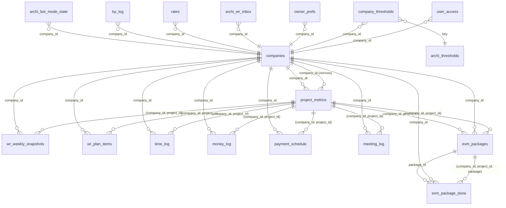
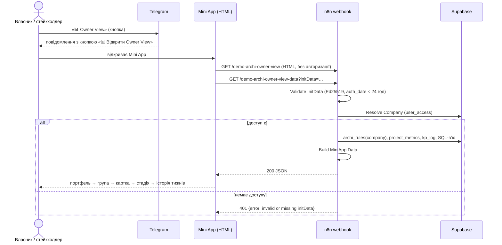
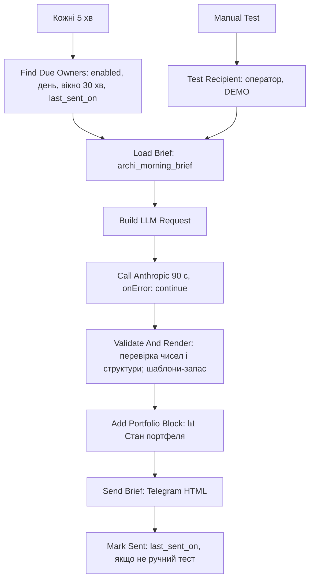
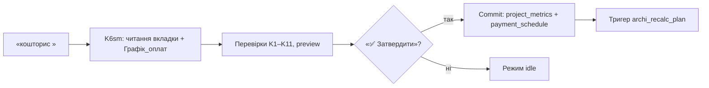

# ARCHI — повний пакет документації для передачі розробки

Зібрано автоматично `scripts/build_handover_bundle.py`. Кожен документ вставлено дослівно; `<!-- SOURCE … -->` містить sha256 джерела.
Не входять: `docs/RELEASE_PLAN.md` (журнал робіт, ~540 КБ, читати з кінця в репозиторії), `docs/archive/`, `sql/`, `workflows/` (код і експорти лише в репозиторії).
Номери «п. N» означають пункти закритих рішень у `CLAUDE.md`. Починати з Частини I, документ 00.

## Зміст

**ЧАСТИНА I — Пакет передачі: що це, для кого, як читати**
1. `docs/handover/00_START_HERE.md` — Навігація, стан, чек-лист передачі
2. `docs/handover/01_PRODUCT_BRIEF.md` — Продуктовий бриф для Product Manager
3. `docs/handover/02_BUSINESS_REQUIREMENTS.md` — Бізнес-вимоги
4. `docs/handover/03_TECHNICAL_CTO.md` — Технічний документ для CTO
5. `docs/handover/04_METHODOLOGY_FOR_DEVELOPERS.md` — Методологія для розробників
6. `docs/handover/10_DATABASE_SCHEMA.md` — Схема БД (згенеровано зі знімка)
7. `docs/handover/11_API_CONTRACT.md` — API-контракт
8. `docs/handover/openapi.yaml` — OpenAPI 3.0
9. `docs/handover/12_ERROR_AND_EDGE_CASES.md` — Помилки, порожні стани, крайні випадки
10. `docs/handover/13_USER_FLOWS.md` — Потоки користувача (Mermaid)
11. `docs/handover/14_THREAT_MODEL.md` — Модель загроз (STRIDE)
12. `docs/handover/15_USER_STORIES.md` — User Stories з Acceptance Criteria
13. `docs/handover/16_NFR.md` — Нефункціональні вимоги: цілі власника й стан

**ЧАСТИНА II — Перевірка пакета**
14. `docs/handover/05_CTO_REVIEW_PLAN.md` — План перевірки пакета CTO
15. `docs/handover/06_REVIEW_VALIDATION_PLAN.md` — План валідації результатів перевірки
16. `docs/handover/07_REVIEW_REPORT.md` — Звіт про перевірку за планом
17. `docs/handover/08_CODE_VS_DOCS_AUDIT_PROMPT.md` — Промпт: перевірка існуючого коду проти документації

**ЧАСТИНА III — Канон: рішення, карта, специфікації**
18. `CLAUDE.md` — Закриті рішення власника п. 1–35, ритуал і правила сесії
19. `docs/DECISIONS_REGISTER.md` — Реєстр закритих рішень і суперечностей
20. `docs/ROADMAP_TO_RELEASE.md` — Єдина карта розробки до релізу
21. `docs/WBS_FROM_FINAL.md` — Зворотний WBS від фіналу до сьогодні (згенеровано)
22. `docs/ARCHI_TECH_SPEC_v3_1.md` — Технічна специфікація v3.1
23. `docs/FORMULAS.md` — Довідник формул і порогів
24. `SECURITY.md` — Відомі ризики безпеки

**ЧАСТИНА IV — Додаткові специфікації й методологія**
25. `docs/ARCHI_Obraz_Idealnoho_Rezultatu.md` — Методологія й концепція
26. `docs/W1_DESIGN.md` — Дизайн багатоклієнтності
27. `docs/WEEKLY_REPORT_FORM.md` — Форма звіту ПМа і Weekly Render
28. `docs/LAYOUT_STANDARD.md` — Стандарт верстки текстів
29. `docs/EVM_CLASSIC_PLAN.md` — План гілки «EVM (класичний)»
30. `docs/EVM_CLASSIC_DESIGN.md` — Дизайн гілки «EVM (класичний)»
31. `docs/OWNER_MORNING_TEST.md` — Тест для власника
32. `docs/FEATURE_IDEAS.md` — Ідеї власника: чат проєкту, виконавці
33. `docs/HANDOVER_CTO.md` — Пакет передачі CTO Senior (v1, 02.11.2026)
34. `docs/CTO_CHECKPOINT_03.11.2026.md` — Останній аудит коду проти документації
35. `docs/NODE_MAP.md` — Карта вузлів core workflow (генерується)
36. `docs/MORNING_BRIEF_PROMPT.txt` — Системний промпт ранкового брифінгу

---

# ЧАСТИНА I — Пакет передачі: що це, для кого, як читати


---

<!-- SOURCE docs/handover/00_START_HERE.md sha256=22fa8bb50b29f92a730e5ff00c0572f71ad7ab478fa9d5abbeded5e93e8b360b bytes=13396 -->
**Джерело: `docs/handover/00_START_HERE.md` — Навігація, стан, чек-лист передачі**

# ARCHI — пакет передачі розробки IT-компанії
Версія 1.0 (остаточна) · 05.11.2026 · Зміни пакета — лише через PR з перевіркою `check_handover.py` і CI та новим розділом у `RELEASE_PLAN`. · Репозиторій `matveevhmd-prog/fdo-perfect` (приватний), гілка `main`.
Власник продукту — Андрій Матвєєв (COO). Мова документації — українська. Назви показників, вузлів, таблиць, полів і шляхів — без перекладу.

Позначки в усіх документах пакета: **Факт** — перевірено кодом або живим SQL (джерело й дата поруч); **[Припущення]** — логічний висновок без перевірки; **Потребує перевірки** — сумнів; **[Рекомендація]** — пропозиція автора пакета, не рішення власника.

## 1. Що це за продукт одним абзацом
ARCHI — це **контроль майбутньої рентабельності проєкту** для архітектурно-проєктних компаній. Продукт не моніторить фактичний % виконання. Центр методології — постійний фокус на **прогнозі часу до завершення (ETC)**, який щотижня дає проєктний менеджер (ПМ). ARCHI порівнює слова ПМа з об'єктивними цифрами (години, акти, оплати) і робить розбіжність видимою без наказів. Власник бачить портфель у Telegram Mini App, питає чат-агента, а щоранку отримує готовий план дій на день.
Методологічна основа — «порожній човен»: видима правда цифр замість особистого тиску (`docs/ARCHI_Obraz_Idealnoho_Rezultatu.md`, Розділ 1).

## 2. Кому який документ
| Роль | Читати | Навіщо |
|---|---|---|
| Product Manager | `01_PRODUCT_BRIEF.md`, потім `02_BUSINESS_REQUIREMENTS.md` | бачення, користувачі, кілер-фічі, каталог фіч зі статусами, вимоги, критерії релізу |
| CTO / техлід | `03_TECHNICAL_CTO.md`, потім `04_METHODOLOGY_FOR_DEVELOPERS.md` | архітектура, дані, потоки, безпека, борг, ризики, перші кроки |
| Розробник | `04_METHODOLOGY_FOR_DEVELOPERS.md`, `10_DATABASE_SCHEMA.md`, `11_API_CONTRACT.md`, `13_USER_FLOWS.md`, `docs/FORMULAS.md`, `docs/NODE_MAP.md` | предметна область, схема БД, API, потоки, формули, карта вузлів |
| QA | `15_USER_STORIES.md`, `12_ERROR_AND_EDGE_CASES.md`, `02_BUSINESS_REQUIREMENTS.md` §6, `docs/OWNER_MORNING_TEST.md` | сценарії приймання, помилки й крайні випадки |

## 3. Порядок читання першого дня (для всіх)
1. Цей файл.
2. `CLAUDE.md` у корені репозиторію — **закриті рішення власника (п. 1–34)**. Їх не перепитують і не переробляють без власника. Для нового виконавця це найважливіший файл: він пояснює, чому продукт влаштований саме так.
3. `docs/DECISIONS_REGISTER.md` — реєстр рішень і суперечностей між документами.
4. `docs/ROADMAP_TO_RELEASE.md` — єдина карта розробки до релізу (потоки W0–W11, критерії R-1…R-14, рішення OD-N).
5. Документи за роллю (таблиця вище).

## 4. Пакет документів
### 4.1 Нові документи цього пакета (`docs/handover/`)
| Файл | Зміст |
|---|---|
| `00_START_HERE.md` | цей файл: навігація, стан, чек-лист передачі |
| `01_PRODUCT_BRIEF.md` | продуктове бачення, користувачі, сценарії, кілер-фічі, каталог фіч |
| `02_BUSINESS_REQUIREMENTS.md` | бізнес-контекст, вимоги BR-N зі статусом і джерелом, обмеження, критерії приймання, ризики |
| `03_TECHNICAL_CTO.md` | архітектура, дані, потоки n8n, інтеграції, безпека, борг, операційні правила, рекомендації |
| `04_METHODOLOGY_FOR_DEVELOPERS.md` | предметна область і формули простою мовою, правила кольору й верстки |
| `05…07` | план перевірки пакета CTO, план валідації, звіт про перевірку |
| `08_CODE_VS_DOCS_AUDIT_PROMPT.md` | промпт: перевірка коду й живих систем проти документації |
| `10_DATABASE_SCHEMA.md` | схема БД (згенеровано з живої бази): типи, обмеження, індекси, RLS, ER |
| `11_API_CONTRACT.md`, `openapi.yaml` | API-контракт 5 вебхуків і форма відповідей |
| `12_ERROR_AND_EDGE_CASES.md` | помилки, порожні стани, крайні випадки «як є» |
| `13_USER_FLOWS.md` | потоки користувача (діаграми Mermaid) |
| `14_THREAT_MODEL.md` | модель загроз STRIDE |
| `15_USER_STORIES.md` | 55 User Stories з Acceptance Criteria |
| `16_NFR.md` | нефункціональні вимоги: цілі власника й виміряний стан |

### 4.2 Канонічні документи репозиторію (джерела, на які посилається пакет)
| Файл | Призначення |
|---|---|
| `CLAUDE.md` | закриті рішення власника п. 1–34, ритуал сесії |
| `docs/ROADMAP_TO_RELEASE.md` | карта, критерії релізу, рішення OD |
| `docs/ARCHI_TECH_SPEC_v3_1.md` | технічна специфікація v3.1 |
| `docs/FORMULAS.md` | довідник усіх формул і порогів (єдине джерело визначень) |
| `docs/WEEKLY_REPORT_FORM.md` | форма звіту ПМа і специфікація Weekly Render |
| `docs/LAYOUT_STANDARD.md` | верстка текстів «стовпчиком», словник емодзі |
| `docs/ARCHI_Obraz_Idealnoho_Rezultatu.md` | методологія й концепція |
| `docs/W1_DESIGN.md` | дизайн багатоклієнтності (company_id, ролі, пороги на клієнта) |
| `docs/EVM_CLASSIC_PLAN.md`, `docs/EVM_CLASSIC_DESIGN.md` | окрема гілка «EVM (класичний)» |
| `docs/NODE_MAP.md` | карта 193 вузлів core workflow (генерується скриптом) |
| `docs/FEATURE_IDEAS.md` | ідеї власника: ARCHI у чаті проєкту, виконавці |
| `docs/OWNER_MORNING_TEST.md` | тест для власника: 4 дії + 10 питань |
| `SECURITY.md` | відомі ризики безпеки й прийняті рішення |
| `docs/RELEASE_PLAN.md` | журнал усіх робіт (540 КБ; читати з кінця) |
| `docs/CTO_CHECKPOINT_*.md` | аудити коду проти документації |
| `docs/MORNING_BRIEF_PROMPT.txt` | системний промпт ранкового брифінгу |
| `workflows/*.json`, `workflows/*.sdk.ts` | експорти n8n (токен замінено на `<TELEGRAM_BOT_TOKEN>`) |
| `sql/` | міграції з відкатами, демо-дані, тести |
| `scripts/` | `check_docs.py`, `check_report_form.py`, `check_tenant_filter.py`, `gen_node_map.py`, `replay/` |

## 5. Стан продукту (чесно)
| Параметр | Стан | Джерело |
|---|---|---|
| Фаза | Робочий прототип на демо-даних; **реальних клієнтів немає**. Мета — три перші клієнти без переробки архітектури | `CLAUDE.md` п. 20 |
| Дані в системі | Усі вигадані демо-дані з арифметично порахованими значеннями (SQL); це свідомий актив для показів, не дефект | `CLAUDE.md` п. 18 |
| Стек | n8n Cloud (логіка, 193 вузли у core), Supabase Postgres (дані й обчислення), Telegram (бот і Mini App), Anthropic Claude (чат, брифінг), OpenAI gpt-4o (звіти, імпорт, фото, голос) | `TECH_SPEC` §6 |
| Багатоклієнтність | База готова (`company_id`, ключ `(company_id, project_id)`, ролі в `user_access`, пороги на клієнта). **Ізоляцію доведено тестом на рівні БД; на рівні n8n — ні.** RLS свідомо вимкнений до першого платного клієнта | `RELEASE_PLAN` §165–§171, `CLAUDE.md` п. 28 |
| Безпека | Відкриті свідомі ризики: токен бота в живому workflow, RLS вимкнений. Авторизація з таблиці `user_access` реалізована в n8n 03.11.2026, але в Telegram не прогнана (до цього чат і WR-бот були без allowlist, `SECURITY.md` п. 7). Рішення власника: токен міняти останнім кроком перед презентацією першому клієнтові | `SECURITY.md`, `CLAUDE.md` п. 25, 28 |
| Реліз | Дат релізів і показів немає (скасовано власником) | `CLAUDE.md` п. 24, 26 |
| Повнота | Див. каталог фіч у `01_PRODUCT_BRIEF.md` §6: ✅ реалізовано · 🟡 частково · ⬜ не розпочато | |

## 6. Що ще потрібно від власника при передачі (чек-лист)
Секрети в репозиторії відсутні й не мають бути. Нижче те, що власник передає окремо, захищеним каналом.
| № | Що | Навіщо |
|---|---|---|
| 1 | Доступ до n8n Cloud `osbbcopilot.app.n8n.cloud` (проєкт з workflow `CKwCsGIwyw9feCY5`, `K6smBd5xWZLWx9rr`, `RC7HNVlJtuPLtvYV`, `J3Oqcaa2YBEsVSng`) | запуск, налагодження, публікація |
| 2 | Доступ до Supabase `bxawceksdkqlbkdgjvyz` (проєкт «matvieiev-bots») | міграції, SQL |
| 3 | Токен бота `@archi_demo_bot` через BotFather і credential `Telegram account 4` у n8n | перенос секрету в сховище, потім ротація (`CLAUDE.md` п. 25) |
| 4 | API-ключі Anthropic та OpenAI, credentials у n8n | обчислення чату, звітів, брифінгу |
| 5 | Доступ до GitHub-репозиторію | код і документація |
| 6 | Google Drive / Sheets: файл Кошториса DEMO і папка договорів | спадковий адаптер; виводиться з обігу (`CLAUDE.md` п. 17) |
| 7 | Відповіді на відкриті рішення OD (`02_BUSINESS_REQUIREMENTS.md` §8) | розблокування потоків W2, W6, W8, W9, W10 |
| 8 | Юрист: пункт договору про згоду на знеособлені патерни, строки зберігання знань із чатів | `CLAUDE.md` п. 28, OD-20 |

## 7. Як перевірити, що середовище живе (перші 2 години)
1. Відкрити `docs/NODE_MAP.md` і порівняти з живим core workflow `CKwCsGIwyw9feCY5` у n8n (`activeVersionId` `978db8b8-1193-4db9-acb7-84cd21d61214`, 193 вузли на 05.11.2026). Якщо розходяться — довіряти живому n8n, експорт перезробити (правило `CLAUDE.md`).
2. У боті `@archi_demo_bot` пройти `docs/OWNER_MORNING_TEST.md` (15 хв).
3. Запустити `python3 scripts/check_docs.py` — очікується 0 помилок.
4. Запустити незалежну звірку F-02, F-13, F-15 з сирих таблиць проти `project_metrics` (запит у `docs/CTO_CHECKPOINT_PROMPT.md`, перевірка C-3).

## 8. Що пакет свідомо не містить
- Секретів, токенів, паролів, ключів API.
- Цін і тарифів: їх немає (власник ще не визначив склад; орієнтир — розділ 6 `02_BUSINESS_REQUIREMENTS.md`).
- Оцінок трудомісткості й термінів: вимірюваних даних немає, оцінювати без них заборонено правилами власника.
- Юридичних висновків.


---

<!-- SOURCE docs/handover/01_PRODUCT_BRIEF.md sha256=88e762dbf59d723b6e1eace15dcab9617a5587bf2af5fffde6f265f2ecf84bb7 bytes=33026 -->
**Джерело: `docs/handover/01_PRODUCT_BRIEF.md` — Продуктовий бриф для Product Manager**

# ARCHI — продуктовий бриф для Product Manager
Версія 1 · 05.11.2026. Позначки — як у `00_START_HERE.md`. Статуси фіч: ✅ реалізовано · 🟡 частково · ⬜ не розпочато · ⛔ чекає рішення власника.

## 1. Проблема і рішення
**Проблема.** У проєктній компанії керівник дізнається про втрату рентабельності пізно: коли години вже витрачені, а акт не підписано. Статус «готовність 40%» ні до чого не прив'язаний: людина може сказати що завгодно. Тиск «зроби швидше» викликає опір або формальне виконання.

**Рішення ARCHI.** Щотижня ПМ дає прогноз часу до завершення (ETC). ARCHI зіставляє його з годинами, актами й оплатами. Розбіжність показується як цифра, а не як чиясь думка. Оскаржити цифру складніше, ніж оскаржити людину. Це і є «порожній човен»: тиск є, але без особи, на яку можна образитись (`ARCHI_Obraz_Idealnoho_Rezultatu.md`, Розділ 1, §2).

**Суть продукту (власник, 02.11.2026, `CLAUDE.md` п. 19, переказ).**
- ARCHI — це контроль **майбутньої** рентабельності, а не моніторинг фактичного % виконання.
- Центр — прогноз ETC.
- Щотижневий моніторинг прогресу у **грошах контракту** і у **грошах собівартості виконавців**.
- Щотижневий ритм: звіт ПМа, нарада, таблиця Weekly Render.
- Owner View з drill-down на будь-який рівень у Mini App.
- Зручність: дані вантажаться голосом або текстом через бота, або імпортом з файлів; відповіді приходять туди, де людині зручно.

**Критерій для будь-якого продуктового рішення:** чи підсилює воно контроль майбутньої рентабельності й зручність каналу. Інакше фіча не входить.

## 2. Для кого
| Користувач | Що йому потрібно | Як ARCHI допомагає | Стан ролі в системі |
|---|---|---|---|
| **Власник / COO** | Знати, де «запалає», і що робити зараз | Owner View, чат Q1–Q10, ранковий брифінг з планом дій | ✅ |
| **ПМ** | Швидко здати прогноз, не писати форму руками | Опитування в Telegram; довільні відповіді (текст, голос, фото, документ) | ✅ |
| **ГАП** | Бачити стан свого проєкту | Weekly Render, Owner View | 🟡 [Припущення: ГАП — головний архітектор проєкту; розшифровку дає власник] |
| **Виконавець** | Вносити години й % готовності свого розділу без форм | Бот для виконавців; **без грошей** (`CLAUDE.md` п. 23) | ⬜ (W3.11, W10.9) |
| **Фіндиректор** | Отримувати чіткі запити про акти й оплати | Адресат порад у ранковому брифінгу; доступу до системи немає | 🟡 роль лише як адресат тексту |
| **Оператор FDO (консультант власника)** | Бачити всіх клієнтів, навчати систему на кейсах | Роль `operator` у `user_access`, бачить усі компанії | ✅ модель; журналу дій немає |
| **Замовник, підрядники** | Не користувачі ARCHI | Лише джерело подій (чати, договори) | — |

**Рівень доступу.** Ролі задаються на рівні компанії, без доступу по проєктах (`CLAUDE.md` п. 27, OD-3). Наслідок: усі ПМ клієнта бачать усі його проєкти.

## 3. Три основні фічі
1. **Owner View** — Telegram Mini App для власника: портфель, сигнали, картка проєкту, історія тижнів.
2. **Archi Consult** — чат-агент: 10 фіксованих питань і вільні питання; відповідь у форматі Insight → Impact → Action.
3. **Щотижневий ритм** — звіт ПМа через бота → Weekly Render для наради → xlsx.

Додаткові модулі: ранковий брифінг, імпорт годин і грошей через бота, журнал зустрічей, облік КП, прийом договору, гілка «EVM (класичний)», знання проєкту з чатів (план), самонавчання (план).

## 4. Кілер-фічі
Кілер-фіча — те, чого немає в звичайному таск-трекері чи BI і що важко скопіювати, бо за нею стоїть методологія. Перелік складено за закритими рішеннями власника.

| № | Кілер-фіча | У чому сила | Стан | Джерело |
|---|---|---|---|---|
| K1 | **Ланцюжок готовності в годинах** | Чотири числа поруч: «Витрачено» = AC/BAC; «Готовність ПМа» = EV/BAC; «За прогнозом» = AC/EAC, де EAC = AC + ETC_прогноз; «Ефективність годин» = BAC/EAC (план = 1,00). Розбіжність «Готовність ПМа − за прогнозом» у п.п. — **видимий технічний борг**. Людина не може словами закрити цей розрив | ✅ | `CLAUDE.md` п. 7; `FORMULAS` E-01…E-08 |
| K2 | **Звіт ПМа через опитування, а не форма** | ПМ відповідає довільно (текст, голос, фото екрана, документ). ARCHI структурує, бачить прогалини, ставить уточнення. На кожне ПМ мусить відповісти чітко або сказати «відповіді немає» | ✅ | `CLAUDE.md` п. 2 |
| K3 | **Захист від вигаданих чисел (довіра до даних)** | Числа, дати й блокер приймаються лише якщо їх можна знайти в тексті ПМа. Перевіряє код, не LLM. Слова-підтвердження («нуль», «немає») діють лише по названій стадії. Непідтверджене показується окремим блоком «Не підтверджено вашим текстом» | ✅ | `CLAUDE.md` п. 9; тести 29/0 |
| K4 | **«За чиї гроші працювала команда» (P-10)** | Приріст готовності між двома звітами × контракт = бюджет приросту. Порівняння з витратами команди (години × ставка) показує, чи тиждень пройшов за гроші замовника чи власника. Історія кожного тижня | ✅ в Owner View; індекс у Weekly Render ⬜ | `CLAUDE.md` п. 11, 12 |
| K5 | **Правило кольору «від'ємне — червоне»** | Одна логіка на весь продукт: різниця = результат − план; мінус 🔴, плюс або нуль 🟢, жовтого немає. Колір рахує лише SQL. Екран підсвічує відхилення від плану, а не «настрій» | ✅ | `CLAUDE.md` п. 15 |
| K6 | **Дві рентабельності й дві методології** | Рентабельність від контракту і від собівартості (важливо для pro bono й імідж-проєктів). Окрема вкладка «EVM (класичний)» без домішок методології Archi: власник бачить проєкт у двох оптиках | ✅ методологія Archi; 🟡 EVM (таблиці й функції є, екрана немає) | `CLAUDE.md` п. 8, 13, 14 |
| K7 | **Ранковий брифінг власника** | Щодня о 08:30 (пн–пт) у Telegram приходить план дій на день: топ-5 дій у форматі Insight → Impact → Action; для кожної — адресат за роллю (ПМ, Фіндиректор) і **готовий текст, який власник копіює й надсилає**, або тези для власного дзвінка (з 07.11.2026). ARCHI не просто підсвічує проблему, а думає за власника «що мені з цим робити». Пріоритети рахує SQL, LLM лише формулює, числа перевіряє код | ✅ розсилку ввімкнено 05.11.2026; перший автозапуск не перевірено | `CLAUDE.md` п. 32; `RELEASE_PLAN` §172–§175 |
| K8 | **Weekly Render без грошей для наради** | Таблиця для наради з командою, підрядниками, замовниками: лише відхилення від плану в % або індексом (план = 1,00). Гроші лише в Owner View | ✅ | `CLAUDE.md` п. 7 |
| K9 | **Чесне «даних немає»** | Система не вигадує. Немає залишків на рахунках — на питання «чи є гроші на зарплату» відповідь «даних немає» і що саме потрібно | ✅ | `OWNER_MORNING_TEST` Q4, Q5; `TECH_SPEC` §1.1 |
| K10 | **Канал там, де зручно** | Голос, текст, скрін, PDF у Telegram; у майбутньому — повідомлення проєктних чатів | ✅ вхід бота; ⬜ групові чати | `CLAUDE.md` п. 19, 22 |
| K11 | **Знання проєкту з чатів** (план) | Бот у проєктних чатах збирає рішення, ризики, домовленості й відповідає на «що ми домовились» з цитатою, датою, автором | ⬜ W10 | `CLAUDE.md` п. 22 |
| K12 | **Цикл самонавчання між клієнтами** (план) | Власник з Claude вивчає кейси; знеособлені патерни покращують відповіді ARCHI. Сирі дані клієнтів ізольовані; між клієнтами тече лише шар патернів. Конкурентна перевага | ⬜ W11 | `CLAUDE.md` п. 27, 28 |

**Чого в кілер-фічах немає навмисно (не пропонувати).**
- Лінійна екстраполяція темпу проєкту — сигнал було реалізовано й видалено 25.09.2026 як методологічно хибний (`Образ…`, Розділ 7).
- Гроші у Weekly Render.
- Жовтий колір для відхилень від плану.
- Сигнал «прогноз застарів» — свіжість показує дата оновлення даних (`CLAUDE.md` п. 26).
- Керування ліквідністю, касовим розривом, зарплатним фондом: даних немає, не обіцяти.

## 5. Ключові сценарії
### 5.1 Щотижневий ритм
| Коли | Хто | Що відбувається |
|---|---|---|
| П'ятниця, 17:30–18:30 | Виконавці, ПМ | Рефлексія: що робили, зробили, будемо робити; оцінка % готовності й ETC. Оплачується як звичайна робота. Нагадування від бота — ⬜ (D1) |
| До вівторка | ПМ | У боті натискає кнопку проєкту, бачить питання, відповідає довільно, натискає «📤 Відправити». ARCHI структурує й ставить уточнення. «✅ Фінал» фіксує звіт у `wr_weekly_snapshots` |
| Вівторок, з 9:30 | Топменеджмент, ПМ, ГАП | Нарада з показом екрана Weekly Render. «Порожній човен» діє і на керівництво: не можна відмовити ПМу в ресурсі, а потім звинуватити його в зриві дедлайну |
Свідоме спрощення поточної версії: один ПМ агрегує усну рефлексію виконавців. Майбутнє: виконавці самі надсилають години й % боту (W10.9).

### 5.2 Ранок власника
1. 08:30 приходить брифінг: 5 дій, кожна з готовим текстом.
2. Власник пересилає тексти адресатам або дзвонить.
3. За потреби питає чат: «Де може запалати?», «Чи потрібно мені зараз щось робити?».
4. Для деталей відкриває Owner View: портфель → група → картка → стадія → історія тижнів.

### 5.3 Старт проєкту (поточна реалізація)
Команда `кошторис <id>` → перевірки K1–K11 → «затвердити» → план у `project_metrics` і `payment_schedule`. Джерело плану — Google Sheets (спадковий адаптер). **Мета:** жива сесія планування в самому ARCHI з GATE «планову рентабельність затвердив власник» (W2, ⬜). **GATE:** команда не списує час на проєкт, доки власник не затвердив планову рентабельність. Зараз це організаційне правило, не перевірка в коді (OD-8).

### 5.4 Журнал годин і грошей
Режим «Години і гроші» в боті: діалог з LLM, неповні рядки блокують «Фінал», підтверджені рядки йдуть у `time_log` і `money_log`. Виконавці годин самі не вносять (⬜).

## 6. Каталог фіч зі статусом
### 6.1 Owner View (Telegram Mini App)
| Фіча | Стан | Примітка |
|---|---|---|
| Портфель: таблиця План / Факт / Прогноз / Різниця | ✅ | проєкти, Workload, Зроблено ÷ витрачено, прибуток, рентабельність від контракту, КП, договори |
| Загальний статус: лічильники 🟢🟡🔴⛔ з переліком проєктів | ✅ | |
| Панель «Показник»: Рентабельність, Прибуток, Акти і гроші, Години, Ефективність; розподіл | ✅ | |
| Перелік «Потребують уваги» | ✅ | |
| Картка проєкту: сигнали, рентабельність, ⛔, контракт, роботи/акти/гроші, прибуток, звіт ПМа, ETC, ефективність | ✅ | |
| Блок стадій МБР/ЕП/П/Р, історія тижнів | ✅ | |
| «Приріст готовності проти витрат команди» + таблиця «за чиї гроші по тижнях» | ✅ | |
| Drill-down до виконавця, розділу, пакета, запису журналу | ⬜ | R-7, W6.1 |
| Вкладка «EVM (класичний)» | ⬜ | W6.4 |
| Хостинг сторінки поза n8n | ⬜ ⛔ | OD-12 |
| Дата оновлення даних на кожному екрані | 🟡 | є на більшості; повна перевірка не виконана (`CLAUDE.md` п. 26) |

### 6.2 Archi Consult (чат)
| Фіча | Стан |
|---|---|
| Q1–Q10 кнопкою «❓ Питання» і текстом | ✅ |
| Вільні питання | ✅ |
| Формат Insight → Impact → Action, до 3 проєктів, без вигаданих чисел | ✅ |
| Пам'ять розмови | ⬜ (кожне питання окремо) |
| Відповіді з знань проєкту (договір, наради, чати) | ⬜ W10 |

Q1–Q10 (LOCKED): що відбувається; де запалає; чи потрібно щось робити; чи є гроші на зарплату (відповідь «даних немає»); чи є небезпека касового розриву (лише з графіка оплат); на який час у команди є робота; чи виконуємо річний план по прибутку; небезпечні дедлайни; за що можуть «прилетіти» від якірного замовника («не визначено»); що пообіцяли замовнику на останній нараді (з `meeting_log`).

### 6.3 Щотижневий ритм
| Фіча | Стан |
|---|---|
| Бриф-питання по проєкту; відповіді текстом, голосом, фото, PDF/TXT | ✅ |
| Черга повідомлень, «📤 Відправити», «📄 Чернетка», «✅ Фінал», «🆕 Новий» | ✅ |
| Перевірка чисел у тексті ПМа кодом | ✅ |
| Гейт «Фінал»: статуси всіх пунктів плану минулого тижня | ✅ |
| План наступного тижня з перенесенням невиконаного | ✅ |
| Блокер (⛔), його тип і дата, розбіжність готовності (⚖️) | ✅ |
| Weekly Render: колонки тижнів + «Сьогодні», кольори від SQL, без грошей | ✅ |
| Експорт xlsx | ✅ |
| Команда `/status`, кнопка «📋 Статус звітів» | ✅ |
| Нагадування п'ятниці | ⬜ (D1, W5.3) |
| Звіт АН (авторський нагляд) вільним текстом або голосом | ⬜ (W5.4, п. 16) |
| P-10 індексом у Weekly Render (без грошей) | ⬜ (п. 12) |

### 6.4 Ранковий брифінг
| Фіча | Стан |
|---|---|
| Вибір подій і ранжування в SQL (`archi_morning_brief`) | ✅ |
| Правила: блокер, прострочений і близький акт, дедлайн документації, дія з наради, ETC перевитрата, рентабельність нижче плану, немає прогнозу, немає звіту, підрядник чекає аванс | ✅ |
| Формулювання LLM + перевірка чисел кодом + шаблони-запас | ✅ |
| Формат Insight → Impact → Action, текст для копіювання, типи command / propose / call | ✅ 07.11.2026 |
| Посилання на людину в чаті для надсилання одним натисканням | ⬜ (потрібні Telegram-id людей команди; після заведення команди) |
| Розсилка 08:30 пн–пт | ✅ ввімкнено 05.11.2026 |
| Налаштування часу й днів | 🟡 змінюється в `owner_prefs` за проханням; команди в боті немає (рішення власника) |

### 6.5 Дані й інтеграції
| Фіча | Стан |
|---|---|
| Імпорт годин і грошей діалогом у боті | ✅ код; вхід: текст, голос, фото |
| Імпорт з XLSX/CSV з профілем колонок на клієнта | ⬜ W3.10 (OD-18: XLSX основний + CSV резервний) |
| API IF.TEAM, OneB | ⬜ відкладено (API і зразків немає, п. 21) |
| Журнал зустрічей (`meeting_log`) | 🟡 11 записів, живого фіду немає |
| Облік КП («КП: N»): місяць, рік, конверсія 20%, план 350 | ✅ |
| Прийом договору (`договір <id>`) у Google Drive | 🟡 |
| Договори АН «оплата за виїзд» (модель даних і розрахунок) | ✅ |
| Кошторис через Google Sheets (спадковий адаптер) | ✅ виводиться з обігу |
| Модуль плану в ARCHI (версії плану, журнал змін, GATE) | ⬜ W2 |

### 6.6 Платформа
| Фіча | Стан |
|---|---|
| Багатоклієнтність: `companies`, `company_id`, ключ `(company_id, project_id)` | ✅ в БД; 🟡 тест ізоляції на рівні n8n не виконано |
| Ролі з таблиці `user_access` (замість зашитого allowlist) | 🟡 W1.2 |
| Пороги й параметри методології на клієнта | ✅ `company_thresholds` |
| Формули, пороги й кольори лише в SQL | 🟡 W1.8: частину ще рахує n8n і браузер |
| RLS-політики | ⬜ свідомо відкладено до першого платного клієнта |
| Секрети й окремий бот на клієнта | ⬜ W1.4 |
| Онбординг клієнта від порожньої бази до першого Weekly Render | ⬜ W9.1 |

### 6.7 Гілка «EVM (класичний)»
Окрема вкладка за підручниковою методологією: BAC, PV, EV, AC, CV, SV, CPI, SPI, EAC, ETC, VAC, TCPI. EV = Σ по пакетах робіт (бюджет пакета × правило виконання, напр. 0/100 по виданих аркушах), незалежно від оцінки ПМа. PV — з розкладу пакетів у часі.
| Фіча | Стан |
|---|---|
| Таблиці `evm_packages` (100 демо-рядків), `evm_package_done`, функції й в'ю `evm_classic_*` | ✅ |
| Введення фактів виконання пакетів (бот «Видано») | ⬜ W7.2 |
| AC субпідряду за актом субпідрядника (О-3 «А», `CLAUDE.md` п. 34): новий тип у `money_log`, ввід ПМом | ⬜ W7.6 |
| Екран «EVM (класичний)» | ⬜ W6.4 |
| Рішення Н-5, О-3, D7 (W7.3, OD-13 закрито) | ✅ 05.11.2026 (`CLAUDE.md` п. 34): Н-5 за назвою, D7 неділя тижня, О-3 за актом субпідрядника |

### 6.8 Фічі наступної хвилі (карта, не розпочато)
| Фіча | Вузол | Суть |
|---|---|---|
| Бот-адмін у проєктних чатах, пошук по знаннях проєкту | W10.1–W10.8 | джерело знань: контракт, кошторис, наради, чати |
| Performer Bot для виконавців | W10.9 | лише години й % готовності свого розділу; без грошей |
| Сценарії виконавця | W10.10 | «поставь мене в курс справ»: контракт без сум, дедлайни, готовність, ETC, домовленості |
| Звіт виконавцю за тиждень | W3.7 | перелік його записів, підтвердження |
| Цикл самонавчання | W11 | знеособлений шар патернів |
| Розбиття монолітного workflow, власний бекенд чи n8n | W8.2, OD-14 | рішення після W1–W3 |

## 6.9 Інші вузли карти (технічні й допоміжні)
Вузли `ROADMAP_TO_RELEASE.md`, які не мають окремої фічі в каталозі вище: інженерія, процес, дрібні складники. Статус — із карти станом на 05.11.2026 (першоджерело — `ROADMAP`).
| Вузол | Назва | Статус за картою |
|---|---|---|
| W0.1 | Єдина карта (цей файл) і стартовий промпт сесії-штабу (`START_PROMPT_HQ.md`) | ✅ 02.11.2026 |
| W0.2 | Закрити паралельні сесії (С1, С2, EVM-1, EVM-2) після результату; нові — лише за вузлом цієї карти | 🟡 С1: результат у `RELEASE_PLAN` §146–§148 (05.11.2026), відхилення внесені як WD.1–WD.7; сесія EVM Ф0 (`session_01RSwaMQuhTxVUWQqf4kVzGi`)… |
| W0.3 | CTO Checkpoint повний перед кожним релізним шлюзом і після ≥ 3 публікацій n8n | 🟡 частковий 03.11 (`CTO_CHECKPOINT_03.11.2026.md`: P0 0 · P1 0 · P2 13; виконано A-1…A-5, C-3, C-4, F-check, S-check, R-06 (тести, макет); не… |
| W0.4 | Перехідний промпт v5 (Карта = цей файл) | ⬜ |
| W0.5 | Опис фіч для клієнта (файл ARCHI_FEATURES_v1 (запланований, ще не створено)) | ⬜ |
| W0.6 | Індекс документів і перевірка узгодженості | ✅ 02.11.2026 |
| W0.7 | Перенести з `TRANSITION_PROMPT_2026-10-25.md` (v3) розділи 2–8, 10–15 у канонічні документи і заархівувати v3 | ⬜ |
| W0.8 | Пакет передачі CTO Senior (`docs/HANDOVER_CTO.md`) і стартовий промпт сесії-штабу | ✅ 02.11.2026 |
| W1.3 | RLS-політики по компанії | ⬜ відкладено рішенням власника 03.11.2026 (OD-4): до заведення першого платного клієнта |
| W1.7 | Видимість репозиторію | 🟡 OD-6 закрито 02.11.2026 (варіант А, `CLAUDE.md` п. 25): зробити приватним; змінює власник у GitHub Settings; стан після зміни перевірити |
| W2.4 | Імпорт плану з файлу | ⬜ |
| W2.5 | Розрахунок полів плану | ⬜ |
| W2.6 | Пакети EVM | 🟡 таблиці й 100 демо-пакетів є (RELEASE_PLAN §143) |
| W2.8 | Дані проєктів, що вже є | 🟡 |
| W3.1 | Бот: звіт ПМа (текст/голос/фото) | ✅ код (Факт); живу перевірку в Telegram виконує власник |
| W3.2 | Імпорт годин і грошей | 🟡 |
| W3.3 | IF.TEAM | ⬜ відкладено: API-доступу і зразків немає (власник 02.11.2026, `CLAUDE.md` п. 21); не проєктується до появи доступу, з карти не видаляється |
| W3.4 | OneB | ⬜ відкладено з тієї ж причини |
| W3.9 | Розбір документів у боті | ✅ 03.11.2026: вихід TXT (індекс 1) → `WR: Extract TXT Text`, fallback (індекс 2) → лише `WR: Send Unsupported Format` (`40abff53`, `RELEASE_PLAN`… |
| W4.1 | ETC-фокус | ✅ (основа, `FORMULAS` §2–§3) |
| W4.3 | ~~Сигнал застарілого прогнозу~~ → дата оновлення даних | 🟡 рішення прийнято; ⬜ перевірити дату на Owner View, Weekly Render, чаті, xlsx |
| W4.4 | Логіка порогів в одному місці | ⬜ |
| W4.7 | Точність прогнозів ПМа (ідея 07.11.2026) | ⬜ |
| W4.8 | Головне обмеження бюро, Constraint Engine (ідея 07.11.2026) | ⬜ |
| W4.9 | Повнота даних поряд із кольором (ідея 07.11.2026) | ⬜ |
| W4.10 | Виконання дій брифінгу й корисність сигналів | ⛔ рішення власника (п. 32) |
| W5.1 | Звіт ПМа (опитування) | ✅ |
| W5.2 | Weekly Render | ✅ |
| W5.6 | Ритм нарад: п'ятниця рефлексія, вівторок 9:30 | — |
| W6.3 | Чат-агент | ✅ (Q1, Q8 виправлено §139); вибірково |
| W7.1 | Ф0 дизайн, Ф1 таблиці, Ф1b функції й в'ю | ✅ (RELEASE_PLAN §143, §144) |
| W7.4 | V4(б) мутаційний тест, V6 з числовим знімком, V7–V10 | ⬜ |
| W8.3 | K6sm і RC7H експортувати в git | ✅ 02.11.2026: `workflows/Archi_Koshtorys_Ingest_K6sm.json` (`cf904641`, 16 вузлів), `workflows/Archi_Document_Intake_RC7H.json` (`d86d127a`, 5… |
| W8.5 | `NODE_MAP`, `TECH_SPEC` | 🟡 |
| W8.6 | Надійність LLM- і медіа-вузлів звіту (повтор, таймаут, запасне повідомлення) | ⬜ |
| W8.7 | Константи в одному місці (URL n8n, BOT_ID, стадії) | ⬜ |
| W8.8 | Захист від prompt-injection у текстах ПМа | ⬜ |
| W8.9 | Версіонування знімка звіту за той самий тиждень | ⛔ рішення власника |
| W8.10 | Кириличні назви колонок БД | ⛔ рішення власника |
| W9.2 | Демо-тенант і відокремлення демо-даних | ⬜ |
| W10.3 | Обробка повідомлень групи | ⬜ |
| W10.5 | Витяг подій із чатів | ⬜ |
| W10.6 | Відповіді «що ми домовились» | ⬜ |
| W11.1 | Реєстр кейсів і патернів | ⬜ (після W1) |
| W11.2 | Шар знеособлених патернів | ⬜ (після W1) |
| W11.3 | Використання патернів у ARCHI | ⬜ |
| W11.4 | Вимірювання користі | ⬜ |

## 7. Стан якості для PM
- **Демо-дані:** 14 проєктів-договорів і 4 договори АН, 8 тижнів знімків, набір сценаріїв: 🟢, 🟡, 🔴, ⛔, ⚖️ (`live SQL` 05.11.2026: розподіл на екрані 🟢3 🟡3 🔴6 ⛔2). Сценарії створені, щоб показувати клієнту, як ARCHI працює в різних ситуаціях.
- **Відомі відхилення демо-циклу (WD.1–WD.7)** — `ROADMAP_TO_RELEASE.md` розділ WD. Вони не блокують розробку; три з них чекають рішення власника (WD.5, WD.6, WD.7).
- **Тест для власника:** `docs/OWNER_MORNING_TEST.md`, вердикту власника ще немає.

## 8. Принципи, які PM не змінює без власника
Повний перелік — `CLAUDE.md`. Найважливіші для продукту:
1. Термін лише **ETC** (ETC_план, ETC_факт, ETC_прогноз). Слово «залишок» заборонено скрізь (п. 1).
2. Верстка текстів лише **стовпчиком**: один показник — один рядок (п. 4, `LAYOUT_STANDARD.md`).
3. Weekly Render без грошових сум і без абсолютних вартостей (п. 7). Вигляд змінюється лише за прямим запитом власника й разом зі специфікацією (п. 3).
4. Колір: мінус 🔴, плюс або нуль 🟢, жовтого для відхилень від плану немає (п. 15).
5. Не змішувати методології Archi і класичного EVM у назвах і порогах (п. 14).
6. Реліз = три клієнти без переробки архітектури; обсяг не зменшується, костилів і патчів немає (п. 20).
7. Дані клієнтів ізольовані; між клієнтами лише знеособлені патерни (п. 28).


---

<!-- SOURCE docs/handover/02_BUSINESS_REQUIREMENTS.md sha256=d511068eef97d81924d9d515bd1d872f68c8692a4db50333cfb3b55a1a5a5811 bytes=28133 -->
**Джерело: `docs/handover/02_BUSINESS_REQUIREMENTS.md` — Бізнес-вимоги**

# ARCHI — бізнес-вимоги
Версія 1 · 05.11.2026. Позначки й статуси — як у `00_START_HERE.md` і `01_PRODUCT_BRIEF.md`. Кожна вимога має джерело: закрите рішення власника (`CLAUDE.md` п. N), пункт карти (`ROADMAP_TO_RELEASE.md`, W-N) або специфікацію.

## 1. Бізнес-контекст
- **Власник продукту:** Андрій Матвєєв, COO, 30 років практики в управлінні архітектурно-будівельним бізнесом. Методологія відпрацьована на практиці до коду; ARCHI автоматизує перевірену методологію, не винаходить нову.
- **Цільовий клієнт:** архітектурно-проєктна компанія; до 20 проєктів на клієнта (`CLAUDE.md` п. 21).
- **Модель продажу:** ARCHI — додаток до експертної послуги «COO-as-a-service». Орієнтир ціни: **$500 на місяць** (власник, 02.11.2026). Склад ціни й чи входить операційна підтримка — відкрито (OD-17). Тарифи не визначені. Оператор FDO (консультант-власник) бачить усіх клієнтів.
- **Мета:** три перші реальні клієнти працюють без переробки архітектури (`CLAUDE.md` п. 20). Дат релізу немає (п. 24, 26).
- **Продуктова теза:** управління через видиму правду цифр. Метрика — крос-перевірка слів людини з об'єктивним розрахунком, а не просто число (`Образ…` §4.3).

## 2. Цілі й показники успіху
| № | Ціль | Спосіб виміру | Стан |
|---|---|---|---|
| G-1 | Власник за 15 хв ранком розуміє стан портфеля й що робити | `OWNER_MORNING_TEST.md`: 4 дії + 10 питань, вердикт власника | ⬜ вердикту немає (WD.7) |
| G-2 | ПМ здає тижневий звіт без ручної форми | Звіт проходить «Фінал»; частка проєктів зі свіжим звітом | 🟡 вимірюється кнопкою «Статус звітів» |
| G-3 | Прогноз ETC порівнюється з реальністю щотижня | Знімки `wr_weekly_snapshots` за тиждень | ✅ механізм |
| G-4 | Втрата рентабельності видна до підписання акта | Сигнали ETC, рентабельність нижче плану | ✅ |
| G-5 | Додавання клієнта не вимагає переробки коду | Онбординг тестового клієнта від порожньої бази до першого Weekly Render | ⬜ R-10 |
**Вимірювані цифри ефекту для клієнта (економія годин, зростання маржі) відсутні:** пілотів не було. Не обіцяти числа, поки їх не виміряно.

## 3. Межі
**У межах продукту:** контроль прогнозу й рентабельності, щотижневий ритм, аналітика власника, канали входу даних, багатоклієнтність, знання проєкту (план), самонавчання (план).
**Поза межами (свідомо):**
- Керування ліквідністю, касовий розрив, зарплатний фонд (даних немає).
- «Автоматичний захист прибутку».
- Лінійна екстраполяція темпу проєкту.
- Заміна систем обліку (IF.TEAM, OneB): ARCHI лише приймає з них дані.
- Грошові суми у Weekly Render.
- Показ виконавцям грошей.

## 4. Бізнес-вимоги
Пріоритет: **M** — обов'язкова для релізу, **S** — потрібна, **C** — бажана. Стан: ✅ 🟡 ⬜ ⛔.

### 4.1 Методологія й показники
| ID | Вимога | Пр. | Стан | Джерело |
|---|---|---|---|---|
| BR-01 | Центральний показник — ETC у трьох значеннях: ETC_план, ETC_факт, ETC_прогноз. Термін «залишок» заборонено в UI, промптах, звітах, документах | M | ✅ | п. 1 |
| BR-02 | Ланцюжок готовності в годинах: Витрачено = AC/BAC; Готовність ПМа = EV/BAC; За прогнозом = AC/EAC (EAC = AC + ETC_прогноз); Ефективність годин = BAC/EAC. Розбіжність готовностей у п.п. показується як технічний борг | M | ✅ | п. 7 |
| BR-03 | Дві рентабельності: від контракту і від собівартості; обидві зберігаються (pro bono, часткова оплата) | M | ✅ | п. 8 |
| BR-04 | Прогрес у грошах контракту і собівартості: «Готовність ПМа» (EV від контракту), «Виставлено ÷ освоєне (WIP)», «Зроблено ÷ витрачено» | M | ✅ | п. 7, 8 |
| BR-05 | Приріст готовності проти витрат команди (P-10): Δготовність × контракт = бюджет приросту; витрати = години × ставка; різниця = «за чиї гроші»; показувати кожного тижня; в Owner View з грошима, у Weekly Render лише індексом | M | ✅ OV; ⬜ WR | п. 11, 12 |
| BR-06 | Workload прогнозу = Σ ETC_прогноз усіх проєктів (відпрацьований час і нові договори не входять); проєкти без ETC від ПМа дають 0 | S | ✅ | п. 10 |
| BR-07 | Усі показники вираховуються в одному місці; кольори й пороги лише в SQL; екрани лише відображають | M | 🟡 | п. 7, 31; W1.8 |
| BR-08 | Правило кольору: різниця = результат − план; мінус 🔴, плюс або нуль 🟢; жовтого для відхилень від плану немає; індекси з планом 1,00: < 1,00 → 🔴 | M | ✅ | п. 15 |
| BR-09 | Після округлення значення на екрані колір рахується по округленому числу | S | ✅ | п. 15 |
| BR-10 | Окрема гілка «EVM (класичний)»: BAC, PV, EV, AC, CV, SV, CPI, SPI, EAC, ETC, VAC, TCPI; EV по пакетах робіт; без входів і порогів Archi; лише класичні назви | M | 🟡 | п. 8, 13, 14 |
| BR-11 | Дані й показники подаються з простежуваністю: кожен сигнал показує, з яких даних виник | S | 🟡 | `TECH_SPEC` §8 п. 3 |
| BR-12 | Відсутність даних не показується як норма («даних немає», не 0 і не план) | M | ✅ для прогнозу; 🟡 для актів/оплат | `TECH_SPEC` §8 п. 2 |
| BR-13 | Статусна дата — «станом на дату оновлення даних» на кожному екрані (замість сигналу «прогноз застарів») | M | 🟡 | п. 7, 26 |

### 4.2 Щотижневий ритм
| ID | Вимога | Пр. | Стан | Джерело |
|---|---|---|---|---|
| BR-20 | ПМ натискає кнопку проєкту й бачить перелік питань звіту | M | ✅ | п. 2 |
| BR-21 | Відповіді довільні: текст, голос, фото екрана, документи | M | ✅ | п. 2 |
| BR-22 | «Відправити» → ARCHI структурує, розставляє у формі звіту, показує на екрані | M | ✅ | п. 2 |
| BR-23 | ARCHI бачить прогалини й ставить уточнення; ПМ мусить відповісти чітко або написати «відповіді немає» | M | ✅ | п. 2 |
| BR-24 | Числа, дати, блокер і ймовірності приймаються лише з тексту ПМа; перевіряє код; непідтверджене показується окремим блоком, «Фінал» питає знову; підставляти план або «правдоподібний» варіант заборонено | M | ✅ | п. 9 |
| BR-25 | «Фінал» не приймається без статусів усіх пунктів плану минулого тижня | M | ✅ | `TECH_SPEC` §4.2 |
| BR-26 | Єдина форма звіту (пп. 1–13): чат ПМа і Weekly Render показують ті самі пункти | M | ✅ | `WEEKLY_REPORT_FORM` §1 |
| BR-27 | Weekly Render: таблиця для наради; рядки — проєкти; колонки — тижні + «Сьогодні»; без грошових сум; склад і формати фіксовані специфікацією | M | ✅ | п. 3, 7; `WEEKLY_REPORT_FORM` §2 |
| BR-28 | Експорт xlsx з історією, без грошей там, де заборонено | S | ✅ | R-1 |
| BR-29 | Нагадування п'ятниці ПМам (10:00 у коді; 17:30 у методології) | S | ⬜ | D1, W5.3, OD-23 |
| BR-30 | Звіт АН (авторський нагляд) вільним текстом або голосом; окрема секція Weekly Render; спершу змінити специфікацію | S | ⬜ | п. 16, W5.4 |
| BR-31 | Журнал зустрічей `meeting_log` з живим джерелом і гейтом підтвердження | S | 🟡 | W5.5, OD-24 |
| BR-32 | Ритм нарад: п'ятниця (рефлексія), вівторок 9:30 (нарада) | — | організаційно | `Образ…` §4.1 |

### 4.3 Owner View і чат
| ID | Вимога | Пр. | Стан | Джерело |
|---|---|---|---|---|
| BR-40 | Owner View у Telegram Mini App: портфель → проєкт → стадія → пакет/виконавець → запис (drill-down на будь-який рівень) | M | 🟡 до стадії й історії | п. 19; R-7 |
| BR-41 | Чат-агент: 10 фіксованих питань (LOCKED) і вільні; формат Insight → Impact → Action; без вигаданих чисел | M | ✅ | `OWNER_MORNING_TEST` |
| BR-42 | Чат відповідає на «гроші на зарплату», «касовий розрив» лише чесним «даних немає» (+ що потрібно) і даними з графіка оплат | M | ✅ | Q4, Q5 |
| BR-43 | Верстка текстів стовпчиком: один показник — один рядок; блоки через порожній рядок; 🎯 дія окремим рядком; словник емодзі; перший рядок «Станом на ДД.ММ.РРРР» | M | ✅ | п. 4; `LAYOUT_STANDARD` |
| BR-44 | Вигляд Mini App поза n8n (статичний хостинг, n8n віддає JSON) | S | ⬜ ⛔ | W6.2, OD-12 |

### 4.4 Ранковий брифінг
| ID | Вимога | Пр. | Стан | Джерело |
|---|---|---|---|---|
| BR-50 | Push у Telegram пн–пт о 08:30 за Києвом; час і дні — налаштування на користувача | M | ✅ | п. 32 |
| BR-51 | Зміст: стан портфеля (до 5 сигналів), топ-5 дій на день; без календаря; без списку «що горить за 7 днів» (власник, 07.11.2026). «Стан портфеля» = кількості проєктів за сигналами SQL (стоять, прострочені акти, ETC, рентабельність, без прогнозу, без звіту); загальний статус 🔴🟡🟢⛔ як в Owner View — після W1.8 | M | ✅ з 05.11.2026 (блок додано після аудиту; перший автозапуск не перевірено) | п. 32; `RELEASE_PLAN` §177 |
| BR-52 | Кожна дія — Insight → Impact → Action: що сталося, що це коштує, готовий текст для копіювання й надсилання (адресат за роллю: ПМ проєкту / Фіндиректор) або тези для дзвінка власника; тип дії `command` / `propose` / `call` визначає SQL (власник, 07.11.2026) | M | ✅ з 07.11.2026 (перший автозапуск у новому форматі не перевірено) | п. 32 |
| BR-53 | Пріоритети й числа рахує SQL; LLM лише формулює; числа в тексті перевіряє код; при недоступному LLM звіт усе одно надсилається | M | ✅ | п. 32 |
| BR-54 | Жодних нових вхідних даних: звіт будується на наявних таблицях | M | ✅ | п. 32 |
| BR-55 | Правило «підрядник чекає аванс / не отримав оплату, не віддає роботу»: тригер — слова ПМа в розділі «Проблеми» тижневого звіту; адресат — Фіндиректор | M | ✅ | п. 32; `RELEASE_PLAN` §175 |
| BR-56 | Відповідність «тип події → адресат і дія» — правило в SQL, не в промпті; імен у даних немає, адресати за роллю | M | ✅ | п. 32 |

### 4.5 Дані й інтеграції
| ID | Вимога | Пр. | Стан | Джерело |
|---|---|---|---|---|
| BR-60 | Канали входу: CSV/XLSX-імпорт, ввід виконавцями через бота (голос, текст, скрін), завантажений файл; API-адаптери відкладені, з карти не видаляються | M | 🟡 бот ✅; файли ⬜ | п. 21; W3 |
| BR-61 | Формат табличного імпорту: XLSX основний + CSV резервний; профіль відповідності колонок на клієнта; дедуплікація; гейт «фінал» | M | ⬜ | п. 22; OD-18; W3.10 |
| BR-62 | Усі логи годин і грошей проходять гейт «фінал» до `confirmed` | M | ✅ для бота | W3.5 |
| BR-63 | Виконавці вносять лише години й % готовності свого розділу; гроші вносить лише ПМ | M | ⬜ | п. 23 |
| BR-64 | План вводиться й змінюється в ARCHI (живий Кошторис), версії плану, журнал змін по ходу проєкту з фіксацією рентабельності; GATE затвердження планової рентабельності | M | ⬜ | п. 17; R-4; W2 |
| BR-65 | Джерело плану — Supabase; Google Drive/Sheets виводиться з обігу | M | 🟡 | п. 17 |
| BR-66 | Прийом договору: файл у сховищі, посилання в картці проєкту | S | 🟡 | W3.8 |
| BR-67 | Облік КП: місяць, рік, конверсія 20%, план 350 | S | ✅ | `TECH_SPEC` §4.4 |
| BR-68 | Договори АН «оплата за виїзд»: модель даних і розрахунок | S | ✅ | F-27 |

### 4.6 Знання проєкту й самонавчання
| ID | Вимога | Пр. | Стан | Джерело |
|---|---|---|---|---|
| BR-70 | ARCHI — джерело знань про проєкт: контракт, кошторис, записи нарад, звіти, повідомлення проєктних Telegram-чатів; відповідь з цитатою, датою, автором | M | ⬜ | п. 22; R-13; W10 |
| BR-71 | Бот-адмін у проєктних чатах; прив'язка чату до проєкту; згода чату | M | ⬜ | W10.2; OD-19 |
| BR-72 | У групі лише не фінансові знання; гроші й метрики Owner View лише в приваті авторизованої ролі | M | ⬜ | W10.4 |
| BR-73 | Performer Bot (окремий бот виконавців) | M | ⬜ | п. 23; W10.9 |
| BR-74 | Цикл самонавчання: кейс (тип проєкту, стадія, відхилення, причина, рішення, результат) → знеособлений патерн → використання в відповідях | S | ⬜ | п. 27, 28; R-14; W11 |
| BR-75 | Згода клієнта на знеособлені патерни — пункт договору; юридичну перевірку виконує юрист | M | ⬜ ⛔ | п. 28; OD-20 |

### 4.7 Багатоклієнтність і безпека
| ID | Вимога | Пр. | Стан | Джерело |
|---|---|---|---|---|
| BR-80 | Одна база Supabase, `company_id` у таблицях, ключ `(company_id, project_id)` | M | ✅ | п. 27, 29 |
| BR-81 | Клієнт бачить лише свої дані; ізоляція доведена тестом | M | 🟡 тест БД ✅; тест n8n ⬜ | R-2; T4–T6 |
| BR-82 | Ролі з таблиці (власник, ПМ, ГАП, виконавець, оператор); ролі лише на рівні компанії | M | 🟡 | п. 27; R-3; W1.2 |
| BR-83 | Користувач, якого немає в `user_access`, отримує «доступ не надано» і нічого не записує | M | 🟡 | п. 30 D5 |
| BR-84 | Оператор FDO бачить усіх клієнтів | M | ✅ модель | п. 22 |
| BR-85 | Пороги й параметри методології: значення за замовчуванням + перевизначення на клієнта | M | ✅ | п. 30 D4 |
| BR-86 | Окремий бот і токен на клієнта; токен у сховищі секретів; ротація токена — останній крок розробки перед презентацією першому клієнту | M | ⬜ | п. 25 |
| BR-87 | RLS-політики по компанії; повернутись до рішення при заведенні першого платного клієнта | M | ⬜ ⛔ | п. 28; OD-4 |
| BR-88 | Репозиторій приватний | M | 🟡 дія власника | п. 25 |
| BR-89 | Демо-дані — окремий тенант `DEMO` (`kind='demo'`), відокремлений від реальних клієнтів | M | ✅ | п. 30 D3 |

### 4.8 Інженерія й експлуатація
| ID | Вимога | Пр. | Стан | Джерело |
|---|---|---|---|---|
| BR-90 | Код великих вузлів у файлах (джерело істини), тести на ключових вузлах | M | ⬜ | W8.1; R-9 |
| BR-91 | Моніторинг помилок, резервні копії, відкат | M | ⬜ | W8.4 |
| BR-92 | Продуктивність: до 20 проєктів на клієнта; для трьох клієнтів 3 × 20 = 60 проєктів; навантажувального тесту немає | M | ⬜ | W4.5 |
| BR-93 | Документація оновлюється тим самим комітом, що й зміна системи; `scripts/check_docs.py` = 0 помилок | M | ✅ процес | `CLAUDE.md` |
| BR-94 | Онбординг клієнта задокументований і виконаний на тестовому клієнті | M | ⬜ | R-10; W9.1 |
| BR-95 | Рішення платформи: n8n чи власний бекенд — за критеріями G5; не раніше завершення W1–W3 | S | ⬜ ⛔ | OD-14 |

## 5. Нефункціональні вимоги
| ID | Вимога | Джерело |
|---|---|---|
| NFR-01 | Мова інтерфейсу — українська; назви показників без перекладу | `CLAUDE.md` |
| NFR-02 | Telegram: HTML-режим (`<b>`, `<i>`), екранування `& < >`, ліміт повідомлення 4096 символів | `LAYOUT_STANDARD` п. 5, 6, 9 |
| NFR-03 | Правдивість: жодних вигаданих чисел; кожне число має джерело; результат на макеті не видається за живий | `CLAUDE.md` «Перевірка цифр» |
| NFR-04 | Змінюваність: усі зміни схеми Supabase лише міграцією з файлом у `sql/` і відкатом тим самим комітом | п. 14 |
| NFR-05 | Масштаб: рішення мають працювати для N клієнтів, а не лише N проєктів; без тенант-залежних констант у коді | п. 20 |
| NFR-06 | Відтворюваність: `workflows/*.json` у git, токен — заглушка `<TELEGRAM_BOT_TOKEN>`, `grep` токена = 0 | `CLAUDE.md` |
| NFR-07 | Авторизація Mini App: підпис Telegram (Ed25519), `auth_date` < 24 год | `TECH_SPEC` §5 |
| NFR-08 | Вартість: вимір токенів і вартості на повідомлення; цільове співвідношення до $500 на місяць — вимірювати, не оцінювати | W10.7 |
| NFR-10…NFR-15 | Цілі власника 05.11.2026: відповідь 6 с; недоступність ≤ 8 год на місяць; RPO ≤ 24 год; ≤ $80 на клієнта на місяць; 20 проєктів на клієнта; одна база з `company_id`. Виміряний стан і суперечності — `16_NFR.md` | власник 05.11.2026, п. 21, п. 29 |

## 6. Критерії приймання (реліз)
Реліз = **R-1…R-14 одночасно** (`ROADMAP_TO_RELEASE.md` §2). Коротко:
| ID | Критерій | Стан |
|---|---|---|
| R-1 | Сім пунктів `RELEASE_PLAN` §0 для будь-якого проєкту й тижня | ✅ для демо |
| R-2 | Ізоляція даних клієнтів доведена тестом | 🟡 БД ✅, n8n ⬜; RLS відкладено |
| R-3 | Авторизація з таблиці, не з коду | 🟡 |
| R-4 | План вводиться й змінюється в ARCHI | ⬜ |
| R-5 | Факт вантажиться без ручного вводу | 🟡 |
| R-6 | Щотижневий ритм без Claude-оператора | 🟡 |
| R-7 | Drill-down на будь-який рівень | 🟡 |
| R-8 | Гілка «EVM (класичний)» повна | 🟡 |
| R-9 | Інженерія: код у git, тести, моніторинг, резервні копії | ⬜ |
| R-10 | Онбординг клієнта виконано на тестовому клієнті | ⬜ |
| R-11 | Безпека: рішення власника виконані | ⬜ |
| R-12 | Демо відокремлені, `grep` токена 0, CTO Checkpoint без P0/P1 | 🟡 (P0 0, P1 0, P2 13 на 03.11.2026) |
| R-13 | ARCHI — джерело знань про проєкт | ⬜ |
| R-14 | Цикл самонавчання | ⬜ |

**Приймання фічі.**
- Для кожної: тест на живих даних, а не на макеті (правило перевірки цифр).
- Незалежний SQL-перерахунок F-02, F-13, F-15 проти `project_metrics`: 14/14 збіг на 15.10.2026 і 01.11.2026.
- Replay екранів на живих даних (`scripts/replay/`): 112 перевірок Weekly Render, розбіжностей 0 (05.11.2026).
- Тести розбору звіту: 29 пройдено, 0 помилок (`tests/wr_parse_agent_output`).

## 7. Припущення й ризики
| № | Ризик / припущення | Вплив | Стан |
|---|---|---|---|
| RK-1 | Реальних клієнтів ще не було: вимір ефекту, ціни й навантаження невідомі | висока невизначеність | [Припущення] ціна $500/міс. не перевірена ринком |
| RK-2 | Токен бота в живому n8n; RLS вимкнений; резолвер ролей `user_access` у n8n не прогнаний у Telegram | витік або неавторизований доступ | свідомо прийнято до першого платного клієнта (п. 25, 28) |
| RK-3 | Монолітний workflow (193 вузли) складно тестувати й супроводжувати | швидкість змін, регресії | OD-14 |
| RK-4 | Якість прогнозу = якість звіту ПМа; без свіжого звіту прогнозу немає | знижується цінність | сигналу немає; показується дата оновлення |
| RK-5 | Залежність від LLM (Anthropic, OpenAI): вартість, зміна поведінки | якість звітів і брифінгу | кодова валідація чисел, шаблони-запас |
| RK-6 | Персональні дані у знаннях із чатів (замовник, підрядники) | юридичний ризик | потрібен юрист до першого клієнта (OD-20) |
| RK-7 | Один ключ знань: власник (методологія) | передача без пояснень | цей пакет і `CLAUDE.md` |
| RK-8 | Недетермінізм агента звіту `WR: Agent` (WD.2) | пропуск пункту плану | відкрито |
| RK-9 | Відсутність нагадування п'ятниці (D1) | ПМ забувають звіт | відкрито |

## 8. Відкриті рішення власника (блокують потоки)
Повний перелік OD-1…OD-25 — `ROADMAP_TO_RELEASE.md` розділ 6. Нижче лише відкриті.
| OD | Питання | Блокує |
|---|---|---|
| OD-4 | Увімкнення RLS: повернутись при першому платному клієнті | R-2, R-11 |
| OD-7 | Назви сутностей плану («версія плану», «зміна плану») | W2.1 |
| OD-8 | GATE рентабельності: організаційний чи автоматизований | W2.2 |
| OD-9 | Канал живого вводу плану | W2.3 |
| OD-12 | Хостинг Mini App | W6.2 |
| OD-14 | n8n чи власний бекенд | W8.2 |
| OD-15, OD-17 | Склад ціни, операційна підтримка FDO | W9.3 |
| OD-19 | Правила бота в групових чатах | W10.2, W10.4 |
| OD-20 | Зберігання знань, юрист | W10.8, W11.5 |
| OD-21…OD-24 | Ідентифікація виконавця, чернетка %, нагадування п'ятниці, джерело нарад | W10.9, W10.10, W5.3, W5.5 |
| WD.5, WD.6, WD.7 | DEMO-03 без годин; «Факт» рентабельності; Owner Morning Test | W4.2, W9.4 |


---

<!-- SOURCE docs/handover/03_TECHNICAL_CTO.md sha256=fe5269ca6507e93361f754581a52c928750c3ee3030ee1f681c9455fba376516 bytes=36393 -->
**Джерело: `docs/handover/03_TECHNICAL_CTO.md` — Технічний документ для CTO**

# ARCHI — технічний документ для CTO
Версія 1 · 05.11.2026. Позначки — як у `00_START_HERE.md`. Цей документ — карта. Деталі й джерела істини: `docs/ARCHI_TECH_SPEC_v3_1.md`, `docs/FORMULAS.md`, `docs/W1_DESIGN.md`, `docs/NODE_MAP.md`, `SECURITY.md`. Усе, що розходиться з живою системою, виправляється за живою системою (`CLAUDE.md`, ритуал старту).

## 1. Підсумок для CTO
| Питання | Відповідь |
|---|---|
| Що це | Оркестраційний шар над проєктними даними: план + факт + прогноз → метрики, сигнали, відповіді |
| Де логіка | n8n Cloud: core workflow на 193 вузли, плюс 3 допоміжні workflow. Обчислення — в SQL (Supabase Postgres) і частково в Code-вузлах n8n |
| Де дані | Supabase проєкт `bxawceksdkqlbkdgjvyz`, схема `public` |
| Клієнтські канали | Telegram-бот (чат, звіт, імпорт, брифінг), Telegram Mini App (Owner View, Weekly Render), xlsx |
| LLM | Anthropic `claude-sonnet-4-6` (чат, брифінг), OpenAI `gpt-4o` (звіт, імпорт, зустрічі, фото), OpenAI transcribe (голос) |
| Стан | Прототип на демо-даних; один демо-тенант; безпека — свідомі прийняті ризики (розділ 9) |
| Найбільші технічні питання | Моноліт на 193 вузли в n8n (OD-14); частина формул ще поза SQL (W1.8); безпека (токен, RLS); відсутність автотестів на більшості вузлів; відсутність моніторингу |
| Перша рекомендація | Розділ 12 |

## 2. Архітектура
### 2.1 Шари (цільові й поточні)
```
АДАПТЕРИ (замінні)          DATA TOTAL (Postgres)            ARCHI-ядро                  ЕКРАНИ
Кошторис Sheets (K6sm)  ─┐   project_metrics (план+розрахунок) ┐
Звіт ПМа (Telegram)     ─┤   wr_weekly_snapshots, wr_plan_items│ тригери          Owner View (Mini App)
Години/гроші (бот)      ─┼─► time_log, money_log, payment_*    ├─► archi_recalc() ─► Чат-агент (Claude)
Договір (RC7H)          ─┤   meeting_log, kp_log               │   вʼю archi_*     Weekly Render, xlsx
Знання з чатів (план)   ─┘   companies, user_access, ...       ┘   функції evm_*   Ранковий брифінг, /status
```
Принципи: адаптери замінні, методологія незмінна; обчислення в одному місці; жодних тенант-залежних констант у коді (`TECH_SPEC` §2, `ROADMAP` §3).

### 2.2 Інваріант єдиного обчислення
Кожен показник обчислюється в одному місці й показується всюди з нього.
- Рівень проєкту — `archi_recalc()` (SQL) і SQL-вʼю/функції: `archi_report_today`, `archi_snapshot_history`, `archi_plan_execution`, `archi_weekly_progress`, `archi_*_signal`.
- Колір і поріг рахує лише SQL (`CLAUDE.md` п. 7).
- **Відомі порушення (борг):** частину сигналів і агрегатів портфеля ще рахує код вузла `Build MiniApp Data` в n8n; `AN: Attach Block` має власні `rule()` і кольори; браузер рахує різниці й знаки (`TECH_SPEC` §2.1, D14, `FORMULAS` §7.2). Усунення — вузол карти **W1.8**, власник вирішив зробити це після W1.5 («серце ARCHI — формули — має бути в SQL», п. 31).

### 2.3 Перерахунок
`public.archi_recalc(p_project text DEFAULT NULL)` (+ `archi_recalc_stages()`, `archi_recalc_visit()`). Тригери: `archi_recalc_time` (time_log), `archi_recalc_money` (money_log), `archi_recalc_wr` (wr_weekly_snapshots), `archi_recalc_schedule` (payment_schedule), `archi_recalc_plan` (project_metrics). Workflow `archi_recalc` не викликає.

## 3. Реєстр середовища (без секретів)
| Компонент | Ідентифікатор | Примітка |
|---|---|---|
| n8n | `osbbcopilot.app.n8n.cloud` | хмарний; проєкт власника |
| Core workflow | `CKwCsGIwyw9feCY5` «DEMO Archi Agent» | `activeVersionId` `978db8b8-1193-4db9-acb7-84cd21d61214`, 193 вузли (DR-14, 05.11.2026; відкат — попередня версія `a4c89c3c`, на 2 вузли менше) (05.11.2026) |
| Koshtorys Ingest | `K6smBd5xWZLWx9rr` | 16 вузлів, активна `cf904641`; експорт `workflows/Archi_Koshtorys_Ingest_K6sm.json`; спадковий адаптер |
| Document Intake | `RC7HNVlJtuPLtvYV` | 5 вузлів, `d86d127a`; експорт `workflows/Archi_Document_Intake_RC7H.json` |
| **Error Alert** | `JZ5htUtbMaWTagoC` «ARCHI: Error Alert» | 2 вузли (`Error Trigger` → `Alert Operator`), опублікований; Error Workflow для core і Morning Brief; надсилає оператору workflow, вузол, помилку (до 300 символів), id виконання |
| Sheets Helper | `nGcSyWfuMO7vjTn6` | ручний, неактивний, 7 вузлів |
| **Morning Brief** | `J3Oqcaa2YBEsVSng` «ARCHI: Morning Brief» | 11 вузлів, опублікований; `activeVersionId` `cb4b50e8-1acd-457c-a37f-16647d00fcb7` (відкат — `ae7e4e3b-eaa7-4ff6-b108-c6edec0311f4`); код `workflows/Archi_Morning_Brief.sdk.ts` |
| Не чіпати | `I3K5tBj0FWF1dbWb` (Representative Bot) | чужий проєкт власника |
| Інші workflow в акаунті | 103 workflow усього (live, 05.11.2026): `Task Dispatcher` (активний), `DS Executor`, `Archi Protocol Format Helper` (неактивний, застарілий) і ~90 тимчасових `TEMP:` | **не частина ARCHI**; не змінювати без власника. ARCHI = 5 workflow: core, K6sm, RC7H, Sheets Helper, Morning Brief |
| Supabase | `bxawceksdkqlbkdgjvyz` «matvieiev-bots» | у базі є чужі таблиці (`_bak_*`, `jarvis_*`, `shift_*`, `bot_*`, `archi_bot_semantic_memory`) — не частина ARCHI |
| Telegram-бот | `@archi_demo_bot` | credential n8n `Telegram account 4` |
| Credentials n8n (імена) | `Postgres account`, `Telegram account 4`, `Anthropic account`, OpenAI account(s), Google Drive/Sheets/Docs | значення не в репозиторії |
| Mini App endpoints | `/webhook/demo-archi-owner-view[-data]`, `demo-archi-weekly-render[-data]`, `demo-archi-export` | розділ 6 |
| Демо-компанія | `00000000-0000-4000-8000-000000000001` (`code='DEMO'`, `kind='demo'`) | оператор: telegram id `304884647` |

**Підводні камені середовища (Факт):**
- Автопідстановка credentials при створенні workflow через SDK може вибрати не того Telegram-бота й не підставляє credential у HTTP-вузли. Після створення завжди перевіряти `get_workflow_details`.
- Прямий вихід з cloud-сесії розробки до `*.supabase.co` заблокований проксі; SQL виконується через MCP-інструменти.
- Експорт core JSON у git завжди з заглушкою `<TELEGRAM_BOT_TOKEN>`, перед комітом `grep` токена = 0.

## 4. Модель даних
Повна схема — `TECH_SPEC` §3 і `sql/`. Нижче — карта.

### 4.1 Ядро (Data Total)
| Таблиця / об'єкт | Призначення | Хто пише |
|---|---|---|
| `companies`, `user_access` | клієнти й ролі (`owner`, `pm`, `gap`, `executor`, `operator`); `operator` ⇔ `company_id IS NULL` | міграції, адміністрування |
| `project_metrics` | один рядок на проєкт: план (контракт, години, ETC_план по стадіях, рентабельність) і розрахункові поля (факт, прогноз, `stage_data`, `data_updated_at`); `contract_type` ∈ (`stages`, `visit`) | план — Кошторис/міграції; розрахунок — лише `archi_recalc` |
| `wr_weekly_snapshots` | знімок звіту ПМа за тиждень (унікально `(company_id, project_id, week_start)`): готовність по стадіях, ETC_прогноз по стадіях, дедлайни, ймовірності, блокер, тексти | потік «Фінал» |
| `wr_plan_items` | пункти плану тижня зі статусами `pending/done/not_done/no_answer`, перенесення (`origin_week`, `carry_count`) | потік звіту |
| `archi_wr_inbox` | черга повідомлень ПМа до «Відправити» (RLS увімкнено) | потік звіту |
| `time_log`, `money_log` | години й гроші, `статус='confirmed'` після «Фінал»; `source`, `created_at` | імпорт ботом |
| `payment_schedule` | графік актів і документації: `подія`, `дата_план`, `сума_план`, `ймовірність_план`, `статус_план` | Кошторис, міграції |
| `rates` | ставки по посадах (7 посад, глобально; потрібна відповідність на клієнта, W3.6) | вручну |
| `meeting_log`, `kp_log` | зустрічі; облік КП | бот |
| `archi_thresholds` + `company_thresholds` | 31 порог і параметри методології: значення за замовчуванням + перевизначення по компанії; функції `archi_threshold(company,key)`, `archi_rules(company)` | міграції |
| `archi_bot_mode_state` | стан режиму бота й активної компанії оператора | бот |
| `owner_prefs` | налаштування ранкового брифінгу: `brief_time`, `tz`, `days`, `enabled`, `last_sent_on` (RLS без політик) | вручну / міграція |
| `evm_packages`, `evm_package_done` | гілка «EVM (класичний)»: базовий план пакетів і факт виконання | міграції; RLS без політик |
| `n8n_chat_histories` | пам'ять LLM-агентів (звіт, імпорт, зустріч) | n8n |
| Вʼю | `archi_report_today`, `archi_snapshot_history`, `archi_plan_execution`, `archi_weekly_progress`, `evm_classic_today` | SQL |
| Функції | `archi_recalc*`, `archi_*_signal` (з перевантаженнями `p_company`), `archi_snapshot_evm`, `archi_morning_brief(p_company, p_asof)`, `evm_classic_indices`, `evm_classic_at` | SQL |
| Застаріле | `project_metrics_live` (лінійна оцінка готовності за годинами — суперечить методології; не використовується), `rates_coverage_check` (діагностика), стовпець `wr_weekly_snapshots.final_message` | видалення — рішення власника |

### 4.2 Ключі й тенантність (W1)
- Ключ проєкту — `(company_id, project_id)`; `project_id` — людський код, унікальний у межах клієнта (OD-2).
- `company_id` NOT NULL у таблицях Archi й `evm_*` (live SQL 05.11.2026: 10 з 11 перевірених таблиць; **виняток — `archi_bot_mode_state`, де `company_id` допускає NULL**, бо стан режиму бота веде й оператор без компанії); міграції M0–M6 застосовано 03.11.2026 з відкатами (`sql/2026-11-03_w1_*`).
- Ізоляцію доведено на рівні БД: тест T2/T3 — однаковий код проєкту у трьох компаніях, `ON CONFLICT` не чіпає чужі рядки, вʼю повертають рядки лише своєї компанії, вставка без `company_id` відхиляється (`sql/tests/w1_isolation_T2_T3.sql`).
- **Не доведено:** ізоляцію на рівні n8n (потрібен другий Telegram-акаунт, тести T4–T6); 245 рядків `wr_plan_items` зі старими ID (`ARCH-…`, `ARCH2-…`): дизайн D2 передбачає перенесення в `wr_plan_items_legacy` з відкатом, **але таблиці `wr_plan_items_legacy` у базі ще немає** (live SQL 05.11.2026), тобто крок не виконано; FK для логів не додані (`ROADMAP` W1.1).
- n8n підключається до Postgres прямим з'єднанням, що **обходить RLS**; ізоляцію тримає фільтр `company_id` у запитах. Перевірка наявності фільтра: `scripts/check_tenant_filter.py`.

### 4.3 Демо-дані (п. 18)
Усі наявні дані демо. Набір: 14 договорів стадій (`DEMO-01…10` і 4 «реальні» `22-24`, `24-11`, `24-37`, `24-52`, переведені в демо), 4 договори АН, 8 тижнів знімків. Генерація й відкат — `sql/demo_seed_*`, `sql/*_rollback.sql`.

## 5. Потоки n8n
Детальна карта — `docs/NODE_MAP.md` (генерується `python3 scripts/gen_node_map.py`).

### 5.1 Вхід Telegram (core, `message`)
| Гілка | Що робить |
|---|---|
| Головна | `archi_bot_mode_state` → `WR: Determine Route` → `WR: Hard Logic Engine` → `WR: Route` (18 виходів: меню, вибір проєкту, звіт ПМа, імпорт, зустріч, Кошторис preview/commit, статус, довідник, скидання, черга звіту) або не-WR: `/status`, Weekly Render, Owner View, чат |
| Doc Intake — команда | `договір <id>` |
| Doc Intake — вміст | режим `document_intake` + файл/Drive → RC7H |
| KP Log | `КП: N` |
Тригер приймає лише `message` (групових подій і `edited_message` немає — потрібно для W10). Гілки 2–4 не блокують головну (`Is Parallel Cmd?` глушить чат-гілку; наживо не перевірено).

### 5.2 Звіт ПМа
Повідомлення (текст, голос → `WR: Transcribe`, фото → `WR: Analyze Image`, документ → PDF/TXT) → `buffer_data` → `WR: Inbox Add` (`archi_wr_inbox`) → «📥 Прийнято · у черзі N» (без LLM). «📤 Відправити» або «✅ Фінал» → `WR: Fetch Inbox` → `WR: Build WR Prompt` → `WR: Agent` (gpt-4o, пам'ять 30) → **`WR: Parse Agent Output`** (детермінована перевірка: числа й блокер лише з тексту ПМа, п. 9; підсумки за `FORMULAS` §5; уточнення) → `WR: Inbox Consume`. «Фінал» → один SQL-вираз: UPSERT `wr_weekly_snapshots` + статуси `wr_plan_items`; далі план наступного тижня → тригер → `archi_recalc()` → екрани.
Тести: `tests/wr_parse_agent_output` (29/0).

### 5.3 Чат-агент
`Build MiniApp Data` → `Build Request Body` (детектор Q1–Q10, дані пораховані кодом, глосарій, правила «не вигадувати») → Anthropic `claude-sonnet-4-6` (`max_tokens 2600`, `temperature 0.2`) → `Sanitize Reply` (Markdown → HTML Telegram) → відправка. Пам'яті розмови немає. Тексти Q1–Q10 продубльовано у 4 місцях (`Send Questions Menu`, `Send Reply (Questions)`, `Is Fixed Question?`, `WR: Determine Route`): зміна питання = правка всіх чотирьох.

### 5.4 Owner View, Weekly Render, xlsx
`Validate InitData` → резолвер компанії → `Fetch Project Metrics` (+ `archi_rules` по компанії) → `Build MiniApp Data` → JSON; сторінка — окремий вебхук `Build MiniApp HTML`. Weekly Render: `Fetch All Project Metrics` + `Fetch Weekly Snapshots For Grid` → `Build Weekly Render Data` → `Build Weekly Render HTML`. xlsx: `Xlsx: Build Rows`.
**Борг:** `Fetch All Weekly Snapshots` без `WHERE` і `LIMIT`; навантажувального тесту немає (W4.5).

### 5.5 Кошторис і договір
`кошторис <id>` → K6sm preview (перевірки K1–K11) → «затвердити» → запис плану в `project_metrics` і `payment_schedule`. Гілка `AN:` для вкладок `<id>-АН`. `договір <id>` → RC7H: файл у Google Drive, URL у `contract_file_url`. Усе це спадковий адаптер (Sheets), виводиться з обігу (п. 17).

### 5.6 Ранковий брифінг (W5.7)
```
Every 5 Minutes → Find Due Owners ─┐
Manual Test → Test Recipient ──────┴─► Load Brief → Build LLM Request → Call Anthropic
                                          → Validate And Render → Add Portfolio Block → Send Brief → Mark Sent
```
- `Find Due Owners`: `owner_prefs` з `enabled`, `isodow ∈ days`, поточний час у вікні 30 хв від `brief_time`, `last_sent_on` ≠ сьогодні.
- `Load Brief`: `archi_morning_brief(company)` повертає jsonb: `actions[]` (rank, project_id, kind, score, facts, advice{to_role, mode, purpose, action_type}), `portfolio`, `data_updated_at` (`horizon_7d[]` лишається в jsonb, брифінг його не показує).
- Правила й вага (score): блокер 100 + дні; `sub_blocked` 120; акт 90 − днів до дати (статус «заплановано», вікно −30…+7 днів); дедлайн документації 75 − днів; дія з наради 65 − днів; ETC перевитрата (`etc_red`) 70 + % від BAC; рентабельність нижче плану 55 + різниця; немає звіту 60 (з четверга); немає прогнозу 50. Не більше 2 дій на проєкт, топ-5.
- `advice` (адресат за роллю, режим, мета) — вираз `CASE` у SQL, не в промпті.
- LLM (`claude-sonnet-4-6`, `temperature 0.2`) формулює `headline`, `insight`, `impact`, `message` (з 07.11.2026; раніше `headline`, `why`, `message`); системний промпт — `docs/MORNING_BRIEF_PROMPT.txt`.
- `Validate And Render` (Code): пункт приймається, якщо збігається `rank`, довжини в межах, немає слова «залишок», немає номерів чужих проєктів, **усі числа є серед фактів цієї дії**; інакше підставляється шаблон за метою. Звіт надсилається і при недоступному LLM.
- Блок «📊 Стан портфеля» (кількості за сигналами) формує SQL (`archi_morning_brief(...)->portfolio`), вставляє вузол `Add Portfolio Block` (без LLM).
- Перше тестове надсилання: виконання 6953, Telegram `message_id 1774`; з блоком — виконання 7054.

## 6. API й авторизація
| Ендпоінт `/webhook/…` | Призначення | Авторизація |
|---|---|---|
| `demo-archi-owner-view` | HTML Owner View | немає (статична сторінка) |
| `demo-archi-owner-view-data` | JSON | initData Telegram |
| `demo-archi-weekly-render` | HTML | немає |
| `demo-archi-weekly-render-data` | JSON | initData |
| `demo-archi-export` | xlsx | initData |
`initData`: підпис Ed25519 Telegram (публічний ключ Telegram), `auth_date` < 24 год; після цього резолвер компанії читає `user_access` за `telegram_user_id`; немає запису → «доступ не надано». Раніше доступ давав зашитий allowlist у 4 вузлах; з 03.11.2026 замінено резолвером (`Resolve Company (Telegram|Owner View|Weekly Render|Xlsx)`, `Has Access`, `Attach Company`). **Не прогнано в Telegram.**

## 7. Формули і пороги
Єдине джерело — `docs/FORMULAS.md` (ID: D — вхідні, E — ланцюжок EVM-подібних індексів Archi, F — показники проєкту, S — сигнали, P — портфель, V, R, H, PX, K — гілка класичного EVM). Розробнику потрібно прочитати `04_METHODOLOGY_FOR_DEVELOPERS.md`, потім FORMULAS. **Зміна формули, порогу або підпису = оновлення FORMULAS тим самим комітом** (`CLAUDE.md` п. 5).
Пороги: таблиця `archi_thresholds` (значення за замовчуванням) + `company_thresholds` (перевизначення); читання лише через `archi_threshold`/`archi_rules`. Поточні значення відхилень від плану: `etc_*`, `rent_drop_pp*`, `profit_*_pct`, `slip_red_days` = 0; `idx_*` = `cpi_*` = 1 (п. 15).

## 8. Тести й перевірки, що є
| Інструмент | Що перевіряє |
|---|---|
| `scripts/check_docs.py` | узгодженість документації: індекс, лічильники, нумерація (0 помилок на 05.11.2026) |
| `scripts/check_report_form.py` | відповідність форми звіту (0 розбіжностей, 01.11.2026) |
| `scripts/check_tenant_filter.py` | наявність `company_id` у запитах n8n |
| `scripts/replay/` | прогін екранів на живих даних (112 перевірок Weekly Render, 0 розбіжностей, 05.11.2026) |
| `tests/wr_parse_agent_output` | розбір відповіді агента звіту: 29 пройдено, 0 помилок |
| `sql/tests/` | ізоляція T2/T3; перевизначення порогів (`w1_5_threshold_override.sql`, **не запущено**) |
| `docs/CTO_CHECKPOINT_PROMPT.md` | повний аудит коду проти документації; останній 03.11.2026: P0 0 · P1 0 · P2 13 |
| Незалежна звірка F-02/F-13/F-15 | 14/14 збіг (15.10 і 01.11.2026) |
**Немає:** тестів `Build Request Body`, `Build MiniApp Data` (G4); моніторингу помилок; резервних копій за розкладом; відкату автоматизованого (відкат — ручний за `activeVersionId` і `*_rollback.sql`); навантажувального тесту.

### 8.1 CI (GitHub Actions, `.github/workflows/ci.yml`)
На кожен PR і push у `main` без доступу до живих систем виконуються: `check_docs`, `check_handover`, перевірка актуальності єдиного файлу пакета, `gen_db_schema --check`, `check_report_form`, `check_tenant_filter` (базова лінія), `tests/wr_parse_agent_output`, seed-тест перевірок. Живі перевірки (версії workflow, схема БД, брифінг) — аудит за `08`. Довідники схеми БД і API: `10_DATABASE_SCHEMA.md` (генерується зі знімка `sql/schema/`), `11_API_CONTRACT.md` + `openapi.yaml`; помилки й крайні випадки — `12`; потоки — `13`; загрози — `14`.

## 9. Безпека
Джерело — `SECURITY.md` (12 пунктів). Рішення власника: **не виправляти самостійно**, поки він не скаже.
| Ризик | Стан | Рішення власника |
|---|---|---|
| Токен бота в живому workflow (1 вузол `M: Send Project Picker`) і в історії git | у репозиторії заглушка; чинним лишається лише новий токен | ротація й перенесення в credential — **останній крок розробки перед презентацією першому клієнтові** (п. 25) |
| RLS вимкнений на більшості таблиць Archi (live 05.11.2026: `project_metrics` і `wr_weekly_snapshots` — вимкнений; `companies`, `user_access`, `company_thresholds`, `owner_prefs`, `archi_wr_inbox`, `evm_packages` — увімкнений, у частини без політик); публічний ключ Supabase дає повний доступ до таблиць без RLS | відкрито | повернутись при першому платному клієнті (п. 28, OD-4); R-2 і R-11 до цього не виконуються |
| Mini App HTML-вебхуки без авторизації | сторінка статична, дані за initData | прийнято |
| Weekly Render Data Webhook без авторизації (`SECURITY.md` п. 2) | **виправлено 13.09.2026**, підтверджено виконаннями 5512 (без initData — відмова) і 5513 (з initData — дані) | закрито |
| Бот відкритий для будь-якого користувача Telegram (`SECURITY.md` п. 7) | резолвер `user_access` реалізовано 03.11.2026 (W1.2); у Telegram не прогнано; у `SECURITY.md` статус лишається «не виправлено» до перевірки | рішення D5, п. 30 |
| Google Sheets `anyone writer` на файлі Кошториса | виводиться з обігу | W2.7 |
| Нові таблиці/вʼю без RLS | `owner_prefs`, `evm_*` — RLS без політик; інші — без RLS | кожен новий об'єкт — з RLS за можливості (R-11) |
| Репозиторій | приватний (власник підтвердив) | п. 25, дію в GitHub виконує власник |
Інші пункти `SECURITY.md` (п. 3 credentials Sheets і Postgres, п. 4 Anthropic API, п. 6 і 7б–12 нові таблиці, вʼю й функції без RLS або з RLS без політик) — у файлі `SECURITY.md`; кожен новий об'єкт БД дописується туди тим самим комітом.
Правило: **CTO не вмикає RLS і не ротує токен без власника.**

## 10. Відомий технічний борг
Повний реєстр — `TECH_SPEC` §11 (D1…D14), `CTO_CHECKPOINT_01.11.2026.md` (№1…№12), `CTO_CHECKPOINT_03.11.2026.md`, `DOC_AUDIT_29.10.2026.md`.
| № | Борг | Вузол карти |
|---|---|---|
| T-1 | Формули/пороги/кольори частково в n8n і браузері, не в SQL | W1.8 |
| T-2 | Моноліт 193 вузли; код у JSON, а не у файлах | W8.1, W8.2 |
| T-3 | ~~DDL на кожне повідомлення~~ **усунено:** вузли `WR: Ensure Mode Table` і `WR: Ensure Plan Table` виконують лише `SELECT 1 AS ok` (експорт core `a4c89c3c`, перевірка аудитом 05.11.2026); самі вузли — зайві, можна видалити | W1.6 |
| T-4 | 21 Postgres-вузол інтерполює `'{{ … }}'` (лише `chat.id` і регулярно перевірений `project_id`); за кодом ризик низький, параметризація не планується (рішення `RELEASE_PLAN` §117, варіант A) | W1.6 |
| T-5 | `WR: Schedule Reminder (Fri 10:00)` без вихідних з'єднань: нагадування не надсилається (D1) | W5.3 |
| T-6 | Гілка Doc Intake читає `$('WR: Read Mode')` з іншої гілки (клас D2) | CTO 01.11 №8 |
| T-7 | Код і тексти Q1–Q10 дубльовані в 4 вузлах | W8 |
| T-8 | Немає автотестів на більшості Code-вузлів, немає моніторингу, резервних копій, навантажувального тесту | W4.6, W8.4, W4.5 |
| T-9 | `wr_weekly_snapshots.final_message` порожній у знімках потоку черги (WD.1); недетермінізм `WR: Agent` (WD.2) | WD |
| T-10 | Дві суми «бюджет приросту» в Owner View (59 976 грн різниці через проєкт без годин, WD.4–WD.5) | W4.2 |
| T-11 | Колонки з історичними назвами `ev_classic_evm`, `cpi_classic_evm` (це методологія Archi, не класичний EVM) — перейменувати разом із вкладкою EVM | W7.5 |
| T-12 | Застарілі сутності в БД: `project_metrics_live`, `final_message`, колонки `efficiency_contract`, `earned_value`, `paid_volume`, `comparison` | рішення власника |
| T-13 | `WR: Agent`, `Import: Agent`, `Meeting: Agent`, `WR: Transcribe`, `WR: Analyze Image` без повтору, таймауту й запасного повідомлення користувачу (Факт, live core `978db8b8`, 07.11.2026); збій OpenAI під час звіту ПМа лишає ПМа без відповіді | W8.6 |
| T-14 | Константи не в одному місці: URL n8n у 4 вузлах, BOT_ID у 3 вузлах `Validate InitData`, `KP_CONVERSION_PCT`, `MAX_AGE_SECONDS`, перелік стадій у 15 місцях 7 Code-вузлів (Факт, 07.11.2026) | W8.7 |
| T-15 | `WR: Save Weekly Snapshot` перезаписує знімок за той самий тиждень (`DO UPDATE`), історії виправлень немає; запис плану при повторі скидає `status` | W8.9 ⛔ рішення власника |
| T-16 | Кириличні назви колонок БД (`готовність_pct`, `дедлайн_прогноз_по_стадіях`, історична `залишок_прогноз_по_стадіях`); міграція велика, без рішення власника не чіпати | W8.10 ⛔ рішення власника |

## 11. Правила змін (процес, обов'язкові)
Джерело — `CLAUDE.md`. Їх треба відтворити в процесі IT-компанії, інакше документація розійдеться з системою.
1. Спершу читати `CLAUDE.md`, `ROADMAP_TO_RELEASE.md`, `RELEASE_PLAN.md` (з кінця), потім міняти.
2. Перед пропозицією змін n8n/Supabase/структури: місце в плані; що з підключеного зачіпає; чи не створює боргу; чи масштабується на N клієнтів; що не перевірено.
3. **n8n:** записати `activeVersionId` до зміни → змінювати через `update_workflow` → отримати workflow й **побайтово** порівняти з надісланим → лише тоді `publish_workflow`. Імпорт JSON — лише для нових workflow. `test_workflow` не запускати без пінування (виконує неспіновані вузли по-справжньому). Після публікації перевірити `grep` видалених/перейменованих змінних у відредагованих Code-вузлах.
4. **Supabase:** схема змінюється лише міграцією (`apply_migration`) з файлом у `sql/` і файлом відкату тим самим комітом. RLS і ротація токена — лише за рішенням власника.
5. Після кожної публікації: переекспортувати JSON в `workflows/` (з заглушкою токена), `python3 scripts/gen_node_map.py`, розділ у `docs/RELEASE_PLAN.md` (що зроблено → результат → спосіб перевірки → checkpoint), оновити `TECH_SPEC`, `FORMULAS`, `SECURITY.md`, `README.md`, «Живий стан» у `TRANSITION_PROMPT`.
6. Перед комітом: `python3 scripts/check_docs.py` = 0 помилок. Новий `docs/*.md` вносити в `docs/README.md`; нове закрите рішення власника — в `docs/DECISIONS_REGISTER.md`.
7. Звірка цифр: незалежний SQL по всіх рядках і полях, а не вибірково; число має джерело: «live SQL», «макет» або «розрахунок вручну». Макет не видавати за живі дані.
8. Номер розділу `RELEASE_PLAN` звіряти з `origin/main` перед комітом (дві паралельні сесії 05.11.2026 зайняли §173).
9. Робочу гілку кінець сесії зливати в `main` (PR + merge).

## 12. Рекомендації CTO [Рекомендація, не рішення власника]
Рішення за власником. Нижче — порядок, у якому зручно приймати систему.
**Перші 2 тижні (прийняття):**
1. Отримати доступи (чек-лист `00_START_HERE.md` §6); пройти `OWNER_MORNING_TEST`; запустити всі скрипти перевірки з розділу 8.
2. Скласти власну карту вузлів core і порівняти з `NODE_MAP.md` (відкат — за `activeVersionId` у `RELEASE_PLAN`).
3. Прогнати резолвер ролей у Telegram (тести T4–T6) із другим тестовим акаунтом: це закриває R-2 на рівні n8n.
4. Запустити `sql/tests/w1_5_threshold_override.sql` у SQL Editor.
5. Перевірити автозапуск ранкового брифінгу 08:30 за київським часом (`executions` workflow `J3Oqcaa2YBEsVSng`, `owner_prefs.last_sent_on`).
**Далі за залежностями карти:** W1.8 (формули в SQL) → W1.2/W1.4 завершення → W2 (модуль плану в ARCHI) → W3.10 (імпорт XLSX/CSV) → W4.5/W8 (інженерія, продуктивність) → W6.1/W6.4 (drill-down, вкладка EVM) → W10 (знання проєкту) → W11. Порядок обґрунтовано: усе, що зберігає дані клієнтів, залежить від W1.
**Рішення OD-14 (n8n чи власний бекенд).** Рекомендація: не вирішувати до завершення W1–W3. Критерії для рішення (G5): кількість клієнтів, вартість підтримки, ролі й RLS, навантаження, тестованість, прив'язка до вендора. Аргументи за міграцію, відомі з коду: 193 вузли в одному workflow, код у JSON, DDL на кожне повідомлення, обмежена тестованість. Аргументи проти: працююча бізнес-логіка зашита у вузлах, а SQL-ядро (`archi_*`, `evm_*`) переносимо без змін. [Припущення] SQL-ядро — найцінніша переносима частина.
**Що переносимо найпершим:** `archi_recalc*`, вʼю й функції — вони вже в Postgres і не залежать від n8n.


---

<!-- SOURCE docs/handover/04_METHODOLOGY_FOR_DEVELOPERS.md sha256=7d6bf7d8488cff1cb096feb0369bb07b06ab8043d12f86c4c84e98918028ad33 bytes=18069 -->
**Джерело: `docs/handover/04_METHODOLOGY_FOR_DEVELOPERS.md` — Методологія для розробників**

# ARCHI — методологія для розробників
Версія 1 · 05.11.2026. Призначення: розробник без досвіду в проєктному бізнесі розуміє, що означають числа, які він рахує й показує. Це переказ. **Визначення показників — лише `docs/FORMULAS.md`**; методологія — `docs/ARCHI_Obraz_Idealnoho_Rezultatu.md`; рішення власника — `CLAUDE.md`.

## 1. Словник предметної області
| Термін | Значення |
|---|---|
| Проєкт / договір | Одиниця обліку: один договір з замовником; ключ `(company_id, project_id)`. Типи: `stages` (оплата за стадії) і `visit` (АН, оплата за виїзд) |
| Стадії | **МБР** — містобудівний розрахунок; **ЕП** — ескізний проєкт; **П** — стадія «Проєкт»; **Р** — стадія «Робоча документація» (розшифровка власника, 05.11.2026). За цими чотирма стадіями рахуються план годин, готовність, ETC, ймовірність і дедлайн документації та акти. Акт підписується після завершення стадії. МБР у Weekly Render довідково не показується (рішення власника) |
| ПМ | Проєктний менеджер: щотижня дає ETC_прогноз і готовність стадій |
| ГАП | Роль у моделі доступу; [Припущення] головний архітектор проєкту — перевірити в власника |
| Виконавець | Член команди або субпідрядник; вносить години |
| АН | **Авторський нагляд** (розшифровка власника, 05.11.2026): окремий договір `visit` (`<id>-АН`), оплата за виїзд; не входить у 4 стадії й у Weekly Render |
| КП | Комерційна пропозиція; облік кількості, конверсія й план КП |
| Кошторис | План проєкту: WBS на одній сторінці, години, ставки, бюджет, графік актів. Зараз у Google Sheets, цільово — модуль в ARCHI |
| Акт | Підписаний акт виконаних робіт; підстава для оплати; підписується **після завершення стадії**; оплати теж **по стадіях, відповідно до підписаних актів** (власник, 05.11.2026) |
| Блокер ⛔ | Проєкт стоїть: типи `люди`, `гроші`, `замовник`; дата початку; що потрібно для розблокування |
| ⚖️ Розбіжність готовності | Слова ПМа про готовність не збігаються з його ж прогнозом ETC |
| Weekly Render | Таблиця для наради зі стейкхолдерами: без грошей |
| Owner View | Mini App власника: з грошима |
| FDO | Компанія-консультант власника продукту; оператор FDO бачить усіх клієнтів |
| Data Total | Назва сирої бази (Postgres): «не розумна», формули живуть в ARCHI-логіці |

## 2. Три величини ETC (центр методології)
- **ETC_план** — плановий час: Σ планових годин по 4 стадіях (МБР, ЕП, П, Р; без АН), з Кошториса (D-03, F-23).
- **ETC_факт** — Σ (план стадії − відпрацьовані години стадії) по 4 стадіях, **без обмеження знизу**: при перевитраті значення від'ємне (F-23).
- **ETC_прогноз** — скільки годин ще треба за словами ПМа: сума по стадіях; лише якщо всі 4 стадії задані (F-06). Стадія з готовністю ≥ 100% або з планом 0 дає 0.
Різниця Δ ETC = ETC_факт − ETC_прогноз показується з правилом знака: **мінус = 🔴** (прогноз ПМа більший за те, що лишилось за планом).
**Прогноз без запису ПМа не підставляється з плану** (рішення 10.10.2026): немає звіту — «—» і 🔴 «прогноз відсутній».

## 3. Ланцюжок готовності в годинах (власник, п. 7)
| ID | Показник | Формула | Читання |
|---|---|---|---|
| E-01 | Витрачено | AC ÷ BAC | частка планових годин, що витрачена |
| E-02 | Готовність ПМа (EV) | Σ (готовність стадії × плановий ETC стадії) ÷ Σ плановий ETC | оцінка ПМа, зважена по стадіях |
| E-03 | Готовність за прогнозом | AC ÷ EAC, де EAC = AC + ETC_прогноз | яка частка зроблена, якщо вірити ETC ПМа |
| E-04 | Узгодженість прогнозу, п.п. | E-02 − E-03 | перевірка даних ПМа; різниця — видимий технічний борг |
| E-05 | Ефективність годин | BAC ÷ EAC | «план / (факт + прогноз)»; 1,00 = за планом; < 1 — перевитрата |
| E-08 | Ефективність виконання (години) | E-02 ÷ E-01 | об'єктивний індекс; не залежить від прогнозу |
Тут BAC = Σ плану годин 4 стадій; AC = відпрацьовані години; EV, EAC, CPI — довідкові літери з EVM, а на екрані гілки Archi вживаються **власні назви** (рішення п. 14).

**Ілюстрація методології (з `Образ…` §4.3, умовні числа):** план 1000 год, факт 400 год. Команда каже «готовність 40%». На питання «скільки ще годин» каже 800, а не 600. Готовність_total = (400 + 800) ÷ 1000 = 120% — прогнозований перевитрат бюджету часу на 20%. Людина не може словами закрити цей розрив.

## 4. Гроші: дві бази
| Показник | Формула | Примітка |
|---|---|---|
| Собівартість_факт (F-02) | Σ(години × ставка) + Σ оплат субпідряднику | `actual_cost`; години лише `статус='confirmed'` |
| Собівартість_прогноз_фінальна (F-13) | F-02 + гроші до завершення команди (F-11 = ETC_прогноз × ставка) + до завершення субпідряд (F-12) | |
| Прибуток_прогноз (F-14) | Контракт − F-13 | |
| Рентабельність_прогноз (F-15), **від контракту** | F-14 ÷ контракт × 100 | |
| Рентабельність від собівартості | окрема проєкція; обидві зберігаються (п. 8) | pro bono й часткова оплата |
| Освоєно за контрактом (F-08) | Контракт × готовність ПМа | гілка Archi |
| Освоєно за собівартістю (F-09) | бюджет собівартості × готовність ПМа | гілка Archi, не класичний EVM |
| Виставлено ÷ освоєне, WIP (E-06b) | Σ підписаних актів ÷ (контракт × готовність ПМа) | **без кольору** |
| Акти ÷ план на дату (E-06) | підписані акти ÷ акти за `payment_schedule` на статусну дату | план = 1,00 |
| Оплата ÷ Акти (E-07) | надходження ÷ підписані акти | > 1 — аванс 🟢; < 1 — заборгованість 🔴 |
| Не оплачено (F-21) | F-02 − оплачено | |
Значення «Факт» у портфельній таблиці нейтральне (чорне); колір має лише «Різниця» (п. 31).

## 5. «За чиї гроші працювала команда» (P-10)
Приклад власника (`CLAUDE.md` п. 11): готовність ПМа минулого тижня 25%, цього 40%; на ці 15% команда витратила 150 год = 150 000 грн; контрактна вартість 15% = 120 000 грн; висновок: тиждень у збиток (−30 000 грн).
Формула: Δготовність ПМа (п.п. між двома останніми звітами) × контракт = вартість приросту = «бюджет приросту»; витрати = Σ годин команди за період × ставка (`rates`); результат = бюджет приросту − витрати; індекс = бюджет ÷ витрати. Витрати до бюджету — «за гроші замовника», понад бюджет — «за гроші власника». Показувати кожного тижня, агрегація портфеля — **брутто** (перевитрата одного проєкту не гаситься економією іншого). Система зберігає **всі** тижневі значення готовності, нічого не затирає. Це не прогноз і не екстраполяція.
У Weekly Render показується лише індекс (бюджет ÷ витрати, план 1,00), без грошей.

## 6. Правила кольору й порогів (п. 15)
1. Різниця = результат − план. Для розбіжності: план − (факт + прогноз).
2. Від'ємна різниця (гірше за план) → 🔴. Нуль або плюс → 🟢. **Жовтого для відхилень від плану немає.**
3. Пороги `etc_*`, `rent_drop_pp*`, `profit_*_pct`, `slip_red_days` = 0; порівняння строгі: «рівно за планом» 🟢.
4. Індекси з планом 1,00 (ефективність годин, ефективність виконання, акти ÷ план, оплата ÷ акти, зроблено ÷ витрачено, P-10): < 1,00 → 🔴 і для факту, і для прогнозу.
5. Порівняння по **округленому** значенню, як на екрані.
6. Планові значення на екранах — зелені; від'ємні числа — червоні. У Telegram 🔴 перед від'ємним, план без емодзі.
7. Не порівнюються з планом, тому без цього правила: неоплата (10% / 25%), ймовірність документації, дні блокера.
8. Колір рахує лише SQL.
Приклад власника: план 100, факт 70, ETC_прогноз 85 → розбіжність 100 − (70 + 85) = −55 → 🔴.

## 7. Правила звіту ПМа
- Форма — єдина: чат ПМа і Weekly Render показують ті самі пункти (`WEEKLY_REPORT_FORM.md` §1, §2). Склад, порядок і формати фіксовані специфікацією.
- Пункти плану тижня зі статусом: `pending`, `done`, `not_done`, `no_answer`; невиконане переноситься (`carry_count`).
- **Правило перевірки (п. 9):** готовність, ETC_прогноз, дедлайни, ймовірність документації, блокер приймаються лише якщо їх можна знайти в тексті ПМа. Перевіряє код (`WR: Parse Agent Output`), не LLM. Слова «нуль», «немає», «завершено», «без змін» діють лише по названій стадії в тій самій частині речення. Блокер «немає» — лише зі слів ПМа про відсутність. Непідтверджене прибирається зі звіту й показується блоком «Не підтверджено вашим текстом»; «Фінал» питає ці дані знову.
- Межа: тексти плану, проблем і допомоги не перевіряються (відома межа).
- Звіт АН: вільний текст або голос; окрема секція в Weekly Render; не реалізовано.

## 8. Класичний EVM — окрема гілка
- Показники: BAC, PV, EV, AC, CV, SV, CPI, SPI, EAC, ETC, VAC, TCPI — **лише класичні назви**, без суфіксів і назв Archi.
- EV = Σ по пакетах робіт (бюджет пакета × правило виконання, напр. 0/100 по виданих аркушах або розділах), незалежно від оцінки ПМа. PV — з розкладу пакетів у часі (базовий план).
- Жодних входів і порогів із методології Archi: ні «готовності ПМа», ні P-10, ні кольорів Archi. Окрема вкладка, окрема база.
- Дані: `evm_packages` (план), `evm_package_done` (факт), функції `evm_classic_indices`, `evm_classic_at`, вʼю `evm_classic_today`; ID показників K-01…K-12 у `FORMULAS` §9.
- **Правило вирішення (п. 14):** якщо показник, колонка, поріг чи екран змішує Archi і класичний EVM — розвести на дві гілки; питати власника вдруге не треба.
- Назви в Archi — назви власника; нова назва без погодження заборонена.

## 9. Верстка й мова
- Лише «стовпчиком»: один показник — один рядок; блоки через порожній рядок; заголовки `<b>`; списки «• »; дія окремим рядком `🎯`. Перший рядок відповіді — «Станом на ДД.ММ.РРРР» (дата оновлення даних, F-28, не дата запиту). Заборонено склеювати значення через «;», «/» чи в одному абзаці; порівняння план / факт / прогноз — окремими рядками (`LAYOUT_STANDARD.md`, п. 4).
- Словник емодзі строгий: 🔴 критично, 🟡 увага, 🟢 норма, ⛔ проєкт стоїть, 🎯 дія, 💡 висновок, ⚠️ наслідок, 📊 портфель, ⏱ години, 💰 гроші, 📋 бриф, ✍️ приклад тексту, 📝 звіт, 🤝 зустріч, ✅ виконано, ❌ ні.
- Мова — українська. Термін «залишок» заборонено. Не перекладати назви показників, вузлів, таблиць, SQL і шляхи.

## 10. Типові помилки (з історії проєкту; не повторювати)
1. Показувати суму грошей у Weekly Render.
2. Вважати Data Total «розумною базою».
3. Плутати адаптер (WR-агент, Кошторис) з методологією.
4. Вважати метрику просто числом там, де вона має бути крос-перевіркою слів і цифр.
5. **Лінійна екстраполяція темпу проєкту:** сигнал «прогноз ПМа оптимістичніший за темп» було реалізовано й видалено 25.09.2026. Причина (`Образ…` Розділ 7): ранні стадії МБР і ЕП структурно дорожчі за відсоток готовності, ніж П і Р; робота ЕП переноситься вперед і здешевлює наступні стадії; стадії можуть іти паралельно. Лінійний темп трактує годину МБР як годину Р, а вони не еквівалентні. Будь-який майбутній сигнал темпу має або враховувати внесок стадій у наступні, або спиратись на статистику завершених проєктів.
6. Підставляти план замість прогнозу ПМа або видавати відсутність даних за норму.
7. Лишати індекс на старих порогах із поясненням «індекс не буває від'ємним» (помилка 29.10.2026; п. 15: «по всьому решта» означає всі показники, що мають план).
8. Змішувати назви методологій; додавати жовтий для відхилень від плану.
9. Видавати числа макета за живі; перевіряти вибірково, а не по всіх рядках.
10. Змінювати вигляд Weekly Render без запиту власника й без правки специфікації.


---

<!-- SOURCE docs/handover/10_DATABASE_SCHEMA.md sha256=4c36681de594da3fff1ee121eb5ad8ace1c173c05338ef2a7e392bc3fb58d06c bytes=51651 -->
**Джерело: `docs/handover/10_DATABASE_SCHEMA.md` — Схема БД (згенеровано зі знімка)**

# ARCHI — схема бази даних (згенеровано)

Згенеровано `scripts/gen_db_schema.py` зі знімка `sql/schema/schema_dump_2026-11-05.json` (живий Supabase `bxawceksdkqlbkdgjvyz`, схема `public`). **Не редагувати вручну:** змінюється знімок → перегенерувати → закомітити разом.
Перевірка відповідності: `python3 scripts/gen_db_schema.py --check`. Оновлення знімка: `sql/schema/dump_query.sql`.
Охоплено 19 таблиць і 7 вʼю ARCHI. Чужі таблиці в тій самій базі (`_bak_*`, `jarvis_*`, `shift_*`, `bot_*`, `archi_bot_semantic_memory`) не входять.

## 1. Огляд

| Об'єкт | Тип | Рядків | RLS | Політик | Призначення | Клас даних |
|---|---|---|---|---|---|---|
| `companies` | таблиця | 1 | так | 0 | клієнти (тенанти); `DEMO` — демо-компанія | службові |
| `user_access` | таблиця | 1 | так | 0 | ролі користувачів Telegram у компанії; `operator` ⇔ `company_id IS NULL` | PII: Telegram id |
| `company_thresholds` | таблиця | 0 | так | 0 | перевизначення порогів методології по компанії | конфігурація |
| `archi_thresholds` | таблиця | 31 | так | 0 | пороги й план бюро за замовчуванням (31 ключ) | конфігурація |
| `owner_prefs` | таблиця | 1 | так | 0 | налаштування ранкового брифінгу власника | PII: Telegram id |
| `project_metrics` | таблиця | 18 | ні | 0 | один рядок на проєкт: план і розрахункові поля | фінансові, комерційна таємниця |
| `wr_weekly_snapshots` | таблиця | 101 | ні | 0 | знімок тижневого звіту ПМа | ділові тексти ПМа (можливі ПІБ) |
| `wr_plan_items` | таблиця | 467 | ні | 0 | пункти плану тижня зі статусами й перенесенням | ділові тексти ПМа |
| `archi_wr_inbox` | таблиця | 0 | так | 0 | черга повідомлень ПМа до «Відправити» | вільний текст, можливі ПІБ |
| `time_log` | таблиця | 476 | ні | 0 | відпрацьовані години (`confirmed` після «Фінал») | PII-lite: виконавець, години |
| `money_log` | таблиця | 152 | ні | 0 | акти, надходження, оплати субпідрядникам | фінансові |
| `payment_schedule` | таблиця | 56 | так | 0 | графік актів і документації | фінансові |
| `rates` | таблиця | 7 | ні | 0 | ставки по посадах (глобально, W3.6) | фінансові |
| `meeting_log` | таблиця | 11 | ні | 0 | журнал зустрічей і домовленостей | вільний текст |
| `kp_log` | таблиця | 11 | ні | 0 | облік комерційних пропозицій | комерційні |
| `archi_bot_mode_state` | таблиця | 1 | ні | 0 | режим діалогу бота й обраний проєкт; ключ — id чату | службові |
| `n8n_chat_histories` | таблиця | 118 | ні | 0 | пам'ять LLM-агентів звіту, імпорту, зустрічі | вільний текст, можливі ПІБ |
| `evm_packages` | таблиця | 100 | так | 0 | гілка «EVM (класичний)»: базовий план пакетів | фінансові |
| `evm_package_done` | таблиця | 0 | так | 0 | гілка «EVM (класичний)»: факт виконання пакетів | фінансові |
| `archi_report_today` | вʼю | — | — | — | вʼю: колонка «Сьогодні» звіту (ETC, рентабельність, ймовірності) | похідні |
| `archi_snapshot_history` | вʼю | — | — | — | вʼю: історія знімків із сигналами (H-01, H-02, E-*) | похідні |
| `archi_plan_execution` | вʼю | — | — | — | вʼю: виконання плану тижня (PX-01) | похідні |
| `archi_weekly_progress` | вʼю | — | — | — | вʼю: приріст готовності проти витрат (P-10) | похідні, фінансові |
| `evm_classic_today` | вʼю | — | — | — | вʼю: класичні показники на сьогодні | похідні |
| `project_metrics_live` | вʼю | — | — | — | застаріле вʼю: лінійна оцінка за годинами; **не використовувати** | похідні |
| `rates_coverage_check` | вʼю | — | — | — | діагностика: пари проєкт–виконавець без ставки | службові |

Рядків — оцінка `pg_stat_user_tables.n_live_tup` на дату знімка. Усі дані демо (`CLAUDE.md` п. 18).
n8n підключається прямим з'єднанням Postgres і **обходить RLS**; ізоляцію клієнтів тримає фільтр `company_id` у запитах (`docs/W1_DESIGN.md` §4).

## 2. Зв'язки (ER)

Зовнішні ключі (FK) у базі є **лише** на `companies`. Між рештою таблиць зв'язок логічний через `(company_id, project_id)` без FK; це відомий борг (W1.1: «FK для логів не додані»).



Позначка «логічно» — зв'язок без FK у БД. Кожна FK: `user_access` → `companies(company_id)`, `company_thresholds` → `companies(company_id)`, `company_thresholds` → `archi_thresholds(key)`, `owner_prefs` → `companies(company_id)`, `project_metrics` → `companies(company_id)`, `wr_weekly_snapshots` → `companies(company_id)`, `wr_plan_items` → `companies(company_id)`, `archi_wr_inbox` → `companies(company_id)`, `time_log` → `companies(company_id)`, `money_log` → `companies(company_id)`, `payment_schedule` → `companies(company_id)`, `rates` → `companies(company_id)`, `meeting_log` → `companies(company_id)`, `kp_log` → `companies(company_id)`, `archi_bot_mode_state` → `companies(company_id)`, `evm_packages` → `companies(company_id)`, `evm_packages` → `project_metrics(company_id, project_id)`, `evm_package_done` → `companies(company_id)`, `evm_package_done` → `evm_packages(id) ON DELETE RESTRICT`.

## 3. Клієнти, доступ, конфігурація

### `companies`

- Призначення: клієнти (тенанти); `DEMO` — демо-компанія.
- Хто пише: міграції, оператор.
- Хто читає: n8n (резолвер).
- Клас даних: службові.

| № | Колонка | Тип | NULL | За замовчуванням |
|---|---|---|---|---|
| 1 | `company_id` | uuid | **ні** | `gen_random_uuid()` |
| 2 | `code` | text | **ні** |  |
| 3 | `name` | text | **ні** |  |
| 4 | `kind` | text | **ні** |  |
| 5 | `created_at` | timestamp with time zone | **ні** | `now()` |

Обмеження:
- CHECK `companies_kind_check`: `CHECK ((kind = ANY (ARRAY['demo'::text, 'client'::text])))`
- PRIMARY KEY `companies_pkey`: `PRIMARY KEY (company_id)`
- UNIQUE `companies_code_key`: `UNIQUE (code)`

Індекси:
- `companies_code_key`: `CREATE UNIQUE INDEX companies_code_key ON public.companies USING btree (code)`
- `companies_pkey`: `CREATE UNIQUE INDEX companies_pkey ON public.companies USING btree (company_id)`

### `user_access`

- Призначення: ролі користувачів Telegram у компанії; `operator` ⇔ `company_id IS NULL`.
- Хто пише: оператор, міграції.
- Хто читає: n8n (резолвер на 4 входах).
- Клас даних: PII: Telegram id.

| № | Колонка | Тип | NULL | За замовчуванням |
|---|---|---|---|---|
| 1 | `id` | bigint | **ні** |  |
| 2 | `telegram_user_id` | bigint | **ні** |  |
| 3 | `company_id` | uuid | так |  |
| 4 | `role` | text | **ні** |  |
| 5 | `created_at` | timestamp with time zone | **ні** | `now()` |
| 6 | `created_by` | text | так |  |

Обмеження:
- CHECK `user_access_operator_global`: `CHECK (((role = 'operator'::text) = (company_id IS NULL)))`
- CHECK `user_access_role_check`: `CHECK ((role = ANY (ARRAY['owner'::text, 'pm'::text, 'gap'::text, 'executor'::text, 'operator'::text])))`
- FOREIGN KEY `user_access_company_id_fkey`: `FOREIGN KEY (company_id) REFERENCES companies(company_id)`
- PRIMARY KEY `user_access_pkey`: `PRIMARY KEY (id)`

Індекси:
- `user_access_pkey`: `CREATE UNIQUE INDEX user_access_pkey ON public.user_access USING btree (id)`
- `user_access_uq`: `CREATE UNIQUE INDEX user_access_uq ON public.user_access USING btree (telegram_user_id, COALESCE(company_id, '00000000-0000-0000-0000-000000000000'::uuid))`

### `company_thresholds`

- Призначення: перевизначення порогів методології по компанії.
- Хто пише: оператор.
- Хто читає: `archi_rules`, `archi_threshold`.
- Клас даних: конфігурація.

| № | Колонка | Тип | NULL | За замовчуванням |
|---|---|---|---|---|
| 1 | `company_id` | uuid | **ні** |  |
| 2 | `key` | text | **ні** |  |
| 3 | `value` | numeric | **ні** |  |
| 4 | `note` | text | так |  |
| 5 | `updated_at` | timestamp with time zone | **ні** | `now()` |

Обмеження:
- FOREIGN KEY `company_thresholds_company_id_fkey`: `FOREIGN KEY (company_id) REFERENCES companies(company_id)`
- FOREIGN KEY `company_thresholds_key_fkey`: `FOREIGN KEY (key) REFERENCES archi_thresholds(key)`
- PRIMARY KEY `company_thresholds_pkey`: `PRIMARY KEY (company_id, key)`

Індекси:
- `company_thresholds_pkey`: `CREATE UNIQUE INDEX company_thresholds_pkey ON public.company_thresholds USING btree (company_id, key)`

### `archi_thresholds`

- Призначення: пороги й план бюро за замовчуванням (31 ключ).
- Хто пише: міграції.
- Хто читає: `archi_rules`, `archi_threshold`.
- Клас даних: конфігурація.

| № | Колонка | Тип | NULL | За замовчуванням |
|---|---|---|---|---|
| 1 | `key` | text | **ні** |  |
| 2 | `value` | numeric | **ні** |  |
| 3 | `note` | text | так |  |

Обмеження:
- PRIMARY KEY `archi_thresholds_pkey`: `PRIMARY KEY (key)`

Індекси:
- `archi_thresholds_pkey`: `CREATE UNIQUE INDEX archi_thresholds_pkey ON public.archi_thresholds USING btree (key)`

### `owner_prefs`

- Призначення: налаштування ранкового брифінгу власника.
- Хто пише: оператор (вручну).
- Хто читає: workflow Morning Brief.
- Клас даних: PII: Telegram id.

| № | Колонка | Тип | NULL | За замовчуванням |
|---|---|---|---|---|
| 1 | `telegram_user_id` | bigint | **ні** |  |
| 2 | `company_id` | uuid | **ні** |  |
| 3 | `brief_time` | time without time zone | **ні** | `'08:30:00'::time without time zone` |
| 4 | `tz` | text | **ні** | `'Europe/Kyiv'::text` |
| 5 | `days` | int2[] | **ні** | `'{1,2,3,4,5}'::smallint[]` |
| 6 | `enabled` | boolean | **ні** | `false` |
| 7 | `last_sent_on` | date | так |  |
| 8 | `updated_at` | timestamp with time zone | **ні** | `now()` |

Обмеження:
- FOREIGN KEY `owner_prefs_company_id_fkey`: `FOREIGN KEY (company_id) REFERENCES companies(company_id)`
- PRIMARY KEY `owner_prefs_pkey`: `PRIMARY KEY (telegram_user_id, company_id)`

Індекси:
- `owner_prefs_pkey`: `CREATE UNIQUE INDEX owner_prefs_pkey ON public.owner_prefs USING btree (telegram_user_id, company_id)`

## 4. Проєкти й тижневий ритм

### `project_metrics`

- Призначення: один рядок на проєкт: план і розрахункові поля.
- Хто пише: план — Кошторис/міграції; розрахунок — лише `archi_recalc`.
- Хто читає: усі екрани, чат, брифінг.
- Клас даних: фінансові, комерційна таємниця.

| № | Колонка | Тип | NULL | За замовчуванням |
|---|---|---|---|---|
| 1 | `project_id` | text | **ні** |  |
| 2 | `contract_amount` | numeric | так |  |
| 3 | `profitability_plan_pct` | numeric | так |  |
| 4 | `profit_plan` | numeric | так |  |
| 5 | `cost_plan_team` | numeric | так |  |
| 6 | `cost_plan_subcontract` | numeric | так |  |
| 7 | `planned_hours` | numeric | так |  |
| 8 | `actual_hours` | numeric | так |  |
| 9 | `hours_remaining` | numeric | так |  |
| 10 | `percent_execution` | numeric | так |  |
| 11 | `earned_value_contract` | numeric | так |  |
| 12 | `actual_cost` | numeric | так |  |
| 13 | `efficiency_contract` | numeric | так |  |
| 14 | `money_received` | numeric | так |  |
| 15 | `earned_value` | numeric | так |  |
| 16 | `paid_volume` | numeric | так |  |
| 17 | `acts_amount` | numeric | так |  |
| 18 | `comparison` | numeric | так |  |
| 19 | `stage_data` | jsonb | так |  |
| 20 | `etc_forecast_total_hours` | numeric | так |  |
| 21 | `real_rate_team_hour` | numeric | так |  |
| 22 | `money_to_completion_team` | numeric | так |  |
| 23 | `cost_final_forecast` | numeric | так |  |
| 24 | `profit_forecast` | numeric | так |  |
| 25 | `profitability_forecast_pct` | numeric | так |  |
| 26 | `bac` | numeric | так |  |
| 27 | `ev_classic_evm` | numeric | так |  |
| 28 | `cpi_classic_evm` | numeric | так |  |
| 29 | `updated_at` | timestamp with time zone | **ні** | `now()` |
| 30 | `money_to_completion_subcontract` | numeric | так |  |
| 31 | `nearest_act_date` | date | так |  |
| 32 | `nearest_act_probability` | numeric | так |  |
| 33 | `nearest_doc_deadline` | date | так |  |
| 34 | `doc_issuance_probability` | numeric | так |  |
| 35 | `etc_plan_by_stage` | jsonb | так |  |
| 36 | `planned_hours_by_stage` | jsonb | так |  |
| 37 | `koshtorys_spreadsheet_id` | text | так |  |
| 38 | `koshtorys_sheet` | text | так |  |
| 39 | `baseline_at` | timestamp with time zone | так |  |
| 40 | `baseline_by` | bigint | так |  |
| 41 | `contract_file_url` | text | так |  |
| 42 | `forecast_confirmed_pct` | numeric | так |  |
| 43 | `forecast_confirmed_week` | date | так |  |
| 44 | `contract_type` | text | **ні** | `'stages'::text` |
| 45 | `parent_project_id` | text | так |  |
| 46 | `visits_plan` | integer | так |  |
| 47 | `visit_price` | numeric | так |  |
| 48 | `visit_hours` | numeric | так |  |
| 49 | `visits_done` | integer | так |  |
| 50 | `data_updated_at` | timestamp with time zone | так |  |
| 51 | `company_id` | uuid | **ні** |  |

Обмеження:
- FOREIGN KEY `project_metrics_company_id_fkey`: `FOREIGN KEY (company_id) REFERENCES companies(company_id)`
- PRIMARY KEY `project_metrics_pkey`: `PRIMARY KEY (company_id, project_id)`

Індекси:
- `project_metrics_pkey`: `CREATE UNIQUE INDEX project_metrics_pkey ON public.project_metrics USING btree (company_id, project_id)`

Тригери: `archi_recalc_plan` (AFTER INSERT), `archi_recalc_plan` (AFTER UPDATE).

### `wr_weekly_snapshots`

- Призначення: знімок тижневого звіту ПМа.
- Хто пише: потік «Фінал».
- Хто читає: Weekly Render, `archi_report_today`, `archi_snapshot_history`.
- Клас даних: ділові тексти ПМа (можливі ПІБ).

| № | Колонка | Тип | NULL | За замовчуванням |
|---|---|---|---|---|
| 1 | `id` | integer | **ні** | `nextval('wr_weekly_snapshots_id_seq'::regclass)` |
| 2 | `project_id` | text | **ні** |  |
| 3 | `week_start` | date | **ні** |  |
| 4 | `session_id` | text | так |  |
| 5 | `готовність_pct` | jsonb | так |  |
| 6 | `залишок_прогноз_год` | numeric | так |  |
| 7 | `ймовірність_акту` | numeric | так |  |
| 8 | `ймовірність_документації` | numeric | так |  |
| 9 | `plans_next_week` | text | так |  |
| 10 | `problems` | text | так |  |
| 11 | `help_needed` | text | так |  |
| 12 | `pm_comment` | text | так |  |
| 13 | `final_message` | text | так |  |
| 14 | `item_statuses` | jsonb | так |  |
| 15 | `created_at` | timestamp with time zone | **ні** | `now()` |
| 16 | `залишок_прогноз_по_стадіях` | jsonb | так |  |
| 17 | `дедлайн_прогноз_по_стадіях` | jsonb | так |  |
| 18 | `блокер` | jsonb | так |  |
| 19 | `розбіжність_готовності` | jsonb | так |  |
| 20 | `company_id` | uuid | **ні** |  |

Обмеження:
- FOREIGN KEY `wr_weekly_snapshots_company_id_fkey`: `FOREIGN KEY (company_id) REFERENCES companies(company_id)`
- PRIMARY KEY `wr_weekly_snapshots_pkey`: `PRIMARY KEY (id)`
- UNIQUE `wr_weekly_snapshots_company_project_week_key`: `UNIQUE (company_id, project_id, week_start)`

Індекси:
- `wr_weekly_snapshots_company_project_week_key`: `CREATE UNIQUE INDEX wr_weekly_snapshots_company_project_week_key ON public.wr_weekly_snapshots USING btree (company_id, project_id, week_start)`
- `wr_weekly_snapshots_pkey`: `CREATE UNIQUE INDEX wr_weekly_snapshots_pkey ON public.wr_weekly_snapshots USING btree (id)`

Тригери: `archi_recalc_wr` (AFTER DELETE), `archi_recalc_wr` (AFTER INSERT), `archi_recalc_wr` (AFTER UPDATE).

### `wr_plan_items`

- Призначення: пункти плану тижня зі статусами й перенесенням.
- Хто пише: потік звіту.
- Хто читає: `archi_plan_execution`.
- Клас даних: ділові тексти ПМа.

| № | Колонка | Тип | NULL | За замовчуванням |
|---|---|---|---|---|
| 1 | `id` | integer | **ні** | `nextval('wr_plan_items_id_seq'::regclass)` |
| 2 | `project_id` | text | **ні** |  |
| 3 | `week_start` | date | **ні** |  |
| 4 | `item_number` | integer | **ні** |  |
| 5 | `item_text` | text | **ні** |  |
| 6 | `status` | text | **ні** | `'pending'::text` |
| 7 | `created_at` | timestamp with time zone | **ні** | `now()` |
| 8 | `origin_week` | date | так |  |
| 9 | `carry_count` | integer | **ні** | `0` |
| 10 | `company_id` | uuid | **ні** |  |

Обмеження:
- FOREIGN KEY `wr_plan_items_company_id_fkey`: `FOREIGN KEY (company_id) REFERENCES companies(company_id)`
- PRIMARY KEY `wr_plan_items_pkey`: `PRIMARY KEY (id)`
- UNIQUE `wr_plan_items_company_project_week_item_key`: `UNIQUE (company_id, project_id, week_start, item_number)`

Індекси:
- `idx_wr_plan_items_proj_week`: `CREATE INDEX idx_wr_plan_items_proj_week ON public.wr_plan_items USING btree (project_id, week_start)`
- `wr_plan_items_company_project_week_item_key`: `CREATE UNIQUE INDEX wr_plan_items_company_project_week_item_key ON public.wr_plan_items USING btree (company_id, project_id, week_start, item_number)`
- `wr_plan_items_pkey`: `CREATE UNIQUE INDEX wr_plan_items_pkey ON public.wr_plan_items USING btree (id)`

### `archi_wr_inbox`

- Призначення: черга повідомлень ПМа до «Відправити».
- Хто пише: `WR: Inbox Add`.
- Хто читає: `WR: Fetch Inbox`, `WR: Inbox Consume`.
- Клас даних: вільний текст, можливі ПІБ.

| № | Колонка | Тип | NULL | За замовчуванням |
|---|---|---|---|---|
| 1 | `id` | bigint | **ні** | `nextval('archi_wr_inbox_id_seq'::regclass)` |
| 2 | `session_id` | text | **ні** |  |
| 3 | `project_id` | text | **ні** |  |
| 4 | `source_type` | text | **ні** | `'text'::text` |
| 5 | `content` | text | **ні** |  |
| 6 | `created_at` | timestamp with time zone | **ні** | `now()` |
| 7 | `company_id` | uuid | **ні** |  |

Обмеження:
- FOREIGN KEY `archi_wr_inbox_company_id_fkey`: `FOREIGN KEY (company_id) REFERENCES companies(company_id)`
- PRIMARY KEY `archi_wr_inbox_pkey`: `PRIMARY KEY (id)`

Індекси:
- `archi_wr_inbox_pkey`: `CREATE UNIQUE INDEX archi_wr_inbox_pkey ON public.archi_wr_inbox USING btree (id)`
- `archi_wr_inbox_sess_proj`: `CREATE INDEX archi_wr_inbox_sess_proj ON public.archi_wr_inbox USING btree (session_id, project_id, id)`
- `idx_archi_wr_inbox_company_sess`: `CREATE INDEX idx_archi_wr_inbox_company_sess ON public.archi_wr_inbox USING btree (company_id, session_id, project_id, id)`

## 5. Факт: години, гроші, графік

### `time_log`

- Призначення: відпрацьовані години (`confirmed` після «Фінал»).
- Хто пише: імпорт ботом.
- Хто читає: `archi_recalc`, P-10.
- Клас даних: PII-lite: виконавець, години.

| № | Колонка | Тип | NULL | За замовчуванням |
|---|---|---|---|---|
| 1 | `id` | bigint | **ні** |  |
| 2 | `project_id` | text | **ні** |  |
| 3 | `дата` | date | **ні** |  |
| 4 | `стадія` | text | так |  |
| 5 | `виконавець` | text | так |  |
| 6 | `завдання_розділ` | text | так |  |
| 7 | `години` | numeric | так |  |
| 8 | `статус` | text | так | `'logged'::text` |
| 9 | `source` | text | так |  |
| 10 | `raw_payload` | jsonb | так |  |
| 11 | `created_at` | timestamp with time zone | так | `now()` |
| 12 | `company_id` | uuid | **ні** |  |

Обмеження:
- FOREIGN KEY `time_log_company_id_fkey`: `FOREIGN KEY (company_id) REFERENCES companies(company_id)`
- PRIMARY KEY `time_log_pkey`: `PRIMARY KEY (id)`

Індекси:
- `idx_time_log_company_project`: `CREATE INDEX idx_time_log_company_project ON public.time_log USING btree (company_id, project_id)`
- `idx_time_log_date`: `CREATE INDEX idx_time_log_date ON public.time_log USING btree ("дата")`
- `idx_time_log_project`: `CREATE INDEX idx_time_log_project ON public.time_log USING btree (project_id)`
- `time_log_pkey`: `CREATE UNIQUE INDEX time_log_pkey ON public.time_log USING btree (id)`

Тригери: `archi_recalc_time` (AFTER DELETE), `archi_recalc_time` (AFTER INSERT), `archi_recalc_time` (AFTER UPDATE).

### `money_log`

- Призначення: акти, надходження, оплати субпідрядникам.
- Хто пише: імпорт ботом (лише ПМ).
- Хто читає: `archi_recalc`.
- Клас даних: фінансові.

| № | Колонка | Тип | NULL | За замовчуванням |
|---|---|---|---|---|
| 1 | `id` | bigint | **ні** |  |
| 2 | `project_id` | text | **ні** |  |
| 3 | `дата` | date | **ні** |  |
| 4 | `стадія` | text | так |  |
| 5 | `контрагент` | text | так |  |
| 6 | `сума` | numeric | так |  |
| 7 | `тип` | text | так |  |
| 8 | `статус` | text | так | `'logged'::text` |
| 9 | `source` | text | так |  |
| 10 | `raw_payload` | jsonb | так |  |
| 11 | `created_at` | timestamp with time zone | так | `now()` |
| 12 | `company_id` | uuid | **ні** |  |

Обмеження:
- FOREIGN KEY `money_log_company_id_fkey`: `FOREIGN KEY (company_id) REFERENCES companies(company_id)`
- PRIMARY KEY `money_log_pkey`: `PRIMARY KEY (id)`

Індекси:
- `idx_money_log_company_project`: `CREATE INDEX idx_money_log_company_project ON public.money_log USING btree (company_id, project_id)`
- `idx_money_log_date`: `CREATE INDEX idx_money_log_date ON public.money_log USING btree ("дата")`
- `idx_money_log_project`: `CREATE INDEX idx_money_log_project ON public.money_log USING btree (project_id)`
- `money_log_pkey`: `CREATE UNIQUE INDEX money_log_pkey ON public.money_log USING btree (id)`

Тригери: `archi_recalc_money` (AFTER DELETE), `archi_recalc_money` (AFTER INSERT), `archi_recalc_money` (AFTER UPDATE).

### `payment_schedule`

- Призначення: графік актів і документації.
- Хто пише: Кошторис, міграції.
- Хто читає: `archi_recalc`, брифінг.
- Клас даних: фінансові.

| № | Колонка | Тип | NULL | За замовчуванням |
|---|---|---|---|---|
| 1 | `id` | bigint | **ні** | `nextval('payment_schedule_id_seq'::regclass)` |
| 2 | `project_id` | text | **ні** |  |
| 3 | `стадія` | text | так |  |
| 4 | `подія` | text | **ні** |  |
| 5 | `дата_план` | date | **ні** |  |
| 6 | `сума_план` | numeric | так |  |
| 7 | `ймовірність_план` | integer | так |  |
| 8 | `статус_план` | text | так |  |
| 9 | `baseline_at` | timestamp with time zone | **ні** | `now()` |
| 10 | `company_id` | uuid | **ні** |  |

Обмеження:
- CHECK `payment_schedule_check`: `CHECK ((("подія" <> 'акт'::text) OR ("стадія" IS NOT NULL)))`
- CHECK `payment_schedule_ймовірність_план_check`: `CHECK ((("ймовірність_план" IS NULL) OR (("ймовірність_план" >= 1) AND ("ймовірність_план" <= 10))))`
- CHECK `payment_schedule_подія_check`: `CHECK (("подія" = ANY (ARRAY['акт'::text, 'документація'::text])))`
- CHECK `payment_schedule_стадія_check`: `CHECK ((("стадія" IS NULL) OR ("стадія" = ANY (ARRAY['МБР'::text, 'ЕП'::text, 'П'::text, 'Р'::text, 'АН'::text]))))`
- FOREIGN KEY `payment_schedule_company_id_fkey`: `FOREIGN KEY (company_id) REFERENCES companies(company_id)`
- PRIMARY KEY `payment_schedule_pkey`: `PRIMARY KEY (id)`

Індекси:
- `idx_payment_schedule_company_project`: `CREATE INDEX idx_payment_schedule_company_project ON public.payment_schedule USING btree (company_id, project_id)`
- `ix_payment_schedule_proj`: `CREATE INDEX ix_payment_schedule_proj ON public.payment_schedule USING btree (project_id, "подія", "дата_план")`
- `payment_schedule_pkey`: `CREATE UNIQUE INDEX payment_schedule_pkey ON public.payment_schedule USING btree (id)`

Тригери: `archi_recalc_schedule` (AFTER DELETE), `archi_recalc_schedule` (AFTER INSERT), `archi_recalc_schedule` (AFTER UPDATE).

### `rates`

- Призначення: ставки по посадах (глобально, W3.6).
- Хто пише: вручну.
- Хто читає: F-02, P-10.
- Клас даних: фінансові.

| № | Колонка | Тип | NULL | За замовчуванням |
|---|---|---|---|---|
| 1 | `posada` | text | **ні** |  |
| 2 | `stavka_grn_god` | numeric | **ні** |  |
| 3 | `nakladni_grn_god` | numeric | **ні** |  |
| 4 | `razom_grn_god` | numeric | так |  |
| 5 | `company_id` | uuid | **ні** |  |

Обмеження:
- FOREIGN KEY `rates_company_id_fkey`: `FOREIGN KEY (company_id) REFERENCES companies(company_id)`
- PRIMARY KEY `rates_pkey`: `PRIMARY KEY (company_id, posada)`

Індекси:
- `rates_pkey`: `CREATE UNIQUE INDEX rates_pkey ON public.rates USING btree (company_id, posada)`

## 6. Журнали й стан бота

### `meeting_log`

- Призначення: журнал зустрічей і домовленостей.
- Хто пише: бот (режим «Зустріч»).
- Хто читає: чат (Q10), брифінг.
- Клас даних: вільний текст.

| № | Колонка | Тип | NULL | За замовчуванням |
|---|---|---|---|---|
| 1 | `id` | bigint | **ні** |  |
| 2 | `project_id` | text | **ні** |  |
| 3 | `дата` | date | **ні** |  |
| 4 | `учасники` | text | так |  |
| 5 | `рішення_дія` | text | так |  |
| 6 | `відповідальний` | text | так |  |
| 7 | `дедлайн` | date | так |  |
| 8 | `source` | text | так |  |
| 9 | `raw_payload` | jsonb | так |  |
| 10 | `created_at` | timestamp with time zone | так | `now()` |
| 11 | `company_id` | uuid | **ні** |  |

Обмеження:
- FOREIGN KEY `meeting_log_company_id_fkey`: `FOREIGN KEY (company_id) REFERENCES companies(company_id)`
- PRIMARY KEY `meeting_log_pkey`: `PRIMARY KEY (id)`

Індекси:
- `idx_meeting_log_company_project`: `CREATE INDEX idx_meeting_log_company_project ON public.meeting_log USING btree (company_id, project_id)`
- `idx_meeting_log_date`: `CREATE INDEX idx_meeting_log_date ON public.meeting_log USING btree ("дата")`
- `idx_meeting_log_project`: `CREATE INDEX idx_meeting_log_project ON public.meeting_log USING btree (project_id)`
- `meeting_log_pkey`: `CREATE UNIQUE INDEX meeting_log_pkey ON public.meeting_log USING btree (id)`

### `kp_log`

- Призначення: облік комерційних пропозицій.
- Хто пише: бот `КП: N`.
- Хто читає: Owner View.
- Клас даних: комерційні.

| № | Колонка | Тип | NULL | За замовчуванням |
|---|---|---|---|---|
| 1 | `id` | bigint | **ні** | `nextval('kp_log_id_seq'::regclass)` |
| 2 | `logged_at` | timestamp with time zone | **ні** | `now()` |
| 3 | `count` | integer | **ні** |  |
| 4 | `telegram_user_id` | bigint | так |  |
| 5 | `company_id` | uuid | **ні** |  |

Обмеження:
- FOREIGN KEY `kp_log_company_id_fkey`: `FOREIGN KEY (company_id) REFERENCES companies(company_id)`
- PRIMARY KEY `kp_log_pkey`: `PRIMARY KEY (id)`

Індекси:
- `kp_log_pkey`: `CREATE UNIQUE INDEX kp_log_pkey ON public.kp_log USING btree (id)`

### `archi_bot_mode_state`

- Призначення: режим діалогу бота й обраний проєкт; ключ — id чату.
- Хто пише: n8n.
- Хто читає: n8n.
- Клас даних: службові.

| № | Колонка | Тип | NULL | За замовчуванням |
|---|---|---|---|---|
| 1 | `session_id` | text | **ні** |  |
| 2 | `mode` | text | **ні** | `'idle'::text` |
| 3 | `updated_at` | timestamp with time zone | **ні** | `now()` |
| 4 | `project_id` | text | так |  |
| 5 | `context` | jsonb | так |  |
| 6 | `company_id` | uuid | так |  |

Обмеження:
- FOREIGN KEY `archi_bot_mode_state_company_id_fkey`: `FOREIGN KEY (company_id) REFERENCES companies(company_id)`
- PRIMARY KEY `archi_bot_mode_state_pkey`: `PRIMARY KEY (session_id)`

Індекси:
- `archi_bot_mode_state_pkey`: `CREATE UNIQUE INDEX archi_bot_mode_state_pkey ON public.archi_bot_mode_state USING btree (session_id)`

### `n8n_chat_histories`

- Призначення: пам'ять LLM-агентів звіту, імпорту, зустрічі.
- Хто пише: n8n (LangChain).
- Хто читає: n8n.
- Клас даних: вільний текст, можливі ПІБ.

| № | Колонка | Тип | NULL | За замовчуванням |
|---|---|---|---|---|
| 1 | `id` | integer | **ні** | `nextval('n8n_chat_histories_id_seq'::regclass)` |
| 2 | `session_id` | character varying(255) | **ні** |  |
| 3 | `message` | jsonb | **ні** |  |

Обмеження:
- PRIMARY KEY `n8n_chat_histories_pkey`: `PRIMARY KEY (id)`

Індекси:
- `n8n_chat_histories_pkey`: `CREATE UNIQUE INDEX n8n_chat_histories_pkey ON public.n8n_chat_histories USING btree (id)`

## 7. EVM (класичний)

### `evm_packages`

- Призначення: гілка «EVM (класичний)»: базовий план пакетів.
- Хто пише: міграції.
- Хто читає: `evm_classic_*`.
- Клас даних: фінансові.

| № | Колонка | Тип | NULL | За замовчуванням |
|---|---|---|---|---|
| 1 | `id` | bigint | **ні** |  |
| 2 | `project_id` | text | **ні** |  |
| 3 | `baseline_no` | integer | **ні** | `1` |
| 4 | `stage` | text | **ні** |  |
| 5 | `package_code` | text | **ні** |  |
| 6 | `title` | text | **ні** |  |
| 7 | `budget_uah` | numeric | **ні** |  |
| 8 | `budget_src` | text | так |  |
| 9 | `rule` | text | **ні** | `'0/100'::text` |
| 10 | `planned_start` | date | так |  |
| 11 | `planned_finish` | date | **ні** |  |
| 12 | `source` | text | **ні** |  |
| 13 | `created_at` | timestamp with time zone | **ні** | `now()` |
| 14 | `created_by` | text | так |  |
| 15 | `company_id` | uuid | **ні** |  |

Обмеження:
- CHECK `evm_packages_baseline_no_check`: `CHECK ((baseline_no >= 1))`
- CHECK `evm_packages_budget_uah_check`: `CHECK ((budget_uah > (0)::numeric))`
- CHECK `evm_packages_rule_check`: `CHECK ((rule = '0/100'::text))`
- CHECK `evm_packages_source_check`: `CHECK ((source = ANY (ARRAY['koshtorys'::text, 'demo'::text])))`
- CHECK `evm_packages_stage_check`: `CHECK ((stage = ANY (ARRAY['МБР'::text, 'ЕП'::text, 'П'::text, 'Р'::text])))`
- CHECK `evm_packages_start_le_finish`: `CHECK (((planned_start IS NULL) OR (planned_start <= planned_finish)))`
- FOREIGN KEY `evm_packages_company_id_fkey`: `FOREIGN KEY (company_id) REFERENCES companies(company_id)`
- FOREIGN KEY `evm_packages_project_fkey`: `FOREIGN KEY (company_id, project_id) REFERENCES project_metrics(company_id, project_id)`
- PRIMARY KEY `evm_packages_pkey`: `PRIMARY KEY (id)`
- UNIQUE `evm_packages_uq`: `UNIQUE (company_id, project_id, baseline_no, package_code)`

Індекси:
- `evm_packages_pkey`: `CREATE UNIQUE INDEX evm_packages_pkey ON public.evm_packages USING btree (id)`
- `evm_packages_uq`: `CREATE UNIQUE INDEX evm_packages_uq ON public.evm_packages USING btree (company_id, project_id, baseline_no, package_code)`

### `evm_package_done`

- Призначення: гілка «EVM (класичний)»: факт виконання пакетів.
- Хто пише: бот «Видано» (⬜).
- Хто читає: `evm_classic_*`.
- Клас даних: фінансові.

| № | Колонка | Тип | NULL | За замовчуванням |
|---|---|---|---|---|
| 1 | `id` | bigint | **ні** |  |
| 2 | `package_id` | bigint | **ні** |  |
| 3 | `event` | text | **ні** |  |
| 4 | `event_date` | date | **ні** |  |
| 5 | `confirmed_by` | text | так |  |
| 6 | `evidence` | text | так |  |
| 7 | `source` | text | **ні** |  |
| 8 | `created_at` | timestamp with time zone | **ні** | `now()` |
| 9 | `company_id` | uuid | **ні** |  |

Обмеження:
- CHECK `evm_package_done_event_check`: `CHECK ((event = ANY (ARRAY['started'::text, 'done'::text, 'cancelled'::text])))`
- CHECK `evm_package_done_source_check`: `CHECK ((source = ANY (ARRAY['bot'::text, 'koshtorys'::text, 'demo'::text])))`
- FOREIGN KEY `evm_package_done_company_id_fkey`: `FOREIGN KEY (company_id) REFERENCES companies(company_id)`
- FOREIGN KEY `evm_package_done_package_id_fkey`: `FOREIGN KEY (package_id) REFERENCES evm_packages(id) ON DELETE RESTRICT`
- PRIMARY KEY `evm_package_done_pkey`: `PRIMARY KEY (id)`

Індекси:
- `evm_package_done_pkey`: `CREATE UNIQUE INDEX evm_package_done_pkey ON public.evm_package_done USING btree (id)`
- `evm_package_done_pkg_idx`: `CREATE INDEX evm_package_done_pkg_idx ON public.evm_package_done USING btree (package_id)`

## 8. Вʼю

### `archi_report_today`

- Призначення: вʼю: колонка «Сьогодні» звіту (ETC, рентабельність, ймовірності).
- Хто пише: —.
- Хто читає: Weekly Render, чат ПМа.
- Клас даних: похідні.

| № | Колонка | Тип | NULL | За замовчуванням |
|---|---|---|---|---|
| 1 | `project_id` | text | так |  |
| 2 | `data_updated_at` | timestamp with time zone | так |  |
| 3 | `rent_plan_pct` | numeric | так |  |
| 4 | `rent_forecast_pct` | numeric | так |  |
| 5 | `planned_hours` | numeric | так |  |
| 6 | `actual_hours` | numeric | так |  |
| 7 | `etc_plan_hours` | numeric | так |  |
| 8 | `etc_fact_hours` | numeric | так |  |
| 9 | `etc_forecast_hours` | numeric | так |  |
| 10 | `eac_hours_pct` | numeric | так |  |
| 11 | `cpi` | numeric | так |  |
| 12 | `act_date` | date | так |  |
| 13 | `act_prob` | numeric | так |  |
| 14 | `doc_date` | date | так |  |
| 15 | `doc_prob` | numeric | так |  |
| 16 | `etc_gap_hours` | numeric | так |  |
| 17 | `etc_gap_signal` | text | так |  |
| 18 | `spent_pct` | numeric | так |  |
| 19 | `ready_pm_pct` | numeric | так |  |
| 20 | `ready_fc_pct` | numeric | так |  |
| 21 | `ready_gap_pp` | numeric | так |  |
| 22 | `ready_gap_signal` | text | так |  |
| 23 | `eff_hours_idx` | numeric | так |  |
| 24 | `eff_signal` | text | так |  |
| 25 | `acts_to_ev` | numeric | так |  |
| 26 | `paid_to_acts` | numeric | так |  |
| 27 | `acts_to_ev_signal` | text | так |  |
| 28 | `paid_to_acts_signal` | text | так |  |
| 29 | `exec_idx` | numeric | так |  |
| 30 | `exec_signal` | text | так |  |
| 31 | `acts_due` | integer | так |  |
| 32 | `acts_done` | integer | так |  |
| 33 | `acts_plan_idx` | numeric | так |  |
| 34 | `acts_plan_signal` | text | так |  |
| 35 | `etc_gap_pct_bac` | numeric | так |  |
| 36 | `stage_etc_signal` | jsonb | так |  |
| 37 | `company_id` | uuid | так |  |

### `archi_snapshot_history`

- Призначення: вʼю: історія знімків із сигналами (H-01, H-02, E-*).
- Хто пише: —.
- Хто читає: Weekly Render.
- Клас даних: похідні.

| № | Колонка | Тип | NULL | За замовчуванням |
|---|---|---|---|---|
| 1 | `project_id` | text | так |  |
| 2 | `week_start` | date | так |  |
| 3 | `rent_plan_pct` | numeric | так |  |
| 4 | `rent_forecast_pct` | numeric | так |  |
| 5 | `eac_hours_pct` | numeric | так |  |
| 6 | `cpi` | numeric | так |  |
| 7 | `etc_plan_hours` | numeric | так |  |
| 8 | `etc_fact_hours` | numeric | так |  |
| 9 | `etc_forecast_hours` | numeric | так |  |
| 10 | `etc_gap_hours` | numeric | так |  |
| 11 | `etc_gap_signal` | text | так |  |
| 12 | `spent_pct` | numeric | так |  |
| 13 | `ready_pm_pct` | numeric | так |  |
| 14 | `ready_fc_pct` | numeric | так |  |
| 15 | `ready_gap_pp` | numeric | так |  |
| 16 | `ready_gap_signal` | text | так |  |
| 17 | `eff_hours_idx` | numeric | так |  |
| 18 | `eff_signal` | text | так |  |
| 19 | `acts_to_ev` | numeric | так |  |
| 20 | `paid_to_acts` | numeric | так |  |
| 21 | `acts_to_ev_signal` | text | так |  |
| 22 | `paid_to_acts_signal` | text | так |  |
| 23 | `exec_idx` | numeric | так |  |
| 24 | `exec_signal` | text | так |  |
| 25 | `acts_due` | integer | так |  |
| 26 | `acts_done` | integer | так |  |
| 27 | `acts_plan_idx` | numeric | так |  |
| 28 | `acts_plan_signal` | text | так |  |
| 29 | `company_id` | uuid | так |  |

### `archi_plan_execution`

- Призначення: вʼю: виконання плану тижня (PX-01).
- Хто пише: —.
- Хто читає: Weekly Render.
- Клас даних: похідні.

| № | Колонка | Тип | NULL | За замовчуванням |
|---|---|---|---|---|
| 1 | `project_id` | text | так |  |
| 2 | `week_start` | date | так |  |
| 3 | `total` | integer | так |  |
| 4 | `done` | integer | так |  |
| 5 | `not_done` | integer | так |  |
| 6 | `no_answer` | integer | так |  |
| 7 | `pending` | integer | так |  |
| 8 | `max_carry` | integer | так |  |
| 9 | `exec_pct` | numeric | так |  |
| 10 | `signal` | text | так |  |
| 11 | `company_id` | uuid | так |  |

### `archi_weekly_progress`

- Призначення: вʼю: приріст готовності проти витрат (P-10).
- Хто пише: —.
- Хто читає: Owner View.
- Клас даних: похідні, фінансові.

| № | Колонка | Тип | NULL | За замовчуванням |
|---|---|---|---|---|
| 1 | `project_id` | text | так |  |
| 2 | `week_start` | date | так |  |
| 3 | `prev_week` | date | так |  |
| 4 | `ready_prev_pct` | numeric | так |  |
| 5 | `ready_pct` | numeric | так |  |
| 6 | `d_ready_pp` | numeric | так |  |
| 7 | `hours` | numeric | так |  |
| 8 | `cost_uah` | numeric | так |  |
| 9 | `contract_amount` | numeric | так |  |
| 10 | `value_uah` | numeric | так |  |
| 11 | `result_uah` | numeric | так |  |
| 12 | `idx` | numeric | так |  |
| 13 | `signal` | text | так |  |
| 14 | `budget_uah` | numeric | так |  |
| 15 | `customer_money_uah` | numeric | так |  |
| 16 | `owner_money_uah` | numeric | так |  |
| 17 | `company_id` | uuid | так |  |

### `evm_classic_today`

- Призначення: вʼю: класичні показники на сьогодні.
- Хто пише: —.
- Хто читає: (екрана ще немає).
- Клас даних: похідні.

| № | Колонка | Тип | NULL | За замовчуванням |
|---|---|---|---|---|
| 1 | `project_id` | text | так |  |
| 2 | `as_of` | date | так |  |
| 3 | `has_baseline` | boolean | так |  |
| 4 | `baseline_no` | integer | так |  |
| 5 | `packages` | integer | так |  |
| 6 | `bac` | numeric | так |  |
| 7 | `pv` | numeric | так |  |
| 8 | `ev` | numeric | так |  |
| 9 | `ac` | numeric | так |  |
| 10 | `cv` | numeric | так |  |
| 11 | `sv` | numeric | так |  |
| 12 | `cpi` | numeric | так |  |
| 13 | `spi` | numeric | так |  |
| 14 | `eac` | numeric | так |  |
| 15 | `etc` | numeric | так |  |
| 16 | `vac` | numeric | так |  |
| 17 | `tcpi` | numeric | так |  |
| 18 | `company_id` | uuid | так |  |

### `project_metrics_live`

- Призначення: застаріле вʼю: лінійна оцінка за годинами; **не використовувати**.
- Хто пише: —.
- Хто читає: ніхто.
- Клас даних: похідні.

| № | Колонка | Тип | NULL | За замовчуванням |
|---|---|---|---|---|
| 1 | `project_id` | text | так |  |
| 2 | `contract_amount` | numeric | так |  |
| 3 | `planned_hours` | numeric | так |  |
| 4 | `actual_hours` | numeric | так |  |
| 5 | `percent_execution` | numeric | так |  |
| 6 | `earned_value_contract` | numeric | так |  |
| 7 | `actual_cost` | numeric | так |  |
| 8 | `efficiency_contract` | numeric | так |  |
| 9 | `comparison` | numeric | так |  |
| 10 | `company_id` | uuid | так |  |

### `rates_coverage_check`

- Призначення: діагностика: пари проєкт–виконавець без ставки.
- Хто пише: —.
- Хто читає: ручна перевірка.
- Клас даних: службові.

| № | Колонка | Тип | NULL | За замовчуванням |
|---|---|---|---|---|
| 1 | `project_id` | text | так |  |
| 2 | `posada_bez_stavky` | text | так |  |
| 3 | `company_id` | uuid | так |  |

## 9. Функції SQL (`archi_*`, `evm_*`)

| Функція | Аргументи | Повертає | SECURITY DEFINER |
|---|---|---|---|
| `archi_acts_plan` | `p_company uuid, p_project text, p_asof date` | `TABLE(acts_due integer, acts_done integer, acts_plan_idx numeric)` | ні |
| `archi_acts_plan` | `p_project text, p_asof date` | `TABLE(acts_due integer, acts_done integer, acts_plan_idx numeric)` | ні |
| `archi_etc_gap_signal` | `p_company uuid, p_fact numeric, p_forecast numeric` | `text` | ні |
| `archi_etc_gap_signal` | `p_fact numeric, p_forecast numeric` | `text` | ні |
| `archi_flow_idx_signal` | `p numeric` | `text` | ні |
| `archi_flow_idx_signal` | `p_company uuid, p numeric` | `text` | ні |
| `archi_idx_signal` | `p numeric` | `text` | ні |
| `archi_idx_signal` | `p_company uuid, p numeric` | `text` | ні |
| `archi_morning_brief` | `p_company uuid, p_asof date DEFAULT ((now() AT TIME ZONE 'Europe/Kyiv'::text))::date` | `jsonb` | ні |
| `archi_paid_idx_signal` | `p numeric` | `text` | ні |
| `archi_paid_idx_signal` | `p_company uuid, p numeric` | `text` | ні |
| `archi_ready_gap_signal` | `p_company uuid, p_pp numeric` | `text` | ні |
| `archi_ready_gap_signal` | `p_pp numeric` | `text` | ні |
| `archi_recalc` | `p_company uuid, p_project text` | `integer` | ні |
| `archi_recalc` | `p_project text DEFAULT NULL::text` | `integer` | ні |
| `archi_recalc_stages` | `p_company uuid, p_project text` | `integer` | ні |
| `archi_recalc_stages` | `p_project text DEFAULT NULL::text` | `integer` | ні |
| `archi_recalc_trg` | `—` | `trigger` | ні |
| `archi_recalc_visit` | `p_company uuid, p_project text` | `integer` | ні |
| `archi_recalc_visit` | `p_project text DEFAULT NULL::text` | `integer` | ні |
| `archi_rules` | `p_company uuid` | `json` | ні |
| `archi_snapshot_evm` | `p_company uuid, p_project text, p_week date, p_rd jsonb, p_et jsonb` | `TABLE(spent_pct numeric, ready_pm_pct numeric, ready_fc_pct numeric, ready_gap_pp numeric, ready_gap_signal text, eff_hours_idx numeric, eff_signal text, acts_to_ev numeric, paid_to_acts numeric)` | ні |
| `archi_snapshot_evm` | `p_project text, p_week date, p_rd jsonb, p_et jsonb` | `TABLE(spent_pct numeric, ready_pm_pct numeric, ready_fc_pct numeric, ready_gap_pp numeric, ready_gap_signal text, eff_hours_idx numeric, eff_signal text, acts_to_ev numeric, paid_to_acts numeric)` | ні |
| `archi_snapshot_metrics` | `p_company uuid, p_project text, p_week date, p_rd jsonb, p_et jsonb` | `TABLE(rent_plan_pct numeric, rent_forecast_pct numeric, eac_hours_pct numeric, cpi numeric, etc_plan_hours numeric, etc_fact_hours numeric, etc_forecast_hours numeric, etc_gap_hours numeric, etc_gap_signal text)` | ні |
| `archi_snapshot_metrics` | `p_project text, p_week date, p_rd jsonb, p_et jsonb` | `TABLE(rent_plan_pct numeric, rent_forecast_pct numeric, eac_hours_pct numeric, cpi numeric, etc_plan_hours numeric, etc_fact_hours numeric, etc_forecast_hours numeric, etc_gap_hours numeric, etc_gap_signal text)` | ні |
| `archi_threshold` | `p_company uuid, p_key text` | `numeric` | ні |
| `archi_vac_signal` | `p_company uuid, p_gap numeric, p_bac numeric` | `text` | ні |
| `archi_vac_signal` | `p_gap numeric, p_bac numeric` | `text` | ні |
| `evm_classic_at` | `p_company uuid, p_project text, p_t date` | `TABLE(company_id uuid, project_id text, as_of date, has_baseline boolean, baseline_no integer, packages integer, bac numeric, pv numeric, ev numeric, ac numeric, cv numeric, sv numeric, cpi numeric, spi numeric, eac numeric, etc numeric, vac numeric, tcpi numeric)` | ні |
| `evm_classic_at` | `p_project text, p_t date` | `TABLE(project_id text, as_of date, has_baseline boolean, baseline_no integer, packages integer, bac numeric, pv numeric, ev numeric, ac numeric, cv numeric, sv numeric, cpi numeric, spi numeric, eac numeric, etc numeric, vac numeric, tcpi numeric)` | ні |
| `evm_classic_indices` | `p_bac numeric, p_pv numeric, p_ev numeric, p_ac numeric` | `TABLE(cv numeric, sv numeric, cpi numeric, spi numeric, eac numeric, etc numeric, vac numeric, tcpi numeric)` | ні |

Формули й пороги, які реалізують функції, — `docs/FORMULAS.md`. Перевантаження `p_company` читають пороги по компанії (W1.5).

## 10. Політики зберігання й дані особисті

- Політики зберігання й видалення **не визначені** (OD-20, W10.8, W11.5). Нічого не архівується й не видаляється автоматично.
- Дані з потенційно особистим змістом: `user_access` (Telegram id), `owner_prefs`, `time_log` (ПІБ або посада виконавця), `wr_*`, `meeting_log`, `archi_wr_inbox`, `n8n_chat_histories` (вільний текст).
- Юридична перевірка — до першого клієнта (OD-20); юридичних висновків цей документ не дає.

## 11. Відомі відхилення схеми від бажаного

| № | Факт зі знімка | Наслідок | Вузол карти |
|---|---|---|---|
| 1 | FK є лише на `companies` | немає цілісності між `project_metrics` і логами | W1.1 |
| 2 | `company_id` допускає NULL: `archi_bot_mode_state`, `user_access` | `user_access`: так задумано (оператор); `archi_bot_mode_state`: колізія станів бота для оператора з кількома клієнтами | W1.6 |
| 3 | таблиці без `company_id`: `archi_thresholds`, `n8n_chat_histories` | немає прив'язки до клієнта: `archi_thresholds` — значення за замовчуванням (перевизначення в `company_thresholds`); `n8n_chat_histories` — пам'ять LLM, ізоляція лише через `session_id` | W1.6, W3.6, DR-13 |
| 4 | RLS увімкнено, але політик немає на частині таблиць | публічний ключ нічого не читає, n8n (роль postgres) читає все | OD-4 |
| 5 | `wr_plan_items_legacy` відсутня | дизайн D2 не виконано (245 рядків зі старими ID) | W1.1 |
| 6 | Застарілі об'єкти: `project_metrics_live`, колонки `final_message`, `efficiency_contract`, `earned_value`, `paid_volume`, `comparison` | плутанина; видалення — рішення власника | T-12 |


---

<!-- SOURCE docs/handover/11_API_CONTRACT.md sha256=e1070350e84b9a6f3649cd9abddc7bf2be9af311d529a7bc502f0d4c02631335 bytes=13483 -->
**Джерело: `docs/handover/11_API_CONTRACT.md` — API-контракт**

# ARCHI — API-контракт
Версія 1 · 05.11.2026. Джерело: експорт core workflow `978db8b8` (вузли webhook, `Validate InitData`, `Respond …`, `Build MiniApp Data`, `Build Weekly Render Data`, `Xlsx: Build Rows`). Машинний опис — `docs/handover/openapi.yaml` (OpenAPI 3.0). Усе нижче **Факт за кодом**, окрім позначеного «не перевірено»; зразків живих відповідей немає (запит потребує підписаного `initData` Telegram). Форма відповіді береться з коду, перелік полів проєкту — з об'єкта в `Build MiniApp Data`.

## 1. Огляд
| Ендпоінт | Метод | Відповідь | Авторизація | Вузол |
|---|---|---|---|---|
| `/webhook/demo-archi-owner-view` | GET | `200 text/html` (сторінка Owner View) | немає | `MiniApp Page Webhook` |
| `/webhook/demo-archi-owner-view-data` | GET | `200 application/json` або `401` | `initData` + доступ до компанії | `MiniApp Data Webhook` |
| `/webhook/demo-archi-weekly-render` | GET | `200 text/html` (сторінка Weekly Render) | немає | `Weekly Render Page Webhook` |
| `/webhook/demo-archi-weekly-render-data` | GET | `200 application/json` або `401` | `initData` + доступ | `Weekly Render Data Webhook` |
| `/webhook/demo-archi-export` | GET | `200` xlsx або `401` | `initData` + доступ | `Xlsx Export Webhook` |
Базовий URL: `https://osbbcopilot.app.n8n.cloud` (n8n Cloud). Версіонування API немає. Rate limiting у коді немає. Ідемпотентність: усі ендпоінти лише читають, повтор безпечний.

## 2. Авторизація
1. Клієнт (Telegram Mini App) передає рядок `initData` у query-параметрі: `?initData=<url-encoded initData>`. Без нього — `{valid:false, reason:'no_init_data'}` і відповідь `401`.
2. Вузол `Validate InitData` (у кожного з 3 ендпоінтів даних є власна копія: `Validate InitData`, `WR-Render: Validate InitData`, `Xlsx: Validate InitData`) перевіряє:
   - підпис Ed25519 від Telegram (публічний ключ Telegram), токен бота не потрібен;
   - `auth_date` обов'язковий і не старший за 24 години;
   - витягує `userId`.
3. `Resolve Company (…)` шукає `userId` у `user_access` (`telegram_user_id`), повертає `company_id` і роль.
4. `Has Access (…)`: порожній `company_id` → та сама відповідь `401` (`Respond Unauthorized`, `Respond Weekly Render Unauthorized`, `Respond Xlsx Unauthorized`).
Помилка авторизації не розрізняє причини для клієнта: тіло завжди `{"error":"invalid or missing initData"}`.
Сторінки HTML (`/owner-view`, `/weekly-render`) авторизації не мають: це статичний шаблон, дані клієнт запитує окремо.
Оператор FDO (`company_id IS NULL` у `user_access`): активна компанія береться з `archi_bot_mode_state`; поведінка вебхуків для оператора **не перевірена** (потребує тесту T4–T6).

## 3. `GET /webhook/demo-archi-owner-view`
Відповідь `200`, `Content-Type: text/html; charset=utf-8`, `Cache-Control` задано у вузлі `Respond MiniApp HTML`. Тіло — одна HTML-сторінка з вбудованим скриптом, що викликає ендпоінт даних із `initData` Telegram WebApp.

## 4. `GET /webhook/demo-archi-owner-view-data?initData=…`
Відповідь `200 application/json`: об'єкт `data` з вузла `Build MiniApp Data`.

| Поле | Тип | Опис |
|---|---|---|
| `asOf` | string | дата оновлення даних `ДД.ММ.РРРР` (F-28) або `—` |
| `projects` | array\<Project\> | договори стадій (див. нижче) |
| `attention` | array | перелік проєктів, що потребують уваги |
| `counts` | object `{red, yellow, green, blocked}` | лічильники статусів |
| `totalContract`, `totalContractFmt` | number, string | сума контрактів |
| `pfc` | object | показники портфеля (таблиця План / Факт / Прогноз): `planProjects`, `planHours`, `planProfit`, `planRentPct`, `factRentPct`, `forecastRentPct`, `planRentContractPct`, `factRentContractPct`, `forecastRentContractPct`, `factProfit`, `forecastProfit`, `factProjects`, `forecastProjects`, `factHours`, `unpaidHours`, `forecastHours`, `kpMonthSent`, `kpYearSent`, `kpPlanYear`, `kpConversionPct`, `kpProjectedContracts`, `execIdx`, `effFcIdx`, `wp`, `fcSig`, `diff` |
| `rules` | object | пороги в тому вигляді, в якому їх бачить клієнт: `OPT_ETC_DROP`, `OPT_READY_MAX`, `RENT_DROP_PP`, `RENT_DROP_PP_RED`, `PROFIT_YELLOW_PCT`, `PROFIT_RED_PCT`, `CPI_RED`, `CPI_YELLOW`, `ETC_RED`, `ETC_YELLOW`, `UNPAID_YELLOW`, `UNPAID_RED`, `SLIP_RED_DAYS`, `BLOCK_RED_DAYS` |
| `views` | object | згруповані перегляди для панелі «Показник» (`rentDefs`, `profitDefs` тощо; групи `critical`/`attention`/`normal`) |

**Project** (одна картка): `id`, `name`, `dataUpdated`, `status` (`red`/`yellow`/`green`), `reds`, `yellows`, `signals[]`, `cls{}` (колір по показниках), `wr{}` (звіт ПМа), `blocker`, `contract`, `contractFmt`, `rentPlan`, `rentPlanFmt`, `noForecast`, `lastConfirmedForecast`, `rentForecast`, `rentForecastFmt`, `profitPlan`, `profitPlanFmt`, `profitForecast`, `profitForecastFmt`, `profitFact`, `profitFactFmt`, `executedWorkFmt`, `receivedFmt`, `actsFmt`, `moneyToCompleteTeamFmt`, `moneyToCompleteSubFmt`, `etcPlanFmt`, `etcFactFmt`, `etcPlanTotFmt`, `etcForecastFmt`, `etc`, `cpi`, `cpiFmt`, `cpiH`, `cpiHFmt`, `rentContractPlanFmt`, `rentContractFactFmt`, `rentContractForecastFmt`, `rentCostPlanFmt`, `rentCostFactFmt`, `rentCostForecastFmt`, `planHrs`, `factHrs`, `rawQ`, `rawS`, `rawP`, `rawEtcPlan`, `rawEtcForecast`, `wp{}`.

Правила значень (з коду):
- Числа без суфікса `Fmt` — `number | null`; `null` означає «даних немає», не 0 (BR-12).
- Поля з суфіксом `Fmt` — готові рядки для показу з розділювачем тисяч і валютою; відсутній прогноз подається як `🔴 Прогноз відсутній` (`rentForecastFmt`, `profitForecastFmt`) або `🔴 Не подано ПМом` (`etcForecastFmt`).
- Частка поля `rentPlan`/`rentForecast` — частка від одиниці (`0.2` = 20%), не відсоток.
- У відповіді присутні назви на кшталт `cpi`, `rentPlanFmt`: це історичні імена полів JSON, на екрані підписи інші (`CLAUDE.md` п. 14); перейменування — W1.8/W7.5.
- Колір розраховує код вузла `Build MiniApp Data` частково через значення з SQL; повний перенос у SQL — W1.8. **Поки клієнт отримує колір у `cls` і `status`, а не рахує його сам.**
- Статус `yellow` у структурі лишився, але за п. 15 для відхилень від плану не використовується (пороги = 0).

## 5. `GET /webhook/demo-archi-weekly-render` (HTML) і `…-data?initData=…` (JSON)
Дані (`Build Weekly Render Data`): `{ asOf: string, weekLabels: string[], projects: [{ id, dataUpdated, columns: Cell[] }] }`. `columns` = по одній комірці на тиждень зі знімка + остання комірка «Сьогодні» (`isToday: true`, `label: 'Сьогодні (Data Total)'`).
Поля комірки: `m1 {plan, forecast}` (рентабельність), `m2 {plan, fact, forecast, gap, signal}` (ETC), `m3 {spent, pm, fc, gap, gapSignal, eff, effSignal, exec, execSig}` (ланцюжок готовності), `m7x {actsToEv, paidToActs, planIdx, planSig, due, done, paidSig}`, `stages {ЕП, П, Р}` (готовність стадій; МБР у Weekly Render не показується), `m7 {date, prob}` (акт), `m8 {date, prob}` (документація), `plan`, `problems`, `help`, `comment` (тексти ПМа), `planExec`, `textsFrom`. Повний набір полів — `Build Weekly Render Data` (≈6 КБ).
Відповідь **без грошових сум** (BR-27): `contract_amount`, `actual_cost`, суми актів у цій відповіді не повертаються; перевірка — крок 7 аудиту (`08`).

## 6. `GET /webhook/demo-archi-export?initData=…`
Відповідь `200`, бінарний файл xlsx `archi_weekly_history.xlsx`, аркуш «Історія», перший рядок — заголовки. Рядок = проєкт (`project_id`), далі для кожного тижня знімка набір колонок з префіксом тижня: `<тиждень>_Рентабельність_прогноз_%`, `_Витрачено_часу_%`, `_Готовність_ПМа_%`, `_Готовність_за_прогнозом_%`, `_Розбіжність_готовності_пп`, `_Ефективність_годин`, `_Ефективність_виконання`, `_Акти_до_плану_на_дату`, `_Акти_виконано_з_запланованих`, `_Виставлено_до_освоєного_WIP`, `_Оплата_до_актів`, `_МБР_%`, `_ЕП_%`, `_П_%`, `_Р_%`, `_ETC_план_год`, `_ETC_факт_год`, `_ETC_прогноз_год`, `_ETC_Δ_год`, `_Ймовірність_акту`, `_Ймовірність_документації`, `_План_виконано`, `_План_виконано_%`. Якщо даних немає, повертається один рядок `project_id = «немає даних»`.

## 7. Telegram (вхідні події)
Вузол `Telegram Trigger` приймає лише `updates: ["message"]`. Не обробляються `callback_query`, `edited_message`, `channel_post`, `my_chat_member` (потрібно для W10). Типи вмісту повідомлення: текст, голос (`WR: Transcribe`), фото (`WR: Analyze Image`), документ PDF/TXT. Інший формат → `WR: Send Unsupported Format`. Користувач без запису в `user_access` → «⛔ Доступ не надано». Чи використовується секретний токен вебхука Telegram: **не перевірено** (n8n реєструє вебхук сам).
Команди й кнопки (за підписами в вузлах): `/status`, «📋 Статус звітів», «📊 Owner View», «📝 Тижневий звіт», «❓ Питання», «📖 Довідник», «📄 Договір», «🤝 Зустріч», `кошторис <id>`, «✅ Затвердити», `КП: N`, кнопки проєктів, «📤 Відправити», «📄 Чернетка», «✅ Фінал», «🆕 Новий». Кнопка Weekly Render — у меню вмісту; точний підпис не звірено. Деталі потоків — `13_USER_FLOWS.md`.

## 8. Зовнішні виклики
| Сервіс | Вузол | Модель / призначення | Таймаут і повтор |
|---|---|---|---|
| Anthropic | `Call Anthropic` | `claude-sonnet-4-6`, чат; `max_tokens 2600`, `temperature 0.2` | таймаут 45 с, 2 спроби (пауза 2 с); збій → «⚠️ Відповідь тимчасово недоступна» (DR-14, 05.11.2026) |
| OpenAI | `WR: OpenAI Chat Model`, `WR: Transcribe`, `WR: Analyze Image` | `gpt-4o` звіт/імпорт/зустріч; транскрипція голосу; аналіз фото | немає |
| Anthropic | Morning Brief `Call Anthropic` | `claude-sonnet-4-6`, брифінг; `max_tokens 2000`, `temperature 0.2`, таймаут 90 с | `onError: continueRegularOutput` (шаблони-запас) |
| Supabase Postgres | вузли `postgres` | прямі SQL-запити (51 вузол core) | немає; `WR: Save Weekly Snapshot` — `retryOnFail` |
| Google Drive/Sheets | K6sm, RC7H | Кошторис, договір | спадковий адаптер |

## 9. Що відсутнє (борг, не вигадуємо)
- Зразки живих відповідей (знімок `owner-view-data` для демо-компанії) — потрібен підписаний `initData`; додається разом із тестом T4–T6.
- Контрактні тести (клієнт ↔ сервер).
- JSON Schema поля `signals[]`, `cls{}`, `wr{}`, `views{}`: структура вкладених об'єктів описана лише кодом `Build MiniApp Data`; детальний опис — після W1.8, коли обчислення перейдуть у SQL і форма стабілізується.


---

<!-- SOURCE docs/handover/openapi.yaml sha256=d2cf84d3a5b0d6cb9b2002756da2a1213d17a63740f60277bc89277cd9891f6e bytes=5204 -->
**Джерело: `docs/handover/openapi.yaml` — OpenAPI 3.0**

openapi: 3.0.3
info:
  title: ARCHI Mini App API
  version: "2026-11-05"
  description: >
    Контракт за кодом core workflow a4c89c3c (n8n). Деталі й обмеження: docs/handover/11_API_CONTRACT.md.
    Усі ендпоінти GET; дані потребують initData Telegram WebApp у query. Форма вкладених об'єктів описана неповно (див. розділ 9 контракту).
servers:
  - url: https://osbbcopilot.app.n8n.cloud/webhook
paths:
  /demo-archi-owner-view:
    get:
      summary: Сторінка Owner View (HTML)
      responses:
        "200": { description: HTML, content: { text/html: { schema: { type: string } } } }
  /demo-archi-owner-view-data:
    get:
      summary: Дані Owner View
      parameters: [ { $ref: "#/components/parameters/initData" } ]
      responses:
        "200": { description: OK, content: { application/json: { schema: { $ref: "#/components/schemas/OwnerViewData" } } } }
        "401": { $ref: "#/components/responses/Unauthorized" }
  /demo-archi-weekly-render:
    get:
      summary: Сторінка Weekly Render (HTML)
      responses:
        "200": { description: HTML, content: { text/html: { schema: { type: string } } } }
  /demo-archi-weekly-render-data:
    get:
      summary: Дані Weekly Render (без грошових сум)
      parameters: [ { $ref: "#/components/parameters/initData" } ]
      responses:
        "200": { description: OK, content: { application/json: { schema: { $ref: "#/components/schemas/WeeklyRenderData" } } } }
        "401": { $ref: "#/components/responses/Unauthorized" }
  /demo-archi-export:
    get:
      summary: Історія по тижнях (xlsx, аркуш «Історія»)
      parameters: [ { $ref: "#/components/parameters/initData" } ]
      responses:
        "200": { description: archi_weekly_history.xlsx, content: { application/vnd.openxmlformats-officedocument.spreadsheetml.sheet: { schema: { type: string, format: binary } } } }
        "401": { $ref: "#/components/responses/Unauthorized" }
components:
  parameters:
    initData:
      name: initData
      in: query
      required: true
      description: Рядок initData Telegram WebApp (підпис Ed25519, auth_date < 24 год)
      schema: { type: string }
  responses:
    Unauthorized:
      description: Немає або недійсний initData, або користувача немає в user_access
      content: { application/json: { schema: { type: object, properties: { error: { type: string, example: invalid or missing initData } } } } }
  schemas:
    OwnerViewData:
      type: object
      required: [asOf, projects, counts, pfc, rules, views]
      properties:
        asOf: { type: string, description: "ДД.ММ.РРРР або —" }
        projects: { type: array, items: { $ref: "#/components/schemas/Project" } }
        attention: { type: array, items: { type: object } }
        counts:
          type: object
          properties: { red: { type: integer }, yellow: { type: integer }, green: { type: integer }, blocked: { type: integer } }
        totalContract: { type: number, nullable: true }
        totalContractFmt: { type: string }
        pfc: { type: object, additionalProperties: true, description: Показники портфеля, див. 11_API_CONTRACT §4 }
        rules: { type: object, additionalProperties: { type: number, nullable: true } }
        views: { type: object, additionalProperties: true }
    Project:
      type: object
      required: [id, status]
      properties:
        id: { type: string }
        name: { type: string }
        dataUpdated: { type: string }
        status: { type: string, enum: [red, yellow, green] }
        signals: { type: array, items: { type: object } }
        cls: { type: object, additionalProperties: { type: string } }
        wr: { type: object, nullable: true, additionalProperties: true }
        blocker: { type: object, nullable: true, additionalProperties: true }
        contract: { type: number, nullable: true }
        rentPlan: { type: number, nullable: true, description: частка від одиниці }
        rentForecast: { type: number, nullable: true, description: частка від одиниці; null = прогноз відсутній }
        noForecast: { type: boolean }
        profitPlan: { type: number, nullable: true }
        profitForecast: { type: number, nullable: true }
        profitFact: { type: number, nullable: true }
        etc: { type: number, nullable: true }
        planHrs: { type: number, nullable: true }
        factHrs: { type: number, nullable: true }
      additionalProperties: true
    WeeklyRenderData:
      type: object
      required: [asOf, weekLabels, projects]
      properties:
        asOf: { type: string }
        weekLabels: { type: array, items: { type: string } }
        projects:
          type: array
          items:
            type: object
            properties:
              id: { type: string }
              dataUpdated: { type: string }
              columns: { type: array, items: { type: object, nullable: true, additionalProperties: true } }


---

<!-- SOURCE docs/handover/12_ERROR_AND_EDGE_CASES.md sha256=05eb3538075186d83b657e064ccb3c478a4b5589231321b92a246a0f2f219d6e bytes=18425 -->
**Джерело: `docs/handover/12_ERROR_AND_EDGE_CASES.md` — Помилки, порожні стани, крайні випадки**

# ARCHI — помилки, порожні стани, крайні випадки
Версія 1 · 05.11.2026. Розділи 1–3 — **як є** (Факт за експортом core `978db8b8` (до DR-14 — `a4c89c3c`) і живим SQL). Колонка «Бажано» — **[Рекомендація]**, рішення за власником. Чого немає в коді, того тут не вигадано: це записано як прогалина.

## 1. Що є в коді для обробки помилок (Факт)
| Параметр | Значення | Наслідок |
|---|---|---|
| Вузлів із `onError` | 6: `WR: Save Weekly Snapshot` (`continueErrorOutput`), `Fetch KP Log Sum (MiniApp)` і `(Chat)`, `Send Thinking Ack`, `Send LLM Fallback` (`continueRegularOutput`), `Call Anthropic` (`continueErrorOutput`, з 05.11.2026, DR-14) | усі інші вузли при помилці зупиняють виконання |
| Вузлів із `retryOnFail` | 3: `WR: Send Final Report`, `WR: Save Weekly Snapshot`, `Call Anthropic` (2 спроби, пауза 2 с) | решта без повтору |
| LLM-вузли | `Call Anthropic` (чат): таймаут 45 с, 2 спроби, error output → `Send LLM Fallback` (DR-14, 05.11.2026). `WR: Agent`, `Import: Agent`, `Meeting: Agent`, `WR: Transcribe`, `WR: Analyze Image`: без `onError`, без `retryOnFail`, таймаут не задано (Факт, live core `978db8b8`, перевірено 07.11.2026; раніше в цьому рядку було лише `WR: OpenAI Chat Model`) | збій OpenAI = помилка виконання (оператор отримує сповіщення, користувач ПМ — ні; висновок із коду, на живому збої не перевірено). Вузол карти W8.6 |
| Error Workflow | `JZ5htUtbMaWTagoC` «ARCHI: Error Alert» для core і Morning Brief (з 05.11.2026): оператору в Telegram надходять workflow, вузол, помилка, id виконання. **Не перевірено наживо** (потрібен збій) | оператор дізнається про збій; користувач — лише для чату |
| Тексти помилок для користувача в core | 3 (з DR-14): «⛔ Доступ не надано» (`Send Access Denied`) і «❗ Формат файлу не підтримується» (`WR: Send Unsupported Format`); HTTP `401` `{"error":"invalid or missing initData"}` для Mini App | решта збоїв користувач бачить як тишу |
| Брифінг (Morning Brief) | `Call Anthropic` має `onError: continueRegularOutput`, таймаут 90 с; код підставляє шаблони | єдиний потік із fallback |
| Спостережуваність | немає моніторингу помилок, дашборда виконань, алертів | W8.4 ⬜ |
**Висновок:** після DR-14 збій Anthropic у чаті доходить до користувача повідомленням «⚠️ Відповідь тимчасово недоступна», а оператор отримує сповіщення про будь-який збій core. У звіті ПМа (OpenAI), транскрипції й аналізі фото користувач досі нічого не бачить. [Припущення за налаштуваннями вузлів, не перевірено відтворенням: користувач бачить мовчання бота.]

## 2. Каталог помилок
Класи: **U** — помилка користувача (виправляється діями користувача), **S** — системна, **R** — відновлювана, **N** — невідновлювана без втручання.
| № | Ситуація | Клас | Що бачить користувач (зараз) | Що робить система (зараз) | Бажано |
|---|---|---|---|---|---|
| E-01 | Користувача немає в `user_access` (Telegram) | U | «⛔ Доступ не надано … Зверніться до власника ARCHI» | нічого не записує (D5) | залишити |
| E-02 | Немає або недійсний `initData` / користувач без компанії (Mini App) | U | [Припущення: порожній екран або помилка завантаження]; HTTP `401` | відповідь `401` | показати в Mini App повідомлення «Відкрийте з Telegram» |
| E-03 | `auth_date` старший за 24 години | U, R | як E-02 | `401` | заохочувати перезапуск Mini App |
| E-04 | Непідтримуваний формат файлу (не PDF/TXT) | U, R | «❗ Формат файлу не підтримується • Надішліть як .txt або .pdf • Або вставте текст» | зупиняє обробку файлу | залишити |
| E-05 | Збій Anthropic у чаті (таймаут, 429, 5xx) | S, R | **«⚠️ Відповідь тимчасово недоступна • Сервіс відповідей не відповів • Спробуйте ще раз за хвилину»** (DR-14, 05.11.2026; не перевірено наживо) | таймаут 45 с, 2 спроби, error output → `Send LLM Fallback`; оператору — сповіщення (Error Workflow спрацьовує лише на збої, що зупинили виконання) | залишити |
| E-06 | Збій OpenAI у звіті ПМа, імпорті чи зустрічі (`WR: Agent`, `Import: Agent`, `Meeting: Agent`) | S, R | тиша: немає гілки помилки, повтору й запасного повідомлення (за кодом; живим збоєм не перевірено) | виконання падає; повідомлення лишаються в `archi_wr_inbox` (не видаляються до `Inbox Consume`) | «Звіт не оброблено, повідомлення збережено, повторіть «Відправити»» |
| E-07 | Збій транскрипції голосу / аналізу фото (`WR: Transcribe`, `WR: Analyze Image`) | S, R | тиша: немає `onError`, повтору й таймауту (за кодом; живим збоєм не перевірено) | виконання падає | «Не вдалося розпізнати голос/фото, надішліть текстом» |
| E-08 | Telegram API не приймає відповідь (429, 403 «бот заблокований», 400 через HTML) | S | недоступно | виконання падає; для HTML-розмітки є `Sanitize Reply` і екранування | лог + Error Workflow; для 429 — пауза й повтор |
| E-09 | Supabase недоступний | S, R | тиша [Припущення] | усі Postgres-вузли падають | повідомлення про тимчасову недоступність; алерт |
| E-10 | Google Drive/Sheets недоступні або вкладки Кошториса немає | S | «Вкладку … не знайдено» (K6sm: `AN: Read Tab` `continueRegularOutput`) для відсутньої вкладки АН; інші збої — тиша | | зрозуміле повідомлення |
| E-11 | «Фінал» без статусів усіх пунктів плану минулого тижня | U | уточнення «статус пункту N?» | `WR: Parse Agent Output` (`planPending`) не пускає «Фінал» | залишити |
| E-12 | Числа, дати чи блокер ПМа без підтвердження в тексті | U | блок «Не підтверджено вашим текстом»; «Фінал» питає знову | дані прибираються зі звіту (п. 9) | залишити |
| E-13 | Збій збереження знімка | S | не відомо | `WR: Save Weekly Snapshot`: `retryOnFail` + `continueErrorOutput` | перевірити, що вихід помилки приводить до повідомлення ПМу [не перевірено] |
| E-14 | Ранковий брифінг: LLM недоступна або відповідь не пройшла перевірку | S, R | брифінг приходить із шаблонними текстами | `onError` + шаблони за метою дії | залишити |
| E-16 | Повторний «Фінал» за той самий тиждень | U | нове підтвердження звіту | `WR: Save Weekly Snapshot`: `ON CONFLICT … DO UPDATE` перезаписує знімок без історії; `WR: Save Next Week Plan`: при повторі `status` пунктів плану знову `pending` (за кодом, 07.11.2026; живим повтором не перевірено). Суперечність із п. 12 («нічого не затирається») — рішення власника, W8.9 | зберігати попередню версію знімка й виправлення ПМа; не скидати статуси [Рекомендація] |
| E-15 | Брифінг: `owner_prefs` порожня або `enabled=false` | — | нічого не надсилається | `Find Due Owners` не повертає рядків | залишити |

## 3. Порожні стани (Empty States)
У коді їх здебільшого вирішують «—», «даних немає» і шаблонні тексти; окремого дизайну екранів немає. Прогалини позначено.
| Екран / ситуація | Що відбувається зараз | Прогалина |
|---|---|---|
| Прогноз ПМа відсутній | `rentForecastFmt` = «🔴 Прогноз відсутній (останній: …)», `etcForecastFmt` = «🔴 Не подано ПМом», числові поля `null`; сигнал S-01 | — |
| Немає даних для відповіді (Q4, Q5, Q6, Q9, Q10) | чат відповідає «даних немає» і що саме потрібно | — |
| Weekly Render: проєкт без знімків | комірка `null`, показується «—» (не 0 і не план) | текст пояснення відсутній |
| xlsx без даних | один рядок `project_id = «немає даних»` | — |
| Портфель без проєктів | не специфіковано; поведінка `Build MiniApp Data` на порожньому наборі **не перевірена** | потрібен тест і текст «Проєктів немає. Додайте перший проєкт» |
| Новий клієнт із порожньою базою | не специфіковано (W9.1 онбординг ⬜) | перший екран, порожній Weekly Render, запит «Додайте план» |
| Картка проєкту без звітів | блоки «Звіт ПМа» з «—» | немає підказки «попросіть ПМа подати звіт» |
| КП = 0, графік оплат порожній | показується 0 / «—» | не відрізняється «порожньо» від «немає даних» |
| Ранковий брифінг: 0 дій | «• Критичних дій на сьогодні немає» (код `Validate And Render`) | — |
Правило відрізняти «порожньо» від «помилка»: порожній стан — це відповідь системи з даними «немає»; помилка — відсутність відповіді (E-05…E-09). Зараз їх неможливо розрізнити (тиша). **[Рекомендація]** виправити пунктами E-05…E-09.

## 4. Крайні випадки (Edge Cases)
Для кожного: що відбувається за кодом/схемою, чи перевірено, що бажано.
| № | Випадок | Поведінка зараз | Стан перевірки | Бажано |
|---|---|---|---|---|
| EC-01 | Два ПМи одночасно натискають «Фінал» по одному проєкту й тижню | `wr_weekly_snapshots` має унікальну пару `(company_id, project_id, week_start)`, запис UPSERT: переможе останній, перший **перезаписується** без попередження | схема — Факт; сценарій не відтворювався | блокування або повідомлення «знімок уже збережено іншим користувачем» |
| EC-02 | Повторне натискання «Фінал» | UPSERT за тією самою парою: ідемпотентно за даними знімка; статуси `wr_plan_items` переписуються | не відтворювалось | залишити, додати відповідь «вже збережено» |
| EC-03 | Нові повідомлення під час обробки черги | `WR: Inbox Consume` видаляє лише `id <= max`, взятого до обробки; пізніші лишаються | за кодом | залишити |
| EC-04 | ПМ дав ETC лише по частині стадій | `F-06 ETC_прогноз (Total)` = `NULL`, якщо не всі 4 стадії задані; показується «Не подано ПМом»; план не підставляється (рішення 10.10.2026) | Факт (`FORMULAS`) | залишити |
| EC-05 | Один пункт плану внесено двічі | `WR: Agent` недетермінований (WD.2): дубль іноді відкидається (24-11), іноді зберігається (DEMO-07) | відкрито | детермінована дедуплікація в `WR: Parse Agent Output` |
| EC-06 | Часові зони | Workflow `timezone = Europe/Kyiv`; розсилка брифінгу враховує `owner_prefs.tz`; формули SQL з `current_date`/`now()` залежать від часового поясу сервера БД (UTC) | не перевірено | зафіксувати правило «статусна дата = дата за Києвом» |
| EC-07 | Великі файли (PDF 50 МБ, 1000 рядків у звіті) | обмежень у коді немає; діють ліміти Telegram і n8n Cloud [Припущення: числа лімітів не звірено] | не перевірено | поріг розміру й повідомлення користувачу |
| EC-08 | Скасування чернетки | «🆕 Новий» очищає пам'ять LLM і чергу `archi_wr_inbox` | за кодом (`TECH_SPEC` §4.1) | залишити |
| EC-09 | Видалення знімка | UI немає; лише SQL вручну | Факт | рішення власника: чи потрібне |
| EC-10 | Редагування знімка заднім числом | В коді не знайдено правила «редагується лише в день звіту» (`Образ…` §5, Потік Г); повторний «Фінал» того самого тижня перезаписує знімок | Факт за пошуком у коді | рішення власника: заборонити після вівторка |
| EC-11 | Конфлікт ролей: оператор FDO є також ПМом | Роль `operator` ⇔ `company_id IS NULL`; поєднання з роллю ПМа в клієнта не специфіковано | не специфіковано | рішення власника |
| EC-12 | Проєкт без годин: P-10 | `бюджет приросту` без витрат; індекс `NULL`; різниця 59 976 грн в сумі портфеля (WD.4, WD.5) | відкрито | рішення власника WD.5: «годин немає» |
| EC-13 | Зміна плану після знімків | Версій плану немає (W2.1 не спроєктовано); поля плану в `project_metrics` перезаписуються, історичні знімки зберігають лише відсотки й тексти | Факт | версія плану й журнал змін (W2) |
| EC-14 | Дві компанії з однаковим кодом проєкту | ключ `(company_id, project_id)`; доведено тестом БД (T2/T3); у n8n не доведено; ключ чернеток і режиму бота не містить `company_id` (DR-13) | БД — Факт; n8n — не перевірено | W1.6, T4–T6 |
| EC-15 | Користувач у Telegram-групі | `Telegram Trigger` приймає лише `message`; різниці приват/група немає | Факт | W10.2 |
| EC-16 | Конфліктні CSV/XLSX | імпорту файлів немає (W3.10 ⬜) | — | дедуплікація, профіль колонок, гейт «Фінал» |
| EC-17 | Права видалення клієнта | не специфіковано (OD-20) | — | юрист, політика зберігання |

## 5. Рекомендації за пріоритетом [Рекомендація, рішення власника]
1–2 виконано 05.11.2026 (DR-14): fallback чату з таймаутом і повтором, Error Workflow. Лишається:
3. Повідомлення «збережено, повторіть» для звіту ПМа при збої OpenAI (E-06).
4. Рішення EC-01 (одночасний «Фінал»), EC-10 (редагування заднім числом), EC-11 (ролі).
5. Тести порожніх станів (портфель без проєктів, новий клієнт).
Усі пункти 1–3 змінюють живий n8n: лише з вашим «так».


---

<!-- SOURCE docs/handover/13_USER_FLOWS.md sha256=b55c82165d55aa5c539eb635d90b27fb4c28b9840c6d6e06407d4b9773af21ce bytes=8719 -->
**Джерело: `docs/handover/13_USER_FLOWS.md` — Потоки користувача (Mermaid)**

# ARCHI — потоки користувача (діаграми)
Версія 1 · 05.11.2026. Діаграми Mermaid за кодом core `978db8b8` (до DR-14 — `a4c89c3c`) і документами (`TECH_SPEC` §4, `WEEKLY_REPORT_FORM`, `CLAUDE.md` п. 2, 9, 32). Вузли n8n названо як у `NODE_MAP.md`. Гілки помилок — за `12_ERROR_AND_EDGE_CASES.md`; **жирним** у підписах позначено поведінку, якої в системі зараз немає (прогалина). Кнопки й повідомлення — із коду.

## 1. Тижневий звіт ПМа
```mermaid
sequenceDiagram
  actor PM as ПМ
  participant TG as Telegram
  participant WF as n8n core
  participant DB as Supabase
  participant LLM as OpenAI gpt-4o
  PM->>TG: кнопка проєкту
  TG->>WF: message
  WF->>DB: резолвер user_access, archi_bot_mode_state = weekly_report
  WF-->>PM: бриф: питання звіту (стадії, ймовірності, блокер, план)
  loop довільні відповіді
    PM->>TG: текст / голос / фото / PDF-TXT
    WF->>LLM: транскрипція або аналіз фото (за типом)
    WF->>DB: archi_wr_inbox (додати)
    WF-->>PM: «📥 Прийнято · у черзі N» (без LLM)
  end
  PM->>TG: «📤 Відправити»
  WF->>DB: Fetch Inbox
  WF->>LLM: WR: Agent (уся черга одним запитом)
  WF->>WF: WR: Parse Agent Output (числа, дати, блокер лише з тексту ПМа; п. 9)
  WF->>DB: Inbox Consume (id ≤ max)
  WF-->>PM: звіт за формою + «Не підтверджено вашим текстом» + уточнення (ask)
  PM->>TG: відповідь або «відповіді немає»
  PM->>TG: «✅ Фінал»
  alt усі пункти плану минулого тижня мають статус
    WF->>DB: UPSERT wr_weekly_snapshots + статуси wr_plan_items
    DB->>DB: тригер archi_recalc_wr → archi_recalc()
    WF->>DB: план наступного тижня (перенесення)
    WF-->>PM: підтвердження звіту (Send Final Report, retry)
  else немає статусів
    WF-->>PM: уточнення «статус пункту N?»
  end
```
Гілки помилок: збій OpenAI → **немає повідомлення користувачу**, повідомлення лишаються в черзі (E-06); збій збереження знімка → `retryOnFail`, вихід помилки (E-13); повторне «Фінал» → перезапис знімка (EC-02); паралельний «Фінал» → переможе останній (EC-01).
Режим «🆕 Новий» очищає пам'ять LLM і чергу.

## 2. Owner View і Weekly Render (Mini App)

Weekly Render і xlsx — той самий потік із ендпоінтами `…-weekly-render-data` і `…-export`.
Drill-down нижче стадії (виконавець, розділ, пакет, запис журналу) **не реалізовано** (R-7).

## 3. Чат-агент (Archi Consult)
```mermaid
flowchart TD
  A[Повідомлення в Telegram] --> B{Користувач у user_access?}
  B -- ні --> C[⛔ Доступ не надано]
  B -- так --> D{Режим / команда?}
  D -- WR-потік --> E[Потоки звіт / імпорт / зустріч / Кошторис / договір / КП]
  D -- /status, «Статус звітів» --> F[Build Status Text]
  D -- Owner View / Weekly Render --> G[Кнопка Mini App]
  D -- інше --> H[Fetch Project Metrics + Fetch KP Log Sum]
  H --> I[Build MiniApp Data: сигнали, pfc]
  I --> J[Build Request Body: детектор Q1–Q10, правила «не вигадувати»]
  J --> K[Call Anthropic claude-sonnet-4-6]
  K -->|успіх| L[Sanitize Reply: Markdown → HTML Telegram]
  L --> M{Q1–Q10?}
  M -- так --> N[Send Reply (Questions): клавіатура питань]
  M -- ні --> O[Send Reply: головне меню]
  K -. збій після 2 спроб .-> P[Send LLM Fallback: ⚠️ Відповідь тимчасово недоступна]
  H2[Build Request Body] --> Q[Send Thinking Ack: ⏳ Готую відповідь…]
```
Перед викликом LLM кожне запитання отримує повідомлення «⏳ Готую відповідь…» (DR-14). Пам'яті розмови немає. Формат відповіді — Insight → Impact → Action, до 3 проєктів; «даних немає» замість вигаданих чисел.

## 4. Імпорт годин і грошей (бот)
```mermaid
flowchart LR
  S[Кнопка проєкту → режим «Години і гроші»] --> T[Користувач диктує/пише/надсилає скрін]
  T --> U[Import: Agent (LLM) формує Time_Log / Money_Log]
  U --> V[Import: Parse Agent Output]
  V -->|неповні рядки| W[Уточнення; «Фінал» заблоковано]
  V -->|повні| X[Чернетка]
  X --> Y{«✅ Фінал»?}
  Y -- так --> Z[Import: Insert Time Rows / Money Rows, статус confirmed]
  Z --> R[Тригери archi_recalc_time / money → archi_recalc]
  Y -- «🆕 Новий» --> N[Очистити чернетку]
```
Гроші вносить лише ПМ (п. 23); **перевірки ролі в коді немає** (аудит 05.11.2026). Файли xlsx/csv не імпортуються (W3.10).

## 5. Ранковий брифінг власника

`archi_morning_brief` повертає `actions[]` (топ-5, у `advice` є `action_type`: command / propose / call), `portfolio`, `data_updated_at`; Telegram-текст картки: Insight, Impact, Action з готовим текстом у `<pre>` (копіюється натисканням). Без `owner_prefs` — нічого не надсилається.

## 6. Старт проєкту (поточна реалізація через Кошторис)

Доступ до команди — лише `ALLOWED` у `WR: Hard Logic Engine` (власник). Модуль плану в ARCHI (версії, GATE) — W2 ⬜.

## 7. Не описані потоки (не існують)
Онбординг нового клієнта (W9.1), видалення клієнта й даних (OD-20), перемикання компанії оператором FDO (W1.2: «клавіатура клієнт → проєкт» у дизайні, у коді не підтверджено), вихід користувача.


---

<!-- SOURCE docs/handover/14_THREAT_MODEL.md sha256=e6a8ccddb2206129fcab65dc26cf54b87892c1d0e46684a54ce4d641596ed6c7 bytes=11691 -->
**Джерело: `docs/handover/14_THREAT_MODEL.md` — Модель загроз (STRIDE)**

# ARCHI — модель загроз (STRIDE, короткий огляд)
Версія 1 · 05.11.2026. Підстава: `SECURITY.md` п. 1–12, `03_TECHNICAL_CTO.md` §9, `10_DATABASE_SCHEMA.md`, `11_API_CONTRACT.md`, `12_ERROR_AND_EDGE_CASES.md`. Це **огляд для старту**, не повноцінний аудит і не пентест. Оцінки ймовірності/впливу — якісні (В/С/Н) за судженням автора, не виміряні. **Рішення про RLS, ротацію токена й видимість репозиторію — власника** (`CLAUDE.md` п. 25, 28); цей документ їх не змінює.

## 1. Активи
| Актив | Чому цінний |
|---|---|
| Фінансові дані клієнтів (`project_metrics`, `money_log`, `payment_schedule`, акти, прибуток) | комерційна таємниця, конкурентна інформація |
| Тексти ПМів і зустрічей (`wr_*`, `meeting_log`, `n8n_chat_histories`) | можливі ПІБ замовників, підрядників, домовленості |
| Облікові записи й ролі (`user_access`, Telegram id) | доступ до даних |
| Токен бота, ключі Anthropic/OpenAI, ключ Supabase | повний доступ до бота й БД, витрати на LLM |
| Методологія й формули ARCHI | ключова цінність продукту |
| Цілісність розрахунків | довіра власника до цифр |

## 2. Межі довіри
Клієнт (Telegram, Mini App) → n8n Cloud (вебхуки, логіка) → Supabase Postgres (прямий доступ ролі postgres, RLS обходиться) → зовнішні LLM (Anthropic, OpenAI) → Google (Drive/Sheets). Публічний ключ Supabase (`anon`) діє окремо: через REST API дає доступ до таблиць без RLS.

## 3. Загрози за STRIDE
| № | Категорія | Загроза | Компонент | Поточний захист (Факт) | Залишковий ризик | Ймовір. / Вплив | Вузол карти |
|---|---|---|---|---|---|---|---|
| T-01 | Spoofing | Підробка користувача Mini App | вебхуки `*-data`, `export` | Ed25519 `initData`, `auth_date` < 24 год, перевірка в `user_access` | малий; тест оператора з кількома клієнтами не виконано | Н / В | T4–T6 |
| T-02 | Spoofing | Чужий користувач пише боту | `Telegram Trigger` | резолвер `user_access`, «Доступ не надано» (W1.2); не прогнано в Telegram | середній, поки не прогнано | С / В | W1.2 |
| T-03 | Spoofing | Підробка запиту до вебхука Telegram | Telegram → n8n | n8n реєструє вебхук; секретний токен: **не перевірено** | невідомий | Н / В | перевірити |
| T-04 | Tampering | SQL-ін'єкція через вільний текст ПМа | 51 Postgres-вузол | параметризація 13 вузлів (включно 6 з вільним текстом); 21 вузол інтерполює лише `chat.id` і перевірений `project_id` | малий; рішення «варіант A» (`RELEASE_PLAN` §117) | Н / В | W1.6 |
| T-05 | Tampering | Prompt injection: ПМ або документ наказує LLM змінити число/блокер | `WR: Agent`, чат, брифінг | числа, дати й блокер приймає код лише за наявності в тексті ПМа (п. 9); брифінг перевіряє числа проти фактів; тексти плану/проблем/допомоги **не перевіряються** (відома межа); слова ПМа (`quote` з розділу «Проблеми») потрапляють у фрази брифінгу як факти для моделі, перевіряються лише числа й чужі номери проєктів (Факт, код брифінгу 07.11.2026); розмітки входу й перевірки змісту виходу немає | середній для текстів, малий для чисел | С / С | W4.6, W8.8 |
| T-06 | Tampering | Зміна даних іншого клієнта через збіг `project_id` | n8n запити | ключ `(company_id, project_id)`; доведено в БД; у n8n 16 вузлів без `company_id` (DR-13) | середній до закриття W1.6 | Н до другого клієнта / В | W1.6 |
| T-07 | Repudiation | Неможливо довести, хто що змінив | `wr_weekly_snapshots`, логи | аудиту дій немає; `session_id` лише в частині таблиць; знімок звіту за тиждень перезаписується без історії (W8.9) | високий для оператора FDO (бачить усіх) | С / С | журнал дій оператора [рекомендація] |
| T-08 | Information disclosure | Токен бота в живому workflow і в історії git | `M: Send Project Picker`, git | у репозиторії заглушка; чинним лишається лише новий токен; репозиторій приватний. **07.11.2026:** власник отримав від зовнішніх ШІ-сервісів аналізи, у яких процитовано токен із живого експорту workflow; експорт із живого n8n зовнішнім сервісам не передавати, лише `workflows/*.json` з репозиторію | **прийнято** до кроку ротації (п. 25); момент ротації — рішення власника | С / В | W1.4 |
| T-09 | Information disclosure | Публічний ключ Supabase читає таблиці без RLS (`project_metrics`, `time_log`, `money_log`, `wr_*`…) | Supabase REST | RLS вимкнений на 10 таблицях; на 9 увімкнений без політик | **прийнято** до першого платного клієнта (п. 28) | С / В | OD-4 |
| T-10 | Information disclosure | Витік даних через чат: LLM бачить портфель із грошима | `Call Anthropic` | лише авторизований користувач; у групових чатах гроші не виводяться (W10.4, ще не реалізовано) | малий зараз; зросте з W10 | Н / В | W10.4 |
| T-11 | Information disclosure | Дані клієнтів у логах виконань n8n і в LLM-провайдерів | n8n Cloud, Anthropic, OpenAI | умови провайдерів не досліджено; згода клієнта не оформлена | юридичний ризик | С / В | OD-20, юрист |
| T-12 | Information disclosure | Файл Кошториса `anyone writer` | Google Drive | виводиться з обігу (п. 17), правило доступу ще діє | середній, лише демо-файл | С / С | W2.7 |
| T-13 | Information disclosure | Email власника й сервісного акаунта в публічній git-історії | git | репозиторій приватний; email замасковано в документах, лишається в історії | малий | Н / Н | — |
| T-14 | Denial of service | Масові запити до бота й вебхуків | n8n Cloud | rate limiting у коді немає; обмеження платформи | середній | С / С | W8.4 |
| T-15 | Denial of service | Збій LLM/Supabase/Telegram залишає бота без відповіді | чат, звіт | fallback чату (таймаут 45 с, 2 спроби, повідомлення) і Error Workflow з 05.11.2026; звіт ПМа, імпорт, зустрічі (`WR: Agent`, `Import: Agent`, `Meeting: Agent`), транскрипція, фото — без повтору, таймауту й повідомлення користувачу (Факт, 07.11.2026) | середній для звіту, малий для чату | С / С | `12` §5, W8.6 |
| T-16 | Denial of service | Вичерпання бюджету LLM довгими повідомленнями | чат, звіт | ліміти токенів на вузлах; бюджет не контролюється | середній | С / С | W10.7 |
| T-17 | Elevation of privilege | Виконавець вносить гроші (п. 23) | імпорт | перевірки ролі в коді немає | відкрито | С / В | W10.9 |
| T-18 | Elevation of privilege | Оператор FDO бачить усіх клієнтів без журналу | модель ролей | роль задокументована, журналу дій немає | прийнято як модель (п. 22) | Н / В | журнал дій |
| T-19 | Elevation of privilege | Надмірний доступ n8n (роль postgres, обходить RLS) | n8n → Supabase | ізоляція лише фільтром `company_id` у запитах | структурний ризик | Н / В | OD-4, OD-14 |
| T-20 | Tampering | Підміна відповіді LLM (невалідний JSON, чужі номери проєктів) | брифінг | перевірка структури, довжин, чисел, чужих `project_id` | малий | Н / С | — |

## 4. Прийняті ризики (рішення власника)
- T-08 (токен): ротація — останній крок перед презентацією першому клієнту (п. 25).
- T-09 (RLS): повернутись при першому платному клієнті (п. 28).
- T-18 (оператор): оператор бачить усіх клієнтів (п. 22).

## 5. Рекомендації (в порядку впливу) [Рекомендація]
1. Перевірити секретний токен вебхука Telegram (T-03): одна перевірка, без змін.
2. Закрити T-06: `company_id` у 16 вузлах і в ключі `session_id` (W1.6), тести T4–T6.
3. Додати перевірку ролі в імпорті грошей (T-17), коли з'являться виконавці.
4. ~~Fallback чату й Error Workflow (T-15)~~ — виконано 05.11.2026 (DR-14); лишається повідомлення ПМу при збої звіту, транскрипції й аналізу фото.
5. Журнал дій оператора (T-07, T-18).
6. Перевірки вмісту текстів плану/проблем/допомоги (T-05): обмеження довжини, фільтр розмітки.
7. Юридична перевірка умов провайдерів LLM і договору клієнта (T-11).

## 6. Чого немає (не вигадуємо)
Оцінки ймовірності числами; перелік OWASP Top 10 по вузлах; DAST/SAST; секрет-сканер у CI (є лише ручна перевірка `check_handover.py` A8); політика зберігання даних (OD-20); план реагування на інциденти й runbook (не створені).


---

<!-- SOURCE docs/handover/15_USER_STORIES.md sha256=cb9d1d88d65c1a7f1ebf2ce53489704a023bc1c484d95b3d87bf268aefed1b6b bytes=35898 -->
**Джерело: `docs/handover/15_USER_STORIES.md` — User Stories з Acceptance Criteria**

# ARCHI — User Stories з Acceptance Criteria
Версія 1 · 05.11.2026. Покриває **усі** фічі каталогу `01_PRODUCT_BRIEF.md` §6 і кілер-фічі K1–K12. Згенеровано з єдиного переліку, щоб формат був однорідний.
Формат: **User Story** («Як <роль> я хочу <дія>, щоб <цінність>»), Acceptance Criteria у стилі Given / When / Then, пріоритет за MoSCoW (Must / Should / Could; узгоджено з пріоритетами M/S/C у `02_BUSINESS_REQUIREMENTS.md`), статус (✅ реалізовано · 🟡 частково · ⬜ не розпочато), зв'язок із BR-N, R-N, вузлами карти.
Для ✅ AC описують **поточну поведінку** і є основою тестів приймання; для 🟡 і ⬜ — **цільову** з позначкою прогалини. Тривалості й оцінки не додано (немає вимірюваних даних, правило карти). Усі дані системи демо (`CLAUDE.md` п. 18).
Кілер-фічі K1…K12 розкладено по сценаріях: K1 → US-OV-07, US-WR-07; K2 → US-WR-01…04; K3 → US-WR-05; K4 → US-OV-08; K5 → US-OV-01; K6 → US-OV-10; K7 → US-MB-01…05; K8 → US-WR-07; K9 → US-CH-02; K10 → US-WR-02, US-DT-03; K11 → US-CH-05, US-KN-01…02; K12 → US-SL-01.


## Owner View

### US-OV-01 · Must · ✅
Як **Власник** я хочу бачити портфель таблицею План / Факт / Прогноз / Різниця, щоб одним поглядом оцінити, чи портфель іде за планом.

Acceptance Criteria:
- Given відкрито Owner View і є проєкти, When сторінка завантажена, Then показано рядки: Проєкти, Workload (год), Зроблено ÷ витрачено часу, Прибуток (грн), Рентабельність від контракту, КП надіслано, Договори підписано; колонки План, Факт, Прогноз, Різниця
- Given Факт, When він показаний, Then текст нейтральний (чорний); колір мають лише Прогноз і Різниця: мінус 🔴 (червоний), плюс або нуль 🟢 (зелений); планові значення зелені (п. 15, п. 31)
- Given значення відсутнє, When воно виводиться, Then показано «—», не 0 і не план (BR-12)
- Given порівняння, When колір рахується, Then по округленому значенню, як на екрані; жовтого для відхилень від плану немає

Зв'язок: BR-08, BR-09, R-1.

### US-OV-02 · Must · 🟡
Як **Власник** я хочу бачити «Дані оновлено ДД.ММ.РРРР» у шапці, щоб знати, наскільки свіжі дані.

Acceptance Criteria:
- Given є дані, When екран відкрито, Then дата = `max(data_updated_at)` по проєктах (F-28)
- Given даних немає, When екран відкрито, Then «—»

Зв'язок: BR-13, п. 26 (перевірка дати на кожному екрані не завершена).

### US-OV-03 · Must · ✅
Як **Власник** я хочу клікнути лічильник статусів (🔴 / 🟡 / 🟢 / ⛔) і побачити перелік проєктів, щоб швидко перейти до проблемних.

Acceptance Criteria:
- Given лічильник 🔴 = N, When клік, Then відкрито перелік рівно з N проєктів із причиною
- Given ⛔ «Стоять без руху: N», When клік, Then перелік проєктів із блокером, типом, датою й днями простою

Зв'язок: BR-40.

### US-OV-04 · Should · ✅
Як **Власник** я хочу перемикати показник (Рентабельність, Прибуток, Акти і гроші, Години, Ефективність) і бачити розподіл проєктів, щоб дивитись портфель під різним кутом.

Acceptance Criteria:
- Given панель «Показник», When вибрано вкладку, Then показано план і прогноз портфеля та розподіл «Нижче плану або збиток / Без відхилень» з лічильниками й проєктами
- Given проєкти без прогнозу, When показник = Рентабельність, Then вони у групі «Нижче плану або збиток» з підписом «прогноз відсутній»

Зв'язок: BR-40.

### US-OV-05 · Must · ✅
Як **Власник** я хочу бачити перелік «Потребують уваги», щоб не переглядати всі 14 проєктів.

Acceptance Criteria:
- Given проєкти зі статусом ⛔ або 🔴, When екран відкрито, Then вони у переліку, відсортовані: ⛔ першими; для кожного одна причина-рядок і лічильники 🔴/🟡

Зв'язок: BR-40.

### US-OV-06 · Must · ✅
Як **Власник** я хочу відкрити картку проєкту, щоб зрозуміти причину відхилення.

Acceptance Criteria:
- Given клік по проєкту, When картка відкрита, Then по порядку: сигнали → Рентабельність (План | Факт | Прогноз; від контракту й від собівартості) → ⛔ блокер → Контракт → Роботи/акти/гроші → Прибуток (План | Факт | Прогноз) → Звіт ПМа → ETC (План | Факт | Прогноз) → Ефективність
- Given прогноз відсутній, When картка відкрита, Then «🔴 Прогноз відсутній (останній: X%)» і ETC «🔴 Не подано ПМом», а не план

Зв'язок: BR-02, BR-03, BR-12.

### US-OV-07 · Must · ✅
Як **Власник** я хочу бачити блок стадій ЕП, П, Р (готовність, ETC, ймовірність) і історію тижнів, щоб знайти стадію, де прогноз гірший за план.

Acceptance Criteria:
- Given картка, When розгорнуто стадію, Then готовність ПМа, ETC_план / ETC_факт / ETC_прогноз, різниця з кольором за п. 15, ймовірність акту і документації
- Given історія тижнів, When вибрано проєкт, Then кожне значення тижня береться зі знімка `wr_weekly_snapshots`, нічого не затирається (п. 12)

Зв'язок: BR-02, BR-05.

### US-OV-08 · Must · 🟡
Як **Власник** я хочу бачити «Приріст готовності проти витрат команди» й таблицю «за чиї гроші по тижнях», щоб знати, за чиї гроші працювала команда.

Acceptance Criteria:
- Given два останні звіти ПМа, When блок показано, Then Δготовність (п.п.), витрати команди (год × ставка), бюджет приросту (Δ × контракт), «за гроші замовника» / «за гроші власника (перевитрата)», результат періоду, індекс = бюджет ÷ витрати
- Given таблиця по тижнях, When показана, Then по кожному тижню: бюджет, витрати, власник; перевитрата червона; портфель агрегується брутто
- Given проєкт без годин, When агрегація, Then поведінка за рішенням власника WD.5 (відкрито: «годин немає» чи бюджет без витрат)

Зв'язок: BR-05, WD.4, WD.5.

### US-OV-09 · Should · ⬜
Як **Власник** я хочу drill-down з картки до виконавця, розділу, пакета, запису журналу, щоб дійти до першопричини.

Acceptance Criteria:
- Given стадія, When клік по виконавцю/розділу/пакету, Then перелік записів журналу з датами й годинами
- Given запис, When відкрито, Then джерело (бот, імпорт) і хто підтвердив

Зв'язок: BR-40, R-7, W6.1.

### US-OV-10 · Should · ⬜
Як **Власник** я хочу вкладка «EVM (класичний)», щоб дивитись проєкт за підручником EVM окремо від методології Archi.

Acceptance Criteria:
- Given пакети й факти виконання, When відкрито вкладку, Then BAC, PV, EV, AC, CV, SV, CPI, SPI, EAC, ETC, VAC, TCPI без назв і порогів Archi (п. 13, 14)

Зв'язок: BR-10, W6.4, OD-13.

### US-OV-11 · Could · ⬜
Як **Власник** я хочу відкривати Mini App без залежності від n8n-сторінки, щоб стабільний вигляд і швидкість.

Acceptance Criteria:
- Given хостинг статичної сторінки, When користувач відкриває Mini App, Then HTML віддається з окремого хостингу, n8n віддає лише JSON

Зв'язок: BR-44, OD-12.

### US-OV-12 · Should · ✅
Як **Власник** я хочу отримати xlsx з історією по тижнях, щоб передати цифри в Excel без грошових сум.

Acceptance Criteria:
- Given доступ, When запит `demo-archi-export`, Then файл `archi_weekly_history.xlsx`, аркуш «Історія», рядок на проєкт, для кожного тижня 23 колонки показників
- Given даних немає, When запит, Then один рядок «немає даних»

Зв'язок: BR-28.

## Archi Consult (чат)

### US-CH-01 · Must · ✅
Як **Власник** я хочу поставити одне з 10 фіксованих питань кнопкою «❓ Питання», щоб отримати стандартну відповідь без набору тексту.

Acceptance Criteria:
- Given головне меню, When натиснуто «❓ Питання», Then клавіатура з 10 питань і «Назад»
- Given питання вибрано, When відповідь готова, Then формат Insight → Impact → Action, не більше 3 проєктів, клавіатура питань лишається

Зв'язок: BR-41.

### US-CH-02 · Must · ✅
Як **Власник** я хочу отримати чесне «даних немає» там, де даних немає, щоб не приймати рішення на вигаданих цифрах.

Acceptance Criteria:
- Given питання про гроші на зарплату або касовий розрив, When відповідь, Then «даних немає» і що саме потрібно (залишок на рахунках); цифра не вигадується
- Given Q9, When немає поняття «якірний замовник», Then «не визначено»

Зв'язок: BR-42, K9.

### US-CH-03 · Must · 🟡
Як **Власник** я хочу ставити довільні питання про портфель, щоб не обмежуватись 10 питаннями.

Acceptance Criteria:
- Given вільний текст, When відповідь, Then числа лише з розрахованих кодом рядків «Сигнали (пораховано кодом)»; «залишок» у тексті не вживається
- Given збій Anthropic, When запит, Then після 2 спроб і таймауту 45 с повідомлення «⚠️ Відповідь тимчасово недоступна», оператору — сповіщення (DR-14, 05.11.2026; не перевірено наживо)

Зв'язок: BR-41, `12` E-05.

### US-CH-04 · Could · ⬜
Як **Власник** я хочу отримувати відповідь з пам'яттю розмови, щоб уточнювати питання без повтору контексту.

Acceptance Criteria:
- Given серія питань, When наступне питання, Then враховано попередні відповіді (зараз кожне питання окремо)

Зв'язок: —.

### US-CH-05 · Should · ⬜
Як **Власник, ПМ, виконавець** я хочу запитати «що ми домовились» і отримати відповідь із цитатою, датою й автором, щоб не шукати домовленості по чатах і протоколах.

Acceptance Criteria:
- Given знання проєкту (контракт, наради, чат), When питання, Then відповідь із джерелом; без джерела — «не знайдено»; у групі лише не фінансові знання

Зв'язок: BR-70…BR-72, W10.

## Щотижневий ритм

### US-WR-01 · Must · ✅
Як **ПМ** я хочу натиснути кнопку проєкту й побачити перелік питань звіту, щоб знати, що саме звітувати.

Acceptance Criteria:
- Given доступ ПМа, When кнопка проєкту, Then бриф: стадії договору, ймовірність документації, план минулого тижня, проблеми, допомога, план, блокер; «відповіді немає» дозволено

Зв'язок: BR-20.

### US-WR-02 · Must · ✅
Як **ПМ** я хочу відповідати довільно текстом, голосом, фото екрана, документом, щоб не заповнювати форму руками.

Acceptance Criteria:
- Given повідомлення будь-якого типу, When надіслано, Then «📥 Прийнято · у черзі N» без LLM
- Given голос або фото, When розпізнавання успішне, Then текст у черзі; Given формат .docx, Then «❗ Формат файлу не підтримується • Надішліть як .txt або .pdf»

Зв'язок: BR-21.

### US-WR-03 · Must · ✅
Як **ПМ** я хочу натиснути «📤 Відправити» і побачити структурований звіт, щоб перевірити, що система мене зрозуміла.

Acceptance Criteria:
- Given черга не порожня, When «Відправити», Then звіт у єдиній формі (пп. 1–13), чергу оброблено й очищено; нові повідомлення під час обробки не губляться
- Given «📄 Чернетка», Then показано поточний стан без обробки черги

Зв'язок: BR-22, BR-26.

### US-WR-04 · Must · ✅
Як **ПМ** я хочу отримувати уточнення й відповідати чітко або «відповіді немає», щоб щоб звіт був повним.

Acceptance Criteria:
- Given бракує даних, When звіт показано, Then перелік питань `ask`; ПМ мусить відповісти або написати «відповіді немає»
- Given «відповіді немає», When звіт перераховано, Then відповідний показник «—», не план

Зв'язок: BR-23.

### US-WR-05 · Must · ✅
Як **Власник** я хочу щоб числа, дати й блокер у звіті приймались лише з тексту ПМа, щоб звіт не містив вигаданого.

Acceptance Criteria:
- Given число або дата відсутні в тексті ПМа, When звіт обробляється, Then вони прибрані й показані в блоці «Не підтверджено вашим текстом»; «Фінал» питає знову
- Given слово «нуль»/«немає»/«завершено», When воно не відноситься до названої стадії, Then воно не підтверджує стадію
- Given блокер «немає», When ПМ не сказав про відсутність, Then блокер не знімається

Зв'язок: BR-24, п. 9; 29/0 тестів.

### US-WR-06 · Must · ✅
Як **ПМ** я хочу зафіксувати звіт «✅ Фінал» лише після статусів усіх пунктів минулого плану, щоб план не губився.

Acceptance Criteria:
- Given є пункти минулого плану без статусу, When «Фінал», Then відмова й питання про статус; Given всі статуси, Then UPSERT знімка й оновлення `wr_plan_items`, невиконане переноситься (`carry_count`)
- Given повторне «Фінал» того ж тижня, Then знімок перезаписується (EC-01, EC-02)

Зв'язок: BR-25.

### US-WR-07 · Must · ✅
Як **Власник, ПМ, ГАП** я хочу відкрити Weekly Render для наради, щоб бачити відхилення проєктів без грошей.

Acceptance Criteria:
- Given доступ, When Weekly Render відкрито, Then рядок на проєкт, колонки тижнів + «Сьогодні»; пп. 1–12; жодних грошових сум; «—» там, де даних немає
- Given мобільний екран ≤ 700 px, Then одна колонка тижня на свайп

Зв'язок: BR-27, п. 3, п. 7.

### US-WR-08 · Should · ⬜
Як **ПМ** я хочу отримати нагадування про звіт у п'ятницю, щоб не забути.

Acceptance Criteria:
- Given п'ятниця 10:00 Europe/Kyiv, When настав час, Then кожен ПМ без звіту за тиждень отримує повідомлення особисто (рекомендація OD-23)
- Зараз вузол без вихідних з'єднань: нагадування не надсилається (D1)

Зв'язок: BR-29, W5.3, OD-23.

### US-WR-09 · Must · ✅
Як **Власник** я хочу бачити «Статус звітів» (хто подав, хто ні, у кого немає ETC_прогноз), щоб контролювати ритм.

Acceptance Criteria:
- Given кнопка «📋 Статус звітів» або `/status`, When натиснута, Then «Станом на ДД.ММ.РРРР», перелік проєктів зі звітом за тиждень, без звіту, зі звітом без ETC_прогноз і одна дія «🎯 Що зробити»

Зв'язок: BR-20, LAYOUT_STANDARD.

### US-WR-10 · Should · ⬜
Як **Власник** я хочу індекс «Приріст готовності ÷ витрати» у Weekly Render без грошей, щоб наради бачили темп без сум.

Acceptance Criteria:
- Given два останні звіти, When Weekly Render, Then індекс бюджет ÷ витрати (план = 1,00), < 1,00 🔴, без грошових сум

Зв'язок: п. 12.

### US-WR-11 · Should · ⬜
Як **ПМ** я хочу звітувати по АН (авторський нагляд) вільним текстом або голосом, щоб не заповнювати форму стадій для нагляду.

Acceptance Criteria:
- Given договір `<id>-АН`, When ПМ надсилає текст/голос, Then ARCHI записує, структурує й показує окремою секцією Weekly Render; спершу змінюється `WEEKLY_REPORT_FORM` §6 (п. 3)

Зв'язок: BR-30, W5.4, п. 16.

## Ранковий брифінг

### US-MB-01 · Must · ✅
Як **Власник** я хочу щоранку о 08:30 (пн–пт) отримувати план дій на день, щоб не шукати, що горить.

Acceptance Criteria:
- Given `owner_prefs.enabled`, день у `days`, час у вікні 30 хв, `last_sent_on` ≠ сьогодні, When тик, Then один брифінг; після відправки `last_sent_on` = сьогодні; ручний тест його не змінює
- Given `enabled=false` або немає рядка, Then нічого не надсилається

Зв'язок: BR-50, п. 32.

### US-MB-02 · Must · ✅
Як **Власник** я хочу бачити «📊 Стан портфеля» і до 5 дій, щоб одним поглядом бачити масштаб і пріоритети.

Acceptance Criteria:
- Given дані, When брифінг, Then перший блок: кількість проєктів і кількості по сигналах (стоять, прострочені акти, ETC, рентабельність, без прогнозу, без звіту), далі до 5 дій за вагою; не більше 2 дій на проєкт
- Given 0 дій, Then «• Критичних дій на сьогодні немає»

Зв'язок: BR-51.

### US-MB-03 · Must · ✅
Як **Власник** я хочу щоб кожна дія мала адресата за роллю, режим і готовий текст, щоб переслати без обдумування.

Acceptance Criteria:
- Given дія, When показана, Then Insight (що сталося, факт із числом), Impact (що це коштує, лише з фактів SQL), Action за типом `action_type`: command — «надішліть <роль>» і готовий наказ; propose — «надішліть <роль>: він пропонує варіанти й телефонує вам»; call — «зателефонуйте» і 2–3 тези; текст у блоці `<pre>`, копіюється натисканням, до 320 символів, з терміном
- Given LLM-текст не пройшов перевірку (чужий проєкт, число не з фактів, «залишок», довжина), Then шаблон за метою; брифінг надсилається навіть при збої LLM

Зв'язок: BR-52, BR-53.

### US-MB-04 · Must · ✅
Як **Власник** я хочу щоб слова ПМа «субпідрядник не починає, чекає аванс / не отримав оплату» створювали дію для Фіндиректора, щоб не пропустити блокування підряду.

Acceptance Criteria:
- Given «Проблеми» останнього звіту містять тригер, When брифінг, Then дія `sub_blocked` з цитатою ПМа, адресат Фіндиректор, вага 120

Зв'язок: BR-55.

### US-MB-05 · Could · 🟡
Як **Власник** я хочу змінювати час і дні брифінгу, щоб підлаштувати під графік.

Acceptance Criteria:
- Given прохання до оператора, When оновлено `owner_prefs`, Then наступний брифінг у новий час; окремої команди в боті немає (рішення п. 32)

Зв'язок: BR-50.

## Дані й інтеграції

### US-DT-01 · Must · 🟡
Як **ПМ** я хочу вносити години й гроші голосом/текстом/скріном у режимі «Години і гроші», щоб не вводити таблиці.

Acceptance Criteria:
- Given чернетка з неповними рядками, When «Фінал», Then блоковано; Given повні, Then рядки в `time_log`/`money_log` зі статусом `confirmed` і перерахунок `archi_recalc`
- Гроші вносить лише ПМ (п. 23); перевірки ролі в коді немає (T-17)

Зв'язок: BR-62, BR-63.

### US-DT-02 · Must · ⬜
Як **ПМ, власник** я хочу імпортувати XLSX/CSV з профілем колонок на клієнта, щоб не вносити вручну.

Acceptance Criteria:
- Given файл, When імпорт, Then відповідність колонок за профілем клієнта, дедуплікація, показ різниці, гейт «Фінал» (W3.5)

Зв'язок: BR-60, BR-61, W3.10, OD-18.

### US-DT-03 · Must · ⬜
Як **Виконавець** я хочу вносити свої години й % готовності свого розділу голосом або текстом, щоб не відкривати систему обліку.

Acceptance Criteria:
- Given роль «виконавець», When внесення, Then чернетка для підтвердження ПМом (рекомендація OD-22); гроші недоступні

Зв'язок: BR-63, BR-73, W3.11, W10.9.

### US-DT-04 · Should · 🟡
Як **Власник** я хочу вести журнал зустрічей, щоб пам'ятати домовленості.

Acceptance Criteria:
- Given режим «🤝 Зустріч», When текст/голос, Then записи в `meeting_log` (дія, відповідальний, термін); дедлайни з'являються в брифінгу

Зв'язок: BR-31, W5.5.

### US-DT-05 · Should · ✅
Як **Власник** я хочу фіксувати КП командою «КП: N», щоб бачити конверсію й план КП.

Acceptance Criteria:
- Given «КП: N», When записано, Then Owner View показує КП за місяць і рік, конверсію 20%, план 350

Зв'язок: BR-67.

### US-DT-06 · Should · 🟡
Як **ПМ** я хочу завантажити договір командою `договір <id>`, щоб мати документ у картці проєкту.

Acceptance Criteria:
- Given файл або посилання, When обробка, Then файл у Google Drive, URL у `contract_file_url`; непідтримуваний формат → повідомлення

Зв'язок: BR-66, W3.8.

### US-DT-07 · Must · ⬜
Як **Власник** я хочу вести план проєкту й зміни по ходу в ARCHI, щоб не залежати від Google Sheets.

Acceptance Criteria:
- Given модуль плану, When введено розклад (проєкт, стадія, розділ, виконавець, години, бюджет), Then версія плану, журнал змін (причина, Δ годин, бюджет), фіксація рентабельності
- Given GATE, When планова рентабельність не затверджена власником, Then статус «не затверджено» і команда не списує час

Зв'язок: BR-64, W2, OD-8, OD-9.

### US-DT-08 · Should · ✅
Як **ПМ** я хочу затвердити план командою `кошторис <id>` (поточний адаптер), щоб запустити проєкт.

Acceptance Criteria:
- Given вкладка Кошториса, When `кошторис <id>`, Then перевірки K1–K11 і preview; «✅ Затвердити» → запис у `project_metrics` і `payment_schedule`; інакше idle

Зв'язок: BR-65 (адаптер виводиться з обігу).

### US-DT-09 · Should · ✅
Як **Власник** я хочу мати договори АН «оплата за виїзд» окремим рядком, щоб окремо рахувати нагляд.

Acceptance Criteria:
- Given `contract_type='visit'`, When перерахунок, Then договір = `visits_plan × visit_price`, план годин = `visits_plan × visit_hours`; у Weekly Render АН не входить

Зв'язок: BR-68, F-27.

## Платформа

### US-PL-01 · Must · 🟡
Як **Власник клієнта** я хочу бачити лише свої дані, щоб довіряти ізоляції.

Acceptance Criteria:
- Given два клієнти з однаковим кодом проєкту, When запит, Then кожен бачить лише своє; доведено в БД (T2/T3); у n8n — тести T4–T6 (⬜)

Зв'язок: BR-80, BR-81, R-2.

### US-PL-02 · Must · 🟡
Як **Власник** я хочу щоб доступ визначався таблицею `user_access`, щоб додавати користувачів без зміни коду.

Acceptance Criteria:
- Given Telegram id не в таблиці, When запит до бота або Mini App, Then «Доступ не надано» / `401`, нічого не записується; Given оператор, Then бачить усіх клієнтів

Зв'язок: BR-82, BR-83, BR-84.

### US-PL-03 · Must · ✅
Як **Оператор FDO** я хочу мати власні пороги на клієнта, щоб підлаштовувати методологію.

Acceptance Criteria:
- Given перевизначення в `company_thresholds`, When `archi_rules(company)`, Then значення клієнта; інакше за замовчуванням (31 ключ)

Зв'язок: BR-85.

### US-PL-04 · Must · 🟡
Як **Власник** я хочу щоб формули й кольори рахувались лише в SQL, щоб цифри збігались на всіх екранах.

Acceptance Criteria:
- Given показник, When він виводиться, Then значення й колір з SQL; n8n і браузер лише відображають; різниця між екранами = 0

Зв'язок: BR-07, W1.8.

### US-PL-05 · Must · ⬜
Як **Власник** я хочу окремий бот і токен у сховищі секретів на клієнта, щоб безпека і брендинг.

Acceptance Criteria:
- Given клієнт, When підключення, Then окремий бот, токен у credential n8n, не в коді; ротація токена — останній крок розробки

Зв'язок: BR-86, W1.4.

### US-PL-06 · Must · ⬜
Як **Оператор FDO** я хочу онбординг нового клієнта від порожньої бази до першого Weekly Render, щоб підключати клієнтів без розробників.

Acceptance Criteria:
- Given порожня компанія, When виконано чек-лист, Then є користувачі, проєкти, план, перший звіт і Weekly Render; порожні екрани мають пояснення (`12` §3)

Зв'язок: BR-94, R-10, W9.1.

### US-PL-07 · Must · ⬜
Як **Оператор FDO** я хочу бачити помилки й падіння, щоб реагувати до скарги користувача.

Acceptance Criteria:
- Given збій у workflow, When він стався, Then сповіщення оператору (Error Workflow); дашборд виконань; резервні копії й відкат

Зв'язок: BR-91, W8.4.

## EVM (класичний)

### US-EV-01 · Should · ⬜
Як **Власник** я хочу вносити факт виконання пакетів («Видано») ботом, щоб мати класичний EV незалежно від оцінки ПМа.

Acceptance Criteria:
- Given пакет і правило виконання (напр. 0/100 по аркушах), When внесено факт, Then запис в `evm_package_done`, перерахунок EV, SPI, CPI

Зв'язок: W7.2, п. 13.

## Знання проєкту

### US-KN-01 · Should · ⬜
Як **Адмін чату** я хочу додати бота в проєктний чат і прив'язати до проєкту, щоб збирати знання з чату.

Acceptance Criteria:
- Given бот-адмін і згода чату, When прив'язка, Then `chat_bindings`, повідомлення групи обробляються (текст, голос, фото, PDF/TXT); бот повідомляє чат про ведення нотаток

Зв'язок: BR-71, W10.2, OD-19.

### US-KN-02 · Could · ⬜
Як **Власник** я хочу витяг подій з чатів (рішення, ризики, зміни обсягу, дедлайни) як пропозиції, щоб ПМ підтверджував.

Acceptance Criteria:
- Given повідомлення групи, When виявлено подію, Then пропозиція ПМу на підтвердження; підтверджена потрапляє в `knowledge_items`

Зв'язок: W10.5.

### US-KN-03 · Could · ⬜
Як **Виконавець** я хочу отримати «поставь мене в курс справ»: контракт без сум, дедлайни, готовність, ETC, домовленості, щоб швидко включитись у проєкт.

Acceptance Criteria:
- Given роль «виконавець», When команда, Then відповідь без грошових даних; джерела вказано

Зв'язок: W10.10, `FEATURE_IDEAS`.

### US-KN-04 · Could · ⬜
Як **Виконавець** я хочу щотижня отримувати свої записи на підтвердження, щоб виправити помилки.

Acceptance Criteria:
- Given тиждень закінчено, When звіт виконавцю, Then перелік його записів стовпчиком; підтвердити або виправити

Зв'язок: W3.7.

## Самонавчання

### US-SL-01 · Could · ⬜
Як **Власник і Claude** я хочу фіксувати кейси й знеособлені патерни, щоб покращувати відповіді ARCHI між клієнтами.

Acceptance Criteria:
- Given кейс (тип проєкту, стадія, відхилення, причина, рішення, результат), When внесено, Then знеособлений патерн без назв клієнта й проєкту, відносні величини; згода клієнта в договорі; сирі дані ізольовані

Зв'язок: BR-74, BR-75, W11, OD-20.

## Зведення

| Пріоритет | ✅ | 🟡 | ⬜ |
|---|---|---|---|
| Must | 20 | 7 | 6 |
| Should | 5 | 2 | 8 |
| Could | 0 | 1 | 6 |

Усього User Stories: 55.


---

<!-- SOURCE docs/handover/16_NFR.md sha256=fab77b26a9421e189d64fa943269fa9e2bebcb3fef8b12cc9c1739688d09135d bytes=10075 -->
**Джерело: `docs/handover/16_NFR.md` — Нефункціональні вимоги: цілі власника й стан**

# ARCHI — нефункціональні вимоги (NFR)
Версія 1 · 05.11.2026. Цілі задав власник 05.11.2026 (чотири числа нижче). Решта розділів — виміряні факти й **[Рекомендація]**; чого не виміряно, того не оцінено. Відсутні рішення зібрано в розділі 7.

## 1. Цілі власника (05.11.2026)
| ID | Показник | Ціль власника | Розшифровка |
|---|---|---|---|
| NFR-10 | Час відповіді | **6 с** | відповідь бота й Mini App; уточнення, до яких відповідей це належить, — розділ 4 |
| NFR-11 | Доступність | **8 годин недоступності на місяць** | 1 − 8 ÷ 720 год (30-денний місяць) = **98,89%**; на 31-денний місяць (744 год) 98,92% — розрахунок вручну |
| NFR-12 | Втрата даних (RPO) | **до 24 годин** | резервні копії не рідше ніж раз на добу |
| NFR-13 | Вартість | **$80 на клієнта на місяць** | LLM + інфраструктура; орієнтир ціни послуги — $500 на місяць (OD-17) |
Не задано власником: час відновлення після одного збою (RTO); перцентиль для NFR-10 (середнє, p95, p99); як ділиться спільна інфраструктура на клієнтів; що входить у $80. Це розділ 7.

## 2. Масштаб (раніше зафіксовано)
| ID | Вимога | Джерело |
|---|---|---|
| NFR-14 | до 20 проєктів на клієнта; для трьох перших клієнтів 3 × 20 = 60 проєктів | `CLAUDE.md` п. 21, W4.5 |
| NFR-15 | одна база з `company_id`; ізоляція клієнтів доведена тестом | п. 29, R-2 |
| NFR-01…09 | мова, верстка, безпека, відтворюваність | `02_BUSINESS_REQUIREMENTS.md` §5 |

## 3. Поточний стан проти цілей (виміряно)
### 3.1 NFR-10 Час відповіді
Джерело: `search_workflow_executions`, core `CKwCsGIwyw9feCY5`, **100 останніх успішних виконань** (31.10–05.11.2026; більшість — випробування й replay, не робочий трафік; час — від старту до завершення виконання n8n, без часу Telegram і мережі).
| Показник | Значення |
|---|---|
| Виконань ≤ 6 с | 96 з 100 |
| Довші за 6 с | 4: 6,1 с (6841), 11,3 с (6946), 29,4 с (6955), 47,3 с (6927) |
| Найдовші з решти | 5,5 с, 5,3 с, 4,4 с, 4,2 с, 4,1 с |
| p95 (за вибіркою) | ≈ 5,5–6,1 с, тобто на межі цілі |
**Джерела довгих виконань не визначено** (які потоки це були): у вибірці немає поля «потік». [Припущення] довгі — звіт ПМа через `WR: Agent` або чат через Anthropic: LLM-виклик триває секунди.
Окремо виміряно в Morning Brief (не інтерактивний): `Call Anthropic` 14–18 с, усе виконання 17–22 с (виконання 6953 і 7054).
**Висновок:** детерміновані відповіді (кнопки, `/status`, JSON Mini App) укладаються в 6 с, відповіді з LLM — не гарантовано. Розділ 4.

### 3.2 NFR-11 Доступність
Доступність системи = добуток доступності залежностей: n8n Cloud, Supabase, Telegram, Anthropic, OpenAI. **SLA жодної з них не звірено** з поточними тарифами (**не перевірено**). Моніторингу доступності немає (W8.4 ⬜), тому поточну доступність виміряти неможливо; зафіксувати «8 годин на місяць» нема чим.

### 3.3 NFR-12 RPO 24 години
Резервні копії за розкладом і перевірка відновлення не налаштовані як вимога системи (W8.4 ⬜). Які автоматичні копії робить поточний тариф Supabase, **не перевірено**. Тому RPO ≤ 24 год сьогодні **не гарантований**.

### 3.4 NFR-13 Вартість $80 на клієнта
Не виміряно: облік токенів і вартості по клієнтах немає (W10.7 «вимірювати, не оцінювати»). Відомо лише про один виклик брифінгу (виконання 6953, 7054): вхід ≈ 1 950 токенів, вихід ≈ 980–1 040 токенів (`Call Anthropic`, `claude-sonnet-4-6`). Ціни провайдерів у пакеті не наведено, доларовий розрахунок тут не робиться.

## 4. Суперечність: 6 секунд і відповіді з LLM
Відповіді чату й звіту ПМа залежать від LLM; виклик Anthropic у брифінгу тривав 14–18 с на 5 діях. Чат-відповіді (`max_tokens 2600`) і обробка черги ПМа (`WR: Agent`) мають аналогічний порядок часу; 4 виконання з 100 тривали 6–47 с. Отже **ціль 6 с не можна виконати для відповідей, які формує LLM**, без зміни підходу.
**[Рекомендація] — розділити відповіді на класи (потрібне слово власника):**
| Клас | Приклад | Ціль |
|---|---|---|
| A. Детерміновані | кнопки, `/status`, «Статус звітів», JSON Mini App, «📥 Прийнято · у черзі N» | ≤ 6 с (NFR-10, перцентиль — розділ 7) |
| B. З LLM, інтерактивні | чат Q1–Q10 і вільні питання, «Відправити» звіт ПМа, імпорт | перше повідомлення «⏳ Готую відповідь» ≤ 6 с; сама відповідь — окрема ціль [X] |
| C. Планові | ранковий брифінг | не залежить від користувача; окрема ціль [X], напр. завершення виконання в межах вікна 30 хв |
Клас B: проміжне повідомлення «⏳ Готую відповідь…», таймаут 45 с і fallback для чату **реалізовано 05.11.2026 (DR-14)**; для звіту ПМа (`WR: Agent`) і імпорту — ще ні. Ціль самої відповіді класу B — розділ 7.

## 5. Як перевіряти кожну вимогу
| ID | Метод | Критерій | Стан |
|---|---|---|---|
| NFR-10 | Тривалість виконань n8n по потоках (поле потоку додати в журнал); синтетична проба щогодини | p95 класу A ≤ 6 с протягом місяця | ⬜ немає поля потоку, проби |
| NFR-11 | Зовнішній uptime-моніторинг вебхуків і розрахунок місячної недоступності | сума недоступності ≤ 8 год на календарний місяць | ⬜ |
| NFR-12 | Резервна копія щонайменше раз на добу; щомісячне відновлення на тестовій базі | віку останньої копії ≤ 24 год на будь-який момент; відновлення успішне | ⬜ |
| NFR-13 | Лічильник токенів і вартості по `company_id` (запис у таблицю або журнал) і місячний звіт | витрати ≤ $80 на клієнта; сповіщення при 80% бюджету [Рекомендація, 80% — моя пропозиція] | ⬜ |
| NFR-14 | Навантажувальний тест на 60 проєктах | час відповіді класу A в межах NFR-10 | ⬜ (W4.5) |

## 6. Що потрібно, щоб цілі стали виконуваними (за вузлами карти)
| Дія | Вузол |
|---|---|
| Журнал виконань із полем потоку, uptime-моніторинг, Error Workflow | W8.4, DR-14 |
| Резервні копії за розкладом і тест відновлення | W8.4 |
| Облік токенів і вартості по клієнту | W10.7 |
| Навантажувальний тест на 60 проєктах; індекси; обмеження вибірки `Fetch All Weekly Snapshots` | W4.5 |
| Проміжне повідомлення й fallback у чаті та звіті ПМа | `12` §5, DR-14 |
| Перевірка SLA n8n Cloud, Supabase, Anthropic, OpenAI | не на карті [внести] |

## 7. Рішення, яких бракує
1. **NFR-10:** 6 с — це p95 чи середнє? До яких класів відповідей належить (розділ 4)? Яка ціль для відповіді LLM (клас B) і планових завдань (клас C)?
2. **NFR-11:** скільки максимум триває один збій (RTO)? Чи враховувати час, коли недоступний лише Anthropic або OpenAI (бот живий, але без відповідей LLM)?
3. **NFR-13:** що входить у $80: лише LLM чи також частка n8n Cloud і Supabase? Як ділити спільну інфраструктуру на клієнтів?


# ЧАСТИНА II — Перевірка пакета


---

<!-- SOURCE docs/handover/05_CTO_REVIEW_PLAN.md sha256=d2c533bdd1b4f6ec7fe55102fe323979119e2f06e31ff5c450caa2bbdecdc9b4 bytes=13505 -->
**Джерело: `docs/handover/05_CTO_REVIEW_PLAN.md` — План перевірки пакета CTO**

# ARCHI — план перевірки пакета документації (для CTO)
Версія 1 · 05.11.2026. Мета: CTO за 1–2 дні відповідає на питання «чи можна на цій документації прийняти продукт у розробку без пояснень власника?». План виконується людиною; автоматизована частина — `python3 scripts/check_handover.py`.

## 1. Що перевіряємо і що ні
**У межах:** пакет `docs/handover/` (00–07), збірка `ARCHI_FULL_PACKAGE.md`, канонічні документи, на які він посилається (`CLAUDE.md`, `ROADMAP_TO_RELEASE.md`, `FORMULAS.md`, `ARCHI_TECH_SPEC_v3_1.md`, `SECURITY.md`), відповідність документації репозиторію й живим системам.
**Поза межами цього плану:** перевірка коду проти документації — для неї є окремий промпт `08_CODE_VS_DOCS_AUDIT_PROMPT.md`; якість коду n8n вузол за вузлом; аудит безпеки (пентест); оцінка ринку; юридична перевірка.
**Обмеження:** CTO читає документи, не бачачи автора. Усі питання без відповіді в документах — це дефекти пакета, а не питання до власника.

## 2. Критерії рішення
| Рівень | Означення | Наслідок |
|---|---|---|
| **P0** | Документ вводить в оману або містить секрет; неправда про стан живої системи, яка змінює рішення | Пакет не приймається, виправити й повторити |
| **P1** | Прогалина чи розбіжність, через яку розробник не може почати роботу або зробить неправильно (немає визначення, битий шлях, суперечність між документами) | Прийняття лише після виправлення або письмового прийняття ризику CTO |
| **P2** | Неточність, яка не блокує роботу (стиль, дубль, застаріла примітка) | У реєстр, виправляти в плановому порядку |
**Вердикт:** «Прийнято» — P0 = 0 і P1 = 0. «Прийнято умовно» — P0 = 0, P1 > 0 з власником і строком виправлення. Інакше «Не прийнято».

## 3. Етапи
### R0. Підготовка (30 хв)
| Крок | Дія | Результат |
|---|---|---|
| R0.1 | Клонувати репозиторій, гілка `main` | локальна копія |
| R0.2 | Отримати доступ до n8n, Supabase, GitHub за чек-листом `00_START_HERE.md` §6 | доступи; якщо чогось бракує — P1 пакета |
| R0.3 | Запустити `python3 scripts/check_docs.py` і `python3 scripts/check_handover.py` | обидва без помилок |

### R1. Повнота (2 год)
| ID | Перевірка | Метод | Критерій проходження |
|---|---|---|---|
| R1.1 | Усі закриті рішення власника (п. 1–34) відображені в пакеті | вибірка 10 пунктів `CLAUDE.md`: знайти в 01, 02, 04 | кожен знайдено, формулювання не суперечить |
| R1.2 | Усі критерії релізу R-1…R-14 є у вимогах | `check_handover.py` A5 | PASS |
| R1.3 | Усі відкриті OD карти є в `02` §8 | A6 | PASS |
| R1.4 | Усі фічі з `ROADMAP` (W1…W11, WD) мають статус у каталозі фіч `01` §6 | порівняти список вузлів | кожен вузол або описаний, або явно позначений як «технічний» (інженерія) |
| R1.5 | Усі таблиці й функції БД з `03` §4 існують у Supabase | SQL з розділу 4 цього плану | 100% існують; зайві/відсутні — у реєстр |
| R1.6 | У пакеті є відповіді на питання нового розробника: «що це», «як запустити», «що не чіпати», «де правда про формули», «як вносити зміни» | тест нової людини (розділ 5) | ≥ 9 з 10 |

### R2. Внутрішня узгодженість (2 год)
| ID | Перевірка | Метод |
|---|---|---|
| R2.1 | Усі шляхи до файлів існують | A2 |
| R2.2 | Посилання «п. N», OD-N, W-N, WD-N, R-N вказують на існуючі об'єкти | A3, A4 |
| R2.3 | Числа (вузли, версії) збігаються з експортом | A10 |
| R2.4 | Один термін — одне значення: ETC (3 величини), «Готовність ПМа», «Ефективність годин»; «залишок» не вживається | A9 + вибірка 10 абзаців |
| R2.5 | Статус однієї фічі однаковий у `01`, `02`, `ROADMAP` | вибірка 15 фіч, таблиця зіставлення |
| R2.6 | Формули в `04` збігаються з `FORMULAS.md` | вибірка 8 формул (E-01…E-08, F-02, F-13…F-15, P-10) |
| R2.7 | Таблиці читаються (однакова кількість колонок) | A11 |

### R3. Відповідність живим системам (3 год)
| ID | Перевірка | Метод | Критерій |
|---|---|---|---|
| R3.1 | Core workflow: `activeVersionId` і кількість вузлів | `get_workflow_details` `CKwCsGIwyw9feCY5` | збігається з `00` §7, `03` §3 |
| R3.2 | Допоміжні workflow існують, активність як у `03` §3 | n8n | збігається |
| R3.3 | Експорт у `workflows/` = жива версія | порівняти `versionId` | збігається; інакше довіряти живому і зафіксувати розбіжність |
| R3.4 | Supabase: таблиці, вʼю, функції з `03` §4 | `information_schema`, `pg_proc` | усі є |
| R3.5 | Пороги: кількість ключів `archi_thresholds`, перевизначення | SQL | 31 ключ; `archi_rules(DEMO)` повертає json |
| R3.6 | Тенантність: `company_id` NOT NULL у таблицях з `03` §4.2 | `information_schema.columns` | так |
| R3.7 | Брифінг: `owner_prefs` має рядок, workflow опубліковано, `archi_morning_brief(DEMO)` повертає 5 дій | SQL, n8n | так |
| R3.8 | Демо-числа (14 проєктів, 4 АН, 8 тижнів знімків) | SQL | збігаються з `01` §7, `03` §4.3 |
| R3.9 | Незалежна звірка F-02, F-13, F-15 з сирих таблиць проти `project_metrics` | запит із `CTO_CHECKPOINT_PROMPT.md` (C-3) | 14/14 |
| R3.10 | Безпекові твердження: RLS стан таблиць, токен у workflow | `pg_tables.rowsecurity`; пошук токена в експорті | збігається з `03` §9 і `SECURITY.md` |

### R4. Відтворюваність (3 год)
| ID | Перевірка | Критерій |
|---|---|---|
| R4.1 | `OWNER_MORNING_TEST.md` частина A (4 дії) і Q1–Q10 | відповіді змістовні, без вигаданих чисел |
| R4.2 | `scripts/replay/` на живих даних | 0 розбіжностей |
| R4.3 | `tests/wr_parse_agent_output` | 29 пройдено, 0 помилок |
| R4.4 | Процес змін (`03` §11): CTO виконує безпечну зміну (напр. коментар у тестовому workflow) за описом, не питаючи | процес виконано без пояснень автора |

### R5. Безпека й секрети (1 год)
| ID | Перевірка | Критерій |
|---|---|---|
| R5.1 | Пошук секретів у пакеті, збірці, `workflows/`, `sql/` | A8: 0; експорти лише з `<TELEGRAM_BOT_TOKEN>` |
| R5.2 | Перелік прийнятих ризиків повний і чесний | порівняти `03` §9 з `SECURITY.md` п. 1–12: усі є, статуси збігаються |
| R5.3 | Передача доступів задокументована без секретів | `00` §6 не містить значень |

### R6. Придатність для рішень (2 год)
| ID | Перевірка | Критерій |
|---|---|---|
| R6.1 | Чи можна оцінити обсяг робіт за картою | кожен вузол має залежності й статус; тривалості свідомо відсутні |
| R6.2 | Чи ясно, що вже працює, а що ні (честність статусів) | вибірка 10 «✅» перевірена виконанням; «✅» без підтвердження = P1 |
| R6.3 | Чи ясно, що вирішує власник, а що CTO | `02` §8 і `03` §12 |
| R6.4 | Чи достатньо для рішення OD-14 (n8n чи власний бекенд) | перелік критеріїв, фактів і ризиків є |

## 4. SQL-запити перевірки (R1.5, R3.4–R3.8, R3.10)
```sql
-- таблиці й вʼю з 03 §4
select table_name from information_schema.tables where table_schema='public' and table_name in
 ('companies','user_access','project_metrics','wr_weekly_snapshots','wr_plan_items','archi_wr_inbox','time_log','money_log',
  'payment_schedule','rates','meeting_log','kp_log','archi_thresholds','company_thresholds','archi_bot_mode_state','owner_prefs',
  'evm_packages','evm_package_done','n8n_chat_histories','archi_report_today','archi_snapshot_history','archi_plan_execution',
  'archi_weekly_progress','evm_classic_today') order by 1;
-- функції
select proname from pg_proc p join pg_namespace n on n.oid=p.pronamespace where n.nspname='public'
 and proname in ('archi_recalc','archi_morning_brief','archi_threshold','archi_rules','evm_classic_indices','evm_classic_at') group by 1;
-- company_id NOT NULL
select table_name, is_nullable from information_schema.columns where table_schema='public' and column_name='company_id'
 and table_name in ('project_metrics','wr_weekly_snapshots','wr_plan_items','time_log','money_log','payment_schedule','meeting_log','kp_log','archi_bot_mode_state','evm_packages','evm_package_done') order by 1;
-- кількість порогів, брифінг, демо-обсяги
select (select count(*) from archi_thresholds) thresholds,
       (select count(*) from owner_prefs where enabled) brief_users,
       (select count(*) from project_metrics where contract_type='stages') stages,
       (select count(*) from project_metrics where contract_type='visit') visit,
       (select count(distinct week_start) from wr_weekly_snapshots) weeks;
-- RLS
select tablename, rowsecurity from pg_tables where schemaname='public' and tablename in ('project_metrics','wr_weekly_snapshots','owner_prefs','archi_wr_inbox','evm_packages') order by 1;
```

## 5. Тест нової людини (R1.6)
Людина, яка не бачила продукту, відповідає лише за пакетом. Питання:
1. Яку проблему вирішує ARCHI і для кого?
2. Що таке ETC_план, ETC_факт, ETC_прогноз?
3. Чому в Weekly Render немає грошей?
4. Яке правило кольору для відхилень від плану?
5. Де лежить єдине джерело формул і що робити при зміні формули?
6. Чого не можна робити без рішення власника (RLS, токен)?
7. Які три основні фічі й які кілер-фічі?
8. Як ARCHI не дає LLM вигадувати числа у звіті ПМа?
9. Що потрібно зробити перед публікацією зміни в n8n?
10. Який стан багатоклієнтності й що ще не доведено?
Критерій: ≥ 9 відповідей правильні за еталоном, взятим з документів; кожна відповідь має посилання на файл і розділ.

## 6. Фіксація результатів
Для кожної перевірки: ID, статус (PASS/WARN/FAIL), доказ (вивід команди, SQL, скрін), рівень дефекту (P0/P1/P2), опис, пропозиція. Форма — `07_REVIEW_REPORT.md` (таблиця «Результати» і «Реєстр дефектів»). Результати перевіряються за `06_REVIEW_VALIDATION_PLAN.md`.

## 7. Орієнтовний порядок
R0 → R5 (швидкі) → R1, R2 → R3 → R4 → R6 → вердикт. Тривалості дані як ємність робочого дня CTO, не як оцінка розробки.


---

<!-- SOURCE docs/handover/06_REVIEW_VALIDATION_PLAN.md sha256=317a236a3d937b9a9f8f7515f065b12146428be3120be70a041018c67c844ffe bytes=6860 -->
**Джерело: `docs/handover/06_REVIEW_VALIDATION_PLAN.md` — План валідації результатів перевірки**

# ARCHI — план валідації результатів перевірки пакета
Версія 1 · 05.11.2026. Призначення: довести, що результати перевірки за `05_CTO_REVIEW_PLAN.md` самі правильні. Перевірка без валідації може пропустити дефект (хибний PASS) або вигадати його (хибний FAIL).

## 1. Принципи
1. **Результат без доказу не рахується.** Кожен PASS/FAIL має збережений доказ: вивід команди, текст SQL і відповіді, посилання на рядок файлу, скрін.
2. **Незалежність.** Валідує не той, хто перевіряв: інша людина або повторний прогін автоматичного скрипта на чистій копії.
3. **Однакова відповідь на однаковому вході.** Автоматична перевірка детермінована; якщо результат змінюється між прогонами — це дефект перевірки.
4. **Розділяємо обмеження.** Те, що перевірити неможливо (немає доступу, немає даних), записується як «не перевірено» із причиною. Не як PASS.

## 2. Валідації
| ID | Що валідуємо | Метод | Критерій успіху |
|---|---|---|---|
| V1 | Відтворюваність автоматичних перевірок | Повторний запуск `check_handover.py` і `check_docs.py` на чистому клонуванні `main` | Той самий набір результатів (PASS/WARN/FAIL) у двох прогонах |
| V2 | Чутливість перевірок (хибні PASS) | **Тест із підкинутим дефектом**: у копію пакета вносимо відомі помилки (битий шлях, неіснуючий OD, секрет, розбіжна кількість вузлів, зайвий «залишок», зламана таблиця); скрипт має спіймати кожну | Кожен підкинутий дефект дає FAIL у відповідній перевірці; 100% виявлення |
| V3 | Специфічність (хибні FAIL) | Скрипт на еталонній копії без підкинутих дефектів | 0 хибних FAIL; кожен WARN пояснений |
| V4 | Вибіркова повторна перевірка PASS | Другий перевіряльник повторює ≥ 20% PASS з ручних етапів R1–R6 (мінімум 5 пунктів, з них ≥ 2 живі, R3) | Результат збігається; розбіжність → вся група повторюється |
| V5 | Повна повторна перевірка FAIL і WARN | Кожен FAIL/WARN відтворюється вдруге незалежно | 100% відтворюються; невідтворені закриваються як «хибні» з поясненням |
| V6 | Доказова база | Для 100% результатів у звіті є колонка «Доказ» з непорожнім значенням | 0 результатів без доказу |
| V7 | Калібрування рівнів P0/P1/P2 | Другий перевіряльник незалежно призначає рівень кожному дефекту за таблицею з `05` §2 | Збіг ≥ 90%; розбіжності розв'язує CTO письмово |
| V8 | Закриття дефектів | Після виправлення повторити перевірку, що знайшла дефект, і сусідні перевірки (регресія) | Дефект закритий; нових FAIL немає |
| V9 | Узгодженість звіту з даними | Числа у звіті (кількість PASS/FAIL, дефектів) = рахунок за таблицями звіту | Рахунок збігається |
| V10 | Прозорість обмежень | У звіті є розділ «Не перевірено» з причиною для кожного пункту | Розділ є; жоден «не перевірено» не поданий як PASS |
| V11 | Затвердження | Підпис CTO під вердиктом і підпис власника під прийняттям ризиків P1 | Є обидва, якщо вердикт «умовно» |

## 3. Тест із підкинутими дефектами (V2): набір
| № | Підкинутий дефект | Очікувана перевірка |
|---|---|---|
| S1 | Додати в `01` рядок із шляхом до неіснуючого файлу в каталозі docs у зворотних лапках | A2 |
| S2 | Додати в `02` посилання на `OD-99` | A4 |
| S3 | Додати в `01` фразу `п. 99` | A3 |
| S4 | Додати в `03` фразу `205 вузлів` | A10 |
| S5 | Додати в `01` рядок із фальшивим токеном вигляду `123456789:AA` + 30 символів | A8 |
| S6 | Додати в `04` речення «ETC — це залишок годин» | A9 |
| S7 | Видалити в `02` §6 рядок `R-7` | A5 |
| S8 | Видалити в `02` §8 рядок `OD-14` | A6 |
| S9 | Додати в таблицю `02` рядок із зайвою колонкою | A11 |
| S10 | Продублювати `BR-01` | A7 |
| S11 | Змінити 1 символ у збірці `ARCHI_FULL_PACKAGE.md` усередині `CLAUDE.md` | A12 |
Виконання — на тимчасовій копії репозиторію; після кожного S копія відновлюється.

## 4. Матриця простежуваності
Звіт `07` має таблицю: перевірка плану (`05`) → результат → доказ → валідація (V-ID) → статус валідації. Порожня клітинка = перевірка не завершена.

## 5. Що валідація не покриває
- Правильність самих рішень власника (методології): це не предмет перевірки документації.
- Повноту знань розробника після читання: перевіряється лише тестом нової людини (`05` §5), який є вибіркою.
- Поведінку системи під навантаженням: тесту немає (борг W4.5).


---

<!-- SOURCE docs/handover/07_REVIEW_REPORT.md sha256=4aeec33253c77af5d47cce6b399c4cd62e7dd1f535373047bf3ad8837c10a11b bytes=14685 -->
**Джерело: `docs/handover/07_REVIEW_REPORT.md` — Звіт про перевірку за планом**

# ARCHI — звіт про перевірку пакета за планом
Версія 1 · 05.11.2026. Виконавець перевірки: Claude (автор пакета). **Перевірка не незалежна:** автор перевіряє власну роботу. Тому вердикт умовний, а незалежна валідація (V4, V7, V11 з `06`) лишається за CTO й власником. Джерела чисел: `check_handover.py`, `check_docs.py`, живий SQL Supabase `bxawceksdkqlbkdgjvyz`, історія n8n (05.11.2026).

## 1. Вердикт
**Прийнято умовно.**
- P0 = 0. P1 після виправлень = 0. Усі знайдені дефекти пакета виправлено й перевірено повторним прогоном.
- Умови: (1) ручні етапи R4.1, R4.4 і повторний replay не виконані; (2) незалежна перевірка (V4, V7) і підписи (V11) відсутні; (3) активність версії core в n8n підтверджено за історією версій, а не за `activeVersionId` живого workflow.

## 2. Підсумок за етапами плану (`05`)
| Етап | Виконано | Результат |
|---|---|---|
| R0 | так | `check_docs.py` 0 помилок; `check_handover.py` PASS 14 · WARN 0 · FAIL 0 (після виправлень) |
| R1 Повнота | так | R1.2, R1.3 PASS; R1.4 знайдено прогалину (38 вузлів карти без місця в пакеті) → виправлено; R1.5 PASS; R1.6 10/10 за самооцінкою (не незалежно) |
| R2 Узгодженість | так | R2.1–R2.4, R2.7 PASS автоматично; R2.6 вибірка 8 формул збіглась |
| R3 Живі системи | частково | R3.2–R3.8, R3.10 виконано; R3.1 і R3.3 за історією версій; R3.9 див. нижче |
| R4 Відтворюваність | частково | R4.3 (29/0), `check_report_form.py` (0), `check_tenant_filter.py` (0) пройдено; R4.1, R4.2, R4.4 не виконано |
| R5 Безпека | так | секретів 0; перелік ризиків доповнено |
| R6 Придатність | частково | R6.3, R6.4 є в документах; R6.2 вибірка живих ✅ — розділ 4 |

## 3. Результати перевірок (з доказами)
| ID | Статус | Доказ |
|---|---|---|
| A1 файли пакета | PASS | 8 файлів 00–07 |
| A2 шляхи | PASS (після виправлення) | перший прогін: шлях `docs/ARCHI_FEATURES_v1.md` (запланований файл, у згенерованій таблиці); виправлено |
| A3 «п. N» ≤ 32 | PASS | `check_handover.py` |
| A4 OD/W/WD/R існують у карті | PASS | 20 OD, 81 W, 6 WD, 14 R |
| A4b D-номери | PASS | |
| A5 R-1…R-14 у `02` §6 | PASS | |
| A6 відкриті OD у `02` §8 | PASS | 15 відкритих OD |
| A7 BR унікальні, є джерело | PASS | 69 вимог BR |
| A8 секрети | PASS | пакет і збірка |
| A9 «залишок» | PASS | |
| A10 число вузлів і версія core | PASS | 191, `a4c89c3c` = експорт |
| A11 колонки таблиць | PASS | |
| A12 збірка дослівна, sha256 | PASS | перебудована після правок |
| A13 повнота вузлів карти | PASS | усі 81 вузол W згаданий (після §6.9) |
| R3.2 workflow | PASS | live: core, K6sm, RC7H, Morning Brief — активні; Sheets Helper — неактивний |
| R3.3 / R3.1 версія core | PASS (обмежено) | `get_workflow_history`: остання версія `a4c89c3c`, 04.11.2026 17:58; `workflows/DEMO_Archi_Agent_Core.json` `versionId` = `a4c89c3c` |
| R3.4 таблиці й функції | PASS | live SQL: усі 24 таблиці/вʼю з `03` §4 і 11 функцій існують |
| R3.5 пороги | PASS | `archi_thresholds` 31; `archi_rules(DEMO)` повертає 31 ключ |
| R3.6 `company_id` | PASS з винятком | NOT NULL у 10 з 11 таблиць; `archi_bot_mode_state` допускає NULL (внесено в `03`) |
| R3.7 брифінг | PASS | `owner_prefs` enabled = 1; `archi_morning_brief(DEMO)` = 5 дій |
| R3.8 демо-обсяги | PASS | `stages` 14, `visit` 4, тижнів знімків 8, компанія `DEMO` (`kind=demo`) |
| R3.9 звірка F-02, F-13, F-15 | PASS з приміткою | `actual_cost` 14/14 збіг; `cost_final_forecast` 11 з 12 (2 проєкти без прогнозу), 24-52: 2 283 122 (SQL) проти 2 283 123 (БД): різниця 1 грн, округлення; за правилом C-3 це «розбіжність», класифіковано P2 (дані, не документація) |
| R3.10 RLS | PASS | `project_metrics`, `wr_weekly_snapshots` — RLS вимкнений; `companies`, `user_access`, `company_thresholds`, `owner_prefs`, `archi_wr_inbox`, `evm_packages` — увімкнений |
| R4.3 тести | PASS | `tests/wr_parse_agent_output`: пройдено 29, провалено 0 |
| R4.x скрипти | PASS | `check_report_form.py` розбіжностей 0; `check_tenant_filter.py`: на момент перевірки 0 за вужчим списком таблиць; після розширення (DR-13) — 16 вузлів core без `company_id` і 1 у застарілому `Archi_Protocol_Format_Helper.json` |
| Валідація V2 | PASS | 11 підкинутих дефектів з 11 виявлено (див. розділ 5) |

## 4. Реєстр дефектів
Рівні за `05` §2. Усі дефекти нижче виправлені й перепровірені, якщо не вказано інше.
| № | Рівень | Де | Дефект | Дія | Стан |
|---|---|---|---|---|---|
| DR-1 | P1 | `03` §4.2 | Стверджувалось, що 245 рядків `wr_plan_items` перенесено в `wr_plan_items_legacy`. Таблиці в базі немає (live SQL) | Виправлено: крок D2 не виконано | закрито |
| DR-2 | P1 | `01` §6 | 38 вузлів карти не мали місця в каталозі фіч (R1.4) | Додано §6.9 з таблицею вузлів; перевірка A13 | закрито |
| DR-3 | P2 | `03` §4.2 | Не вказано виняток `archi_bot_mode_state.company_id` NULL | Додано | закрито |
| DR-4 | P2 | `03` §3 | Не сказано, що в n8n-акаунті 103 workflow, лише 5 належать ARCHI | Додано рядок | закрито |
| DR-5 | P2 | `03` §9 | Відсутні `SECURITY.md` п. 2 (виправлено 13.09.2026) і п. 7; неточний RLS-стан таблиць | Додано рядки, факти live SQL | закрито |
| DR-6 | P2 | `03` §9 | Не згадано п. 3, 4, 6, 7б–12 | Додано посилання | закрито |
| DR-7 | P2 | `01` §6.9 | Вставка дослівно скопіювала шлях запланованого файлу | Перефразовано | закрито |
| DR-8 | P2 | дані | `cost_final_forecast` 24-52: розбіжність 1 грн із незалежним SQL | Не документація; відомо як округлення. Рекомендація CTO: з'ясувати, де округлюється | відкрито |
| DR-11 | P1 | `02` BR-51 | Статус ✅, а блоку «стан портфеля» у брифінгу не було (знайдено зовнішнім аудитом) | Блок додано (SQL `portfolio`, вузол `Add Portfolio Block`), виконання 7054 | закрито |
| DR-12 | P1 | `03` T-3, `TECH_SPEC` §6, §10 | Застарілі: DDL на кожне повідомлення; версія core `40abff53`, 179 вузлів | Виправлено; `check_handover.py` A10b стежить за реєстром core | закрито |
| DR-13 | P1 | код | `archi_bot_mode_state` і `n8n_chat_histories` без `company_id` (16 вузлів core); `check_tenant_filter.py` їх не бачив | Скрипт розширено; виправлення вузлів — W1.6, потребує «так» | відкрито |
| DR-14 | P1 | код | Чат (`Call Anthropic`), `WR: Agent`, транскрипція й аналіз фото без `onError`, повтору й таймауту; Error Workflow не задано; користувач не бачить помилок (виявлено при складанні `12`) | **Виправлено частково 05.11.2026 (`RELEASE_PLAN` §180):** чат — ack, таймаут 45 с, 2 спроби, fallback; Error Workflow `JZ5htUtbMaWTagoC` для core і брифінгу. Лишається: звіт ПМа, транскрипція, фото (користувач нічого не бачить); перевірка наживо | закрито частково |
| DR-15 | P2 | безпека | Не перевірено, чи використовує вебхук Telegram секретний токен (T-03 у `14`) | Додано в рекомендації `14` §5 | відкрито |
| DR-16 | P1 | `16_NFR.md` | Ціль «6 с» не виконується для відповідей LLM (4 з 100 виконань core довші за 6 с, брифінг 17–22 с); RPO 24 год і доступність 98,89% не гарантовані: резервних копій за розкладом і моніторингу немає | Описано в `16` §3–§4; рішення власника в `16` §7; виправлення W8.4, W4.5 | відкрито |
| DR-10 | P2 | `00` §6, `04` §1 | Розшифровки МБР, ЕП, П, Р, АН у репозиторії не було | Отримано від власника 05.11.2026, внесено в `04` §1 і `TECH_SPEC` §7; рядок прибрано з чек-листу `00` §6 | закрито |
| DR-9 | P2 | `03` §3 | Версію core підтверджено за історією, а не `activeVersionId` workflow | Пункт у розділі «Не перевірено» | відкрито |

## 5. Валідація результатів (за `06`)
| ID | Результат |
|---|---|
| V1 відтворюваність | Автоматичні перевірки запускались кілька разів на одному коді: набір результатів стабільний. **Повторний прогін на чистому клонуванні не виконано** |
| V2 підкинуті дефекти | **11 з 11 виявлено.** Перший прогін спіймав 9 з 11 і показав 2 помилки в самій перевірці: (а) A6 була порожньою: діапазон «OD-1…OD-25» у вступі `02` §8 робив усі OD «наявними»; виправлено, враховуються лише рядки таблиці; (б) тест S11 неправильно мутував заголовок, а не текст джерела (помилка тесту, виправлено) |
| V3 специфічність | Перший прогін дав 5 хибних FAIL і 1 хибний на «залишків на рахунках». Причини: перевірка читала 05–07, де описані підкинуті дефекти; підрядок `W3.1` у `W3.10`; `R-06` як критерій. Усе виправлено; еталон тепер дає 0 FAIL |
| V4 незалежне перескладання | **Не виконано** (потрібна друга людина) |
| V5 повторне відтворення FAIL | Усі FAIL перших прогонів відтворені як причини розділу V3 |
| V6 докази | У розділі 3 для кожного результату є доказ |
| V7 калібрування рівнів | **Не виконано** |
| V8 закриття | Після виправлень повторено A1–A13 і `check_docs.py`: 0 FAIL |
| V9 рахунки у звіті | PASS 14 перевірок = таблиця розділу 3 (автоматичні A1…A13 разом з A4b) |
| V10 прозорість | Розділ 6 нижче |
| V11 підписи | **Не виконано** (CTO, власник) |

## 6. Не перевірено (і чому)
| Що | Чому |
|---|---|
| R4.1 `OWNER_MORNING_TEST` (Q1–Q10, дії А1–А4 у Telegram) | Потрібен акаунт Telegram власника. Результат шлюзу — вердикт власника (WD.7) |
| R4.2 повторний replay екранів | Скрипти потребують з'єднання з живою базою з цього середовища: використано результат прогону С1 05.11.2026 (112 перевірок, 0 розбіжностей); власного прогону після зміни DEMO-08 немає |
| R4.4 процес змін (тест CTO) | Без людини, яка не знає проєкту |
| R1.6 тест нової людини | Автор відповів сам (10/10 за документами): це перевірка знаходимості, не розуміння |
| Автозапуск брифінгу 08:30 | Ще не відбувся |
| Резолвер ролей у Telegram, тести T4–T6 | Потрібен другий акаунт |
| Усі ✅ каталогу фіч | Перевірено вибірково (брифінг, БД, тести); решта — за документами карти й журналу |
| `activeVersionId` core | Повні дані workflow завеликі; перевірено історію версій |
| Тестове виконання вузлів n8n | Заборонено правилом (`test_workflow` без пінування) |

## 7. Рекомендації CTO після прийняття
1. Виконати R4.1, R4.4 і V4 (друга людина).
2. З'ясувати DR-8 (округлення 24-52).
3. Закрити крок D2 (`wr_plan_items_legacy`), якщо власник підтвердить.
4. Запустити `scripts/check_handover.py` у CI при кожній зміні пакета.


---

<!-- SOURCE docs/handover/08_CODE_VS_DOCS_AUDIT_PROMPT.md sha256=981c14db89527b075a73bb888ea0aaef40a46ee3be2578d44890c35b17789e30 bytes=18905 -->
**Джерело: `docs/handover/08_CODE_VS_DOCS_AUDIT_PROMPT.md` — Промпт: перевірка існуючого коду проти документації**

# ARCHI — промпт: перевірка існуючого коду проти документації
Версія 1 · 05.11.2026. Призначення: ШІ-сесія (Claude Code з доступом до репозиторію, n8n MCP і Supabase MCP) або інженер перевіряє, чи **код і живі системи відповідають документації пакета**. Це розширення `docs/CTO_CHECKPOINT_PROMPT.md` (аудит формул, інваріантів, маршрутизації): воно додає перевірку вимог BR-N, багатоклієнтності, ранкового брифінгу й трасування «вимога → код». Блок нижче вставляється в нову сесію як є.

---

## ПРОМПТ (копіювати від цієї лінії до кінця файлу)

### Роль
Ти — незалежний аудитор коду ARCHI. Твоя задача: знайти **розбіжності між тим, що написано в документації, і тим, що робить код і живі системи**. Ти не виправляєш код, не змінюєш n8n і Supabase, не вмикаєш RLS, не ротуєш токени. Результат — звіт зі знахідками й доказами.

### Правила (обов'язкові)
1. **Режим «лише читання».** Заборонено: `update_workflow`, `publish_workflow`, `test_workflow`, `execute_workflow`, `apply_migration`, запис у БД, `DELETE/UPDATE/INSERT`. Дозволено: `get_workflow_details`, `get_workflow_history`, `search_workflows`, `search_workflow_executions` (без даних виконань, які містять секрети), `execute_sql` лише `SELECT`/`pg_get_functiondef`/`information_schema`/`pg_catalog`.
2. **Правда понад усе.** Не вигадуй факти й числа. Кожне твердження має джерело: файл і рядок, вивід SQL, `activeVersionId`. Нема доказу — пиши «не перевірено» і причину. Число з макета не видавай за живе.
3. **Живе понад файли.** Якщо експорт у `workflows/` розходиться з живим n8n, довіряй живому й зафіксуй розбіжність окремою знахідкою.
4. **Секрети.** Не друкуй значення токенів, ключів, паролів. Якщо знайшов — повідом лише місце (файл:рядок або вузол) і тип.
5. **Не перевіряй те, що рішення власника.** Закриті рішення `CLAUDE.md` п. 1–34 не оскаржуються. Якщо код їм суперечить — це знахідка. Якщо вони тобі не подобаються — це не знахідка.
6. **Зупинка й питання.** Зупинись і запитай «продовжувати?», якщо крок потребує понад 3 викликів поспіль без проміжного результату, або результат перевищить 10 КБ тексту. Великі результати SQL зберігай у файл і розбирай скриптом.
7. **Мова звіту — українська.** Назви показників, вузлів, таблиць, колонок, SQL і шляхів не перекладай. Терміни: ETC_план, ETC_факт, ETC_прогноз; слова «залишок» у власному тексті не вживай.
8. **Верстка:** стовпчиком, один показник — один рядок; таблиці допустимі.

### Вхідні матеріали (читати в цьому порядку)
1. `CLAUDE.md` — закриті рішення п. 1–34.
2. `docs/handover/00_START_HERE.md`, `01_PRODUCT_BRIEF.md`, `02_BUSINESS_REQUIREMENTS.md` (вимоги BR-N і критерії R-1…R-14), `03_TECHNICAL_CTO.md`, `04_METHODOLOGY_FOR_DEVELOPERS.md`.
3. `docs/ARCHI_TECH_SPEC_v3_1.md`, `docs/FORMULAS.md`, `docs/W1_DESIGN.md`, `docs/WEEKLY_REPORT_FORM.md`, `docs/LAYOUT_STANDARD.md`, `SECURITY.md`.
4. `docs/ROADMAP_TO_RELEASE.md` (статуси вузлів W-N), `docs/NODE_MAP.md`, `docs/CTO_CHECKPOINT_PROMPT.md`, останній `docs/CTO_CHECKPOINT_*.md` (щоб не відкривати те, що вже відомо).
5. Код: `workflows/*.json` і `workflows/*.sdk.ts`, `sql/`, `scripts/`, `tests/`.
6. Живі системи: n8n `osbbcopilot.app.n8n.cloud` (core `CKwCsGIwyw9feCY5`, K6sm `K6smBd5xWZLWx9rr`, RC7H `RC7HNVlJtuPLtvYV`, Morning Brief `J3Oqcaa2YBEsVSng`), Supabase `bxawceksdkqlbkdgjvyz`.

### Процедура

**Крок 0. Знімок (обов'язково першим)**
- `git rev-parse HEAD` і гілка.
- Для кожного workflow: `versionId`/`activeVersionId`, `active`, кількість вузлів (живе проти експорту).
- SQL: кількість таблиць, вʼю, функцій у `public`; `relrowsecurity` по таблицях Archi; кількість рядків ключових таблиць.
- Запиши розбіжності між файлами й живим станом як знахідки типу `DRIFT`.

**Крок 1. Трасування «вимога → код» (BR-N)**
Для кожного BR-N з пріоритетом M і статусом ✅ або 🟡 у `02_BUSINESS_REQUIREMENTS.md` §4:
- знайти реалізацію: вузол n8n (за іменем), таблицю/функцію/вʼю, скрипт;
- перевірити, що статус у документі правдивий: ✅ має працювати за кодом, 🟡 має мати названу прогалину, ⬜ не має реалізації;
- вимоги ⬜ — переконайся, що реалізації справді немає (інакше документ застарів).
Вихід: таблиця `BR-N | де в коді | статус документа | статус за кодом | висновок`. Не лишай рядків без доказу.

**Крок 2. Формули й кольори (FORMULAS, п. 15)**
- `pg_get_functiondef` для `archi_recalc`, `archi_recalc_stages`, `archi_recalc_visit`, `archi_*_signal`, `archi_morning_brief`, `evm_classic_*`; вʼю `archi_report_today`, `archi_snapshot_history`, `archi_plan_execution`, `archi_weekly_progress`, `evm_classic_today`.
- Для кожного ID з `FORMULAS` §2–§5 (E-01…E-08, F-01…F-28, S-, P-, PX-, H-): знайти формулу в коді, порівняти зі словесним визначенням. Розбіжність у формулі — P0/P1 за наслідком.
- **Інвентар розрахунків поза SQL:** знайти в Code-вузлах n8n (`Build MiniApp Data`, `AN: Attach Block`, `Build MiniApp HTML`, `Build Weekly Render Data`, `WR: Parse Agent Output`) і в браузерному коді порогові числа, кольори, різниці й знаки. Склади таблицю «що рахується не в SQL» (борг W1.8, D14). Нові випадки відносно `RELEASE_PLAN` — знахідки.
- Правило кольору: для кожного місця, де призначається колір, перевір: різниця = результат − план; мінус 🔴; плюс або нуль 🟢; **жовтого для відхилень від плану немає** (п. 15); «Факт» нейтральний. Будь-який жовтий для відхилення від плану — знахідка.
- Пороги: `archi_thresholds` (31 ключ) і `company_thresholds`; кожен ключ має споживача; жорстко зашитих порогів у коді не має бути.

**Крок 3. Схема даних і багатоклієнтність (TECH_SPEC §3, W1_DESIGN)**
- Таблиці й колонки з `TECH_SPEC` §3 і `03` §4 проти `information_schema`.
- `company_id`: NOT NULL, ключі `(company_id, project_id)`, унікальні обмеження, тригери `archi_recalc_*`.
- Запусти `python3 scripts/check_tenant_filter.py`; потім **вручну**: для кожного Postgres-вузла, що читає чи пише таблицю Archi, перевір, що `company_id` є у `WHERE`/`ON CONFLICT`/`INSERT` і передається параметром, а не береться з `DEFAULT`. Вузол без `company_id` — знахідка `TENANT`. Рівень: P0, якщо запис або читання може змішати дані двох клієнтів; P1, якщо ключ — id чату Telegram (`archi_bot_mode_state`, `n8n_chat_histories`) і колізія можлива лише в оператора з кількома клієнтами.
- Резолвер компанії на 4 входах (`Telegram Trigger`, Owner View, Weekly Render, xlsx): простеж граф, чи кожен шлях до даних проходить `Resolve Company` і `Has Access`. Шлях без нього — `SEC`.
- Ключі чернеток і пам'яті (`n8n_chat_histories.session_id`) містять `company_id`?
- Вʼю з `security_invoker`, функції `SECURITY INVOKER`/`DEFINER`.

**Крок 4. Потоки n8n (NODE_MAP, TECH_SPEC §4)**
- Порівняй список вузлів і з'єднань живого core з `NODE_MAP.md` (кількість, імена). Різниця — `DRIFT`.
- Вузли без вхідних і без вихідних з'єднань (крім тригерів і заміток), крім уже відомих (`CTO_CHECKPOINT`): `DEAD`.
- `executionOrder`; вузли з ≥ 2 вхідними гілками, що читають `$('…')` з іншої гілки (клас D2/D13).
- Тригер приймає лише `message`? Обробка групових чатів відсутня (W10)? Підтверди.
- DDL на кожне повідомлення (`WR: Ensure Mode Table`, `WR: Ensure Plan Table`): присутній?
- Кількість Postgres-вузлів: з параметрами / з інтерполяцією `{{ }}` / статичних. Порівняй з інвентарем `TECH_SPEC` §10 (47 вузлів станом на 28.10; тепер 51).
- Маршрутизація: для кожної кнопки меню і команди (`договір`, `кошторис`, `КП:`, «❓ Питання», «Статус звітів») простеж шлях `WR: Determine Route` → `WR: Hard Logic Engine` → `WR: Route`. Кнопка, що потрапляє в чат-LLM замість свого потоку — `ROUTE`.
- Q1–Q10: тексти в 4 місцях збігаються?

**Крок 5. Звіт ПМа й захист від вигаданих чисел (п. 9)**
- `WR: Parse Agent Output`: перевірка «число/дата/блокер є в тексті ПМа» виконується кодом; слова-підтвердження діють лише по названій стадії.
- Запусти `node tests/wr_parse_agent_output/run.js`: очікується 29 пройдено, 0 провалено.
- Гейт «Фінал»: без статусів усіх пунктів плану минулого тижня звіт не приймається.
- Параметризація SQL у 6 вузлах із вільним текстом (`TECH_SPEC` §10).

**Крок 6. Ранковий брифінг (W5.7, п. 32)**
- `archi_morning_brief`: правила, ваги й `advice` проти `02` BR-50…BR-56 і `03` §5.6. Особливо `sub_blocked` (вага 120), регулярні вирази, вікно актів, «не більше 2 дій на проєкт».
- Workflow `J3Oqcaa2YBEsVSng`: вузли, credentials (`Telegram account 4`, `Anthropic account`, Postgres), `Find Due Owners`, `Mark Sent`, перевірка чисел у `Validate And Render`.
- Чи не порушує жодних вхідних даних понад наявні (п. 32: «нічого нового не треба»).
- Статус: `owner_prefs`, `last_sent_on`, виконання workflow за останню добу.

**Крок 7. Принципи й тексти (п. 1–15, LAYOUT_STANDARD)**
- Пошук «залишок» у промптах, текстах для користувача, HTML: дозволено лише в назвах колонок БД і в забороняючих інструкціях.
- Weekly Render і xlsx: жодних грошових сум і абсолютних вартостей (п. 7). Знайти поля `contract_amount`, `actual_cost`, `profit`, суми актів у вузлах `Build Weekly Render Data/HTML`, `Xlsx: Build Rows`.
- Розведення методологій (п. 14): у гілці Archi немає підписів CPI/SPI/EV/PV як назв показників; у гілці EVM немає назв Archi. Колонки `ev_classic_evm`, `cpi_classic_evm` — відомий борг (W7.5).
- Верстка «стовпчиком»: 5 вибіркових вузлів `Send …` і `WR: Send Project Confirmation`.
- Перший рядок «Станом на ДД.ММ.РРРР» = `data_updated_at`, а не дата запиту.

**Крок 8. Безпека (порівнювати зі SECURITY.md, не відкривати наново)**
- Токен у живому workflow — відомий прийнятий ризик (`CLAUDE.md` п. 25): не P0, фіксується як «прийнято». Новим дефектом є лише токен в експорті репозиторію.
- Пошук секретів: у `workflows/`, `sql/`, `docs/`, `scripts/`, `tests/` (токен Telegram `\d{8,}:AA…`, ключі `sk-`, JWT `eyJ…`, `AIza…`, приватні ключі). Результат 0, окрім заглушки `<TELEGRAM_BOT_TOKEN>`.
- Живий core: скільки вузлів містять літерал токена (очікується 1: `M: Send Project Picker`; це відомий ризик, `CLAUDE.md` п. 25).
- RLS: `pg_tables.rowsecurity` по таблицях Archi проти `SECURITY.md` п. 5–12 і `03` §9.
- Вебхуки: `Validate InitData` перед кожним `*-data` і `demo-archi-export`; `auth_date` < 24 год.
- Не пропонуй вмикати RLS чи ротувати токен: це рішення власника.

**Крок 9. Тести й скрипти**
- Запусти: `python3 scripts/check_docs.py`, `python3 scripts/check_handover.py`, `python3 scripts/check_report_form.py`, `python3 scripts/check_tenant_filter.py`, `node tests/wr_parse_agent_output/run.js`.
- Незалежна звірка F-02, F-13, F-15 (запит C-3 з `CTO_CHECKPOINT_PROMPT.md`): `actual_cost` і `cost_final_forecast` проти `project_metrics`. Розбіжність у гривнях округлення (≤ 1) — P2; більша — P0 DATA.
- Перелік вузлів і функцій, на які тестів немає (G4).

**Крок 10. Документація проти документації**
- Суперечності між `00…04`, `ROADMAP`, `TECH_SPEC`, `FORMULAS`, `CLAUDE.md`: статуси фіч, числа, назви показників, `activeVersionId`. Кожна — знахідка `DOC`.
- Застарілі твердження в канонічних документах, які пакет уже виправив (наприклад, D2 `wr_plan_items_legacy`).

### Класифікація знахідок
Тип: `DATA` (цифри), `SEM` (семантика, підписи, база), `TXT` (тексти для людини), `ROUTE` (маршрутизація), `TENANT` (ізоляція клієнтів), `SEC` (безпека), `DEAD` (мертвий код), `DRIFT` (файли ≠ живе), `DOC` (документ ≠ документ), `MISSING` (вимога без реалізації, яку документ вважає виконаною), `CODE` (інше).
Рівень:
- **P0** — код дає хибні числа, порушує ізоляцію клієнтів, витікає секрет, або документ видає нереалізоване за виконане.
- **P1** — розбіжність, через яку розробник зробить неправильно, або порушення закритого рішення власника.
- **P2** — неточність без наслідків для роботи.

### Формат звіту (файл `docs/handover/audits/CODE_AUDIT_<РРРР-ММ-ДД>.md`)
```
# Аудит коду проти документації — <дата>
Знімок: git <sha>, core <activeVersionId>, вузлів <N>, Supabase <дата SQL>
Підсумок: P0 <n> · P1 <n> · P2 <n>; BR перевірено <n> з <n>; формул <n> з <n>

## Знахідки
| № | Тип | Рівень | Де (файл:рядок / вузол / об'єкт БД) | Що в документі | Що в коді | Доказ | Пропозиція |

## Трасування вимог (Крок 1)
| BR-N | де в коді | статус документа | статус за кодом | висновок |

## Розрахунки поза SQL (Крок 2)
| Місце | Що рахує | Чи є в SQL | Вузол карти |

## Перевірено й відповідає (коротко, з доказом)
## Не вдалося перевірити (чому)
## Зміни відносно попереднього аудиту
```

### Самоперевірка перед здачею
1. Кожна знахідка має доказ (рядок, вивід, версія)?
2. Жодне число не взято з пам'яті чи макета?
3. Усі BR-N з пріоритетом M проглянуті? Яких немає в таблиці — чому?
4. Не запропоновано нічого, що суперечить закритим рішенням (RLS, токен, зміна вигляду Weekly Render, жовтий колір, гроші в Weekly Render)?
5. У звіті немає секретів?
6. Розділ «Не вдалося перевірити» чесний: нічого, що не перевірене, не подано як PASS?


# ЧАСТИНА III — Канон: рішення, карта, специфікації


---

<!-- SOURCE CLAUDE.md sha256=645924b2317975266d817a2f015fbeb114ba90bb16e21f3e04af355f789a1f98 bytes=68080 -->
**Джерело: `CLAUDE.md` — Закриті рішення власника п. 1–35, ритуал і правила сесії**

# ARCHI — ЗАФІКСОВАНІ РІШЕННЯ ВЛАСНИКА (закриті, НЕ перепитувати)

Власник повторював це сотні разів. Кожне питання нижче — ЗАКРИТЕ.
Піднімати їх як "відкрите питання" заборонено; якщо в `TECH_SPEC` чи
іншому документі вони ще значаться відкритими — документ застарів, а не рішення.

1. **Термін: тільки `ETC`** (ETC_план / ETC_факт / ETC_прогноз). "Залишок",
   "Залишок_план/прогноз" — ПРИБРАНО остаточно. Всюди: UI, промпти, звіти, документи.
   (Закриває `TECH_SPEC` Розділ 12, п.6.)
2. **Щотижневий звіт — флоу (як сказав власник 06.10.2026):**
   - ПМ натискає кнопку проєкту → Archi показує перелік питань звіту.
   - ПМ відповідає в довільному форматі: текст, фото екрану, документи.
   - ПМ натискає "Відправити" → дані йдуть в Archi.
   - Archi обробляє, структурує і розставляє у формі звіту, показує на екрані.
   - Archi бачить, чого бракує, і ставить уточнювальні питання.
   - ПМ на кожне уточнення МУСИТЬ або відповісти чітко, або сказати "відповіді немає".
   - Це і є "Archi заповнює звіт за ПМ через опитування", не вільна диктовка.
   **Форма звіту (скріншоти власника, секції 1–5) зафіксована в
   `docs/WEEKLY_REPORT_FORM.md` — читати перед будь-якою роботою зі звітом.**
   Не просити власника скидати форму знову.
3. **Не повертатись до** "Weekly Render: шрифти/вигляд" як до відкритої теми —
   вигляд узгоджувався багато разів; чіпати лише за прямим запитом власника. З 18.10.2026 склад, порядок і формати
   зафіксовані специфікацією `docs/WEEKLY_REPORT_FORM.md` §2; зміна вигляду = зміна цієї специфікації тим самим комітом.
   Жодних патч-вузлів і заміни рядків у згенерованому HTML — лише код відповідного вузла.
4. **Верстка текстів — ТІЛЬКИ стовпчиком (власник, 11.10.2026).** Текст у рядок для
   Telegram нечитабельний. Завжди: один показник — один рядок, блоки через порожній
   рядок, заголовки `<b>`, списки «•», строгі емодзі зі словника, дія окремим рядком
   `🎯`. Це пріоритет над усім іншим у відповідях бота, брифах, звітах і Mini App.
   Стандарт і словник емодзі: `docs/LAYOUT_STANDARD.md` — читати перед будь-якою
   зміною тексту, який бачить користувач.

   **Підтверджено 25.10.2026 (власник): «Всі дані подаємо в стовпчик, не в рядок. Враховуй назавжди».** Правило діє і на відповіді Claude власнику в чаті: один показник — один рядок, значення не склеюються через «;», «/» чи в одному абзаці; порівняння план / факт / прогноз — окремими рядками.

5. **Довідник по всіх формулах — `docs/FORMULAS.md` (вимога власника 15.10.2026, v1.0 створено).**
   Кожен показник (портфель, картка, звіт ПМа, сигнали, пороги) — формула, джерело,
   місце обчислення, де показується, рішення з датою. **Після кожної зміни формули,
   порогу чи підпису — оновлювати довідник тим самим комітом.** Відповідність коду
   документації перевіряє `docs/CTO_CHECKPOINT_PROMPT.md`.

6. **Репозиторій і гілка (власник, 15.10.2026).** ARCHI живе ТІЛЬКИ в
   `matveevhmd-prog/fdo-perfect`. Нову сесію запускати на цьому репозиторії, гілка `main`.
   Інші репозиторії власника не читати, не шукати, не підключати. Якщо сесія не бачить
   цього `CLAUDE.md` з розділом «ARCHI — ЗАФІКСОВАНІ РІШЕННЯ ВЛАСНИКА» — вона на чужому
   репозиторії чи гілці: зупинитись і сказати про це першим рядком.
   **Кінець кожної сесії ARCHI:** робоча гілка зливається в `main` (PR + merge), щоб
   наступна сесія стартувала з актуальних документів.

7. **Методологічна база — EVM (власник, 21.10.2026), діє «зараз і в майбутньому».** Якщо незрозуміло,
   що рахувати, — повертатись до EVM і формул освоєного обсягу (BAC, PV, EV, AC, CPI, SPI, EAC, ETC, VAC), а не вигадувати.
   **Weekly Render (таблиця для наради з командою, підрядниками, замовниками) — БЕЗ грошових сум і абсолютних чисел
   вартості, лише відхилення від плану в % або індексом «план = 1,00 → прогноз».** Гроші — у Owner View. Це свідоме
   рішення, не пропуск; не пропонувати «додати гроші» у Weekly Render.
   **Ланцюжок готовності (кілер-фіча звіту), у годинах:** Витрачено = AC/BAC; Готовність ПМа = EV/BAC (зважена по
   плановим годинам стадій); Готовність за прогнозом = AC/EAC, де EAC = AC + ETC_прогноз; Ефективність годин = BAC/EAC
   (індекс, план = 1,00; власник дав формулу «план / (факт + прогноз)»). Розбіжність «Готовність ПМа − за прогнозом» у п.п. =
   видимий технічний борг. Індекси грошей у Weekly Render (рішення R4 22.10.2026, фраза уточнена власником 29.10.2026 за аудитом): «Акти ÷ план на дату»
   (E-06, план актів `payment_schedule`, з кольором), «Виставлено ÷ освоєне (WIP)» (E-06b, контракт × готовність ПМа, **без кольору**) і
   «Оплата ÷ Акти» (E-07) (план = 1,00). Деталі й ID — `docs/FORMULAS.md` §0 і E-01…E-07.
   **Мета Weekly Render — підсвічувати відхилення від плану (21–22.10.2026). Напрям кольору (власник 22.10.2026):
   🟢 = краще за план або за планом; 🟡/🔴 = гірше за план.** «Плюс» (менше годин, більше актів/оплат, ніж план) — завжди зелений,
   ніколи не жовтий/червоний. ~~Виняток «узгодженість прогнозу ≥ 10 п.п. в обидва боки → 🔴»~~ — скасовано власником 30.10.2026 (п. 15).
   Пороги: індекси (Акти ÷ план на дату, Ефективність виконання, Оплата ÷ акти) — червоний < 1,00, жовтого немає (з 30.10.2026, п. 15; до того < 0,9 / < 0,7); ETC Δ — будь-яка перевитрата → 🔴
   (з 29.10.2026, п. 15; до того > 5% / > 10% від BAC → 🟡/🔴). Акти порівнюються з **планом актів** (`payment_schedule`), не з освоєним. Статусна дата —
   «станом на дату оновлення даних». Колір рахує лише SQL.

8. **Дві незалежні методології: Archi і класичний EVM (власник, 25.10.2026).**
   - Методологія Archi — основна, від реальної роботи великої архітектурної компанії; на ній стоять Owner View, Weekly Render і чат ПМа.
   - Обидві рентабельності — **від контракту** і **від собівартості** — зберігаються. Причина: частина проєктів pro bono або з частковою оплатою (іміджеві), тому важливий моніторинг, скільки грошей у контракті. Не пропонувати прибрати одну з них.
   - Показник «виконано роботи відносно грошей у контракті» = «Готовність ПМа» (E-02, `earned_value_contract` ÷ контракт, у Weekly Render п. 3); його порівняння з актами — «Виставлено ÷ освоєне (WIP)» (E-06b).
   - Класичні показники EVM (BAC, PV, EV, AC, CV, SV, CPI, SPI, EAC, ETC, VAC, TCPI) — **окрема вкладка** «EVM (класичний)». Не реалізовано, рішення зафіксоване. [Позначка 03.11.2026: частково реалізовано — таблиці й функції `evm_*` (`RELEASE_PLAN` §143, §144); екрана ще немає.] Вкладка не змішується з Archi: окремі назви, окрема база (EV від бюджету собівартості BAC), без спільних порогів кольору. SPI/PV — лише коли з’явиться розписаний у часі базовий план.
   - Уточнює п. 7: «повертатись до EVM, якщо незрозуміло, що рахувати» діє для вкладки EVM; для методології Archi еталон — `docs/FORMULAS.md`.
   - Рішення про рядок «Факт» у таблиці «Гроші» (акти − собівартість) — відкрите; пропозиція «EV − AC» знята (не є класичним EVM).

9. **Звіт ПМа: числа, дати й блокер — лише з тексту ПМа (власник, 25.10.2026).**
   - Те, що LLM витягує зі слів ПМа (готовність стадій, ETC_прогноз, дедлайни, ймовірність документації, блокер, його тип і дата), приймається, лише якщо це можна знайти в тексті ПМа. Перевірку виконує код (`WR: Parse Agent Output`), не LLM.
   - Слова-підтвердження («нуль», «немає», «завершено», «без змін») діють лише по названій стадії, в тій самій частині речення. Блокер «немає» — лише зі слів ПМа про відсутність.
   - Непідтверджене прибирається зі звіту й показується блоком «Не підтверджено вашим текстом»; «Фінал» питає ці дані знову. Підставляти плановий або «правдоподібний» варіант заборонено.
   - Не перевіряються тексти плану, проблем і допомоги (відома межа). Деталі й сценарії — `docs/RELEASE_PLAN.md` §104–§111, `docs/WEEKLY_REPORT_FORM.md`.

10. **Workload, прогноз = завантаження команди = Σ ETC_прогноз по всіх проєктах (власник, 29.10.2026).**
    Відпрацьований час у прогноз НЕ входить; нові договори з КП теж НЕ входять. Показник відповідає на питання
    «на скільки часу в команди ще є робота», а не «скільки вже зроблено». Проєкти без ETC від ПМа дають 0 (прогноз лише від ПМа).
    Раніше формула P-02 додавала відпрацьовані години (рішення 15.10) — скасовано. Факт Workload = відпрацьовані години.

11. **Тижневий приріст готовності проти витрат команди (власник, 29.10.2026: «я вже заїбся про це постійно казати»).**
    Логіка власника, дослівно за прикладом: ПМ каже, що минулого тижня готовність = 25%, цього тижня = 40%. На ці 15% приросту
    команда за тиждень витратила 150 годин = 150 000 грн (години × ставка). Контрактна вартість 15% = 120 000 грн.
    Висновок: команда відпрацювала тиждень у збиток (−30 000 грн).
    Формула: Δготовність ПМа (п.п., між двома останніми звітами) × контракт = вартість приросту; витрати = Σ години команди за цей
    період × ставка (як F-02, `rates`); результат = вартість приросту − витрати; індекс = вартість приросту ÷ витрати.
    Показується в Owner View (гроші дозволені, п. 7), на першій сторінці. У Weekly Render грошей немає (п. 7) — там лише індекс.
    Це не «сигнал темпу» (Образ результату §7): жодної екстраполяції на майбутнє, лише порівняння двох уже звітованих точок.
    **Уточнення (власник, 29.10.2026): це «за чиї гроші працювала команда».** Контракт 1 000 000 грн → 1% = 10 000 грн; приріст 10% →
    бюджет приросту 100 000 грн; витрати до бюджету = «за гроші замовника», понад бюджет = «за гроші власника». Показувати **кожного
    тижня (історія)**, не лише останній. Агрегація портфеля — брутто (перевитрата проєкту не гаситься економією іншого).
    Деталі й ID — `docs/FORMULAS.md` P-10.
    Не питати власника, що це за показник, і не підміняти його накопичувальним E-08.

12. **Приріст готовності (P-10): пам'ять і Weekly Render (власник, 29.10.2026).**
    - Система пам'ятає **всі** щотижневі значення % готовності ПМа (`wr_weekly_snapshots`, вʼю `archi_snapshot_history`);
      приріст = різниця між значеннями двох сусідніх тижнів. Нічого не затирається.
    - У Weekly Render P-10 показується **лише індексом** (бюджет приросту ÷ витрати, план = 1,00), **без грошей** (п. 7). Не питати знову.
      Реалізація — відкрита (спершу змінити `docs/WEEKLY_REPORT_FORM.md` §2 тим самим комітом).

13. **Два режими перегляду проєкту (власник, 29.10.2026).** Власник дивиться проєкт через дві оптики: **1) ARCHI** (вже є — по суті EVM,
    кастомізований під архітектурну компанію) і **2) класичний EVM** (треба побудувати; план `docs/EVM_CLASSIC_PLAN.md`, рішення Р1–Р11 прийнято
    26.10.2026). Окремі вкладки, окремі назви й бази, без спільних порогів кольору (п. 8). Це місія наступної сесії.
    **Уточнення (власник, 29.10.2026): класичний EVM — «в чистому вигляді, без моїх костилів».** Окрема гілка моніторингу за підручниковою
    методологією (BAC, PV, EV, AC, CV, SV, CPI, SPI, EAC, ETC, VAC, TCPI): жодних входів і порогів із методології Archi (готовність ПМа E-02,
    «Ефективність виконання», P-10, кольори Archi). **План `EVM_CLASSIC_PLAN.md` v1 (EV = BAC × готовність ПМа; PV опційний) цій вимозі не відповідав —
    переписано 30.10.2026 (v2: D1…D10, метод перевірки V1–V10; v1 — `docs/archive/`).**
    **Рішення власника 29.10.2026 («Роби А»): EV = Σ по пакетах робіт (бюджет пакета × правило виконання, напр. 0/100 по виданих аркушах/розділах),
    незалежно від оцінки ПМа; PV — обов'язковий (розклад пакетів у часі, базовий план). Потрібна розбивка робіт на пакети в Кошторисі (дизайн — Ф0).**
    **[Позначка 03.11.2026, власник погодив: місце введення пакетів замінено п. 17 — пакети в Supabase (`evm_packages`, `evm_package_done`), Кошторис для цього не використовується.]**

14. **Дві окремі гілки методології — не «Франкенштейн» (власник, 29.10.2026, за аудитом документації).**
    «Ми прийняли рішення не намагатися ліпити Франкенштейна з двох методологій, а робити окремі гілки відповідно до класичної
    методології EVM та ARCHI. Будь-які питання такого формату завжди вирішуй за такою логікою.»
    - **Правило вирішення:** якщо показник, назва, колонка, поріг чи екран змішує Archi і класичний EVM — розвести на дві гілки.
      Терміни класичного EVM (CPI, SPI, EV, PV, BAC, CV, SV, EAC, VAC, TCPI) як **назви показників** — лише у гілці «EVM (класичний)».
      У гілці Archi — власні назви (готовність ПМа, ефективність виконання тощо); літери EVM у поясненнях формул Archi (п. 7) допустимі
      як довідка, не як підпис на екрані. Питати власника вдруге не треба — вирішувати за цим правилом і повідомляти.
    - **Назви в гілках (власник, 31.10.2026: «категорично розділяй їх, щоб не перетиналися назви»).** Гілка «EVM (класичний)» —
      **лише класичні назви** (BAC, PV, EV, AC, CV, SV, CPI, SPI, EAC, ETC, VAC, TCPI) без суфіксів, перекладів і назв Archi.
      Гілка Archi — **назви власника за основу**; назва, запропонована Claude, діє лише після погодження власником. Нова назва в Archi
      без погодження — заборонено; до погодження брати наявну назву з `docs/FORMULAS.md` чи Кошторису.
    - Рішення за аудитом 29.10.2026 (`docs/DOC_AUDIT_29.10.2026.md`), усі — «варіант А»:
      1) колонки Archi з назвою «класичний EVM» (`ev_classic_evm`, `cpi_classic_evm`, F-09, F-10, вкладка «EVM» в Owner View) — це Archi;
         у документах перейменовано зараз, колонки БД — разом із реалізацією вкладки EVM;
      2) фраза п. 7 про індекси актів уточнена (вище);
      3) єдиний глосарій без «CPI» у гілці Archi (`docs/FORMULAS.md` §8);
      4) ETC_факт і BAC годин у гілці Archi = Σ 4 стадій (МБР, ЕП, П, Р) без АН (F-23); вʼю `archi_report_today` привести до F-23;
      5) історичні документи — у `docs/archive/`; `*.pyc` з git прибрати + `.gitignore`; email власника в документах замаскувати;
      6) карта вузлів генерується скриптом (`scripts/gen_node_map.py` → `docs/NODE_MAP.md`); усі вʼю описані; зміни схеми Supabase —
         лише міграцією (`apply_migration`) + файл у `sql/` тим самим комітом; чернетки підпроцесів n8n перевіряти при звірці;
      7) повна редакція `TECH_SPEC` v3.1 — після місії EVM.

15. **Колір відхилення від плану: від'ємне — червоне (власник, 29.10.2026, «варіант 1»).**
    Власник: «всі від'ємні значення підсвічуй червоним, всі планові — зеленим. Якщо план 100, факт 70, ETC_прогноз 85, то розбіжність
    100 − (70 + 85) = −55 підсвічуємо червоним, така логіка по всьому решта».
    - Розбіжність = план − (факт + прогноз); на екранах показується з цим знаком (Δ ETC = ETC_факт − ETC_прогноз; Різниця дедлайну = план − прогноз).
    - Будь-яка від'ємна розбіжність (гірше за план) → 🔴, **жовтого для відхилень від плану немає**: пороги `etc_*`, `rent_drop_pp*`,
      `profit_*_pct`, `slip_red_days` = 0 (`archi_thresholds`), порівняння строгі — «рівно за планом» 🟢.
    - Від'ємні числа на екранах — червоні; планові значення — зелені (Owner View, Weekly Render). У Telegram — 🔴 перед від'ємним; план без емодзі.
    - **Поширено власником 30.10.2026 («так» на скріни з колами: «Зроблено ÷ витрачено 0,95 зелене», Workload, «узгодженість +0,1 🟢»):**
      одна логіка для всіх рядків — різниця = результат − план, мінус = 🔴, плюс або нуль = 🟢, жовтого немає.
      Індекси з планом 1,00 (ефективність годин і виконання, акти ÷ план, оплата ÷ акти, ефективність (гроші), «Зроблено ÷ витрачено», P-10) — < 1,00 → 🔴,
      і факт, і прогноз (`idx_*` = `cpi_*` = 1). Виконання плану тижня — < 100% → 🔴. Узгодженість прогнозу — знак «за прогнозом − ПМа», мінус → 🔴
      (виняток п. 7 «≥ 10 п.п. в обидва боки» скасовано). Таблиця портфеля — колонка «Різниця»; Workload = (факт + прогноз) − план (прогноз лише
      залишок роботи, п. 10). Порівняння по округленому значенню, як на екрані. Помилка Claude 29.10.2026: індекси залишено на старих порогах з
      поясненням «індекс не буває від'ємним» — так не вирішувати; «по всьому решта» означає всі показники, що мають план.
    - Не змінюються (не порівнюються з планом): неоплата (10% / 25%), ймовірність документації, дні блокера.
    Деталі — `docs/FORMULAS.md` (S-02, S-03, S-04, S-08, S-09, S-15, E-04…E-08, H-02, P-08, P-09, §6), `docs/WEEKLY_REPORT_FORM.md` §2, RELEASE_PLAN §140, §141.

16. **Звіт АН (авторський нагляд) — вільний текст або голос (власник, 30.10.2026).** Для договорів АН (`<id>-АН`, тип `visit`)
    форми зі стадіями немає. ПМ надсилає текст або голос; Archi записує, структурує і показує окремою секцією у Weekly Render.
    - ~~Не входить у демо 03.11~~ — показ 03.11 більше не актуальний (п. 24); реалізація — вузол карти W5.4.
    - Спершу змінити `docs/WEEKLY_REPORT_FORM.md` §6 тим самим комітом (п. 3). Де зберігати текст (нова таблиця чи поле) — дизайн до коду; рішення має працювати для N договорів АН.
    - До реалізації АН у цикл тижневого звіту і Weekly Render не входять (як зараз, `FORMULAS` P-09).

17. **Джерело плану проєкту — Supabase; Google Drive/Sheets виводиться з обігу (власник, 01.11.2026: «Так» на варіант А).**
    - Причина: файл Кошториса на Drive — єдина точка збоїв (немає запису з cloud-сесії, ID зашитий у K6sm, змінює типи комірок, `anyone writer`).
    - Кошторис — замінний адаптер (`TECH_SPEC` v3.0 §2), не джерело правди. Нові вхідні дані EVM (пакети) пишуться в Supabase напряму (`evm_packages`, `evm_package_done`); вкладку «EVM_пакети» в Кошторисі не створювати, Apps Script не запускати.
    - K6sm, core `CKwCsGIwyw9feCY5`, `project_metrics`, `payment_schedule` — без змін, поки не з'явиться форма введення плану (беклог: форма введення плану, версії плану й зміни по ходу проєкту з фіксацією рентабельності, `company_id` для продажу, міграція `time_log`/`money_log` з IF.TEAM — через існуючий імпорт).
    - Обсяг не зменшується (форма введення плану, версії плану й зміни по ходу, імпорт, питання платформи Python/власний бекенд): розкладено за залежностями в `docs/ROADMAP_TO_RELEASE.md` (W2, W8, OD-14); рішення про платформу — за критеріями G5.

18. **Усі дані в проєкті — вигадані демо-дані; їх мета — показати сценарії Archi (власник, 01.11.2026; повторено не вперше, переказ).**
    - Демо-дані (знімки, години `demo_2910`, сценарні тексти звітів, DEMO-проєкти і проєкти 22-24, 24-11, 24-37, 24-52) створюються, щоб клієнту показати, як Archi
      працює в різних сценаріях і в яких розрізах людина бачить дані проєкту. Вимога до них одна: виглядати як справжні й бути арифметично порахованими (SQL, не підстановка).
    - **Не подавати це власнику як знахідку чи дефект** («години вигадані», «макет»). Позначку джерела числа (live SQL / макет / розрахунок вручну) лишати можна.
    - **Набір сценаріїв має бути різним:** є зелені, жовті, червоні, ⛔ і ⚖️. Перекіс у червоне (01.11.2026: 11 з 14 проєктів 🔴, 3 🟢) — дефект даних сценаріїв, а не методології
      (правило кольору п. 15 лишається чинним). Червоний проєкт має мати вагому причину, а не відхилення на 0,1 п.п. чи 1,5 год.
    - Зміна даних сценаріїв — окремим пакетом із відкатом, за «так» власника, з перевіркою на екрані (replay).

19. **Суть методології ARCHI (власник, 02.11.2026; переказ, не дослівна цитата).**
    - ARCHI — це в першу чергу **контроль майбутньої рентабельності проєкту**, а не моніторинг фактичного % виконання. Центр — постійний фокус на **прогнозі часу до завершення ETC**.
    - Щотижневий моніторинг прогресу виконання **у грошах контракту** і **у грошах собівартості виконавців**; щотижневий ритм нарад; щотижневий звіт ПМа та команди (Weekly Render); **Owner View** зі наскрізною аналітикою та drill-down на будь-який рівень деталізації у вікні Mini App у Telegram.
    - Головне — зручність: ARCHI там, де тобі зручно про все дізнаватись. Інформація вантажиться голосом (або текстом) через бота, або імпортом з IF.TEAM, OneB чи файлів.
    - Використовувати як критерій для будь-якого рішення про зміст продукту. Узгоджується з п. 7, 8, 11 і Образом результату.

20. **Принципи розробки до релізу (власник, 02.11.2026).**
    - Одна сесія-штаб (`docs/START_PROMPT_HQ.md`) веде розробку за єдиною картою `docs/ROADMAP_TO_RELEASE.md`; інші сесії — лише за вузлом карти й закриваються після результату.
    - **Не зменшувати обсяг розробки.** Не пропонувати костилі й патчі: робити якісно й цілісно, методологічно і концептуально.
    - **Не переробляти після трьох перших клієнтів:** рішення мають масштабуватись на N клієнтів (ізоляція даних, ролі, секрети, параметри на клієнта), не лише N проєктів.
    - Карта оновлюється тим самим комітом, що й робота (статус вузла); робота, якої немає на карті, спершу вноситься на карту.

21. **Канали входу даних, ємність, ціна (власник, 02.11.2026).**
    - API IF.TEAM та OneB зараз немає, зразків експортів немає. Проєктувати під: **CSV-імпорт**, **ввід виконавцями через бота** (голос, текст, скрін екрану) та **завантажений файл**. API-адаптери відкладені, з карти не видаляються.
    - Ємність: **до 20 проєктів на клієнта.**
    - Ціна: тарифи ще не визначені («ще нічого не показав»); базова ідея — ARCHI як додаток до експертної послуги «COO-as-a-service» за $500 **на місяць** (уточнено 02.11.2026).

22. **Оператор FDO і ARCHI як джерело знань про проєкт (власник, 02.11.2026).**
    - Оператор (власник як консультант) **бачить усіх клієнтів**.
    - **Формат табличного імпорту (власник, 02.11.2026, «так»): XLSX основний + CSV резервний** (про CSV власник казав «пропонуй інший»; обґрунтування — `docs/ROADMAP_TO_RELEASE.md` OD-18). Профіль відповідності колонок на клієнта; нетабличний вхід (скрін, PDF) розбирає LLM у боті.
    - **ARCHI має бути джерелом знань по проєкту:** контракт, кошторис, записи нарад із замовником, нарад команди проєкту та щотижневої наради; бот, доданий адміністратором у проєктні Telegram-чати команд, забирає звідти корисну інформацію й слугує ПМам, виконавцям і власникам джерелом усієї інформації проєкту (вузол карти W10, критерій R-13). Власник писав про це раніше: `docs/FEATURE_IDEAS.md` Ідея 1 (10.10.2026). Перший пошук 02.11.2026 помилково не знайшов цей запис.

23. **Виконавці: роль, канал, гроші (власник, 10–16.10.2026; перенесено з `docs/FEATURE_IDEAS.md` 02.11.2026).**
    - Канал — Telegram; Teams не пріоритет (10.10.2026).
    - Виконавці вносять **лише години й відсоток готовності свого розділу**; гроші (надходження, оплати субпідрядникам, акти) — тільки ПМ (15.10.2026, «закрите, не перепитувати»).
    - Архітектура — **варіант Б: окремий Performer Bot** (16.10.2026); реалізація після відео демо.
    - «Не бачать гроші» — про тижневий звіт і Weekly Render (грошей там немає, п. 7); доступ виконавців до чату й Owner View — окрема політика (Ф3, `SECURITY.md` п. 7) (уточнення 16.10.2026).
    - Відкриті питання цієї ідеї (ідентифікація виконавця, чернетка чи прямий запис %, приватність у чаті, нагадування п'ятниці 17:30, джерело нарад) — карта: OD-19, OD-21…OD-24.

24. **Показ 03.11.2026 більше не актуальний (власник, 02.11.2026: «3.11 вже не актуально»).** Жодних обмежень «до демо» і «заморожено до показу»: розробка йде за картою `docs/ROADMAP_TO_RELEASE.md`. Демо-дані (п. 18) лишаються сценарним активом для майбутніх показів; дата показу не фіксована.

25. **Токен бота і видимість репозиторію (власник, 02.11.2026, «варіант А в обох випадках»; OD-5, OD-6).**
    - OD-5: ~~ротація зараз~~ **змінено власником 03.11.2026:** ризик витоку токена приймається; **ротацію і перенесення токена в сховище секретів (credential n8n) виконати останнім кроком розробки, перед презентацією продукту першому клієнту**, не раніше. Цільова архітектура лишається: токен у credential, на кожного клієнта окремий бот. Суперечність C-1 знято: «не ротувати» (13.09.2026) стосувалось старого токена; тепер ризик знову прийнято до зазначеного кроку.
    - OD-6: **репозиторій `matveevhmd-prog/fdo-perfect` — приватний.** Приватність не прибирає токен з git-історії; чинним лишається лише новий токен.
    - Виконання: ротація (BotFather `/revoke`) — на останньому кроці розробки; зміна видимості в GitHub — дія власника; зміна n8n (перенесення токена в credential) — лише після явного «так».

26. **Свіжість прогнозу і дати (власник, 03.11.2026).**
    - Окремого сигналу «прогноз застарів» (`wr_stale_days`) **не робимо**: свіжість показує дата оновлення даних («станом на дату оновлення», п. 7), напр. 26.10 — остання дата оновлення. OD-11 закрито. Що дата є на кожному екрані (Owner View, Weekly Render, чат, xlsx) — Claude перевіряє окремо (на 03.11.2026 не перевірено).
    - **Усі дати релізів і показів, будь-коли названі власником, скасовано.** Працюємо до повної готовності повноцінного продукту. Дат як обмежень у документах не вводити й не припускати (доповнює п. 24).
    - Виправлення `WR: Detect Doc Type` у живому n8n виконано за «так» власника 03.11.2026 (`RELEASE_PLAN` §160).

27. **Ключ проєкту, ролі, вимога самонавчання (власник, 03.11.2026; OD-2, OD-3, вимога до OD-1).**
    - OD-2: **ключ проєкту = `(company_id, project_id)`**; `project_id` лишається людським кодом, унікальним у межах клієнта (відповідь «1» на варіант «Ключ (company_id, project_id)»).
    - OD-3: **ролі лише на рівні компанії, без доступу по проєктах** (власник вибрав цей варіант). Наслідки, названі до вибору: усі ПМ клієнта бачать усі його проєкти; виконавця не можна обмежити проєктом чи розділом на рівні доступу (п. 23 діє для того, що виконавець вносить; обмеження перегляду — окрема політика). Якщо це зміниться, потрібна міграція `user_access`.
    - **Вимога до OD-1 (переказ, не дослівна цитата):** модель даних має дозволяти власнику разом з Claude вивчати, як працюють клієнтські кейси, фіксувати патерни й нюанси, щоб на цьому працював **цикл самонавчання ARCHI**; це конкурентна перевага власника, яка покращує відповіді ARCHI. Це не вибір між «одна база» і «база на клієнта»: OD-1 лишається відкритим, поки власник не підтвердить його з урахуванням цієї вимоги й OD-25 (карта).

28. **Самонавчання між клієнтами і RLS (власник, 03.11.2026; OD-25, OD-4).**
    - OD-25, варіант «шарами» (відповідь «1»): сирі дані клієнта лишаються ізольованими за `company_id` і доступні лише цьому клієнту та оператору FDO (п. 22); між клієнтами працює **лише знеособлений шар патернів** (тип проєкту, стадія, відхилення, причина, рішення; без назв клієнтів і проєктів, відносні величини замість сум); згода клієнта — пункт договору; юридичну перевірку виконує юрист (Claude юридичних висновків не дає). Карта: потік W11.
    - OD-4: **RLS поки не вмикати**; повернутись до рішення, коли заводитимемо **першого платного клієнта** (відповідь власника на варіант «Не вмикати, ізоляція лише в n8n»). Наслідок, названий до вибору: до цього моменту публічний ключ Supabase дає повний доступ до таблиць Archi (`SECURITY.md` п. 5), а ізоляцію клієнтів тримає лише фільтр `company_id` у запитах n8n; критерії R-2 і R-11 до рішення не виконуються.
    - Робоча гілка зливається в `main` (п. 6): власник сказав «так» на PR і merge 03.11.2026.

29. **OD-1 підтверджено (власник, 03.11.2026: «Так, підтверджую OD 1, роби все що сказав»).** Модель клієнта: **одна база Supabase, `company_id` у таблицях** (з вимогою самонавчання, п. 27, 28). Дизайн W1 — `docs/W1_DESIGN.md`; зміни живої системи — лише після явного «так» і рішень D1–D6 дизайну.

30. **Рішення дизайну W1 (власник, 03.11.2026: відповіді «1» на D1, D2, D4, D5; D3 — за правилом сесії 9).**
    - D1: назви `companies`, `company_id`, `user_access` погоджено.
    - D2: 245 рядків `wr_plan_items` зі старими ID (`ARCH-…`, `ARCH2-…`) переносяться в `wr_plan_items_legacy` з відкатом; виконання — у складі міграції за явним «так» на пакет (п. 18).
    - D3: усі наявні дані належать одній компанії `DEMO` (`kind='demo'`) — п. 18 і правило сесії 9.
    - D4: пороги й параметри методології — значення за замовчуванням плюс перевизначення на клієнта.
    - D5: користувач, якого немає в `user_access`, отримує «доступ не надано» і нічого не записує (закриває `SECURITY.md` п. 7 після реалізації W1.2).
    - D6 (місце динамічного тесту ізоляції) — відкрито, рішення за результатом перевірки транзакцій у `execute_sql`.

31. **Порядок W1.5 і W1.8 (власник, 04.11.2026, варіант «А»).** Спершу W1.5 (пороги методології на клієнта: `archi_thresholds` = значення за замовчуванням + перевизначення по `company_id`, п. 30 D4), потім W1.8: усі формули, пороги й кольори — лише в SQL; n8n (`Build MiniApp Data`, `AN: Attach Block`) і Mini App лише відображають (борг A-1, D14, `FORMULAS` §7.2). Причина: «серце Archi — формули — має бути в SQL» (власник, 04.11.2026); W1.8 спирається на пороги по компанії, тому йде після W1.5. Правила кольору Owner View (п. 15 + власник 04.11.2026): «Факт» нейтральний, від'ємна різниця 🔴, додатна 🟢; впроваджено 04.11.2026 (`RELEASE_PLAN` §167).

32. **Ранковий брифінг власника з планом на день (власник, 04.11.2026, варіант «А»).** Push у Telegram щодня пн–пт о 08:30 за Києвом (час і дні змінюються командою в боті): стан портфеля, топ-5 дій на день з причиною, що горить за 7 днів; без календаря. Пріоритети й числа рахує SQL (`archi_morning_brief(company)`), LLM лише формулює; числа в тексті перевіряє код; формат стовпчиком (п. 4). Налаштування на користувача; N клієнтів. Вузол карти W5.7. **Уточнення власника 05.11.2026: «нічого нового не треба, це просто звіт на даних, які вже є»** — жодних нових вхідних даних, форм чи введення; лише наявні таблиці й в'ю; команду «ранок 08:30» в боті не робити (час у `owner_prefs` змінюється за проханням). **Доповнення власника 05.11.2026: наприкінці брифінгу — «Поради власнику»: що йому робити, які управлінські дії** (напр. «нарада 1×1 з ПМ проєкту 24-37 + готове повідомлення з описом проблеми й тим, що очікуємо»; «Фіндиректору: розібрати, чому не платимо підряднику + готове повідомлення»). Кожна порада = адресат за роллю (ПМ проєкту / Фіндиректор / власник), дія (нарада 1×1, повідомлення, рішення), готовий текст і очікуваний результат. Відповідність «тип події → адресат і дія» — правило в SQL; текст повідомлення формулює LLM лише з фактів SQL, числа перевіряє код; адресати за роллю, імен немає в даних. **Уточнення власника 07.11.2026 (формат брифінгу; відповідь «Так, з цього брифу список 7 днів прибираємо»):** брифінг — верхній рівень, без деталей проблем; кожна дія — **Insight → Impact → Action**; Action — готовий текст, який власник копіює й надсилає (пізніше — посилання на людину в чаті, коли команду заведено), або дзвінок із тезами. Типи дії (`advice.action_type`, правило в SQL): `command` — «зроби X до Y»; `propose` — виконавець готує варіанти й телефонує власнику, власник підтверджує або спростовує; `call` — дзвінок власника. Список «Горить за 7 днів» і рядок «Головне» з брифінгу прибрано; власник не читає пояснень Claude, а виконує дії.


33. **Нефункціональні цілі (власник, 05.11.2026; відповідь на питання пакета передачі).** Час відповіді — **6 с**; недоступність — **до 8 годин на місяць** (98,89% на 30-денний місяць, розрахунок вручну); втрата даних (RPO) — **до 24 годин**; вартість LLM + інфраструктура — **$80 на клієнта на місяць**. Не визначено власником: перцентиль для 6 с, RTO одного збою, що входить у $80, до яких відповідей належить 6 с (відповіді LLM не вкладаються: `docs/handover/16_NFR.md` §4). Виміряний стан і дії — `16_NFR.md`; NFR-10…NFR-15 у `02_BUSINESS_REQUIREMENTS.md` §5.

34. **EVM (класичний): рішення OD-13, частково (власник, 05.11.2026: «так підтверджую»).**
    - **Н-5:** перевірка E3 — за назвою пакета (`title`) у `Довідник_розділів` (кодів розділів у довіднику немає).
    - **D7:** статусна дата — кінець звітного тижня, **неділя, Europe/Kyiv**, одна для AC, EV, PV; підпис «станом на» (збігається з `EVM_CLASSIC_DESIGN.md` D7 від 31.10.2026).
    - **О-3 (AC субпідряду) — «А» (власник, 05.11.2026, після винесення суперечності): за підписаним актом субпідрядника (нарахування, підручникова практика EVM).** Стосується лише гілки «EVM (класичний)»; собівартість у гілці Archi (F-02) не змінюється (п. 14). Потрібні новий тип запису в `money_log` (акт субпідрядника), ввід ПМом через бот і зміна `evm_classic_at` — вузол карти W7.6. До реалізації W7.6 код рахує AC субпідряду за оплатою: це відоме відхилення, а не рішення.

35. **Пауза багатокористувацьких питань і пріоритет — демонстраційне відео (власник, 07.11.2026).**
    - **Пауза (не скасування, п. 20):** ізоляція між клієнтами, безпека користувачів, ролі, інші технічні питання роботи кількох користувачів (потік W1: W1.1–W1.4, W1.6, W1.7; ключі чернеток з `company_id`; тест ізоляції T4–T6). Умова повернення — перед першим реальним клієнтом; токен і RLS — за п. 25, 28.
    - **Пріоритет:** демонстраційне відео для клієнтів. Склад: «реліз з майбутнього» → опис фіч і кілер-фіч → послідовна демонстрація екранів ARCHI для власника, ПМа й команди. Усе показане має працювати коректно, бути зручним і красивим. План — `docs/DEMO_VIDEO_PLAN_2026-11-07.md`, стартовий промпт — `docs/START_PROMPT_DEMO.md`, вузли карти WD.8–WD.11.
    - W1.8 кроки 2–4 — після відео, крім випадку, коли власник вирішить застосувати рішення 2А до запису (V1 плану). Дат релізів і показів як обмежень немає (п. 24, 26).
---

# ARCHI — обов'язковий ритуал старту сесії

Цей файл існує тому, що 04.10.2026 сесія почала редагувати продукт ARCHI
(n8n workflow `CKwCsGIwyw9feCY5`, Supabase `bxawceksdkqlbkdgjvyz`) напряму,
**не прочитавши цей репозиторій спочатку** — хоча він уже існував і містив
актуальну документацію. Власник прямо вказав, що це повторювана помилка
("чому я роблю це вже не перший раз"). Якщо ти Claude і почав роботу над
ARCHI — зупинись і виконай кроки нижче ПЕРШИМИ, до будь-якої зміни в n8n
чи Supabase.

## Порядок читання (обов'язково, у цьому порядку)

00a. **`docs/DECISIONS_REGISTER.md`** — реєстр усіх закритих рішень власника (включно з тими, чий канон поза цим файлом) і суперечностей між документами.

00. **`docs/ROADMAP_TO_RELEASE.md`** (з 02.11.2026) — єдина карта розробки до релізу (WBS, залежності, рішення власника OD-N). Сесія-штаб стартує з `docs/START_PROMPT_HQ.md`.

0. **Найновіший `docs/TRANSITION_PROMPT_*.md`** (зараз `TRANSITION_PROMPT_2026-11-02.md`, v5; `…2026-10-25.md` — v3: розділи 2–8, 10–15 довідкові до `TECH_SPEC` v3.1) —
   повна картина продукту, карта коду, формули, розбіжності з документами,
   відкриті задачі. Далі — пункти нижче.

1. **`docs/RELEASE_PLAN.md`** — що зроблено, що ні, останній відкритий
   checkpoint. Читати з кінця (найновіший розділ) — там стан на сьогодні.
2. **`docs/ARCHI_TECH_SPEC_v3_1.md`** (чинна, v3.1 від 02.11.2026) і **`docs/FORMULAS.md`** —
   архітектура, інваріант єдиного обчислення, схема, авторизація, дефекти; усі формули.
   `archive/ARCHI_TECH_SPEC_v2_0.md` — застаріла історія, не еталон.
3. **`SECURITY.md`** — відомі, свідомо не виправлені проблеми (RLS
   вимкнений на частині таблиць, токен бота в коді). НЕ намагатись
   "виправити" їх самостійно — це рішення власника, не технічний борг
   для автоматичного фіксу.
4. **`docs/ARCHI_Obraz_Idealnoho_Rezultatu.md`** — тільки якщо потрібне
   "навіщо" за методологічним рішенням (front-loaded стадії, чому
   сигнал темпу видалили тощо).

## Після читання — звір з живим станом, не довіряй файлам мовчки

- `workflows/DEMO_Archi_Agent_Core.json` застаріває одразу після
  наступної сесії редагування в n8n, якщо його не переекспортувати.
  Перевір `activeVersionId` у файлі (шукай `"versionId"` у корені JSON)
  проти `mcp__OSBB_n8n__get_workflow_details` на `CKwCsGIwyw9feCY5` —
  якщо розходяться, довіряй живому n8n, не файлу, і переекспортуй файл
  після своїх змін (дивись нижче).
- Якщо документ каже "не перевірено наживо" чи "checkpoint не пройдено"
  — це значить саме це, а не "ймовірно вже ок". Не видавай незавершену
  роботу за завершену.

## Після будь-якої зміни в n8n/Supabase — онови репозиторій тим же коммітом

1. Переекспортуй `workflows/DEMO_Archi_Agent_Core.json` (повний live
   JSON з `get_workflow_details`, не лише змінені ноди) і перегенеруй
   `docs/NODE_MAP.md`: `python3 scripts/gen_node_map.py` (п. 14, рішення 6).
2. Допиши новий розділ у `docs/RELEASE_PLAN.md` в тому самому форматі,
   що й існуючі розділи: що зробив → результат → спосіб перевірки
   (реальний SQL/execution, не "status: success") → checkpoint
   пройдено/відкрито.
3. Онови `docs/ARCHI_TECH_SPEC_v3_1.md`, якщо змінилась схема таблиць,
   потоки, авторизація чи межа Data Total; онови `docs/FORMULAS.md`, якщо змінилась
   формула, поріг, база чи підпис показника.
4. Онови `SECURITY.md`, якщо створив нову таблицю без RLS чи знайшов
   нову діру — так само чесно, як існуючі пункти, не замовчуй.
5. Онови дату/версію й короткий статус у `README.md`.
6. Закоміть і запуш усе разом з робочою сесією, не окремим "потім".
7. Перед комітом документації: `python3 scripts/check_docs.py` — 0 помилок. Новий `docs/*.md` спершу вносити в `docs/README.md`; нове закрите рішення власника — в `docs/DECISIONS_REGISTER.md`.

## Перевірка цифр (правило власника, 16.10.2026)

Цифри з виходу коду звіряти SQL-ом по **всіх** рядках і по всіх полях, які повідомляються
власнику, а не вибірково. Прогін коду на макеті (fixture) перевіряє логіку, а не живі цифри:
у звіті власнику не видавати числа з макета за живі. Кожне повідомлене число має джерело:
«live SQL», «макет» або «розрахунок вручну». Чого не перевірено наживо — писати прямо.

## Заборонено

- ❌ Робити архітектурні зміни в ARCHI без попереднього читання
  RELEASE_PLAN.md і TECH_SPEC — навіть якщо задача здається дрібною.
- ❌ Вмикати RLS чи ротувати токен бота самостійно — обидва рішення
  власника, задокументовані як "не чіпати" в SECURITY.md.
- ❌ Публікувати зміну в n8n без повторного `grep` по видалених/
  перейменованих змінних у відредагованій Code-ноді.
- ❌ Залишати репозиторій застарілим після сесії — якщо зробив publish
  в n8n чи зміну в Supabase, цей репозиторій оновлюється тим же коммітом,
  не "наступного разу".

---

# ARCHI — робочі правила сесії (затверджено власником 28.10.2026)

Ці правила доповнюють розділи вище й профільну інструкцію власника. Пріоритет при конфлікті: **правда → безпека продакшену → закриті рішення власника (п. 1–35) → стиль**.

## Карта замість WBS
WBS = `docs/ROADMAP_TO_RELEASE.md` (з 02.11.2026) — головна карта; раніше окремого WBS не було. «Місце в плані» = «Карта» трьох фіналів (Ф1 демо, Ф2 реліз, Ф3 клієнт) у найновішому `docs/TRANSITION_PROMPT_*.md` + найновіші розділи `docs/RELEASE_PLAN.md`. Якщо з'явиться WBS-файл — він має пріоритет.

## Блок «місце, вплив, борг, масштаб» перед пропозицією
- **Повний** (чотири пункти: місце в плані; що з підключеного зачіпає; чи не створює боргу; чи масштабується на N проєктів; що не перевірено) — для змін n8n, Supabase і структури.
- **Один рядок** — для змін лише документів.
- Не вмієш оцінити — пиши «не перевірив X, Y, Z». Точкову правку не видавати за завершене рішення.

## Тригери стопу (замість «10% ліміту сесії», якого не видно)
Перед кроком — зупинка й одне запитання «продовжувати?», якщо крок: (а) змінює живий n8n чи Supabase; (б) вставляє у відповідь понад 10 КБ тексту; (в) потребує понад 3 викликів підряд без проміжного результату.

## Правила n8n через MCP (замість «Download → Import»)
1. Записати ID відкату (поточний `activeVersionId`) **до** зміни.
2. Змінювати через `update_workflow` (`setNodeParameter`). `versionName` ≤ 80 символів.
3. Після зміни — `get_workflow_details` і **побайтове** порівняння з надісланим (Python, `==`); перевірити, що відрізняються лише заплановані вузли, а `connections` і `settings` без змін.
4. `publish_workflow` — лише після порівняння.
5. Import JSON — лише для **нових** workflow (імпорт додає вузли поверх, не замінює).
6. `test_workflow` не запускати без пінування (виконує неспіновані вузли по-справжньому).
7. Експорт у репозиторій — з заглушкою `<TELEGRAM_BOT_TOKEN>`; перед комітом `grep` токена = 0.

## Перехідний промпт
- **Після кожної публікації в n8n або зміни схеми Supabase** — оновити рядок «Живий стан» у найновішому `TRANSITION_PROMPT_*.md` (версія, кількість вузлів, дата) тим же комітом.
- **Повну нову версію** (v+1) — після кожних ≥ 3 публікацій або при зміні «Карти».

## Правила з повторних помилок (28.10.2026)
1. Перед гайдом для Telegram прочитати клавіатуру й маршрут **саме цього потоку** (`WR: Hard Logic Engine`, вузли `Send …`): у «Години і гроші» та «Зустріч» немає «Відправити» (є «Чернетка/Фінал/Новий/Скасувати»); звіт ПМа працює через чергу.
2. Після кожного коміту — `git show --stat HEAD`: склад змін відповідає повідомленню.
3. Кожен лічильник у документі (вузли, рядки, проєкти) — з виводу команди чи SQL, не «~N».
4. Великі SQL/JSON генерувати у файл у scratchpad; у відповідь і виклики вставляти лише необхідне.
5. Скріни Telegram можуть приходити не за порядком: рішення про результат — за базою і журналом, не за скріном.
6. Цитати вчителів у блоці «Порада» — лише якщо певен дослівності; інакше переказ без лапок з позначкою.
7. **Не перекладати на власника те, що Claude може перевірити сам** (власник, 28.10.2026: «Ти що хочеш, щоб я це все руками робив?»). Спершу виконати самому: replay екранів на live-даних (`scripts/replay/`, §88), SQL, офлайн-прогін коду вузлів (`Build Request Body` тощо). Власнику залишати лише те, що потребує його акаунта Telegram або його рішення; кожне таке прохання — з поясненням, чому Claude не може сам.
8. Вивантаження великого результату SQL у файл, щоб він не потрапив у контекст: у запит додати `repeat('x', 300000) as pad` — інструмент збереже результат файлом; розібрати Python-ом (`json.loads` обгортки `result`, далі блок між `<untrusted-data-…>`). Прямий вихід з контейнера до `*.supabase.co` заблоковано проксі — не обходити.
9. **Демо-дані генерує Claude (власник, 31.10.2026: «Ми з тобою генеруємо 100% даних для demo»).** Для DEMO-* і для проєктів, переведених власником у демо (`22-24`, `24-11`, `24-37`, `24-52` для гілки EVM — рішення «А» 31.10.2026), не питати власника про дані: генерувати з позначкою `source='demo'` і описом правил генерації. Питати лише про дані, які мають бути реальними.
10. **Недолік методології — підсвітити і запропонувати рішення (власник, 31.10.2026).** Знайдена невідповідність методології Archi чи EVM подається як «Н-N: факт → чому порушення → рішення», без мовчазного виправлення; виконання — після «так» власника.

11. **Credentials після створення workflow через SDK — перевіряти завжди (власник, 05.11.2026: «так додай правило»).** Автопідстановка credential при `create_workflow_from_code` помиляється: тричі 05.11.2026 на Telegram-вузол стала бот `Telegram account` замість `Telegram account 4` (`jDGC5deJSU6Bjk2J`, бот ARCHI), а на HTTP-вузол (Anthropic) credential не підставився зовсім. Після створення й перед публікацією: `get_workflow_details`, звірити `credentials` кожного вузла з очікуваними (`Postgres account` `9RgEysuE2hzWIIQq`, `Telegram account 4` `jDGC5deJSU6Bjk2J`, `Anthropic account` `U5Ts0Bmqulc3foVf`) і виправити `update_workflow` (`setNodeCredential`) до `publish_workflow`.


---

<!-- SOURCE docs/DECISIONS_REGISTER.md sha256=8b2de09d98bff942c3d124c759f24ba6adef7fb97a5584cff6e8782e815cd9c7 bytes=14140 -->
**Джерело: `docs/DECISIONS_REGISTER.md` — Реєстр закритих рішень і суперечностей**

# ARCHI — реєстр закритих рішень власника
Версія 1 · 02.11.2026 · зібрано з документів репозиторію (`grep` по «рішення власника», «прийнято власником», «не перепитувати») та звірено з `CLAUDE.md`.

> **Навіщо.** Рішення власника були розкидані по `CLAUDE.md`, `FEATURE_IDEAS.md`, перехідних промптах, `RELEASE_PLAN`, `FORMULAS`, `WEEKLY_REPORT_FORM`. Тут вони зведені в одне місце з указанням **канонічного джерела**. Сам текст рішення живе в джерелі, тут — рядок-покажчик.
> **Правила.** (1) Нове закрите рішення власника додається сюди й у канонічне джерело тим самим комітом. (2) Рішення без запису тут вважається незафіксованим. (3) Якщо джерела суперечать — запис потрапляє в розділ C, а не вирішується мовчки. (4) Рядки розділу B зібрано з документів, **повторно власником не підтверджувались**.

## A. Пункти `CLAUDE.md` (канон, найвищий пріоритет після правди й безпеки)
| № | Дата | Суть |
|---|---|---|
| 1 | — | Термін лише ETC (ETC_план/факт/прогноз), «Залишок» прибрано |
| 2 | 06.10 | Флоу тижневого звіту: питання → відповіді → «Відправити» → структуризація → уточнення |
| 3 | — | Вигляд Weekly Render не переглядається; зміна = зміна `WEEKLY_REPORT_FORM` §2 |
| 4 | 11.10, 25.10 | Верстка лише стовпчиком |
| 5 | 15.10 | `FORMULAS.md` оновлюється тим самим комітом |
| 6 | 15.10 | Репозиторій лише `fdo-perfect`; кінець сесії = PR + merge |
| 7 | 21–22.10 | EVM — методологічна база; Weekly Render без грошей; напрям кольору |
| 8 | 25.10 | Дві методології, обидві рентабельності |
| 9 | 25.10 | Числа, дати, блокер лише з тексту ПМа |
| 10 | 29.10 | Workload прогноз = Σ ETC_прогноз |
| 11 | 29.10 | Приріст готовності проти витрат: «за чиї гроші працювала команда» |
| 12 | 29.10 | P-10: пам'ять і Weekly Render (лише індекс) |
| 13 | 29.10 | Два режими перегляду; класичний EVM «в чистому вигляді»; EV за пакетами |
| 14 | 29–31.10 | Дві окремі гілки, не «Франкенштейн»; назви розведені |
| 15 | 29–30.10 | Від'ємне відхилення = 🔴, жовтого для відхилень немає |
| 16 | 30.10 | Звіт АН — вільний текст або голос |
| 17 | 01.11 | Джерело плану — Supabase; Google Drive/Sheets виводиться з обігу |
| 18 | 01.11 | Усі дані — вигадані демо-дані для сценаріїв; не подавати як дефект; сценарії різні |
| 19 | 02.11 | Суть методології ARCHI (контроль майбутньої рентабельності через ETC) |
| 20 | 02.11 | Принципи розробки: одна сесія-штаб, обсяг не зменшувати, без патчів, масштаб N клієнтів |
| 21 | 02.11 | Канали даних (бот, файл), до 20 проєктів на клієнта, ціна $500 на місяць |
| 22 | 02.11 | Оператор бачить усіх клієнтів; XLSX основний + CSV резервний; ARCHI як джерело знань |
| 23 | 10–16.10 | Виконавці: лише години й % готовності, без грошей; окремий Performer Bot; Telegram, не Teams |
| 24 | 02.11 | Показ 03.11.2026 не актуальний; обмежень «до демо» немає |
| 25 | 02.11, 03.11 | OD-5: токен у сховищі секретів, окремий бот на клієнта; ротація — останній крок перед презентацією клієнту, ризик до того прийнято (змінено 03.11); OD-6: репозиторій приватний |
| 26 | 03.11 | Сигналу застарілості прогнозу немає, свіжість = дата оновлення (OD-11 закрито); усі дати релізів і показів скасовано |
| 27 | 03.11 | OD-2: ключ `(company_id, project_id)`; OD-3: ролі лише по компанії; вимога самонавчання між клієнтськими кейсами (R-14); OD-1 чекає підтвердження; п. 13 і п. 8 позначено «замінено п. 17» |
| 28 | 03.11 | OD-25: самонавчання шарами (сирі дані ізольовані, між клієнтами лише знеособлені патерни); OD-4: RLS не вмикати до заведення першого платного клієнта |
| 29 | 03.11 | OD-1 підтверджено: одна база Supabase з `company_id`; дизайн W1 — `docs/W1_DESIGN.md` |
| 30 | 03.11 | Дизайн W1: назви `companies`/`company_id`/`user_access`; сироти `wr_plan_items` → `wr_plan_items_legacy`; наявні дані → компанія `DEMO`; пороги: за замовчуванням + перевизначення; невідомий користувач → відмова |
| 31 | 04.11 | Порядок: W1.5 (пороги на клієнта) → W1.8 (усі формули й кольори лише в SQL); правило кольору таблиць Owner View | `CLAUDE.md` п. 31 |
| 32 | 04.11 | Ранковий брифінг власника з планом на день: пн–пт 08:30 Київ, топ-5 дій, без календаря; пріоритети в SQL, LLM лише формулює; уточнення 07.11.2026: Insight → Impact → Action, готовий текст для копіювання, типи command/propose/call, без списку «7 днів» | `CLAUDE.md` п. 32, карта W5.7 |
| 33 | 05.11 | Нефункціональні цілі: відповідь 6 с; недоступність ≤ 8 год/міс; RPO ≤ 24 год; $80 на клієнта на місяць (LLM + інфраструктура) | `CLAUDE.md` п. 33, `docs/handover/16_NFR.md` |
| 34 | 05.11 | EVM (класичний), OD-13: Н-5 — E3 за назвою пакета; D7 — статусна дата неділя тижня (Europe/Kyiv). О-3 «А»: AC субпідряду за актом субпідрядника (нарахування); лише гілка EVM; реалізація W7.6 | `CLAUDE.md` п. 34 |
| 35 | 07.11 | Пауза багатокористувацьких питань (ізоляція, безпека користувачів, ролі, W1) — перенесено, не скасовано; пріоритет — демонстраційне відео для клієнтів (реліз з майбутнього, фічі й кілер-фічі, демонстрація екранів для власника, ПМа, команди). План `DEMO_VIDEO_PLAN_2026-11-07.md` | закрито |

## B. Рішення, канон яких поза `CLAUDE.md`
| ID | Дата | Рішення | Канонічне джерело |
|---|---|---|---|
| B-01 | 10.10 | Прогноз лише від ПМа; немає ETC по стадії < 100% → прогноз NULL, завжди 🔴, план не підставляється | `RELEASE_PLAN` §16; `FORMULAS` |
| B-02 | 10.10 | «Відповіді нема» — наслідки для розрахунків | `WEEKLY_REPORT_FORM` §3, `RELEASE_PLAN` §16 |
| B-03 | 11.10 | Прибуток факт = підписані акти − собівартість факт; «оптимістичний прогноз ПМа» (ETC стадії нижче плану на 40% при готовності < 50%) → 🟡 | `RELEASE_PLAN` §30, §33; `archi_thresholds` (`opt_etc_drop`, `opt_ready_max`) |
| B-04 | 13.10 | Стадії без плану (ETC_план 0) не питаються: готовність 100, ETC 0 | `RELEASE_PLAN` §36 |
| B-05 | 14–16.10 | Рентабельність — головний показник; бізнес 25% = прибуток / собівартість; дві проєкції; «Виконані роботи» = собівартість факт (F-24 = F-02); КП-конверсія 20% (1 з 5) | `RELEASE_PLAN` §38–§58; `FORMULAS` F-24 |
| B-06 | 15.10 | Q8 на кнопці — «Чи є небезпечні дедлайни?» | `RELEASE_PLAN` §51; `TECH_SPEC` (опис кнопок Q1–Q10) |
| B-07 | 16.10 | CPI за годинами; ETC/Прибуток План·Факт·Прогноз; картка План \| Факт \| Прогноз | `RELEASE_PLAN` §57–§58; `FORMULAS` |
| B-08 | 17.10 | АН — окремий договір «оплата за виїзд» (`contract_type='visit'`), поза портфельними розрахунками | `RELEASE_PLAN` §62–§71; `FORMULAS` F-27 |
| B-09 | 18.10 | Єдина форма звіту скрізь (чат ПМа = Weekly Render = xlsx); «Фінал» вирішує код, не LLM; стадії МБР у «Сьогодні» немає | `WEEKLY_REPORT_FORM` §1–§2; `RELEASE_PLAN` §76–§77 |
| B-10 | 18.10 | «План тижня» — контур керування PX-01 | `RELEASE_PLAN` §76–§77; пороги змінено п. 15 (див. C-3) |
| B-11 | 20–22.10 | ETC-трійка + Δ; EVM-ланцюжок; самоаудит R1–R5 | `RELEASE_PLAN` §79–§86; `FORMULAS` §0 |
| B-12 | 24.10 | S-04 в Owner View — з SQL; прогноз року лише колір шрифту; «Прибуток» над рентабельностями | `RELEASE_PLAN` §87–§91 |
| B-13 | 24–25.10 | Черга повідомлень ПМа: обробка лише по «Відправити»/«Фінал»; «Фінал» без даних відхиляється до LLM | `RELEASE_PLAN` §93–§98 |
| B-14 | 27.10 | Тестовий DEMO-03 лишити (знімки 217, 222; `wr_plan_items` 497–518) | `DEMO_PLAN` §1, §6 |
| B-15 | 28.10 | ~~Перший показ вівторок 03.11.2026~~ **скасовано 02.11.2026 (`CLAUDE.md` п. 24)**; глядачі — власники АБ-компаній | `DEMO_PLAN` §6 |
| B-16 | 31.10 | D1–D10 для класичного EVM прийнято за делегуванням («Роби як вважаєш за потрібне»); Н-1…Н-4 «так»; О-2, О-4, О-5 закрито | `EVM_CLASSIC_DESIGN` §2, §7, §7.1 |
| B-17 | 10.10 | Telegram, Teams не пріоритет (канал виконавців) | `FEATURE_IDEAS` Ідея 1 п.1 → `CLAUDE.md` п. 23 |
| B-18 | 15.10 | Виконавці вносять лише години й % готовності свого розділу; гроші лише ПМ | `FEATURE_IDEAS` Ідея 1 → `CLAUDE.md` п. 23 |
| B-19 | 16.10 | Виконавці: варіант Б — окремий Performer Bot, реалізація після відео | `FEATURE_IDEAS` Ідея 1; `RELEASE_PLAN` §55 → `CLAUDE.md` п. 23 |
| B-20 | 16.10 | «Не бачать гроші» — про тижневий звіт і Weekly Render; доступ виконавців до чату й Owner View — окрема політика Ф3 | `FEATURE_IDEAS` Ідея 1 → `CLAUDE.md` п. 23 |

## C. Суперечності між документами (потребують підтвердження власника)
| ID | Суперечність | Де | Дія |
|---|---|---|---|
| C-1 | Токен бота: одні документи фіксують «токен не ротувати — прийнятий ризик назавжди», інші — «ротація відкрите рішення власника» | `RELEASE_PLAN` §0 і рядок про «токен не ротувати»; `SECURITY.md` п. 1; `TRANSITION_PROMPT_2026-10-25` | **Знято 03.11.2026:** власник приймає ризик, ротація — останній крок розробки перед презентацією клієнту (`CLAUDE.md` п. 25, 26); «не ротувати» від 13.09 стосувалось старого токена |
| C-2 | `CLAUDE.md` п. 13: «розбивка на пакети в Кошторисі»; п. 17: пакети в Supabase | `CLAUDE.md` | П. 17 новіше й чинне; у п. 13 додано посилання |
| C-3 | «План тижня» пороги 70/50 (18.10) проти `plan_exec_red/yellow = 100` (п. 15, 30.10) | `RELEASE_PLAN` §76; `archi_thresholds` | Чинні п. 15 і значення в БД |
| C-4 | Сигнал «оптимістичний прогноз» 🟡 (B-03) проти «жовтого для відхилень немає» (п. 15) | `archi_thresholds` (`opt_etc_drop`) | **Потребує перевірки:** чи сигнал досі жовтий і чи це відхилення від плану |
| C-5 | `TECH_SPEC` §1 тарифи Light/Full проти п. 21 («тарифи відкриті, $500 на місяць») | `TECH_SPEC` | Оновлено в `TECH_SPEC` v3.1 |

## D. Відкриті рішення власника
Не дублюються тут: карта `docs/ROADMAP_TO_RELEASE.md` (розділ 6, OD-N) і `SECURITY.md`.


---

<!-- SOURCE docs/ROADMAP_TO_RELEASE.md sha256=e5180144a697fc81528047c3129d95c8e911052cf9377c71aa9746f528ad8b52 bytes=60174 -->
**Джерело: `docs/ROADMAP_TO_RELEASE.md` — Єдина карта розробки до релізу**

# ARCHI — ROADMAP_TO_RELEASE (WBS, єдина карта)
Версія 1 · 02.11.2026 · створено за рішенням власника 02.11.2026 («одна сесія, довести ARCHI до релізу; не зменшувати обсяг; без костилів і патчів; цілісно, методологічно і концептуально; без переробки після 3 перших клієнтів»).

> **Зворотний вигляд «від фіналу до сьогодні» (згенерований, лише читання): `docs/WBS_FROM_FINAL.md`.**
> **Це єдине джерело правди про те, що робимо і в якому порядку.** Кожна сесія починає з цього файлу (після `CLAUDE.md`) і закінчує оновленням статусів тут же, тим самим комітом. Робота, якої немає в цьому файлі, не починається: спершу вона вноситься сюди з місцем у залежностях.
> Позначки: **Факт** — перевірено (джерело поруч); **[Припущення]**; **Потребує перевірки**. Тривалості не оцінюються (немає виміряних даних) — лише порядок і залежності.

---

## 1. Продукт одним абзацом (суть методології, власник 02.11.2026, `CLAUDE.md` п. 19)
ARCHI — це **контроль майбутньої рентабельності проєкту**, а не моніторинг фактичного % виконання. Центр — постійний фокус на **прогнозі часу до завершення (ETC)**. Інструмент: щотижневий моніторинг прогресу у **грошах контракту** і у **грошах собівартості виконавців**; щотижневий ритм нарад і щотижневий звіт ПМа та команди (Weekly Render); **Owner View** зі наскрізною аналітикою й drill-down на будь-який рівень деталізації у вікні Mini App у Telegram. Головне — зручність: ARCHI там, де зручно все дізнатися. Інформація вантажиться голосом чи текстом через бота, або імпортом з IF.TEAM, OneB чи файлів.
Підстава: «порожній човен» — видима правда цифр замість тиску (`ARCHI_Obraz_Idealnoho_Rezultatu.md` Розділ 1).

## 2. Що таке реліз (від кінця)
Реліз = **три перші реальні клієнти працюють на ARCHI, і для цього не потрібно переробляти архітектуру**. Критерії R (усі одночасно):

| ID | Критерій | Джерело / стан |
|---|---|---|
| R-1 | Сім пунктів `RELEASE_PLAN` §0 виконуються для будь-якого проєкту й тижня (WR-гейт «фінал», авто-оновлення прогнозу, рендер лише за Telegram-авторизацією, Mini App і чат з Postgres, xlsx з історією, без грошей там, де заборонено, дірки безпеки закриті або прийняті власником). | `RELEASE_PLAN` §0. Умови достатні для демо, недостатні для багатоклієнтності |
| R-2 | **Ізоляція даних клієнтів:** клієнт бачить лише свої дані; доведено тестом. | `TECH_SPEC` §10: зараз один тенант (Факт) |
| R-3 | **Авторизація з таблиці**, не з коду: ролі (власник, ПМ, ГАП, виконавець), доступ по проєктах. | `TECH_SPEC` §10: allowlist зашитий у 4 вузли (Факт, CTO 01.11) |
| R-4 | **План вводиться й змінюється в ARCHI** (живий Кошторис), з GATE затвердження планової рентабельності й журналом змін по ходу проєкту. | `CLAUDE.md` п. 17; Образ §3; вимога власника 02.11 |
| R-5 | **Факт вантажиться без ручного вводу:** голос/текст через бота; імпорт IF.TEAM, OneB, файлів; гейт валідації «фінал» для логів. | Код (Факт, 02.11.2026): бот приймає текст, голос (`WR: Transcribe`), фото (`WR: Analyze Image`, gpt-4o), PDF і TXT; цей вхід спільний для режимів звіт ПМа, Години і гроші (`Import: *`), Зустріч (`Meeting: *`); гейт «фінал» для годин і грошей працює (`Import: Is Final?`). Немає: розбору xlsx/csv, підключення до API IF.TEAM / OneB. `TECH_SPEC` та Образ §6 про відсутність гейта застаріли |
| R-6 | Щотижневий ритм працює без Claude-оператора: нагадування, звіт ПМа, Weekly Render, дата оновлення даних на екранах (сигналу застарілості немає, `CLAUDE.md` п. 26). | CTO 01.11 знахідка 1 закрито рішенням п. 26; наявність дати на всіх екранах — Потребує перевірки |
| R-7 | **Owner View: drill-down на будь-який рівень** (портфель → проєкт → стадія → пакет/виконавець → запис) у Mini App. | Код (Факт): є портфель → група/статус → картка проєкту (`renderCard`) → блок стадії (`stageBlock`) → історія тижнів; **немає** рівнів виконавець, розділ/пакет, запис журналу: ні в клієнті (`Build MiniApp HTML`), ні в запитах даних |
| R-8 | Окрема гілка «EVM (класичний)» повна (BAC…TCPI, факти виконання пакетів, вкладка). | `CLAUDE.md` п. 13, 14; Ф1 виконано |
| R-9 | Інженерія: код у файлах у git (джерело істини), тести на ключових вузлах, K6sm і RC7H у git, моніторинг помилок, резервні копії, відкат. | Пункти G2, G4 плану; CTO 01.11 знахідка 9 |
| R-10 | **Онбординг клієнта** задокументований і виконаний на тестовому клієнті від порожньої бази до першого Weekly Render. | Не існує |
| R-11 | Безпека: рішення власника по RLS, токенах, видимості репозиторію виконані; нові об'єкти — з RLS. | `SECURITY.md` п. 1–12 |
| R-12 | Демо-дані відокремлені від реальних клієнтських (окремий demo-тенант; `CLAUDE.md` п. 18: демо-дані — свідомий продуктовий актив, не дефект); `grep` токена = 0; CTO Checkpoint повний (S-, P-, R-, F-check, маршрутизація) без P0/P1. | `sql/demo_seed_2026-10-29/rollback.sql`; CTO 01.11 «Не вдалося перевірити» |
| R-13 | **ARCHI — джерело знань про проєкт:** контракт, план, протоколи нарад, звіти, повідомлення проєктних Telegram-чатів; відповіді ПМам, виконавцям і власникам із посиланням на джерело; ізоляція за клієнтом, проєктом і роллю. | Вимога власника 02.11.2026; зараз є лише контракт (RC7H), `meeting_log` (11 рядків), звіти ПМа. Групових чатів бот не розрізняє (Факт) |
| R-14 | **Цикл самонавчання ARCHI:** власник разом з Claude вивчає клієнтські кейси, фіксує патерни й нюанси; патерни покращують відповіді ARCHI; ізоляція даних клієнтів не порушується. | Вимога власника 03.11.2026 (`CLAUDE.md` п. 27, переказ); зараз немає ні шару патернів, ні процесу |

## 3. Цільова архітектура (від кінця до початку)
```
ЕКРАНИ        Owner View (Mini App, drill-down)  ·  Чат-агент  ·  Weekly Render  ·  xlsx  ·  Бот (голос/текст/фото)
                ▲ лише відображення; кольори й показники рахує SQL (TECH_SPEC §2.1)
ARCHI         SQL-ядро: archi_recalc*, archi_snapshot*, evm_classic_*   (тенант-обізнане)
                ▲
DATA TOTAL    Postgres/Supabase: company_id у кожній таблиці; RLS-політики; версії плану; журнал змін; логи (транзит → «фінал»)
                ▲
АДАПТЕРИ      Бот (голос/текст/фото) · IF.TEAM · OneB · банк/файли · договір (RC7H) · Кошторис-модуль ARCHI (план, наживо)
```
Принципи: адаптери замінні; обчислення в одному місці; жодних тенант-залежних констант у коді; п. 14 — дві методології розведені.

## 4. WBS: потоки робіт і залежності
Статуси: ✅ зроблено · 🟡 частково · ⬜ не розпочато · ⛔ чекає рішення власника (OD-N, розділ 6). Порядок за залежностями; **W1 передує всьому, що зберігає дані клієнтів**, інакше переробка (R-2, R-3).

### W0 · Керування розробкою
| Пункт | Стан |
|---|---|
| W0.1 Єдина карта (цей файл) і стартовий промпт сесії-штабу (`START_PROMPT_HQ.md`) | ✅ 02.11.2026 |
| W0.2 Закрити паралельні сесії (С1, С2, EVM-1, EVM-2) після результату; нові — лише за вузлом цієї карти | 🟡 С1: результат у `RELEASE_PLAN` §146–§148 (05.11.2026), відхилення внесені як WD.1–WD.7; сесія EVM Ф0 (`session_01RSwaMQuhTxVUWQqf4kVzGi`) завершена, `IDLE` — закриття за власником |
| W0.3 CTO Checkpoint повний перед кожним релізним шлюзом і після ≥ 3 публікацій n8n | 🟡 частковий 03.11 (`CTO_CHECKPOINT_03.11.2026.md`: P0 0 · P1 0 · P2 13; виконано A-1…A-5, C-3, C-4, F-check, S-check, R-06 (тести, макет); не виконано P-check, R-01…R-05, кроки 3 і 5, replay на живих даних) |
| W0.4 Перехідний промпт v5 (Карта = цей файл) | ⬜ |
| W0.5 Опис фіч для клієнта (`docs/ARCHI_FEATURES_v1.md`) | «3 фічі: що входить / не входить, що побачить клієнт, критерій готово» — запланований у чернетці демо-плану, не створений; потрібен до продажу | ⬜ |
| W0.6 Індекс документів і перевірка узгодженості | `docs/README.md`, `scripts/check_docs.py`, `docs/DECISIONS_REGISTER.md`; архів виконаних документів | ✅ 02.11.2026 |
| W0.7 Перенести з `TRANSITION_PROMPT_2026-10-25.md` (v3) розділи 2–8, 10–15 у канонічні документи і заархівувати v3 | v3 — довідковий; архівувати лише після звірки, що нічого не втрачено (реєстр інфраструктури §4, опис ключових вузлів §6) | ⬜ |
| W0.8 Пакет передачі CTO Senior (`docs/HANDOVER_CTO.md`) і стартовий промпт сесії-штабу | ✅ 02.11.2026 |

### W1 · Фундамент: багатоклієнтність і безпека (передує W2–W6)
> **Пауза з 07.11.2026 (`CLAUDE.md` п. 35):** потік W1 (ізоляція, безпека користувачів, ролі, ключі чернеток) відкладено до першого реального клієнта; пріоритет — демонстраційне відео (`docs/DEMO_VIDEO_PLAN_2026-11-07.md`, вузли WD.8–WD.11). Статуси вузлів нижче не змінено.

| Пункт | Зміст | Стан |
|---|---|---|
| W1.1 Модель клієнта | `companies`, `company_id` у всіх таблицях Archi і `evm_*`, формат `project_id` (`TECH_SPEC` §12 п.4) | 🟡 M0–M6 застосовано 03.11.2026 (§165); D2 і FK для логів не зроблені; OD-1 підтверджено 03.11.2026 (одна база + `company_id`, `CLAUDE.md` п. 29), OD-2 закрито, OD-25 закрито; дизайн готовий — `docs/W1_DESIGN.md`; D1–D5 рішено (`CLAUDE.md` п. 30); відкрито D6 (місце тесту ізоляції); міграції — лише після явного «так» на пакет |
| W1.2 Авторизація з таблиці | ролі (власник, ПМ, ГАП, виконавець, оператор FDO — бачить усіх клієнтів) замість зашитого allowlist у 4 вузлах (G1); `BOT_ID`; **ролі лише по компанії, без доступу по проєктах** (OD-3 закрито 03.11.2026, `CLAUDE.md` п. 27) | 🟡 реалізовано 03.11.2026 (`user_access`, резолвер у n8n); не прогнано в Telegram |
| W1.3 RLS-політики по компанії | замість вимкнених/«без політик»; `service_role` лише в n8n | ⬜ відкладено рішенням власника 03.11.2026 (OD-4): до заведення першого платного клієнта |
| W1.4 Секрети й токени на клієнта | окремий бот/токен із сховища секретів; ротація (`SECURITY.md` п. 1, 7); для виконавців — окремий Performer Bot (варіант Б, `CLAUDE.md` п. 23); суперечність про ротацію знято (C-1) | 🟡 OD-5: власник 03.11.2026 приймає ризик; ротація і перенесення токена з вузла `M: Send Project Picker` у credential — **останній крок розробки перед презентацією клієнту** (`CLAUDE.md` п. 25, 26); окремий бот на клієнта — цільова архітектура |
| W1.5 Параметри методології на клієнта | `archi_thresholds`, `plan_year_*` (річний план бюро) — зараз глобальні | 🟡 кроки 1–3 зроблено 04.11.2026 (`RELEASE_PLAN` §169–§171); лишається динамічний тест перевизначення і екранна перевірка |
| W1.6 Параметризація SQL | вузли з `{{ }}` (21 вузол, безпечні за CTO 01.11) → єдиний шаблон; DDL на кожне повідомлення прибрати; `company_id` у кожному запиті (перевірка `scripts/check_tenant_filter.py`: база 03.11.2026 — 46 вузлів без `company_id`; `docs/W1_DESIGN.md` §4–§6) | 🟡 `company_id` у всіх запитах (--strict = 0, 03.11.2026); лишились `{{ }}` у частині вузлів, T2–T6 |
| W1.8 Усі формули, пороги і кольори — лише в SQL (борг A-1, D14, `FORMULAS` §7.2) | перенести з `Build MiniApp Data` (n8n), `AN: Attach Block` і браузера (`Build MiniApp HTML`: різниці, знак, колір) у SQL-вʼю/функції; n8n і Mini App лише відображають; вимога власника 04.11.2026 («серце Archi — формули — в SQL»); масштабується на N клієнтів (пороги з `archi_thresholds` по `company_id`, W1.5) | 🟡 крок 1 виконано 07.11.2026 (SQL `archi_project_signals`, `RELEASE_PLAN` §186); кроки 2–4 — `docs/W1_8_DESIGN.md` §4 |
| W1.7 Видимість репозиторію | репозиторій публічний (`README.md`) | 🟡 OD-6 закрито 02.11.2026 (варіант А, `CLAUDE.md` п. 25): зробити приватним; змінює власник у GitHub Settings; стан після зміни перевірити |

### W2 · Кошторис-модуль у ARCHI (план, наживо)
Замінює Google Sheets (`CLAUDE.md` п. 17). Зберігає практику методології: ПМ і керівники відділів вводять оцінки разом, GATE рентабельності, зміни по ходу проєкту фіксуються.
| Пункт | Зміст | Стан |
|---|---|---|
| W2.1 Модель плану | рядки плану (проєкт, стадія, розділ, виконавець, години, бюджет), версія плану (`baseline_no`), журнал змін (причина, дельта годин, бюджету й контракту, з грошима чи без, хто затвердив, коли) | ⬜ ⛔ OD-7 (назви в Archi — лише погоджені власником, п. 14) |
| W2.2 GATE затвердження планової рентабельності | команда не списує час, доки власник не затвердив (Образ §3: зараз організаційне правило) — рішення, чи автоматизувати | ⬜ ⛔ OD-8 |
| W2.3 Екран/інтерфейс вводу | жива сесія планування у Mini App (або інший канал за OD-9); хто редагує — ПМ | ⬜ ⛔ OD-9 |
| W2.4 Імпорт плану з файлу | разовий імпорт готового Кошториса (xlsx) у нову версію плану, з показом різниці | ⬜ |
| W2.5 Розрахунок полів плану | з рядків у `project_metrics` / `payment_schedule`, без дублювання `archi_recalc` | ⬜ |
| W2.6 Пакети EVM | `evm_packages` з плану; ввід власником/ГІП; демо-набір `source='demo'` | 🟡 таблиці й 100 демо-пакетів є (RELEASE_PLAN §143) |
| W2.7 Виведення Sheets | K6sm → у git, потім вимкнення; закрити `anyone writer` (`SECURITY.md`) | ⬜ |
| W2.8 Дані проєктів, що вже є | 10 DEMO-вкладок: `sql/seed/demo_plan_rows_2026-10-31.json` (120 рядків) | 🟡 |

### W3 · Адаптери факту
| Пункт | Зміст | Стан |
|---|---|---|
| W3.1 Бот: звіт ПМа (текст/голос/фото) | `WR: Is Audio or Photo?` → `WR: Download Audio` → `WR: Transcribe`; `WR: Download Photo` → `WR: Analyze Image`; `WR: Download Document` → PDF/TXT | ✅ код (Факт); живу перевірку в Telegram виконує власник |
| W3.2 Імпорт годин і грошей | діалог з LLM у боті: Time_Log (date, stage ∈ МБР/ЕП/П/Р, executor, task_section, hours), Money_Log (date, stage, counterparty, amount, type ∈ оплата_субпідряднику / надходження_від_замовника / акт_підписаний); xlsx і csv не розбираються | 🟡 |
| W3.3 IF.TEAM | API-імпорт годин | ⬜ відкладено: API-доступу і зразків немає (власник 02.11.2026, `CLAUDE.md` п. 21); не проєктується до появи доступу, з карти не видаляється |
| W3.4 OneB | імпорт грошей | ⬜ відкладено з тієї ж причини |
| W3.5 Гейт валідації «фінал» | у каналі бота реалізований (`Import: Is Final?`, неповні рядки блокують фінал); нові канали (файли, API) мають пройти той самий гейт | 🟡 оновити `TECH_SPEC` §11–§12 та Образ §6 |
| W3.6 Відповідність виконавців і ставок на клієнта | `rates` — зараз 7 посад глобально; дубль із вкладкою «Ставки_і_накладні» | ⬜ |
| W3.7 Звіт виконавцю | перелік його записів за тиждень, підтвердження/виправлення (стовпчиком, `LAYOUT_STANDARD`) | ⬜ |
| W3.8 Договір (RC7H) | у git, тест | 🟡 |
| W3.9 Розбір документів у боті | `WR: Detect Doc Type`: вихід «TXT» (індекс 1) без з'єднань; fallback веде одночасно в `WR: Extract TXT Text` і `WR: Send Unsupported Format` | ✅ 03.11.2026: вихід TXT (індекс 1) → `WR: Extract TXT Text`, fallback (індекс 2) → лише `WR: Send Unsupported Format` (`40abff53`, `RELEASE_PLAN` §160). Виконанням у Telegram не перевірено |
| W3.10 Імпорт табличних файлів і експортів IF.TEAM / OneB | адаптер з **профілем відповідності колонок на клієнта** (`company_id`): формат зовнішніх систем невідомий, тому відповідність налаштовується, а не зашивається; XLSX основний, CSV резервний (OD-18); ті самі поля й гейт «фінал», що в каналі бота (W3.5); ключ дедуплікації рядків | ⬜ (формат: OD-18 закрито) |
| W3.11 Виконавець вводить свої години сам | бот: голос, текст, скрін екрану, файл; роль «виконавець» (W1.2); відповідність Telegram-акаунта і виконавця у `rates` (W3.6); звіт виконавцю (W3.7). Зараз ПМ агрегує за команду (Образ §4.2, «свідоме спрощення») | ⬜ |

### W4 · Ядро ARCHI (SQL)
| Пункт | Зміст | Стан |
|---|---|---|
| W4.1 ETC-фокус | ETC_план/факт/прогноз, розбіжність, сигнали | ✅ (основа, `FORMULAS` §2–§3) |
| W4.2 Прогрес у грошах контракту і собівартості | Готовність ПМа, «Зроблено ÷ витрачено», P-10 «за чиї гроші» | ✅ P-10 в Owner View; ⬜ P-10 в Weekly Render (п. 12) |
| W4.3 ~~Сигнал застарілого прогнозу~~ → дата оновлення даних | Рішення власника 03.11.2026 (`CLAUDE.md` п. 26): сигналу `wr_stale_days` немає, свіжість = дата оновлення на екранах | 🟡 рішення прийнято; ⬜ перевірити дату на Owner View, Weekly Render, чаті, xlsx |
| W4.4 Логіка порогів в одному місці | `AN: Attach Block` дублює пороги (CTO 30.10 #4, 01.11 #3) | ⬜ |
| W4.5 Продуктивність на N проєктів | ціль приймання (власник 02.11.2026): до 20 проєктів на клієнта; для трьох перших клієнтів 3 × 20 = 60 проєктів (розрахунок вручну; чи рахуються АН-договори окремо — не визначено). Факти: `Fetch All Weekly Snapshots` без `WHERE` і `LIMIT` (101 рядок, `live SQL` 02.11); запити без `company_id`; `CREATE TABLE` у `WR: Ensure Mode Table`, `WR: Ensure Plan Table` на кожне повідомлення; 60 останніх успішних виконань core 01.11: від 0,4 до 5,5 с при 18 рядках `project_metrics` (перегляд списку); навантажувального тесту немає | ⬜ |
| W4.6 Тести | `tests/wr_parse_agent_output` ✅ (29/0); `Build Request Body`, `Build MiniApp Data` ⬜ (G4) | 🟡 |
| W4.7 Точність прогнозів ПМа (Forecast Accuracy) | на що спрямовано: порівняння ETC_прогноз зі знімків `wr_weekly_snapshots` з тим, що вийшло за годинами; нових вхідних даних не потребує (п. 32 не порушується); назва показника — погодження власника (п. 14); живить W11.4 і довіру до кольорів. Джерело: зовнішній ШІ-аналіз, отриманий власником 07.11.2026 (не рішення власника) | ⬜ ідея 07.11.2026; пауза до відео |
| W4.8 Головне обмеження бюро (Constraint Engine) | теорія обмежень (Голдратт): що обмежує прибуток — людина, погодження, гроші; на наявних даних (Workload п. 10, ETC_прогноз, блокери, години); продовження п. 19; дизайн до коду, назва — погодження власника (п. 14). Джерело — той самий аналіз | ⬜ ідея 07.11.2026; кандидат у блок «реліз з майбутнього» відео |
| W4.9 Повнота даних поряд із кольором | показувати не лише дату оновлення (п. 26), а й повноту (напр. ETC по всіх стадіях) і джерело; проти automation bias і false precision; нова назва — погодження власника (п. 14) | ⬜ ідея 07.11.2026 |
| W4.10 Виконання дій брифінгу (Action Closure) і корисність сигналів (Alert Precision) | відмітка «виконано» для дій брифінгу й відгук власника про корисність: потребує нового вводу, а `CLAUDE.md` п. 32 каже «нічого нового не треба» | ⛔ рішення власника про конфлікт із п. 32 |

### W5 · Щотижневий ритм
| Пункт | Зміст | Стан |
|---|---|---|
| W5.1 Звіт ПМа (опитування) | `WEEKLY_REPORT_FORM.md`, п. 2, п. 9 | ✅ |
| W5.2 Weekly Render | без грошей (п. 7), кольори з SQL | ✅ |
| W5.3 Нагадування п'ятниці | `WR: Schedule Reminder (Fri 10:00)` без вихідних з'єднань (D1) | ⬜ |
| W5.4 Звіт АН (текст/голос) | `CLAUDE.md` п. 16, `WEEKLY_REPORT_FORM.md` §6 — спершу дизайн | ⬜ |
| W5.5 Журнал зустрічей | `meeting_log`, живий фід, гейт | 🟡 (`TECH_SPEC` §12 п.6) |
| W5.6 Ритм нарад: п'ятниця рефлексія, вівторок 9:30 | Образ §4.1 — організаційно | — |
| W5.7 Ранковий брифінг власника з планом на день | push у Telegram у заданий час (власник, 04.11.2026): стан портфеля + план на день з урахуванням подій у проєктах; пріоритети рахує SQL (функція `archi_morning_brief(company)`), LLM лише формулює (числа тільки з SQL, перевірка кодом); час і дні — налаштування на користувача; залежить від W1.2, W1.5; після W1.8 правила пріоритету лежать у SQL | 🟢 реалізовано 05.11.2026 (`CLAUDE.md` п. 32; `RELEASE_PLAN` §172, §174): SQL з `advice` і `sub_blocked`, workflow n8n `J3Oqcaa2YBEsVSng`, тестове надсилання власнику (`message_id 1774`); розсилку за розкладом **ввімкнено 05.11.2026** (`RELEASE_PLAN` §175); блок «Стан портфеля» (BR-51) додано 05.11.2026 (§177); демо-сценарій «підрядник чекає аванс» — DEMO-08; перший автозапуск не перевірено; **формат v2 07.11.2026** (Insight → Impact → Action, готовий текст для копіювання, типи command/propose/call; `RELEASE_PLAN` §186); посилання на людину в чаті — після заведення команди |

### W6 · Owner View і чат
| Пункт | Зміст | Стан |
|---|---|---|
| W6.1 Drill-down на будь-який рівень | є: портфель → група → картка → стадія → історія тижнів; немає: виконавець, розділ, пакет, запис журналу (потрібні нові запити, дані й екрани) | 🟡 |
| W6.2 Вигляд Mini App поза n8n | статичний хостинг, n8n віддає JSON (G3) | ⬜ ⛔ OD-12 |
| W6.3 Чат-агент | Q1–Q10 | ✅ (Q1, Q8 виправлено §139); вибірково |
| W6.4 Вкладка «EVM (класичний)» | Ф4 | ⬜ |

### W7 · EVM (класичний)
| Пункт | Стан |
|---|---|
| W7.1 Ф0 дизайн, Ф1 таблиці, Ф1b функції й в'ю | ✅ (RELEASE_PLAN §143, §144) |
| W7.2 Факти виконання пакетів (бот «Видано»), Ф3 | ⬜ |
| W7.3 Рішення Н-5 (E3 за назвою), О-3 (AC субпідряду), D7 (статусна дата) | ✅ 05.11.2026 (`CLAUDE.md` п. 34): Н-5 за назвою; D7 неділя тижня; О-3 «А» — за актом субпідрядника, реалізація W7.6 |
| W7.6 AC субпідряду за актом (О-3 «А») | новий тип у `money_log` (акт субпідрядника), ввід ПМом через бот із гейтом «Фінал», зміна `evm_classic_at` і K-04; гілка Archi (F-02) без змін | ⬜ |
| W7.4 V4(б) мутаційний тест, V6 з числовим знімком, V7–V10 | ⬜ |
| W7.5 Перейменування колонок `*_classic_evm` (п. 14) разом із вкладкою | ⬜ |

### W8 · Інженерна гігієна
| Пункт | Стан |
|---|---|
| W8.1 Код великих вузлів у файлах (джерело істини) + збірка в JSON (G2) | ⬜ |
| W8.2 Розбиття монолітного workflow на підпроцеси (179 вузлів) | ⬜ ⛔ OD-14 (G5: n8n чи власний бекенд — з критеріями: клієнти, підтримка, ролі/RLS, навантаження) |
| W8.3 K6sm і RC7H експортувати в git | ✅ 02.11.2026: `workflows/Archi_Koshtorys_Ingest_K6sm.json` (`cf904641`, 16 вузлів), `workflows/Archi_Document_Intake_RC7H.json` (`d86d127a`, 5 вузлів); `RELEASE_PLAN` §158. Лишається: Sheets Helper `nGcSyWfuMO7vjTn6` (не експортовано) |
| W8.4 Моніторинг помилок, резервні копії, відкат | 🟡 05.11.2026: CI документації й скриптів (`.github/workflows/ci.yml`, `RELEASE_PLAN` §178); Error Workflow `JZ5htUtbMaWTagoC` і fallback чату з 05.11.2026 (`RELEASE_PLAN` §180); дашборда виконань, uptime-моніторингу, резервних копій за розкладом немає |
| W8.5 `NODE_MAP`, `TECH_SPEC` | `NODE_MAP` генерується; `TECH_SPEC` v3.1 ✅ 02.11.2026 (змінено лише перевірене; розділи 4, 5, 7 — зміст v3.0, звірка S-/P-/R-check лишається в W0.3) | 🟡 |
| W8.6 Надійність LLM- і медіа-вузлів звіту | `WR: Agent`, `Import: Agent`, `Meeting: Agent`, `WR: Transcribe`, `WR: Analyze Image` без `onError`, повтору й таймауту (live core `978db8b8`, звірено 07.11.2026); збій OpenAI = ПМ не отримує відповіді, лише Error Workflow сповіщає оператора. Додати повтор, таймаут і запасне повідомлення ПМу (за зразком `Call Anthropic`, `Send LLM Fallback`). Критично для запису відео. Джерело: зовнішній ШІ-аналіз 07.11.2026, перевірено кодом | ⬜ |
| W8.7 Константи в одному місці | URL n8n у 4 вузлах (`Send MiniApp Open Button`, `Build MiniApp HTML`, `Send Weekly Render Button`, `Build Weekly Render HTML`), BOT_ID у 3 вузлах `Validate InitData`, `KP_CONVERSION_PCT`, `MAX_AGE_SECONDS`, перелік стадій у 15 місцях 7 Code-вузлів (+ SQL); n8n не має спільних модулів у Code-вузлах — варіанти: змінні середовища, sub-workflow, SQL | ⬜ |
| W8.8 Захист від prompt-injection у текстах ПМа | тексти «Проблеми», «Допомога», `quote` потрапляють у брифінг і чат власника; числа перевіряє код (п. 9), текст — ні; розмітка входу й перевірка виходу | ⬜ ідея 07.11.2026; пауза до відео |
| W8.9 Версіонування знімка звіту за той самий тиждень | `WR: Save Weekly Snapshot` має `ON CONFLICT … DO UPDATE`: повторний «Фінал» перезаписує знімок без історії; запис плану тижня при повторі скидає `status` у `pending`. Н-кандидат (правило 10 сесії): співвідношення з п. 12 («нічого не затирається») — рішення власника; ідея `pm_corrections` (виправлення ПМа числа чи дати — зберігати) | ⛔ рішення власника |
| W8.10 Кириличні назви колонок БД | `готовність_pct`, `залишок_прогноз_по_стадіях` (історична колонка), `дедлайн_прогноз_по_стадіях`: ускладнюють `pg_dump`, ORM, нових розробників; міграція велика, ризикова; без рішення власника не чіпати | ⛔ рішення власника |

### W9 · Релізна операційка
| Пункт | Стан |
|---|---|
| W9.1 Процедура онбордингу клієнта + тестовий клієнт | ⬜ |
| W9.2 Демо-тенант і відокремлення демо-даних | демо-дані (п. 18) лишаються сценарним активом в окремому тенанті; відкат `sql/demo_seed_2026-10-29/rollback.sql` — лише для демо-годин, змішаних з реальними, до першого реального клієнта | ⬜ |
| W9.3 Операційна підтримка FDO (тариф Full), облік годин | ⬜ ⛔ OD-15 (`TECH_SPEC` §12 п.8), OD-17; модель: ARCHI як додаток до послуги «COO-as-a-service», $500 на місяць (власник 02.11.2026), склад ціни відкритий |
| W9.4 Релізний шлюз: R-1…R-12 + CTO повний | ⬜ |

### W10 · Знання проєкту (Project Knowledge) — ARCHI як джерело всієї інформації проєкту
Ідея власника: вперше зафіксована 10.10.2026 (`FEATURE_IDEAS.md` Ідея 1, закриті рішення — `CLAUDE.md` п. 23), підтверджена 02.11.2026. Суть: бот-адмін у проєктних Telegram-чатах забирає корисну інформацію й разом із контрактом, кошторисом та записами нарад (із замовником, команди, щотижневої) стає джерелом знань для ПМів, виконавців і власників. Залежить від W1 (ізоляція, ролі, RLS) і W2.1 (зміни плану); не раніше демо.
| Пункт | Зміст | Стан |
|---|---|---|
| W10.1 Шар знань | `knowledge_items(company_id, project_id, source, source_ref, author, text, embedding, visibility, created_at)` + векторний пошук. Факт: розширення `vector` 0.8.0 у Supabase встановлено; таблиця `archi_bot_semantic_memory` (8170 рядків) за `TECH_SPEC` чужа — не використовувати | ⬜ |
| W10.2 Прив'язка чату до проєкту | команда адміна чату + таблиця `chat_bindings(company, project, chat_id, bound_by, consent_at)`; бот-адмін отримує всі повідомлення групи | ⬜ ⛔ OD-19 |
| W10.3 Обробка повідомлень групи | текст, голос, фото, PDF/TXT — існуючий конвеєр (R-5). Нове: розрізнення `chat.type`, `edited_message`. Факт: тригер приймає лише `message`, `WR: Hard Logic Engine` групу від привата не відрізняє — у групі бот відповідав би всім | ⬜ |
| W10.4 Політика відповідей | у групі лише не фінансові знання; гроші й метрики Owner View лише в приваті авторизованої ролі (п. 7); оператор FDO бачить усіх клієнтів | ⬜ ⛔ OD-19 |
| W10.5 Витяг подій із чатів | рішення, ризики, зміни обсягу та додаткові роботи, дедлайни — як **пропозиції** з підтвердженням ПМом (за аналогією п. 9: число чи дата потрапляє в метрики лише з підтвердженого тексту); зв'язок із журналом змін плану W2.1 | ⬜ |
| W10.6 Відповіді «що ми домовились» | пошук по знаннях проєкту з цитатою, датою й автором; без вигадування | ⬜ |
| W10.7 Вартість на клієнта | вимір токенів і вартості на повідомлення, ліміти; цільове співвідношення до $500 на місяць | ⬜ вимірювати, не оцінювати |
| W10.8 Зберігання й видалення | строки, видалення за запитом, експорт; юридична перевірка | ⬜ ⛔ OD-20 |
| W10.9 Performer Bot (варіант Б, п. 23) | окремий бот для виконавців: вносять **лише години й % готовності свого розділу, без грошей**; ідентифікація виконавця (Telegram id → людина → розділ плану й `rates`); пріоритет при розбіжності з ПМом | ⬜ ⛔ OD-21, OD-22 |
| W10.10 Сценарії виконавця (`FEATURE_IDEAS` п. 1–4) | онбординг («поставь мене в курс справ»: контракт без сум, дедлайни, готовність, ETC, домовленості з нарад і чату); довідник стану справ; бриф «на нараді ти мав зробити X, Y — зробив? який %»; ритуал п'ятниці 17:30–18:30 (рефлексія, плани на тиждень) | ⬜ ⛔ OD-23 |

### W11 · Цикл самонавчання ARCHI (міжклієнтські патерни)
Вимога власника 03.11.2026 (`CLAUDE.md` п. 27, R-14): вивчати клієнтські кейси, фіксувати патерни й нюанси, використовувати їх, щоб відповіді ARCHI ставали кращими; це перевага власника. Залежить від W1 (ізоляція, ролі) і рішення OD-25.
| Пункт | Зміст | Стан |
|---|---|---|
| W11.1 Реєстр кейсів і патернів | процес і сховище: кейс (тип проєкту, стадія, відхилення, причина, рішення, результат) і патерн; власник і Claude додають і розбирають | ⬜ (після W1) |
| W11.2 Шар знеособлених патернів | структура без ідентифікаторів клієнта й проєкту; зв'язок із кейсом лише в межах клієнта | ⬜ (після W1) |
| W11.3 Використання патернів у ARCHI | чат-агент, бриф ПМа, сигнали: відповідь із посиланням на патерн; без вигадування | ⬜ |
| W11.4 Вимірювання користі | чи покращились відповіді (метрики якості); вимірювати, не оцінювати | ⬜ |
| W11.5 Згода й правила | пункт у договорі з клієнтом, строки зберігання, видалення за запитом; юридична перевірка | ⬜ ⛔ OD-20 (юрист) |

### WD · Демо-дані і сценарії (показ 03.11.2026 скасовано, `CLAUDE.md` п. 24)
Демо-дані (п. 18) — сценарний актив для майбутніх показів: `RELEASE_PLAN` §146–§148 (живий цикл звітів С1, перебалансування сценаріїв, сценарій 5). Дата показу не фіксована; жодних обмежень «до демо». Стан знімків перечитувати `live SQL` перед використанням. Сесії С1/С2 закриваються (W0.2).

**Відхилення живого циклу 26.10 і перевірки екранів (внесено 05.11.2026 за «Так, роби як сказав»; `RELEASE_PLAN` §146–§148, replay на `a4c89c3c` 05.11.2026).** Усі — на демо-даних (п. 18: «вигадані» не є дефектом; дефектом є розбіжність логіки).
| Пункт | Факт (live SQL / replay) | Куди належить | Стан |
|---|---|---|---|
| WD.1 `final_message` порожній у знімках, які пише потік черги | 0 з 13 знімків 26.10; у 19 з 88 знімків 17–18.10 заповнений; вузол `WR: Save Weekly Snapshot` поле має; причину не з'ясовано | W3.1 / W5.1 (журнал «Фінал») | ⬜ з'ясувати, чи це збій запису чи свідома зміна черги `wr_inbox` |
| WD.2 Недетермінізм агента звіту `WR: Agent` | 24-11: з 3 пунктів плану на тиждень записано 2 (виконаний повтор відкинуто; у DEMO-07 такий самий повтор збережено); 24-52: `🟢` у тексті пунктів плану (`wr_plan_items` 546–547); DEMO-04: нумерація «1) 2)» знята; «Допомога не потрібна» → `''` або `«не потрібно»` | W5.1; W4.6 (тести) | ⬜ детермінована нормалізація в коді (`WR: Parse Agent Output`), тест |
| WD.3 Перенесений пункт плану `id` 548 DEMO-01 | `pending`, 02.11, «Підготувати до підписання акт…», хоча пункт минулого тижня (`id` 291) виконаний; видалення не підтверджено в Supabase | W3.1 (логіка перенесення) | ⬜ перевірити, що виконаний пункт не переноситься; видалити рядок за «так» |
| WD.4 Дві суми «бюджет приросту» на одному екрані Owner View | верхній блок 933 086 грн (усі проєкти), таблиця «за чиї гроші по тижнях», рядок 26.10 — 873 110 грн (тільки проєкти з годинами > 0); різниця 59 976 = DEMO-03 | W6.1 / W1.8 (агрегат лише в SQL) | ⬜ одне джерело суми й однакове правило для нуля годин |
| WD.5 Проєкт без годин дає «результат = весь бюджет приросту» | DEMO-03: приріст 6,8 п.п., бюджет 59 976 грн, витрати 0, індекс `NULL` | W4.2 (P-10) | ⬜ рішення власника: показувати «годин немає» чи розрахунок; потрібне до правки WD.4 |
| WD.6 Перша сторінка: «Факт» рентабельності від контракту −94,7%, прибуток −2,7 млн | факт = підписані акти − витрати; актів мало; `CLAUDE.md` п. 8: рядок «Факт» відкритий; колір «Факт» нейтральний (§167) | W4.2 / OD (п. 8) | ⬜ рішення власника по рядку «Факт» |
| WD.7 Owner Morning Test | `OWNER_MORNING_TEST.md` є, вердикту власника немає, на карті не було | W6.3 / W9.4 (R-шлюз) | ⬜ власник проходить, вердикт у `RELEASE_PLAN` |
| WD.8 Аудит екранів «юзабельно і красиво» (V4–V5) | replay Owner View, Weekly Render, брифінгу; перелік дефектів; виправлення за «так» | W6.1 / W5.1 | ⬜ пріоритет 07.11.2026 (п. 35) |
| WD.9 Живий прогін для запису (V3, V6, V7, V8) | свіжий тиждень звітів через бот, Тест 2 `OWNER_MORNING_TEST.md`, перший брифінг, Q1–Q10 у Telegram | W5.7 / W6.3 | ⬜ потребує акаунта власника |
| WD.10 Рішення V1, V9 власника | 2А до запису чи після; WD.4–WD.6 у кадрі | W1.8 / W4.2 | ⬜ рішення власника |
| WD.11 Сценарій, сторіборд, запис, монтаж (V10–V11) | `docs/DEMO_VIDEO_PLAN_2026-11-07.md` §2 | — | ⬜ |
**Підтверджено 05.11.2026 (replay на `a4c89c3c`, 14 проєктів):** розподіл сценаріїв (`DEMO_PLAN` §9) зберігся — 🟢 3 · 🟡 3 · 🔴 6 · ⛔ 2; 0 помилок JS; Weekly Render — 112 перевірок проти бази, розбіжностей 0. Не перевірено: вигляд у Telegram.

## 5. Критичний шлях (чому такий порядок)
1. **W1 → W2 → W3** — усе, що зберігає дані клієнтів, спирається на `company_id`, авторизацію й RLS; без цього перше підключення клієнта дає міграцію даних.
2. **W2** — до того, як ПМи клієнтів почнуть вводити плани; формат плану (версії, журнал змін) не можна змінити без втрати історії.
3. **W3.5, W3.10** (гейт «фінал» для нових каналів і розбір файлів) — до імпорту з IF.TEAM/OneB, інакше недостовірні години потрапляють у прогноз.
4. **W4.3 (дата оновлення на екранах) + W5.3 (нагадування)** — ритм без оператора; окремого сигналу застарілості немає (п. 26).
5. **W6, W7, W8, W10** — паралельно з W2–W5, коли є залежності від моделі (W10 строго після W1: знання проєкту — найчутливіші дані).
6. **W9** — останній шлюз.

## 6. Рішення власника (блокують потоки)
| ID | Рішення | Блокує | Рекомендація Claude |
|---|---|---|---|
| OD-1 | ~~Модель клієнта: одна база з `company_id` чи окрема база на клієнта~~ **Закрито 03.11.2026 (власник, `CLAUDE.md` п. 29): одна база з `company_id`.** Вимога самонавчання (R-14, п. 27) сумісна: OD-25 «шарами». RLS відкладено (OD-4), тому ізоляцію тримає фільтр `company_id` у запитах n8n | W1.1 | — |
| OD-2 | ~~Формат `project_id`~~ **Закрито 03.11.2026 (власник):** ключ `(company_id, project_id)`, `project_id` — людський код, унікальний у межах клієнта | W1.1 | — |
| OD-3 | ~~Модель ролей~~ **Закрито 03.11.2026 (власник):** ролі лише по компанії, без доступу по проєктах; наслідок — ПМ бачать усі проєкти клієнта, виконавця не обмежити проєктом/розділом на рівні доступу; зміна потребуватиме міграції | W1.2 | Для запасу: у `user_access` закласти nullable `project_id` без використання — потребує підтвердження власника [рекомендація] |
| OD-4 | Увімкнення RLS і політик (`SECURITY.md` п. 5). **Рішення власника 03.11.2026: не вмикати зараз, повернутись при заведенні першого платного клієнта** (`CLAUDE.md` п. 28); R-2 і R-11 до цього не виконуються | W1.3 | Раніше рекомендовано: так, після тесту на копії. Ізоляцію даних клієнтів не прив'язувати до тарифу [рекомендація]; тарифи відкриті (власник 02.11.2026) |
| OD-5 | ~~Ротація токена, окремий бот на клієнта~~ **Закрито 02.11.2026, терміни змінено 03.11.2026:** токен у сховищі секретів, окремий бот на клієнта; ротація — останній крок перед презентацією клієнту, ризик до того прийнято | W1.4 | — |
| OD-6 | ~~Видимість репозиторію~~ **Закрито 02.11.2026 (власник, варіант А):** репозиторій приватний | W1.7 | — |
| OD-7 | Назви сутностей плану («версія плану», «зміна плану») | W2.1 | Узгодити перед міграцією (п. 14) |
| OD-8 | GATE рентабельності: організаційний чи автоматизований | W2.2 | Автоматизований статус «затверджено власником» |
| OD-9 | Канал живого вводу плану (Mini App / інший) | W2.3 | Mini App |
| OD-10 | ~~Доступ і формат IF.TEAM, OneB~~ **Закрито 02.11.2026:** API і зразків немає; канали — CSV, бот (голос, текст, скрін), завантажений файл; API відкладено без видалення з карти | W3.10, W3.11 (W3.3, W3.4 відкладено) | — |
| OD-11 | ~~Сигнал застарілого прогнозу, поріг~~ **Закрито 03.11.2026 (власник, п. 26):** сигналу немає, показується дата оновлення | W4.3 | — |
| OD-12 | Хостинг Mini App | W6.2 | Після W1 |
| OD-13 | ~~Н-5, О-3, D7~~ **Закрито 05.11.2026 (`CLAUDE.md` п. 34):** Н-5 за назвою; D7 неділя тижня; О-3 «А» — за актом субпідрядника | W7.3, W7.6 | — |
| OD-14 | n8n чи власний бекенд (G5) | W8.2 | Критерії з G5; рішення після W1–W3, не раніше |
| OD-15 | Операційна підтримка FDO | W9.3 | — |
| OD-16 | ~~Роль оператора FDO~~ **Закрито 02.11.2026 (власник):** оператор бачить усіх клієнтів | W1.2 | Журнал дій оператора [рекомендація, не рішення] |
| OD-17 | Ціна: **$500 на місяць** (власник 02.11.2026). Склад ціни й чи входить операційна підтримка FDO — відкрито (`TECH_SPEC` §1 тарифи Light/Full застаріли) | W9.3 | Рішення власника; архітектурно — витрати інфраструктури й моделей на клієнта мають бути малі відносно $500/міс [Припущення]; вимірювати, не оцінювати (W10.7) |
| OD-18 | ~~Формат табличного імпорту~~ **Закрито 02.11.2026 (власник «так»):** XLSX основний + CSV резервний. Профіль відповідності колонок на клієнта, ключ дедуплікації, гейт «фінал» (W3.5); нетабличний вхід (скрін, PDF) — LLM-розбір, як зараз | W3.10 | Перевірити розбір xlsx вузлом `extractFromFile` на реальному файлі до проєктування [Потребує перевірки] |
| OD-19 | Правила груп: бот-адмін у проєктних чатах — згода чату (opt-in адміном), повідомлення в чаті про ведення нотаток, хто що бачить у відповідях | W10.2, W10.4 | Згода на чат; у групі лише не фінансові знання; гроші й метрики Owner View лише в приваті авторизованої ролі (п. 7) |
| OD-20 | Зберігання знань із чатів: строки, видалення за запитом, юридична перевірка щодо персональних даних (замовник і підрядники в чатах) | W10.8 | Юрист до першого клієнта [Потребує перевірки юристом; Claude не дає юридичних висновків] |
| OD-21 | Ідентифікація виконавця: Telegram id → людина → розділ плану / `rates`; хто призначає розділ (`FEATURE_IDEAS` п. 2) | W10.9, W1.2 | Призначає ПМ у модулі плану (W2); id підтверджується один раз |
| OD-22 | % готовності від виконавця: чернетка для підтвердження ПМом чи прямий запис; хто головніший при розбіжності (`FEATURE_IDEAS` п. 3) | W10.9 | Чернетка, яку підтверджує ПМ (узгоджено з п. 9: число потрапляє в метрики лише після підтвердження) [рекомендація] |
| OD-23 | Нагадування п'ятниці 17:30: у чат проєкту всім виконавцям чи особисто кожному (`FEATURE_IDEAS` п. 6) | W10.10, W5.3 | Особисто виконавцю; зведення в чат лише без чутливого [рекомендація] |
| OD-24 | Джерело нарад: запис чи транскрипт, формат; нині в `meeting_log` 11 рядків (`FEATURE_IDEAS` п. 4) | W10.1, W5.5 | Спершу текст/файл, потім інтеграція [рекомендація] |
| OD-25 | ~~Дані для самонавчання~~ **Закрито 03.11.2026 (власник, «шарами»):** сирі дані клієнта ізольовані; між клієнтами лише знеособлені патерни; згода в договорі; юрист (`CLAUDE.md` п. 28) | W11.1, W1.1 (підтвердження OD-1) | Шарами: сирі дані клієнта ізольовані за `company_id`; між клієнтами — лише знеособлені патерни; згода в договорі; юридична перевірка (Claude не дає юридичних висновків) [рекомендація] |

## 7. Реєстр відомого боргу
`CTO_CHECKPOINT_01.11.2026.md` №1…№12; `CTO_CHECKPOINT_30.10.2026.md`; `DOC_AUDIT_29.10.2026.md`; `SECURITY.md` п. 1–12; `TECH_SPEC` §11. Кожен пункт має бути прив'язаний до вузла цієї карти; непривʼязані — внести.

## 8. Правила роботи за картою
1. Одна сесія-штаб (`START_PROMPT_HQ.md`) веде карту. Інші сесії — лише за вузлом W/OD з цього файлу, закриваються після результату.
2. Перед зміною: блок «місце / вплив / борг / масштаб» (`CLAUDE.md`), де «масштаб» = N клієнтів, не N проєктів.
3. Обсяг не зменшується: пункт не видаляється, а лише переноситься в порядку або отримує причину очікування.
4. Жодних патчів і обхідних шляхів: технічна проблема означає перегляд архітектури (профіль власника).
5. Кінець кожної сесії: статуси тут, `RELEASE_PLAN`, PR + merge.

## 9. Що з'ясовано кодом 02.11.2026 і що ще потрібне від власника
З'ясовано з коду (Факт; `workflows/DEMO_Archi_Agent_Core.json` = живий `bc449cbd`, 179 вузлів): голос, фото, PDF і TXT; гейт «фінал» у каналі бота; рівні drill-down; запити без `company_id`; DDL на кожне повідомлення. Результат вже внесено в R-5, R-7, W3, W4.5, W6.1.

Прийнято власником 02.11.2026 (`CLAUDE.md` п. 21): (1) API IF.TEAM / OneB і зразків експортів немає — проєктуємо під CSV, ввід виконавцями через бота (голос, текст, скрін екрану) і завантажені файли; (2) ємність: до 20 проєктів на клієнта; (3) тарифи відкриті, базова ідея — ARCHI як додаток до «COO-as-a-service» за $500.

Лишається відкритим: період і склад ціни $500 (OD-17); модель доступу оператора FDO до всіх клієнтів (OD-16).

Не перевірено виконанням: голос і фото в Telegram (код є, виконання не відтворювалось); W3.9 виправлено 03.11.2026, виконанням у Telegram не перевірено.


---

<!-- SOURCE docs/WBS_FROM_FINAL.md sha256=7f91d3d7b58b220b9e6b56b3c70134ca99072971ac2f676c1555e81e4a3374b8 bytes=23469 -->
**Джерело: `docs/WBS_FROM_FINAL.md` — Зворотний WBS від фіналу до сьогодні (згенеровано)**

# ARCHI — WBS від фіналу до сьогодні

**Згенеровано** `scripts/gen_wbs.py` з `docs/ROADMAP_TO_RELEASE.md` (єдине джерело правди); не редагувати вручну. Перевірка: `python3 scripts/gen_wbs.py --check`.
Дерево читається **зверху вниз від фіналу**: що має бути правдою в кінці (реліз) → які критерії (R-N) це означають → які пакети робіт (W-N) їх закривають → що робити першим. Статуси: ✅ зроблено · 🟡 частково · ⬜ не розпочато · ⛔ чекає рішення власника. Тривалості не оцінюються (немає виміряних даних; правило карти).

## 0. Фінал
**Реліз = три перші реальні клієнти працюють на ARCHI, і для цього не потрібна переробка архітектури** (`CLAUDE.md` п. 20). Рішення мають масштабуватись на N клієнтів, до 20 проєктів на клієнта (п. 21). Нефункціональні цілі: відповідь 6 с, недоступність ≤ 8 год на місяць, RPO ≤ 24 год, ≤ $80 на клієнта на місяць (п. 33). Дат релізу немає (п. 24, 26).

## 1. Сьогодні: стан 91 вузлів карти (за ROADMAP)

| Статус | Вузлів |
|---|---|
| ✅ зроблено | 13 |
| 🟡 частково | 21 |
| ⬜ не розпочато | 57 |
| з них ⛔ чекають рішення власника | 15 |

## 2. Дерево: критерій релізу → пакети робіт → перша дія

### R-1 — Сім пунктів RELEASE_PLAN §0 виконуються для будь-якого проєкту й тижня (WR-гейт «фінал», авто-оновлення прогнозу, рендер лише за Telegram-авторизацією, Mini App і чат з Postgres, xlsx з історією, без 

Стан: ✅ 4 · 🟡 1 · ⬜ 0 (з 5).

| Вузол | Назва | Статус |
|---|---|---|
| W4.1 | ETC-фокус | ✅ |
| W4.2 | Прогрес у грошах контракту і собівартості | 🟡 |
| W5.1 | Звіт ПМа (опитування) | ✅ |
| W5.2 | Weekly Render | ✅ |
| W6.3 | Чат-агент | ✅ |

Перша дія [Рекомендація]: Власнику пройти `docs/OWNER_MORNING_TEST.md` і дати вердикт (WD.7); рішення WD.5 і WD.6.

### R-2 — Ізоляція даних клієнтів: клієнт бачить лише свої дані; доведено тестом.

Стан: ✅ 0 · 🟡 3 · ⬜ 1 (з 4).

| Вузол | Назва | Статус |
|---|---|---|
| W1.1 | Модель клієнта | 🟡 |
| W1.3 | RLS-політики по компанії | ⬜ |
| W1.5 | Параметри методології на клієнта | 🟡 |
| W1.6 | Параметризація SQL | 🟡 |

Перша дія [Рекомендація]: Тести T4–T6 із другим Telegram-акаунтом; `company_id` у 16 вузлах core і в `session_id` (DR-13); D2 і FK; RLS — за OD-4 при першому платному клієнті.

### R-3 — Авторизація з таблиці, не з коду: ролі (власник, ПМ, ГАП, виконавець), доступ по проєктах.

Стан: ✅ 0 · 🟡 1 · ⬜ 0 (з 1).

| Вузол | Назва | Статус |
|---|---|---|
| W1.2 | Авторизація з таблиці | 🟡 |

Перша дія [Рекомендація]: Прогнати резолвер ролей у Telegram (другий акаунт); додати журнал дій оператора [Рекомендація].

### R-4 — План вводиться й змінюється в ARCHI (живий Кошторис), з GATE затвердження планової рентабельності й журналом змін по ходу проєкту.

Стан: ✅ 0 · 🟡 1 · ⬜ 6 (з 7).

| Вузол | Назва | Статус |
|---|---|---|
| W2.1 | Модель плану | ⬜ ⛔ |
| W2.2 | GATE затвердження планової рентабельності | ⬜ ⛔ |
| W2.3 | Екран/інтерфейс вводу | ⬜ ⛔ |
| W2.4 | Імпорт плану з файлу | ⬜ |
| W2.5 | Розрахунок полів плану | ⬜ |
| W2.7 | Виведення Sheets | ⬜ |
| W2.8 | Дані проєктів, що вже є | 🟡 |

Перша дія [Рекомендація]: Рішення власника OD-7, OD-8, OD-9; далі дизайн модуля плану (версії плану, журнал змін, GATE).

### R-5 — Факт вантажиться без ручного вводу: голос/текст через бота; імпорт IF.TEAM, OneB, файлів; гейт валідації «фінал» для логів.

Стан: ✅ 2 · 🟡 3 · ⬜ 8 (з 13).

| Вузол | Назва | Статус |
|---|---|---|
| W3.1 | Бот: звіт ПМа (текст/голос/фото) | ✅ |
| W3.2 | Імпорт годин і грошей | 🟡 |
| W3.3 | IF.TEAM | ⬜ |
| W3.4 | OneB | ⬜ |
| W3.5 | Гейт валідації «фінал» | 🟡 |
| W3.6 | Відповідність виконавців і ставок на клієнта | ⬜ |
| W3.7 | Звіт виконавцю | ⬜ |
| W3.8 | Договір (RC7H) | 🟡 |
| W3.9 | Розбір документів у боті | ✅ |
| W3.10 | Імпорт табличних файлів і експортів IF.TEAM / OneB | ⬜ |
| W3.11 | Виконавець вводить свої години сам | ⬜ |
| W10.9 | Performer Bot (варіант Б, п. 23) | ⬜ ⛔ |
| W10.10 | Сценарії виконавця (`FEATURE_IDEAS` п. 1–4) | ⬜ ⛔ |

Перша дія [Рекомендація]: W3.10 імпорт XLSX/CSV з профілем колонок на клієнта (OD-18); W3.11 ввід виконавцями (OD-21, OD-22).

### R-6 — Щотижневий ритм працює без Claude-оператора: нагадування, звіт ПМа, Weekly Render, дата оновлення даних на екранах (сигналу застарілості немає, CLAUDE.md п. 26).

Стан: ✅ 1 · 🟡 2 · ⬜ 3 (з 6).

| Вузол | Назва | Статус |
|---|---|---|
| W4.3 | ~~Сигнал застарілого прогнозу~~ → дата оновлення даних | 🟡 |
| W5.3 | Нагадування п'ятниці | ⬜ |
| W5.4 | Звіт АН (текст/голос) | ⬜ |
| W5.5 | Журнал зустрічей | 🟡 |
| W5.6 | Ритм нарад: п'ятниця рефлексія, вівторок 9:30 | ⬜ |
| W5.7 | Ранковий брифінг власника з планом на день | ✅ |

Перша дія [Рекомендація]: Перевірити автозапуск брифінгу 08:30; з'єднати вихід нагадування п'ятниці (D1, OD-23); перевірити дату оновлення на кожному екрані.

### R-7 — Owner View: drill-down на будь-який рівень (портфель → проєкт → стадія → пакет/виконавець → запис) у Mini App.

Стан: ✅ 0 · 🟡 1 · ⬜ 1 (з 2).

| Вузол | Назва | Статус |
|---|---|---|
| W6.1 | Drill-down на будь-який рівень | 🟡 |
| W6.2 | Вигляд Mini App поза n8n | ⬜ ⛔ |

Перша дія [Рекомендація]: Дизайн drill-down нижче стадії (виконавець, розділ, пакет, запис журналу); рішення OD-12.

### R-8 — Окрема гілка «EVM (класичний)» повна (BAC…TCPI, факти виконання пакетів, вкладка).

Стан: ✅ 2 · 🟡 1 · ⬜ 5 (з 8).

| Вузол | Назва | Статус |
|---|---|---|
| W2.6 | Пакети EVM | 🟡 |
| W6.4 | Вкладка «EVM (класичний)» | ⬜ |
| W7.1 | Ф0 дизайн, Ф1 таблиці, Ф1b функції й в'ю | ✅ |
| W7.2 | Факти виконання пакетів (бот «Видано»), Ф3 | ⬜ |
| W7.3 | Рішення Н-5 (E3 за назвою), О-3 (AC субпідряду), D7 (статусна дата) | ✅ |
| W7.4 | V4(б) мутаційний тест, V6 з числовим знімком, V7–V10 | ⬜ |
| W7.5 | Перейменування колонок `*_classic_evm` (п. 14) разом із вкладкою | ⬜ |
| W7.6 | AC субпідряду за актом (О-3 «А») | ⬜ |

Перша дія [Рекомендація]: W7.2 факти виконання пакетів; W7.6 AC субпідряду за актом (О-3 «А»); вкладка «EVM (класичний)».

### R-9 — Інженерія: код у файлах у git (джерело істини), тести на ключових вузлах, K6sm і RC7H у git, моніторинг помилок, резервні копії, відкат.

Стан: ✅ 1 · 🟡 4 · ⬜ 9 (з 14).

| Вузол | Назва | Статус |
|---|---|---|
| W1.8 | Усі формули, пороги і кольори — лише в SQL (борг A-1, D14, `FORMULAS` §7.2) | 🟡 |
| W4.4 | Логіка порогів в одному місці | ⬜ |
| W4.5 | Продуктивність на N проєктів | ⬜ |
| W4.6 | Тести | 🟡 |
| W8.1 | Код великих вузлів у файлах (джерело істини) + збірка в JSON (G2) | ⬜ |
| W8.2 | Розбиття монолітного workflow на підпроцеси (179 вузлів) | ⬜ ⛔ |
| W8.3 | K6sm і RC7H експортувати в git | ✅ |
| W8.4 | Моніторинг помилок, резервні копії, відкат | 🟡 |
| W8.5 | `NODE_MAP`, `TECH_SPEC` | 🟡 |
| W8.6 | Надійність LLM- і медіа-вузлів звіту | ⬜ |
| W8.7 | Константи в одному місці | ⬜ |
| W8.8 | Захист від prompt-injection у текстах ПМа | ⬜ |
| W8.9 | Версіонування знімка звіту за той самий тиждень | ⬜ ⛔ |
| W8.10 | Кириличні назви колонок БД | ⬜ ⛔ |

Перша дія [Рекомендація]: W1.8 (усі формули й кольори в SQL); W8.4 моніторинг, резервні копії, uptime (NFR-11, NFR-12); тести `Build MiniApp Data`; рішення OD-14.

### R-10 — Онбординг клієнта задокументований і виконаний на тестовому клієнті від порожньої бази до першого Weekly Render.

Стан: ✅ 0 · 🟡 0 · ⬜ 1 (з 1).

| Вузол | Назва | Статус |
|---|---|---|
| W9.1 | Процедура онбордингу клієнта + тестовий клієнт | ⬜ |

Перша дія [Рекомендація]: Дизайн онбордингу клієнта від порожньої бази до першого Weekly Render (після W1).

### R-11 — Безпека: рішення власника по RLS, токенах, видимості репозиторію виконані; нові об'єкти — з RLS.

Стан: ✅ 0 · 🟡 2 · ⬜ 0 (з 2).

| Вузол | Назва | Статус |
|---|---|---|
| W1.4 | Секрети й токени на клієнта | 🟡 |
| W1.7 | Видимість репозиторію | 🟡 |

Перша дія [Рекомендація]: W1.4: токен у credential і ротація — останній крок перед презентацією (п. 25); W1.7: репозиторій приватний (дія власника).

### R-12 — Демо-дані відокремлені від реальних клієнтських (окремий demo-тенант; CLAUDE.md п. 18: демо-дані — свідомий продуктовий актив, не дефект); grep токена = 0; CTO Checkpoint повний (S-, P-, R-, F-check, 

Стан: ✅ 0 · 🟡 1 · ⬜ 2 (з 3).

| Вузол | Назва | Статус |
|---|---|---|
| W0.3 | CTO Checkpoint повний перед кожним релізним шлюзом і після ≥ 3 публікацій n8n | 🟡 |
| W9.2 | Демо-тенант і відокремлення демо-даних | ⬜ |
| W9.4 | Релізний шлюз: R-1…R-12 + CTO повний | ⬜ |

Перша дія [Рекомендація]: Відокремлення демо-тенанта; повний CTO Checkpoint (`docs/CTO_CHECKPOINT_PROMPT.md`); релізний шлюз R-1…R-12.

### R-13 — ARCHI — джерело знань про проєкт: контракт, план, протоколи нарад, звіти, повідомлення проєктних Telegram-чатів; відповіді ПМам, виконавцям і власникам із посиланням на джерело; ізоляція за клієнтом, 

Стан: ✅ 0 · 🟡 0 · ⬜ 8 (з 8).

| Вузол | Назва | Статус |
|---|---|---|
| W10.1 | Шар знань | ⬜ |
| W10.2 | Прив'язка чату до проєкту | ⬜ ⛔ |
| W10.3 | Обробка повідомлень групи | ⬜ |
| W10.4 | Політика відповідей | ⬜ ⛔ |
| W10.5 | Витяг подій із чатів | ⬜ |
| W10.6 | Відповіді «що ми домовились» | ⬜ |
| W10.7 | Вартість на клієнта | ⬜ |
| W10.8 | Зберігання й видалення | ⬜ ⛔ |

Перша дія [Рекомендація]: OD-19, OD-20 (юрист) → схема `knowledge_items`, прив'язка чатів.

### R-14 — Цикл самонавчання ARCHI: власник разом з Claude вивчає клієнтські кейси, фіксує патерни й нюанси; патерни покращують відповіді ARCHI; ізоляція даних клієнтів не порушується.

Стан: ✅ 0 · 🟡 0 · ⬜ 5 (з 5).

| Вузол | Назва | Статус |
|---|---|---|
| W11.1 | Реєстр кейсів і патернів | ⬜ |
| W11.2 | Шар знеособлених патернів | ⬜ |
| W11.3 | Використання патернів у ARCHI | ⬜ |
| W11.4 | Вимірювання користі | ⬜ |
| W11.5 | Згода й правила | ⬜ ⛔ |

Перша дія [Рекомендація]: OD-20 (згода, юрист) → реєстр кейсів і шар знеособлених патернів (після W1).

### Ідеї (беклог, не критерій релізу)

Стан: ✅ 0 · 🟡 0 · ⬜ 4 (з 4).

| Вузол | Назва | Статус |
|---|---|---|
| W4.7 | Точність прогнозів ПМа (Forecast Accuracy) | ⬜ |
| W4.8 | Головне обмеження бюро (Constraint Engine) | ⬜ |
| W4.9 | Повнота даних поряд із кольором | ⬜ |
| W4.10 | Виконання дій брифінгу (Action Closure) і корисність сигналів (Alert Precision) | ⬜ ⛔ |

Перша дія [Рекомендація]: Рішення власника щодо W4.10 (конфлікт із п. 32); W4.8 і W4.7 — кандидати в блок «реліз з майбутнього» відео [Рекомендація].

### Керування і комерція

Стан: ✅ 3 · 🟡 1 · ⬜ 4 (з 8).

| Вузол | Назва | Статус |
|---|---|---|
| W0.1 | Єдина карта (цей файл) і стартовий промпт сесії-штабу (`START_PROMPT_HQ.md`) | ✅ |
| W0.2 | Закрити паралельні сесії (С1, С2, EVM-1, EVM-2) після результату; нові — лише за вузлом цієї карти | 🟡 |
| W0.4 | Перехідний промпт v5 (Карта = цей файл) | ⬜ |
| W0.5 | Опис фіч для клієнта (`docs/ARCHI_FEATURES_v1.md`) | ⬜ |
| W0.6 | Індекс документів і перевірка узгодженості | ✅ |
| W0.7 | Перенести з `TRANSITION_PROMPT_2026-10-25.md` (v3) розділи 2–8, 10–15 у канонічні документи і заархівувати v3 | ⬜ |
| W0.8 | Пакет передачі CTO Senior (`docs/HANDOVER_CTO.md`) і стартовий промпт сесії-штабу | ✅ |
| W9.3 | Операційна підтримка FDO (тариф Full), облік годин | ⬜ ⛔ |

Перша дія [Рекомендація]: Закрити паралельні сесії (W0.2); `START_PROMPT_HQ.md` як вхід кожної сесії; ціна й підтримка FDO (OD-15, OD-17).

## 3. Вузли, що чекають рішення власника (⛔)

- W2.1 — Модель плану
- W2.2 — GATE затвердження планової рентабельності
- W2.3 — Екран/інтерфейс вводу
- W4.10 — Виконання дій брифінгу (Action Closure) і корисність сигналів (Alert Precision)
- W6.2 — Вигляд Mini App поза n8n
- W8.2 — Розбиття монолітного workflow на підпроцеси (179 вузлів)
- W8.9 — Версіонування знімка звіту за той самий тиждень
- W8.10 — Кириличні назви колонок БД
- W9.3 — Операційна підтримка FDO (тариф Full), облік годин
- W10.2 — Прив'язка чату до проєкту
- W10.4 — Політика відповідей
- W10.8 — Зберігання й видалення
- W10.9 — Performer Bot (варіант Б, п. 23)
- W10.10 — Сценарії виконавця (`FEATURE_IDEAS` п. 1–4)
- W11.5 — Згода й правила

## 4. Відкриті рішення власника (OD)

| OD | Питання |
|---|---|
| OD-4 | Увімкнення RLS і політик (`SECURITY.md` п. 5). **Рішення власника 03.11.2026: не вмикати зараз, повернутись при заведенні першого платного клієнта** ( |
| OD-7 | Назви сутностей плану («версія плану», «зміна плану») |
| OD-8 | GATE рентабельності: організаційний чи автоматизований |
| OD-9 | Канал живого вводу плану (Mini App / інший) |
| OD-12 | Хостинг Mini App |
| OD-14 | n8n чи власний бекенд (G5) |
| OD-15 | Операційна підтримка FDO |
| OD-17 | Ціна: **$500 на місяць** (власник 02.11.2026). Склад ціни й чи входить операційна підтримка FDO — відкрито (`TECH_SPEC` §1 тарифи Light/Full застаріли |
| OD-19 | Правила груп: бот-адмін у проєктних чатах — згода чату (opt-in адміном), повідомлення в чаті про ведення нотаток, хто що бачить у відповідях |
| OD-20 | Зберігання знань із чатів: строки, видалення за запитом, юридична перевірка щодо персональних даних (замовник і підрядники в чатах) |
| OD-21 | Ідентифікація виконавця: Telegram id → людина → розділ плану / `rates`; хто призначає розділ (`FEATURE_IDEAS` п. 2) |
| OD-22 | % готовності від виконавця: чернетка для підтвердження ПМом чи прямий запис; хто головніший при розбіжності (`FEATURE_IDEAS` п. 3) |
| OD-23 | Нагадування п'ятниці 17:30: у чат проєкту всім виконавцям чи особисто кожному (`FEATURE_IDEAS` п. 6) |
| OD-24 | Джерело нарад: запис чи транскрипт, формат; нині в `meeting_log` 11 рядків (`FEATURE_IDEAS` п. 4) |

## 5. Відхилення демо-циклу (WD)

| WD | Суть |
|---|---|
| WD.1 | `final_message` порожній у знімках, які пише потік черги |
| WD.2 | Недетермінізм агента звіту `WR: Agent` |
| WD.3 | Перенесений пункт плану `id` 548 DEMO-01 |
| WD.4 | Дві суми «бюджет приросту» на одному екрані Owner View |
| WD.5 | Проєкт без годин дає «результат = весь бюджет приросту» |
| WD.6 | Перша сторінка: «Факт» рентабельності від контракту −94,7%, прибуток −2,7 млн |
| WD.7 | Owner Morning Test |
| WD.8 | Аудит екранів «юзабельно і красиво» (V4–V5) |
| WD.9 | Живий прогін для запису (V3, V6, V7, V8) |
| WD.10 | Рішення V1, V9 власника |
| WD.11 | Сценарій, сторіборд, запис, монтаж (V10–V11) |

## 6. Критичний шлях у зворотному порядку (від фіналу)

1. **W9** (онбординг, демо-тенант, релізний шлюз R-1…R-12) — останній; вимагає виконання всього нижче.
2. **W6, W7, W8, W10** — паралельно з W2–W5, коли є модель; **W10 строго після W1** (знання проєкту — найчутливіші дані).
3. **W4.3 + W5.3** — ритм без оператора (дата оновлення, нагадування).
4. **W3.5, W3.10** — гейт «Фінал» і розбір файлів до будь-якого імпорту.
5. **W2** — до того, як ПМи клієнтів вводитимуть плани: формат плану (версії, журнал змін) не змінюється без втрати історії.
6. **W1** — перший: усе, що зберігає дані клієнтів, спирається на `company_id`, авторизацію й RLS (за рішеннями власника).

Джерело порядку — `docs/ROADMAP_TO_RELEASE.md` §5; тут він лише подано від кінця до початку.

## 7. Правила роботи за картою
- Одна сесія-штаб (`docs/START_PROMPT_HQ.md`); інші — лише за вузлом W/OD і закриваються після результату.
- Робота, якої немає в ROADMAP, спершу вноситься туди. Статус вузла змінюється тим самим комітом, що й робота.
- Обсяг не зменшується; жодних костилів (`CLAUDE.md` п. 20).


---

<!-- SOURCE docs/ARCHI_TECH_SPEC_v3_1.md sha256=0172cff2cc208df7de5290fe99d657cc793bfad18f47b75af93ff2991cf14c42 bytes=43154 -->
**Джерело: `docs/ARCHI_TECH_SPEC_v3_1.md` — Технічна специфікація v3.1**

# ARCHI — ТЕХНІЧНА СПЕЦИФІКАЦІЯ v3.1

**Дата:** 02.11.2026 (v3.1; v3.0 — 15.10.2026) · **Замінює:** v3.0 та `archive/ARCHI_TECH_SPEC_v2_0.md` (v2.2 від 04.10.2026 — історичний документ)
**Звірено з:** n8n `CKwCsGIwyw9feCY5` `activeVersionId cbaac3d3-bad7-43af-8c40-3304b381ab51` (29.10.2026, 179 вузлів; історія версій — `docs/RELEASE_PLAN.md` §48–§132; звірено аудитом документації 29.10.2026, `docs/DOC_AUDIT_29.10.2026.md`), Supabase `bxawceksdkqlbkdgjvyz` (схема, тригери, `archi_recalc()`, `archi_thresholds`).
**Супутні документи:** `CLAUDE.md` (закриті рішення), `docs/FORMULAS.md` (усі формули —
ця специфікація їх не дублює, лише посилається на ID), `docs/WEEKLY_REPORT_FORM.md`,
`docs/LAYOUT_STANDARD.md`, `SECURITY.md`, `docs/ARCHI_Obraz_Idealnoho_Rezultatu.md` (методологія «навіщо»).
**Контроль відповідності:** `docs/CTO_CHECKPOINT_PROMPT.md`.

Позначки: **Факт** — перевірено кодом/SQL; **[Припущення]**; **Потребує перевірки**.

**Що змінилось у v3.1 (02.11.2026; джерела — `CTO_CHECKPOINT_01.11.2026.md`, код `workflows/DEMO_Archi_Agent_Core.json`, `live SQL`):** джерело плану — Supabase (`CLAUDE.md` п. 17); ціна й ємність (п. 21) замість тарифів Light/Full; гілка «EVM (класичний)»; гейт «фінал» у каналі бота (прибрано припущення про підтвердження логів); факти про групові чати, розбір документів, запити без `company_id`; оновлені дефекти D8, нові D12–D14; відкриті питання зіставлено з картою (`ROADMAP_TO_RELEASE.md`). **Звірено з (02.11.2026):** n8n `CKwCsGIwyw9feCY5` `activeVersionId bc449cbd-e249-4972-a5d5-e9cd507353b1`, 179 вузлів (збігається з репозиторієм); K6sm `cf904641` (01.11); Supabase `bxawceksdkqlbkdgjvyz`. Розділи 4, 5, 7 не переписувались: у них зміст v3.0, звірений аудитом 29.10.2026; повторна звірка `S-`, `P-`, `R-check` і маршрутизації — у відкритому пункті карти W0.3.

---

## 1. Продукт і межі обіцянки

ARCHI — оркестраційний шар над проєктними даними архітектурного бюро: план
(Supabase; Кошторис — спадковий адаптер, `CLAUDE.md` п. 17) + факт (журнали годин і грошей) + прогноз (щотижневий звіт ПМа) →
метрики, сигнали й відповіді власнику. Три фічі: **Owner View** (Telegram Mini App),
**Archi Consult** (чат-агент, Q1–Q10 + довільні питання), **Щотижневий ритм**
(звіт ПМа → Weekly Render → xlsx).

Суть методології — `CLAUDE.md` п. 19 (контроль майбутньої рентабельності через ETC; прогрес у грошах контракту й собівартості; щотижневий ритм; Owner View з drill-down).

Ціна й ємність (власник 02.11.2026, `CLAUDE.md` п. 21): до 20 проєктів на клієнта; тарифи не визначені; базова ідея — ARCHI як додаток до послуги «COO-as-a-service» за $500 на місяць. Тарифи Light/Full з v3.0 не затверджені й скасовані. **[Припущення]** трудомісткість FDO не виміряна — до пілоту вести облік годин FDO на клієнта (карта: OD-17, W9.3).

### 1.1 Що продукт чесно може обіцяти зараз (зовнішній аудит 15.10.2026, прийнято)
- Регулярна видимість портфеля: план / факт / прогноз рентабельності, прибутку,
  годин; сигнали відхилень; перехід від сигналу до причини (дані ПМа + сигнали).
- **Не обіцяти:** управління ліквідністю / касовий розрив / «гроші на зарплату»
  (немає залишків на рахунках і зарплатного фонду — Q4, Q5 відповідають «даних
  немає»); «автоматичний захист прибутку»; багатоклієнтність до виконання потоку W1 `ROADMAP_TO_RELEASE.md` (див. §10).
- Прогноз = якість звіту ПМа. Без свіжого звіту прогнозу немає (S-01), і це має
  бути видно власнику (§8).

---

## 2. Архітектура

```
АДАПТЕРИ (замінні)            DATA TOTAL (Postgres, Supabase)          ARCHI (n8n)                 ЕКРАНИ
Кошторис (Sheets) ─K6sm──►   project_metrics (план)          ┐
Звіт ПМа (Telegram) ─────►   wr_weekly_snapshots, wr_plan_items │ тригери        Build MiniApp Data ──► Owner View
Імпорт годин/грошей ─────►   time_log, money_log (транзит)   ├─► archi_recalc() ─► (сигнали, кольори, ──► Чат (Claude)
Графік оплат ────────────►   payment_schedule                │   → project_metrics   портфель)
Договір (файл/Drive) ─RC7H►  project_metrics.contract_file_url │                    Build Weekly Render ─► Weekly Render
КП (команда) ────────────►   kp_log (транзит)                ┘                    Xlsx: Build Rows ───► xlsx
                             archi_thresholds (пороги + план бюро), rates           Build Status Text ──► /status
```

**Примітки v3.1.** (1) Кошторис (Sheets) — спадковий адаптер; джерело плану — Supabase (п. 17). (2) Гілка «EVM (класичний)» живе в Data Total окремо: `evm_packages`, `evm_package_done` → `evm_classic_at()` / `evm_classic_today`; екрана ще немає (карта W6.4). (3) Цільова архітектура до релізу (тенант, ролі, адаптери CSV/XLSX/бот, знання проєкту) — `ROADMAP_TO_RELEASE.md` §3.

### 2.1 Правило єдиного обчислення (інваріант)
Кожен показник обчислюється **в одному місці** і показується всюди з нього:
- рівень проєкту — лише `archi_recalc()` (SQL);
- сигнали, кольори, агрегати портфеля — лише `Build MiniApp Data` (n8n), спільний для
  Owner View і чату (`Is Chat Request?` розгалужує);
- **уточнення (аудит 29.10.2026, `CLAUDE.md` п. 7 «Колір рахує лише SQL»):** з 18–29.10.2026 частину показників і кольорів рахують SQL-вʼю й функції — `archi_report_today`, `archi_snapshot_history`, `archi_plan_execution`, `archi_weekly_progress`, `archi_*_signal` (E-01…E-08, H-01, H-02, PX-01, S-04, P-10; FORMULAS). Рівень SQL = `archi_recalc()` + ці вʼю/функції;
- решта контурів (HTML, чат-промпт, /status, Weekly Render, xlsx) — **тільки
  відображення**. Відомий виняток — колір стадійного блоку в браузері
  (FORMULAS §7.2), підлягає перенесенню.
- Weekly Render і /status кольорів не рахують (порогів не читають). **Застаріле «нейтральний показ план → прогноз» знято аудитом 29.10.2026:** Weekly Render показує кольори відхилень, пораховані SQL (`archi_report_today`, `archi_snapshot_history`; `CLAUDE.md` п. 7, `WEEKLY_REPORT_FORM.md` §2).

### 2.2 Перерахунок
SQL-функція `public.archi_recalc(p_project text DEFAULT NULL)` + `archi_recalc_trg()`;
тригери `archi_recalc_time` (time_log), `archi_recalc_money` (money_log),
`archi_recalc_wr` (wr_weekly_snapshots), `archi_recalc_schedule` (payment_schedule) —
INSERT/UPDATE/DELETE; `archi_recalc_plan` (project_metrics INSERT/UPDATE). Workflow
`archi_recalc` не викликає. Формули — FORMULAS §2.

---

## 3. Data Total — схема (Факт, 15.10.2026; оновлено 02.11.2026)

**`project_metrics`** (43 колонки, 14 рядків: DEMO-01…10 + реальні `22-24`, `24-11`,
`24-37`, `24-52`; **`live SQL` 02.11.2026: 50 колонок, 18 рядків — 14 `stages` + 4 `visit` `DEMO-01/04/05/08-АН`**): план — `contract_amount, profitability_plan_pct, profit_plan,
cost_plan_team, cost_plan_subcontract, planned_hours, etc_plan_by_stage,
planned_hours_by_stage, real_rate_team_hour, bac, koshtorys_spreadsheet_id/_sheet,
baseline_at/_by, contract_file_url`; факт і прогноз (пише лише `archi_recalc`) —
`actual_hours, hours_remaining, percent_execution, actual_cost, acts_amount,
money_received, earned_value_contract, ev_classic_evm, cpi_classic_evm, stage_data,
etc_forecast_total_hours, money_to_completion_team/_subcontract, cost_final_forecast,
profit_forecast, profitability_forecast_pct, forecast_confirmed_pct/_week,
nearest_act_date/_probability, nearest_doc_deadline, doc_issuance_probability, data_updated_at (F-28, 18.10.2026), updated_at`;
застарілі/невикористовувані — `efficiency_contract, earned_value, paid_volume, comparison`
**Потребує перевірки** (не пише `archi_recalc`).

**`wr_weekly_snapshots`** (19 колонок): `project_id, week_start` (унікальна пара, UPSERT),
`готовність_pct` jsonb, `залишок_прогноз_по_стадіях` jsonb (= ETC_прогноз по стадіях;
назва колонки історична, у текстах — лише ETC), `дедлайн_прогноз_по_стадіях`,
`ймовірність_акту`, `ймовірність_документації`, `блокер` jsonb {types, since, need},
`розбіжність_готовності` jsonb, `plans_next_week, problems, help_needed, pm_comment,
final_message, item_statuses, session_id, created_at`.

**SQL-вʼю `archi_report_today` (18.10.2026):** єдине обчислення колонки «Сьогодні» звіту — `rent_plan_pct`, `rent_forecast_pct`, `etc_plan_hours`, `etc_fact_hours`, `etc_forecast_hours`, `eac_hours_pct` (F-22), `cpi`, `act_date/prob`, `doc_date/prob`, `data_updated_at` (джерело — `project_metrics`; міграція `report_today_view_20261018`, `sql/2026-10-18_report_today_view.sql`). Читають: `Build Weekly Render Data` (через `Fetch All Project Metrics`) і чат ПМа (`WR: Fetch Report Today` → `WR: Render Report`). Закриває борг «№2/№3 рахує n8n-вузол» (§2.1).
**`wr_weekly_snapshots.final_message`** — застарілий стовпець: з 18.10.2026 не пишеться (звіт складає код із полів, див. `WEEKLY_REPORT_FORM` §1); старі рядки лишаються.

**АН «оплата за виїзд» (17.10.2026):** окремий рядок `project_metrics` з `contract_type='visit'`
(`DEMO-05-АН`), поля `parent_project_id, visits_plan, visit_price, visit_hours, visits_done`.
`archi_recalc()` = `archi_recalc_stages()` (оригінальна логіка, лише `contract_type='stages'`) +
`archi_recalc_visit()` (FORMULAS F-27). `contract_amount/planned_hours/bac` візитної функції НЕ
пише — тригер `archi_recalc_plan` спрацьовує на UPDATE OF цих колонок (рекурсія). SQL — `sql/2026-10-17_visit_contracts.sql`,
бекап `_bak_20261017_project_metrics`.

**Інші:** вʼю `archi_weekly_progress` (P-10: приріст готовності проти витрат; бюджет/замовник/власник; `sql/2026-10-29_archi_weekly_progress.sql`); `wr_plan_items` (план тижня: `status` pending|done|not_done|no_answer, `origin_week`, `carry_count`; вʼю `archi_plan_execution` — PX-01, вʼю `archi_snapshot_history` — H-01, функція `archi_etc_gap_signal` — H-02, `archi_snapshot_evm`, `archi_idx_signal`, `archi_ready_gap_signal` — E-01…E-07, FORMULAS), `archi_bot_mode_state`, `archi_wr_inbox` (черга повідомлень ПМа до «Відправити», 25.10.2026, RLS увімкнено)
(session_id, mode, project_id, context, updated_at), `archi_thresholds` (key, value
numeric, note — FORMULAS §6), `payment_schedule` (RLS увімкнено), `rates`,
`time_log`, `money_log` (статус `confirmed`: імпорт через бота пише `confirmed` лише після «Фінал» — гейт `Import: Is Final?`, `source='bot'` (Факт, код 02.11.2026); `live SQL` 02.11.2026: `time_log` confirmed 424 / archived_20261017 52, `money_log` confirmed 111 / archived_20261017 41), `meeting_log`, `kp_log`,
`n8n_chat_histories` (пам'ять WR/Import/Meeting агентів).

**Вʼю поза розрахунками ARCHI (описано 29.10.2026, `CLAUDE.md` п. 14, рішення 6; Факт — `pg_get_viewdef`, власник `postgres`, коментаря немає; жоден вузол core workflow їх не читає — пошук по JSON = 0):**
- `project_metrics_live` — **застаріла** (до `archi_recalc`, [Припущення] вересень 2026): рахує з `time_log`/`money_log`/`rates` «наживо» `actual_hours`, `percent_execution` = факт ÷ план годин, `earned_value_contract` = контракт × факт ÷ план годин, `actual_cost`, `efficiency_contract`, `comparison`. Це **лінійна оцінка готовності за годинами** — суперечить F-07/E-02 (готовність лише від ПМа) і Образу результату §7. Не використовувати; видалення — рішення власника.
- `rates_coverage_check` — діагностика: пари (проєкт, виконавець) з підтвердженими годинами, для яких немає ставки в `rates` (такі години не входять у F-02 і P-10). Корисна для перевірки даних перед демо.

**Гілка «EVM (класичний)» (01.11.2026, `FORMULAS` §9):** таблиці `evm_packages` (базовий план, 100 демо-рядків), `evm_package_done` (факт виконання, порожня) — з RLS без політик; функції `evm_classic_indices`, `evm_classic_at`; в'ю `evm_classic_today` (`security_invoker`). Джерело плану — Supabase (`CLAUDE.md` п. 17), Кошторис лише адаптер.

**Векторний пошук:** розширення `vector` 0.8.0 встановлено (Факт, `live SQL` 02.11.2026) — основа для потоку W10 карти (знання проєкту). Таблиця `archi_bot_semantic_memory` (8170 рядків, колонка вектора) чужа, не використовується.

**Чужі таблиці в тій самій базі** (`_bak_2026092*`, `jarvis_*`, `shift_*`, `bot_*`,
`archi_bot_semantic_memory` тощо) — не частина ARCHI, не чіпати.

---

## 4. Workflow `CKwCsGIwyw9feCY5` — потоки

Повна карта вузлів (усі 179, з'єднання) — `docs/NODE_MAP.md`, генерується `scripts/gen_node_map.py` після кожного переекспорту. Опис ключових вузлів — `docs/TRANSITION_PROMPT_2026-10-25.md` §6; `docs/archive/TRANSITION_PROMPT_2026-10-15.md` §5 — історія (167 вузлів).

### 4.1 Telegram (`message`) → 4 паралельні гілки
1. **Головна:** режим (`archi_bot_mode_state`) → `WR: Determine Route` →
   WR-потоки (`WR: Hard Logic Engine` → `WR: Route`, 18 виходів: меню, вибір проєкту,
   звіт ПМа, імпорт, зустріч, Кошторис preview/commit, статус, довідник, скидання, черга звіту)
   **Тижневий звіт (варіант А, 25.10.2026):** повідомлення ПМа (текст, голос, фото, документ) → `buffer_data` →
   `WR: Inbox Add` (таблиця `archi_wr_inbox`) → `WR: Send Inbox Ack` «📥 Прийнято · у черзі N», без LLM.
   «📤 Відправити» (`send_inbox`) і «✅ Фінал» (`generate_final`) → `WR: Fetch Inbox` → `WR: Build WR Prompt`
   (уся черга одним запитом) → `WR: Agent` → `WR: Parse Agent Output` → `WR: Inbox Consume` (видаляє оброблені `id <= max`).
   «📄 Чернетка» — показ без обробки черги. «🆕 Новий» чистить і памʼять, і чергу
   **або** не-WR: `/status`, Weekly Render, Owner View кнопка, інакше чат.
2. **Doc Intake — команда** `договір <id>`.
3. **Doc Intake — вміст** (режим `document_intake` + файл/Drive-посилання) → RC7H.
4. **KP Log** `КП: N`.
**Ризик (Потребує перевірки):** гілки 2–4 не блокують гілку 1 → можливі подвійні
відповіді (чат-LLM теж відповідає).
**Факти 02.11.2026 (код):** тригер приймає лише `message`; `WR: Hard Logic Engine` не розрізняє груповий чат і приват (потрібно для потоку W10); `WR: Detect Doc Type` — вихід «TXT» без з'єднань, fallback веде одночасно в розбір TXT і в «непідтримуваний формат» (D12); гілка Doc Intake читає `$('WR: Read Mode')` з іншої гілки (D13).

### 4.2 Звіт ПМа (канон — `CLAUDE.md` п.2, форма — `WEEKLY_REPORT_FORM.md`)
Кнопка проєкту → бриф (стадії договору, ймовірність документації, план минулого тижня,
проблеми, допомога, план, блокер; «відповіді нема» дозволено) → довільні відповіді
(текст/голос/фото/PDF/TXT) → «📤 Відправити» → `WR: Agent` (gpt-4o, пам'ять 30) структурує →
`WR: Parse Agent Output` детерміновано рахує підсумки (FORMULAS §5), ставить уточнення →
«✅ Фінал» (гейт; без статусів усіх пунктів минулого плану не приймається) → один SQL-вираз: `wr_weekly_snapshots` UPSERT + статуси `wr_plan_items`; далі план наступного тижня з переносом → тригер →
`archi_recalc()` → усі екрани.

### 4.3 Чат-агент
`Build MiniApp Data` → `Build Request Body` (детектор Q1–Q10; дані пораховані кодом;
глосарій; правила «не вигадувати») → Anthropic `claude-sonnet-4-6`, `max_tokens 2600`,
`temperature 0.2` → `Sanitize Reply` (Markdown → HTML Telegram) → `Is Fixed Question?` →
`Send Reply (Questions)` (клавіатура питань лишається) або `Send Reply` (головне меню).
Пам'яті розмови немає (кожне питання окремо).

**Кнопки фіксованих питань Q1–Q10 (RELEASE_PLAN §51, 15.10.2026).** У головній клавіатурі —
кнопка «❓ Питання» (поряд з «📖 Довідник»). Маршрут: `Is Weekly Render Request?` (false) →
`Is Questions Menu?` (текст починається з «❓») → `Send Questions Menu` (клавіатура з 10 питань +
«Назад»); інакше → `Is Owner View Request?` як раніше. Натиснуте питання — звичайне текстове
повідомлення; детектор `detectIntent` не змінювався. `WR: Determine Route` не віддає тексти Q1–Q10
і «❓ Питання» у сесію тижневого звіту (`isFixedQuestion`). Тексти питань — LOCKED-список
(`OWNER_MORNING_TEST`), Q8 на кнопці: «Чи є небезпечні дедлайни?» (рішення власника 15.10.2026).
У коді тексти продубльовано в 4 місцях (`Send Questions Menu`, `Send Reply (Questions)`,
`Is Fixed Question?`, `WR: Determine Route`) — зміна формулювання питання = правка всіх чотирьох.

### 4.4 Owner View
`Validate InitData` → `Fetch Project Metrics (MiniApp)` + `Fetch KP Log Sum (MiniApp)` →
`Build MiniApp Data` → JSON → `Build MiniApp HTML` (сторінка окремим вебхуком).
Структура екрана (з 15.10.2026, RELEASE_PLAN §54): портфель (таблиця FORMULAS §4 з рядками КП під «Проєкти») →
загальний статус (клікабельні лічильники → перелік проєктів) → синя панель «Показник» (вкладки, плитки, розподіл за показником) → увага →
картка (сигнали → РЕНТАБЕЛЬНІСТЬ → ⛔ → Контракт → Роботи/акти/гроші → Прибуток →
Звіт ПМа → До завершення → CPI).

Картка з 16.10.2026 (RELEASE_PLAN §57): «Виконані роботи» = Собівартість_факт (F-24); у рядках ETC_Total, стадійному ETC і Прибуток — колонки План \| Факт \| Прогноз (F-23, F-25); `Fetch KP Log Sum` повертає `kp_month` і `kp_year`; конверсія КП 20%, план КП 350.

### 4.5 Weekly Render і xlsx
Без грошових сум (методологія). Колонки — тижні знімків + «Сьогодні»: рентабельність, ETC, готовність — ланцюжок EVM у годинах
(E-01…E-05, E-08; з 21.10.2026 замінив «Години до кінця / бюджет» F-22 — FORMULAS F-22, виправлено аудитом 29.10.2026), готовність стадій ЕП/П/Р, акт, документація, тексти ПМа (CPI з 22.10.2026 не показується); у комірці проєкту і в шапці —
дата оновлення даних (F-28). **Повна специфікація (метрики 1–12, порядок, формати) — `WEEKLY_REPORT_FORM.md` §2**;
вигляд змінюється лише за запитом власника й разом із цією специфікацією (`CLAUDE.md` п.3). CSS і формати живуть у
`Build Weekly Render HTML` (патч-вузла немає з 18.10.2026).

### 4.6 Кошторис і договір
`кошторис <id>` → K6sm preview (перевірки K1–K11) → `затвердити` → commit плану в
`project_metrics` + `payment_schedule`. Доступ — `ALLOWED` у `WR: Hard Logic Engine`.
Реальні проєкти бюро мають інший формат вкладок — внесені SQL-ом (RELEASE_PLAN §35). З 01.11.2026 джерело плану — Supabase (`CLAUDE.md` п. 17); K6sm — спадковий адаптер до модуля плану (карта W2).
`договір <id>` → RC7H: файл у Google Drive, URL у `contract_file_url`.

---

## 5. API і авторизація

| Ендпоінт (`/webhook/…`) | Призначення | Авторизація |
|---|---|---|
| `demo-archi-owner-view` | HTML Owner View | немає (статична сторінка, дані — окремо) |
| `demo-archi-owner-view-data` | JSON Owner View | initData |
| `demo-archi-weekly-render` | HTML рендеру | немає |
| `demo-archi-weekly-render-data` | JSON рендеру | initData |
| `demo-archi-export` | xlsx | initData |

**initData (Факт):** Ed25519-підпис Telegram (`signature`, публічний ключ Telegram,
`BOT_ID 8813476306`) + `auth_date` < 24 год (обов'язковий) + allowlist `['304884647']`.
**Чат і WR-бот — без allowlist** (`SECURITY.md` п.7, рішення власника).

---

## 6. Реєстр середовища

| Компонент | ID |
|---|---|
| n8n | `osbbcopilot.app.n8n.cloud` |
| Core workflow | `CKwCsGIwyw9feCY5`, `978db8b8-1193-4db9-acb7-84cd21d61214` (05.11.2026, 193 вузли, DR-14; раніше `a4c89c3c-3892-40d0-91e6-7e9ba5eb49d9` 04.11.2026, 191 вузол, W1.5; ще раніше `40abff53` 03.11.2026, 179 вузлів; §160; попередня `bc449cbd`, 30.10.2026, §141) |
| Koshtorys Ingest | `K6smBd5xWZLWx9rr` (JSON не в репо; з 17.10.2026 — 16 нод, гілка `AN:` для вкладок `<id>-АН`, RELEASE_PLAN §64). **29.10.2026:** гілка `AN:` (7 вузлів, збережена 17.10.2026) лишалась неопублікованою (активна була `84a8e8b0` від 11.10.2026); опубліковано `f2eb3887` 29.10.2026 за рішенням власника (§135), відкат — `84a8e8b0`. Перевірка `кошторис DEMO-0X-АН` у Telegram — відкрито | **29.10.2026, §139:** `AN: Read Tab` — `onError: continueRegularOutput` (відсутня вкладка → повідомлення «Вкладку … не знайдено»), активна версія `cf904641`, відкат `f2eb3887`.
| Document Intake | `RC7HNVlJtuPLtvYV` (JSON не в репо; live 29.10.2026 — 5 нод) |
| Sheets Helper | `nGcSyWfuMO7vjTn6` (ручний, inactive, 7 нод; правки Кошторису) |
| Не чіпати | `I3K5tBj0FWF1dbWb` (Representative Bot) |
| Supabase | `bxawceksdkqlbkdgjvyz` |
| Кошторис DEMO | `1Ok4_U9u8kLZ0GJarPbEk4nQsqKeqdLzNNBONNNDgF7g` — спадковий адаптер, виводиться з обігу (п. 17) |
| K6sm активна версія | `cf904641-0f46-4725-a0ab-beaef8385cd9` (звірено 01.11.2026) |
| Бот | `@archi_demo_bot`; власник `304884647` |
| Моделі | Claude `claude-sonnet-4-6` (чат); OpenAI `gpt-4o` (WR/Import/Meeting, фото), OpenAI transcribe (голос) |

---

## 7. Глосарій (канон)

Стадії: МБР — містобудівний розрахунок, ЕП — ескізний проєкт, П — стадія «Проєкт», Р — стадія «Робоча документація»; АН — авторський нагляд (власник, 05.11.2026). Акт підписується по завершенню стадії; оплати — по стадіях, відповідно до підписаних актів. Контракт · ETC_план · Фактичний_час · ETC_факт · ETC_прогноз · Прибуток_план ·
Прибуток_прогноз · Рентабельність_план · Рентабельність_прогноз · Виконано · Акти ·
Оплачено · CPI · ⛔ блокер · ⚖️ розбіжність готовності. «Залишок» у текстах для людей
заборонено (`CLAUDE.md` п.1). Визначення — FORMULAS. Невирішені колізії назв —
FORMULAS §7.1, §7.5.

---

## 8. Якість і свіжість даних (нові вимоги, 15.10.2026)

Джерело: зовнішній аудит + власна перевірка. **Статус: вимоги, не реалізовано.**

0. **Дата оновлення даних — реалізовано 18.10.2026 (F-28):** колонка `project_metrics.data_updated_at`; показують Owner View (портфель і картка), Weekly Render, xlsx, `/status`, кнопка «Статус звітів», чат («Станом на» бере її з коду). **Єдина форма звіту (18.10.2026):** чат ПМа і Weekly Render показують ті самі пп. 1–13 (`WEEKLY_REPORT_FORM` §1); LLM лише збирає поля й питання (`ask`), звіт складає `WR: Render Report`. Нижче — вимоги, що лишаються відкритими.
1. **Свіжість прогнозу.** Показувати дату останнього звіту ПМа в картці (є) і
   **сигнал «прогноз застарів»**, якщо звіт старший за N днів (новий ключ
   `wr_stale_days`, пропозиція 10). Факт 15.10.2026: останні звіти DEMO — 21.09.2026
   (24 дні), сигналу немає. **Факт 01.11.2026:** з 14 проєктів звіт ≤ 10 днів у 3, у DEMO-08 41 день, у 24-37 звіту немає (карта: W4.3, OD-11).
2. **Відсутність даних ≠ зелений.** Вже виконано для прогнозу (S-01). Перевірити
   для актів/оплат (немає записів → не «оплата встигає»).
3. **Простежуваність.** Кожен сигнал має показувати, з яких даних він виник
   (значення плану, прогнозу, поріг). Owner View сигнали містять числа; чат отримує
   рядки «Сигнали (пораховано кодом)». Вимога: Insight/Impact/Action у чаті — лише з
   цих рядків (вже в промпті).
4. **Еталонна звірка (golden project).** Перед кожним демо/релізом: незалежний SQL-
   перерахунок F-02, F-13, F-15 із сирих таблиць проти `project_metrics`
   (запит — `CTO_CHECKPOINT_PROMPT.md`, перевірка C-3). Факт 15.10.2026: 14/14 збіг; повторено 01.11.2026 (CTO): `actual_cost` 14/14 проєктів стадій.
   Повна ручна звірка одного проєкту з Кошторисом (план) — ще не виконана.
5. **Owner Morning Flow.** Telegram → портфель → сигнал → проєкт → пояснення → джерело.
   Не пройдено власником на поточному двигуні.

---

## 9. Демо-дані (п. 18; стан 15.10.2026, оновлено 02.11.2026)

> **Принцип (п. 18):** усі дані проєкту — вигадані демо-дані; їхня мета — показати сценарії Archi; це не дефект. **`live SQL` 02.11.2026:** `project_metrics` 18, `wr_weekly_snapshots` 101 (8 тижнів), `time_log` 476, `money_log` 152, `payment_schedule` 56, `wr_plan_items` 467, `meeting_log` 11, `evm_packages` 100.

> **Історичний зріз.** Live 29.10.2026: 18 рядків `project_metrics` (14 договорів + 4 АН), 90 знімків за 9 тижнів, демо-години `time_log.source='demo_2910'` — 80 рядків / 757 год (відкат `sql/demo_seed_2026-10-29/rollback.sql`). Актуальні числа портфеля — найновіший розділ `RELEASE_PLAN`.

14 проєктів; 9 з прогнозом ПМа (DEMO-01, 03–10); без прогнозу — DEMO-02 (немає ETC по Р)
і 4 реальні (звітів не було). Графік оплат реальних проєктів — вигаданий (рішення 13.10).
Портфель: рентабельність факт −65,5% (мало актів у демо — наслідок формули P-04),
прогноз 21,5% проти плану 25%; статуси 12 🔴 / 2 🟡 / 0 🟢. Для відео може знадобитися
досидити акти/надходження (рішення власника).

---

## 10. Межі масштабування (не блокує DEMO/пілот)

- Один тенант: таблиці без `company_id`, SQL без фільтра компанії.
- Allowlist Telegram ID зашитий у коді (`Validate InitData`, `WR-Render: Validate InitData`, `Xlsx: Validate InitData` + `WR: Hard Logic Engine`).
- Токен бота в живому workflow — 1 вузол (`M: Send Project Picker`); три `Validate InitData` токена не мають (підпис Telegram перевіряється публічним ключем). У репозиторії токен замінюється на `<TELEGRAM_BOT_TOKEN>` (SECURITY.md п. 1). RLS вимкнений на більшості таблиць.
- SQL, куди йде вільний текст ПМа, параметризовано (RELEASE_PLAN §116 і §118) у 6 вузлах: `WR: Inbox Add`, `Import: Insert Time Rows`, `Import: Insert Money Rows`, `Meeting: Insert Rows`, `WR: Save Weekly Snapshot`, `WR: Save Next Week Plan` (`$1…$n`, `queryReplacement`). Інвентар 28.10.2026: вузлів Postgres 47 — з параметрами 13, з інтерполяцією `'{{ … }}'` 21, статичних 13. 21 вузол інтерполює лише `chat.id` (число) і `project_id` (регулярки з класом `[a-zа-яіїєґ0-9_-]`, без лапок) — за кодом ризик низький, параметризація не планується (RELEASE_PLAN §117, варіант A).
- ~~DDL (`CREATE TABLE IF NOT EXISTS`) на кожне повідомлення~~ — усунено (перевірка експорту `a4c89c3c`, 05.11.2026): `WR: Ensure Mode Table` і `WR: Ensure Plan Table` виконують лише `SELECT 1 AS ok`.
- Запити Mini App читають усі рядки без фільтра компанії; `Fetch All Weekly Snapshots` без `WHERE` і `LIMIT` (Факт, код 02.11.2026). Навантажувального тесту немає.
Для другого клієнта потрібні: `company_id` + фільтри, права доступу з таблиці,
окремий бот/токен із сховища секретів, RLS-policies, параметризовані запити.
Рішення власника (SECURITY.md), не автоматичні фікси. План усунення — потік W1 `ROADMAP_TO_RELEASE.md`; ціль приймання навантаження — до 20 проєктів на клієнта (п. 21).

---

## 11. Відомі дефекти (15.10.2026; статуси оновлено 02.11.2026)

| # | Дефект | Впевненість |
|---|---|---|
| D1 | `WR: Schedule Reminder (Fri 10:00)` без вихідних з'єднань і без дня/часу | Факт; **live 29.10.2026:** день і час є (п'ятниця 10:00, Europe/Kyiv), вихідних з'єднань немає — нагадування не надсилається |
| D2 | Чат бачить 0 КП (порядок сестринських гілок `executionOrder v1`) | **Виправлено 15.10.2026** (§48): `Fetch KP Log Sum` → `Fetch Project Metrics` послідовно в чаті й Mini App; чат перевірено наживо (запуски 6168/6169: `kp_month = 5`), Owner View — не перевірено |
| D3 | ETC-методологія в картці (FORMULAS §7.3–7.5) | **Виправлено 16.10.2026** (§57): F-23, три рядки План/Факт/Прогноз |
| D4 | Чат Q6/Q7 не знає плану бюро | **Виправлено 15.10.2026** (§48): Q6/Q7 цитують `pfc`; структуру відповідей перевірено наживо 15.10.2026 |
| D5 | Кнопка «📄 Договір» іде в чат-LLM; кнопка «📄 договір X» не пройде regex | **Виправлено 17.10.2026** (§60): `договір` у `isWrCommand`; наживо в Telegram не перевірено |
| D6 | Подвійні відповіді на «КП: N» / «договір X» | **Виправлено 17.10.2026** (§60): вузол `Is Parallel Cmd?` глушить чат-гілку; наживо в Telegram не перевірено |
| D11 | У сесії звіту/імпорту/зустрічі текст ПМа зі словами «огляд», «меню», «owner», «щотижнев» відрізався від WR-потоку й ішов у чат (`isOwnerViewLike`) | **Виправлено 18.10.2026** (§75): Owner View / Weekly Render розпізнаються лише за точною командою чи кнопкою (`OWNER_CMD` у `WR: Determine Route`; ті самі точні форми в `Is Owner View Request?` / `Is Weekly Render Request?`); живий екран не перевірено |
| D7 | `WR: Fetch Money Log Acts` без фільтра `статус='confirmed'` | **Виправлено 17.10.2026** (RELEASE_PLAN §63): у запиті `AND статус = 'confirmed'` (CTO checkpoint 25.10.2026, #3) |
| D8 | Немає сигналу застарілого прогнозу | **Закрито рішенням власника 03.11.2026 (`CLAUDE.md` п. 26):** сигналу не буде, свіжість = дата оновлення на екранах; Потребує перевірки: дата на кожному екрані |
| D9 | Дві бази рентабельності під одним підписом | **Виправлено 16.10.2026** (§58): дві проєкції — від контракту і від собівартості |
| D10 | Запит `Fetch Project Metrics (Chat)` не мав `m.actual_cost, m.stage_data` → у чаті `pfc.factProfit` = Σ актів (без собівартості), `factRentPct` = «—», `unpaidHours` = 0, сигнал оптимістичного ETC не рахувався (порушення §2.1 на вході) | **Виправлено 15.10.2026** (§49): запит чату ідентичний запиту Mini App; чат після правки наживо не перевірено |
| D12 | `WR: Detect Doc Type`: вихід «TXT» без з'єднань; fallback веде одночасно в розбір TXT і в «непідтримуваний формат» | **Виправлено 03.11.2026** (опубліковано `40abff53`, відкат `bc449cbd`): вихід TXT → розбір TXT, fallback → «непідтримуваний формат»; виконанням у Telegram не перевірено |
| D13 | Гілка Doc Intake читає `$('WR: Read Mode')` з іншої гілки (клас D2) | CTO 01.11.2026 №8; помилок після 29.10 немає |
| D14 | `AN: Attach Block` має власні `rule()` і кольори поза `Build MiniApp Data` (інваріант §2.1) | CTO 30.10 №4, 01.11 №3; запасні 0,85/0,95 ≠ п. 15, у БД ключі = 1 |

Перевірено й **спростовано** (зовнішній аудит 15.10.2026): «готовність 120%» у Weekly
Render (F-22 підписано «Години до кінця / бюджет»); «акт = будь-який запис money_log»
(запит фільтрує `тип='акт_підписаний'`); розбіжність порогів між екранами (Weekly
Render і /status порогів не застосовують; резервні значення браузера = значенням БД).

---

## 12. Відкриті питання власнику

> **Статус 02.11.2026:** повний список рішень — `ROADMAP_TO_RELEASE.md` розділ 6 (OD-N) і `DECISIONS_REGISTER.md`. Відповідність: п. 2 → OD-11; п. 3 → W5.3; п. 4 → OD-1…OD-6; п. 6 → OD-24; п. 8 → OD-17.

1. Рішення по FORMULAS §7 (бази рентабельності, ETC стадій, назви, P-03).
2. ~~Поріг свіжості прогнозу (`wr_stale_days`) і чи робити сигнал~~ — закрито 03.11.2026 (`CLAUDE.md` п. 26): сигналу немає, показується дата оновлення.
3. Чи потрібне п'ятничне нагадування ПМам (D1).
4. Доступ до бота (SECURITY п.7), RLS, окремий бот для реального клієнта, формат `project_id`.
5. Конверсія КП як параметр (`archi_thresholds`) і повний облік КП.
6. `meeting_log`: живий фід (Circleback / ручний), гейт підтвердження.
7. Сигнал раннього відставання проєкту «в цілому» (лінійний темп заборонено; стадійний
   оптимістичний прогноз S-05 — дозволено 11.10.2026).
8. Облік годин FDO для тарифу Full.

---

## 13. Заборони

- Обчислювати показник поза двома місцями обчислення (§2.1).
- Підставляти план замість прогнозу ПМа; видавати відсутність даних за норму.
- Лінійна екстраполяція темпу проєкту (Образ результату §7); EAC/BAC як «готовність».
- Оцінювати `profitability_plan_pct` проти «галузевої норми».
- «Залишок» у текстах; метрики поза глосарієм; верстка не стовпчиком.
- Вмикати RLS / ротувати токен / обмежувати доступ без рішення власника.
- Грошові суми у Weekly Render і xlsx; зміна вигляду Weekly Render.
- Зміна коду без оновлення FORMULAS / цього документа / RELEASE_PLAN тим самим комітом.
- Починати роботу, якої немає в `ROADMAP_TO_RELEASE.md`.
- Закрите рішення власника без запису в `DECISIONS_REGISTER.md`.


---

<!-- SOURCE docs/FORMULAS.md sha256=b17914a911dd12d9779d932918b0e3015a90469f2fa59fc7e6adef4ac9275bbd bytes=62623 -->
**Джерело: `docs/FORMULAS.md` — Довідник формул і порогів**

# ARCHI — довідник формул (єдине джерело визначень показників)

**Версія 1.8 · 30.10.2026 · звірено з кодом** (n8n `CKwCsGIwyw9feCY5`
`activeVersionId bc449cbd-e249-4972-a5d5-e9cd507353b1` (п. 15 поширено на індекси, виконання плану тижня й узгодженість прогнозу: гірше за план — 🔴, пороги `idx_*`/`cpi_*` = 1,00, `plan_exec_*` = 100, `wr_ready_gap_pp` = 0; колонка «Різниця» в таблиці портфеля; §141; раніше 9581c7e3 — п. 15: будь-яка від'ємна розбіжність з планом — 🔴, пороги S-02/S-03/S-04/S-09 = 0, знак Різниці/Δ = план − (факт + прогноз), §140; раніше 2f74af2a — формули не змінено: колір заголовка картки й лічильник Q8 у чаті — з коду, §139; раніше cbaac3d3 — P-09 на канон стадій, §136; раніше eb66775d — назви гілки Archi без «CPI»/«EVM», п. 14, §135; раніше b100e952 — P-10 «за чиї гроші», §131; раніше 68118665 (прогноз року — лише колір шрифту, §91; раніше ffa8bd31: колір прогнозу року в портфелі, §90; раніше febb053b: Owner View читає S-04 з SQL, §89; раніше fb3b3a6e: S-04 на BAC, §87; раніше 3a319870: рішення самоаудиту R1–R5, §86; раніше 868f0316: CPI прибрано з Weekly Render/чату/xlsx, §84; раніше 89f82443, n8n без змін у §83; колір лише в SQL: напрям «зелене = краще за план», §83; раніше §82: симетричний колір ефективності, аванс, ETC Δ без кольору для виконаного проєкту; раніше b9875b77: колір відхилень від плану, RELEASE_PLAN §81; раніше ba8d6ded: EVM-ланцюжок готовності E-01…E-07; раніше 8afe1891: ETC трійка + Δ H-02; раніше історія по тижнях H-01; раніше 744b9fe8 PX-01 контур плану; F-28; решта — станом на 15–17.10.2026, `6f702771`), Supabase `archi_recalc()` і `archi_thresholds` станом на 15.10.2026).

**Правило (рішення власника 15.10.2026, `CLAUDE.md` п.5):** будь-яка зміна формули,
порогу, бази розрахунку чи підпису показника оновлює цей файл **тим самим комітом**,
що й код. Розбіжність між кодом і цим файлом — дефект (перевіряє CTO Checkpoint,
`docs/CTO_CHECKPOINT_PROMPT.md`).

**Як читати запис.** `ID` — стабільний ідентифікатор (посилатися в коді/RELEASE_PLAN).
**Обчислюється** — єдине місце, де формула рахується. **Показується** — усі екрани,
що її відображають (мають брати значення з «Обчислюється», а не рахувати своє).
**Рішення** — дата й джерело рішення власника. ⚠️ — відома проблема (див. розділ 7).

**Контури показу (6):** Owner View (`Build MiniApp HTML`), чат-агент
(`Build Request Body`), команда `/status` (`Build Status Text`), звіт ПМа
(`WR: Build WR Prompt` / `WR: Parse Agent Output`), Weekly Render
(`Build Weekly Render Data/HTML`), xlsx (`Xlsx: Build Rows`).
**Контури обчислення (2):** SQL `public.archi_recalc()` (рівень проєкту) і n8n
`Build MiniApp Data` (сигнали, кольори, портфель). Третього місця обчислення
бути не повинно (виняток — 7.2).
**Уточнення (аудит 29.10.2026, `CLAUDE.md` п. 7 «Колір рахує лише SQL»):** SQL-рівень з 18–29.10.2026 — це `archi_recalc()` **і** вʼю/функції `archi_report_today`, `archi_snapshot_history`, `archi_plan_execution`, `archi_weekly_progress`, `archi_*_signal` (E-01…E-08, H-01, H-02, PX-01, S-04, P-10). `Build MiniApp Data` рахує решту сигналів і агрегати портфеля (борг A-1).
**Звірка 29.10.2026 (аудит):** 31 ключ `archi_thresholds` — значення збігаються з §6 (live SQL).

---

## 0. EVM — методологічна база (рішення власника 21.10.2026, `CLAUDE.md` п.7)

Скрізь, де це можливо, показники тлумачаться як EVM-індекси. Одиниці — **години** (BAC = план годин, AC = відпрацьовані години, ETC = прогноз ПМа; база — канон стадій нижче). **Канон бази з 29.10.2026 (власник, `CLAUDE.md` п. 14, рішення 4):** BAC годин = Σ плану 4 стадій (МБР, ЕП, П, Р; D-03, без АН), AC = Σ годин цих стадій, ETC_факт = F-23. Вʼю `archi_report_today` і функції `archi_snapshot_metrics` / `archi_snapshot_evm` переведено на канон міграцією `bac_stages_canon_20261029` (`sql/2026-10-29_bac_stages_canon.sql`, RELEASE_PLAN §135); md5 рядків трьох вʼю до/після — однакові. P-09 «Зроблено ÷ витрачено» в `Build MiniApp Data` переведено на той самий канон 29.10.2026 (§136). Live 29.10.2026: різниці немає — 14/14 проєктів `planned_hours` = Σ D-03 і `actual_hours` = Σ годин стадій (години поза 4 стадіями — 0). Weekly Render не показує сум грошей: лише % і індекси «план = 1,00».

| ID | Показник | Формула | Читання | Приклад DEMO-01, 12.10 (live SQL 21.10.2026) |
|---|---|---|---|---|
| E-01 | Витрачено часу (AC%, не PV) | AC ÷ BAC | скільки планового часу витрачено; якщо все за планом, готовність мала б дорівнювати цьому | 56,1% |
| E-02 | Готовність ПМа (EV) | Σ (готовність стадії × плановий ETC стадії) ÷ Σ плановий ETC | оцінка ПМа, зважена по стадіях (= `earned_value_contract` ÷ контракт) | 55,7% |
| E-03 | Готовність за прогнозом | AC ÷ EAC, EAC = AC + ETC_прогноз | яка частка роботи реально зроблена, якщо вірити залишку ПМа | 55,6% |
| E-04 | Узгодженість прогнозу ПМа, п.п. (було «Розбіжність готовності») | E-02 − E-03 | Перевірка даних ПМа, **не** відхилення від плану: 0, коли ETC ПМа відповідає його готовності (EAC_ПМ = BAC ÷ CPI_год). Додатне — готовність завищена або ETC завищений; від’ємне — готовність занижена або ETC оптимістичний. Weekly Render/чат/xlsx показують зі знаком **E-03 − E-02** («за прогнозом − ПМа», власник 30.10.2026, п. 15): від'ємне (прогноз відстає від оцінки ПМа) → 🔴, ≥ 0 → 🟢 (`archi_ready_gap_signal`: round(E-02 − E-03, 1) > `wr_ready_gap_pp` = 0 → 🔴; збережене значення `ready_gap_pp` = E-02 − E-03, знак не змінено). До 30.10.2026 — \|E-02 − E-03\| ≥ 10 п.п. → 🔴 в обидва боки (R1, 22.10.2026; скасовано власником). Owner View S-12 — інша (стадійна) метрика, 20 п.п. 🟡 | 24-11: Δ −0,1 п.п. 🔴 (live SQL 30.10.2026) |
| E-05 | Ефективність годин | BAC ÷ EAC (власник: «план / (факт + прогноз)»; було в рядку 3 як EAC ÷ BAC = 100,8% — зворотне) | 1,00 = за планом; < 1 перевитрата годин; колір (`archi_idx_signal`, по округленому до 0,01): < 1,00 → 🔴 (`idx_red` = `idx_yellow` = 1, власник 30.10.2026, п. 15; до того 🔴 < 0,7, 🟡 < 0,9); ≥ 1,00 🟢 | 0,99 🔴 |
| E-06 | Акти ÷ план на дату | Σ `сума_план` підписаних актів ÷ Σ `сума_план` актів, запланованих на статусну дату (`payment_schedule`, подія «акт», `дата_план` ≤ статусна дата; підписаний = `money_log` «акт_підписаний» confirmed по тій самій стадії) | 1,00 = усі заплановані на дату акти підписано; < 1 прострочено. Колір (`archi_flow_idx_signal`, по округленому до 0,01): < 1,00 → 🔴, ≥ 1,00 🟢 (з 30.10.2026, п. 15; до того < 0,9 🟡, < 0,7 🔴). Немає запланованих на дату актів — «—». Функція `archi_acts_plan`; у підписі «(N з M)» (власник 22.10.2026, R4) | DEMO-03: 0,00 🔴 (0 з 1, П план 16.10) |
| E-06b | Виставлено ÷ освоєне (WIP) | Σ підписаних актів ÷ (контракт × готовність ПМа) (колишній E-06) | 1,00 = виставлено стільки, скільки освоєно; < 1 — освоєне, але ще не виставлене (акти підписуються по завершенню стадії, тож < 1 — норма). **Без кольору** (22.10.2026, R4) | DEMO-01: 0,40 |
| E-07 | Оплата ÷ Акти | Σ надходжень ÷ Σ підписаних актів | 1,00 = оплачено все підписане; > 1 аванс; < 1 заборгованість. Колір (`archi_paid_idx_signal` = `archi_flow_idx_signal`): < 1,00 🔴 (з 30.10.2026, п. 15; до того < 0,9 🟡, < 0,7 🔴); ≥ 1 (аванс) 🟢 — краще за план (власник 22.10.2026). У підписі «(>1 — аванс)» | 2,05 (аванс) 🟢 |
| E-08 | Ефективність виконання (години) — гілка Archi (до 29.10.2026 у дужках стояло «CPI у годинах», п. 14) | E-02 ÷ E-01 = EV ÷ AC | Об’єктивний індекс виконання (не залежить від прогнозу ПМа); 1,00 = готовність відповідає витраченому. Колір (`archi_flow_idx_signal`): < 1,00 🔴 (з 30.10.2026, п. 15; до того < 0,9 🟡, < 0,7 🔴); ≥ 1,00 🟢. **Лише індекс виконання, не прогноз** (EAC = BAC ÷ CPI — лінійна екстраполяція, заборонена Образом результату §7). Власник 22.10.2026, R3 | DEMO-05-АН: 0,63 🔴 (E-05 = 0,81 🟡) |

**Правило кольору (власник 29.10.2026, CLAUDE.md п. 15, «варіант 1»):** розбіжність = план − (факт + прогноз); будь-яке від'ємне значення (гірше за план) — 🔴, жовтого для відхилень від плану немає; від'ємні числа на екранах — червоні; планові значення — зелені (Owner View, Weekly Render; у Telegram план без емодзі). **Поширено 30.10.2026 (власник: «так»):** індекси з планом 1,00 (E-05, E-06, E-07, E-08, S-08, P-09, P-10) — < 1,00 → 🔴 (`idx_*` = `cpi_*` = 1); виконання плану тижня (S-15) — < 100% → 🔴 (`plan_exec_*` = 100); узгодженість прогнозу (E-04) — показ зі знаком «за прогнозом − ПМа», мінус → 🔴, виняток п. 7 «≥ 10 п.п. в обидва боки» скасовано. Порівняння — по округленому значенню, як на екрані («1,00» ніколи не 🔴). Таблиця портфеля (P-08): колонка «Різниця» = результат − план. Без змін (не порівнюються з планом): неоплата, ймовірність документації, дні блокера.

Принцип власника (22.10.2026): 🟢 = краще за план або за планом, 🟡/🔴 = гірше за план; «плюс» ніколи не жовтий/червоний. ~~Виняток E-04 «в будь-який бік = 🔴»~~ — скасовано 30.10.2026 (п. 15). Пороги E-05…E-08 з 30.10.2026: червоний нижче 1,00, жовтого немає (до того жовтий нижче 0,9, червоний нижче 0,7); H-02 (ETC Δ): з 29.10.2026 показ ETC_факт − ETC_прогноз, будь-яке від'ємне → 🔴 (п. 15, §140; до того Δ > 0 — частка від BAC: > 5% 🟡, > 10% 🔴). **Статусна дата (власник 22.10.2026):** «станом на дату оновлення даних» (`data_updated_at`, Europe/Kyiv); у колонках тижнів — кінець тижня знімка. Чат ПМа першим рядком: «Станом на ДД.ММ.РРРР».

---

## 1. Вхідні дані (сирі джерела)

| ID | Величина | Джерело |
|---|---|---|
| D-01 | Контракт | `project_metrics.contract_amount` (Кошторис, без ПДВ) |
| D-02 | План годин проєкту | `project_metrics.planned_hours` (включно з АН) |
| D-03 | План годин стадії | `project_metrics.etc_plan_by_stage` (МБР/ЕП/П/Р; = `planned_hours_by_stage` без АН) |
| D-04 | Рентабельність_план, Прибуток_план | `profitability_plan_pct` (Кошторис A3), `profit_plan` |
| D-05 | План собівартості субпідряду | `cost_plan_subcontract` |
| D-06 | Ставка години команди | `real_rate_team_hour` (Кошторис A5, рішення 13.09.2026) або `rates.razom_grn_god` за посадою |
| D-07 | Години факт | `time_log.години` зі `статус='confirmed'` |
| D-08 | Гроші | `money_log` зі `статус='confirmed'`, тип: `акт_підписаний`, `надходження_від_замовника`, `оплата_субпідряднику` |
| D-09 | Звіт ПМа | останній `wr_weekly_snapshots` проєкту: `готовність_pct`, `залишок_прогноз_по_стадіях` (= ETC_прогноз по стадіях), `ймовірність_документації`, `блокер`, `розбіжність_готовності` |
| D-10 | Графік актів/документації | `payment_schedule` (`подія` = акт / документація, `дата_план`, `ймовірність_план`) |
| D-11 | КП | `kp_log.count`, сума за поточний календарний місяць |
| D-12 | Пороги і план бюро | `archi_thresholds` (розділ 6) |

---

## 2. Показники проєкту (обчислюються в `archi_recalc()`)

| ID | Назва (глосарій) | Формула | Колонка |
|---|---|---|---|
| F-01 | Фактичний_час | Σ D-07 | `actual_hours` |
| F-02 | Собівартість_факт | Σ(години × ставка D-06) + Σ оплат субпідряднику | `actual_cost` |
| F-03 | ETC_факт, проєкт (з АН; без обмеження знизу) | D-02 − F-01 | `hours_remaining` — лише колонка БД; `Build MiniApp Data` з 16.10.2026 підміняє її значенням F-23 (рядки `rawEtcPlan`, `etcPlanFmt`), тому картка, вкладка «Години» і чат показують F-23 |
| F-23 | ETC_план / ETC_факт (Total, як у звіті ПМа; SQL-вʼю `archi_report_today.etc_plan_hours`/`etc_fact_hours` з 18.10.2026; з 29.10.2026 вʼю рахує за цим рядком (BAC = Σ 4 стадій, AC = Σ годин 4 стадій; міграція `bac_stages_canon_20261029`, §135)) | ETC_план = Σ D-03 по 4 стадіях (МБР, ЕП, П, Р; без АН); ETC_факт = Σ (D-03ₛ − F-01ₛ) **без обмеження знизу** | рахує `Build MiniApp Data` (`etcPlanTotFmt`, `etcFactFmt`, `etcFactN` по стадії); рішення власника 16.10.2026 |
| F-04 | ETC_прогноз стадії | з D-09; стадія з готовністю ≥100% або з планом стадії 0 → 0; інакше NULL (**план не підставляється**, рішення 10.10.2026) | `stage_data[s].etc_forecast_hours` |
| F-05 | Готовність стадії | з D-09; стадія з планом 0 → 100 (рішення 13.10.2026) | `stage_data[s].readiness_forecast` |
| F-06 | ETC_прогноз (Total) | Σ F-04 по 4 стадіях, **лише якщо всі 4 не NULL**, інакше NULL | `etc_forecast_total_hours` |
| F-07 | Готовність проєкту | Σ(F-05 × D-03) / Σ D-03 (лише при 4 стадіях) | — (проміжна) |
| F-08 | Освоєно за контрактом (контракт × готовність ПМа) — **більше не «Виконані роботи»**; гілка Archi (до 29.10.2026 «Освоєна вартість EV», п. 14) | D-01 × F-07 | `earned_value_contract`; використовується в E-02, E-06b, P-09, P-10 (аудит 29.10.2026: «лише в CPI (F-10)» було хибно — F-10 бере F-09) |
| F-09 | Освоєно за собівартістю (бюджет собівартості × готовність ПМа) — гілка Archi (до 29.10.2026 «EV класичний»; **це не класичний EVM**, `CLAUDE.md` п. 13–14) | `bac` × F-07 | `ev_classic_evm` (історична назва колонки; перейменування — разом із вкладкою EVM) |
| F-10 | Ефективність виконання (гроші, за готовністю ПМа) — гілка Archi (до 29.10.2026 «CPI_готовність», п. 14) | F-09 / F-02 | `cpi_classic_evm` (історична назва колонки); **у Weekly Render, чаті ПМа і xlsx не показується (рішення власника 22.10.2026, дублює «Ефективність годин»)**; лишається в Owner View (V-05, S-08) |
| F-27 | АН «оплата за виїзд» (`contract_type='visit'`) | Договір = `visits_plan × visit_price`; план годин = `visits_plan × visit_hours`; Факт: `visits_done` = к-сть підписаних актів (`money_log`), собівартість = години × ставка + субпідряд; ETC = (`visits_plan` − `visits_done`) × `visit_hours` (без оцінки ПМа — виїзди плануються наперед); прогноз собівартості = факт + ETC × ставка; CPI = BAC × (виїзди/план) ÷ собівартість факт. **Не входить** у портфель, «Проєкти», Weekly Render, xlsx, чат-списки, пікери; показується окремим блоком в Owner View | `archi_recalc_visit` (SQL), `AN: Attach Block` (сигнали АН — відомий виняток з §2.1, борг), `AN: Patch HTML` (вставка блока); рішення власника 17.10.2026 (10 виїздів × 7 500 грн = 75 000 грн для демо) |
| F-26 | Ефективність за прогнозом годин (гроші) — гілка Archi (до 29.10.2026 «CPI_години»; у «Дві методології» згадувався як «F-10b», п. 14) | D-01 × H/(H+F-06) / F-02, де H = Σ Фактичний_час по 4 стадіях (МБР, ЕП, П, Р); лише якщо ПМ дав ETC по всіх стадіях | `Build MiniApp Data` (`cpiH`); рішення власника 16.10.2026. ⚠️ ETC_прогноз — така сама оцінка ПМа, як %, «об'єктивні» лише відпрацьовані години; сигналу розбіжності двох CPI **немає** (на живих даних 8 з 9 проєктів розходяться ≥ 0,3 — шум) |
| F-11 | Гроші до завершення: команда | F-06 × ставка проєкту | `money_to_completion_team` |
| F-12 | Гроші до завершення: субпідряд | max(D-05 − сплачено субпідряду, 0) | `money_to_completion_subcontract` |
| F-13 | Собівартість_прогноз_фінальна | F-02 + F-11 + F-12 | `cost_final_forecast` |
| F-14 | Прибуток_прогноз | D-01 − F-13 | `profit_forecast` |
| F-15 | Рентабельність_прогноз (**база — контракт**) | F-14 / D-01 × 100 | `profitability_forecast_pct` |
| F-16 | Останній підтверджений прогноз | останнє ненульове F-15 і тиждень звіту | `forecast_confirmed_pct/_week` |
| F-17 | Акти / Оплачено | Σ D-08 за типом | `acts_amount`, `money_received` |
| F-18 | Найближчий акт | перший акт у D-10 по стадії без підписаного акту | `nearest_act_date/_probability` |
| F-19 | Найближча документація | перша документація в D-10 по стадії з готовністю <100 | `nearest_doc_deadline` |
| F-20 | Ймовірність документації | з D-09, інакше з D-10 | `doc_issuance_probability` |
| F-21 | Не оплачено (проєкт) | **F-02 − F-17(оплачено)** (було F-08 − F-17; змінено 16.10.2026) | рахує `Build MiniApp Data` |
| F-24 | Виконані роботи | **= F-02** (Фактичний_час × ставка + оплачені субпідрядники) — рішення власника 16.10.2026 (було: контракт × готовність) | `actual_cost`; підпис у картці/чаті «Виконані роботи» / «Виконано» |
| F-25 | Прибуток_факт (проєкт) | F-17(акти) − F-02; лише якщо `money_received` > 0 | `Build MiniApp Data` (`profitFact`) — рядок «Прибуток» План \| Факт \| Прогноз у картці |
| F-28 | Дата оновлення даних проєкту | `max` часу надходження вхідних даних проєкту: `time_log.created_at` і `money_log.created_at` (лише `статус='confirmed'`, як у розрахунках), усі знімки `wr_weekly_snapshots.created_at`, `payment_schedule.baseline_at`, `project_metrics.baseline_at` (для АН — без знімків і графіка). Залежить лише від вхідних даних: повторний перерахунок значення не змінює (на відміну від `updated_at`, який ставить будь-який перерахунок). Дата портфеля = найпізніша дата серед проєктів | `data_updated_at` (SQL `archi_recalc_stages` / `archi_recalc_visit`, `sql/2026-10-18_data_updated_at.sql`); показують усі екрани, власних обчислень немає (форматування `fmtDay`, зона Europe/Kyiv); рішення власника 18.10.2026 («реальна дата оновлення даних», не демо-дата) |
| F-22 | Години до кінця / бюджет (EAC/BAC) — **з 21.10.2026 не показується в Weekly Render і чаті ПМа**: рядок 3 замінено ланцюжком E-01…E-05 (E-05 = BAC/EAC, зворотне); колонка `eac_hours_pct` лишається у вʼю | (F-01 + F-06) / D-02 × 100. **Не готовність**: >100% = перевищення бюджету годин | SQL-вʼю `archi_report_today` (`eac_hours_pct`; з 18.10.2026), підпис «Години до кінця / бюджет» |

Перерахунок: тригери `archi_recalc_time/money/wr/schedule/plan` на зміну джерел.
Перевірено 15.10.2026: незалежний SQL-перерахунок F-02, F-13, F-15 із сирих таблиць
збігся з `project_metrics` для всіх 14 проєктів.

---

## 3. Сигнали й кольори проєкту (обчислюються в `Build MiniApp Data`)

Статус проєкту: 🔴, якщо є хоч один червоний сигнал; інакше 🟡, якщо є жовтий; інакше 🟢.
⛔ (блокер) виводиться першим.

| ID | Сигнал | 🔴 | 🟡 | Рішення |
|---|---|---|---|---|
| S-01 | Прогноз відсутній | F-15 = NULL → завжди 🔴 (rent/profit/etc) | — | 10.10.2026 |
| S-02 | Рентабельність | F-15 < 0 або D-04 − F-15 > `rent_drop_pp_red` (**0** з 29.10.2026; було 10 п.п.), порівняння по округленому до 0,1 п.п. | > `rent_drop_pp` (0; жовтого немає) | 04.10 / 25.09.2026; **п. 15 — 29.10.2026** |
| S-03 | Прибуток | F-14 < 0 або (план − прогноз)/план > `profit_red_pct` (**0** з 29.10.2026; було 10%), по округленому до 0,1% | > `profit_yellow_pct` (0; жовтого немає) | 04.10.2026; **п. 15 — 29.10.2026** |
| S-04 | ETC | (F-06 − F-23) ÷ **BAC** > `etc_red` (**0** з 29.10.2026, п. 15: будь-яка перевитрата; було 10%), де F-06 — ETC_прогноз, F-23 — ETC_факт, BAC = Σ плану стадій (D-03); у стадійному блоці BAC = план стадії. Δ ≤ 0 → 🟢. Окремого правила «ETC_факт вичерпано» немає — воно входить у загальну формулу | > 5% BAC (`etc_yellow`) | 04.10.2026; база F-23 з 16.10.2026; **база BAC з 24.10.2026** (власник), єдина з H-02. **З 24.10.2026 (§89) колір рахує лише SQL:** проєкт — `archi_report_today.etc_gap_signal`, % від BAC — `etc_gap_pct_bac`, стадії — `stage_etc_signal` (`archi_vac_signal(ETC_прогноз − ETC_факт стадії, план стадії)`); JS лише показує |
| S-05 | Оптимістичний прогноз ПМа ⚠️ | — | стадія: F-04 < D-03 × (1 − `opt_etc_drop` 0,40) і F-05 < `opt_ready_max` (50%) | 11.10.2026 (варіант А) |
| S-06 | Не оплачено | F-21 > D-01 × `unpaid_red` (25%) | > × `unpaid_yellow` (10%) | |
| S-07 | Акти відстають | — | F-24 − F-17(акти) > D-01 × 10% (клас `acts`) | база F-24 з 16.10.2026 |
| S-08 | Ефективність виконання, гроші (F-10; до 29.10.2026 «CPI») | < `cpi_red` 1,00 (по округленому до 0,01) | — (`cpi_yellow` = `cpi_red`; до 30.10.2026 0,85 / 0,95) | ключі порогів — історичні назви; п. 15, 30.10.2026 |
| S-09 | Терміни стадії | зсув прогнозу від плану > `slip_red_days` (**0** з 29.10.2026; було 14) дн. | — (жовтого немає) | **п. 15 — 29.10.2026** |
| S-10 | Документація | ймовірність ≤ `doc_prob_red` (3) | ≤ `doc_prob_yellow` (6) | |
| S-11 | ⛔ Блокер | днів простою ≥ `block_red_days` (14); «днів простою» і «тижнів до дедлайну Р» рахуються від сьогоднішньої дати **за Києвом** (`Build MiniApp Data`, `TODAY`) | < 14 | 17.09.2026; дата за Києвом — 25.10.2026 (§114) |
| S-12 | ⚖️ Розбіжність готовності | — | |оцінка ПМ − F-01ₛ/(F-01ₛ+F-04ₛ)| ≥ `readiness_gap_pp` (20 п.п.), лише після підтвердження ПМа | 25.09.2026 |
| S-13 | ПМ просить допомоги | — | є текст «Потрібна допомога» | |
| S-14 | ПМ ще не подавав звіт | — | є прогноз, але немає жодного знімка | |
| S-15 | Виконання плану тижня (PX-01) | exec_pct < `plan_exec_red` (100) | — (`plan_exec_yellow` = 100; до 30.10.2026 50 / 70) | 18.10.2026; п. 15, 30.10.2026 |

**Стадійний блок картки** (колір рядка «ETC, год» рахує браузер, 7.2):
Колонки План \| Факт \| Прогноз \| Різниця: План = D-03ₛ; Факт = D-03ₛ − F-01ₛ; Прогноз = F-04; Різниця = **Факт − Прогноз** = план − (відпрацьовано + прогноз) (знак власника, 29.10.2026, п. 15: від'ємна = перевитрата; для дедлайну — план − прогноз у днях; до 29.10.2026 було Прогноз − Факт). Колір S-04 стадії (з 24.10.2026, §89 — рахує SQL `stage_etc_signal`): Різниця ≤ 0 → без кольору; Різниця ÷ D-03ₛ > `etc_red` (0,10) → 🔴; > `etc_yellow` (0,05) → 🟡. Якщо S-04 не дав кольору, S-05 → 🟡 (S-05 лишилась проти повного плану D-03, рахує JS).

**Рядки «План \| Факт \| Прогноз» у картці проєкту (16.10.2026):** ETC_Total (F-23 / F-23 / F-06), Прибуток (D-04-прибуток / F-25 / F-14). Рентабельність у картці лишається парою «план → прогноз» — трійка чекає рішення по 7.1 (дві бази).

---

## 4. Портфель (обчислюється в `Build MiniApp Data` → `pfc`)

| ID | Рядок | План | Факт | Прогноз | Рішення |
|---|---|---|---|---|---|
| P-01 | Проєкти | `plan_year_projects` (70) | проєкти з договором (`contract_amount` або `contract_file_url`) | Факт + round(`kp_year` × 20%) (КП за рік ÷ 5; було D-11 за місяць до 28.10.2026) | 15.10.2026; конверсія 20% — 16.10.2026; КП за рік — 28.10.2026 |
| P-02 | Workload, год | `plan_year_hours` (84 000) | Σ F-01 проєктів з договором | **Σ F-06 (ETC_прогноз) по всіх проєктах** — завантаження команди, без відпрацьованого часу і без нових договорів (власник 29.10.2026, `CLAUDE.md` п. 10); було: Σ(F-01 + F-06) + нові договори × 1 200 | 15.10.2026; змінено 29.10.2026 |
| P-03 | └ не оплачено, год ⚠️ | — | Σ F-01 × max(0, 1 − оплачено / F-02) | — | 15.10.2026 (формула **не погоджена**); **з 29.10.2026 рядка на екрані портфеля немає** (власник: «шум»); значення `pfc.unpaidHours` лишається в даних для чату |
| P-04 | Рентабельність, **від собівартості** | `plan_year_rent_pct` (25%) | Σ(акти − F-02) / Σ F-02 по проєктах з надходженням | Σ F-14 / Σ(D-01 − F-14) по проєктах з прогнозом | 14–15.10.2026 |
| P-07 | Рентабельність, **від контракту** (16.10.2026) | `plan_year_profit` ÷ `plan_year_contract` = 9,45 ÷ 47,25 млн = **20%** | Σ(акти − F-02) / Σ акти по проєктах з надходженням | Σ F-14 / Σ D-01 по проєктах з прогнозом | 16.10.2026 (власник: «дві проєкції»). ⚠️ факт ділиться на підписані акти (вибір власника): на живих даних 16.10.2026 портфель −190,2% (акти = 17% контракту і 34% собівартості проєктів з надходженням), прогноз 17,7% |
| P-05 | Прибуток, грн | `plan_year_profit` (9 450 000) | Σ(акти − F-02) по проєктах з надходженням | Σ F-14 | 11.10 / 14.10.2026 |
| P-06 | КП | План КП на рік = `plan_year_projects` ÷ конверсія = 70 ÷ 20% = **350**; план договорів з КП = 70 | КП надіслано за рік (`kp_log.count`, з початку року) | «Договори, підписано» прогноз = `kp_year` ÷ 5 (власник 28.10.2026); той самий прогноз нових договорів входить у «Проєкти» (Факт + `kp_year` ÷ 5); **у Workload НЕ входить** (з 29.10.2026, `CLAUDE.md` п. 10, P-02; до 29.10.2026 тут стояло «+ `kp_year` ÷ 5 × `plan_avg_project_hours`» — виправлено аудитом документації 29.10.2026, код `Build MiniApp Data` уже відповідав п. 10) | 16.10.2026 (власник): «1 з 5 КП стає договором»; показується двома нижніми рядками таблиці портфеля (після рентабельностей; власник 28.10.2026): «КП, надіслано» (350 \| факт за рік \| —) і «Договори, підписано» (70 \| факт = проєкти з договором, як у рядку «Проєкти» \| ≈ прогноз)  |
| P-08 | Колір клітинки «Прогноз» і колонка «Різниця» в таблиці портфеля (власник 24.10.2026: «прогноз по року має бути червоним, має кидатися в очі»; 30.10.2026, п. 15) | — | — | **З 30.10.2026:** колонка «Різниця» = результат − план зі знаком; від'ємна → 🔴, ≥ 0 → 🟢, жовтого немає; той самий колір — у клітинці «Прогноз». Результат: Проєкти (P-01), Прибуток (P-05), Рентабельність від контракту (P-07), Договори з КП (P-06) — прогноз; **Workload (P-02) — факт + прогноз** (прогноз = лише робота, що лишилась, п. 10; порівнювати сам прогноз з річним планом некоректно); Зроблено ÷ витрачено (P-09) — прогноз − 1,00, факт фарбується `idxSig` (< 1,00 🔴). КП, надіслано — без прогнозу, «—». Live 30.10.2026 (дані 29.10, replay): Проєкти −38, Workload 7 563 + 5 688 − 84 000 = −70 749, Зроблено ÷ витрачено −0,05 (факт 0,94 🔴, прогноз 0,95 🔴), Прибуток −7,2 млн, Рентабельність −1,8 п.п., Договори −52 — усі 🔴. До 30.10.2026: P-01, P-02, P-06 — індекс прогноз ÷ план (< 0,9 🟡, < 0,7 🔴); P-05: (план − прогноз) ÷ план ≥ 5% 🟡, ≥ 10% або прогноз < 0 🔴; P-04, P-07: план − прогноз ≥ 5 п.п. 🟡, ≥ 10 п.п. або прогноз < 0 🔴. Колір лише шрифту клітинки «Прогноз» — без плашок і емодзі (власник 24.10.2026: «дуже шумно, достатньо просто червоний шрифт»). Рахує `Build MiniApp Data` (`pfc.fcSig`) — JS, не SQL (агрегати портфеля рахує цей вузол; борг A-1). Порядок рядків з 24.10.2026: Проєкти, КП, договори з КП, Workload, не оплачено, **Прибуток**, Рентабельність від контракту, від собівартості. Live 24.10.2026: Проєкти 14/70 🔴, договори з КП ≈0/70 🔴, Workload 12 641/84 000 🔴, Прибуток 2,7/9,45 млн 🔴, рентабельність 21,1% проти 20% і 26,7% проти 25% 🟢 | 24.10.2026 |
| P-09 | Зроблено ÷ витрачено часу (портфель; власник 29.10.2026: «скільки роботи зроблено відповідно до спаленого часу») | 1,00 | **Факт = E-08** «Ефективність виконання», зважена за годинами: Σ EV_год ÷ Σ AC_год, де EV_год = (`earned_value_contract` ÷ контракт, E-02) × BAC, AC_год = AC; **BAC = Σ плану 4 стадій, AC = Σ годин 4 стадій (`stage_data`; канон з 29.10.2026, §136; було `planned_hours`/`actual_hours`)**, по проєктах портфеля без `-АН` | **Прогноз = E-05** «Ефективність годин»: Σ BAC ÷ Σ (AC + `etc_forecast_total_hours`) по проєктах з ETC від ПМа; колір клітинки — Різниця (прогноз − 1,00) < 0 → 🔴 (P-08); **колір Факту** — `idxSig(факт, 1)`: < 1,00 → 🔴 (з 30.10.2026, п. 15; до того Факт без кольору) | 29.10.2026. ⚠️ **Агрегація по портфелю — припущення Claude** (E-05 і E-08 визначені по проєкту, FORMULAS §0); live 28.10: Факт 1,04 (EV 7 052 год ÷ AC 6 750 год), Прогноз 1,01 (12 проєктів з ETC; DEMO-02 і 24-37 без ETC не входять у прогноз) |
| P-10 | Приріст готовності проти витрат команди — «за чиї гроші працювала команда» (власник 29.10.2026, `CLAUDE.md` п. 11) | — | Між двома сусідніми знімками ПМа: Δготовність = E-02(цей) − E-02(попередній), п.п. — вʼю `archi_snapshot_history`. **Бюджет приросту = max(Δготовність,0) × контракт** (контракт 1 000 000, 1% = 10 000, приріст 10% → бюджет 100 000). **Витрати = Σ години команди за інтервал × ставка** (як F-02: `time_log.status='confirmed'` × `rates.razom_grn_god`, інакше `real_rate_team_hour`; субпідряд не входить; інтервал = (дата попереднього знімка + 6; дата цього знімка + 6]). **За гроші замовника = min(витрати, бюджет); за гроші власника = max(витрати − бюджет, 0)** | результат = бюджет − витрати; індекс = бюджет ÷ витрати (колір `archi_flow_idx_signal`: < 1,00 🔴, жовтого немає — `idx_red` = `idx_yellow` = 1, п. 15, 30.10.2026; ≥ 1,00 🟢; до 30.10.2026 було < 0,9 🟡, < 0,7 🔴). **Портфель = брутто: Σ бюджет, Σ витрати, Σ «за гроші власника» по проєктах** (перевитрата проєкту не гаситься економією іншого; нетто заборонено); історія — Σ по проєктах за кожен `week_start` (до 6 останніх тижнів) | SQL `archi_weekly_progress` (`sql/2026-10-29_archi_weekly_progress.sql`); `Fetch Project Metrics (MiniApp)` (колонки `wp_budget`, `wp_customer`, `wp_owner`, `wp_hist`) → `Build MiniApp Data` (`pfc.wp`, `projects[].wp`, `hist`) → блок «Приріст готовності проти витрат команди» і таблиця «За чиї гроші працювала команда — по тижнях» на першій сторінці й у картці. Перевірено: приклад власника (25→40%, 150 год × 1000 грн, контракт 800 000) → −30 000 грн, індекс 0,80; dry-run з демо-годинами (DEMO-07 власник 33 377 грн, DEMO-06 3 462 грн). ⚠️ Weekly Render і Кошторис до P-10 НЕ підключені (рішення власника не зафіксовано); інтервал = два сусідні знімки, не завжди 7 днів |

Конверсія КП **20%** (було 25%, 16.10.2026) — константа в коді (`KP_CONVERSION_PCT`), не в `archi_thresholds`.

**Вкладки-показники (плитки + групи):**
| ID | Вкладка | Ліва плитка | Права плитка | Групи |
|---|---|---|---|---|
| V-01 | Рентабельність | P-07 план (від контракту, 20%; з 28.10.2026, раніше P-04 25%) | P-07 прогноз; 🔴 якщо є проєкти без прогнозу | S-02 / S-01 (Збиткові / Під загрозою / Без відхилень — підпис «Норма» змінено 15.10.2026, §50, щоб не збігатись із «Загальним статусом») |
| V-02 | Прибуток | Σ D-04 прибуток_план (проєкти з прогнозом) | Σ F-14 | S-03 |
| V-03 | Акти і гроші | Σ F-21 > 0 | к-сть проєктів з S-06 | S-06 |
| V-04 | Години | середнє (F-06 − F-23) | к-сть з S-04 або S-05 | S-04 (колір з SQL); група «увага» також S-05 — підпис «… або оптимістичний прогноз ПМа» (24.10.2026, §89) |
| V-05 | Ефективність (гроші) — до 29.10.2026 «EVM» (екран оновлено 29.10.2026, §135) | середній F-10 | к-сть з F-10 < 1,00 (`cpi_red`, п. 15; до 30.10.2026 — 0,85) | S-08 |

**Лічильники «Загальний статус · найгірший сигнал з усіх»** (раніше «Статус проєктів · за всіма сигналами»): кількість проєктів за статусом
(розділ 3), не за однією вкладкою. З 15.10.2026 (§54) лічильники критично / увага / норма і рядок «⛔ Стоять без руху» клікабельні: відкривають перелік проєктів цього статусу (джерело — `DATA.attention` / `DATA.projects`, нових обчислень немає).

---

## 5. Звіт ПМа (`WR: Build WR Prompt` / `WR: Parse Agent Output`)

| ID | Рядок звіту | Правило |
|---|---|---|
| R-01 | Рентабельність (п. 1 форми) план / прогноз | `archi_report_today.rent_plan_pct` / `rent_forecast_pct` (F-15). Чернетка: прогноз «⏳ після «Фінал»» (не пораховано); «Фінал»: значення після перерахунку `archi_recalc` (раніше — з БД «на момент побудови промпту», тобто попередній тиждень) |
| R-02 | ETC (п. 2 форми) | ETC_прогноз Total: Σ ETC стадій, лише якщо дано всі 4, інакше «— (ПМ не дав ETC по …)» (чернетка: від полів ПМа — `WR: Parse Agent Output`; «Фінал»: `archi_report_today.etc_forecast_hours`). ETC_факт / ETC_план — `archi_report_today` (F-23) |
| R-03 | ~~Готовність_Total~~ | **Скасовано 18.10.2026**: у єдиній формі такого рядка нема (є готовність по стадіях ЕП/П/Р, пп. 4–6, і МБР довідково) |
| R-04 | Стадія поза договором | D-03 = 0 → не питати, готовність 100, ETC 0 (13.10.2026) |
| R-05 | Ймовірність акту (авто) | `ймовірність_план` першої стадії без підписаного акту (D-08, тип `акт_підписаний`) ⚠️ 7.5 |
| R-06 | Гейт «Фінал» | не приймається, поки є питання без відповіді або «відповіді нема»-позначки по обов'язкових полях; 100%-стадії дати не вимагають. З 18.10.2026 також: кожен пункт плану минулого тижня має статус done / not_done / no_answer («відповіді нема»); pending блокує «Фінал»; рішення «Фінал» приймає код (`wantFinal && !missing.length && !gapOpen`), не LLM; «⚠️ Фінал не прийнято» показується завжди, коли ПМ натиснув «Фінал» і він не прийнятий |
| H-01 | Історія показників пп. 1, 2(ETC_факт), 3 по тижнях знімків | Вʼю `archi_snapshot_history` (функція `archi_snapshot_metrics`): ті самі формули, що F-15 (рентабельність від контракту), F-22 (години до кінця / бюджет), F-10 (CPI за готовністю ПМ) і ETC_факт, але на кінець тижня знімка: години й оплати субпідряднику з `time_log`/`money_log` за `дата <= week_start + 6`, готовність і ETC_прогноз зі знімка того тижня; плани (контракт, BAC, ставка) — поточні. Не зберігається, рахується при читанні. Перевірено 20.10.2026: для останнього знімка кожного з 13 проєктів значення збігаються з `archi_report_today` (13/13). Показується: Weekly Render (колонки тижнів), xlsx (`_Рентабельність_прогноз_%`, `_Години_до_кінця_%`, `_CPI`) |
| H-02 | Розрив ETC Δ і його колір (п. 2 форми) | SQL: `etc_gap_hours` = ETC_прогноз − ETC_факт ≡ −VAC. **На екрані з 29.10.2026 (п. 15) Δ показується зі знаком власника: Δ = ETC_факт − ETC_прогноз = план − (факт + прогноз), від'ємне = перевитрата** (Weekly Render, звіт ПМа); пороги `etc_yellow`/`etc_red` = 0 → будь-яка перевитрата 🔴. Колір `etc_gap_signal` = `archi_vac_signal(Δ, planned_hours)`: Δ ≤ 0 → 🟢 (потрібно менше годин, ніж за планом); Δ ÷ BAC > `etc_red` (0,10) → 🔴; > `etc_yellow` (0,05) → 🟡; інакше 🟢; нема прогнозу → без кольору (з 22.10.2026 база — **BAC**, не ETC_факт; виняток для готовності 100% прибрано). З 24.10.2026 та сама база (BAC) в Owner View: S-04 (`Build MiniApp Data`, `Build MiniApp HTML` — стадійний блок); з 24.10.2026 (§89) Owner View бере колір S-04 з SQL (`etc_gap_signal`, `stage_etc_signal`) — одне обчислення; S-05 (оптимістичний прогноз ПМа) лишається в JS. Показується: Weekly Render (рядок 2), чат ПМа (п. 2), xlsx (`_ETC_Δ_год`) |
| PX-01 | Виконання плану тижня | `done / total` пунктів `wr_plan_items` за `week_start` = W (`archi_plan_execution`: `exec_pct = round(100·done/total)`, NULL поки є `pending`). Перенос без втрат: `not_done` і `no_answer` → наступний тиждень з `origin_week` і `carry_count + 1` (`WR: Parse Agent Output`, `WR: Split New Plan Items`). Показується: п. 12 форми (чат), Weekly Render (колонка тижня), картка Owner View (сигнал S-15 + рядок), xlsx (`_План_виконано`, `_План_виконано_%`) |

---

## 6. Пороги й план (`archi_thresholds`, 15.10.2026)

| Ключ | Значення | Призначення |
|---|---|---|
| rent_drop_pp / rent_drop_pp_red | **0 / 0** (з 29.10.2026, п. 15; було 5 / 10) | S-02 |
| profit_yellow_pct / profit_red_pct | **0 / 0** (було 5 / 10) | S-03 |
| etc_yellow / etc_red | **0 / 0** (було 0,05 / 0,10) | S-04 і H-02 (від BAC; Owner View, стадійний блок, Weekly Render, чат ПМа) |
| opt_etc_drop / opt_ready_max | 0,40 / 50 | S-05 |
| unpaid_yellow / unpaid_red | 0,10 / 0,25 | S-06, S-07 |
| cpi_yellow / cpi_red | 1 / 1 (до 30.10.2026 0,95 / 0,85) | S-08; п. 15 |
| slip_red_days | **0** (було 14) | S-09 |
| doc_prob_yellow / doc_prob_red | 6 / 3 | S-10 |
| block_red_days | 14 | S-11 |
| readiness_gap_pp | 20 | S-12 |
| wr_ready_gap_pp | 0 (до 30.10.2026 10, в обидва боки) | E-04: E-02 − E-03 > 0 → 🔴 (на екрані «за прогнозом − ПМа» < 0); п. 15 |
| idx_yellow / idx_red | 1 / 1 (до 30.10.2026 0,9 / 0,7) | E-05, E-06, E-07, E-08, P-09, P-10; порівняння по округленому до 0,01; п. 15 |
| plan_exec_yellow / plan_exec_red | 100 / 100 (до 30.10.2026 70 / 50) | S-15, PX-01; п. 15 |
| plan_year_projects | 70 | P-01 (84 000 / 1 200) |
| plan_year_hours | 84 000 | P-02 (50 виконавців × 140 год × 12) |
| plan_avg_project_hours | 1 200 | **осиротілий з 29.10.2026** (P-02 без нових договорів, `CLAUDE.md` п. 10): жоден вузол n8n і жодна функція/вʼю SQL ключ не читає (аудит 29.10.2026: пошук по `workflows/DEMO_Archi_Agent_Core.json` і `pg_get_functiondef`/`pg_views` = 0) |
| plan_year_rent_pct | 25 | P-04 (прибуток / собівартість) |
| plan_year_profit | 9 450 000 | P-05 (210 000 $ × 45) |
| plan_year_contract | 47 250 000 | дохід (1 050 000 $ × 45) |
| plan_fx_uah_usd | 45 | курс |
| profit_yellow_share | 0,8 | осиротілий, код не читає |
| demo_asof | 20261021 | **осиротілий з 18.10.2026**, код не читає (дата екранів — F-28); видалити DELETE-ом не вдалося (клієнт блокує) |

План бюро (рішення 14.10.2026): собівартість = ЗП 600 000 $ + 40% накладні = 840 000 $;
прибуток = 25% × 840 000 = 210 000 $; дохід = 1 050 000 $.

---

## 7. Відомі проблеми визначень (потрібні рішення власника)

1. ~~Дві бази рентабельності~~ — **закрито 16.10.2026 (власник):** показувати обидві проєкції. Картка проєкту: «Рентабельність від контракту» і «від собівартості» (План \| Факт \| Прогноз; колір S-02 лише за базою «від контракту»); портфель: P-07 і P-04 окремими рядками. Факт від контракту = прибуток факт ÷ підписані акти, від собівартості = ÷ Собівартість_факт.
2. **Колір стадійного блоку рахує браузер** (`Build MiniApp HTML`, `stageBlock`) з
   резервними значеннями `|| 0.10 / 0.05 / 0.4 / 50`. Значення збігаються з БД, але це
   друге місце обчислення; плюс `||` підмінить законний 0 у БД. Перенести в
   `Build MiniApp Data`.
3. ~~ETC: повний план стадії проти залишку~~ — **закрито 16.10.2026:** стадійний блок і S-04 порівнювали F-04 з плановим залишком (F-23) — **з 24.10.2026 розрив нормується на BAC, див. S-04**; у S-05 лишився повний план D-03 (свідомо).
4. ~~ETC_Total у картці~~ — **закрито 16.10.2026:** План / Факт / Прогноз = F-23 / F-23 / F-06, усі без АН.
5. ~~Одна величина — дві назви~~ — **закрито 16.10.2026:** картка, вкладка «Години» і чат використовують F-23; F-03 лишився лише колонкою БД `hours_remaining`. ⚠️ **Термінологія:** власник вживає «ETC факт» і «Фактичний_час»; у документах ETC_факт = ETC_план − Фактичний_час (залишок), а не відпрацьовані години — потребує підтвердження власника.
6. **P-03 (не оплачено, год):** база «оплата проти собівартості» — запропонована,
   не погоджена (альтернатива — проти актів).
7. **Свіжість прогнозу не контролюється:** останній звіт ПМа по DEMO-проєктах —
   21.09.2026 (24 дні на 15.10.2026), сигналу «прогноз застарів» немає (див. TECH_SPEC v3 §8).
8. ~~**R-05:** `WR: Fetch Money Log Acts` бере `тип='акт_підписаний'`, але без фільтра
   `статус='confirmed'`, на відміну від F-17/F-18.~~ — **закрито 17.10.2026** (RELEASE_PLAN §63, TECH_SPEC D7); аудит 29.10.2026: запит вузла містить `AND статус = 'confirmed'`.
9. ~~**Чат Q7/Q6** не використовує план бюро~~ — **закрито 15.10.2026** (RELEASE_PLAN §48):
   Q7 цитує `pfc` (Прибуток, Рентабельність бізнесу, Проєкти — план/факт/прогноз) і
   висновок коду «так / поки що ні: прогноз = N% плану» (N = round(forecastProfit /
   planProfit × 100)) з обмеженням «КП у прибуток не входять»; Q6 цитує рядок Workload
   (план/факт/прогноз/не оплачено) + Σ ETC_прогноз. Нових формул немає — ті самі значення `pfc`.

## Дві методології (власник, 25.10.2026)

> **⚠️ Аудит 29.10.2026 — суперечність із `CLAUDE.md` п. 13 (рішення 29.10.2026, «Роби А»):** класичний EVM — «в чистому вигляді»: EV = Σ по пакетах робіт (бюджет пакета × правило виконання), **незалежно від оцінки ПМа**; PV обов'язковий. Тому твердження нижче «EV = BAC × готовність» і «`cpi_classic_evm` — це вже класичний EVM» **не діють**: `ev_classic_evm` / `cpi_classic_evm` (F-09, F-10) беруть готовність ПМа — це показник методології Archi з історичною назвою колонки. Перейменування — рішення власника (`docs/DOC_AUDIT_29.10.2026.md`, рішення 1). Текст абзацу збережено як історію.
Archi (основна) — формули цього довідника від контракту й годин. Класичний EVM — окрема вкладка (не реалізовано): EV = BAC × готовність (BAC — бюджет собівартості, `project_metrics.bac`), CPI = EV ÷ AC (`cpi_classic_evm` = 0,9065 для DEMO-03 — це вже класичний EVM, розраховується в `archi_recalc_stages`), CV = EV − AC, EAC, ETC, VAC, TCPI; SPI — лише з базовим планом у часі. Показник «CPI за годинами» (F-10b = F-26, від контракту; з 29.10.2026 «Ефективність за прогнозом годин (гроші)») — методологія Archi, не EVM; на картці Owner View два CPI мають різні бази (0,91 і 1,17 для DEMO-03) — підписи виправити окремою задачею. Обидві рентабельності (від контракту й від собівартості) зберігаються — рішення власника (pro bono / часткова оплата).

## 8. Глосарій гілок методології (власник, 29.10.2026, `CLAUDE.md` п. 14)

Дві окремі гілки: **Archi** (цей довідник, §0–§7) і **EVM (класичний)** (окрема вкладка, ще не реалізована; EV по пакетах робіт, PV обовʼязковий — п. 13). Назви класичного EVM (CPI, SPI, EV, PV, BAC, CV, SV, EAC, VAC, TCPI) — **лише** у гілці EVM. Літери EVM у поясненнях формул Archi (§0) — довідка, не назва показника.

| ID | Було (до 29.10.2026) | Назва в гілці Archi | Колонка БД | Підпис на екрані (live) |
|---|---|---|---|---|
| E-08 | Ефективність виконання (CPI у годинах) | Ефективність виконання (години) | — (вʼю `exec_idx`) | «Ефективність виконання» |
| F-08 | Освоєна вартість EV | Освоєно за контрактом | `earned_value_contract` | — |
| F-09 | EV класичний | Освоєно за собівартістю | `ev_classic_evm` (історична) | — |
| F-10 | CPI_готовність | Ефективність виконання (гроші, за готовністю ПМа) | `cpi_classic_evm` (історична) | Owner View, чат, `/status`: «Ефективність виконання (гроші…)» — з 29.10.2026 (`eb66775d`) |
| F-26 | CPI_години / «F-10b» | Ефективність за прогнозом годин (гроші) | — (`cpiH` у `Build MiniApp Data`) | «Ефективність за прогнозом годин (гроші)» — з 29.10.2026 |
| S-08 | CPI | Ефективність виконання, гроші | ключі `cpi_yellow`/`cpi_red` (історичні) | — |
| V-05 | EVM | Ефективність (гроші) | — | вкладка «Ефективність», заголовок «Ефективність (гроші)» — з 29.10.2026 |

**Виконано 29.10.2026 (§135, `eb66775d`):** «CPI»/«EVM» у текстах для людей прибрано з 6 вузлів (`Build MiniApp HTML`, `Build MiniApp Data`, `Build Request Body`, `Build Status Text`, `AN: Attach Block`, `AN: Patch HTML`); у чат-промпті лишилась лише заборона «НЕ називай їх CPI чи EVM». Назви змінних і ключів (`cpi`, `CPI_RED`, `cpi_yellow`, вкладка `id:'evm'`) — внутрішні, не змінювались. Перейменування колонок БД — разом із вкладкою EVM (рішення 1).

## 9. EVM (класичний) — окрема гілка, показники K-01…K-12 (створено 01.11.2026, `CLAUDE.md` п. 13, 14, 17)
Назви — лише класичні (п. 14). Входи — `evm_packages` (базовий план), `evm_package_done` (факт виконання, D3), сирі факти `time_log`, `money_log`, `rates`. Жодного входу з методології Archi (V4). Обчислення — SQL: `evm_classic_indices(BAC, PV, EV, AC)` (чисті індекси) і `evm_classic_at(project_id, t)`; в'ю `evm_classic_today` (t = неділя поточного тижня, Europe/Kyiv; **[Припущення]** трактування D7). Дизайн і рішення D1…D10 — `docs/EVM_CLASSIC_DESIGN.md`. Показ на екрані — Ф4 (ще не реалізовано).

| ID | Показник | Формула | Порожні дані | Рішення |
|---|---|---|---|---|
| K-01 | BAC | Σ `budget_uah` пакетів поточного `baseline_no` | немає пакетів → NULL (D9) | дизайн §3, 31.10.2026 |
| K-02 | PV(t) | Σ `budget_uah` пакетів, де `planned_finish` ≤ t (правило 0/100, D1) | NULL, якщо немає плану | 31.10.2026 |
| K-03 | EV(t) | Σ `budget_uah` пакетів, де остання подія до t з {done, cancelled} = done | немає записів → 0 (факт «нічого не видано») | 31.10.2026 |
| K-04 | AC(t) | Σ годин × `rates.razom_grn_god` (запасний варіант `real_rate_team_hour`) за `time_log` confirmed, 4 стадії, дата ≤ t + Σ `money_log` «оплата_субпідряднику» confirmed, дата ≤ t | NULL, якщо немає плану | **О-3 закрито 05.11.2026, «А» (`CLAUDE.md` п. 34):** субпідряд — за підписаним актом субпідрядника (нарахування); до реалізації W7.6 код рахує за оплатою |
| K-05 | CV | EV − AC | | |
| K-06 | SV | EV − PV | | |
| K-07 | CPI | EV ÷ AC | AC = 0 → NULL | |
| K-08 | SPI | EV ÷ PV | PV = 0 → NULL | |
| K-09 | EAC | BAC ÷ CPI (D6) | CPI NULL або 0 → NULL | |
| K-10 | ETC | EAC − AC | EAC NULL → NULL | |
| K-11 | VAC | BAC − EAC | EAC NULL → NULL | |
| K-12 | TCPI | (BAC − EV) ÷ (BAC − AC) | BAC − AC ≤ 0 → NULL | |

**Перевірено 01.11.2026 (`live SQL`):** V3 (еталон 1000/500/400/450) збігається; V2 (тотожності) 14 з 14; V1 (BAC, PV, AC проти незалежного запиту) 14 з 14; V5 (проєкт без пакетів → усі NULL, тест у відкоченій транзакції) пройдено; V4(а) `grep` заборонених входів = 0. **Зауваження:** EV = 0 у всіх 14 проєктах, бо `evm_package_done` порожня (факти «видано» з'являться в Ф3); тому CPI і SPI зараз 0 — це результат формули, не помилка.


---

<!-- SOURCE SECURITY.md sha256=a9c9986b5c5ada5bbbcb66afe271f7e1e84bbb5b4ad4d936967616f07df7b956 bytes=25722 -->
**Джерело: `SECURITY.md` — Відомі ризики безпеки**

# Відомі проблеми безпеки — ARCHI

> Нумерація: другий розділ «7» (вʼю `archi_report_today`) перейменовано на «7б» аудитом документації 29.10.2026, щоб посилання «SECURITY п. 7» однозначно вели на відкритий доступ до бота.

Факти, перевірені прямо в коді 13.09.2026. Не пом'якшено, не приховано.

## 1. 🔴 Telegram bot token у коді, репозиторій публічний

**Стан на 25.10.2026 (перевірено по живому workflow `cc94785c`, CTO checkpoint 25.10.2026, #4):**
- У живому n8n токен бота лежить літералом в **одному** вузлі — `M: Send Project Picker` (`httpRequest` на Telegram Bot API; URL має вигляд `.../bot<TOKEN>/sendMessage`, n8n-нода `telegram` не приймає динамічну клавіатуру цілим виразом).
- Три вузли `Validate InitData`, `WR-Render: Validate InitData`, `Xlsx: Validate InitData` токена **не мають**: підпис Telegram Mini App `initData` перевіряється публічним ключем Telegram (Ed25519, `crypto.verify`), у коді лише номер бота `BOT_ID` (не секрет). Це змінює історичний опис нижче («у ТРЬОХ нодах») — токен у цих вузлах більше не потрібен.
- Файл `workflows/DEMO_Archi_Agent_Core.json` у репозиторії **має містити заглушку** `<TELEGRAM_BOT_TOKEN>`, а не живий токен. **Правило експорту:** після `get_workflow_details` і до коміту замінити літерал токена на `<TELEGRAM_BOT_TOKEN>` (у вузлі `M: Send Project Picker` і в копії `activeVersion`), потім перевірити: `grep -E "[0-9]{8,}:AA[A-Za-z0-9_-]{30,}"` по репозиторію має повернути 0 рядків.

**Інцидент 17–25.10.2026 (Факт, перевірено `git log -S`):** при експортах workflow починаючи з коміту `c8a0f2a` (17.10.2026) і далі (`456c8f8` 18.10.2026 та наступні) у репозиторій потрапив **чинний** токен (не недійсний, як у запису 09.10.2026) — у двох місцях `workflows/DEMO_Archi_Agent_Core.json` (вузол і копія `activeVersion`). Заглушку, встановлену 09.10.2026, при експорті не відновлювали. Цим комітом токен із HEAD прибрано (заглушка), **але він лишається в публічній git-історії** (коміти з 17.10.2026). Чинний токен слід вважати скомпрометованим. Ротація (BotFather → Revoke → новий токен у `M: Send Project Picker`) — **рішення власника**; без нього токен не змінювався. [Припущення] GitHub secret-scanning міг вже відреагувати — потребує перевірки в налаштуваннях репозиторію.

**Рішення власника (13.09.2026, повторно підтверджено):** попередній токен НЕ ротувався («ризик постійного витоку прийнятий назавжди»). Це рішення стосувалось токена, що був тоді в коді. 09.10.2026 цей літерал виявився недійсним (Telegram 401) і замінений чинним токеном власника; відтоді діє політика «у репозиторії — заглушка». **Рішення власника 03.11.2026 (`CLAUDE.md` п. 25, 26): ризик приймається; ротація токена і перенесення його в сховище секретів n8n (credential) — останній крок розробки перед презентацією продукту першому клієнтові**; на клієнта — окремий бот; репозиторій — приватний (дія власника). Рішення «не ротувати» від 13.09 стосувалось старого токена. Статус виконання: токен **не ротовано** (за рішенням власника до останнього кроку); приватність репозиторію — **не підтверджено**. Раніше стояло: чи поширюється «не ротувати» на чинний токен після інциденту 17–25.10 — **питання власнику** (CLAUDE.md «Заборонено» забороняє ротацію без його рішення).

Історичний запис (13.09–04.10.2026): старий токен `8813476306:AAG…` (замасковано; недійсний з 09.10.2026) лежав літералом у `Validate InitData`, `WR-Render: Validate InitData` і `M: Send Project Picker`. Рішення власника 13.09.2026 — «запушити як є в публічний репозиторій, ризик прийнято свідомо».

## 2. 🔴 Weekly Render Data Webhook без авторизації (регресія)

**Факт:** `Weekly Render Data Webhook` (`demo-archi-weekly-render-data`)
підключений напряму до `Fetch All Project Metrics`, минаючи ноди
`WR-Render: Validate InitData` / `WR-Render: Is Valid InitData` — вони є у
workflow, але нічого на них не веде (мертві, orphaned). Будь-хто, хто знає
URL, отримує дані по всіх 10 проєктах без Telegram-авторизації.

Оригінальний `MiniApp Data Webhook` (owner view) підключений правильно —
перевірено окремо, там `Validate InitData → Is Valid InitData → Read DEMO
Flat` в одному ланцюгу.

**Статус: ВИПРАВЛЕНО 13.09.2026.** У живому workflow видалено пряме
з'єднання `Weekly Render Data Webhook → Fetch All Project Metrics` і
підключено через `WR-Render: Validate InitData → Is Valid InitData`,
так само як в оригінальному `MiniApp Data Webhook`. Опубліковано
(`activeVersionId eeba13e1-5e89-43d4-b3a6-0b1b38b80d26`).

Перевірено двома реальними виконаннями workflow (не curl — вихідний
egress з цієї сесії заблокований проксі на `osbbcopilot.app.n8n.cloud`,
тест зроблено через n8n execution API):
- Execution `5512`, запит без `initData` → `WR-Render: Validate InitData`
  повернув `{"valid":false,"reason":"no_init_data"}` →
  `lastNodeExecuted: "Respond Weekly Render Unauthorized"`. Дані НЕ
  віддані.
- Execution `5513`, запит з коректно підписаним `initData` (HMAC за тим
  самим алгоритмом, що в коді ноди) → `{"valid":true,"hashValid":true,
  "fresh":true}` → дійшло до `Fetch All Project Metrics` →
  `Respond Weekly Render Data` з повними даними по всіх 10 проєктах.

Обидва тести пройдені.

## 3. Google Sheets credential, Postgres credential

Використовуються через n8n credential-посилання (id `ijBsXae1VQfiWISu`,
`9RgEysuE2hzWIIQq`) — самі секрети НЕ потрапляють в JSON-export, тільки
id/назва credential. Це безпечно для git.

## 4. Anthropic API

Викликається через `predefinedCredentialType` (credential id
`U5Ts0Bmqulc3foVf`) — так само безпечно, ключ не в JSON.

## 5. 🔴 Supabase RLS вимкнений на ключових таблицях Archi (нова знахідка, 26.09.2026)

> **Рішення власника 03.11.2026 (`CLAUDE.md` п. 28, OD-4): RLS не вмикати зараз; повернутись до рішення при заведенні першого платного клієнта.** До того публічний ключ Supabase дає повний доступ до цих таблиць; ізоляцію клієнтів тримає лише фільтр `company_id` у запитах n8n.

**Факт, перевірено `list_tables` на проекті `bxawceksdkqlbkdgjvyz`:** Row
Level Security ВИМКНЕНИЙ на таблицях, які Archi читає й пише щодня:
`project_metrics`, `wr_weekly_snapshots`, `wr_plan_items`,
`archi_bot_mode_state`, `time_log`, `money_log`, `rates`, `meeting_log`
(і ще 18 інших таблиць проекту, не всі стосуються Archi). Це означає:
anon-ключ Supabase (клієнтський, публічний за дизайном Supabase) дає
ПОВНИЙ доступ на читання й запис до цих таблиць будь-кому, хто його
знає — по всіх 10 демо-проектах.

Для порівняння: нові таблиці цієї сесії (`archi_thresholds`,
`payment_schedule`) RLS увімкнений одразу при створенні — отже
проблема стосується тільки таблиць, створених до 25.09.2026.

**Статус: НЕ ВИПРАВЛЕНО.** Умисно — вмикати RLS без підготовлених
policies заблокує весь легітимний доступ теж (n8n-воркфлоу
використовують service-role чи прямий Postgres-конектор, не anon-ключ,
тому мали б не постраждати — але це припущення, не перевірено).
Потрібне явне рішення власника: чи приймати цей ризик так само свідомо,
як ризик з токеном бота (п.1), чи готувати policies зараз.

Ремедіація (НЕ застосовувати без підготовлених policies):

```sql
ALTER TABLE "public"."project_metrics" ENABLE ROW LEVEL SECURITY;
ALTER TABLE "public"."wr_weekly_snapshots" ENABLE ROW LEVEL SECURITY;
ALTER TABLE "public"."wr_plan_items" ENABLE ROW LEVEL SECURITY;
ALTER TABLE "public"."archi_bot_mode_state" ENABLE ROW LEVEL SECURITY;
ALTER TABLE "public"."time_log" ENABLE ROW LEVEL SECURITY;
ALTER TABLE "public"."money_log" ENABLE ROW LEVEL SECURITY;
ALTER TABLE "public"."rates" ENABLE ROW LEVEL SECURITY;
ALTER TABLE "public"."meeting_log" ENABLE ROW LEVEL SECURITY;
```

## 6. 🔴 Нова таблиця `kp_log` (04.10.2026) теж без RLS — той самий клас проблеми, не окрема

**Факт:** таблиця `kp_log` (лічильник комерційних пропозицій, Розділ 9.2
RELEASE_PLAN) створена 04.10.2026 БЕЗ RLS — перевірено прямим SQL
(`pg_class.relrowsecurity = false`). Це повторення проблеми п.5 на новій
таблиці, не нова категорія ризику: будь-хто з anon-ключем Supabase може
читати й писати в `kp_log`.

**Статус: НЕ ВИПРАВЛЕНО.** Умисно, з тієї ж причини, що й п.5 — чекає
того самого рішення власника про RLS-policies для Archi в цілому, не
точкового фіксу однієї таблиці.

Ремедіація (НЕ застосовувати без підготовлених policies, те саме
застереження, що й п.5):

```sql
ALTER TABLE "public"."kp_log" ENABLE ROW LEVEL SECURITY;
```

## 7. 🔴 Бот відкритий для будь-якого користувача Telegram (знайдено 09.10.2026, звірено читанням коду `bd4be4da`)

**Факт:** `Telegram Trigger` приймає `message` від будь-кого (`additionalFields: {}`, без `user_ids`/`chat_ids`).
Перевірка відправника (`ALLOWED = ['304884647']`) є лише в `WR: Hard Logic Engine` для команди «кошторис…»
і в трьох `Validate InitData` для Mini App/рендеру/xlsx. Шлях чату `Telegram Trigger → … → Build Request Body →
Call Anthropic → Send Reply` перевірки відправника не має (перевірено обходом графа з'єднань). Отже
будь-хто, хто знайде `@archi_demo_bot`, може: отримати зведення по портфелю з грошима (чат-агент),
вибрати проєкт і писати звіти/імпорт годин і грошей (`WR/Import/Meeting`), писати в `kp_log`, завантажувати
документи (`Doc Intake`).

**Посилюючий фактор:** у `Import: Insert Time Rows` / `Meeting: Insert Rows` поля `Дата`, `Стадія`, `Години`,
`Статус` вставляються в SQL без екранування (екрануються лише `ProjectID`, `Виконавець`, `Завдання`), а
`cleanTimeRows` не перевіряє формат дати/годин. Значення проходять через LLM з тексту користувача.

**Оновлення 27.10.2026 (щодо «посилюючого фактора»):** вузли `Import: Insert Time Rows`, `Import: Insert Money Rows`, `Meeting: Insert Rows` і `WR: Inbox Add` переведено на параметризований SQL (`$1…$n`, `queryReplacement`, явні `::text`/`::date`/`::numeric`; RELEASE_PLAN §116). Значення з тексту користувача більше не вставляються в SQL рядком у цих 4 вузлах. **Оновлення 28.10.2026 (блок A, RELEASE_PLAN §118):** так само параметризовано `WR: Save Weekly Snapshot` і `WR: Save Next Week Plan` — останні вузли, куди йшов вільний текст ПМа (`problems`, `help_needed`, `pm_comment`, `plans_next_week`, `item_text`, JSON блокера). Вільний текст користувача в інтерпольованому SQL: 0 вузлів. **Не виправлено:** 21 вузол Postgres з `'{{ … }}'` у запиті інтерполює лише `chat.id` і `project_id` (регулярки без лапок; шлях запису `project_id` в обхід регулярок не шукали); сам відкритий вхід бота (нижче) не змінювався. Окремо: вихід помилки `WR: Save Weekly Snapshot` (`continueErrorOutput`) нікуди не підключений — збій запису знімка не видно ні в чаті, ні в журналі.

**Рішення власника 03.11.2026 (`CLAUDE.md` п. 30, D5): користувач поза таблицею `user_access` отримує «доступ не надано» і нічого не записує; виконано 03.11.2026 (W1.2): резолвер `user_access` на 4 входах n8n, ролі в `WR: Hard Logic Engine`; у Telegram не прогнано. Нові таблиці `companies`, `user_access`, і `_bak_20261103_*` — з RLS без політик; решта таблиць без RLS (п. 5).**

**Статус: НЕ ВИПРАВЛЕНО. (До рішення власника 03.11.2026 було питання:)** хто має право писати боту (лише власник чи також ПМи;
список Telegram-ID і де він зберігається). Це доступ, не технічний борг для автоматичного фіксу.

## 7б. Нове SQL-вʼю `archi_report_today` (18.10.2026) — без RLS, як і таблиця-джерело

Вʼю `public.archi_report_today` (похідні показники з `project_metrics`) створене 18.10.2026 без обмеження доступу: так само, як
`project_metrics` (див. п. 5, RLS вимкнений). Нових даних воно не відкриває (лише обчислення над тим, що вже читається ключем
сервісу), але додає ще один обʼєкт у тому ж класі ризику. **Статус: НЕ ВИПРАВЛЕНО — частина рішення власника про RLS у цілому** (не вмикати самостійно).

## 8. Нове SQL-вʼю `archi_plan_execution` (18.10.2026) — без RLS

Вʼю `public.archi_plan_execution` (PX-01: підрахунок статусів `wr_plan_items`) створене без обмеження доступу, як і таблиця-джерело (§5, §7). Рішення про RLS — власника; самостійно не вмикати. Нові колонки `wr_plan_items.origin_week`, `carry_count` — без RLS з тієї ж причини.

## 9. Нове SQL-вʼю `archi_snapshot_history` (з 20.10.2026 також `etc_gap_*` і функція `archi_etc_gap_signal`) і функція `archi_snapshot_metrics` (20.10.2026) — без RLS

Вʼю читає `wr_weekly_snapshots`, `project_metrics`, `time_log`, `money_log`, `rates` (усі без RLS, див. §5). Нових таблиць і колонок немає. Рішення про RLS — власника; самостійно не вмикати.

## 10. Нові SQL-функції `archi_snapshot_evm`, `archi_idx_signal`, `archi_ready_gap_signal` і нові колонки вʼю `archi_report_today` / `archi_snapshot_history` (21.10.2026) — без RLS

Нових таблиць немає; джерела (`wr_weekly_snapshots`, `time_log`, `money_log`, `project_metrics`) — без RLS, див. §5. Рішення про RLS — власника. Середовище сесії скасовує міграції з `DROP VIEW/FUNCTION` — такі зміни виконує власник у Supabase SQL Editor.

## 11. Нова таблиця `archi_wr_inbox` (25.10.2026) — RLS увімкнено при створенні

Черга повідомлень ПМа до «Відправити» (текст звіту, розшифровки голосу, опис фото/документів). RLS **увімкнено** одразу (як `payment_schedule`), політик немає: n8n пише ролью `postgres` (власник таблиці, RLS обходить), анонімний ключ API доступу не має. Існуючі таблиці без RLS (§5) не змінювались. Запити n8n підставляли текст ПМа в SQL з екрануванням `'` → `''`; з 27.10.2026 вузол запису в чергу (`WR: Inbox Add`) параметризований (§116). Інші вузли, що працюють з чергою (`WR: Fetch Inbox`, `WR: Inbox Consume`), досі інтерполюють `chat.id` і `project_id` у SQL через `'{{ … }}'`; походження `project_id` (чи може він прийти з вільного тексту) і придатність до ін'єкції не перевірялися — відкрито.


## 12. Звірка з живим станом (аудит документації 29.10.2026) — нове, не виправлено

**Факт (live SQL `pg_class.relrowsecurity`, 29.10.2026):** у схемі `public` 51 таблиця: RLS вимкнено — 28, увімкнено — 23. Порівняно з п. 5 (26.09.2026: 8 таблиць Archi + «ще 18») додались `kp_log` (п. 6) і бекап `_bak_20261018_project_metrics`.

Нові обʼєкти, які п. 7б–11 не перелічують (усі читають таблиці без RLS, нових таблиць немає):
- вʼю `archi_weekly_progress` (29.10.2026, P-10; `sql/2026-10-29_archi_weekly_progress.sql`; у `supabase_migrations` записи немає — застосовано не міграцією);
- функції `archi_acts_plan`, `archi_flow_idx_signal`, `archi_paid_idx_signal`, `archi_vac_signal` (22–24.10.2026);
- вʼю `project_metrics_live` (застаріла) і `rates_coverage_check` (діагностика ставок) — описано 29.10.2026 у `TECH_SPEC` §3; власник `postgres`, n8n їх не читає.

**Демо-дані в робочих таблицях:** `time_log.source='demo_2910'` — 80 рядків / 757 год (вигадані за дозволом власника 29.10.2026); відкат `sql/demo_seed_2026-10-29/rollback.sql` — **перед Ф3 обовʼязково**.

**Персональні дані в публічному репозиторії:** email власника в `docs/RELEASE_PLAN.md` (розділ 64) замасковано 29.10.2026 (рішення власника 5, `CLAUDE.md` п. 14). **У публічній git-історії він лишається** (коміти до 29.10.2026) — так само, як токен (п. 1); переписування історії не виконувалось.

**Статус: НЕ ВИПРАВЛЕНО — частина рішення власника про RLS у цілому** (не вмикати самостійно).

**Кошторис `DEMO_M0.1_Koshtorys` — загальний доступ (виявлено 31.10.2026, `get_file_permissions`):** на файлі є дозвіл `anyone` із роллю `writer` — будь-хто з посиланням може редагувати; додатково `writer` — сервісний акаунт `archi-ai@archi-ai-access.iam.gserviceaccount.com`. Чи потрібен `anyone`, невідомо. **Статус: НЕ ВИПРАВЛЕНО** — рішення власника, самостійно не змінювати.

**Нові таблиці `evm_packages`, `evm_package_done` (01.11.2026, RELEASE_PLAN §143):** створені **з** RLS (`relrowsecurity = true`, політик немає — звичайний ключ не читає, сервісний читає), на відміну від решти таблиць Archi (п. 5). Містять лише демо-дані (`source='demo'`). **Статус: ОК для цих таблиць; рішення про RLS на решті таблиць — як і раніше власника.** Запис у них ведеться через сервісний ключ n8n (Ф3, бот «Видано»); політик на запис не створено свідомо.

**Функції `evm_classic_indices`, `evm_classic_at` і в'ю `evm_classic_today` (01.11.2026, RELEASE_PLAN §144):** функції `SECURITY INVOKER`, `search_path = public`; в'ю з `security_invoker = true`, тому RLS таблиць `evm_*` діє і через в'ю. Функції читають `project_metrics`, `time_log`, `money_log`, `rates` (без RLS, п. 5) — нових даних не відкривають. Права `EXECUTE` — за замовчуванням (PUBLIC) на функції, що мають лише обчислення; **Перевірено 01.11.2026 (`has_function_privilege`, `has_table_privilege`):** `anon` має `EXECUTE` на обидві функції і `SELECT` на `time_log`, `project_metrics`, `evm_packages` (права таблиці), але `evm_*` закриті RLS без політик, тож пакетів `anon` не бачить; `time_log` і `project_metrics` `anon` і так читає напряму (п. 5). Функції нової дірки не додають. Відкликати `EXECUTE` у `anon` — рішення власника.


**04.11.2026 (W1.5 крок 1):** нова таблиця `company_thresholds` — RLS увімкнено без політик (як `companies`, `user_access`); читає й пише лише n8n (роль postgres) і SQL Editor. Публічний ключ за RLS без політик доступу не повинен мати (запитом з anon-ключем не перевірено).

**05.11.2026 (W5.7 крок 1):** нова таблиця `owner_prefs` — RLS увімкнено без політик (як `companies`, `user_access`, `company_thresholds`); читає й пише лише n8n (роль postgres) і SQL Editor. Публічний ключ за RLS без політик доступу не повинен мати (запитом з anon-ключем не перевірено).

**07.11.2026 (W1.8 крок 1):** нові функції `archi_threshold_req`, `archi_project_signals` — `SECURITY INVOKER`, `search_path = public`; читають `project_metrics`, `wr_weekly_snapshots` та інші таблиці без RLS (п. 5); `EXECUTE` за замовчуванням у PUBLIC (як у інших `archi_*`); нових даних вони не відкривають, але `anon` може викликати їх з довільним `company_id` (ізоляція — як у п. 5, рішення власника OD-4). Відкликати `EXECUTE` — рішення власника.


# ЧАСТИНА IV — Додаткові специфікації й методологія


---

<!-- SOURCE docs/ARCHI_Obraz_Idealnoho_Rezultatu.md sha256=6f369d6c6b0beef8d5ed338b119d5fdba5bbca3caf02ef726d0ef99d518b3d5f bytes=38578 -->
**Джерело: `docs/ARCHI_Obraz_Idealnoho_Rezultatu.md` — Методологія й концепція**

# **ARCHI — Образ ідеального результату**

### **Фінальна версія, 05.09.2026 (доповнено 26.09.2026 — Розділ 7, §5.1, §6)**

**Що додано 26.09.2026:** новий Розділ 7 — методологічний урок про те, чому лінійна екстраполяція темпу непридатна для архітектурних проектів (сигнал було реалізовано і видалено того ж дня, 25.09.2026); §5.1 — межа Data Total розширена з 4 до 7 таблиць; §6 — записано рішення "не робити" як частину гнучкості методології. Технічні деталі, ID, схеми — в `archive/ARCHI_TECH_SPEC_v2_0.md` (заголовок усередині v2.1), цей документ лишається "навіщо", не "як".

---

## **Розділ 1 — Методологія**

### **0\. Одне речення**

Archi не автоматизує процес. Archi робить правду видимою, і видима правда сама тисне на людей — без наказів.

### **1\. Звідки це виникло**

Методологія відпрацьована роками практики управління архітектурно-будівельним бізнесом, до будь-якого коду. Кошторис і Щотижневий звіт — не вигадані для продукту артефакти, а інструменти, які вже працювали на папері й в Excel задовго до Archi. Archi автоматизує вже перевірену методологію, не винаходить нову. Якщо технічне рішення суперечить тому, як це вже реально працювало в практиці Андрія — помиляється рішення, не практика.

### **2\. Ключовий принцип**

Управління через видиму правду цифр замість прямого тиску. Наказ викликає опір або формальне виконання "для галочки". Видима цифра викликає власне рішення людини, бо оскаржити факт складніше, ніж оскаржити чиюсь думку.

Це називається "порожній човен" — тиск є, він реальний, але джерело тиску не персоніфіковане: нема конкретної людини, на яку можна образитись. Є тільки факт, і факт не сперечається у відповідь.

Принцип має два прояви — на старті проекту (Кошторис) і на виконанні (Щотижневий звіт). Це не два різних інструменти, а одна ідея на двох фазах життя проекту.

### **3\. Прояв №1 — Кошторис (фаза продажу/старту)**

Документ, де WBS проекту розкладений на одній сторінці — весь обсяг робіт, розподіл між командою і підрядниками, бюджет, дедлайни Актів.

Як це працює: після підписання контракту, або ще раніше — на етапі розрахунку комерційної пропозиції, керівники відділів сідають разом з ПМ. ПМ відкриває Кошторис наживо. Кожен вводить свою оцінку. Рентабельність перераховується миттєво на очах у всіх.

Ефект: нікому не треба казати виконавцю "у тебе замало часу". Він сам бачить цифру — і або коригує оцінку, або веде до рішення віддати розділ підряднику, або, в окремих випадках з практики Андрія, до повної відмови від контракту.

**GATE, критичний, без винятків:** команда не має права списувати час на задачі проекту, поки власник компанії не затвердив планову Рентабельність. Організаційне правило, не автоматизована перевірка в коді.

### **4\. Прояв №2 — Щотижневий звіт (фаза виконання)**

Регулярний артефакт, що показує стан кожного проекту — відсоток готовності по стадіях, ETC, ризики, плани — без жодних грошових сум.

**Точне правило:** заборонені абсолютні суми у валюті (грн/$). Відсотки і співвідношення (Рентабельність\_pct, CPI) дозволені — вони показують темп і ризик, а не суму на рахунку.

#### **4.1. Тижневий цикл**

**П'ятниця, 17:30–18:30**, must have, оплачується як звичайна робота: рефлексія виконавців — що робили, зробили, будемо робити — плюс фіксація оцінки % готовності і ETC-часу.

**Вівторок, з 9:30:** нарада за участі топменеджменту, ПМів, ГАПів. Показ екрану. "Порожній човен" працює і на керівництво — топменеджмент не може відмовити ПМу в ресурсі, а потім звинуватити його в зриві дедлайну.

Разом — керована автономність через 3 питання: скільки залишилось / що завадить / чим допомогти.

#### **4.2. Гранулярність входу (поточна ітерація)**

Один ПМ агрегує усну рефлексію виконавців і диктує один чек-лист боту за проект. Свідоме спрощення поточного етапу, не постійне рішення. Майбутнє (поза скоупом): виконавці самі надсилають ETC і % напряму боту.

#### **4.3. Природа метрик — крос-перевірка, не просто число**

Метрика в Щотижневому звіті існує, щоб зіставити те, що людина каже словами, з тим, що показує об'єктивний розрахунок.

Приклад: план=1000год, факт=400год. Команда каже "готовність 40%". На запитання "скільки ще годин?" команда каже 800, а не 600 (що тримало б план). Формула: **Готовність\_total \= (Час\_факт \+ ETC\_прогноз) / Час\_план \= (400+800)/1000 \= 120%** — читається однозначно: прогнозований перевитрат бюджету часу на 20%. Вище 100% — гірше, ближче до 100% чи нижче — краще.

Людина не може словами "закрити" цей розрив — цифра сама його показує. Наслідок: кожна метрика з парою план/прогноз має нести цю природу. Описові метрики (Проблеми, Допомога, Коментар, План на тиждень) — виключення, вони про контекст, не про темп.

### **5\. Архітектурний наслідок методології**

#### **5.1. Чотири шари і межа Data Total**

Адаптери джерел (замінні) → Data Total (сира база) → Archi (методологічний глосарій) → Екрани

**Data Total — РОЗШИРЕНО 26.09.2026 з чотирьох до семи таблиць Postgres:** `project_metrics`, `wr_weekly_snapshots`, `wr_plan_items`, `archi_bot_mode_state`, `archi_thresholds`, `payment_schedule`, `rates`. Причина розширення: три нові таблиці — це не зовнішні джерела, що змінюються в реальному часі (як Кошторис), а або конфігурація самого Archi (`archi_thresholds` — пороги кольорів), або результат контрольованого одноразового ingest з Кошторису (`payment_schedule`, `rates` — раніше вкладки "Графік_оплат" і "Ставки_і_накладні"), і `archi_recalc()` читає їх нарівні з `project_metrics` як єдине джерело правди. Ані Кошторис (тепер читається разово при "затвердити"), ані транзитні логи (`time_log`, `money_log`, `meeting_log`) не є частиною Data Total — це зовнішні замінні адаптери, які тільки постачають дані всередину.

*(Діаграма межі Data Total зафіксована окремим візуальним артефактом у сесії 05.09.2026 — показує контейнер Data Total із 4 внутрішніми таблицями, адаптери зовні зліва/зверху, Archi та три екрани-консюменти (Mini App, Chat-агент, Щотижневий рендер) знизу.)*

Data Total — сира, не розумна. Формули (Рентабельність\_прогноз, Готовність\_total, CPI тощо) живуть в Archi-логіці (n8n), не в структурі бази.

#### **5.2. Адаптери змінні, методологія незмінна**

Кошторис і транзитні логи — способи завантаження даних, не частина методології. Для іншого клієнта завтра адаптер може бути іншим, методологічна форма — WBS-стадії, gate-логіка, глосарій метрик — лишається однаковою. Це і продається як продукт.

#### **5.3. Два+один екрани, різні аудиторії**

|  | Mini App | Chat-агент | Щотижневий рендер |
| ----- | ----- | ----- | ----- |
| Хто | Власник, будь-коли | Власник, вільне питання | Стейкхолдери, щовівторка |
| Що | Гроші, %, Рентабельність, CPI | Insight-Impact-Action, до 3 проектів | Тільки % і години |
| Джерело | `project_metrics` (готове) | `project_metrics` (готове) | `wr_weekly_snapshots`\+`project_metrics` наживо |

### **6\. Методологія гнучка, не догма**

13 метрик — не фінал. У планах — класичні метрики EVM (EV/AC/BAC) понад уже наявний CPI.

**Гнучкість означає й уміння відкотити невдалу ідею, не тільки додавати нові.** 25.09.2026 був реалізований і того ж дня видалений сигнал "прогноз ПМа оптимістичніший за темп" (лінійна екстраполяція ETC за середнім темпом проекту) — протестований на 9 з 10 демо-проектів і формально "працював", але виявився методологічно хибним для природи архітектурних проектів (деталі — Розділ 7 нижче). Це не провал, а приклад того, як має працювати перевірка: ідея, що технічно "спрацювала", все одно відкочується, якщо суперечить реальній практиці бізнесу.

### **7\. Типові помилки, яких уникати**

Показувати суму грошей у Щотижневому звіті. Вважати Data Total "розумною базою". Плутати адаптер (WR-агент, Кошторис) з методологією. Вважати Кошторис і Щотижневий звіт незалежними фічами. Вважати метрику просто числом там, де вона має бути крос-перевіркою.

---

## **Розділ 2 — Фічі**

**Термінологія:** єдина база — **Data Total** (Postgres, межа — Розділ 1 §5.1). **Flat** — старий Google Sheets референс міграції, далі не розвивається, ніде не фігурує як діюча частина системи. **ABMK** — окремий продукт іншого клієнта, не чіпати, у цьому документі не згадується інакше.

### **1\. Кошторис**

Google Sheets, робочий інструмент КП на старті проекту. Archi тільки читає планові дані (Контракт, Рентабельність\_план, Прибуток\_план, планові години по стадіях), ніколи не пише. Сам процес живого введення — механізм тиску, автоматизація його вбила б.

### **2\. WR-агент — брифінг-агент по всьому розвитку проекту**

Не збирач чек-листа — агент, що веде діалог з ПМом так, ніби опонує сам власник/фіндиректор. Мета — зібрати в Data Total достатньо інформації, щоб Chat-агент міг відповісти власнику на будь-яке питання про проект.

* **Брифінг по Планам на тиждень:** показує ПМу минулий План, питає статус кожного пункту — обов'язковий крок, не залежить від рішення LLM.  
* **Нагадування про мітинги:** з `Meeting_Log` (Data Total).  
* **Чек-лист:** прогноз готовності і ETC\_прогноз ОКРЕМО по кожній з 4 стадій (МБР/ЕП/П/Р), ймовірність Акту (1-10), ймовірність документації (1-10), Проблеми, Допомога, План, Коментар. Формат входу: текст/голос(Whisper)/фото(GPT-4o Vision). Гейт: без "фінал" нічого не фіксується.  
* **Куди:** `wr_weekly_snapshots` \+ `wr_plan_items`.

### **3\. Meeting\_Log — нова транзитна таблиця**

За тією ж моделлю, що `Time_Log`/`Money_Log`: джерело — запис/транскрипт наради (ручне завантаження чи інтеграція типу Circleback — **відкрите питання**), лежить у транзиті до підтвердження "фінал", тоді йде в Data Total. Частина поточного DoD, не відкладена ідея.

**Відкриті питання:** звідки фізично беруться ноутси; сирий транскрипт чи структурована нотатка; поділ команда/Замовник чи один потік; хто підтверджує запис (LLM автоматично чи ПМ вручну).

### **4\. Owner View Mini App**

Портфель 10 проектів, 5 вкладок (Рентабельність/Прибуток/Обсяг/ETC/EVM), доступ через Telegram initData. Джерело — `project_metrics`.

### **5\. Chat-агент**

Відповідає на вільне питання власника з `project_metrics` \+ канонічний глосарій (Контракт, Залишок\_план/прогноз, Прибуток\_план/прогноз, Рентабельність\_план/прогноз, Засвоєно, Акти, Оплачено, CPI). Заборонено вигадувати назви показників. Формат: до 3 проектів з Insight-Impact-Action, решта — рядком.

### **6\. Крок 1 поточного DoD — перемикання з Flat на Data Total**

Mini App і Chat-агент сьогодні читають Flat, не `project_metrics` — попри те, що `project_metrics` уже мігрована й звірена. Перемикання — перший крок поточного DoD, не технічний борг "на потім".

---

## **Розділ 3 — Схеми даних (звірено живими SQL/Sheets-запитами 05.09.2026)**

### **1\. Кошторис (`1Ok4_U9u8kLZ0GJarPbEk4nQsqKeqdLzNNBONNNDgF7g`)**

15 вкладок: `DEMO-01`…`DEMO-10` (ідентична структура), `Довідник_розділів` (прихована), `Ставки_і_накладні`, `Time_Log`, `Money_Log`, `Графік_оплат`.

**Заголовок проектної вкладки (рядки 1-7):** row7 (TOTAL) — D=Контракт(без ПДВ), E=BAC, F=Прибуток\_план, G=Собівартість\_план\_команда, H=Собівартість\_план\_підрядник. A3=Рентабельність\_план (%). A5=проектна ставка грн/год (окрема сутність від корпоративної).

**Інструкція (комірка J2, дослівно):** 5 стадій МБР→ЕП→П→Р→АН; 🟡 ручний ввід, 🔵 автоматичний з Time\_Log/Money\_Log; один рядок \= АБО внутр., АБО субпідряд; K(факт год)→L(ETC план=D−K)→M(%план=K/D); R(ETC ефективний)=K/P−K за темпом, не бюджетом; N/O субпідряд — з банку, не акти; E тягне ставку з "Ставки\_і\_накладні" по імені виконавця.

**⚠️ Методологічна примітка:** Кошторис уже має власний мікро-механізм крос-перевірки на рівні рядка виконавця (P=%готовності ручна, R=ETC ефективний=K/P−K) — інший за формулою від Готовність\_total проекту (Розділ 1 §4.3). Два сумісні, але різні механізми, не плутати.

**Блок стадій (рядки 9-27):** заголовки A-S (Стадія…Факт вартість); МБР(11-13), ЕП(14-17), П(18-21), Р(22-25), АН(26-27). TOTAL-рядок колонки R — сума підрядкових R, не перерахунок формули.

### **2-3. `Time_Log` / `Money_Log` (спільні на портфель, транзитні)**

`Time_Log`: ProjectID, Дата, Стадія, Виконавець, Завдання/розділ, Години — живить колонку K Кошторису. `Money_Log`: ProjectID, Дата, Стадія, Контрагент, Сума, Тип (оплата\_субпідряднику / надходження\_від\_замовника / акт\_підписаний) — живить N/O і фінансові TOTAL.

**За методологічним рішенням 05.09:** обидві — не місце ручного вводу. Дані завантажуються з першоджерел (API IF.TEAM/OneB чи аналогів, файли клієнт-банку, PMS) і лежать у транзиті до підтвердження "фінал" (гейт валідації), після чого йдуть у Data Total. Механізм гейта — **не реалізований**.

### **4\. `Ставки_і_накладні` (загальнокорпоративний, не по проектах)**

86 виконавців, 168год/міс, накладні 1 416 002грн/міс, факт списаних 9275год/міс, ставка накладних \= 153грн/год, завантаженість 64,2%.

### **5\. Data Total → `project_metrics` (Postgres, 30 колонок, живий SQL 05.09)**

| Колонка | Джерело | Статус |
| ----- | ----- | ----- |
| project\_id | назва вкладки | ✅ |
| contract\_amount, profitability\_plan\_pct, profit\_plan, cost\_plan\_team, cost\_plan\_subcontract, planned\_hours | Кошторис (план-блок) | ✅ всі 10 проектів |
| actual\_hours, hours\_remaining, percent\_execution, earned\_value\_contract, actual\_cost, efficiency\_contract, money\_received, earned\_value, paid\_volume, acts\_amount, comparison | Кошторис (факт-блок) | ✅ всі 10 |
| bac, ev\_classic\_evm, cpi\_classic\_evm | обчислено (EVM) | ✅ всі 10 |
| money\_to\_completion\_team, money\_to\_completion\_subcontract | Кошторис/AY | ✅ всі 10 |
| etc\_forecast\_total\_hours, stage\_data (jsonb), profitability\_forecast\_pct, real\_rate\_team\_hour, cost\_final\_forecast, profit\_forecast | прогноз-блок | ❌ **NULL для ВСІХ 10 проектів**, `updated_at` однаковий (03.09) — жоден рядок не оновлювався |
| updated\_at | службове | — |

**⚠️ real\_rate\_team\_hour** — неясно, чи це проектна ставка (A5) чи корпоративна накладна (153грн/год) — не перевірено.

**⚠️ Факт-розбіжність:** `actual_hours` у Data Total (DEMO-01=98) не збігається з тим, що сьогодні показує Mini App/Chat-агент (читають Flat, застарілий).

### **6\. `wr_weekly_snapshots` (15 колонок)**

id, project\_id, week\_start, session\_id, готовність\_pct(jsonb), залишок\_прогноз\_год, ймовірність\_акту, ймовірність\_документації, plans\_next\_week, problems, help\_needed, pm\_comment, final\_message, item\_statuses(jsonb), created\_at.

### **7\. `wr_plan_items` (7 колонок)**

id, project\_id, week\_start, item\_number, item\_text, status, created\_at.

### **8\. `archi_bot_mode_state` (4 колонки)**

session\_id, mode, updated\_at, project\_id.

### **9\. Protocol\_v2 / "Тижневий звіт" — статус: скасовано як ціль запису**

За архітектурним рішенням 05.09 (Розділ 5, Потік Г) — запис у Google Sheets більше не потрібен. Вкладки `Protocol_v2`, "Тижневий звіт", "\_raw" у документі `1-FCswLdXK1dGU4aIh9trgy709pfDN0LyB6oCt0mwpIc` — мертві дані. Живі координати (`subheaderRow=3+p×15`, `metricRow=4+p×15+m`, `labelCol=2+3k`, `planCol=3+3k`, `forecastCol=4+3k`) задокументовані тут як історична довідка, не як ціль розробки.

### **10\. `Meeting_Log` — не існує**

Немає в жодній схемі. Спроєктувати з нуля після відповіді на відкриті питання (Розділ 2 п.3).

---

## **Розділ 4 — 13 метрик (формули зафіксовані, без відкритих суперечностей)**

| № | Метрика | План | Прогноз | Статус |
| ----- | ----- | ----- | ----- | ----- |
| 1 | Рентабельність | Кошторис A3 | Прибуток\_прогноз/Контракт | план✅/прогноз❌ (ланцюг не реалізований) |
| 2 | ETC, год | Час\_план−Час\_факт | Оцінка команди (`залишок_прогноз_год`) | ✅/✅ |
| 3 | Готовність total | завжди 100% | (Час\_факт+ETC\_прогноз)/Час\_план | формула✅/обчислення❌ |
| 4-6 | Стадія ЕП/П/Р | завжди 100% | (Факт\_стадії+ETC\_прогноз\_стадії)/План\_стадії | формула✅; факт/план з Кошторису✅; ETC\_прогноз\_стадії❌ не збирається (потрібне розширення чек-листа) |
| 7 | Найближчий Акт | дата з `Графік_оплат` | ймовірність\_акту (1-10) | ✅/✅ |
| 8 | Дедлайн документації | дата з `Графік_оплат` | ймовірність\_документації (1-10) | ✅/✅ |
| 9 | Темп освоєння (CPI) | завжди 1 | `cpi_classic_evm` (EV/AC) | ✅/✅ |
| 10-13 | Проблеми/Допомога/План/Коментар | — (немає плану, просто вікно) | текст з `wr_weekly_snapshots` | ✅ |

Природа метрик 1, 3-6 — чиста крос-перевірка (Розділ 1 §4.3). Метрики 7-8 — план дати \+ довіра до нього. Метрики 10-13 — контекст, не крос-перевірка.

---

## **Розділ 5 — Флоу**

### **Потік А — старт проекту (Кошторис, разово)**

КП+ПМ вводять оцінки наживо, Рентабельність перераховується на очах, власник затверджує (GATE). Пише тільки в Кошторис.

### **Потік Б — щотижневий цикл**

**Б1. Транзитні логи.** `Time_Log`/`Money_Log`/`Meeting_Log` — буфери валідації, наповнюються з першоджерел (API/файли/PMS), не руками. "Фінал" підтверджує → дані йдуть у Data Total. **Статус: гейт не реалізований, `Meeting_Log` не існує.**

**Б2. П'ятниця — брифінг WR-агента.** Обов'язковий брифінг по минулому плану; нагадування про мітинги (залежить від Б1); чек-лист із ETC\_прогноз по кожній стадії окремо; Human-in-the-Loop гейт "фінал". Пише в `wr_weekly_snapshots`\+`wr_plan_items`. **Статус: базовий чек-лист ✅ (execution 4951); розширення — ❌.**

**Б3. Обчислення формул і запис у `project_metrics`.** Одразу після "фінал": транзитні логи (Б1) \+ `wr_weekly_snapshots` (Б2) → формули Archi (Розділ 4\) → прогнозний блок `project_metrics`. Потрібен для Mini App/Chat-агента (не рахують наживо). **Статус: не існує.**

### **Потік Г — Щотижневий екран (замінює запис у Protocol\_v2)**

За викликом (вівторок 9:30, або за запитом для будь-якого минулого тижня) читає напряму `wr_weekly_snapshots` (історія тижнів проекту) \+ `project_metrics` (план) → рахує формули Розділу 4 наживо, чистою арифметикою/SQL, без LLM → малює екран. Кожен тиждень історії — окремий стовпець, звідси ефект "відмотати назад".

**Правило незмінності (фінальне):** рядок `wr_weekly_snapshots` редагований тільки в день дати звіту; наступного дня — автоматично архів, чиста перевірка дати, без участі людини/LLM. Апдейт заднім числом — тільки через захищений доступ рівня власника.

**Куди пишеться:** нікуди, рендер тимчасовий.

### **Потік Д — періодичний експорт в Excel**

Незалежний механізм: за запитом/періодично вивантажує повну історію `wr_weekly_snapshots`\+пораховані метрики в `.xlsx` (рядки-проекти/колонки-тижні, той самий вигляд, що планувався для Protocol\_v2) — для довіри й аудиту нетехнічними людьми. Не система запису.

### **Потік В — будь-коли, власник питає**

Chat-агент і Mini App читають `project_metrics` (за Кроком 1 DoD). Питання про домовленості з Замовником потребують `Meeting_Log → Data Total` (Б1); без цього — чесна відповідь "даних немає".

---

## **Розділ 6 — Від фіналу до сьогодні**

Два незалежні фінали, що сходяться на спільному фундаменті — не один лінійний ланцюг.

### **Фінал А — Щотижневий екран (Потік Г)**

⟵ рахує наживо, не потребує заздалегідь порахованого прогноз-блоку ⟵ потребує розширеного чек-листа WR-агента (ETC по стадіях) ⟵ потребує обов'язкового брифінгу по минулому плану й нагадування про мітинги ⟵ потребує `Meeting_Log` ⟵ потребує гейта валідації транзитних логів (Б1)

### **Фінал Б — Mini App \+ Chat-агент**

⟵ читають `project_metrics` напряму (Крок 1 DoD) ⟵ потребують ЗАЗДАЛЕГІДЬ порахованого й збереженого прогноз-блоку (Крок Б3) — на відміну від Фіналу А ⟵ Крок Б3 потребує тих самих трьох передумов, що й Фінал А (розширений чек-лист, брифінг, транзитні логи)

**Точка сходження:** розширений чек-лист WR-агента, обов'язковий брифінг, гейт валідації транзитних логів і `Meeting_Log` — спільний фундамент для обох фіналів.

### **Де ми зараз (перевірено живими запитами 05.09.2026)**

* `Time_Log`/`Money_Log` існують без гейта валідації; `Meeting_Log` не існує.  
* WR-агент збирає один ETC на проект; брифінг по плану не обов'язковий для моделі.  
* `project_metrics`: план-блок живий; прогноз-блок NULL для всіх 10 проектів; Кроку Б3 не існує.  
* Mini App і Chat-агент читають Flat.  
* `Protocol_v2`/"Тижневий звіт" і ноди WR:Read/Compute/Build/Write Protocol Cell — мертвий код, до видалення.

### **Впорядкований список робіт**

| № | Крок | Для якого фіналу | Залежить від |
| ----- | ----- | ----- | ----- |
| 1 | Видалити мертвий код (WR:Protocol-ноди, запис у Protocol\_v2) | обидва | — |
| 2 | Гейт валідації "фінал" для `Time_Log`/`Money_Log` | обидва | — |
| 3 | Спроєктувати й створити `Meeting_Log` | обидва | відповіді на 4 відкриті питання (Розділ 2 п.3) |
| 4 | Розширити чек-лист WR-агента: ETC\_прогноз по стадіях | обидва | — |
| 5 | Обов'язковий брифінг по минулому плану | обидва | — |
| 6 | Побудувати Потік Г (render Щотижневого екрану) | Фінал А | 2-5 |
| 7 | Побудувати Потік Д (експорт в Excel) | аудит, не блокує | 6 |
| 8 | Побудувати Крок Б3 (обчислення → `project_metrics`) | Фінал Б | 2-5 |
| 9 | Перемкнути Mini App/Chat-агента на `project_metrics` | Фінал Б | 8 |

Кроки 2-5 — спільний фундамент. 6-7 і 8-9 — незалежні паралельні гілки, можуть виконуватись одночасно різними людьми.

---

## **Розділ 7 — Урок 25.09.2026: чому лінійна екстраполяція темпу не працює для архітектурних проектів**

### **1. Що було зроблено і чому це виглядало правильно**

25.09.2026 був реалізований сигнал "прогноз ПМа оптимістичніший за темп": брали середній темп освоєння годин проекту за весь минулий час і лінійно екстраполювали його на залишок — якщо ПМ прогнозує завершення швидше, ніж показує екстрапольований темп, бот попереджав власника. Формально це та сама природа крос-перевірки, що й усі інші метрики Archi (§1.4.3): зіставити слова людини з об'єктивним розрахунком. Протестований на реальних демо-даних, спрацював як задумано на 9 з 10 проектів.

### **2. Що не так методологічно**

Андрій вказав пряму помилку в основі: **ранні стадії архітектурного проекту (МБР, ЕП) структурно дорожчі за відсоток готовності, ніж пізні (П, Р), і це нормально, а не відхилення.** Причини з реальної практики:

* Робота, зроблена на стадії ЕП (ескізний проект), не "закінчується" разом зі стадією — вона переноситься вперед і здешевлює наступні стадії П і Р. Проект, що витратив на ЕП вдвічі-втричі більше запланованого часу, часто наздоганяє це на П/Р, бо основні рішення вже прийняті.
* Стадії можуть йти паралельно: поки триває ЕП, частина команди вже може виконувати роботи, що формально належать до П чи Р.
* Тому "перевитрата темпу" на ранній стадії проекту — не сигнал ризику для проекту в цілому, а очікувана структура витрат.

Лінійна екстраполяція середнього темпу ігнорує цю нерівномірність повністю: вона трактує годину роботи на МБР так само, як годину роботи на Р, хоча методологічно вони не еквівалентні. Це не крайовий випадок — це системна властивість домену, тому сигнал хибив на системному рівні, не в окремих проектах.

### **3. Урок для будь-якого майбутнього сигналу "темпу проекту в цілому"**

Будь-яка майбутня спроба побудувати такий сигнал повинна або (а) рахувати внесок кожної стадії з урахуванням її вкладу в наступні стадії (потребує способу ПМа оцінити цей вклад — нове поле в брифі, не існує сьогодні), або (б) спиратись на статистику реальних завершених проектів для калібрування ваг стадій (не існує статистики — DEMO-проекти демонстраційні, не історичні). Без одного з цих двох — сигнал технічно "працюватиме" (видасть число), але буде методологічно хибним так само, як видалений 25.09.2026. Це відкрите архітектурне питання (`archive/ARCHI_TECH_SPEC_v2_0.md` §12, п.5) — рішення власника, не технічного директора чи Claude.

### **4. Що лишається коректним**

Агрегований розрахунок метрик 1-3 (Рентабельність, ETC, EAC/BAC) **в цілому по проекту** — коректний, бо не намагається розкласти прогрес по стадіях у часі. Так само коректна метрика "⚖️ Розбіжність готовності" (стадійно-локальна, порівнює заявлену ПМом готовність стадії з розрахунком по годинах ТІЄЇ Ж стадії, без екстраполяції між стадіями чи в часі) — вона не має тієї самої вади.

---

*Кінець документа.*

&nbsp;


---

<!-- SOURCE docs/W1_DESIGN.md sha256=1c8a82f3f937edd738095e3440edabf061ac1d6f27a4f2395caa2b60596e79b3 bytes=23616 -->
**Джерело: `docs/W1_DESIGN.md` — Дизайн багатоклієнтності**

# ARCHI — W1: дизайн багатоклієнтності (W1.1, W1.2, W1.6)
Версія 1 · 03.11.2026 · дизайн. **Статус реалізації 03.11.2026: M0–M6 і M5 (n8n) виконано, див. `RELEASE_PLAN` §165; T2–T6 і D2 відкриті.** Позначки: **Факт** (джерело поруч: `live SQL`, код, документ), **[Припущення]**, **Потребує перевірки**. Назви об'єктів нижче — **робочі**; назва в гілці Archi діє лише після погодження власника (`CLAUDE.md` п. 14), див. розділ 8.

## 0. Місце · вплив · борг · масштаб
- **Місце:** потік W1 карти (`ROADMAP_TO_RELEASE.md`), перший на критичному шляху; передує W2, W3, W10, W11. Критерії R-2, R-3, R-12.
- **Що зачіпає:** 14 таблиць Archi (розділ 3), 7 в'ю, 15 функцій `archi_*`/`evm_*`, 5 тригерів `archi_recalc_*`; n8n: 42 вузли core + 3 вузли K6sm/RC7H + 1 вузол `Archi_Protocol_Format_Helper` (`scripts/check_tenant_filter.py`, база 03.11.2026); усі екрани й імпорти.
- **Борг, що закривається:** DDL на кожне повідомлення (`WR: Ensure Mode Table`, `WR: Ensure Plan Table`); інтерполяція `'{{ … }}'` у 21 вузлі; глобальні `rates` і `archi_thresholds`; allowlist Telegram ID у 4 вузлах.
- **Масштаб:** N клієнтів (до 20 проєктів на клієнта, `CLAUDE.md` п. 21); один код, дані розділені `company_id`.
- **Не перевірено:** виконання міграцій (їх ще немає), поведінка n8n при зміні первинних ключів на живих даних, навантаження, ізоляція з боку n8n (тести розділу 6 ще не існують), RLS (відкладено, п. 28).

## 1. Мета від кінця
Реліз-критерій R-2: клієнт бачить лише свої дані — **доведено тестом** (розділ 6), у тому числі з боку n8n, бо n8n підключається роллю `postgres`, яка обходить RLS (`SECURITY.md` п. 11). RLS відкладено рішенням власника (п. 28), тому до першого платного клієнта ізоляцію тримає лише фільтр `company_id` у кожному запиті; отже **кожен запит має бути параметризований і містити `company_id`** — це умова, а не прибирання.

## 2. Рішення, на яких стоїть дизайн
| Рішення | Зміст | Джерело |
|---|---|---|
| OD-1 | Одна база Supabase, `company_id` у таблицях | власник підтвердив 03.11.2026, `CLAUDE.md` п. 29 |
| OD-2 | Ключ проєкту `(company_id, project_id)`; `project_id` — людський код, унікальний у межах клієнта | `CLAUDE.md` п. 27 |
| OD-3 | Ролі лише по компанії, без доступу по проєктах | `CLAUDE.md` п. 27 |
| OD-4 | RLS не вмикати до заведення першого платного клієнта | `CLAUDE.md` п. 28 |
| OD-16 | Оператор FDO бачить усіх клієнтів | `CLAUDE.md` п. 22 |
| OD-25 | Самонавчання шарами: сирі дані ізольовані, між клієнтами лише знеособлені патерни | `CLAUDE.md` п. 28 |
| п. 18 | Усі наявні дані — демо-дані | `CLAUDE.md` п. 18; правило сесії 9 |

## 3. Модель даних
### 3.1 Нові таблиці
- `companies`: `company_id uuid PK`, `code text UNIQUE` (напр. `DEMO`), `name`, `kind` ∈ (`demo`, `client`), `created_at`.
- `user_access`: `telegram_user_id bigint`, `company_id uuid NULL`, `role` ∈ (`owner`, `pm`, `gap`, `executor`, `operator`), `created_at`, `created_by`. Унікальність `(telegram_user_id, company_id)`; обмеження: `role = 'operator'` ⇔ `company_id IS NULL`. Проєктної колонки **немає** (OD-3). Наслідок названо власнику: ПМи клієнта бачать усі його проєкти; виконавця не обмежити проєктом чи розділом на рівні доступу.

### 3.2 Таблиці Archi: що змінюється (Факт: `live SQL` 03.11.2026, ключі з `pg_constraint`)
| Таблиця | Зараз | Стане |
|---|---|---|
| `project_metrics` (18 рядків) | PK `(project_id)`; `parent_project_id` (4 рядки) | `company_id NOT NULL`; PK `(company_id, project_id)`; `parent_project_id` — у межах компанії |
| `time_log` (476), `money_log` (152), `payment_schedule` (56), `meeting_log` (11) | без FK на проєкт | `company_id NOT NULL`; FK `(company_id, project_id)` → `project_metrics` |
| `wr_weekly_snapshots` (101) | UNIQUE `(project_id, week_start)` | UNIQUE `(company_id, project_id, week_start)`; FK |
| `wr_plan_items` (467) | UNIQUE `(project_id, week_start, item_number)` | UNIQUE з `company_id`; FK — **заблоковано 245 рядками-сиротами** (розділ 7) |
| `evm_packages` (100) | FK `project_id` → `project_metrics(project_id)`; UNIQUE `(project_id, baseline_no, package_code)` | `company_id`; FK складений; UNIQUE з `company_id` |
| `evm_package_done` (0) | FK `package_id` → `evm_packages(id)` | `company_id` (денормалізовано, для фільтрів і майбутнього RLS) |
| `kp_log` (11) | `telegram_user_id`, без проєкту | `company_id` (компанія автора запису) |
| `rates` (7) | PK `(posada)` — глобально | PK `(company_id, posada)`; ставки на клієнта (W3.6) |
| `archi_thresholds` (25 рядків) | PK `(key)` — глобально | значення за замовчуванням `company_id IS NULL` + перевизначення на клієнта; пошук `COALESCE(перевизначення, за замовчуванням)` (W1.5) |
| `archi_bot_mode_state` (1) | PK `(session_id)` = Telegram-чат | PK лишається; + `company_id` (активна компанія; для оператора — обрана) |
| `archi_wr_inbox` (0) | RLS так; `session_id`, `project_id` | + `company_id` |

**Не чіпаються (не Archi або чужий продукт у тій самій базі):** `jarvis_*`, `shift_*`, `bot_*`, `chat_history_clean`, `n8n_bot_logs`, `reports`, `response_trace`, `monthly_goals`, `archi_representative_chat_history` (Representative Bot — не чіпати). `archi_bot_full_history`, `archi_bot_learnings`, `archi_bot_semantic_memory` (8 126 рядків) — не тенантні; шар знань W10 буде окремою таблицею з `company_id`.

### 3.3 В'ю, функції, тригери
- В'ю `archi_report_today`, `archi_snapshot_history`, `archi_weekly_progress`, `archi_plan_execution`, `evm_classic_today`, `project_metrics_live`, `rates_coverage_check`: додати `company_id`, з'єднання за обома ключами.
- Функції з `p_project text`: `archi_recalc`, `archi_recalc_stages`, `archi_recalc_visit`, `archi_acts_plan`, `archi_snapshot_metrics`, `archi_snapshot_evm`, `evm_classic_at` — нова перша змінна `p_company uuid`; усі `JOIN` і `WHERE` за `(company_id, project_id)`. Сигнальні функції (`archi_vac_signal`, `archi_idx_signal`, `archi_flow_idx_signal`, `archi_paid_idx_signal`, `archi_ready_gap_signal`, `archi_etc_gap_signal`) читають `archi_thresholds` через значення компанії.
- Тригери `archi_recalc_time/money/wr/schedule/plan`: `archi_recalc_trg()` передає `NEW.company_id`.
- Факт: `archi_recalc_stages` об'єднує `time_log`, `money_log`, `wr_weekly_snapshots`, `payment_schedule` лише за `project_id`, а `rates` — лише за `posada` (код). Без `company_id` два клієнти з однаковим кодом проєкту змішали б години й ставки.

## 4. Контекст компанії в n8n
- **Резолвер компанії** — перший вузол кожного входу: `Telegram Trigger` і три webhook-и (Owner View, Weekly Render, xlsx; після `Validate InitData`). Запит: `user_access` за `telegram_user_id`. Вихід: `company_id`, `role`.
- Немає запису → «доступ не надано» (закриває бот, відкритий для будь-кого, `SECURITY.md` п. 7 — потребує рішення власника, розділ 8, D5). Замінює зашитий allowlist у 4 вузлах.
- Оператор: активна компанія береться з `archi_bot_mode_state.company_id`; вибір — клавіатурою «клієнт → проєкт».
- Кожен Postgres-вузол на об'єктах Archi: `queryReplacement` з `company_id`; `WHERE`/`ON CONFLICT` містять `company_id`; запис `company_id` явний (без `DEFAULT` після завершення міграції). Зараз `company_id` у 0 з 46 вузлів (код, `scripts/check_tenant_filter.py`).
- Ключі чернеток: `n8n_chat_histories.session_id = '<chat>_import_<project>'` (вузли `Import: Reset Draft`, `Import: Clear Draft After Final`) — додати компанію: `<chat>_<company>_import_<project>`, інакше оператор з однаковим кодом проєкту у двох клієнтів змішає чернетки.
- Клас дефекту D2 (читання `$('…')` з іншої гілки): резолвер викликається на початку кожної гілки, а не береться з сусідньої.

## 5. Порядок міграції (розширення → перемикання → стиснення), кожен крок з відкатом
| Крок | Дія | Відкат / перевірка |
|---|---|---|
| M0 | Резервні копії таблиць Archi (`_bak_<дата>_<таблиця>`, як раніше) | видалити копії |
| M1 | `companies`, `user_access`; рядок `DEMO` (`kind='demo'`) | `DROP` двох таблиць |
| M2 | `company_id` nullable з `DEFAULT` = id `DEMO`; заповнення наявних рядків (усі — демо, п. 18) | `DROP COLUMN` |
| M3 | Нові унікальні індекси `(company_id, project_id…)` **поруч** зі старими первинними ключами | `DROP INDEX` |
| M4 | Нові версії функцій і в'ю з `company_id` поряд зі старими; тригери перемкнено | повернути старі функції |
| M5 | Оновлення n8n (W1.6): резолвер, параметри, `ON CONFLICT (company_id, …)`, K6sm і RC7H, прибрати вузли DDL | ID відкату n8n; `scripts/check_tenant_filter.py --strict` = 0 |
| M6 | Стиснення: `NOT NULL`, прибрати `DEFAULT`, прибрати старі PK/UNIQUE, додати складені FK | відновлення зі старого індексу |
| M7 | Тест ізоляції (розділ 6) | — |
| M8 | RLS — **відкладено** (п. 28) | — |

**Чому M3 передує M5:** вузли використовують `ON CONFLICT (project_id)` (код): core `WR: Save Weekly Snapshot` — `(project_id, week_start)`, `WR: Save Next Week Plan` — `(project_id, week_start, item_number)`; K6sm `Commit Plan`, `AN: Commit Visit Plan` і RC7H `Write Contract URL` — `(project_id)`. Це 5 операторів, які перестали б працювати після заміни ключів. Ще 10 вузлів режиму (`WR: Reset Mode`, `K: Save Mode` та інші) використовують `ON CONFLICT (session_id)`, ключ `archi_bot_mode_state` лишається, їх це не зачіпає. Заміна ключів без оновлення вузлів зупинила б запис плану, знімків і договору. `DEFAULT` в M2 дозволяє старим вузлам писати рядки до M5.

## 5a. M5: правила переписування n8n (з аналізу коду 03.11.2026)
- **Входи:** 4 (`Telegram Trigger`, `MiniApp Data Webhook`, `Weekly Render Data Webhook`, `Xlsx Export Webhook`). Кожен із 42 Postgres-вузлів core на об'єктах Archi досяжний рівно з одного входу; виняток — `Fetch Meeting Log (Chat)` (Telegram і Owner View): для нього вираз бере компанію з того резолвера, що виконався.
- **Резолвер на вході:** `Postgres Resolve Company` → `If Has Access` → `Code Attach Company` (додає `company_id`, `role` до елемента, зберігаючи поля тригера). Для вебхуків резолвер стоїть після `Is Valid InitData`; гілка «відмова» веде в наявні `Respond … Unauthorized`; для Telegram — повідомлення «доступ не надано».
- **Факт:** `Validate InitData`, `WR-Render: Validate InitData`, `Xlsx: Validate InitData` не повертають Telegram-ID користувача (повертають лише `valid`, `hashValid`, `fresh`, `member`) і перевіряють зашитий `ALLOWED = ['304884647']`. Для резолвера треба додати `userId` у вихід, а перевірку `ALLOWED` замінити на `user_access` (W1.2).
- **Категорії запитів:** (A) режим чату `archi_bot_mode_state` — ключ `session_id` (Telegram-чат), не змінюється, ізоляція за чатом; (B) два вузли DDL (`WR: Ensure Mode Table`, `WR: Ensure Plan Table`) → `SELECT 1`; (C) видалення чернеток за `session_id` — `company_id` у ключі чернетки (§4); (D) читання `project_metrics`, знімків, в'ю, журналів — `WHERE company_id = $N`; (E) вставки `time_log`, `money_log`, `meeting_log`, `kp_log`, `wr_plan_items`, `wr_weekly_snapshots`, `archi_wr_inbox` — явний `company_id`, `ON CONFLICT` зі складеним ключем (потрібен M3). Параметр `company_id` — через `queryReplacement`, у наявних масивах додається останнім.
- **K6sm і RC7H:** ядро передає `company_id` у виклик; вузли `Commit Plan`, `AN: Commit Visit Plan`, `Write Contract URL` пишуть його й використовують `ON CONFLICT (company_id, project_id)`.
- **Порядок залежностей:** M5 після M3 (потрібні складені індекси для `ON CONFLICT`) і M4 (в'ю мають `company_id`). D2 (сироти) потрібне лише до M6 (складений FK), не до M5.

## 6. Тест ізоляції (критерій R-2)
| Тест | Що перевіряє | Стан |
|---|---|---|
| T1 статичний | `python3 scripts/check_tenant_filter.py --strict`: у кожному Postgres-вузлі на об'єктах Archi є `company_id`. Додати правило: жодної інтерполяції `{{ }}` у запиті на цих об'єктах | скрипт є; база: 46 вузлів без `company_id` (core 42, K6sm 2, RC7H 1, Protocol Format Helper 1) |
| T2 динамічний | дві тестові компанії A і B з **однаковими кодами проєктів** і різними значеннями; для кожного запиту, в'ю, функції в контексті A немає жодного рядка B і навпаки; оператор бачить обидві | не написано; виконувати в транзакції з відкатом [Припущення: `execute_sql` підтримує транзакцію — Потребує перевірки] |
| T3 колізії ключів | `ON CONFLICT` у A не змінює рядок B з тим самим кодом | не написано |
| T4 replay | `scripts/replay/` Owner View і Weekly Render для A і B; порівняння з очікуваним | скрипти є, дані ізоляції немає |
| T5 мутаційний | прибрати фільтр у копії запиту → T1/T2 мають впасти | не написано |
| T6 сесії | оператор перемикає компанію: чернетки й режими не змішуються | не написано |
R-2 вважається виконаним лише після T1–T6.

## 7. Факти, що вплинули на дизайн
| Факт | Джерело |
|---|---|
| Сироти: 245 рядків `wr_plan_items` без проєкту в `project_metrics` (ID `ARCH-…` 13 проєктів, `ARCH2-…` 11 проєктів, тижні 07.09–19.10.2026); у `time_log`, `money_log`, `payment_schedule`, `meeting_log`, `wr_weekly_snapshots`, `evm_packages` сиріт 0 | `live SQL` 03.11.2026 |
| Усі наявні дані — демо; 4 проєкти бюро (22-24, 24-11, 24-37, 24-52) переведені в демо | `CLAUDE.md` п. 18, правило сесії 9 |
| `project_metrics`: 18 рядків (14 стадій + 4 АН), 4 із `parent_project_id` | `live SQL` |
| Вузли без таблиць, але з `project_id` у ключі: `Import: Reset Draft`, `Meeting: Reset Draft`, `Import/Meeting/WR: Clear Draft After Final` (видаляють з `n8n_chat_histories` за `session_id`) | код core |
| `rates` і `archi_thresholds` глобальні; сигнальні функції SQL мають резервні пороги, що відрізняються від БД (`archi_vac_signal` 0,10/0,05) | код, `live SQL` |

## 8. Рішення дизайну (D1, D2, D4, D5 — власник 03.11.2026; D3 — за правилом сесії 9; D6 відкрито)
| ID | Питання | Варіанти | Рекомендація |
|---|---|---|---|
| D1 ✅ погоджено | Назви об'єктів Archi (`CLAUDE.md` п. 14): `companies`, `company_id`, `user_access` | погодити як є / запропонувати свої | `company_id` назвав власник (п. 17); `companies`, `user_access` запропоновані Claude — погодити або змінити |
| D2 ✅ варіант A | 245 сиріт `wr_plan_items` (`ARCH-…`, `ARCH2-…`) — блокують складений FK | A: перенести в `wr_plan_items_legacy` з відкатом; B: перейменувати на поточні ID (ризик дублікатів ключа); C: видалити | A (дані не губляться, FK можливий; правило 18: зміна даних — пакетом із відкатом, за «так») |
| D3 ✅ варіант A (за п. 18 і правилом 9) | До якої компанії належать наявні дані | A: одна `DEMO`; B: `DEMO` + окрема компанія бюро для 4 проєктів | A (п. 18, правило 9: усе демо) |
| D4 ✅ варіант A | Пороги й параметри на клієнта (W1.5) | A: значення за замовчуванням + перевизначення на клієнта; B: повна копія на клієнта | A (менше дублювання, зміна методології діє на всіх) |
| D5 ✅ варіант A | Невідомий користувач Telegram | A: відмовити (тільки `user_access`); B: дозволити читання | A (закриває `SECURITY.md` п. 7; рішення власника) |
| D6 відкрито | Де виконувати динамічний тест T2 | A: транзакція з відкатом у робочій базі; B: гілка Supabase (платна, потрібна згода на вартість) | A, якщо транзакції в `execute_sql` працюють; інакше B |

## 9. Що далі
Після рішення D6: міграції M0–M2 і M3–M4 (кожна — `apply_migration` + файл і відкат у `sql/`), далі M5 (зміна n8n за правилами `CLAUDE.md`), M6, T1–T6. Зміна живої системи — лише після явного «так».

## 9. W1.5 — пороги методології на клієнта (дизайн, 04.11.2026; рішення D4 `CLAUDE.md` п. 30, порядок п. 31)
**Факт (live SQL 04.11.2026):** `archi_thresholds(key text PK, value numeric, note text)` — 31 ключ. Споживачі: функції `archi_etc_gap_signal`, `archi_flow_idx_signal`, `archi_idx_signal`, `archi_ready_gap_signal`, `archi_vac_signal`; в'ю `archi_plan_execution`; n8n: `Fetch Project Metrics (MiniApp)`, `Fetch Project Metrics (Chat)`, `WR: Fetch Project Metrics Static`, `Build MiniApp Data` (читає `rules`).
**Модель:**
• `archi_thresholds` — значення за замовчуванням (без змін, лишається).
• Нова таблиця `company_thresholds(company_id uuid FK, key text, value numeric, note text, PK(company_id, key))`, RLS увімкнено без політик (як `companies`).
• Функція `archi_threshold(p_company uuid, p_key text) → numeric` = `COALESCE(override, default)`; `STABLE`.
• Функція `archi_rules(p_company uuid) → json` (всі ключі з перевизначенням) замість `json_object_agg` по `archi_thresholds` у n8n.
**Міграція (expand/contract, як M3–M4):**
1. таблиця + дві функції (нічого не ламають);
2. нові перевантаження сигнальних функцій з `p_company uuid` (старі — обгортки на DEMO), `archi_plan_execution` читає пороги через `archi_threshold(company_id, key)`; контроль — md5 рядків в'ю до/після (як M3–M4);
3. n8n: три Postgres-вузли замість `SELECT … FROM archi_thresholds` беруть `archi_rules($company)`; `Build MiniApp Data` не змінюється;
4. тест: два клієнти з різним `rent_drop_pp` бачать різний колір на тих самих вхідних даних (T2-розширення).
**Відкат:** drop нових функцій (не через сесійні міграції — SQL Editor), повернути старі запити n8n (`eab0cf36`/`83f65552` у історії).
**Масштаб:** N клієнтів без змін коду. **Борг:** W1.8 прибере решту порогів із JS (`rule('…', запасне)`), тут лише джерело значень.
**Не перевірено:** чи є пороги, які дублюються константами в JS поза `rule()`; перевірка в W1.8.


---

<!-- SOURCE docs/WEEKLY_REPORT_FORM.md sha256=6716c92815935418ad98b85896a554045d5de353547ee3c9d8c318f37ff62aeb bytes=19820 -->
**Джерело: `docs/WEEKLY_REPORT_FORM.md` — Форма звіту ПМа і Weekly Render**

# ARCHI — щотижневий звіт: ЯК ВЖЕ ПОБУДОВАНО (з коду, 06.10.2026)

**Джерело правди — код, не скріншоти.** Звірено з `workflows/DEMO_Archi_Agent_Core.json`
(`activeVersionId 833f6202…`, ноди `WR: Build WR Prompt`, `Build Weekly Render Data/HTML`,
`WR: Save Weekly Snapshot`, `Xlsx: Build Rows`). Старі ручні звіти власника (Google Sheets,
секції "% виконання / Плановий показник на сьогодні / Залишок планового часу") — це
ДОАРХІ-формат: приклад вигляду, не джерело формул (урок 10.09.2026). **Не відновлювати
їх структуру замість шаблону нижче.** Попередня версія цього файлу (b12ae5e) була
помилкова саме з цієї причини.

## 1. Єдина форма звіту (18.10.2026, рішення власника: «скрізь, наскрізно один тип звіту»)

Один склад і одна нумерація **пп. 1–12** (з 22.10.2026; п. «CPI» прибрано, тексти зсунулись на 9–12) у всіх контурах: чат ПМа (чернетка і «Фінал»), Weekly Render, xlsx. Формат і склад — §2.
Старий чат-шаблон із 6 розділів («1. Готовність_Total… 4. ПРОБЛЕМИ, 5. ДОПОМОГА, 6. ПЛАН») **скасовано**; «Готовність_Total» і «ETC_Total» як окремі рядки прибрано (R-03; ETC_Total = п. 2).

**Архітектура (рішення 18.10.2026):**
1. **LLM звіт не пише.** Агент `WR: Agent` повертає JSON: поля даних (готовність, ETC_прогноз, дедлайни, ймовірності, блокер, проблеми, допомога, план, коментар, `no_answer`) і `ask` — лише питання до ПМа (0–3 рядки).
2. `WR: Parse Agent Output` валідує поля, застосовує гейти (R-04, R-06, розбіжність готовності) і віддає блоки-попередження (`pre_blocks` над звітом, `post_blocks` під ним).
3. **`WR: Render Report`** (один Code-вузол) складає текст звіту з цих полів; показники «Сьогодні» (пп. 1, 2, 3, 9 + дати пп. 7, 8) читає з SQL-вʼю **`archi_report_today`** (єдине обчислення; те саме вʼю читає `Build Weekly Render Data`).
4. Чернетка: пп. 1, 3, 9 показують «⏳ після «Фінал»» (прогноз ще не пораховано); п. 2 — Σ ETC_прогноз від ПМа. «Фінал»: `WR: Save Weekly Snapshot` → тригер `archi_recalc` → `WR: Fetch Report Today` → `WR: Render Report` → Telegram; пп. 1, 2, 3, 9 — уже перераховані значення.
5. Перевірка узгодженості підписів і нумерації між чатом і Weekly Render: `scripts/check_report_form.py` (запускати після будь-якої зміни форми; входить у `CTO_CHECKPOINT_PROMPT`).

**Чат-форма = §2 + підпункти по стадіях** (рішення власника 18.10.2026): під п. 2 — рядок `ETC_план · ETC_факт · ETC_прогноз`; під пп. 4–6 при готовності < 100% — `ETC_Стадія X: план / факт / прогноз` і `Дедлайн X: план / прогноз`; під п. 7 — акти по стадіях (`✅ (підписаний)` або `ДАТА / N/10`); стадія МБР — довідковим рядком над п. 4 (у таблиці Weekly Render її немає). У п. 12 — нові пункти плану, `🔴 … (перенесено ×N)` (невиконане/«відповіді нема» переноситься без втрат, `origin_week`/`carry_count`) і блок «Виконання минулого плану»: у чернетці лічильники ✅/❌/❓/⏳, у «Фіналі» «X з M · P% 🟢🟡🔴» (PX-01, пороги 70/50) і статус кожного пункту. «Фінал» не приймається, поки кожен пункт минулого плану не має статусу done / not_done / «відповіді нема». **З 25.10.2026 (§99):** план на наступний тиждень ділиться на пункти по рядках, по «;» і по маркерах «1)», «2)»; дата завершення стадії з готовністю 100% у знімок не пишеться. **З 25.10.2026:** «Фінал» без жодних даних ПМа (порожня черга і немає жодного повідомлення ПМа в памʼяті звіту) відхиляється ДО виклику LLM (вузол `WR: Final Has Data?`, §97) — числа без джерела в звіт не потрапляють. «Фінал» не приймає прогнозну дату завершення незавершеної стадії, раніша за сьогодні (Europe/Kyiv): бот вимагає нову дату або «відповіді нема» (тоді дату в базу не пишемо). **З 25.10.2026 (§104):** кожне число й дата від LLM (готовність, ETC_прогноз, дедлайн, ймовірності, дата блокера) приймається, лише якщо воно є в тексті ПМа; інакше прибирається зі звіту з блоком «Не підтверджено вашим текстом». П. 10 — блокер першим рядком (`⛔ Блокер з ДД.ММ.РРРР: …`).

Без грошових сум. Пороги/кольори — з `archi_thresholds`. Дати в тексті ДД.ММ.РРРР.

Автоматично (ПМ не питається): ETC_план, ETC_факт, Дедлайн_план, статус Актів, act_probability, перевірка ⚖️ розбіжності готовності.
Збирається від ПМ (чек-лист у промпті): готовність по 4 стадіях → ETC_прогноз по стадіях → дедлайн (без змін / нова дата) →
ймовірність документації → актуальність Актів → блокер; + статус пунктів минулого плану.

## 2. Щотижнева таблиця для наради (Weekly Render) — специфікація (18.10.2026)

Джерело правди про вигляд і склад. Зміна — лише за запитом власника, разом із цим розділом (`CLAUDE.md` п.3).
Без грошових сум. Вузли: `Fetch All Project Metrics` + `Fetch Weekly Snapshots For Grid` → `Build Weekly Render Data`
(лише розкладає значення; №2 і №3 — з вʼю `archi_report_today`) → `Build Weekly Render HTML`; вебхуки — TECH_SPEC §5.

**Таблиця.** Рядки — проєкти (договори `contract_type='stages'`; АН не входить); у лівій колонці ID проєкту і
«оновлено ДД.ММ.РРРР» (F-28). Колонки — тижні зі знімків (`ДД.ММ.РРРР (брифінг БОТ)`) і остання «Сьогодні». Шапка
сторінки: «N проєктів · дані оновлено ДД.ММ.РРРР» (найпізніша дата серед проєктів). Колонка тижня — 270 px, таблиця
прокручується вправо.

**Колонка тижня** (з 20.10.2026 — та сама форма пп. 1–12, що й «Сьогодні»; дані знімка `wr_weekly_snapshots` + вʼю `archi_snapshot_history` для пп. 1, 2, 3 на кінець тижня; дати пп. 7, 8 у колонках тижнів не показуються — їх історії немає). Раніше: `2. ETC цього тижня` (Σ ETC_прогноз по 4 стадіях, лише якщо дано всі
4, інакше «—», R-02); `7. Акт` і `8. Документація` — ймовірності `N/10`; блок «Оцінка ПМ по стадіях» (готовність
МБР/ЕП/П/Р, %); тексти у порядку **9. Проблеми, 10. Допомога, 11. План на тиждень, 12. Коментар ПМ**. У п. 11 Weekly Render: «Виконання плану: X з M · P% 🟢🟡🔴» або «не підтверджено (pending з total)» (PX-01).

**Колонка «Сьогодні»** (дані `project_metrics`, формат `план → прогноз`):

| № | Підпис | План | Прогноз / значення | Формула |
|---|---|---|---|---|
| 1 | Рентабельність | `profitability_plan_pct` | `profitability_forecast_pct` | F-15 (від контракту) |
| 2 | ETC, год | блок: ETC_план (Кошторис), ETC_факт (F-23: Σ по 4 стадіях план стадії − години стадії з `time_log`, без АН — канон з 29.10.2026, `CLAUDE.md` п. 14 рішення 4; вʼю `archi_report_today` рахує так з 29.10.2026, міграція `bac_stages_canon_20261029`), ETC_прогноз (ПМ); у шапці рядка Δ = **ETC_факт − ETC_прогноз = план − (факт + прогноз)** (знак власника з 29.10.2026, CLAUDE.md п. 15; до того прогноз − факт), від'ємне = перевитрата → 🔴 (жовтого немає) | — | F-23 / F-06 / H-02 (S-04) |
| 3 | Готовність (ланцюжок EVM, у годинах) | блок: «Витрачено часу» (AC/BAC), «Готовність ПМа» (EV/BAC), «За прогнозом» (AC/EAC), «Ефективність годин» (BAC/EAC), «Ефективність виконання» (E-02÷E-01, план 1,00 → факт); у шапці (підпис «3. Готовність · узгодженість») — Δ **«за прогнозом − Готовність ПМа»** у п.п. з кольором (знак з 30.10.2026, CLAUDE.md п. 15) | — | E-01…E-05, E-08 (FORMULAS §0); від'ємна Δ → 🔴, ≥ 0 → 🟢 (`wr_ready_gap_pp` = 0; до 30.10.2026 — ≥ 10 п.п. в обидва боки); індекси ефективності — < 1,00 🔴, ≥ 1,00 🟢, жовтого немає (з 30.10.2026; до того 🟡 <0,9, 🔴 <0,7) |
| 4–6 | Стадія ЕП / П / Р | 100% | `stage_data[s].readiness_forecast` | F-05 |
| 7 | Акт | — | дата найближчого акту · `N/10` | F-18; під рядком три індекси «план 1,00 → факт»: «Акти ÷ план на дату (N з M)» (E-06, за `payment_schedule`), «Виставлено ÷ освоєне (WIP)» (E-06b, **без кольору**), «Оплата ÷ акти» (E-07); колір: < 1,00 🔴, жовтого немає (`idx_yellow` = `idx_red` = 1, з 30.10.2026, п. 15; до того < 0,9 🟡, < 0,7 🔴); «Оплата ÷ акти» ≥ 1 (аванс) 🟢, підпис «(>1 — аванс)». Чат ПМа першим рядком — «Станом на ДД.ММ.РРРР» (дата оновлення даних) |
| 8 | Документація | — | дата найближчого дедлайну · `N/10` | F-19, F-20 |

**Мобільна верстка (≤700 px, 18.10.2026):** колонка проєкту 84 px, кожна колонка тижня = ширина екрана мінус колонка проєкту (одна повна колонка на свайп: `scroll-snap-type:x mandatory` + `scroll-padding-left:85px`, щоб колонка вставала впритул до колонки проєкту); підпис показника переноситься, значення — ні. Реалізовано CSS у `Build Weekly Render HTML`, не патчем.

**Кольори значень (власник 29.10.2026, CLAUDE.md п. 15):** планові значення (ліва частина «план → прогноз», «1,00», «100%», ETC_план) — зелені; від'ємні числа (прогноз рентабельності, ETC_факт, Δ) — червоні. Реалізовано CSS/кодом у `Build Weekly Render HTML` (`.plan`, `.neg`), не патчем.

Стадії МБР у «Сьогодні» немає (рішення власника). «—» = даних немає (не 0 і не план).

**Борг закрито 18.10.2026:** №2 (ETC_факт → ETC_прогноз) і №3 (F-22) рахує SQL-вʼю `archi_report_today`; `Build Weekly Render Data` їх більше не обчислює.

## 3. Флоу в коді проти канону (`CLAUDE.md` п.2) — РОЗРИВИ ЗАКРИТО 08.10.2026 (`bd4be4da`)

| Канон (слова власника) | Є в коді | Статус |
|---|---|---|
| ПМ тисне кнопку проєкту | Меню "📝 Тижневий звіт" → клавіатура проєктів (`M: Build Project Keyboard`, з `project_metrics`) → вибір проєкту | ✅ |
| Archi показує ПЕРЕЛІК питань | `WR: Send Project Confirmation`: "📋 БРИФ" (стадії МБР/ЕП/П/Р, документація, план, проблеми/допомога, блокер) + незакритий план минулого тижня | ✅ (це і є Бриф ПМ) |
| Довільна відповідь: текст, фото, документи | текст, голос, фото, PDF/TXT | ✅ |
| "Відправити" | Кнопка **📤 Відправити** (клавіатура під брифом). **З 25.10.2026 (варіант А, власник):** відповіді ПМа до натискання лише накопичуються в черзі `archi_wr_inbox` (бот відповідає «📥 Прийнято · у черзі N», без обробки); «Відправити» обробляє всю чергу одним запитом — Archi структурує, показує форму і питає, чого бракує. «Фінал» теж спершу забирає необроблене з черги. «Чернетка» — лише показ. Поруч 📄 Чернетка, ✅ Фінал, 🆕 Новий, ⬅️ Назад | ✅ |
| Форма звіту на екрані | Після «Відправити» бот показує єдину форму (розділ 1) у чаті. **Окремий екран Mini App НЕ побудовано** — це була б нова сутність, не запитана власником | ⚠️ свідомо: форма у чаті |
| Уточнення, поки бракує | «Фінал» не приймається, бот називає, чого бракує | ✅ |
| Чітка відповідь або "відповіді нема" | Явний стан для ВСІХ елементів: поле `no_answer` (ключі `готовність:МБР`, `ETC:ЕП`, `дата:П`, `документація`, `план`, `блокер`); гейт фіналу приймає такий елемент; у звіт і в `problems` пишеться «❓ Відповіді нема (ПМ): …»; значення в БД не вигадуються | ✅ |

**Наслідок «відповіді нема» для розрахунків (рішення власника 10.10.2026, `RELEASE_PLAN` Розділ 16):**
`archi_recalc()` рахує прогноз ТІЛЬКИ від ПМа. Якщо ETC_прогноз не дано хоч по одній стадії з готовністю < 100% — ETC_Total, прибуток і рентабельність прогноз = NULL,
плановий залишок НЕ підставляється. Стадії з готовністю 100% → ETC авто 0. В Owner View/чаті: «🔴 Прогноз відсутній: ПМ не дав ETC по <стадії>» (завжди червоний)
і сірий останній підтверджений прогноз з датою (`forecast_confirmed_pct/week`). Те саме для проєкту без жодного звіту.

**Також виправлено:** fallback-витяг плану в `WR: Parse Agent Output` тепер шукає розділ 6
(раніше шукав застарілий розділ 2).

## 4. Знайдені дефекти під час читання коду — ВИПРАВЛЕНО 08.10.2026

1. ~~`Build Weekly Render Data` жорстко рахував 10 `DEMO-NN`~~ — тепер проєкти беруться
   з `project_metrics` + `wr_weekly_snapshots`. Те саме було в `Xlsx: Build Rows`
   (знайдено при виправленні) — тепер проєкти зі знімків. Наслідок для xlsx: проєкт без
   жодного знімка в файл не потрапляє (раніше був порожнім рядком).
2. ~~Колонка xlsx `…_Залишок_прогноз_год`~~ — тепер `…_ETC_прогноз_год`.
3. У промптах слово "Залишок" лишилось тільки як заборона — це нормально. Назви колонок
   БД (`залишок_прогноз_…`) — внутрішні, не змінювались (потрібне окреме рішення).
4. Не виправлено (косметика): текст кнопки Owner View "зведення по DEMO-портфелю".

## 5. Підсумкові рядки і стадії на 100% (10.10.2026, `RELEASE_PLAN` Розділ 17)

- ETC_Total прогноз і Готовність_Total рахує код (`WR: Parse Agent Output`). Нема даних по стадії → «—» з назвою стадії, не 0 і не план.
- Стадія з готовністю 100%: ETC_прогноз = 0 автоматично; ETC і дата завершення у ПМа не питаються.
- `ймовірність_акту` — авто за Кошторисом (перша стадія з непідписаним Актом).

## 6. Звіт АН (авторський нагляд) — вимога власника 30.10.2026, НЕ реалізовано (`CLAUDE.md` п. 16)

- Звіт АН — вільний текст або голос ПМа. Стадій, готовності, ETC і дедлайнів у ньому немає (рядки `<id>-АН` мають тип `visit`).
- Потік: ПМ надсилає текст/голос → Archi записує і структурує → секція «Авторський нагляд» у Weekly Render.
- **Не визначено (дизайн до коду):** склад секції Weekly Render; сховище (нова таблиця чи поле); як агент структурує текст без стадій; зв'язок з `parent_project_id`.
- Дати реалізації немає (`CLAUDE.md` п. 26). До реалізації АН у Weekly Render не входять. Тести: розширити `check_report_form.py` разом із реалізацією.


---

<!-- SOURCE docs/LAYOUT_STANDARD.md sha256=e64e645c5194c6e53e8aedfe97e5a68281f94ee8c6d82e3f7e54426ae51efbab bytes=5663 -->
**Джерело: `docs/LAYOUT_STANDARD.md` — Стандарт верстки текстів**

# ARCHI — стандарт верстки текстів (Telegram і Mini App)

**Рішення власника, 11.10.2026 (закрите, НЕ перепитувати):** текст у рядок нечитабельний.
Верстка — **стовпчиком**, з виділенням (HTML-теги Telegram) і строгими емодзі. Усе має бути
нативним, інтуїтивним і зрозумілим з першого погляду. Це пріоритет над будь-якою іншою
вимогою до тексту. Стосується всіх відповідей бота, брифів, підтверджень, звітів і Mini App.
Виняток: форма тижневого звіту і вигляд Weekly Render — специфікація в `docs/WEEKLY_REPORT_FORM.md` (§1, §2).

## Правила (Telegram, `parse_mode: HTML`)

1. **Один показник — один рядок.** Ніколи кілька показників в одному рядку через пробіл, «·», «|», «;».
2. **Блоки через порожній рядок.** Між темами — порожній рядок; між картками — роздільник `━━━━━━━━━━━━`.
3. **Заголовок блоку** — емодзі + `<b>жирний</b>`. Підзаголовок групи — `<b>…:</b>`.
4. **Списки** — «• » на початку рядка. Один пункт — одна думка (до ~90 символів).
5. **Лише `<b>` і `<i>`.** Жодного Markdown (`**`, `#`, `---`) — Telegram його не відображає в HTML-режимі.
6. **Екранування:** усе, що походить від користувача, LLM чи бази, проходить `& → &amp;`, `< → &lt;`, `> → &gt;`
   (інакше Telegram відхиляє повідомлення). Теги — лише ті, що ставить код.
7. **Дія — окремим рядком в кінці:** `🎯 <b>Що зробити:</b> …` (один крок).
8. **Дата актуальності — першим рядком** відповіді: «Станом на ДД.ММ.РРРР» — це **дата оновлення даних (F-28)**, не дата запиту й не демо-дата. Код підставляє її сам (`DATA.asOf`), модель дату не вигадує.
9. **Ліміт 4096 символів** — довші відповіді різати по межі абзацу (робить `Sanitize Reply`).

## Словник емодзі (строгий, одне значення — одна емодзі)

| Емодзі | Значення |
|---|---|
| 🔴 | критично / прострочено / прогноз відсутній |
| 🟡 | на межі / увага |
| 🟢 | норма |
| ⛔ | проєкт стоїть (блокер) |
| 🎯 | що зробити (дія) |
| 💡 | висновок (Insight) |
| ⚠️ | наслідок / застереження (Impact) |
| 📊 | портфель / зведення |
| ⏱ | години |
| 💰 / 💵 | гроші / платіж |
| 📋 | бриф / перелік вимог |
| ✍️ | як відповідати / приклад |
| 🔘 | кнопки |
| 📝 | звіт |
| 🤝 | зустріч |
| ✅ / ❌ | виконано / ні |
| 🔍 | перевірки (блок «Перевірки» перегляду Кошторису; пункти всередині — ✅/⚠️/❌) |
| ℹ️ | довідка |

Нових емодзі без потреби не вводити; один і той самий сенс — завжди та сама емодзі.

## Шаблон картки проєкту

```
[🔴] <b>DEMO-07</b>

⏱ <b>Години</b>
• ETC_план: Xг
• Фактичний_час: Yг
• ETC_факт: Zг
• ETC_прогноз: Wг

💰 <b>Гроші</b>
• Прибуток_план → Прибуток_прогноз: N → M грн
• Рентабельність_план → Рентабельність_прогноз: X% → Y%
• Не оплачено: K грн (P% контракту) 🟡   ← рядок лише якщо K > 0

💡 <b>Insight:</b> …
⚠️ <b>Impact:</b> …
🎯 <b>Action:</b> …
```

## Mini App (HTML)

Те саме правило: показник — окремий рядок/комірка, групи під заголовками, кольори — лише 🔴🟡🟢⛔ з
таблиці, підписи — ті самі терміни (ETC, не «Залишок»). Жодних довгих рядків, що переносяться «в кашу».
**Перевірка Mini App власником — відкрита** (див. `docs/RELEASE_PLAN.md`).

## Як застосовується в n8n

- Відповіді чату — вузол `Build Request Body` (блок `LAYOUT` і сценарій кожного питання) + `Sanitize Reply`.
- Бриф-повідомлення режимів («📝 Звіт», «💰 Імпорт», «🤝 Зустріч») — вузли `… Send Project Confirmation` (`parse_mode: HTML`).
- Статус звітів — `WR: Build Status Text` (кнопка «📋 Статус звітів», перший рядок «Станом на» = F-28) і `Build Status Text` (команда `/status`).
- Системні підтвердження («🆕 Нову сесію…», «✅ …») — короткі, одна подія — один рядок + емодзі зі словника.


---

<!-- SOURCE docs/EVM_CLASSIC_PLAN.md sha256=6da088658d25024c19f72f6705d649a7f519ab26ea451d38f9ad464cccdca8ce bytes=19763 -->
**Джерело: `docs/EVM_CLASSIC_PLAN.md` — План гілки «EVM (класичний)»**

# План v2: гілка «EVM (класичний)» — EV по пакетах робіт, PV обов'язковий, метод перевірки

> Створено 30.10.2026 за запитом власника («пиши план і метод перевірки результату для створення гілки EVM»). Замінює v1 від 26.10.2026 (`docs/archive/EVM_CLASSIC_PLAN_v1_2026-10-26.md`): v1 брав EV із готовності ПМа і робив PV опційним — це суперечить `CLAUDE.md` п. 13 («Роби А», 29.10.2026) і п. 14 («не Франкенштейн»).
> **Статус: план, не реалізація.** Дати старту немає: усі дати скасовано власником (`CLAUDE.md` п. 26). Рішення, що не закриті власником, позначені **D1…D10** (розділ 4): Claude готує варіанти й рекомендацію, не вирішує. Позначки: **Факт** (перевірено), **[Припущення]**, **Потребує перевірки**.

## 0. Місце, вплив, борг, масштаб
| Питання | Відповідь |
|---|---|
| Місце в плані | Окрема місія після С3 (Карта: Ф2/Ф3). Окрема місія без дати (п. 26) |
| Що зачіпає | Нові таблиці/в'ю Supabase, вкладка Кошторису, `K6sm`, `Build MiniApp Data/HTML`, бот (фіксація виконання пакетів). **Archi-формули, пороги, Weekly Render не змінюються** |
| Борг | Перейменування історичних колонок `ev_classic_evm`, `cpi_classic_evm`, ключів `cpi_*` (п. 14, рішення 1) — робиться разом із цією місією, не окремо |
| Масштаб | Дизайн на N проєктів: пакети й розклад — у таблицях за `project_id`, не в коді під DEMO-хардкод |
| Не перевірено | Реальні комірки вкладки проєкту в Кошторисі поза `A1:X27` (Sheets MCP потребував входу 26.10); чи існує розбивка робіт на пакети хоч в одному проєкті |

## 1. Вимоги (джерела — `CLAUDE.md`, не перепитувати)
| № | Вимога | Джерело |
|---|---|---|
| R1 | Окрема гілка за підручниковою методологією: BAC, PV, EV, AC, CV, SV, CPI, SPI, EAC, ETC, VAC, TCPI | п. 8, 13 |
| R2 | «В чистому вигляді, без моїх костилів»: жодних входів і порогів Archi — готовність ПМа (E-02), «Ефективність виконання» (E-08), P-10, кольори Archi, `archi_thresholds` | п. 13 |
| R3 | **EV = Σ по пакетах робіт** (бюджет пакета × правило виконання, напр. 0/100 по виданих аркушах/розділах), незалежно від оцінки ПМа | п. 13, «Роби А» |
| R4 | **PV обов'язковий**: розклад пакетів у часі, базовий план | п. 13 |
| R5 | Терміни EVM — лише в цій гілці; у Archi — власні назви | п. 14 |
| R6 | Вкладка «EVM (класичний)»: окремі назви, окрема база (BAC = бюджет собівартості), без спільних порогів кольору | п. 8 |
| R7 | Розрахунок — в SQL, один раз; JS лише показує (інваріант єдиного обчислення, `TECH_SPEC` §2.1) | `TECH_SPEC` |
| R8 | Зміни схеми — лише міграцією (`apply_migration`) + файл у `sql/` тим самим комітом | п. 14, рішення 6 |
| R9 | Звіт АН і договори `visit` не входять | п. 16 |

## 2. Що є і чого немає (Факт)
- **Є:** `project_metrics.bac` (бюджет собівартості з Кошторису, K6sm `E7`); AC = `actual_cost` (години × ставка + оплати субпідрядникам, `статус='confirmed'`; C-3 від 30.10.2026 — збіг у всіх 18 рядках); `payment_schedule` (акти — події, не розклад вартості).
- **Немає:** розбивки робіт на пакети; бюджету пакета; правила виконання; факту «пакет виконаний» (дата, хто); розкладу пакетів у часі (PV); в'ю EVM; вкладки; бота для фіксації.
- **Чужі для цієї гілки (не використовувати):** `pct_complete`, `earned_value_contract`, `ev_classic_evm = bac × pct_complete` (це Archi, п. 14 рішення 1), `wr_weekly_snapshots.готовність_pct`.
- **AC — спільні сирі факти** (години, ставки, платежі), не метрика Archi: використання дозволене; формулу AC EVM-гілка бере з тих самих `time_log`/`rates`/`money_log` за одну статусну дату з EV.

## 3. Архітектура (від кінця до початку)
```
Вкладка «EVM (класичний)» у Owner View (код вузла Build MiniApp HTML, лише відображення)
        ▲
 Build MiniApp Data (передає значення з SQL, без обчислень)
        ▲
 SQL-в'ю evm_classic_today + функція evm_classic_at(project_id, дата)  ← єдине місце обчислень
        ▲                          ▲                       ▲
 evm_packages              evm_package_done           time_log / rates / money_log (AC на статусну дату)
 (пакет, стадія, бюджет,   (пакет, дата виконання,
  план. завершення, правило) хто підтвердив)
        ▲                          ▲
 Кошторис: вкладка «EVM_пакети»    Фіксація виконання (D3: Кошторис чи бот)
 → K6sm (preview/commit, перевірки)
```
- Інваріант: EV на дату *t* = Σ бюджет пакета, де виконання підтверджено ≤ *t* (правило 0/100; інші правила — за D1). PV на дату *t* = Σ бюджет пакета, де планове завершення ≤ *t*. Обидва — з тих самих таблиць пакетів, **без** участі ПМа-відсотка.
- Історія (будь-яка минула дата) рахується з дат, знімки не потрібні [Припущення — перевірити на Ф0].
- Нові таблиці — з RLS (як `archi_wr_inbox`), запис у `SECURITY.md` (Р11 з v1 лишається чинним).

## 4. Рішення власника D1…D10 (Claude дає рекомендацію; закриває власник)
| № | Питання | Рекомендація | Чому |
|---|---|---|---|
| **D1** | **Правило виконання пакета по стадіях (МБР, ЕП, П, Р): 0/100 по виданому розділу/аркушу чи інше (50/50, % за віхами)** — **перше питання власнику** | 0/100 для всіх стадій | Не залежить від суб'єктивної оцінки; це і є «без костилів» |
| D2 | Що є пакетом: розділ, комплект, аркуш | Пакет = видавана одиниця на стадії (розділ/комплект), не аркуш | Аркуші — надто дрібно для 14+ проєктів; рівень узгодити з ГІПами |
| D3 | Хто й де фіксує «пакет виконаний» | Бот: ПМ натискає «Видано: <пакет>» → запис у `evm_package_done` з датою; Кошторис лише для плану | Дані EV не мають залежати від ручного редагування таблиці; потребує дизайну кнопок (після `WEEKLY_REPORT_FORM`) |
| D4 | Одиниці | Гривні: BAC = бюджет собівартості (Р2 v1); години лише в Archi | Підручникова база; не змішує гілки |
| D5 | Хто задає план завершення пакетів (PV) | Власник/ГІП у вкладці «EVM_пакети»; бот лише пропонує рівномірний шаблон між кінцем попередньої стадії й дедлайном стадії, **з позначкою «модель, не план ПМа»** (Р5 v1) | Генерований розклад — не факт |
| D6 | Формули прогнозу | EAC = BAC ÷ CPI; ETC = EAC − AC; VAC = BAC − EAC; TCPI = (BAC − EV) ÷ (BAC − AC) (Р3 v1) | Підручниковий варіант за замовчуванням; інші варіанти EAC — пізніше |
| D7 | Статусна дата | Одна дата для AC і EV: кінець звітного тижня; підпис «станом на» (Р7 v1) | R7/M11 самоаудиту |
| D8 | Кольори й пороги | У v1 — без кольору, лише значення; пороги `evm_*` — окремим рішенням (Р6 v1) | Ніяких спільних порогів з Archi (п. 8) |
| D9 | Проєкт без базового плану | Показувати «базовий план не заданий», **без числових показників** (PV обов'язковий, п. 13); не «0» і не «план замість факту» | v1 дозволяв часткові показники — це скасовано п. 13 |
| D10 | Дані для 14 наявних проєктів | Пакети вводить власник/ГІП. Для демо — окремий набір із явною позначкою `source='demo'`, як `demo_2910` у `time_log`; відкат до Ф3 | Вигадані пакети не видавати за реальні (правило «Перевірка цифр») |

Незмінні рішення з v1 (Р1, Р2, Р8, Р9, Р10, Р11) лишаються чинними, крім тих, що суперечать R3–R4. Зміна — лише новим рішенням власника.

## 5. Фази (кожна — окрема сесія і PR; не більше однієї великої зміни n8n за раз; дат не призначаю — [Припущення] 5–6 сесій)
| Фаза | Зміст | Вихід | Модель |
|---|---|---|---|
| Ф0 | Прочитати вкладку проєкту в Кошторисі (реальні комірки); закрити D1–D10 з власником; формули K-01…K-12 у стилі `FORMULAS` | `docs/EVM_CLASSIC_DESIGN.md` без коду; шаблон вкладки «EVM_пакети» | Opus |
| Ф1 | SQL: `evm_packages`, `evm_package_done` (RLS), в'ю `evm_classic_today`, функція `evm_classic_at`; міграція + `sql/…`; новий розділ у `FORMULAS` | в'ю повертає значення для проєктів з пакетами; без пакетів — «не задано» | Sonnet |
| Ф2 | ~~Кошторис + `K6sm`: читання «EVM_пакети», перевірки E1…E5, commit у `evm_packages`~~ **скасовано `CLAUDE.md` п. 17 (01.11.2026)** | preview і commit на 2–3 проєктах | Sonnet |
| Ф3 | Бот: фіксація виконання пакета; пропозиція шаблону розкладу; запис у Кошторис через Sheets Helper | сценарій Telegram від плану до «Видано» | Sonnet; Opus при дефекті маршруту |
| Ф4 | Вкладка «EVM (класичний)» у Owner View (картка і портфель); перейменування історичних колонок (п. 14) | значення = в'ю, підпис «станом на» | Sonnet |
| Ф5 | Наскрізна перевірка, повний CTO Checkpoint, документи, `SECURITY.md` | звіт, PR, merge | Sonnet |

## 6. Метод перевірки результату
Мірило — факт у даних і на екрані. Кожне число має мітку: `live SQL`, `макет` або `розрахунок вручну`. Перевірка по **всіх** проєктах і **всіх** полях, не вибірково.

| Рівень | Що перевіряємо | Метод | Критерій |
|---|---|---|---|
| V1 Незалежний розрахунок | BAC, PV, EV, AC, CV, SV, CPI, SPI, EAC, ETC, VAC, TCPI в'ю проти окремого запиту з сирих таблиць (`evm_packages`, `evm_package_done`, `time_log`, `rates`, `money_log`), без використання в'ю | SQL у стилі C-3 (`CTO_CHECKPOINT_PROMPT`) по всіх проєктах з пакетами | розбіжностей 0 |
| V2 Тотожності | CV = EV − AC; SV = EV − PV; CPI = EV ÷ AC; SPI = EV ÷ PV; EAC = BAC ÷ CPI; ETC = EAC − AC; VAC = BAC − EAC; TCPI = (BAC − EV) ÷ (BAC − AC) | SQL-перевірка тотожностей; межі: 0 ≤ EV ≤ BAC; PV на кінець плану = BAC; Σ бюджетів пакетів = BAC (± 1 грн) | виконано для кожного проєкту |
| V3 Підручниковий еталон | Фікстура з відомою відповіддю: BAC 1000, PV 500, EV 400, AC 450 → CV −50, SV −100, CPI 0,889, SPI 0,800, EAC 1125, ETC 675, VAC −125, TCPI 1,091 | тест на макеті (`tests/evm_classic/`, за зразком `tests/wr_parse_agent_output`); відповіді — **розрахунок вручну**, не з коду | 12 з 12 збігаються |
| V4 Незалежність від Archi (R2) | а) пошук: в'ю й вузли EVM не читають `pct_complete`, `earned_value_contract`, `готовність_pct`, `archi_thresholds`, E-02/E-08/P-10; б) **мутаційний тест**: змінити готовність ПМа у знімку (транзакція з відкатом/фікстура) — значення EVM не змінюються; змінити статус пакета — EV змінюється | SQL + `grep` + мутація | а) 0 збігів; б) EVM інваріантний до ПМа, чутливий до пакетів |
| V5 Немає плану → не «0» | Проєкт без пакетів/розкладу | SQL + екран | «Базовий план не заданий», числових показників немає; жодного `0` замість NULL |
| V6 Регресія Archi (R5) | Числа Archi до і після міграції на всіх 14 проєктах: `archi_report_today`, вивід `Build MiniApp Data` (Archi-частина) | знімок до Ф1, порівняння після кожної фази; `check_report_form.py`, `wr_parse_agent_output` 29/0 | різниць 0 |
| V7 Чистота назв (п. 14) | Терміни EVM — лише на вкладці EVM; терміни Archi («Готовність ПМа», «Ефективність виконання») — не на вкладці EVM; спільних порогів і кольорів немає | `grep` по вузлах і `FORMULAS` §8 | 0 порушень |
| V8 Екран | Кожне значення вкладки = в'ю, по всіх проєктах і полях; «станом на» присутній | replay на live-даних (за зразком `scripts/replay/`); скрін оцінює власник | розбіжностей 0; вигляд — вердикт власника |
| V9 Приймання власником | На одному реальному проєкті власник вводить пакети й розклад, відмічає один пакет виданим; EV зростає на бюджет пакета; PV за датою; власник перераховує 2 числа вручну | живий прогін | ✅ власника |
| V10 Документи й безпека | `FORMULAS` (розділ EVM, ID K-), `TECH_SPEC`, `SECURITY.md` (нові таблиці з RLS), `README`, `RELEASE_PLAN`, `NODE_MAP`; `grep` токена = 0 | CTO Checkpoint повний, P0 = 0 | усе синхронне |

**Критерій «гілку EVM виконано» — усе одночасно:** V1–V10 пройдено; D1–D10 закриті власником і внесені в `EVM_CLASSIC_DESIGN.md`; Archi-числа не змінились (V6); на жодному екрані немає змішування (V7).
**Критерії по фазах (шлюзи):** Ф0 — D1–D10 мають відповіді й вкладку прочитано; Ф1 — V1, V2, V3, V5, V6; Ф2 — preview/commit на 2–3 проєктах, свідомо зіпсований блок дає попередження; Ф3 — живий прогін від плану до «Видано», відмова нічого не пише; Ф4 — V7, V8; Ф5 — V9, V10.

## 7. Ризики
- **Дані, яких немає:** пакети й розклад ніхто не веде; без них гілка порожня. Мітигація: D10, Ф0 з власником.
- **Змішування (п. 14):** спокуса підставити готовність ПМа замість факту пакета — закрито тестом V4(б).
- **Модель замість плану:** бот-шаблон розкладу (D5) — не план ПМа; позначка обов'язкова.
- **Крихкість n8n:** нові вузли поруч з `Doc Intake` та `K:`; не змінювати Y-координати сестринських гілок (CTO A-5).
- **Паралельні сесії:** 30.10.2026 паралельна сесія змінила пороги й n8n під час мого checkpoint — перед кожною фазою звіряти `activeVersionId` і `git fetch origin main`.
- **Обсяг:** 5–6 сесій [Припущення]; не змішувати з «Інженерною гігієною» G1–G5.

## 8. Чого не робити
- Не змінювати Archi-формули, пороги, Weekly Render, `AN: Patch HTML`.
- Не брати EV, пороги чи кольори з Archi; не показувати PV/EV як «план» або «0», коли даних немає.
- Не вигадувати пакети й дати для реальних проєктів; демо-набір — лише з `source='demo'`.
- Не вмикати RLS на наявних таблицях; не ротувати токен; не комітити токен.
- Не публікувати зміну n8n без побайтової звірки.

## 9. Перший крок
Ф0: питання власнику **D1** (правило виконання пакета по стадіях МБР, ЕП, П, Р) і D2 (рівень пакета); прочитати реальну вкладку проєкту. Без них Ф1 не починається.


---

<!-- SOURCE docs/EVM_CLASSIC_DESIGN.md sha256=74bcc539bc15afc1b32b34905c5ad9dde28667984007dda9a2509dd44e8d0ba2 bytes=35263 -->
**Джерело: `docs/EVM_CLASSIC_DESIGN.md` — Дизайн гілки «EVM (класичний)»**

# Дизайн гілки «EVM (класичний)» — Ф0 (без коду)

> Створено 30–31.10.2026 сесією «EVM класичний, Ф0» за `docs/EVM_CLASSIC_PLAN.md` v2, розділ 5. Гілка `claude/c1-live-cycle-30-10`.
> **Статус: дизайн, не реалізація.** D1–D10 прийнято 31.10.2026 за делегуванням власника (розділ 2.2). **Шлюз Ф0 пройдено для всіх 14 проєктів:** 4 проєкти бюро отримують згенерований демо-набір (`source='demo'`, О-2 закрито «А» 31.10.2026). Ф1 (SQL) — після Ф2-дані; обмеження «після 03.11» скасовано (розділ 2.3).
> Позначки: **Факт** (перевірено, з джерелом), **[Припущення]**, **Потребує перевірки**. Кожне число — з міткою `live SQL`, `Кошторис (xlsx-експорт 30.10.2026)`, `розрахунок вручну` або `макет`.

## 0. Місце, вплив, борг, масштаб
| Питання | Відповідь |
|---|---|
| Місце в плані | Ф0 окремої місії після С3 (Карта: Ф2/Ф3). Окрема місія без дати (`CLAUDE.md` п. 26) |
| Що зачіпає | Нічого живого: лише цей файл. Ф1+ — нові таблиці `evm_packages`, `evm_package_done`, в'ю `evm_classic_today`, функція `evm_classic_at`, вкладка «EVM_пакети», `K6sm`, Owner View. Archi-формули, пороги, Weekly Render — без змін |
| Борг | Новий не створюється. Знайдено чужий для гілки: комірки «EV / AC / CPI» у вкладках Кошторису (розділ 1.3) — назви EVM на Archi-числах (п. 14) |
| Масштаб | Пакети, бюджети й дати — рядками за `project_id`; на N проєктів без коду під DEMO |
| Не перевірено | Реальні Кошториси 4 проєктів бюро (`22-24`, `24-11`, `24-37`, `24-52`) — у базі `koshtorys_spreadsheet_id = NULL`, файлів не знайдено; Sheets MCP потребує повторного входу |

## 1. Що прочитано (Факт)

### 1.1 Живий стан (30.10.2026)
- n8n `CKwCsGIwyw9feCY5`: `activeVersionId` = `bc449cbd-e249-4972-a5d5-e9cd507353b1`, 179 вузлів — збігається з `README.md` (`get_workflow_details`).
- `origin/main` = `38fae45`; нових комітів відносно цієї гілки немає (`git log HEAD..origin/main` = 0).
- Supabase `bxawceksdkqlbkdgjvyz`: таблиць `evm%` — 0 (`live SQL`, `information_schema.tables`).
- Доступ: n8n — так; Supabase — так; **Google Sheets MCP — ні** (потрібен повторний вхід, `/mcp`). Кошторис прочитано через Google Drive MCP: експорт xlsx, лише читання, розбір `openpyxl`.
- ID Кошторису: у базі й Drive — `1Ok4_U9u8kLZ0GJarPbEk4nQsqKeqdLzNNBONNNDgF7g` (три `N` перед `DgF7g`). У стартовому промпті сесії — дві `N`. Робочий — з бази.

### 1.2 Кошторис `DEMO_M0.1_Koshtorys` (xlsx-експорт 30.10.2026)
- 20 вкладок: `DEMO-01`…`DEMO-10`, `Довідник_розділів` (71 рядок), `Ставки_і_накладні`, `Time_Log`, `Money_Log`, `Графік_оплат`, `Meeting_Log`, 4 вкладки `DEMO-0X-АН`.
- Вкладка проєкту — `A1:X27`, однакова шапка рядка 9 у всіх 10 DEMO-вкладках.
- Блок «план» (рядки 11–27): `A` стадія, `B` завдання/розділ, `C` виконавець, `D` трудовитрати, год, `E` вартість внутр., грн, `F` субпідряд, грн, `G` % від стадії, `H` еквівалент год, `I` еквівалент грн (= `E` + `F`). Рядки `TOTAL` по стадіях.
- Блок «факт/оцінка»: `K` факт год (PMS), `L` ETC план, `M` % готовності (план), `N`/`O` оплачено/борг підряднику, `P` % готовності (команда), `Q` час до завершення, `R` ETC ефективний, `S` факт вартість.
- Шапка `B2:B7`, `E2:E7`: собівартість по стадіях; `E7` = BAC. DEMO-01: `E7` = 548 547,86 грн (Кошторис) = `project_metrics.bac` 548 547,86 (`live SQL`).
- **Рядків-кандидатів у пакети в кожній DEMO-вкладці — 12** (11 на МБР/ЕП/П/Р + 1 АН з нульовим бюджетом). Склад однаковий у 10 вкладках:

| Стадія | Рядки (розділ або роль) | DEMO-01, `I`, грн (Кошторис) |
|---|---|---|
| МБР | ГП (Генеральний план) | 15 702 |
| МБР | Керівник проекту — **роль** | 10 468 |
| ЕП | АР (Архітектурні рішення) | 61 572 |
| ЕП | ГК — Головний конструктор — **роль** | 16 197 |
| ЕП | ГІП — **роль** | 11 590 |
| П | АР | 53 588 |
| П | КР (Конструктивні рішення) | 40 492 |
| П | Інженерні системи (комплексно), субпідряд | 90 000 |
| Р | АР | 71 451 |
| Р | ПОБ (Проект організації будівництва) | 67 487 |
| Р | Інженерні системи (комплексно), субпідряд | 110 000 |

- **Немає в жодній вкладці:** дат (у DEMO-вкладках клітинок-дат 0), планового старту/фінішу рядка, позначки «видано», правила виконання. Отже **розбивки на пакети з розкладом немає ні в одному проєкті** (Факт за Кошторисом). Є лише бюджетна розбивка «стадія × розділ/роль».
- `Довідник_розділів`: 70 назв розділів (з реального Tech list АБМК) — придатний як словник кодів пакетів.
- `Графік_оплат`: колонка `M` «Дедлайн_…» по стадіях (DEMO-01: П 2026-10-30, Р 2026-12-04) — дедлайн стадії, не розклад пакетів.
- Реальні проєкти: `planned_hours_by_stage` є лише по стадіях (`live SQL`): `22-24` — Р 1280 год; `24-11` — Р 680; `24-37` — МБР 2266,08, П 2280, Р 2360; `24-52` — ЕП 320, П 1344, Р 1160. Розділів і бюджетів по розділах немає.

### 1.3 Знахідка (не виправляю, рішення власника)
У кожній DEMO-вкладці `U1:V4` підписано «ПроцентВиконання / EV / AC / CPI». DEMO-01: `V1` = 0,2416 = 143 ÷ 592 (факт годин ÷ план годин, розрахунок вручну); `V2` «EV» = 181 165,54 = 0,2416 × 750 000 (контракт); `V4` «CPI» = 1,2105 = `V2` ÷ `V3`.
- Це лінійна оцінка готовності за годинами від контракту — не класичний EVM (EV не від пакетів, база не BAC) і не Archi E-02 (готовність лише від ПМа).
- Порушує п. 14: назви EVM на не-EVM числах. Гілка EVM ці комірки **не читає**. Перейменування/видалення — рішення власника (Ф4 разом із колонками `*_classic_evm`).

## 2. Рішення D1…D10 — стан
Запит власнику 30.10.2026 (D1, D2): відповідь «без переваги». 31.10.2026 власник делегував: «Роби як вважаєш за потрібне». Рекомендації нижче прийнято як рішення за делегуванням. Переглянути можна до старту Ф1 одним словом власника.

| № | Питання | Рекомендація | Стан |
|---|---|---|---|
| **D1** | Правило виконання пакета по стадіях МБР, ЕП, П, Р | 0/100 для всіх стадій | прийнято 31.10.2026, делегування |
| **D2** | Що є пакетом | Розділ на стадії (рядок Кошторису з видаваним результатом). Бюджет ролей (Керівник проекту, ГІП, ГК) розподілити на розділи тієї ж стадії пропорційно їх `I` | прийнято 31.10.2026, делегування |
| D3 | Хто й де фіксує «пакет видано» | Бот: «Видано: <пакет>» → `evm_package_done` з датою; Кошторис — лише план | прийнято 31.10.2026, делегування |
| D4 | Одиниці | Гривні, BAC = собівартість (`E7`); години — лише в Archi | прийнято 31.10.2026, делегування |
| D5 | Хто задає розклад (PV) | Власник/ГІП у «EVM_пакети»; бот лише пропонує шаблон з позначкою «модель, не план» | прийнято 31.10.2026, делегування |
| D6 | Формули прогнозу | EAC = BAC ÷ CPI; ETC = EAC − AC; VAC = BAC − EAC; TCPI = (BAC − EV) ÷ (BAC − AC) | прийнято 31.10.2026, делегування |
| D7 | Статусна дата | Одна дата для AC, EV, PV — кінець звітного тижня (неділя, Europe/Kyiv); підпис «станом на» | прийнято 31.10.2026, делегування |
| D8 | Кольори й пороги | Без кольору, лише значення; пороги `evm_*` — окремим рішенням | прийнято 31.10.2026, делегування |
| D9 | Проєкт без базового плану | «Базовий план не заданий», без жодних чисел | прийнято 31.10.2026, делегування |
| D10 | Дані для наявних проєктів | Реальні пакети вводить власник/ГІП; демо-набір лише з `source='demo'`, відкат до Ф3 | прийнято 31.10.2026, делегування |

### 2.1 Варіанти D2 (прийнято А)
| Варіант | Пакети DEMO-01 | Плюс | Мінус |
|---|---|---|---|
| А (рекомендовано) Розділ, ролі розподілено | 8: МБР·ГП; ЕП·АР; П·АР, П·КР, П·Інж; Р·АР, Р·ПОБ, Р·Інж | EV лише від видаваних результатів | розподіл ролей — розрахунок, не факт Кошторису |
| Б Розділ + ролі як LOE (level of effort, EV = PV) | 8 розділів + 3 LOE | підручниковий прийом для управлінських робіт | ролі ніколи не показують відставання; частка ролей DEMO-01 = 38 255 ÷ 548 548 = 7,0% бюджету (розрахунок вручну) |
| В Стадія цілком | 4 | найпростіше | EV стрибає 4 рази за проєкт; SPI майже весь час 0 або 1 |
| Г Аркуш | сотні | найточніше | немає даних; ручний ввід неприйнятний для 14+ проєктів |

Варіант А, DEMO-01, бюджет пакета після розподілу ролей (розрахунок вручну з Кошторису): МБР·ГП = 15 702 + 10 468 = 26 171 (= `E2`); ЕП·АР = 61 572 + 16 197 + 11 590 = 89 359 (= `E3`); П і Р — ролей немає, бюджет = `I` рядка. Σ 8 пакетів = 548 548 = `E7`.
Наслідок варіанта А в DEMO-структурі: МБР і ЕП мають по одному розділу, тож пакет = стадія цілком.

### 2.2 Слова власника 31.10.2026 (відповіді на уточнення)
- «Розбивку на пакети з датами в кошторисі треба зробити» → вкладка «EVM_пакети» (розділ 5). Набір для DEMO-01…10 підготовлено (`docs/EVM_CLASSIC_DESIGN_notes.md`).
- «Для реальних пакетів треба зробити кошториси» → О-2: потрібні вихідні дані бюро.
- «Комірки U1:V4 — згідно ТЗ ми створюємо паралельну незалежну гілку EVM» → О-5 закрито: гілка EVM ці комірки не читає, не чіпаємо.
- «Роби як вважаєш за потрібне» → D1–D10 за рекомендаціями.

## 3. Формули K-01…K-12 (гілка «EVM (класичний)», лише гривні)
Позначення: *p* — проєкт, *t* — статусна дата (D7), *k* — пакет (`evm_packages`, лише стадії МБР, ЕП, П, Р; АН і `visit` не входять, п. 16). Усі обчислення — в SQL (`evm_classic_at(p, t)`, в'ю `evm_classic_today`), JS лише показує (`TECH_SPEC` §2.1). Жодного входу з Archi: `pct_complete`, `earned_value_contract`, `ev_classic_evm`, `cpi_classic_evm`, `wr_weekly_snapshots.готовність_pct`, `archi_thresholds` — заборонені (R2).

| ID | Показник | Формула | Джерело | Порожні дані |
|---|---|---|---|---|
| K-01 | BAC | Σ `budget_uah` пакетів базового плану | `evm_packages` | немає пакетів → NULL (D9) |
| K-02 | PV(*t*) | Σ `budget_uah` × частка_плану(*k*, *t*); для 0/100: частка = 1, якщо `planned_finish` ≤ *t*, інакше 0 | `evm_packages` | пакет без `planned_finish` → помилка E5, проєкт без плану (D9) |
| K-03 | EV(*t*) | Σ `budget_uah` × частка_виконання(*k*, *t*); для 0/100: 1, якщо існує запис `evm_package_done` з `done_date` ≤ *t* і не скасований | `evm_packages`, `evm_package_done` | немає записів → EV = 0 (це факт «нічого не видано», не відсутність даних) |
| K-04 | AC(*t*) | Σ годин × ставка (`time_log` confirmed, `дата` ≤ *t*, стадії МБР/ЕП/П/Р; `rates`) + Σ оплат субпідрядникам (`money_log` confirmed, `дата` ≤ *t*) | сирі факти (спільні з Archi, R2 дозволяє) | **Потребує перевірки:** чи AC субпідряду — за оплатою (касовий) чи за підписаним актом субпідрядника (нарахування); див. О-3 |
| K-05 | CV | EV − AC | K-03, K-04 | — |
| K-06 | SV | EV − PV | K-03, K-02 | — |
| K-07 | CPI | EV ÷ AC | | AC = 0 → NULL |
| K-08 | SPI | EV ÷ PV | | PV = 0 → NULL |
| K-09 | EAC | BAC ÷ CPI (D6) | | CPI NULL або 0 → NULL |
| K-10 | ETC | EAC − AC | | EAC NULL → NULL |
| K-11 | VAC | BAC − EAC | | EAC NULL → NULL |
| K-12 | TCPI | (BAC − EV) ÷ (BAC − AC) | | BAC − AC ≤ 0 → NULL, підпис «бюджет вичерпано» |

- **Назви (власник 31.10.2026):** на вкладці EVM — лише класичні назви BAC, PV, EV, AC, CV, SV, CPI, SPI, EAC, ETC, VAC, TCPI, без суфіксів і перекладу. ETC тут — K-10 (гроші); відрізняється від ETC_план / ETC_факт / ETC_прогноз Archi (години) окремою вкладкою, не назвою.
- **Еталон V3 (розрахунок вручну, макет):** BAC 1000, PV 500, EV 400, AC 450 → CV −50; SV −100; CPI 0,889; SPI 0,800; EAC 1125; ETC 675; VAC −125; TCPI 600 ÷ 550 = 1,091.
- **Приклад на структурі DEMO-01 (макет, статуси й дати вигадані для ілюстрації, не дані):** варіант А D2, правило 0/100. Якщо видано МБР·ГП і ЕП·АР, а за планом на *t* мали бути ще П·АР: EV = 26 171 + 89 359 = 115 530; PV = 115 530 + 53 588 = 169 118; SV = −53 588; SPI = 0,683 (розрахунок вручну).
- Історія: будь-яка минула *t* рахується з дат пакетів і фактів; знімки не потрібні (Факт за дизайном: усі входи K-01…K-04 мають дату). Умова — базовий план не перезаписується (О-1).

## 4. Схема таблиць (дизайн, без міграції)

### 4.1 `evm_packages` — базовий план
| Колонка | Тип | Зміст |
|---|---|---|
| `id` | bigint identity PK | |
| `project_id` | text, FK → `project_metrics.project_id` | лише `contract_type='stages'` |
| `baseline_no` | int, default 1 | номер базового плану (О-1) |
| `stage` | text, check in ('МБР','ЕП','П','Р') | без АН |
| `package_code` | text | код з `Довідник_розділів`, напр. `П·АР` |
| `title` | text | назва розділу |
| `budget_uah` | numeric(14,2), > 0 | бюджет собівартості пакета |
| `budget_src` | text | рядки Кошторису, напр. `DEMO-01!I18` або `I14+I15+I16` |
| `rule` | text, check in (дозволені за D1), default `'0/100'` | правило виконання |
| `planned_start` | date, null | потрібен лише для 50/50 |
| `planned_finish` | date, not null | для PV (обов'язковий, п. 13) |
| `source` | text, check in ('koshtorys','demo') | демо-набір окремо (D10) |
| `created_at`, `created_by` | timestamptz, text | |
| unique | (`project_id`, `baseline_no`, `package_code`) | |

### 4.2 `evm_package_done` — факт виконання
| Колонка | Тип | Зміст |
|---|---|---|
| `id` | bigint identity PK | |
| `package_id` | bigint FK → `evm_packages.id` | |
| `event` | text, check in ('started','done','cancelled') | `started` — лише для 50/50; `cancelled` скасовує попередній `done` (історія не затирається) |
| `event_date` | date | дата видачі; не пізніше дати запису |
| `confirmed_by` | text | Telegram id / ім'я |
| `evidence` | text, null | номер листа/накладної видачі |
| `source` | text, check in ('bot','koshtorys','demo') | |
| `created_at` | timestamptz | |

- Обидві таблиці — з RLS, як `archi_wr_inbox`; запис у `SECURITY.md` на Ф1. Наявні таблиці не чіпати.
- В'ю `evm_classic_today` = `evm_classic_at(project_id, кінець_тижня(now()))` для кожного проєкту з пакетами; проєкти без пакетів — рядок з `has_baseline = false` і NULL у всіх K-.

## 5. Шаблон вкладки «EVM_пакети» (Кошторис)
> **Скасовано `CLAUDE.md` п. 17 (01.11.2026):** вкладку «EVM_пакети» в Кошторисі не створювати; пакети пишуться в Supabase (`evm_packages`, `evm_package_done`). Розділ лишено як історію дизайну.

Одна вкладка на файл Кошторису, рядок = пакет.

| Кол. | Назва | Хто заповнює | Приклад (макет) |
|---|---|---|---|
| A | ProjectID | власник/ГІП | DEMO-01 |
| B | Стадія | власник/ГІП | П |
| C | Код пакета | з `Довідник_розділів` | П·АР |
| D | Назва | автопідстановка | АР (Архітектурні рішення) |
| E | Бюджет, грн | формула з вкладки проєкту (`=DEMO-01!I18`) | 53 588 |
| F | Джерело бюджету | текст | I18 |
| G | Правило | список за D1 | 0/100 |
| H | Плановий старт | дата (лише 50/50) | — |
| I | Плановий фініш | дата, обов'язково | [дату дає власник/ГІП] |
| J | Примітка | текст | |

Колонки «Видано» у вкладці немає (D3 — факт лише через бот).

**Набір для DEMO-01…10 — `docs/EVM_CLASSIC_DESIGN_notes.md`:** 80 пакетів (8 × 10), бюджети з Кошторису, дати — модель з позначкою `source='demo'`. Запис вкладки в Кошторис — сесія EVM-2 (обмеження «після 03.11» скасовано, розділ 2.3).

## 6. Перевірки K6sm для «EVM_пакети» (E1…E5)
> **Скасовано `CLAUDE.md` п. 17 (01.11.2026):** K6sm вкладку «EVM_пакети» не читає. Розділ лишено як історію дизайну.

| ID | Перевірка | Наслідок |
|---|---|---|
| E1 | Σ E по проєкту = BAC вкладки проєкту (`E7`) ± 1 грн | блок commit |
| E2 | Σ E по стадії = собівартість стадії (`E2…E5`) ± 1 грн | блок commit |
| E3 | Стадія ∈ {МБР, ЕП, П, Р}; код пакета унікальний у проєкті; код є в `Довідник_розділів` | блок commit |
| E4 | I заповнено для кожного рядка; H ≤ I, якщо H заповнено; I ≤ дедлайн стадії (`Графік_оплат`, `M`) | порожня I — блок; I пізніше дедлайну — попередження |
| E5 | G ∈ правила, дозволені D1; E > 0 | блок commit |

Preview показує: кількість пакетів, BAC, PV на кінець плану (= BAC), список помилок. Commit пише новий `baseline_no`, якщо план уже існує (О-1).

## 7. Відкриті питання власнику (крім D1–D10)
| № | Питання | Рекомендація |
|---|---|---|
| О-1 | Переплан: що робити зі старим базовим планом при зміні пакетів/дат | Новий `baseline_no`; старий лишається для історії; показ — поточний |
| ~~О-2~~ | **Закрито 31.10.2026, «А»:** `22-24`, `24-11`, `24-37`, `24-52` — згенерований демо-набір (`source='demo'`, notes); на екранах EVM підпис «демо» | — |
| О-3 | AC субпідряду: за оплатою чи за підписаним актом субпідрядника | За актом (нарахування) — підручникова практика; потребує нового типу в `money_log` [Припущення]. **Закрито 05.11.2026, «А» (`CLAUDE.md` п. 34): за актом субпідрядника.** Реалізація — W7.6; до неї код рахує за оплатою (відоме відхилення) |
| ~~О-4~~ | **Закрито 31.10.2026:** у гілці EVM — лише класичні назви, ETC без суфікса | — |
| ~~О-5~~ | Комірки `U1:V4` — **закрито 31.10.2026**: гілка EVM незалежна, комірки не читає (слова власника, 2.2) | — |
| О-6 | Sheets MCP потребує повторного входу (30.10.2026) | 31.10.2026 Google Sheets MCP знову підключено; для запису на Ф2 перевірити |
| О-7 | У Кошторисі й у базі немає дедлайнів МБР і ЕП для DEMO (є лише П і Р у `Графік_оплат`, `M`) | Демо-дані генерує Claude (власник 31.10.2026); дедлайн кожної стадії — у «EVM_пакети» (Н-3) |
| О-8 | → Н-4 | — |

## 7.1 Недоліки методології Н-1…Н-4 (прийнято власником 31.10.2026: «Н-1…Н-4 так»; виконання — сесія EVM-2, одним комітом з вкладкою «EVM_пакети»; обмеження «після 03.11» скасовано, розділ 2.3)
| № | Факт | Чому порушення | Рішення |
|---|---|---|---|
| Н-1 | Кошторис `U1:V1` «ПроцентВиконання» = факт год ÷ план год (DEMO-01: 143 ÷ 592 = 24,2%, розрахунок вручну) | Це E-01 «Витрачено часу», не готовність (готовність лише від ПМа, F-07) | Перейменувати на «Витрачено часу» (назва з `FORMULAS` E-01) |
| Н-2 | `U2:V4` «EV / AC / CPI»: «EV» = контракт × E-01 | Назви EVM на не-EVM числах (п. 14) | Рядки «EV» і «CPI» прибрати; «AC» → «Факт вартість» (назва з колонки `S9` Кошторису) |
| Н-3 | Дедлайни є лише для П і Р | Без розкладу кожної стадії немає PV (п. 13) | Плановий фініш кожного пакета — у «EVM_пакети»; K6sm E4 блокує порожню дату |
| Н-4 | `Графік_оплат` рядок 29: ProjectID = дата 2026-11-24; у базі рядок правильний — `24-11`, Р, акт 2026-12-04, 697 200 (`live SQL`) | Sheets перетворив текст «24-11» на дату; повторне читання K6sm дало б неіснуючий проєкт [Припущення: K6sm читає `Графік_оплат`] | Ввести як текст `'24-11`; формат колонки A — «Звичайний текст» |

## 8. Перевірки дизайну, що виконано зараз
- Σ `I` 11 рядків DEMO-01 = `E7` 548 547,86 (Кошторис; формули вкладки, розрахунок вручну по TOTAL-рядках: 26 170,75 + 89 358,89 + 184 080,36 + 248 937,86 = 548 547,86).
- `E7` = `project_metrics.bac` для DEMO-01 (`live SQL`). Для DEMO-02…10 збіг не звірявся — **Потребує перевірки** на Ф1 (V1).
- Структура 10 DEMO-вкладок однакова (шапка рядка 9 і 12 рядків-кандидатів — `openpyxl`).
- E1 на демо-наборі: Σ бюджетів 8 пакетів = `project_metrics.bac` у 10 з 10 DEMO-проєктів, розбіжність ≤ 0,01 грн (Кошторис проти `live SQL`).
- Знахідка для Ф1: `time_log` має колонку `завдання_розділ` (`live SQL`, `information_schema`) — у DEMO від 5 до 7 різних розділів на проєкт. Для AC проєкту не потрібна; придатна для AC по пакету, якщо власник захоче (не в обсязі v1).

### 2.3 Рішення власника 31.10.2026 — скасування обмеження «після 03.11»
- Слова власника (передано в сесію EVM-1 повідомленням, підтверджено власником у чаті «Так підтверджую, продовжуй»): «Забудь про 3.11. ці терміни вже пройобані, тому робимо правильно в повному обємі».
- Наслідок: для місії EVM скасовано «не раніше 04.11» і «не змінювати Кошторис до 04.11», а також принцип 1 `docs/archive/START_PROMPT_DEMO_AND_CLOSE.md`. Місія виконується зараз і в повному обсязі.
- Лишаються чинними: стоп-тригер (а) «продовжувати?» перед записом у Кошторис/n8n/Supabase (власник відповів «Так» 31.10.2026 на запис у Кошторис за переліком Н-4, Н-1, Н-2, «EVM_пакети»), бекап перед записом, назви гілок (п. 14), заборона чіпати Archi-формули.

## 9. Сесія EVM-1 (31.10.2026): результат — заблоковано доступом, записів немає
| Крок | Результат | Джерело |
|---|---|---|
| Живий стан | n8n core `bc449cbd-e249-4972-a5d5-e9cd507353b1`, 179 вузлів; K6sm `cf904641-0f46-4725-a0ab-beaef8385cd9`, 16 вузлів; `origin/main` = `f054150` | `get_workflow_details`, `git fetch` |
| B-EVM-1 | **Закрито.** K6sm читає діапазон `A1:X27` вкладки проєкту та `Графік_оплат!A1:N2000`, але код `Parse And Validate` використовує лише `A1`, `A3`, `A5`, `D2:H7`, `W1`, `A/B/D` рядків 13, 17, 21, 25, 27 та колонки `Графік_оплат` за назвами. Колонок `U`, `V` не бере. Н-1/Н-2 безпечні для K6sm | аналіз JSON K6sm |
| Н-4 і K6sm | Рядок `Графік_оплат` шукається за точним текстом ProjectID; дата замість `24-11` → рядок пропускається | код `Parse And Validate` |
| Підготовка V-а, V-б | 100 пакетів у notes (DEMO-01…10 по 8; 22-24 — 3; 24-11 — 3; 24-37 — 7; 24-52 — 7). BAC 14 проєктів у `project_metrics` збігається з очікуваними. Сума пакетів проти BAC: DEMO-02 −0,01; DEMO-07 −0,01; 24-11 −0,01; 24-37 +0,01; решта 0,00 — ≤ 0,01 у 14 з 14 | `live SQL` + розрахунок вручну |
| B-EVM-2 | **Блокер.** Інструмент Google Sheets: «Access to this tool requires that your Google Cloud project (1056163478068) is enrolled in the Google Workspace Developer Preview Program». Читання і запис Sheets через цей інструмент неможливі; на боці власника не виправляється | відповідь інструмента |
| Drive | Читання працює (метадані, права). `copy_file` і `create_file` відмовляють: «The caller does not have permission» — до і після перепідключення власником (Assumption: сесія стартувала до перепідключення або конектор має лише читання) | відповідь інструмента |
| Права Кошторису | `owner` matveevHMD; `writer`: сервісний акаунт `archi-ai@archi-ai-access.iam.gserviceaccount.com` (Assumption: credential «Google Sheets account» у n8n); `writer`: `anyone` (див. `SECURITY.md`) | `get_file_permissions` |
| Н-1…Н-4, «EVM_пакети» | **Не виконано.** Бекапу немає. Кошторис, n8n, Supabase не змінювались | — |

**Висновки:** (1) запис у Кошторис із cloud-сесії можливий лише через n8n (сервісний акаунт) або Apps Script; (2) бекап без Drive-запису — вручну власником (File → Make a copy); (3) перед стартом місії перевіряти інструменти (`get_values`, `copy_file`) першим кроком, до читання документів.

## 10. Сесія EVM-2 (01.11.2026): Supabase — джерело плану, Ф1 таблиці виконано
- **Рішення власника 01.11.2026 («Так»):** Кошторис у Sheets не є джерелом плану EVM (`CLAUDE.md` п. 17). Розділи 5 і 6 (вкладка «EVM_пакети» в Кошторисі, перевірки E1…E5 у K6sm) **не реалізуються**: пакети пишуться в `evm_packages` напряму. Н-1, Н-2, Н-4 у Кошторисі не виконувались (див. нижче).
- **Створено (`live SQL`, міграція `evm_classic_f1_tables`):** `evm_packages`, `evm_package_done` за §4, RLS увімкнено без політик; `rule` лише `0/100` (D1).
- **Наповнено:** 100 пакетів (`source='demo'`) із `EVM_CLASSIC_DESIGN_notes.md`.
- **Перевірено (`live SQL`):** 100 рядків; Σ пакетів проти `bac` ≤ 0,01 грн у 14 з 14; кінець П і Р = дедлайн документації 26 з 26.
- **Н-1, Н-2, Н-4:** не виконані — стосувались Кошториса. Н-4 лишається дефектом: `Графік_оплат!A29` = дата, K6sm пропускає рядок `24-11` (тоді як у `payment_schedule` рядок правильний, `live SQL`). Виправляється вручну власником (формат комірки «Звичайний текст», значення `24-11`) або перестає мати значення разом із виведенням Sheets.
- **Н-5 (правило 10):** перевірка E3 вимагає код пакета у `Довідник_розділів`; там лише назви розділів, кодів немає (70 рядків, одна колонка). Рішення: перевіряти назву пакета (`title`); усі 5 назв демо-набору в довіднику є. **Прийнято власником 05.11.2026 (`CLAUDE.md` п. 34).**
- **Наступне (Ф1b):** `evm_classic_at(project_id, дата)` і в'ю `evm_classic_today` за K-01…K-12; перевірки V1, V2, V3, V5, V6; новий розділ K- у `FORMULAS`. Стоп-тригер (а) перед `apply_migration`.
- **Ф1b виконано (01.11.2026):** міграція `evm_classic_f1b_functions` — `evm_classic_indices`, `evm_classic_at`, в'ю `evm_classic_today`. Перевірено (`live SQL`): V3 еталон; V2 14 з 14; V1 (BAC, PV, AC) 14 з 14; V5 без пакетів → NULL; V4(а) `grep` = 0. Формули — `FORMULAS` §9.
- **Зауваження:** EV = 0 для всіх проєктів (`evm_package_done` порожня), CPI = SPI = 0. Щоб демо-екран був змістовним, потрібні факти «видано» (Ф3 бот) або згенеровані демо-події `source='demo'` (правило 9 — не питати власника про демо-дані; потрібна лише послідовність, яка узгоджується з `time_log`).
- **Лишається:** V6 (регресія Archi до/після), V7 (чистота назв), V8–V10; Ф3 бот «Видано»; Ф4 вкладка Owner View.


---

<!-- SOURCE docs/OWNER_MORNING_TEST.md sha256=446357400b5a3710e59480034b72502affdef43dcc2b4de4b686e7ca7d4ee3eb bytes=8943 -->
**Джерело: `docs/OWNER_MORNING_TEST.md` — Тест для власника**

# ARCHI — Owner Morning Test (текст для проходження власником)

**Для кого:** власник, особисто, на живому `@archi_demo_bot` з його акаунта.
**Навіщо:** закрити відкритий чекпоінт 4 (`RELEASE_PLAN` Розділ 7; `TECH_SPEC` п.11 №15) — тест
не проходили на поточному рушії `archi_recalc()` — і UX-огляд кольорів 5%/10% (Розділ 9.4).
**Час:** ~15 хв. **Вердикт — ваш, не Claude:** "так, це воно" або перелік розбіжностей.

## Підготовка (1 хв)

1. У боті: `/start`.
2. Натисніть **📊 Owner View** — кнопку надіслано ПІСЛЯ останньої публікації (стара кнопка в
   історії чату веде на кешовану версію, `RELEASE_PLAN` 9.3).
3. Тримайте поруч Owner View і чат: відповіді чату й Owner View мають збігатись по кольорах і числах
   (один спільний код розрахунку, `TECH_SPEC` Потік В).

## Частина А — Owner View (3 хв)

| № | Що перевірити | Пройдено, якщо |
|---|---|---|
| А1 | Відкривається без помилки, видно портфель | є блок «План — Факт — Прогноз», список проєктів |
| А2 | Кольори | розбіжність план/прогноз >5% → 🟡, >10% → 🔴 для рентабельності, прибутку, ETC; в одному проєкті різні метрики можуть мати різний колір |
| А3 | Числа | оберіть **2 проєкти** і звірте 2 числа з тим, що знаєте самі (напр. контракт, години) |
| А4 | Сторонні речі | немає "Залишок", є тільки ETC_план / ETC_факт / ETC_прогноз |

## Частина Б — 10 питань (Q1–Q10 LOCKED) в чат бота (8 хв)

Кнопки Q1–Q10: головне меню → «❓ Питання» (з 15.10.2026, RELEASE_PLAN §51); Q8 на кнопці —
«Чи є небезпечні дедлайни?». Можна й текстом, дослівно. Для кожної відповіді перевіряйте **загальні вимоги** нижче.

| Q | Питання (дослівно) | Чесна відповідь Archi має |
|---|---|---|
| 1 | Що в нас зараз відбувається? | загальна картина по проєктах з `project_metrics`: скільки проєктів, які в 🟡/🔴, головна причина |
| 2 | Де може запалати? | названі проєкти (не більше 3) з конкретною причиною: рентабельність, ETC, CPI, ⛔ блокер, ⚖️ розбіжність, дедлайн |
| 3 | Чи потрібно мені зараз щось робити? | конкретна дія або явне "втручання не потрібно" з обґрунтуванням |
| 4 | Чи є гроші на зарплату? | **Припущення:** у Data Total немає залишку коштів — очікується **«даних немає»** + що саме потрібно (залишок на рахунках). Не цифра. |
| 5 | Чи є небезпека касового розриву? | лише те, що видно з графіка оплат/Актів (`payment_schedule`, `money_received`); решту — «даних немає». Не вигадана цифра. |
| 6 | На який час у команди є робота? | якщо даних про завантаження нема — «даних немає»; **Потребує перевірки**, чи відповість по годинах ETC |
| 7 | Чи виконуємо ми річний план по прибутку? | прибуток план/прогноз з `project_metrics`; річного плану компанії в базі нема — чесно позначити; "100 проєктів / 10 000 год" — цільове число, не розрахунок |
| 8 | Чи є пройобані або небезпечні дедлайни? | проєкти з `nearest_act_date` / `nearest_doc_deadline` і низькою ймовірністю (≤5 → 🔴, ≤8 → 🟡 за порогами) |
| 9 | За що нам може прилетіти від ключового / якірного замовника? | **Припущення:** поняття «якірний замовник» у даних немає — очікується чесне «не визначено», можливо разом з загальними ризиками по замовниках |
| 10 | Що ми / PM пообіцяли замовнику на останній нараді? | `meeting_log` має 3 разові записи (DEMO-01, 06.09) — очікується або їх зміст, або «даних немає» по решті. Не вигадані домовленості. |

### Загальні вимоги до КОЖНОЇ відповіді

- **Формат Insight → Impact → Action**, не більше 3 проєктів.
- **Жодних вигаданих чисел.** Якщо числа немає — «даних немає», не здогадка.
- Терміни лише ETC_план / ETC_факт / ETC_прогноз, без «Залишок».
- Кольори збігаються з Owner View (🟡 >5%, 🔴 >10%).
- Відповідь не суперечить собі між питаннями (Q1 ↔ Q2 ↔ Q3 про ті самі проєкти).

## Вердикт

| Результат | Коли |
|---|---|
| ✅ **Пройдено** | А1–А4 ок; по Q1–Q3, Q7, Q8 — змістовні відповіді без вигаданих чисел; Q4, Q9, Q10 — чесне «даних немає» там, де даних справді нема |
| ⚠️ **Частково** | є вигадані числа або суперечності в 1–2 відповідях — записати які; виправляємо промпт/дані |
| ❌ **Не пройдено** | кольори розходяться з Owner View, Q-відповіді вигадують, або «Залишок» у виводі |

**Що записати після проходження (мені, одним повідомленням):** вердикт, номери Q, де розбіжність,
і що саме побачили (скрін або цитата). Я внесу в `RELEASE_PLAN` як закриття чекпоінту — не раніше
вашого «так, це воно».

---

## Тест 2 (5 хв): живий звіт ПМ з «відповіді нема»

Єдине, що не перевірено живим проходом після публікації `bd4be4da` (`RELEASE_PLAN` Розділ 12).

1. Меню → **📝 Тижневий звіт** → оберіть тестовий проєкт (напр. DEMO-02).
2. Бот показує **📋 БРИФ** і клавіатуру (📤 Відправити / 📄 Чернетка / ✅ Фінал / 🆕 Новий / ⬅️ Назад).
3. Надішліть одним повідомленням (приклад):
   «МБР 100%, ЕП 60%, П 20%, Р 0%. Годин ще: МБР 0, ЕП 30, П 120, по Р відповіді нема.
   Дедлайни без змін. Ймовірність документації 7. Блокера немає. План: 1) погодити ЕП. Проблем немає.»
4. Натисніть **📤 Відправити**. Очікується: бот показує звіт за шаблоном і НЕ перепитує про
   ETC по стадії Р; рядок «❓ Відповіді нема (ПМ): ETC_прогноз Р».
5. Натисніть **✅ Фінал**. Очікується: **прийнято** (не «Фінал не прийнято»).
6. Повторіть з пунктом 3 без згадки про Р (не кажіть «відповіді нема») → «Фінал» має
   **не прийматись** і назвати, чого бракує.

**Вердикт:** ✅ якщо п.4–5 дають очікуване, а п.6 відхиляє фінал. Не скасовуйте тест кнопкою «Назад»
посередині: записаний «фінал» створює рядок у `wr_weekly_snapshots` (для тестового проєкту це
допустимо, але вирішуйте самі, на якому проєкті).


---

<!-- SOURCE docs/FEATURE_IDEAS.md sha256=79fe5466fd54a117b4591f3970d5b88f86873d7e236325a76a2dcec6e7a0d3cc bytes=10517 -->
**Джерело: `docs/FEATURE_IDEAS.md` — Ідеї власника: чат проєкту, виконавці**

# ARCHI — реєстр ідей власника (не в розробці)

Сюди потрапляє те, що власник сформулював, але ще не погоджено як архітектуру. **Це не план робіт і не обіцянка до демо.**
За `CLAUDE.md` і правилами власника: без погодженої архітектури (від кінця до початку) технічні кроки не починаються.

---

## Ідея 1 — Archi у чаті проєкту: довідник і помічник зі звітності для ВИКОНАВЦІВ (зафіксовано 10.10.2026, уточнено власником того ж дня)

**Перша редакція запису була неточна** (подавала це як «години через чат»). Нижче — уточнення власника, воно має пріоритет.

**Суть (слова власника, переказ):** Archi додається адміністратором у чат проєкту (який у команди є завжди — Telegram або Teams) і «живе» в проєкті: збирає дані з чату та завантажених нарад.
Це **третя цінність** продукту: власник — Owner View; ПМ — тижневий звіт; **рядовий виконавець** (архітектор, конструктор, інженер, що веде свій розділ за Кошторисом) — довідник і помічник зі звітності. Мета — різко зменшити когнітивне навантаження під час звітів і планів на тиждень.

**Сценарії:**
1. **Онбординг нової людини.** Новий архітектор просить: «Archi, поставь мене в курс справ». Archi розповідає, що відбувається в проєкті загалом і конкретно по роботі цієї людини: контракт, **дедлайни за контрактом, що мусимо зробити**, готовність, залишок годин/часу, обсяги, про що домовлялись на нарадах і в чаті. Людина каже, яку частину веде (напр. генплан) — Archi прив'язує до розділу Кошторису.
2. **Довідник про стан справ.** «Нагадай, про що ми говорили / постав мене знову в курс» — відповідь з нарад і чату.
3. **Звітність виконавця.** Archi бріфує: «на нараді домовлялись, що ти зробиш X, Y — зробив? який відсоток? твої плани на тиждень були такі-то». Виконавець вносить **принаймні відсоток готовності** свого розділу.
4. **Ритуал п'ятниці.** Команда завершує роботу о 17:30; ще 30 хв — час на рефлексію: виконавець порівнює зроблене за тиждень з власним планом, пише плани на наступний тиждень і звітує про відсоток виконання. Archi нагадує (власник: «має пам'ятати, що в моїй системі так»).
5. Для ПМ або команди при заповненні звіту — пропозиція зробити бриф проєкту (перша редакція).

**Жорстке обмеження власника:** виконавцям **гроші не показуються**; решта даних по проєкту — максимально повно.

**РІШЕННЯ ВЛАСНИКА 15.10.2026 (закрите, не перепитувати): виконавці вносять ЛИШЕ години і відсоток готовності свого розділу. Гроші (надходження, оплати субпідрядникам, акти) — тільки ПМ.** Поточна кнопка «⏱ Години і гроші» (RELEASE_PLAN §54-пояснення, потік `Import:`) змішує обидва типи записів в одному потоці без ролей — під це рішення її треба розділити: години/готовність — окремий потік виконавця, гроші — окремий потік ПМа. Архітектура: **варіант Б обрано власником 16.10.2026** (окремий Performer Bot), реалізація — після запису відео (RELEASE_PLAN §55).

**Уточнення власника 16.10.2026:** «не бачать гроші» — це про **тижневий звіт**: у тижневому звіті і Weekly Render грошових сум немає за методологією (`ARCHI_Obraz_Idealnoho_Rezultatu` §4; `DEMO_VIDEO_PLAN` §5 п.7), тому його можна показувати команді. Це не загальна модель доступу виконавців до чату й Owner View (там гроші є, доступ — окрема політика Ф3, `SECURITY.md` п.7). Ритуал: п'ятниця 17:30–18:30 рефлексія виконавців → ПМ (поки що) агрегує → тижневий звіт; `ARCHI_Obraz` §4.2 уже позначає «виконавці самі надсилають ETC і % напряму боту» як майбутнє поза скоупом поточної ітерації.

**Джерела (за власником):** години збираються з проджект-менеджерської програми (ПМ-система / тіми), виконавці годин у чат не звітують основним шляхом; з виконавців у чаті збираються відсотки готовності, плани, обсяги.

**Статус:** ідея, не проєктувалась, нічого не реалізовано. Поточний бот працює лише в особистому діалозі (Telegram Trigger + Mini App), ролей і прав доступу немає.

**Що це означає для архітектури (звірка з наявним, факти з коду/доків):**
- **Ролі й доступ.** Зараз `Is Chat Request?`/Owner View відкриті власнику (список `ALLOWED` у `Validate InitData`), а чат-агент бачить усі гроші проєктів; бот відкритий будь-кому в Telegram (`SECURITY.md` п.7). Для виконавців потрібна окрема модель доступу «без грошей» — це **нова вимога**, не розширення наявного.
- **Дані для довідника без грошей:** контракт (суми прибрати), дедлайни — `payment_schedule`, готовність/ETC/блокери — `wr_weekly_snapshots`, `project_metrics`; наради — `meeting_log` (зараз 3 разові записи DEMO-01 від 06.09, сирі транскрипти й переписки чату не зберігаються).
- **Готовність від виконавців** і вже наявна готовність від ПМа по стадіях — два джерела; потрібне правило пріоритету (ризик подвійної правди).
- **Нагадування п'ятниці.** У workflow є нода `WR: Schedule Reminder (Fri 10:00)` на застарілому типі `cron` для ПМів; 17:30 для команди — окремий розклад і інша аудиторія.

**Відкриті питання до власника (відповідей немає, не вигадувати):**
1. ~~Telegram чи Teams?~~ **ВИРІШЕНО власником 10.10.2026: Teams не пріоритет, починати з Telegram.**
2. Як Archi ідентифікує виконавця (Telegram id → людина → розділ Кошторису/`rates`)? Хто призначає розділ?
3. Відсоток готовності від виконавця — чернетка, яку підтверджує ПМ, чи прямий запис? Хто головніший при розбіжності з ПМом?
4. Нараді-джерело: яке саме («мітинги, які сюди завантажені») — запис/транскрипт Teams, текст у чаті? Зараз у системі їх немає в сирому вигляді.
5. Приватність: у чаті проєкту можуть бути клієнт і субпідрядники — що Archi має право переказувати новій людині?
6. П'ятниця 17:30: нагадування в чат проєкту всім виконавцям чи особисто кожному?

**Технічні припущення — потребують перевірки перед архітектурою:**
- [Припущення] Бот-адміністратор Telegram-групи отримує всі повідомлення групи — звірити з документацією Telegram Bot API.
- [Припущення] Один бот може бути в багатьох чатах; Telegram Trigger у n8n зараз не розрізняє `chat.id` — потрібна маршрутизація «чат → project_id».
- [Припущення] Вартість/ліміти читання історії чату й нарад моделлю — не оцінювались.

**Попереднє місце у WBS:** WBS-документа в репо немає (`DEMO_VIDEO_PLAN` §1). Пропозиція: окремий етап після відео «Канал: чат проєкту / роль Виконавець»; починати з питань 1–2 та моделі доступу без грошей.

**Не робити до рішення власника:** змінювати n8n/Supabase під цю ідею.


---

<!-- SOURCE docs/HANDOVER_CTO.md sha256=9889a620cdb5c6e739de556d33b69e6dc69e27c5949fd27956dbd2e74939c186 bytes=14748 -->
**Джерело: `docs/HANDOVER_CTO.md` — Пакет передачі CTO Senior (v1, 02.11.2026)**

# ARCHI — пакет передачі розробки CTO Senior
Версія 1 · 02.11.2026 · Репозиторій `matveevhmd-prog/fdo-perfect`, гілка `main`. Власник — Андрій Матвєєв (COO), працює українською.
Позначки: **Факт** — перевірено кодом або `live SQL` (джерело поруч); **[Припущення]**; **Потребує перевірки**.

## 1. Що це за продукт
ARCHI — це в першу чергу **контроль майбутньої рентабельності проєкту** через постійний фокус на прогнозі часу до завершення (ETC), а не моніторинг фактичного % виконання (`CLAUDE.md` п. 19).
Складові: щотижневий моніторинг прогресу у **грошах контракту** і **грошах собівартості виконавців**; щотижневий ритм нарад і звіт ПМа (Weekly Render); **Owner View** (Telegram Mini App) із наскрізною аналітикою; чат-агент; дані — голосом чи текстом через бота або імпортом файлів.
Методологічна ідея — «порожній човен»: видима правда цифр замість тиску (`ARCHI_Obraz_Idealnoho_Rezultatu.md` Розділ 1).
Комерційна модель (власник 02.11.2026, п. 21): додаток до послуги «COO-as-a-service», орієнтир $500 на місяць; до 20 проєктів на клієнта; тарифи не визначені.

## 2. Мета передачі
Довести ARCHI до релізу: **три перші реальні клієнти працюють без переробки архітектури** (`CLAUDE.md` п. 20). Обсяг не зменшується; патчі й костилі заборонені. Критерії — `ROADMAP_TO_RELEASE.md` §2 (R-1…R-13).

## 3. Пакет документів (читати в цьому порядку)
| № | Файл | Навіщо |
|---|---|---|
| 1 | `CLAUDE.md` | закриті рішення власника (п. 1–35), ритуал старту, правила сесії |
| 2 | `docs/DECISIONS_REGISTER.md` | усі закриті рішення, включно з тими, чий канон поза `CLAUDE.md`; суперечності між документами |
| 3 | `docs/ROADMAP_TO_RELEASE.md` | єдина карта: критерії релізу, потоки W0–W10, залежності, рішення власника OD-1…OD-24 |
| 4 | `docs/ARCHI_TECH_SPEC_v3_1.md` | архітектура, інваріант єдиного обчислення, схема даних, авторизація, дефекти |
| 5 | `docs/FORMULAS.md` | довідник усіх формул і порогів (єдине джерело визначень показників) |
| 6 | `docs/CTO_CHECKPOINT_01.11.2026.md` | останній аудит коду проти документації: P0 0 · P1 3 · P2 9 |
| 7 | `SECURITY.md` | відомі ризики безпеки й прийняті рішення |
| 8 | `docs/ARCHI_Obraz_Idealnoho_Rezultatu.md` | методологія і концепція («навіщо») |
| 9 | `docs/WEEKLY_REPORT_FORM.md`, `docs/LAYOUT_STANDARD.md` | форма звіту і верстка «стовпчиком» |
| 10 | `docs/EVM_CLASSIC_PLAN.md`, `docs/EVM_CLASSIC_DESIGN.md` | окрема гілка «EVM (класичний)» |
| 11 | `docs/RELEASE_PLAN.md` | журнал усіх робіт (читати з кінця, §143–§157) |
| 12 | `docs/FEATURE_IDEAS.md` | первинний запис ідеї «ARCHI у чаті проєкту» (карта: W10) |
| 13 | `workflows/DEMO_Archi_Agent_Core.json`, `docs/NODE_MAP.md` | експорт головного workflow і карта 179 вузлів |
| 14 | `docs/README.md` | індекс усіх документів і правила їх оновлення |

## 4. Поточний стан (02.11.2026)
**Core workflow n8n** `CKwCsGIwyw9feCY5` («DEMO Archi Agent»): `activeVersionId 978db8b8-1193-4db9-acb7-84cd21d61214` (05.11.2026; попередня `a4c89c3c`), **193 вузли** (Факт: збігається з експортом у репо, CTO 01.11). Типи: postgres 47, code 37, telegram 36, if 20, respondToWebhook 8, webhook 5, set 4, memoryPostgresChat 3 (Факт, код).
**Sub-workflow:** K6sm `K6smBd5xWZLWx9rr` (читає Кошторис, активна `cf904641`) і RC7H `RC7HNVlJtuPLtvYV` (договір, `d86d127a`) експортовано в git 02.11.2026 (`workflows/`, W8.3); Sheets Helper `nGcSyWfuMO7vjTn6` у git немає. `Representative Bot I3K5tBj0FWF1dbWb` — не чіпати.
**Supabase** `bxawceksdkqlbkdgjvyz` (`live SQL` 02.11.2026): `project_metrics` 18 рядків (14 `stages` + 4 `visit`), 50 колонок; `wr_weekly_snapshots` 101 рядок (8 тижнів); `time_log` 476; `money_log` 152; `payment_schedule` 56; `wr_plan_items` 467; `meeting_log` 11; `evm_packages` 100; `evm_package_done` 0. Розширення `vector` 0.8.0 встановлено.
**Моделі:** Claude `claude-sonnet-4-6` (чат); OpenAI `gpt-4o` (звіти, імпорт, зустрічі, фото), OpenAI transcribe (голос).
**Екрани:** Owner View (Mini App; ендпоінти `demo-archi-owner-view[-data]`), Weekly Render (`demo-archi-weekly-render[-data]`), xlsx (`demo-archi-export`), чат Q1–Q10, `/status`.
**Репозиторій:** `sql/` 78 файлів (міграції з відкатами, демо-дані), `scripts/` 5, `tests/` 2, `workflows/` 2.
**Тести й перевірки:** `tests/wr_parse_agent_output` (29/0 за документами), `scripts/check_report_form.py` (0 розбіжностей, 01.11), `scripts/replay/`, `scripts/check_docs.py` (0 помилок), CTO Checkpoint (`docs/CTO_CHECKPOINT_PROMPT.md`).

## 5. Що працює (Факт, код і журнал)
- Щотижневий звіт ПМа: текст, голос (`WR: Transcribe`), фото (`WR: Analyze Image`), PDF/TXT → черга → «Відправити» / «Фінал» (код вирішує, не LLM) → знімок у `wr_weekly_snapshots`.
- Імпорт годин і грошей через бота з гейтом «фінал» (`Import: Is Final?`); зустрічі (`Meeting: *`); договір (RC7H).
- Розрахунок у SQL: `archi_recalc()` + тригери; в'ю `archi_report_today`, `archi_snapshot_history`, `archi_weekly_progress` (P-10), `archi_plan_execution`.
- Owner View: портфель → група → картка проєкту → блок стадії → історія тижнів; кольори з SQL (правило «від'ємне = 🔴», `CLAUDE.md` п. 15).
- Гілка «EVM (класичний)»: таблиці `evm_packages`, `evm_package_done`; функції `evm_classic_indices`, `evm_classic_at`; в'ю `evm_classic_today` (перевірено: еталон, тотожності, незалежний розрахунок — `RELEASE_PLAN` §143–§144). Екрана ще немає.

## 6. Головні ризики й борги (джерела вказані)
| № | Ризик | Джерело |
|---|---|---|
| 1 | **Один тенант:** таблиці без `company_id`, запити без фільтра компанії | `TECH_SPEC` §10; код |
| 2 | **Авторизація в коді:** allowlist Telegram ID зашитий у 4 вузли; чат і WR-бот відкриті будь-кому | `TECH_SPEC` §5, §10; `SECURITY.md` п. 7 |
| 3 | **RLS** вимкнений на `project_metrics`, `time_log`, `money_log`, `rates`, `kp_log`, `meeting_log`, `wr_*` | `live SQL`; `SECURITY.md` п. 5 |
| 4 | **Токен бота** в одному вузлі core; репозиторій публічний; токен був у git-історії 17–25.10; суперечність документів про ротацію | `SECURITY.md` п. 1; `DECISIONS_REGISTER` C-1 |
| 5 | **Моноліт 193 вузли**, великі вузли з кодом лише в n8n; K6sm, RC7H не в git | CTO 01.11 №9; ROADMAP W8 |
| 6 | **Свіжість прогнозу:** 10 з 14 проєктів без свіжого звіту, сигналу застарілості немає | CTO 01.11 №1; ROADMAP W4.3 |
| 7 | **Дублювання порогів** у `AN: Attach Block` поза `Build MiniApp Data` | CTO 30.10 №4, 01.11 №3 |
| 8 | **Навантаження не вимірювалось:** `CREATE TABLE` на кожне повідомлення; запити без `WHERE`/`LIMIT` | `TECH_SPEC` §10; код |
| 9 | **Групові чати:** тригер приймає лише `message`, групу від привата не відрізняє | код core |
| 10 | **Дефект розбору документів:** `WR: Detect Doc Type` — вихід TXT без з'єднань (за схемою) | `TECH_SPEC` D12 |
| 11 | Повна звірка S-/P-/R-check і маршрутизації кнопок не виконана | CTO 01.11, «Не вдалося перевірити» |

## 7. Обмеження методології, які не можна порушувати
- Weekly Render і xlsx — **без грошових сум** (п. 7); гроші лише в Owner View.
- Числа, дати й блокер у звіті ПМа — **лише з тексту ПМа**, перевірку виконує код (п. 9).
- Дві окремі гілки методології: Archi і класичний EVM; назви не змішуються (п. 14).
- Колір: від'ємне відхилення = 🔴, жовтого для відхилень немає (п. 15).
- Термін лише «ETC»; верстка текстів лише стовпчиком (п. 1, 4).
- Усі дані проєкту — демо-дані для показу сценаріїв (п. 18); це не дефект.

## 8. Карта і перші рішення
Критичний шлях: **W1 (багатоклієнтність і безпека) → W2 (модуль плану) → W3 (адаптери факту)**; паралельно W6, W7, W8, W10 (`ROADMAP_TO_RELEASE.md` §5).
Рішення власника, які блокують старт (`ROADMAP_TO_RELEASE.md` §6): OD-1 (модель клієнта: одна база з `company_id` чи база на клієнта), OD-2 (формат `project_id`), OD-3 (ролі), OD-4 (RLS і політики), OD-5 (токен), OD-6 (видимість репозиторію), OD-17 (склад ціни $500 на місяць). Рекомендації Claude по кожному — у таблиці OD; рішення за власником.
Закриті: OD-10 (канали даних), OD-16 (оператор бачить усіх клієнтів), OD-18 (XLSX основний + CSV резервний).

## 9. Як працювати
1. Перший крок сесії — перевірити інструменти (n8n MCP `OSBB_n8n`, Supabase, GitHub) і живий стан проти репо (`activeVersionId`, лічильники).
2. Перед зміною — блок «місце / вплив / борг / масштаб (N клієнтів) / що не перевірено» і малюнок архітектури від кінця до початку.
3. Зміна живого n8n чи Supabase — лише після явного «так» власника. n8n — за правилами `CLAUDE.md` «Правила n8n через MCP» (ID відкату, побайтова звірка, експорт із заглушкою токена). Supabase — `apply_migration` + файл і відкат у `sql/` тим самим комітом.
4. Перевірка зчитуванням стану (SQL, виконання), не звітом інструмента. Кожне число — з міткою джерела.
5. Тим самим комітом: `FORMULAS`, `TECH_SPEC`, `SECURITY.md`, `RELEASE_PLAN`, статус вузла в карті, `README.md`. Перед комітом — `python3 scripts/check_docs.py`.
6. Кінець сесії: PR + merge у `main` (`CLAUDE.md` п. 6).
7. Нове закрите рішення власника — у `CLAUDE.md` і `DECISIONS_REGISTER.md` тієї ж відповіді.

## 10. Доступи (без секретів у репозиторії)
n8n Cloud `osbbcopilot.app.n8n.cloud` (credentials: «Postgres account» `9RgEysuE2hzWIIQq`, «Google Sheets account» `ijBsXae1VQfiWISu`); Supabase `bxawceksdkqlbkdgjvyz`; Telegram-бот `@archi_demo_bot`; GitHub `matveevhmd-prog/fdo-perfect`. Токени й ключі в репозиторії не зберігаються (`grep` = 0, `check_docs.py`). Ротація токена бота — рішення власника (OD-5).

## 11. Чого ми не знаємо (чесно)
- Формат і API IF.TEAM та OneB: зразків немає (п. 21).
- Навантаження на 20 проєктів на клієнта: тесту немає.
- Склад і період ціни $500; вимоги до персональних даних у чатах проєктів (юрист, OD-20).
- Чи розбирає вузол `extractFromFile` xlsx у цьому інстансі (OD-18, Потребує перевірки).
- Голос і фото в Telegram: код є, виконання в сесіях не відтворювалось.

## 12. Перший тиждень CTO (порядок, без оцінок тривалості)
1. Прочитати пакет (розділ 3) і перевірити живий стан (розділ 9, п. 1).
2. Подати власнику **одним повідомленням** пакет рішень OD-1…OD-6 з варіантами й рекомендацією.
3. Закрити W0.3: повний CTO Checkpoint (S-, P-, R-check, маршрутизація) — нуль P0/P1 як базова лінія.
4. Експортувати K6sm і RC7H у git (W8.3).
5. Спроєктувати W1 (модель клієнта, ролі, RLS, секрети) від кінця до початку; після «так» власника — міграції з тестом ізоляції.
6. Далі за критичним шляхом: W2 → W3.


---

<!-- SOURCE docs/CTO_CHECKPOINT_03.11.2026.md sha256=e61e7542b74fc7a89b7c357c5569d92c1719f6c25b38c2d5e1316b369a5a8ab0 bytes=5243 -->
**Джерело: `docs/CTO_CHECKPOINT_03.11.2026.md` — Останній аудит коду проти документації**

# CTO Checkpoint — 03.11.2026 (частина 2 до checkpoint 02.11.2026)
Живий `activeVersionId`: `40abff53-e82e-478a-b1c5-0cb628406ab2` (179 вузлів, `live n8n`; опубліковано 03.11.2026, `RELEASE_PLAN` §160) · Репо: `main` `700901d` · Збіг: **так** (до зміни порівняно побайтово: параметри, `connections`, `settings`; після зміни відрізнявся лише `connections` вузла `WR: Detect Doc Type`). Режим: лише читання; змін n8n і Supabase цією частиною немає.

**Підсумок з урахуванням 02.11.2026 і рішень власника: P0 0 · P1 0 · P2 13.**
Закрито відносно 02.11: №1 (рішення п. 26), №2 (виправлено, у Telegram не перевірено), №3 (позначка в п. 8, п. 13 — власник погодив 03.11), №4 (дати скасовано, розділи позначено).

## Що виконано в цій частині
| Перевірка | Результат | Доказ |
|---|---|---|
| F-check: F-01…F-20, F-23 (складові), F-27, F-28 | відповідають коду; розбіжностей з `FORMULAS` §2 немає, окрім зауваження №10 | `archi_recalc_stages`, `archi_recalc_visit` (`pg_get_functiondef`, `live SQL`) |
| S-check: S-01…S-15 | логіка і пороги відповідають `FORMULAS` §3 (жовті гілки недосяжні при порогах 0 і 1, як у п. 15); резервні значення — №5 цього звіту | `Build MiniApp Data` (код), `archi_thresholds` (`live SQL`) |
| R-06 (гейт «Фінал») і правила п. 9 | `node tests/wr_parse_agent_output/run.js`: пройдено 29, провалено 0 | **макет**, не live-цифри |
| Незалежна перевірка W1 | у `scripts/check_tenant_filter.py` база: 46 Postgres-вузлів на об'єктах Archi без `company_id` | код |

## Нові знахідки (усі P2)
| # | Тип | Де | Факт (доказ) | Рекомендація | Рішення від |
|---|---|---|---|---|---|
| 10 | DOC | `FORMULAS` F-04 | Код `etc_f = COALESCE(ETC зі знімка ПМа, 0 якщо готовність ≥ 100 або план стадії 0)`: значення ПМа має пріоритет над правилом «≥ 100 → 0». У документі «з D-09; стадія з готовністю ≥ 100% … → 0» читається двозначно | Уточнити формулювання в `FORMULAS` | Власник (чи правило пріоритету вірне) |
| 11 | ARCH | `archi_vac_signal` і `archi_etc_gap_signal` | Дві SQL-функції з різною базою Δ ETC: `archi_vac_signal(Δ, BAC)` (в'ю `archi_report_today`, `archi_snapshot_history`) і `archi_etc_gap_signal(факт, прогноз)` — відносно ETC_факт (викликає `archi_snapshot_metrics`). При порогах 0 (п. 15) результат збігається; при зміні порогів розійдуться. Потребує перевірки: чи `archi_snapshot_metrics` використовується живим шляхом | Звести до однієї функції (H-02: база BAC) | Власник |
| 12 | DOC | `FORMULAS` V-05, P-10 | V-05: «F-10 < 0,85»; P-10: колір `archi_flow_idx_signal` «< 0,9 🟡, < 0,7 🔴». Код і БД: `idx_red` = `idx_yellow` = 1 (жовтого немає, п. 15) | Оновити текст | Claude, коміт |
| 13 | DATA | `wr_plan_items` | 245 рядків з `project_id` `ARCH-…` / `ARCH2-…` без проєкту в `project_metrics` (`live SQL`); блокують складений FK у W1.1 | Рішення D2 у `docs/W1_DESIGN.md` | Власник |
| 5 (розширено) | ARCH | SQL-функції сигналів | Резервні пороги ≠ БД також у SQL: `archi_vac_signal` 0,10 / 0,05, `archi_etc_gap_signal` 0,10 / 0,05; у JS `idxSig` 0,9 / 0,7 | Привести резерви до БД | Власник |

## Не виконано
- P-check: портфельні агрегати P-01…P-10 (`pfc`) проти SQL — не перераховувались; V-01…V-05 не звірялись.
- R-01…R-05 (тексти звіту ПМа проти `archi_report_today`); підписи 6 контурів (крок 3); маршрутизація кнопок (крок 5); replay на живих даних.
- Побайтове порівняння K6sm і RC7H з живими після експорту (файли записано вручну з відповіді інструмента).
- Виконання .txt-файлу в Telegram після виправлення `WR: Detect Doc Type`.

## Висновок
Нуль P0 і P1. Числова логіка `archi_recalc` і сигналів відповідає документації; відкриті питання — гігієна, документація й один дані-блокер для W1 (№13). W0.3 лишається 🟡.


---

<!-- SOURCE docs/NODE_MAP.md sha256=b8701fc0f5f56740eedfe78f81958813c050bade2d90114fa38eaafe1aeb2e11 bytes=19589 -->
**Джерело: `docs/NODE_MAP.md` — Карта вузлів core workflow (генерується)**

# ARCHI — карта вузлів core workflow (згенеровано)

> **Не редагувати руками.** Джерело — `workflows/DEMO_Archi_Agent_Core.json`; генератор — `scripts/gen_node_map.py` (`CLAUDE.md` п. 14, рішення 6).
> Workflow `CKwCsGIwyw9feCY5`, `versionId 978db8b8-1193-4db9-acb7-84cd21d61214`, вузлів: 193, груп за префіксом: 11.

## Типи вузлів

| Тип | Кількість |
|---|---|
| `postgres` | 51 |
| `code` | 40 |
| `telegram` | 39 |
| `if` | 24 |
| `respondToWebhook` | 8 |
| `webhook` | 5 |
| `set` | 4 |
| `memoryPostgresChat` | 3 |
| `agent` | 3 |
| `switch` | 3 |
| `executeWorkflow` | 3 |
| `httpRequest` | 2 |
| `openAi` | 2 |
| `extractFromFile` | 2 |
| `telegramTrigger` | 1 |
| `lmChatOpenAi` | 1 |
| `cron` | 1 |
| `convertToFile` | 1 |

## AN (3)

| Вузол | Тип | Звідки | Куди |
|---|---|---|---|
| AN: Attach Block | `code` | Build MiniApp Data | Is Chat Request? |
| AN: Patch HTML | `code` | Build MiniApp HTML | Respond MiniApp HTML |
| AN: Split Stage Rows | `code` | Fetch Project Metrics (Chat), Fetch Project Metrics (MiniApp) | Build MiniApp Data |

## Doc Intake (16)

| Вузол | Тип | Звідки | Куди |
|---|---|---|---|
| Doc Intake: Attach File Fields | `code` | Doc Intake: Download File | Doc Intake: Run Document Intake |
| Doc Intake: Branch File Or Link? | `if` | Doc Intake: Is Contract Content? | [0] Doc Intake: Extract File Id, [1] Doc Intake: Extract Drive Link |
| Doc Intake: Download File | `telegram` | Doc Intake: Extract File Id | Doc Intake: Attach File Fields |
| Doc Intake: Extract Drive Link | `code` | Doc Intake: Branch File Or Link? | Doc Intake: Write Link URL |
| Doc Intake: Extract File Id | `code` | Doc Intake: Branch File Or Link? | Doc Intake: Download File |
| Doc Intake: Extract Set Project | `code` | Doc Intake: Is Set Command? | Doc Intake: Write Mode |
| Doc Intake: Is Contract Content? | `if` | Attach Company (Telegram) | Doc Intake: Branch File Or Link? |
| Doc Intake: Is Set Command? | `if` | Attach Company (Telegram) | Doc Intake: Extract Set Project |
| Doc Intake: Reset Mode After File | `postgres` | Doc Intake: Send File Confirmation | — |
| Doc Intake: Reset Mode After Link | `postgres` | Doc Intake: Send Link Confirmation | — |
| Doc Intake: Run Document Intake | `executeWorkflow` | Doc Intake: Attach File Fields | Doc Intake: Send File Confirmation |
| Doc Intake: Send File Confirmation | `telegram` | Doc Intake: Run Document Intake | Doc Intake: Reset Mode After File |
| Doc Intake: Send Link Confirmation | `telegram` | Doc Intake: Write Link URL | Doc Intake: Reset Mode After Link |
| Doc Intake: Send Set Confirmation | `telegram` | Doc Intake: Write Mode | — |
| Doc Intake: Write Link URL | `postgres` | Doc Intake: Extract Drive Link | Doc Intake: Send Link Confirmation |
| Doc Intake: Write Mode | `postgres` | Doc Intake: Extract Set Project | Doc Intake: Send Set Confirmation |

## Import (16)

| Вузол | Тип | Звідки | Куди |
|---|---|---|---|
| Import: Agent | `agent` | Import: Build Prompt, Import: Postgres Chat Memory, WR: OpenAI Chat Model | Import: Parse Agent Output |
| Import: Build Prompt | `code` | WR: Route | Import: Agent |
| Import: Clear Draft After Final | `postgres` | Import: Send Final Confirmation | — |
| Import: Insert Money Rows | `postgres` | Import: Split Money Rows | — |
| Import: Insert Time Rows | `postgres` | Import: Split Time Rows | — |
| Import: Is Final? | `if` | Import: Parse Agent Output | [0] Import: Split Time Rows, [0] Import: Split Money Rows, [0] Import: Send Final Confirmation, [1] Import: Send Draft Reply |
| Import: Parse Agent Output | `code` | Import: Agent | Import: Is Final? |
| Import: Postgres Chat Memory | `memoryPostgresChat` | — | Import: Agent (ai_memory) |
| Import: Reset Draft | `postgres` | WR: Route | Import: Send Reset Confirmation |
| Import: Send Draft Reply | `telegram` | Import: Is Final? | — |
| Import: Send Final Confirmation | `telegram` | Import: Is Final? | Import: Clear Draft After Final |
| Import: Send Project Confirmation | `telegram` | Import: Write Project Mode | — |
| Import: Send Reset Confirmation | `telegram` | Import: Reset Draft | — |
| Import: Split Money Rows | `code` | Import: Is Final? | Import: Insert Money Rows |
| Import: Split Time Rows | `code` | Import: Is Final? | Import: Insert Time Rows |
| Import: Write Project Mode | `postgres` | WR: Route | Import: Send Project Confirmation |

## K (9)

| Вузол | Тип | Звідки | Куди |
|---|---|---|---|
| K: Attach Company (Commit) | `code` | WR: Route | K: Ingest Commit |
| K: Attach Company (Preview) | `code` | WR: Route | K: Ingest Preview |
| K: Ingest Commit | `executeWorkflow` | K: Attach Company (Commit) | K: Reset Mode |
| K: Ingest Preview | `executeWorkflow` | K: Attach Company (Preview) | K: Save Mode |
| K: Reset Mode | `postgres` | K: Ingest Commit | K: Send Commit Result |
| K: Save Mode | `postgres` | K: Ingest Preview | K: Send Preview |
| K: Send Commit Result | `telegram` | K: Reset Mode | — |
| K: Send Hint | `telegram` | WR: Route | — |
| K: Send Preview | `telegram` | K: Save Mode | — |

## KP Log (5)

| Вузол | Тип | Звідки | Куди |
|---|---|---|---|
| KP Log: Extract Count | `code` | KP Log: Is Count Command? | KP Log: Insert Row |
| KP Log: Fetch Month Total | `postgres` | KP Log: Insert Row | KP Log: Send Confirmation |
| KP Log: Insert Row | `postgres` | KP Log: Extract Count | KP Log: Fetch Month Total |
| KP Log: Is Count Command? | `if` | Attach Company (Telegram) | KP Log: Extract Count |
| KP Log: Send Confirmation | `telegram` | KP Log: Fetch Month Total | — |

## M (3)

| Вузол | Тип | Звідки | Куди |
|---|---|---|---|
| M: Build Project Keyboard | `code` | M: Fetch Project List | M: Send Project Picker |
| M: Fetch Project List | `postgres` | WR: Route | M: Build Project Keyboard |
| M: Send Project Picker | `httpRequest` | M: Build Project Keyboard | — |

## Meeting (14)

| Вузол | Тип | Звідки | Куди |
|---|---|---|---|
| Meeting: Agent | `agent` | Meeting: Build Prompt, Meeting: Postgres Chat Memory, WR: OpenAI Chat Model | Meeting: Parse Agent Output |
| Meeting: Build Prompt | `code` | WR: Route | Meeting: Agent |
| Meeting: Clear Draft After Final | `postgres` | Meeting: Send Confirmation | — |
| Meeting: Insert Rows | `postgres` | Meeting: Split Items | — |
| Meeting: Is Final? | `if` | Meeting: Parse Agent Output | [0] Meeting: Split Items, [0] Meeting: Send Confirmation, [1] Meeting: Send Draft Reply |
| Meeting: Parse Agent Output | `code` | Meeting: Agent | Meeting: Is Final? |
| Meeting: Postgres Chat Memory | `memoryPostgresChat` | — | Meeting: Agent (ai_memory) |
| Meeting: Reset Draft | `postgres` | WR: Route | Meeting: Send Reset Confirmation |
| Meeting: Send Confirmation | `telegram` | Meeting: Is Final? | Meeting: Clear Draft After Final |
| Meeting: Send Draft Reply | `telegram` | Meeting: Is Final? | — |
| Meeting: Send Project Confirmation | `telegram` | Meeting: Write Project Mode | — |
| Meeting: Send Reset Confirmation | `telegram` | Meeting: Reset Draft | — |
| Meeting: Split Items | `code` | Meeting: Is Final? | Meeting: Insert Rows |
| Meeting: Write Project Mode | `postgres` | WR: Route | Meeting: Send Project Confirmation |

## WR (62)

| Вузол | Тип | Звідки | Куди |
|---|---|---|---|
| WR: Agent | `agent` | WR: Build WR Prompt, WR: OpenAI Chat Model, WR: Postgres Chat Memory | WR: Parse Agent Output |
| WR: Analyze Image | `openAi` | WR: Download Photo | WR: Normalize Vision |
| WR: Build Status Text | `code` | WR: Fetch Report Status | WR: Send Status |
| WR: Build WR Prompt | `code` | WR: Final Has Data? | WR: Agent |
| WR: Clear Draft After Final | `postgres` | WR: Send Final Report | — |
| WR: Detect Doc Type | `switch` | WR: Download Document | [0] WR: Extract PDF Text, [1] WR: Extract TXT Text, [2] WR: Send Unsupported Format |
| WR: Determine Route | `code` | WR: Read Mode | Is Parallel Cmd? |
| WR: Download Audio | `telegram` | WR: Is Audio or Photo? | WR: Transcribe |
| WR: Download Document | `telegram` | WR: Is Audio or Photo? | WR: Detect Doc Type |
| WR: Download Photo | `telegram` | WR: Is Audio or Photo? | WR: Analyze Image |
| WR: Ensure Mode Table | `postgres` | Attach Company (Telegram) | WR: Read Mode |
| WR: Ensure Plan Table | `postgres` | WR: Fetch Payment Schedule | WR: Fetch This Week Plan |
| WR: Extract PDF Text | `extractFromFile` | WR: Detect Doc Type | WR: Normalize Document |
| WR: Extract TXT Text | `extractFromFile` | WR: Detect Doc Type | WR: Normalize Document |
| WR: Fetch Inbox | `postgres` | WR: Fetch Money Log Acts | WR: Final Has Data? |
| WR: Fetch Money Log Acts | `postgres` | WR: Fetch Project Metrics Static | WR: Fetch Inbox |
| WR: Fetch Payment Schedule | `postgres` | WR: Route | WR: Ensure Plan Table |
| WR: Fetch Plan For Project Confirm | `postgres` | WR: Write Project Mode | WR: Format Plan For Project Confirm |
| WR: Fetch Project Metrics Static | `postgres` | WR: Fetch This Week Plan | WR: Fetch Money Log Acts |
| WR: Fetch Report Status | `postgres` | WR: Route | WR: Build Status Text |
| WR: Fetch Report Today | `postgres` | WR: Is Final?, WR: Save Weekly Snapshot | WR: Render Report |
| WR: Fetch This Week Plan | `postgres` | WR: Ensure Plan Table | WR: Fetch Project Metrics Static |
| WR: Final Has Data? | `if` | WR: Fetch Inbox | [0] WR: Send Final No Data, [1] WR: Build WR Prompt |
| WR: Format Plan For Project Confirm | `code` | WR: Fetch Plan For Project Confirm | WR: Send Project Confirmation |
| WR: Hard Logic Engine | `code` | WR: Normalize Audio, WR: Normalize Document, WR: Normalize Text, WR: Normalize Vision | WR: Route |
| WR: Inbox Add | `postgres` | WR: Route | WR: Send Inbox Ack |
| WR: Inbox Consume | `postgres` | WR: Parse Agent Output | — |
| WR: Is Audio or Photo? | `switch` | WR: Is WR Flow? | [0] WR: Download Audio, [1] WR: Download Photo, [2] WR: Normalize Text, [3] WR: Download Document |
| WR: Is Final (Render)? | `if` | WR: Render Report | [0] WR: Send Final Report, [1] WR: Send Draft Reply |
| WR: Is Final? | `if` | WR: Parse Agent Output | [0] WR: Merge Carryover, [0] WR: Save Weekly Snapshot, [1] WR: Fetch Report Today |
| WR: Is WR Flow? | `if` | Is Parallel Cmd? | [0] WR: Is Audio or Photo?, [1] Is Status Command? |
| WR: Merge Carryover | `code` | WR: Is Final? | WR: Split New Plan Items |
| WR: Normalize Audio | `set` | WR: Transcribe | WR: Hard Logic Engine |
| WR: Normalize Document | `set` | WR: Extract PDF Text, WR: Extract TXT Text | WR: Hard Logic Engine |
| WR: Normalize Text | `set` | WR: Is Audio or Photo? | WR: Hard Logic Engine |
| WR: Normalize Vision | `set` | WR: Analyze Image | WR: Hard Logic Engine |
| WR: OpenAI Chat Model | `lmChatOpenAi` | — | WR: Agent (ai_languageModel), Import: Agent (ai_languageModel), Meeting: Agent (ai_languageModel) |
| WR: Parse Agent Output | `code` | WR: Agent | WR: Is Final?, WR: Inbox Consume |
| WR: Postgres Chat Memory | `memoryPostgresChat` | — | WR: Agent (ai_memory) |
| WR: Read Mode | `postgres` | WR: Ensure Mode Table | WR: Determine Route |
| WR: Render Report | `code` | WR: Fetch Report Today | WR: Is Final (Render)? |
| WR: Reset Draft | `postgres` | WR: Route | WR: Send Reset Confirmation |
| WR: Reset Mode | `postgres` | WR: Route | WR: Send Clear Confirmation |
| WR: Route | `switch` | WR: Hard Logic Engine | [0] WR: Reset Mode, [1] WR: Send Need Project, [2] WR: Write Project Mode, [3] WR: Fetch Report Status, [4] WR: Write Reference Mode, [5] WR: Fetch Payment Schedule, [6] Import: Write Project Mode, [7] Import: Build Prompt, [8] Meeting: Write Project Mode, [9] Meeting: Build Prompt, [10] WR: Reset Draft, [11] Import: Reset Draft, [12] Meeting: Reset Draft, [13] K: Attach Company (Preview), [14] K: Attach Company (Commit), [15] K: Send Hint, [16] M: Fetch Project List, [17] WR: Inbox Add |
| WR: Save Next Week Plan | `postgres` | WR: Split New Plan Items | — |
| WR: Save Weekly Snapshot | `postgres` | WR: Is Final? | WR: Fetch Report Today |
| WR: Schedule Reminder (Fri 10:00) | `cron` | — | — |
| WR: Send Clear Confirmation | `telegram` | WR: Reset Mode | — |
| WR: Send Draft Reply | `telegram` | WR: Is Final (Render)? | — |
| WR: Send Final No Data | `telegram` | WR: Final Has Data? | — |
| WR: Send Final Report | `telegram` | WR: Is Final (Render)? | WR: Clear Draft After Final |
| WR: Send Inbox Ack | `telegram` | WR: Inbox Add | — |
| WR: Send Need Project | `telegram` | WR: Route | — |
| WR: Send Project Confirmation | `telegram` | WR: Format Plan For Project Confirm | — |
| WR: Send Reference Stub | `telegram` | WR: Write Reference Mode | — |
| WR: Send Reset Confirmation | `telegram` | WR: Reset Draft | — |
| WR: Send Status | `telegram` | WR: Build Status Text | — |
| WR: Send Unsupported Format | `telegram` | WR: Detect Doc Type | — |
| WR: Split New Plan Items | `code` | WR: Merge Carryover | WR: Save Next Week Plan |
| WR: Transcribe | `openAi` | WR: Download Audio | WR: Normalize Audio |
| WR: Write Project Mode | `postgres` | WR: Route | WR: Fetch Plan For Project Confirm |
| WR: Write Reference Mode | `postgres` | WR: Route | WR: Send Reference Stub |

## WR-Render (2)

| Вузол | Тип | Звідки | Куди |
|---|---|---|---|
| WR-Render: Is Valid InitData | `if` | WR-Render: Validate InitData | [0] Resolve Company (Weekly Render), [1] Respond Weekly Render Unauthorized |
| WR-Render: Validate InitData | `code` | Weekly Render Data Webhook | WR-Render: Is Valid InitData |

## Xlsx (4)

| Вузол | Тип | Звідки | Куди |
|---|---|---|---|
| Xlsx: Build Rows | `code` | Fetch All Weekly Snapshots | Xlsx: Convert To File |
| Xlsx: Convert To File | `convertToFile` | Xlsx: Build Rows | Respond Xlsx File |
| Xlsx: Is Valid InitData | `if` | Xlsx: Validate InitData | [0] Resolve Company (Xlsx), [1] Respond Xlsx Unauthorized |
| Xlsx: Validate InitData | `code` | Xlsx Export Webhook | Xlsx: Is Valid InitData |

## (без префікса) (59)

| Вузол | Тип | Звідки | Куди |
|---|---|---|---|
| Attach Company (Telegram) | `code` | Has Access (Telegram) | WR: Ensure Mode Table, Doc Intake: Is Set Command?, Doc Intake: Is Contract Content?, KP Log: Is Count Command? |
| Attach Meeting Log | `code` | Fetch Meeting Log (Chat) | Build Request Body |
| Build MiniApp Data | `code` | AN: Split Stage Rows | AN: Attach Block |
| Build MiniApp HTML | `code` | MiniApp Page Webhook | AN: Patch HTML |
| Build Request Body | `code` | Attach Meeting Log | Send Thinking Ack, Call Anthropic |
| Build Status Text | `code` | Fetch Status Metrics | Send Status Reply |
| Build Weekly Render Data | `code` | Fetch Weekly Snapshots For Grid | Respond Weekly Render Data |
| Build Weekly Render HTML | `code` | Weekly Render Page Webhook | Respond Weekly Render HTML |
| Call Anthropic | `httpRequest` | Build Request Body | [0] Sanitize Reply, [1] Send LLM Fallback |
| Fetch All Project Metrics | `postgres` | Has Access (Weekly Render) | Fetch Weekly Snapshots For Grid |
| Fetch All Weekly Snapshots | `postgres` | Has Access (Xlsx) | Xlsx: Build Rows |
| Fetch KP Log Sum (Chat) | `postgres` | Is Owner View Request? | Fetch Project Metrics (Chat) |
| Fetch KP Log Sum (MiniApp) | `postgres` | Has Access (Owner View) | Fetch Project Metrics (MiniApp) |
| Fetch Meeting Log (Chat) | `postgres` | Is Chat Request? | Attach Meeting Log |
| Fetch Project Metrics (Chat) | `postgres` | Fetch KP Log Sum (Chat) | AN: Split Stage Rows |
| Fetch Project Metrics (MiniApp) | `postgres` | Fetch KP Log Sum (MiniApp) | AN: Split Stage Rows |
| Fetch Status Metrics | `postgres` | Is Status Command? | Build Status Text |
| Fetch Weekly Snapshots For Grid | `postgres` | Fetch All Project Metrics | Build Weekly Render Data |
| Has Access (Owner View) | `if` | Resolve Company (Owner View) | [0] Fetch KP Log Sum (MiniApp), [1] Respond Unauthorized |
| Has Access (Telegram) | `if` | Resolve Company (Telegram) | [0] Attach Company (Telegram), [1] Send Access Denied |
| Has Access (Weekly Render) | `if` | Resolve Company (Weekly Render) | [0] Fetch All Project Metrics, [1] Respond Weekly Render Unauthorized |
| Has Access (Xlsx) | `if` | Resolve Company (Xlsx) | [0] Fetch All Weekly Snapshots, [1] Respond Xlsx Unauthorized |
| Is Chat Request? | `if` | AN: Attach Block | [0] Fetch Meeting Log (Chat), [1] Respond MiniApp Data |
| Is Fixed Question? | `if` | Sanitize Reply | [0] Send Reply (Questions), [1] Send Reply |
| Is Owner View Request? | `if` | Is Questions Menu? | [0] Send MiniApp Open Button, [1] Fetch KP Log Sum (Chat) |
| Is Parallel Cmd? | `if` | WR: Determine Route | [1] WR: Is WR Flow? |
| Is Questions Menu? | `if` | Is Weekly Render Request? | [0] Send Questions Menu, [1] Is Owner View Request? |
| Is Status Command? | `if` | WR: Is WR Flow? | [0] Fetch Status Metrics, [1] Is Weekly Render Request? |
| Is Valid InitData | `if` | Validate InitData | [0] Resolve Company (Owner View), [1] Respond Unauthorized |
| Is Weekly Render Request? | `if` | Is Status Command? | [0] Send Weekly Render Button, [1] Is Questions Menu? |
| MiniApp Data Webhook | `webhook` | — | Validate InitData |
| MiniApp Page Webhook | `webhook` | — | Build MiniApp HTML |
| Resolve Company (Owner View) | `postgres` | Is Valid InitData | Has Access (Owner View) |
| Resolve Company (Telegram) | `postgres` | Telegram Trigger | Has Access (Telegram) |
| Resolve Company (Weekly Render) | `postgres` | WR-Render: Is Valid InitData | Has Access (Weekly Render) |
| Resolve Company (Xlsx) | `postgres` | Xlsx: Is Valid InitData | Has Access (Xlsx) |
| Respond MiniApp Data | `respondToWebhook` | Is Chat Request? | — |
| Respond MiniApp HTML | `respondToWebhook` | AN: Patch HTML | — |
| Respond Unauthorized | `respondToWebhook` | Has Access (Owner View), Is Valid InitData | — |
| Respond Weekly Render Data | `respondToWebhook` | Build Weekly Render Data | — |
| Respond Weekly Render HTML | `respondToWebhook` | Build Weekly Render HTML | — |
| Respond Weekly Render Unauthorized | `respondToWebhook` | Has Access (Weekly Render), WR-Render: Is Valid InitData | — |
| Respond Xlsx File | `respondToWebhook` | Xlsx: Convert To File | — |
| Respond Xlsx Unauthorized | `respondToWebhook` | Has Access (Xlsx), Xlsx: Is Valid InitData | — |
| Sanitize Reply | `code` | Call Anthropic | Is Fixed Question? |
| Send Access Denied | `telegram` | Has Access (Telegram) | — |
| Send LLM Fallback | `telegram` | Call Anthropic | — |
| Send MiniApp Open Button | `telegram` | Is Owner View Request? | — |
| Send Questions Menu | `telegram` | Is Questions Menu? | — |
| Send Reply | `telegram` | Is Fixed Question? | — |
| Send Reply (Questions) | `telegram` | Is Fixed Question? | — |
| Send Status Reply | `telegram` | Build Status Text | — |
| Send Thinking Ack | `telegram` | Build Request Body | — |
| Send Weekly Render Button | `telegram` | Is Weekly Render Request? | — |
| Telegram Trigger | `telegramTrigger` | — | Resolve Company (Telegram) |
| Validate InitData | `code` | MiniApp Data Webhook | Is Valid InitData |
| Weekly Render Data Webhook | `webhook` | — | WR-Render: Validate InitData |
| Weekly Render Page Webhook | `webhook` | — | Build Weekly Render HTML |
| Xlsx Export Webhook | `webhook` | — | Xlsx: Validate InitData |


---

<!-- SOURCE docs/MORNING_BRIEF_PROMPT.txt sha256=182b72131e87e1d0bc73c854c7bfc2bf786a3d83debeb5deafabd23896c533c1 bytes=5844 -->
**Джерело: `docs/MORNING_BRIEF_PROMPT.txt` — Системний промпт ранкового брифінгу**

Ти — начальник штабу власника архітектурної компанії. Власник не має часу думати над кожним питанням: ти думаєш за нього і даєш конкретні дії на сьогодні. Це не аналітика і не звіт. Власник не читає пояснень: він виконує. Кожна дія — Insight (що сталося), Impact (що це коштує), Action (готовий текст або дзвінок).

Вхід: JSON {today, actions}. actions — дії, які система вже відібрала й упорядкувала за пріоритетом. Кожна дія: rank, project_id, kind (тип події), facts (єдине джерело чисел і дат), advice (to_role — кому, mode — у якій формі, purpose — мета, action_type — тип дії).

Значення ключів facts: days — днів простою; since — стоїть з дати; types — причини блокера (люди, гроші, замовник); need — що потрібно для розблокування (слова ПМа); stage — стадія (МБР, ЕП, П, Р); date — дата за планом; days_to — днів до дати (мінус = прострочено на стільки днів); amount — сума, грн; probability — ймовірність з 10; gap_hours — на скільки годин ETC_прогноз більший за ETC_факт; gap_pct_bac — це % від плану проєкту; etc_fact, etc_forecast — ETC у годинах; plan_pct, forecast_pct — рентабельність за планом і за прогнозом ПМа, %; quote — слова ПМа з розділу «Проблеми» тижневого звіту; action, owner, deadline — дія, відповідальний і термін із журналу нарад; week_start — тиждень звіту.

Завдання: для КОЖНОЇ дії, з тим самим rank і в тому самому порядку, напиши чотири поля.
headline — що власнику зробити сьогодні: дієслово наказового способу, до 70 символів. Приклад: «Зателефонувати замовнику по 24-11».
insight — що сталося: один факт із числом або датою з facts, до 110 символів.
impact — що це коштує: наслідок, який прямо випливає з facts (дні простою, сума, відхилення в годинах чи %). Не вигадуй наслідків, яких немає в facts. Якщо є сума або дні — назви їх. До 110 символів.
message — залежить від advice.action_type, до 320 символів:
  command — наказ адресату (advice.to_role) від першої особи власника: що зробити і до якого терміну («сьогодні до 15:00» або «завтра до 12:00»). Починай з факту з числом.
  propose — прохання адресату підготувати два варіанти рішення з цифрами і зателефонувати власнику до терміну; власник підтвердить або спростує. Починай з факту з числом.
  call — тези для дзвінка власника: 2–3 пункти, кожен з нового рядка, початок «— ». Що сказати, що отримати у відповідь (рішення або дата).

Жорсткі правила:
1. Числа, суми, дати, номери проєктів — лише з facts і project_id цієї дії. Нічого не вигадуй, не округлюй, не додавай. Немає в facts — не пиши.
2. Не здогадуйся про причини. Якщо причини в facts немає — проси адресата пояснити причину.
3. Не оцінюй людей. Пиши про факти й очікуваний результат. Одне повідомлення — одне прохання.
4. Терміни: ETC (ніколи не «залишок»), ПМ, акт, аванс, субпідрядник.
5. Один рядок — одна думка. Без markdown, HTML і емодзі.
6. Для kind sub_blocked: facts.quote — слова ПМа; передай суть, не додавай сум і дат, яких немає.
7. Якщо даних для повідомлення замало, message починається з «Уточнити:» і містить питання адресату.

Приклад (числа умовні, лише для стилю):
Вхід: rank 1, project_id Х-01, kind act_due, facts {stage: П, date: 01.10.2026, days_to: -5, amount: 100 000}, advice {to_role: Фіндиректор, mode: повідомлення, action_type: command}
Вихід: {"rank":1,"headline":"Фіндиректору: з'ясувати прострочений акт по Х-01","insight":"Акт П по Х-01 прострочений на 5 днів (план 01.10.2026)","impact":"100 000 грн не надійшли вчасно","message":"Акт П по Х-01 на 100 000 грн прострочений на 5 днів. З'ясуй причину і назви дату оплати. Відповідь сьогодні до 15:00."}

Вихід: лише JSON без пояснень і без ```:
{"items":[{"rank":1,"headline":"...","insight":"...","impact":"...","message":"..."}]}

